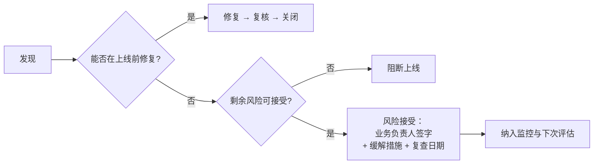

# A02 风险评级与报告：把发现变成决策依据

> 学习目标：读完本章，你能——
> 1. 用"影响 × 可能性"矩阵给发现定级，并对照 Immunefi 的分级口径。
> 2. 写出一条让开发者能复现、让管理者能决策的发现报告。
> 3. 区分"漏洞"与"风险接受"，并为后者建立签字机制。
>
> 前置章节：[A01 评估方法论](A01-methodology.md)、[27 审计与测试](../chapters/27-audit-testing-workflow.md)
> 交互实验：[severity-calculator.html](../interactive/severity-calculator.html) ｜ 模板：[T03 发现报告](../templates/T03-finding-report.md)

---

## 1. 一句话理解

**定级不是给发现贴标签，而是回答一个问题：如果不修，最坏会发生什么，发生的门槛有多高。两个答案决定了它该排在修复队列的哪个位置。**

> 🎯 打个比方：定级像**医院分诊**。
>
> - 分诊护士不治病，她决定谁先进抢救室。
> - 判断依据是两件事：病情多重（影响），以及恶化多快、多容易触发（可能性）。
> - 大出血（高影响）即使暂时稳定，也要优先；轻微擦伤（低影响）即使正在流血，也排后面。
>
> 比喻的局限：病人的病情是客观的；漏洞的"影响"依赖攻击者能力假设。定级时必须写清假设，否则同一个发现在不同人手里评出不同等级。

---

## 2. 评级矩阵

### 2.1 两个维度

**影响（Impact）**：被成功利用后的后果。

| 影响 | 说明 |
|---|---|
| 严重 | 直接盗取用户或协议资金；资金被永久冻结；协议资不抵债；增发；治理被夺取 |
| 高 | 盗取未领取收益；临时冻结资金；部分用户受损 |
| 中 | 合约功能不可用（DoS）；偷 gas；需要特定条件才造成有限损失 |
| 低 | 不造成资金损失的异常；偏离规格但无价值损失 |

**可能性（Likelihood）**：被利用的门槛。

| 可能性 | 说明 |
|---|---|
| 高 | 任何人、一笔交易、无特殊前提即可触发 |
| 中 | 需要一定资本、特定市场条件、抢跑或多步骤 |
| 低 | 需要特权角色、极端条件、或已被其他机制部分缓解 |

### 2.2 矩阵

| | 影响：严重 | 影响：高 | 影响：中 | 影响：低 |
|---|---|---|---|---|
| **可能性：高** | 严重 | 高 | 中 | 低 |
| **可能性：中** | 高 | 高 | 中 | 低 |
| **可能性：低** | 中 | 中 | 低 | 信息 |

> 💡 注意：矩阵是起点不是终点。一个"影响严重、可能性低"的发现（例如需要多签私钥泄露）通常定为中危，但如果这个特权角色的私钥管理本身很薄弱，可能性就不低——定级要结合[运营安全](A06-operational-key-security.md)的实际情况。

去 [severity-calculator.html](../interactive/severity-calculator.html) 选择影响和可能性，并对照 Immunefi 的示例，得到建议等级。

---

## 3. 对照外部标准：Immunefi

漏洞赏金平台 Immunefi 的《漏洞严重度分级系统》是业界常用的参照（截至 2026 年公开资料为 v2.3）。它按资产类型分别给出示例，摘录如下（以官方页面为准）：

### 3.1 智能合约

| 等级 | 代表影响 |
|---|---|
| 严重 | 直接盗取用户资金（在途或静止）；永久冻结资金或 NFT；协议资不抵债；未授权增发；治理投票操纵改变结果 |
| 高 | 盗取未领取收益 / 版税；永久冻结未领取收益；临时冻结资金或 NFT |
| 中 | 因缺少代币导致合约无法运作；区块填塞；无获利的 griefing；偷 gas；无上限 gas 消耗 |
| 低 | 合约未能兑现承诺的收益，但不损失价值 |

### 3.2 网站与应用（前端 / 后端）

| 等级 | 代表影响 |
|---|---|
| 严重 | 执行任意系统命令；读取服务器敏感数据（含区块链私钥）；替换交易参数、合约地址或提交恶意交易；代替用户执行改状态操作；通过 NFT 元数据注入 XSS |
| 高 | 无需 JS 的持久内容篡改；一键改他人敏感信息；泄露用户机密信息；无需已连接钱包的子域接管 |
| 中 | 一键改他人非敏感信息；反射型 HTML 注入；开放重定向 |
| 低 | 需大量交互才能改他人信息；接管失效的外链；临时锁定登录 |

> ⚠️ 警告：前端和后端有独立的分级。交易所和协议的最大损失近年多来自"网站与应用"类（BadgerDAO 前端注入、Bybit/WazirX 签名界面）。评估范围必须覆盖链下，否则等于只验收了大楼的主体结构，没验收门锁。详见 [A06](A06-operational-key-security.md)。

### 3.3 区块链 / L1 / L2

Immunefi 对链本身另有一套分级（网络停摆、非预期分叉、节点资源异常等）。评估 L2 上的协议时，这部分对应"链的信任假设"，见 [C03 Mantle](../chains/C03-mantle.md)。

> 💡 注意：审计竞赛平台有自己的定级规则，例如 [Sherlock](https://docs.sherlock.xyz/audits/judging/guidelines)。审计前要确认客户或平台使用哪一套。[Code4rena 的规则](https://docs.code4rena.com/awarding/judging-criteria/severity-categorization)只在读它的历史报告时参考：Code4rena 已于 2026 年 5 月宣布关停（[The Block](https://www.theblock.co/post/401179)）。

---

## 4. 一条好的发现报告

每条发现按 [T03 模板](../templates/T03-finding-report.md) 写，包含 8 个字段：

1. **标题**：一句话说清问题。例如"`borrow` 在更新借款记录前转出 ETH，可被跨函数重入"。
2. **等级**：严重 / 高 / 中 / 低 / 信息，并标注影响与可能性。
3. **位置**：文件、行号、函数、提交哈希。
4. **描述**：漏洞机制。为什么现有代码会出错。
5. **影响**：最坏后果，用具体数字或场景。标注攻击者能力假设。
6. **复现**：攻击路径或可运行的测试（见 [A08](A08-reproduce-attacks.md)）。
7. **修复建议**：具体到代码层面，给出正确写法或库。
8. **状态**：未处理 / 已修复 / 部分修复 / 已接受风险 / 无法复现，附复核记录（与 [T03](../templates/T03-finding-report.md) 一致）。

### 4.1 写报告的三条原则

- **可复现**：严重和高危发现必须附一个能运行的证明（测试或交易），否则容易被开发者以"理论上不可能"驳回。
- **可决策**：影响要写给非技术的决策者看。"可能损失池子约 99% 的储备"比"k 值检查失效"更有用。
- **可执行**：修复建议要具体。"使用 CEI"不如直接给出调整后的函数顺序。

### 4.2 反例与正例

| 反例 | 问题 | 正例 |
|---|---|---|
| "存在重入风险" | 没说哪个函数、什么后果 | "`withdraw` 先 `call` 转账后清零，攻击者递归提取，可提走合约全部 ETH（PoC 见测试 `test_Reentrancy`）" |
| "建议加强权限控制" | 不可执行 | "`setFeeTo` 缺少 `onlyOwner`，任何人可改手续费接收地址；加 `onlyRole(ADMIN)`" |
| "精度可能有损失" | 没定级、没场景 | "中危：`a/b*c` 在 b>a 时结果为 0，影响小额利息计算；改为 `a*c/b` 或 `mulDiv`" |
| "缺少访问控制" | 标题没说后果 | "任何人可以调用 `setOracle` 替换价格源，并借空资金池" |

### 4.3 整份报告的结构

整份报告按 [T03 第二部分](../templates/T03-finding-report.md) 组织。每条发现使用第 4 节的字段。摘要版和技术版的区别见第 6 节。

---

## 5. 风险接受：不是所有发现都要修

有些发现不修也能上线，但必须走正式流程，而不是口头略过：

**读图要点：**

- "接受风险"必须由有权承担后果的业务负责人签字，不是评估人员单方面决定。
- 接受时要记录缓解措施（例如限额、监控、保险）和复查日期。
- 评估人员的职责是把风险说清楚并给出建议；是否接受是业务决策。两者分开，责任才清晰。

> 💡 注意：评估报告要诚实，包括诚实地写出"本次未覆盖的范围"和"接受的风险"。一份把问题藏起来的报告，比没有报告更危险——它给了决策者虚假的安全感。

---

## 6. 报告的两个版本

| 版本 | 读者 | 内容 |
|---|---|---|
| 技术版 | 开发、审计 | 全部发现、代码位置、复现、修复建议 |
| 摘要版 | 管理、业务 | 风险概览、门禁结论、剩余风险、上线条件 |

摘要版放在报告最前面（一页以内）。它回答决策者唯一关心的问题：能不能上，有什么条件。

---

## 7. 术语表

| 术语 | 英文 | 定义 |
|---|---|---|
| 影响 | Impact | 漏洞被利用后的后果严重程度 |
| 可能性 | Likelihood | 漏洞被利用的门槛与难度 |
| 复现 | Proof of Concept (PoC) | 证明漏洞真实可利用的最小示例 |
| 风险接受 | Risk Acceptance | 业务负责人书面承担未修复风险 |
| 缓解措施 | Mitigation | 降低风险但不消除漏洞的措施（限额、监控、保险） |
| 摘要版 | Executive Summary | 面向决策者的一页结论 |

---

## 8. 思考题

1. 一个发现：攻击者需要控制 3/5 多签中的 3 把私钥才能增发代币。影响是严重（增发），可能性看起来很低。你会定几级？还需要了解什么才能定？
2. 用矩阵给以下发现定级：任何人调用 `claim()` 都能领取不属于自己的空投（已部署，奖池 100 万美元）。
3. 为什么"风险接受"要由业务负责人签字，而不是评估负责人？如果两者是同一个人，有什么问题？

下一章：[A03 交易所自有合约与钱包评估](A03-exchange-contracts-wallets.md)
