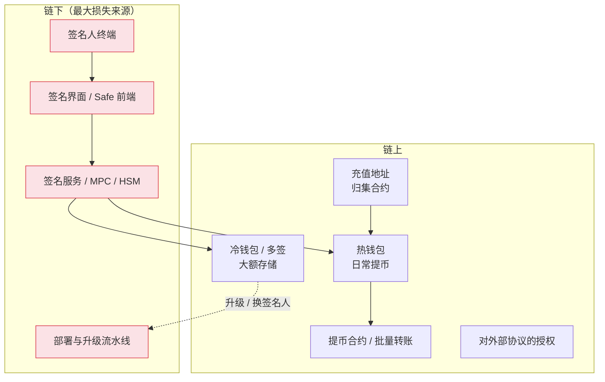
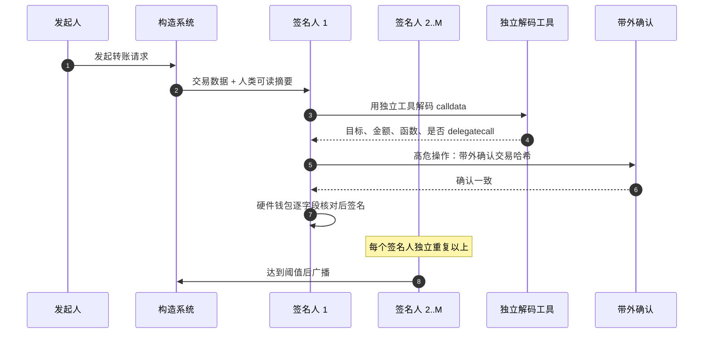

# A03 交易所自有合约与钱包评估

> 学习目标：读完本章，你能——
> 1. 列出交易所链上资产的攻击面：热/冷钱包、多签、充值与提币合约、归集、授权。
> 2. 评估一个多签托管方案的"签名流程"，而不只是"阈值"。
> 3. 把三起交易所级事故（Bybit、WazirX、Radiant）映射到可检查的评估项。
>
> 前置章节：[05 访问控制](../chapters/05-access-control.md)、[09 签名安全](../chapters/09-mev-signatures.md)、[12 跨链桥](../chapters/12-cross-chain-bridges.md)、[C00 以太坊](../chains/C00-ethereum.md)
> 配套：《CEX 交易所学习手册》05 章（钱包与托管）、28 章（事故复盘）

---

## 1. 一句话理解

**交易所的链上资产，99% 的时间安全地躺在冷钱包里；99% 的损失发生在"签一笔交易"的那几秒。评估的重心是签名流程，不是合约代码。**

> 🎯 打个比方：交易所的金库像**银行的运钞流程**。
>
> - 金库的锁（多签阈值）很难撬开。
> - 但劫匪不撬锁。他们伪造一张调拨单，让押运员"按正常流程"把钱运出来（签名界面被篡改）。
> - 或者他们在押运员的电脑里装了木马，押运员以为在签 A，实际签了 B（终端被入侵）。
>
> 比喻的局限：银行运钞单可以人工复核、可以打电话确认。链上交易一旦多签通过并广播，没有撤回。

---

## 2. 攻击面

**读图要点：**

- 红色节点全在链下。Bybit、WazirX、Radiant、DMM 四起合计损失超过 20 亿美元，根因都在这里。
- 合约评估（热/冷钱包合约、归集、提币）是基础，但不是重点。重点是"谁能让冷钱包动，怎么让它动"。
- 局限：本图省略了交易所的内部账本与风控。那部分见《CEX 交易所学习手册》。

---

## 3. 合约层评估项

### 3.1 钱包与多签合约

- [ ] 多签合约是经过审计的标准实现（如 Safe），还是自研？自研必须单独深审。
- [ ] 升级机制：多签实现能否被升级？谁能升级？有无时间锁？（Bybit：实现被 delegatecall 替换）
- [ ] 所有权转移：是否两步式？能否被单笔交易夺取？（Radiant：`transferOwnership` 无撤销机制）
- [ ] `delegatecall`、`module`、`guard` 等扩展点是否受控？Safe 的 module 等于一把额外的钥匙。
- [ ] 签名验证：是否正确处理 EIP-1271（合约签名）、零地址、签名可塑性？（[09 章](../chapters/09-mev-signatures.md)）

### 3.2 充值、归集、提币

- [ ] 充值识别：以**代币合约地址**而非符号识别资产；校验交易执行结果（[12 章](../chapters/12-cross-chain-bridges.md) 第 5 节，TRON 假充值见 [C02](../chains/C02-tron.md)）。
- [ ] 入账幂等：以 (txHash, logIndex) 为键，重放不会重复入账。
- [ ] 确认数 / 最终性：按链设置；考虑重组。
- [ ] 提币合约：批量转账中单笔失败不影响全局（拉取或 try/catch）；黑名单代币不卡死队列。
- [ ] 归集：小额归集的授权额度与频率；归集地址白名单。

### 3.3 对外部协议的授权

- [ ] 交易所做市、理财、质押时对外部协议的授权额度：是否无限授权？能否按需授权、用后撤销？
- [ ] 持有授权的内部合约是否允许任意调用目标？（[07 章](../chapters/07-external-calls-tokens.md) 第 5 节）

---

## 4. 签名流程评估（重点）

多签的安全不等于"M-of-N"。要评估整条签名链路。

### 4.1 评估清单

| 环节 | 要问的问题 | 反面案例 |
|---|---|---|
| 签名人独立性 | N 个签名人是否在不同的人、组织、地理位置、设备上？多少把钥匙实际由同一方控制？ | Ronin：9 选 5，其中 4 把同一机构 + 1 把未撤销授权 |
| 终端安全 | 签名人的电脑是否专机专用？能否收文件、装软件、上网？ | Radiant：开发者在 Telegram 收到伪装成前承包商的文件，终端被植入木马 |
| 交易构造与展示 | 签名人看到的内容和实际签署的数据是否一致？谁构造交易？ | Bybit、WazirX：界面显示正常，签名数据是恶意的 |
| 独立解码 | 是否用独立工具（不同于构造方）解码 calldata 并逐字段核对？ | 盲签：硬件钱包不解析 Safe 交易，签名人无法看懂 |
| 高危操作审批 | 升级、换签名人、`delegatecall`、`transferOwnership` 是否需要额外的带外审批？ | Radiant：盲签了 `transferOwnership` |
| 带外确认 | 大额或高危交易是否通过独立渠道（电话、线下）二次确认交易哈希？ | 多数被盗交易所缺这一步 |
| 时间锁与限额 | 大额转出是否有时间锁？单位时间提币是否有上限和告警？ | — |

### 4.2 签名流程的"理想形态"

**读图要点：**

- 关键在第 3–6 步：解码、带外确认、逐字段核对,由签名人独立完成,不依赖构造系统给出的摘要。
- 这条流程防的是"构造系统或界面被攻破"。如果所有签名人都只看构造系统给的摘要,整个多签退化成单点。
- 局限：流程再严,也挡不住签名人集体被钓鱼或胁迫。所以还要有时间锁和限额兜底。

---

## 5. 三起事故映射到评估项

| 事故 | 根因环节 | 本章对应评估项 |
|---|---|---|
| Bybit（2025-02，约 15 亿美元） | 签名界面（Safe 前端被篡改）→ delegatecall 替换实现 | 4.1 交易展示、独立解码、高危操作审批；3.1 升级机制 |
| WazirX（2024-07，约 2.3 亿美元） | 签名界面与签名数据不一致 → 升级多签 | 4.1 交易展示、独立解码、带外确认 |
| Radiant（2024-10，约 5,000 万美元） | 终端被木马入侵 → 盲签 `transferOwnership` | 4.1 终端安全、独立解码；3.1 所有权转移无撤销 |

三起的共同点：**合约本身没有新漏洞,失守的是"人签了什么"**。评估一个托管方案时,把 60% 的精力放在第 4 节。

> ⚠️ 警告：这些攻击多数由有国家背景的团队（公开报道常指向朝鲜 Lazarus / TraderTraitor）长期策划。防御不能假设攻击者是机会主义者。假设对方会花数月渗透、会伪造完整的招聘流程、会同时攻破多个签名人的终端。

---

## 6. 评估交付物

交易所自有资产评估的交付物比普通审计多两项:

1. 合约审计报告（标准,见 [A02](A02-risk-rating-reporting.md)）。
2. **签名流程评估**：按第 4 节清单逐项打分,标出单点。
3. **监控与应急需求**：移交给 [A09](A09-incident-response.md),包括大额转出告警、权限变更告警、冷钱包异动告警。

---

## 7. 术语表

| 术语 | 英文 | 定义 |
|---|---|---|
| 盲签 | Blind Signing | 签名人无法看懂所签内容 |
| 带外确认 | Out-of-band Verification | 通过独立渠道二次确认交易 |
| MPC | Multi-Party Computation | 私钥分片、多方协同签名,不重组完整私钥 |
| HSM | Hardware Security Module | 保管密钥并在内部完成签名的硬件 |
| 专机 | Air-gapped / Dedicated Device | 隔离、专用于签名的设备 |
| module / guard | Safe Module / Guard | Safe 多签的扩展点,可绕过或附加签名逻辑 |

---

## 8. 思考题

1. 一个交易所的冷钱包是 Safe 4/7,7 个签名人都用硬件钱包。看起来很安全。请指出至少 3 个仍可能导致 Radiant 式失守的环节。
2. "独立解码 calldata"具体怎么做?签名人应该核对哪些字段?哪个字段的出现应当立即触发高度警惕?
3. 为什么说"签名流程评估"比"多签合约审计"对交易所更重要?用本章的三起事故论证。

下一章：[A04 DeFi 协议评估](A04-defi-protocol-review.md)
