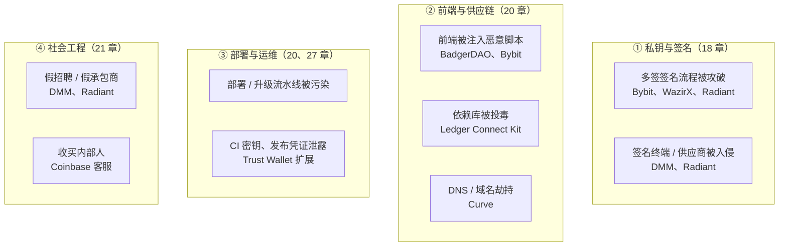

# A06 运营与密钥安全：代码之外的战场

> 学习目标：读完本章，你能——
> 1. 说出近年最大损失的四个链下根因：私钥与签名、前端与供应链、部署流水线、社会工程。
> 2. 在一次评估中，用一张清单快速覆盖这四个根因，并知道每一项去哪一章查细节。
> 3. 决定运营安全在不同评估对象中的权重。
>
> 前置章节：[A03 交易所合约与钱包](A03-exchange-contracts-wallets.md)、[09 签名安全](../chapters/09-mev-signatures.md)
> 详细章节：[18 钱包与密钥管理](../chapters/18-wallet-key-management.md)、[20 前端、DNS 与供应链](../chapters/20-frontend-dns-supply-chain.md)、[21 社工与内部人](../chapters/21-social-engineering-insiders.md)
> 配套模板：[T06 运营安全自查](../templates/T06-ops-security-self-check.md)、[T07 员工防社工清单](../templates/T07-staff-anti-social-engineering.md)

> 💡 注意：本章原来包含密钥方案对比、前端供应链和社会工程的完整讲解。这些内容已经扩展为第六篇的 18、20、21 章。本章只保留评估时用的清单和权重。

---

## 1. 一句话理解

**合约审计覆盖的是"代码会不会出错"。但近年最大的损失，几乎都不在代码里：私钥被骗走、前端被调包、部署流水线被污染、员工被钓鱼。评估不覆盖链下，等于只锁了保险柜，没锁保险柜所在的房间。**

> 🎯 打个比方：合约是保险柜，运营安全是保险柜所在的整栋楼。保险柜用最好的钢材，但保安被收买、门禁被改、送货通道被掉包、保洁被冒充，保险柜再硬也没用。
>
> 比喻的局限：楼里的问题可以装监控、派人巡逻。链上资产一旦被转走，多数情况下没有保险理赔，也难以追回。

---

## 2. 四类链下根因

**读图要点：**

- 四类常常组合：社会工程（④）是入口，导致私钥 / 终端（①）或流水线（③）被攻破。
- 公开报道把多起大案归因于有国家背景的长期团队。评估要按"对方会渗透数月"来设防。
- 局限：本图是攻击面，不是完整的企业安全体系。评估报告应指出哪些项需要企业安全团队跟进。

---

## 3. 评估清单

每一项后面的章节号，是该项的详细讲解和真实案例。

### 3.1 私钥与签名

- [ ] 冷钱包是多签或 MPC，单人无法转出。（[18](../chapters/18-wallet-key-management.md) §4）
- [ ] 签名人在组织、设备、网络、地点上独立。（[18](../chapters/18-wallet-key-management.md) §3.3）
- [ ] 签名人用独立工具解码交易并在硬件钱包上核对；DELEGATECALL 有单独审批。（[18](../chapters/18-wallet-key-management.md) §4.3、[20](../chapters/20-frontend-dns-supply-chain.md) §4.4）
- [ ] 签名终端专机专用，不处理外部文件。（[21](../chapters/21-social-engineering-insiders.md) §4.1）
- [ ] 热钱包有水位上限；签名服务独立校验请求。（[23](../chapters/23-custody-exchange-ops.md) §4.1）
- [ ] 离职、换岗、漏洞披露后，密钥轮换并撤销链上权限。（[18](../chapters/18-wallet-key-management.md) §4.1）
- [ ] MPC 供应商已修复公开的实现漏洞类别。（[02](../chapters/02-cryptography-randomness.md) §3.4）

### 3.2 前端与供应链

- [ ] 域名有注册商锁和注册局锁；DNS 变化有监控。（[20](../chapters/20-frontend-dns-supply-chain.md) §4.1）
- [ ] 依赖锁定版本；不从 CDN 动态加载最新版；外部脚本有 SRI。（[20](../chapters/20-frontend-dns-supply-chain.md) §4.2）
- [ ] 托管和 CDN 账号的 API Key 最小权限、有告警。（[20](../chapters/20-frontend-dns-supply-chain.md) §4.3）
- [ ] 线上文件哈希与构建产物自动比对。（[20](../chapters/20-frontend-dns-supply-chain.md) §4.3）

### 3.3 部署与运维

- [ ] 部署用评审过的脚本；部署与初始化原子化。（[10](../chapters/10-upgradeable-proxy.md)）
- [ ] 部署后验证源码、关键参数、权限移交。
- [ ] 部署私钥和发布凭证不进代码库，使用短期凭证。（[20](../chapters/20-frontend-dns-supply-chain.md) §4.2）
- [ ] 链上变更有审批、有记录、可追溯。

### 3.4 社会工程与内部人

- [ ] 签名、开发、运维人员有反社工培训和钓鱼演练。（[21](../chapters/21-social-engineering-insiders.md) §4、[T07](../templates/T07-staff-anti-social-engineering.md)）
- [ ] 外部代码只在隔离环境中运行。（[21](../chapters/21-social-engineering-insiders.md) §3.1）
- [ ] 招聘有身份核验；离职当天回收全部权限。（[21](../chapters/21-social-engineering-insiders.md) §4.3）
- [ ] 高危操作要求多人和带外确认，单个人被攻破不足以造成损失。
- [ ] 客服与外包的数据访问最小化，有异常查询监控。（[24](../chapters/24-data-privacy.md) §4）

> 💡 注意：自评可以直接使用 [T06 运营安全自查](../templates/T06-ops-security-self-check.md)，它覆盖了上面全部项，并标出了红线项。

---

## 4. 运营安全在评估中的位置

| 评估对象 | 运营安全的权重 | 重点 |
|---|---|---|
| 交易所自有合约与钱包（[A03](A03-exchange-contracts-wallets.md)） | 最高 | 签名流程与密钥管理 |
| 自研 DeFi 协议（[A04](A04-defi-protocol-review.md)） | 高 | 部署、升级权限、前端、监控 |
| 上币 / 合作尽调（[A05](A05-listing-due-diligence.md)） | 中高 | 通过问卷了解；深度合作时提升 |

运营安全的许多项超出"合约安全评估"的传统边界，但损失就发生在这里。评估报告即使不能亲自验证所有链下环节，也要**明确列出需要企业安全团队跟进的项**，而不是当作"不在范围内"略过。

> ⚠️ 警告：对合作项目做尽调时，对方的运营安全薄弱会通过深度合作传导给交易所。合作越深（共享金库、共同部署），越要把对方的运营安全纳入评估。

---

## 5. 思考题

1. 一个团队用 MPC 管理私钥，说"没有完整私钥，所以很安全"。参照 Bybit 和 Radiant，指出这个说法的盲区。
2. 用第 3 节的清单评估你熟悉的一个项目。哪一类根因的空白最多？
3. 上币尽调时，项目方拒绝回答签名流程的问题。你在 [A05](A05-listing-due-diligence.md) 的评分卡里会怎么处理？

下一章：[A07 外部审计与漏洞赏金管理](A07-external-audit-bounty.md)
