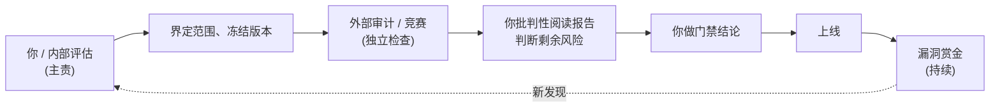

# A07 外部审计与漏洞赏金管理

> 学习目标：读完本章，你能——
> 1. 决定什么时候用外部审计、审计竞赛、形式化验证,以及怎样界定范围。
> 2. 批判性地阅读一份审计报告,识别它的局限和"已确认风险"。
> 3. 设计一个漏洞赏金计划,包括奖金分级、范围和响应流程。
>
> 前置章节：[A01 评估方法论](A01-methodology.md)、[27 审计与测试](../chapters/27-audit-testing-workflow.md)
> 定位:外部审计是你自评的**补充**,不是替代。

---

## 1. 一句话理解

**外部审计不是把安全外包出去,而是给你的自评加一道"没见过这份代码的人"的独立检查。你仍然是风险的最终负责人,所以你要会选审计、会界定范围、会读报告。**

> 🎯 打个比方：外部审计像**请第二位医生会诊**。
>
> - 你(主治医生)最了解病人,也对结果负责。
> - 请会诊是因为第二双眼睛能发现你的盲区,而不是因为你不想看了。
> - 会诊医生只看你给的检查结果和时间窗口内的情况;他看不到的,责任还在你。
>
> 比喻的局限:会诊医生有行医资质门槛。审计公司水平参差,范围和深度差异很大,报告质量要自己判断。

---

## 2. 什么时候用哪种外部检查

| 方式 | 适合 | 特点 | 局限 |
|---|---|---|---|
| 单家审计 | 常规上线 | 固定时间、固定团队、深度审查 | 覆盖面受团队经验限制 |
| 多家审计 | 核心协议、大额资金 | 不同团队侧重不同 | 成本高;可能重复 |
| 审计竞赛 | 需要广覆盖 | 大量审计者并行;按发现付费 | 深度不均;需要时间消化报告 |
| 形式化验证 | 核心数学、清算、会计、桥验证 | 数学证明覆盖所有输入 | 规格编写成本高;只证明写下的性质 |
| 漏洞赏金 | 上线后持续 | 真实攻击者视角;长期 | 被动;依赖奖金吸引力 |

> 💡 注意:这些方式互补,不互斥。一个核心协议的典型组合是:自评 → 单家或多家审计 → 修复复审 → 上线 → 漏洞赏金长期运行;对核心数学模块再加形式化验证。

---

## 3. 界定审计范围

你给审计方的材料，决定了审计的质量。范围说明书按 [A01 第 4 节](A01-methodology.md) 的 8 项写，资料按 [T01 资料清单](../templates/T01-intake-checklist.md) 准备。交给外部审计方时，再做两件事：把你的威胁模型和自评发现交给对方，不隐瞒已知问题；把链下组件、部署脚本和初始化参数默认放进范围（见 [A06](A06-operational-key-security.md)）。

> ⚠️ 警告:审计范围外的代码出事,仍然是你的责任。PancakeBunny 被利用的是审计**之后**上线的新版本。任何在审计后、上线前的改动,都要走差异审计,哪怕"只改了一行"(Uranium)。

---

## 4. 怎么读一份审计报告

一份报告拿到手,按这个顺序看:

1. **范围与版本**:审计的是哪个提交?和你要上线的是不是同一个?哪些文件没审?
2. **方法与工时**:人工审查 + 哪些工具?投入多少人天?时间太短的报告覆盖有限。
3. **发现与修复状态**:每条发现的等级、是否已修复、是否复审。
4. **"已确认风险 / 已知问题"**:这是最容易被忽略、却最重要的部分。它是审计方指出、但项目方选择不修的风险。你要独立判断这些风险是否可接受。
5. **假设与免责**:报告假设了什么?(例如"假设预言机可信""假设 owner 不作恶")这些假设就是你的剩余风险。
6. **范围外提示**:报告常会写"未审计 X"。这些是你的盲区。

### 4.1 报告的红旗

| 红旗 | 含义 |
|---|---|
| 审计版本与上线版本不同 | 审计结论可能不适用 |
| 只有"无严重问题"一句话 | 缺少过程,无法判断覆盖 |
| 工时极短、范围极大 | 走过场 |
| 所有发现都"已修复"但无复审记录 | 修复可能引入新问题 |
| 不列假设和范围外 | 剩余风险不明 |

> 💡 注意:"通过审计"是一种常被滥用的营销话术。做上币尽调时(见 [A05](A05-listing-due-diligence.md)),要核验审计报告本身,而不是听信"已审计"。

### 4.2 练习读别人的报告

[Solodit](https://solodit.cyfrin.io/) 聚合多家审计平台的发现，可以按严重性和标签筛选。[Code4rena Reports](https://code4rena.com/reports) 公开竞赛报告。

练习方法见 [B53 第 7 节 Solodit 每日训练](../bootcamp/B53-contests-and-habits.md)：先只读标题和位置，自己找，再读描述，记录"我为什么没找到"。

---

## 5. 设计漏洞赏金计划

漏洞赏金是上线后的持续防线,用真实攻击者的视角补充一次性审计。

### 5.1 要素

| 要素 | 说明 |
|---|---|
| 范围 | 哪些合约、前端、基础设施在范围内;链上地址明确 |
| 严重度分级 | 用 Immunefi 等标准(见 [A02](A02-risk-rating-reporting.md)),口径一致 |
| 奖金分级 | 按严重度设金额;严重级通常按"可能损失的一定比例"封顶 |
| 排除项 | 已知问题、测试网、第三方依赖、需要不现实前提的攻击 |
| 提交与响应流程 | 接收渠道;响应时限;修复时限;付款流程 |
| 安全港 | 善意研究者的法律豁免(Safe Harbor),鼓励白帽上报而非利用 |
| KYC 与制裁合规 | 付款前的合规检查 |

### 5.2 常见平台

Immunefi、Cantina、HackenProof 等提供托管的赏金计划与分级标准。自建也可以,但要保证响应速度——白帽发现严重漏洞时,每一小时都可能是攻击者也在找同一个洞。

> 💡 注意:漏洞赏金不能替代审计和自评。它是被动的、依赖运气和奖金吸引力的最后一道网,不是第一道防线。

> 💡 注意：研究者一侧的做法见 [B53 Bug Bounty 与审计竞赛](../bootcamp/B53-contests-and-habits.md)。

---

## 6. 内外协作的职责边界

**读图要点:**

- 主责始终在内部。外部审计是输入,不是决策。门禁结论由你做。
- 外部发现的问题回流到内部评估,触发修复与(必要时)重新评估。
- 局限:这条链假设内部有能力读懂并判断审计报告。能力不足时,"外包安全"就变成了"外包责任的错觉"——这正是本手册要帮你避免的。

---

## 7. 术语表

| 术语 | 英文 | 定义 |
|---|---|---|
| 审计竞赛 | Audit Contest | 多名审计者并行审查、按发现付费 |
| 形式化验证 | Formal Verification | 用数学证明代码满足规格 |
| 差异审计 | Diff Audit | 只审相对已审版本的改动 |
| 已确认风险 | Acknowledged Risk | 审计指出、项目方选择不修的风险 |
| 安全港 | Safe Harbor | 对善意安全研究者的法律豁免 |
| 漏洞赏金 | Bug Bounty | 向上报漏洞的研究者付费的持续计划 |

---

## 8. 思考题

1. 你收到一份审计报告,结论是"未发现严重问题"。在把它作为上线依据之前,你要核对哪五件事?
2. 为什么"已确认风险"部分比"已修复发现"部分更需要你亲自判断?
3. 一个严重漏洞的赏金应该设多高?太低和太高分别有什么问题?(提示:和攻击者利用它的收益比较)

下一章：[A08 事故分析与防御性验证](A08-reproduce-attacks.md)
