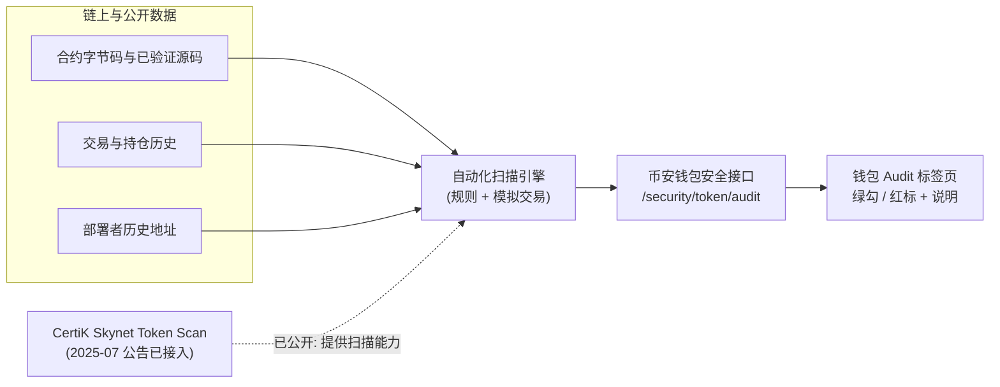
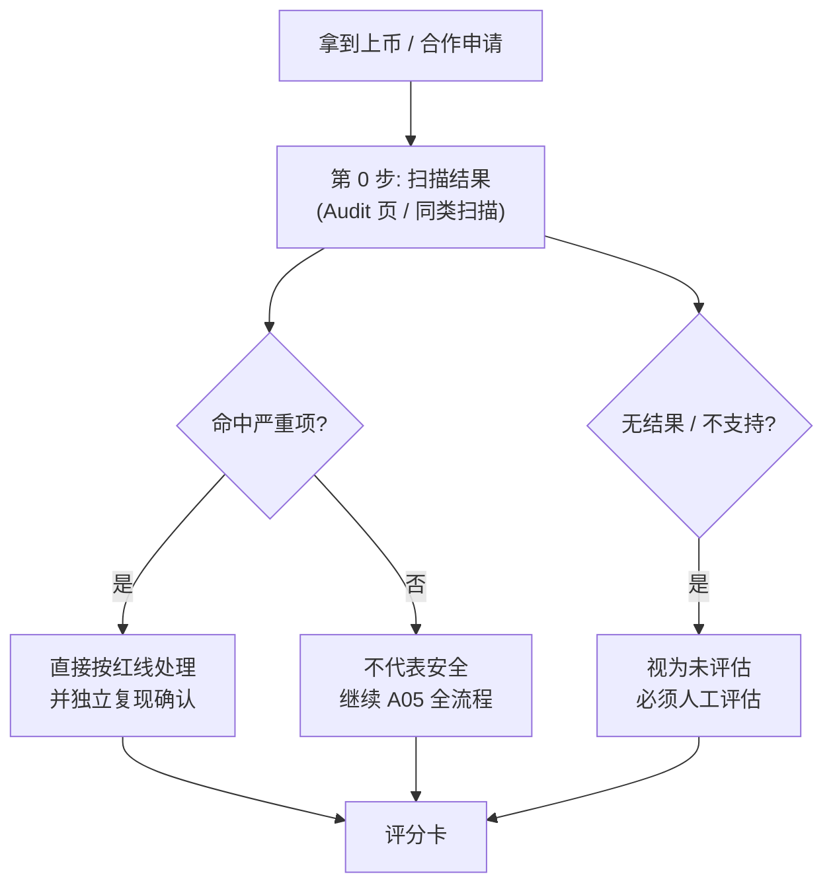

# A10 实例分析：币安钱包 / Alpha 代币的 Audit 页是怎么来的

> 学习目标：读完本章，你能——
> 1. 说清 Audit 页上每一条信息的**来源链路**，并区分"官方已公开的"和"我们推断的"。
> 2. 知道自动扫描能发现什么、发现不了什么，对照 [A05](A05-listing-due-diligence.md) 的八条红线。
> 3. 在尽调中把这类扫描结果当作**第 0 步分诊**，而不是结论。
>
> 前置章节：[A05 上币与合作项目尽调](A05-listing-due-diligence.md)、[07 外部调用与代币](../chapters/07-external-calls-tokens.md)
> 交互工具：[上币评分卡](../interactive/listing-scorecard.html)

> ⚠️ 本章的事实边界：下面标"已公开"的内容来自币安技能库文档、CertiK 官方博客和币安支持页；标"推断"的是根据这些材料作出的合理推断，**币安没有公开完整的数据供应链**，请自行核实后再引用。资料会随产品更新而变化，读到本章时请再确认。

---

## 1. 一句话理解

**Audit 页不是人工审计报告，而是一次自动化的合约扫描结果：把代币合约的代码和链上行为，对照一组风险规则，给出"命中 / 未命中"的清单。它是体检的血常规，不是 CT 全身检查。**

> 🎯 打个比方：Audit 页像**机场的安检门**。
>
> - 它能快速发现金属物品（貔貅盘、过高税率、可增发这类典型特征）。
> - 它查不出藏在行李里的新型危险品（业务逻辑漏洞、尚未被规则收录的后门）。
> - 过了安检门，不等于这个乘客可信；没过，大概率值得多看一眼。
>
> 比喻的局限：安检门每次检查都是即时的，而代币合约在你检查之后还能被项目方改（升级、改税、限制流动性），所以"今天通过"不等于"明天通过"。

---

## 2. Audit 页上看到的是什么

在币安钱包里点开一个代币，会有一个 **Audit（审计）** 标签。币安支持页的说法是：进入代币，点 Audit 标签查看被标记的风险，并称它是"有用的第一道检查，但不是万无一失"，需要配合自己的调查。

结构（来自币安技能库中"查询代币审计"文档，已公开）：

| 层级 | 内容 |
|---|---|
| 是否有结果 | `hasResult`（有无审计数据）、`isSupported`（这个代币能不能被审计）。两者都为真，结果才有效 |
| 总体等级 | `riskLevelEnum`：LOW / MEDIUM / HIGH；对应数值等级 0–5 |
| 附加信息 | 买入税 `buyTax`、卖出税 `sellTax`、合约是否已验证 `isVerified` |
| 风险分类 | `CONTRACT_RISK`（合约风险）、`TRADE_RISK`（交易风险）、`SCAM_RISK`（骗局风险） |
| 每条细则 | `title`、`description`、`isHit`（是否命中）、`riskType`：RISK（严重）或 CAUTION（警告） |

等级怎么读：

| 数值 | 等级 | 文档给出的指引 |
|---|---|---|
| 0–1 | LOW | 谨慎推进，自己做研究 |
| 2–3 | MEDIUM | 仔细看每个命中项 |
| 4 | HIGH | 避免交易 |
| 5 | HIGH | 阻止交易 |

税率口径：文档给出的建议是 **>10% 属严重，5–10% 为警告，<5% 可接受**。

> 💡 注意：文档特别强调"LOW 不等于安全"，结果是时间点快照，项目方之后可以改合约或限制流动性。这与本章后面的结论一致。

---

## 3. 信息从哪里来：已公开与推断

**读图要点：**

- **已公开**：2025 年 7 月，CertiK 发布公告称币安钱包集成了 CertiK 的 Skynet Token Scan，在代币页新增 Audit 标签，一键显示安全清单；未命中的风险项显示绿勾，可能有问题的显示红标，并附风险说明。CertiK 说明它"持续检查数十个关键风险向量"，并举了三类：恶意代码（增发、改余额、提高交易税）、中心化风险（隐藏权限可冻结资金或改变代币机制）、高风险钱包（部署者曾关联高风险或欺诈发币）。
- **已公开**：币安技能库里的接口文档给出了上面第 2 节的字段结构。但文档**没有写明数据供应商**，也没有列出完整检查项，只点名了"貔貅风险（能买不能卖）"这一项。
- **推断**：钱包 Audit 页的数据很可能由第三方扫描引擎提供，再由币安的接口包装。但 CertiK 公告只说明"集成"，没有说明所有链、所有代币（含 Alpha 代币）的结果是否都由它产生，**也不能排除同时使用别的数据源**。
- **别混淆**：这里的 "Audit" 是**扫描**，不是 CertiK 之类公司出具的**人工审计报告**。两者的深度、范围和责任完全不同。
- 局限：Alpha 本身是币安的早期项目发现和交易入口，与主站上币的审核流程不同；Audit 页是**用户保护提示**，不代表币安对该代币做了人工审计背书。

---

## 4. 它能发现什么，发现不了什么

对照 [A05 的八条红线](A05-listing-due-diligence.md)：

| A05 红线 | 自动扫描通常能否发现 | 说明 |
|---|---|---|
| 可无限增发且无时间锁 | 通常能（增发函数 + 权限） | 但"时间锁是否真实有效"需人工看 |
| 貔貅盘 | 通常能（模拟买卖 + 税率 + 黑名单） | 文档明确列出的检查项 |
| owner 可冻结任意地址 | 通常能（暂停/黑名单函数） | CertiK 所述"中心化风险"属此类 |
| 隐藏后门 / 升级后门 | 部分能 | 代理合约的实现可以后续替换，扫描只看当前版本 |
| 升级权为单签 EOA | 部分能 | 能读到 admin 地址类型；能否判断"这个多签其实是一个人控制"则不能 |
| 锁仓 / 流动性锁是假的 | 较弱 | 需要核验锁仓合约与解锁条件 |
| 地址与官网/审计不一致 | 不能 | 需要人工比对官方渠道 |
| 字节码与已验证源码不一致 | 部分能 | `isVerified` 只说明"有验证源码"，不等于"和审计的版本一致" |

**扫描的结构性盲区（任何自动扫描都有）：**

1. **快照问题**：只反映检查时刻。可升级合约、可改税率的合约，之后随时可变。
2. **规则覆盖**：只发现已知模式。新的后门写法、复杂的业务逻辑漏洞（如 [11 章](../chapters/11-defi-economic-security.md) 的经济攻击）不在其内。
3. **上下文缺失**：看不到项目方的运营安全（私钥管理、多签流程），而这是 [A06](A06-operational-key-security.md) 里损失最大的来源。
4. **没有结果的情形**：`hasResult=false` 或 `isSupported=false` 时没有任何审计结论，不能当作"没风险"。

---

## 5. 评估人员怎么用它

把 Audit 页当作 **第 0 步分诊**，放在尽调流程的最前面：

**读图要点：**

- 命中严重项 → 可以快速否决，但**要独立复现**（读源码、分叉环境模拟买卖），因为扫描也有误报。
- 未命中 → 只是通过了"最低门槛"，仍要走完 [A05](A05-listing-due-diligence.md) 的权限、链上数据、运营、经济四个维度。
- 无结果 → 当作"未评估"，不能当作"通过"。
- 局限：把扫描结果直接当上币依据，会把交易所的责任外包给一个你无法控制、也没看过规则的黑盒。

### 5.1 独立验证清单

对扫描给出的每一类结论，都用自己的方法再确认一遍：

- [ ] 在区块浏览器上确认合约已验证源码，并比对部署字节码。
- [ ] 读取 owner / admin / minter 地址，判断是 EOA 还是多签，多签阈值与时间锁。
- [ ] 查看代理实现槽，确认是否可升级、谁可升级。
- [ ] 在分叉环境小额模拟买入再卖出，核对实际税率与扫描结果一致。
- [ ] 查部署者地址的历史：是否曾部署过已被标记的合约。
- [ ] 查持仓前 10 / 前 50 集中度与流动性锁定。
- [ ] 把扫描结果、查询时间和链上读数一并存入证据附录（扫描是快照，要记录时间）。

---

## 6. 从这个实例学到的评估原则

1. **看懂"谁说的"**：每一条风险信息，都要能回答"数据来自哪里、规则是什么、多久更新一次"。回答不了，就只能当提示。
2. **区分扫描与审计**：自动扫描是广度覆盖，人工审计是深度覆盖。两者互补，不互相替代。
3. **快照要带时间**：任何自动结论在报告里都要写明检查时间；可升级合约要加上"持续监控"的上线条件。
4. **没结果不是好结果**：把"未支持 / 无数据"归入未评估。
5. **自己的评分卡为准**：外部扫描作为输入，结论由你按[评分卡](../interactive/listing-scorecard.html)得出并签字。

---

## 7. 术语表

| 术语 | 英文 | 定义 |
|---|---|---|
| 代币扫描 | Token Scan | 自动对代币合约做风险规则检查 |
| 貔貅盘 | Honeypot | 能买不能卖的代币 |
| 快照 | Snapshot | 某一时刻的检查结果，不保证之后仍成立 |
| 误报 / 漏报 | False Positive / Negative | 扫描报告了不存在的风险 / 没报告存在的风险 |
| 中心化风险 | Centralization Risk | 少数权限方可改变代币机制或冻结资金 |
| 分诊 | Triage | 先快速分级，再决定投入多少评估资源 |

---

## 8. 思考题

1. 一个代币的 Audit 页显示 LOW、全部绿勾，但它是可升级代理，admin 是单签 EOA。按 [A05](A05-listing-due-diligence.md)，你的结论是什么？Audit 页为什么没拦住？
2. 某代币显示"不支持审计"。你要在报告里怎么写？需要补哪些工作？
3. 为什么说"扫描 ≠ 审计"？用范围、深度、责任三个角度各举一点。
4. 你要向业务方解释"为什么我们不能只看钱包里的 Audit 页就上币"，用三句话说清楚。

---

Sources（均为公开页面，内容可能随产品更新）：

- [Binance Wallet Integrates CertiK's Skynet Token Scan（CertiK，2025-07-17）](https://www.certik.com/resources/blog/binance-wallet-integrates-certiks-skynet-token-scan)
- [query-token-audit（币安技能库 SKILL.md）](https://github.com/binance/binance-skills-hub/blob/main/skills/binance-web3/query-token-audit/SKILL.md)
- [What to know before you swap tokens in Binance.US Web3 Wallet](https://support.binance.us/en/articles/15426082-what-to-know-before-you-swap-tokens-in-binance-us-web3-wallet)

下一章：回到 [README](../README.md) 复习评估篇学习路径。
