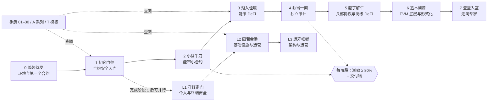

# B00 从零到专家：Web3 安全训练营路线

> 学习目标：读完本章，你能——
> 1. 说出训练营的 8 个阶段和 2 段链下赛道，并找到自己当前的位置。
> 2. 选出一条学习路线，为自己排出一份每周学习计划。
>
> 前置章节：无。
> 预计用时：30 分钟。
> 交互实验：[训练营阶段测验](../interactive/bootcamp-quiz.html) ｜ [学习路径诊断](../interactive/learning-paths.html) ｜ [安全事故浏览器](../interactive/incident-explorer.html)
>
> 最后核对：2026-11-11

> 🗂 先获取仓库：本手册的示例代码和靶场都在 GitHub 仓库里。先下载，再**进入 `web3-security-101/` 目录**，之后全书的命令都从这个目录运行。详细步骤见 [B04 第 6 节](B04-setup.md)。
>
> ```bash
> git clone https://github.com/ocean-8848/web3-security-101.git  # 下载仓库
> cd web3-security-101                                           # 进入仓库根目录：之后都从这里出发
> bash practice-example-code/setup.sh                                 # 下载依赖（只需一次）
> ```

---

## 开场：第一次打开一份合约，你看到了什么？

小白第一次打开合约，看到的是一屏陌生的符号。审计专家打开同一份合约，看到的是资金从哪里进、从哪里出、谁能改规则。

审计员的工作是：在攻击者之前，找到代码里"能让钱流向错误地址"的路径。合约部署后通常不能修改。合约直接持有资金。代码中的一个错误，就可能变成一张公开的提款单。

合约只是 Web3 安全的一半。很多重大损失并不出在合约代码里，而是出在私钥、签名、前端、节点、内部人员和运营流程上（见 [01 安全全景](../chapters/01-security-landscape.md)、[28 事故案例集](../chapters/28-incident-casebook.md)）。所以训练营有两条线：合约审计主线（阶段 0–7），和链下赛道（L1、L2）。

小白和专家的差别不是天赋。差别是做过多少次"读代码、提假设、写测试、写报告"的循环。本训练营把这个循环拆成 8 个阶段，再加 2 段链下赛道。每个阶段有自己要掌握的主题和一道过关门槛。

<details class="predict"><summary>🤔 先猜再看：学合约安全，第一件该做的事是什么？</summary>

第一件事是在自己的电脑上让一个测试跑通。漏洞清单放到后面。你没有能运行的环境，就无法验证任何判断。[B04](B04-setup.md) 只做这一件事。

</details>

## 1. 这条路线适合谁

| 你的情况 | 从哪里开始 | 推荐路线 | 时间（示例） |
|---|---|---|---|
| 没写过代码，也没用过命令行 | 先学一门编程语言（JavaScript 或 Python），再从阶段 0 开始 | 路线 A | 3–4 个月到阶段 2 |
| 会写 Python 或 JavaScript，或做过 Web2 安全 | 阶段 0，快速过 [B05](B05-first-contract.md) | 路线 B | 2–3 个月到阶段 3 |
| 写过 Solidity，没做过审计，准备求职 | [B09 读代码与攻击者思维](B09-reading-code-mindset.md) | 路线 C | 6–8 周到阶段 4 |
| 做过审计练习，想冲竞赛或专精 | 先做[阶段测验](../interactive/bootcamp-quiz.html)，再选择阶段 | 按测验结果 | — |
| 在交易所、钱包或项目方做安全、运维或风控，不审合约 | [B03](B03-blockchain-basics.md)，然后链下赛道 L1 | 路线 D | 6–8 周完成 L1 和 L2，再用 3–4 周完成 L3 |

四条路线：

- **路线 A（零基础）**：按阶段 0 → 1 → 2 → 3 的顺序走。每个阶段先读导读，按导读的章节顺序学。
- **路线 B（Web2 开发或安全工程师）**：阶段 0 快速过 → 主线 [03](../chapters/03-evm-solidity-basics.md)–[09](../chapters/09-mev-signatures.md) → 阶段 1 → 阶段 2 → 阶段 3。
- **路线 C（有 Solidity 经验，准备求职）**：主线 [04](../chapters/04-reentrancy.md)–[09](../chapters/09-mev-signatures.md) 快速复习 → [B09](B09-reading-code-mindset.md) → 阶段 2 → 阶段 3 → 阶段 4 → 阶段 5 → 阶段 7 的 [B53](B53-contests-and-habits.md)、[B54](B54-expert.md)、[B55](B55-interview.md)。阶段 6 按岗位需要补。
- **路线 D（链下与运营安全）**：[B03](B03-blockchain-basics.md) → [B04](B04-setup.md)（只装 Foundry 和 Node.js）→ L1 → L2 → L3（要把防御建成体系并持续运营时，配合手册 [X01–X48](../architecture/X01-security-program-controls.md)）。需要看懂合约风险时，再补 [B08](B08-tokens-and-vault.md)、[B09](B09-reading-code-mindset.md)、[B14](B14-writing-findings.md)。

> 💡 注意：路线 B 和路线 C 是快速通道。跳过的章节不是不重要。如果某个靶场卡住，回到被跳过的章节补课。

> ⚠️ 警告：所有靶场都只在本地运行，只攻击你自己部署的玩具合约。法律与道德边界见 [B04 第 1 节](B04-setup.md)，负责任披露流程见 [B02 第 1.2 节](B02-study-method.md)，平台规则见 [B53](B53-contests-and-habits.md)。

> 🎯 打个比方：训练营像学驾照。先在封闭场地练（本地靶场），再上模拟路考（First Flight 练习赛），最后才上真实道路（竞赛和授权审计）。
>
> 比喻的局限：驾校有教练踩副驾刹车。链上交易一旦上链，通常无法撤回。所以封闭场地阶段不能跳过。

## 2. 阶段地图

阶段名用四字短语，冒号后是能力目标。慢雾路线图条目与本训练营章节的对照，见 [B02 第 4 节](B02-study-method.md)。每个阶段的第一页是阶段导读。导读写明本阶段要掌握的主题、章节顺序、预计用时、靶场与交互实验、交付物和过关门槛。

| 阶段 | 学完能做什么 | 导读 |
|---|---|---|
| 0 整装待发：环境与第一个合约 | 说清区块链怎样记账；安装工具，编译并测试一个合约 | [B01](B01-stage0-guide.md) |
| 1 初窥门径：合约安全入门 | 读懂代币和金库；由小到大读代码；通关入门 CTF | [B07](B07-stage1-guide.md) |
| 2 小试牛刀：能审小合约 | 用工具箱独立审 100–300 行合约，写出合格的发现和报告 | [B11](B11-stage2-guide.md) |
| 3 渐入佳境：能审 DeFi | 读懂 AMM、借贷和经济模型，审 DeFi 靶场并写不变量 | [B16](B16-stage3-guide.md) |
| 4 独当一面：独立审计 | 走完专业审计流程，审跨合约系统，用工具提效 | [B26](B26-stage4-guide.md) |
| 5 庖丁解牛：头部协议与高级 DeFi | 拆解真实头部协议，审集中流动性和永续合约 | [B34](B34-stage5-guide.md) |
| 6 追本溯源：EVM 底层与形式化 | 读字节码和 calldata，优化 Gas，用形式化工具证明性质 | [B44](B44-stage6-guide.md) |
| 7 登堂入室：走向专家 | 审非 EVM 链，用 AI 辅助审计，参加竞赛和赏金，求职 | [B49](B49-stage7-guide.md) |
| L1 链下赛道 · 守好家门：个人与终端安全 | 管好私钥，读懂签名，识破社工，守住账号与权限 | [B56](B56-offchain-l1-guide.md) |
| L2 链下赛道 · 固若金汤：基础设施与运营 | 加固前端与节点，做托管风控与应急，追踪资金，识别密码学实现风险 | [B61](B61-offchain-l2-guide.md) |
| L3 链下赛道 · 运筹帷幄：架构与运营 | 建控制矩阵，写并调风控规则，写检测规则并回放，做签名策略校验，审发布流水线，做桌面推演，交付安全架构评估与 90 天路线图 | [B70](B70-offchain-l3-guide.md) |
| L3 链下赛道 · 纵深验收：验收与恢复 | 对订单序号、分录、撮合切主、强平穿仓做回放验收，三方对账与复付核对，储备偿付与 Merkle 证明，案件授权与限制验收 | [B79](B79-trading-replay-practice.md)、[B80](B80-resumption-recovery-practice.md)、[B81](B81-wallet-channel-recon-practice.md)、[B82](B82-reserves-solvency-practice.md)、[B83](B83-fraud-rules-casework-practice.md) |
| 附录 · 与同道者行 | 术语表与资源索引，全程查阅 | [B78](B78-glossary-resources.md) |

> 🧪 动手验证：打开[训练营阶段测验](../interactive/bootcamp-quiz.html)，选择你认为自己所在的阶段。得分 ≥ 80% 才算通过。结果保存在浏览器中。

## 3. 路线图



读图要点：

- 实线是学习顺序。每个阶段都要通过门槛才能前进。
- 每一章只依赖它前面的章节和主线章节。后面阶段的章节可以查阅，但不是前置。
- 链下赛道从阶段 1 之后开始，可以和阶段 2–7 交替学习。不审合约的读者可以只走 B03 → L1 → L2 → L3。
- 虚线连到"门槛"的只画了 2 条。实际上每个阶段都有门槛，写在各阶段导读里。
- 局限：本图不表示时间长短。阶段 3 章节最多，通常最耗时。

## 4. 时间计划（示例）

下面是每周 10 小时的示例。全职学习可以把周数减半。

| 阶段 | 周数（示例） | 累计 |
|---|---|---|
| 0 整装待发：环境与第一个合约 | 4 | 4 周 |
| 1 初窥门径：合约安全入门 | 3 | 7 周 |
| 2 小试牛刀：能审小合约 | 4 | 11 周 |
| 3 渐入佳境：能审 DeFi | 12 | 23 周 |
| 4 独当一面：独立审计 | 8 | 31 周 |
| 5 庖丁解牛：头部协议与高级 DeFi | 10 | 41 周 |
| 6 追本溯源：EVM 底层与形式化 | 6 | 47 周 |
| 7 登堂入室：走向专家 | 持续，见 [B54](B54-expert.md) 的 12 个月计划 | — |
| L1 守好家门：个人与终端安全 | 3（可与阶段 2–7 并行） | — |
| L2 固若金汤：基础设施与运营 | 5（可与阶段 2–7 并行） | — |
| L3 运筹帷幄：架构与运营 | 4（完成 L2 后；可与阶段 4–7 并行） | — |

> 💡 注意：周数和过关门槛里的百分比都是本手册设定的示例，不是行业标准。门槛的作用是逼你用数字复盘。

## 5. 与手册其他部分的关系

训练营只收录动手和审计方法。与主线重合的知识不重复写，直接链接到主线。

| 你在做什么 | 去读 |
|---|---|
| 想系统学一类漏洞 | 主线 [04 重入](../chapters/04-reentrancy.md)、[05 权限](../chapters/05-access-control.md)、[06 算术](../chapters/06-arithmetic-precision.md)、[07 外部调用与代币](../chapters/07-external-calls-tokens.md)、[08 预言机](../chapters/08-oracle-flashloan.md)、[09 MEV 与签名](../chapters/09-mev-signatures.md)、[10 代理](../chapters/10-upgradeable-proxy.md)、[11 DeFi 经济](../chapters/11-defi-economic-security.md)、[12 跨链](../chapters/12-cross-chain-bridges.md) |
| 补 Solidity 和 EVM 基础 | 主线 [03 EVM 与 Solidity](../chapters/03-evm-solidity-basics.md)，深入见阶段 6 |
| 审非 EVM 链 | 主线 [13 非 EVM 生态](../chapters/13-non-evm-ecosystems.md)，实战见阶段 7 |
| 想了解行业全貌 | [01 安全全景](../chapters/01-security-landscape.md)、[27 审计与测试工作流](../chapters/27-audit-testing-workflow.md)、[28 事故案例集](../chapters/28-incident-casebook.md)、[29 签名路径 2026](../chapters/29-signing-path-2026.md) |
| 想了解链级安全 | [16 链级安全与共识攻击](../chapters/16-consensus-chain-security.md)、[17 节点、RPC 与验证者](../chapters/17-node-rpc-infrastructure.md)、[30 企业链](../chapters/30-enterprise-blockchain-security.md)、[A11 系统测试](../assessment/A11-blockchain-system-testing.md) |
| 需要定级和报告标准 | [A02 风险分级与报告](../assessment/A02-risk-rating-reporting.md)、[T03 发现模板](../templates/T03-finding-report.md) |
| 处理正在发生的事故 | [A09 应急响应](../assessment/A09-incident-response.md) |
| 结业前自测 | [综合自测与结业任务](../interactive/certification-mock-exam.html) |

主线 01–30 讲漏洞原理，A 系列是安全评估方法，T 系列是模板。训练营是"动手主线"，它们是"参考书"。

## 6. 如果出错

| 现象 | 原因 | 处理 |
|---|---|---|
| 某一章的命令失败 | 工具没有装好 | 回到 [B04](B04-setup.md) 做环境自检 |
| 测验页面打不开或分数丢失 | 浏览器隐私模式禁用了本地存储 | 换普通窗口。分数丢失不影响学习 |
| 卡在一个靶场超过 3 天 | 前置知识缺口 | 打开第一层提示。然后回读对应的主线章节 |
| 进度落后于示例计划 | 示例不适合你 | 调整周数。不要降低过关门槛 |

## 7. 过关标准

- [ ] 你能说出自己所在的阶段，并给出依据。
- [ ] 你选定了一条学习路线，写下了每周学习时间和第一个阶段的结束日期。
- [ ] 你完成了一次[阶段测验](../interactive/bootcamp-quiz.html)，并记录了分数。

下一篇：[阶段 0 导读](B01-stage0-guide.md)。它列出阶段 0 要掌握的主题和过关标准，然后带你进入 [B02 学习心法与每日训练](B02-study-method.md)。

## 8. 思考题

1. 为什么过关门槛要求写报告，而不只要求"找到漏洞"？
2. 为什么在本地靶场练习阶段不能直接攻击测试网上的项目？
3. 如果你在阶段测验得了 95%，但一个靶场也没做，你能进入下一阶段吗？
