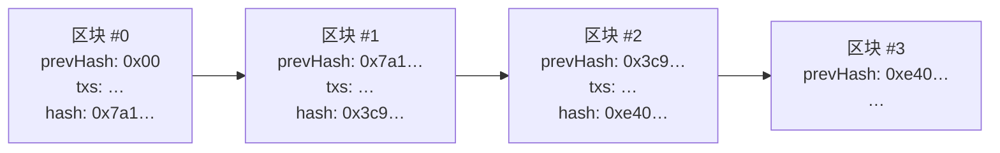
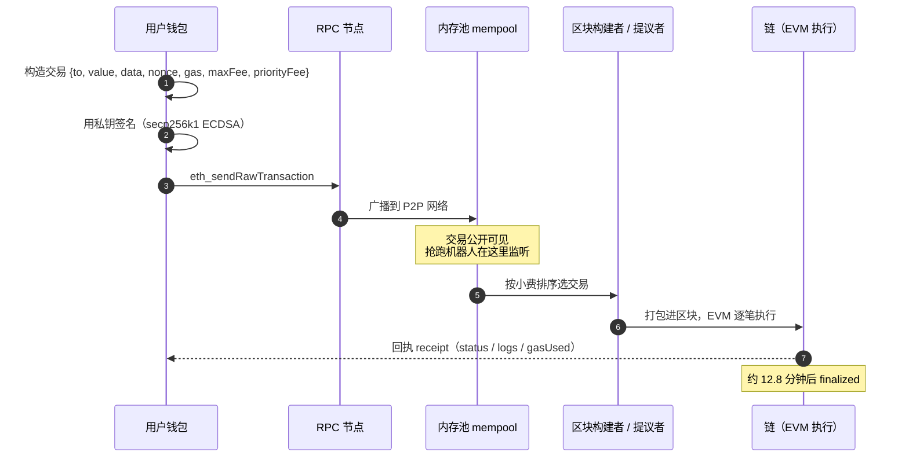
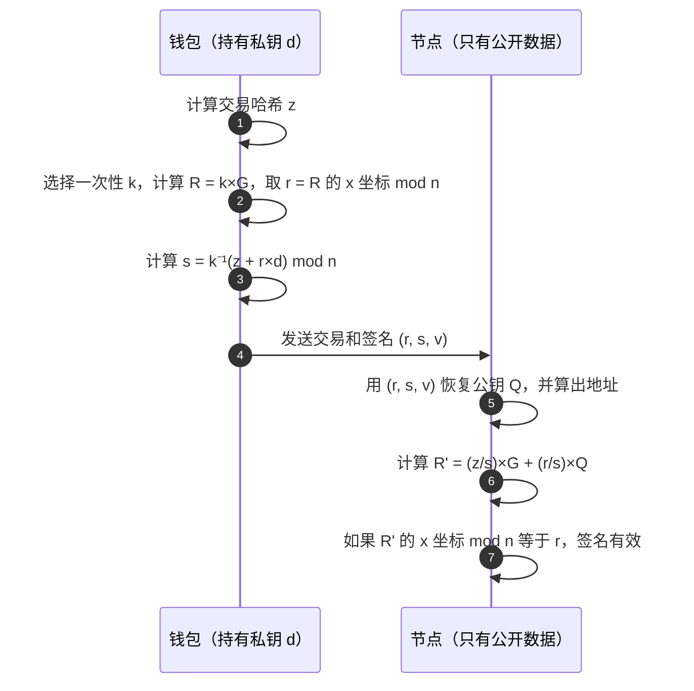
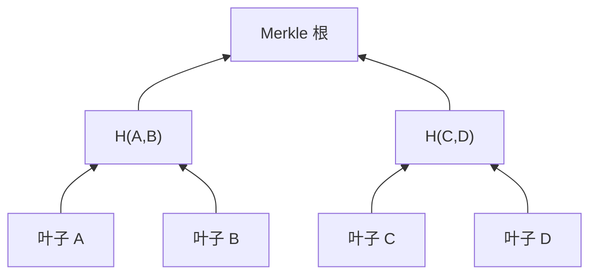
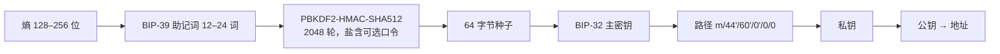
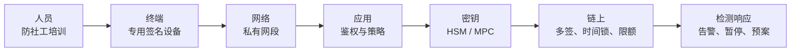

# B03 区块链基础：一本所有人共同记、谁也改不了的账

> 学习目标：解释哈希链为什么防篡改；区分 EOA 与合约账户；走完一笔以太坊交易从签名到最终确认的全过程；计算 EIP-1559 手续费。  
> 前置章节：无  

> 🔗 关联：主线 [02 章](../chapters/02-cryptography-randomness.md)、[03 章](../chapters/03-evm-solidity-basics.md) ｜ 实验 [哈希链](../interactive/audit-hashchain.html)、[EIP-1559](../interactive/audit-fee1559.html) ｜ 评估 [A01](../assessment/A01-methodology.md) ｜ 衔接 [B06](B06-foundry-basics.md)、[B45](B45-yul-opcodes.md)

## 1. 一句话理解

**区块链是一串用哈希值首尾相扣的区块。每个区块记录一批交易。全网节点各自保存一份副本，并按共识规则决定下一个区块。**

> 🎯 打个比方：一个班级用一本公共日记记账。每一页的页脚写着"上一页内容的指纹"。如果有人偷改第 3 页，第 4 页页脚的指纹就对不上，第 5 页、第 6 页也全部对不上。全班每人都有一本副本，所以改一本没有用。
>
> 比喻的局限：真实区块链里没有"班长"。谁来写下一页，由共识机制（工作量证明或权益证明）决定。

## 2. 区块与哈希链

哈希函数（Hash Function）：把任意长度的数据变成固定长度"指纹"的函数。输入改一个比特，输出完全不同。以太坊使用 Keccak-256，比特币使用 SHA-256。



**读图要点：**

- 每个区块的哈希值覆盖它自己的内容，也覆盖上一个区块的哈希值。
- 改动任何历史区块，后面所有区块的哈希值都要重算。攻击者需要追上全网的算力或质押。
- 局限：链只保证"已经记下的东西不被改"。它不保证"记下的东西是对的"。错误的合约逻辑也会被永久记录。

> 🧪 交互实验：[哈希链篡改实验](../interactive/audit-hashchain.html)

## 3. 共识：谁来写下一个区块

| 机制 | 代表 | 出块权来源 | 审计关注点 |
|---|---|---|---|
| 工作量证明 PoW | 比特币 | 算力：先算出满足难度的哈希 | 51% 攻击、链重组，影响确认数设置 |
| 权益证明 PoS | 以太坊（2022 年 9 月合并后） | 质押 32 ETH 成为验证者，随机选出提议者 | 提议者能决定区块内交易顺序 → MEV；`block.prevrandao` 可被提议者影响 |
| 委托/BFT 类 | BNB Chain、Cosmos 链 | 少数验证者投票 | 验证者集中、链停机风险 |

以太坊 PoS 中，一个时隙（slot）为 12 秒，32 个时隙为一个纪元（epoch）。区块在约 2 个纪元（约 12.8 分钟）后进入"最终确定"（finalized）状态。截至 2026 年 11 月仍是如此：Fusaka 已于 2025 年 12 月上线，下一次升级 Glamsterdam 尚未确定主网时间（[来源](https://crypto.news/ethereum-glamsterdam-hoodi-upgrade-postponed/)）。

## 4. 账户模型：EOA 与合约账户

|  | 外部账户 EOA | 合约账户 Contract |
|---|---|---|
| 控制者 | 私钥持有人 | 合约代码 |
| 能否主动发起交易 | 能 | 不能，只能被调用后再调用别人 |
| 有没有代码 | 没有（EIP-7702 之后可以"委托"代码，见 05 章） | 有，部署后通常不可变 |
| 地址来源 | 公钥的 Keccak-256 后 20 字节 | CREATE：部署者地址 + nonce；CREATE2：部署者 + salt + 初始化代码哈希 |
| 状态字段 | nonce、balance、storageRoot、codeHash（四个字段两类账户都有） | nonce、balance、storageRoot、codeHash（四个字段两类账户都有） |

> 💡 注意：`msg.sender` 是"直接调用我的地址"。`tx.origin` 是"发起整笔交易的 EOA"。用 `tx.origin` 做权限检查是经典漏洞（见 05 章）。

## 5. 一笔交易的生命周期



**读图要点：**

- 第 4 步之后，交易内容对全世界公开。任何人都能复制、抢先或夹击你的交易（见 09 章 MEV）。
- 第 6 步中，交易要么全部执行成功，要么全部回滚（revert）。回滚时仍然扣除已消耗的 Gas。
- 风险点：nonce 决定交易顺序。同一 nonce 的两笔交易只有一笔能上链，可以用来"取消"交易。
- 私有交易通道（例如 Flashbots Protect）可以绕过公共内存池，降低被抢跑的风险。

## 6. Gas 与 EIP-1559

Gas：EVM 执行每条指令消耗的计算单位。它防止死循环，也给计算定价。

2021 年伦敦升级引入 EIP-1559。每个区块有一个**基础费（baseFee）**，由协议根据上一个区块的拥堵程度自动调整（每块最多 ±12.5%）。基础费被**销毁**。用户另付**小费（priorityFee）**给提议者。

```
有效单价 = min(maxFeePerGas, baseFee + maxPriorityFeePerGas)
用户支付 = gasUsed × 有效单价
销毁     = gasUsed × baseFee
提议者得 = gasUsed × (有效单价 − baseFee)
如果 maxFeePerGas < baseFee → 交易留在内存池，不被打包
```

> 🧪 交互实验：[EIP-1559 手续费计算器](../interactive/audit-fee1559.html)

## 7. 审计员需要的区块链知识清单

- 区块时间不精确：`block.timestamp` 由提议者设置，只能在小范围内偏移。不要用它做秒级判断或随机数。
- 链重组（reorg）：最新几个区块可能被替换。跨链桥和交易所的确认数依赖这一点。
- 交易顺序可被操纵：同一区块内的交易顺序由构建者决定。
- 所有链上数据都公开：`private` 变量也能被任何人读取（`eth_getStorageAt`）。

## 8. 延伸阅读

延伸阅读见 [B78 资源索引](B78-glossary-resources.md) 的"区块链基础"一行。本章的哈希链实验是 Anders Brownworth Blockchain Demo 的简化版。

> 🪞 反思：选一条你常用的链。
> 1. 你能说出它的确认规则吗？
> 2. 你的系统把几次确认当作最终？依据是什么？
> 3. 如果发生重组，哪些记录需要回滚？

## 9. 思考题

1. 在哈希链实验里篡改区块 #1，然后只重新挖区块 #1。区块 #2 为什么仍然是红色？
2. 把 maxFee 调到低于 baseFee，交易会怎样？用户损失了什么？
3. 一个合约用 `private uint256 password` 存密码。为什么这个设计不安全？（提示：Ethernaut 第 8 关 Vault）

---

## 10. 密码学入门：给零基础读者的补充

> 最后核对：2026-11-10

本节不要求数学基础。本节只回答一个问题：每种密码学工具保护什么，不保护什么。实现风险和真实事故见[主线 02 章](../chapters/02-cryptography-randomness.md)。

> 🎯 打个比方：哈希是指纹，对称密钥是一把两人共用的钥匙，私钥是只有你拥有的印章，公钥是公开的印章样本。
>
> 比喻的局限：真实指纹可能被复制，密码学指纹靠计算难度保护。计算难度的前提是算法和实现都正确。

### 10.1 哈希函数的性质

<details class="predict"><summary>🤔 先猜再看：两笔交易只差 1 个比特。它们的 256 位 Keccak-256 哈希平均相差多少位？</summary>

平均约 128 位，也就是约一半。这叫雪崩效应（Avalanche Effect）。所以你不能从"两个哈希很像"推出"两份数据很像"。

</details>

| 性质 | 含义 | 区块链用途 |
|---|---|---|
| 确定性（Deterministic） | 相同输入永远得到相同输出 | 所有节点独立计算出同一个区块哈希 |
| 抗原像（Preimage Resistance） | 已知输出，算不出输入 | 承诺方案：先公开哈希，后公开原文 |
| 抗第二原像（Second-preimage Resistance） | 已知一个输入，找不到另一个同哈希的输入 | 改动历史区块后，哈希无法保持不变 |
| 抗碰撞（Collision Resistance） | 找不到任意两个同哈希的输入 | Merkle 根能代表一整批交易 |
| 雪崩效应 | 输入改一位，输出约一半位翻转 | 篡改立即可见 |

> 💡 注意：哈希不是加密。哈希没有密钥，也不能还原。以太坊的 Keccak-256 和 [NIST FIPS 202](https://csrc.nist.gov/pubs/fips/202/final) 的 SHA3-256 填充规则不同，同一输入的输出也不同。

> 🧪 动手验证：打开[哈希链实验](../interactive/audit-hashchain.html)，改动一个区块的一个字符。记录哪些区块变红。

### 10.2 对称加密与非对称密码学

| 对比项 | 对称加密（Symmetric） | 非对称密码学（Asymmetric） |
|---|---|---|
| 密钥 | 双方共用一把密钥 | 一对密钥：私钥保密，公钥公开 |
| 速度 | 快，适合大量数据 | 慢，适合少量数据和身份证明 |
| 常见算法 | AES-GCM、ChaCha20-Poly1305 | ECDSA（secp256k1）、Ed25519、RSA |
| 区块链用途 | 钱包文件加密（[Web3 Secret Storage](https://ethereum.org/developers/docs/data-structures-and-encoding/web3-secret-storage/)）、节点传输层 | 交易签名、节点身份 |
| 主要风险 | 共用密钥的分发和泄露 | 私钥泄露、随机数错误 |

> 💡 注意：比特币和以太坊的交易默认不加密。签名证明"谁批准了这笔交易"，不隐藏交易内容。

### 10.3 公钥和私钥

- 私钥（Private Key）：一个保密的 256 位随机数。
- 公钥（Public Key）：私钥乘以椭圆曲线基点 G 得到的曲线上的点。
- 从私钥算公钥很容易。从公钥反推私钥在当前计算能力下不可行。这是椭圆曲线离散对数难题（[SEC 2](https://www.secg.org/sec2-v2.pdf) 定义了 secp256k1 曲线）。

> ⚠️ 警告：私钥只有一份控制权。任何人拿到私钥，链上都无法区分他和你。

### 10.4 secp256k1 签名与验证

本节只讲概念。公式中 `d` 是私钥，`Q` 是公钥，`z` 是消息哈希，`k` 是每次签名使用的随机数（nonce），`n` 是曲线的阶。



**读图要点：**

- 第 1–3 步需要私钥。第 5–7 步只需要公开数据。
- 以太坊交易不携带 `from` 字段。节点从签名恢复公钥，再算出发送方地址。
- 出错点：`k` 被重复使用或可被预测时，攻击者能算出 `d`。[RFC 6979](https://www.rfc-editor.org/rfc/rfc6979) 用确定性方法生成 `k`，避免依赖运行时随机源。
- 局限：验证通过只说明私钥持有人签了这段数据，不说明用户看懂了这段数据（见 [19 章](../chapters/19-user-scams.md)）。

<details class="predict"><summary>🤔 先猜再看：同一把私钥用同一个 k 签了两笔不同的交易。攻击者只看链上数据，能做什么？</summary>

攻击者能算出私钥。两个签名的 `r` 相同。攻击者用两个 `s` 和两个 `z` 列方程，先解出 `k`，再解出 `d`。详细路径见 [02 章 3.2 节](../chapters/02-cryptography-randomness.md)。

</details>

> 💡 注意：对同一消息，`(r, s)` 和 `(r, n−s)` 都能通过验证，这叫签名延展性。[EIP-2](https://eips.ethereum.org/EIPS/eip-2) 要求以太坊交易使用较小的 `s`。合约自己验证签名时，要用标准库并增加防重放字段（见 [09 章](../chapters/09-mev-signatures.md)）。

### 10.5 Merkle 树证明

Merkle 树（Merkle Tree）：把一批数据的哈希两两合并，最后得到一个根哈希的树形结构。



**读图要点：**

- 要证明 C 在树中，证明者提供 D 和 H(A,B)。这两个值叫兄弟节点。
- 验证者依次计算 H(C,D) 和根，再和已知的根比较。
- 证明大小只随叶子数的对数增长。
- 局限：证明只说明"这个值在这棵树中"。它不说明"这棵树的内容是对的"。

<details class="predict"><summary>🤔 先猜再看：一棵二叉 Merkle 树有 1,048,576 个叶子。证明一个叶子需要多少个兄弟哈希？</summary>

需要 20 个，因为 2²⁰ = 1,048,576。验证者不需要下载全部叶子。

</details>

> 🧪 动手验证：打开 [Merkle 证明实验](../interactive/audit-merkle.html)，生成一个叶子的证明，再改动证明中的一个节点。记录根哈希的变化。

> 💡 注意：以太坊执行层的状态、交易、回执使用 Merkle Patricia Trie，三个根写在区块头中（[ethereum.org](https://ethereum.org/developers/docs/data-structures-and-encoding/patricia-merkle-trie/)）。它和上图的简单二叉树结构不同，证明的思路相同。

### 10.6 地址从哪里来

以太坊地址的计算步骤（[ethereum.org](https://ethereum.org/developers/docs/accounts/)）：

1. 钱包用私钥算出公钥。
2. 钱包对公钥的 64 字节坐标计算 Keccak-256。
3. 钱包取哈希的最后 20 字节。
4. 钱包在前面加上 `0x`。

[EIP-55](https://eips.ethereum.org/EIPS/eip-55) 用大小写做校验。规则对小写十六进制地址字符串计算 Keccak-256，再按哈希决定每个字母的大小写。

> ⚠️ 警告：校验和只能发现输入错误。校验和不能发现地址投毒，因为攻击者的地址本身是合法地址。打开[地址投毒实验](../interactive/address-poisoning-lab.html)比对。

### 10.7 助记词如何派生出地址



**读图要点：**

- 助记词来自熵（[BIP-39](https://github.com/bitcoin/bips/blob/master/bip-0039.mediawiki)）。熵不足时，后面的步骤都无法补救。
- 种子到私钥的派生是确定性的（[BIP-32](https://github.com/bitcoin/bips/blob/master/bip-0032.mediawiki)、[BIP-44](https://github.com/bitcoin/bips/blob/master/bip-0044.mediawiki)）。一个种子泄露，全部地址一起泄露。
- 路径 `m/44'/60'/0'/0/0` 是以太坊钱包的常见默认路径，不是协议规则。
- 局限：换钱包时，路径不同会显示不同的地址。资金没有丢失。

<details class="predict"><summary>🤔 先猜再看：你恢复钱包时把 BIP-39 可选口令（passphrase）输错一个字符。钱包会报错吗？</summary>

钱包不会报错。任何口令都能算出一个有效种子。你会看到一个全新的空钱包。所以口令也要像助记词一样备份。

</details>

### 10.8 TLS 与 PKI：节点在哪里用

TLS（Transport Layer Security）：在网络连接上提供身份验证、加密和完整性的协议，当前版本是 [TLS 1.3](https://www.rfc-editor.org/rfc/rfc8446)。

PKI（Public Key Infrastructure）：由证书颁发机构（CA）签发证书，把公钥和身份绑定起来的体系。

TLS 握手用非对称密码学验证身份，再协商对称密钥传输数据。这一点把 10.2 节的两种工具连接在了一起。

| 连接 | 常见保护 | 身份来源 | 注意事项 |
|---|---|---|---|
| 钱包或后端 → RPC 服务商 | HTTPS（TLS） | CA 证书和域名 | TLS 只保护传输。服务商返回的数据可能仍然错误（见 [17 章](../chapters/17-node-rpc-infrastructure.md)） |
| 共识客户端 → 执行客户端 Engine API | JWT（HS256），默认端口 8551（[规范](https://github.com/ethereum/execution-apis/blob/main/src/engine/authentication.md)） | 双方共享的 256 位密钥 | 规范说明 JWT 不防窃听和重放。这条连接要留在本机或私有网段 |
| 执行层节点之间 | devp2p / RLPx（[ethereum.org](https://ethereum.org/developers/docs/networking-layer/)） | 节点密钥，不依赖 CA | 公开网络中的对端不可信。加密不等于可信 |
| 共识层节点之间 | discv5 发现 + libp2p Noise 通道 | 节点记录 ENR，不依赖 CA | 同上 |
| 验证者客户端 → 远程签名服务 | 业界通用做法：私有网段 + 双向 TLS | 内部 CA | 证书泄露等于获得签名入口（见 [18 章](../chapters/18-wallet-key-management.md)） |
| 联盟链 Fabric 节点之间 | TLS + X.509 身份（[MSP](https://hyperledger-fabric.readthedocs.io/en/latest/membership/membership.html)） | 成员组织的 CA | CA 私钥是整个成员体系的根 |

<details class="predict"><summary>🤔 先猜再看：RPC 地址是 https，证书也有效。这能证明它返回的余额是真实余额吗？</summary>

不能。TLS 只证明你连到了持有该域名证书的服务器，并且传输中没有被改动。服务器本身可以返回错误数据。要验证数据，需要多源比对或轻客户端证明。打开 [RPC 多源比对实验](../interactive/rpc-quorum-lab.html)验证。

</details>

> ⚠️ 警告：不要把节点的 JSON-RPC 端口开放到公网。[Geth 安全文档](https://geth.ethereum.org/docs/fundamentals/security)建议防火墙拦截 8545，只放行明确信任的机器，P2P 端口 30303 才对外开放。

### 10.9 术语表

| 术语 | 英文 | 定义 |
|---|---|---|
| 抗碰撞 | Collision Resistance | 找不到两个输出相同的输入 |
| 签名随机数 | Nonce（k） | ECDSA 每次签名使用的一次性秘密值，不是账户 nonce |
| Merkle 证明 | Merkle Proof | 证明某叶子属于某个根所需的兄弟哈希列表 |
| 派生路径 | Derivation Path | HD 钱包从主密钥推导子密钥的路径 |
| 证书颁发机构 | Certificate Authority, CA | 为公钥和身份的绑定关系签名的机构 |

---

## 11. CIA 三要素与纵深防御

> 最后核对：2026-11-10

### 11.1 CIA 三要素映射到区块链资产

CIA 三要素是信息安全的三个目标（[NIST FIPS 199](https://csrc.nist.gov/pubs/fips/199/final)）。

- 机密性（Confidentiality）：只有获得授权的人能读取信息。
- 完整性（Integrity）：信息不被未经授权地修改或破坏。
- 可用性（Availability）：获得授权的人能及时可靠地使用系统。

| 资产 | 机密性 | 完整性 | 可用性 |
|---|---|---|---|
| 私钥 / 助记词 | **最高优先级**：泄露后无法撤销 | 备份不能被替换 | 丢失后资金无法找回 |
| 链上账本 | 默认公开，机密性很低 | 由哈希链和共识保护 | 取决于节点和验证者 |
| 合约状态与逻辑 | `private` 变量也公开 | 权限和不变量保护 | 暂停、Gas 上限、依赖停机 |
| RPC 节点数据 | 查询内容暴露用户关联 | 节点可能返回错误数据 | 限流、宕机、同步落后 |
| 验证者 | 签名密钥保密 | 不重复签名，防止罚没 | 离线会损失奖励，停摆影响确认 |
| 交易所 KYC 数据 | 个人信息，须严格保护 | 风控结论不被改动 | 影响合规流程 |
| 前端与域名 | 通常公开 | 代码被改动时用户会签恶意交易 | 域名被劫持时用户无法访问 |

<details class="predict"><summary>🤔 先猜再看：热钱包私钥被盗。这是 C、I、A 中哪一项的失败？</summary>

先是机密性失败：私钥被读取。随后是完整性失败：攻击者能写入合法但未经授权的交易。最后可能是可用性失败：钱包被掏空，业务停止。一次事故可以穿过三项。威胁建模时要追踪后续影响。

</details>

> 💡 注意：区块链保护的是账本的完整性。它不自动保护私钥、节点、前端和个人数据。

### 11.2 纵深防御

纵深防御（Defense in Depth）：组合人员、技术和运营措施，在系统的多个层次设置强度不同的屏障（[NIST 术语表](https://csrc.nist.gov/glossary/term/defense_in_depth)）。

> 🎯 打个比方：银行不只靠大门的锁。它还有警卫、监控、金库门和双人开启规则。
>
> 比喻的局限：银行可以追回部分损失。链上交易确认后，通常无法撤销。



**读图要点：**

- 攻击者要到达资产，必须穿过每一层。
- 每一层都要假设上一层已经失败。
- 风险点：多个层次依赖同一个人、同一台电脑或同一个云账户时，它们其实是一层。
- 局限：层数多不等于安全。每一层都要有测试证据（见 [A11](../assessment/A11-blockchain-system-testing.md)）。

| 层次 | 热钱包服务示例（本手册示例） | 这一层失败时，下一层做什么 |
|---|---|---|
| 人员 | 运维人员接受防钓鱼训练 | 终端隔离阻止恶意软件接触密钥 |
| 终端 | 审批只在专用设备上进行 | 网络规则阻止横向移动 |
| 网络 | 签名服务只接受内网请求 | 应用鉴权拒绝伪造请求 |
| 应用 | 策略引擎校验地址和限额 | 密钥服务独立校验策略 |
| 密钥 | 私钥不离开 HSM 或 MPC 节点 | 链上限额限制单次损失 |
| 链上 | 大额转出经过多签和时间锁 | 监控发现异常并暂停 |
| 检测响应 | 大额转出告警，有人值守 | 启动 [A09](../assessment/A09-incident-response.md) 预案 |

> 🧪 动手验证：打开[威胁建模实验](../interactive/threat-model-lab.html)，选择"热钱包服务"。把每个缓解措施归入上表的一层。如果某一层是空的，把它写进你的改进清单。

下一章：[B04 环境搭建](B04-setup.md)
