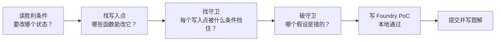

# B10 CTF 入门关卡

> 学习目标：掌握"读胜利条件 → 找写入点 → 找守卫 → 破守卫 → 写 PoC"的解题方法；把 Ethernaut 和 Capture the Ether 的关卡映射到漏洞类型，并用 Foundry 写出题解。  
> 前置章节：[B03](B03-blockchain-basics.md)、[B04](B04-setup.md)–[B08](B08-tokens-and-vault.md)、[B09](B09-reading-code-mindset.md)；主线 [03](../chapters/03-evm-solidity-basics.md)–[07](../chapters/07-external-calls-tokens.md) 章。  
> 预计用时：每周 3–5 关，持续练到阶段 2。

> 🔗 关联：主线 [04 章](../chapters/04-reentrancy.md)、[05 章](../chapters/05-access-control.md)、[06 章](../chapters/06-arithmetic-precision.md)、[07 章](../chapters/07-external-calls-tokens.md) ｜ 实验 [重入](../interactive/reentrancy-lab.html)、[存储与代理](../interactive/storage-proxy-lab.html) ｜ 评估 [A08](../assessment/A08-reproduce-attacks.md) ｜ 衔接 [B24 DeFi CTF 攻防](B24-defi-ctf.md)（阶段 3）

> ⚠️ 警告：只在 CTF 官方靶场、本地环境或测试网练习。练习规则见 [B04 第 1 节](B04-setup.md)。

## 1. 解题方法

**读图要点：**

- 从"胜利条件"倒推，比从第一行代码顺读快得多。真实审计也一样：从"钱在哪里、谁能转走"倒推。
- "破守卫"这一步就是 [B09 第 4 节](B09-reading-code-mindset.md) 的问题："这个假设由谁保证？"
- 每关写一个 Foundry 测试作为题解，并记录"被打破的假设"。把题解放进 GitHub 仓库。这个仓库就是作品集的第一部分（见 [B54](B54-expert.md) 第 5 节，阶段 7）。

## 2. Ethernaut（OpenZeppelin）关卡地图

| # | 关卡 | 考点 | 本手册章节 |
|---|---|---|---|
| 1 | Fallback | receive / fallback 中的权限逻辑 | 03 |
| 2 | Fallout | 旧式构造函数拼写错误 | 05 |
| 3 | Coin Flip | 链上可预测随机数 | 02 |
| 4 | Telephone | tx.origin vs msg.sender | 05 |
| 5 | Token | 下溢（0.6 版本） | 06 |
| 6 | Delegation | delegatecall 改写 owner | 03 / 10 |
| 7 | Force | selfdestruct 强制转账 | 07 |
| 8 | Vault | private 变量可读 | B03 |
| 9 | King | 推送支付 DoS | 07 |
| 10 | Re-entrancy | 经典重入 | 04 |
| 11 | Elevator | 不可信的外部 view 返回值 | 07 |
| 12 | Privacy | 存储布局与打包 | B45 |
| 13–14 | Gatekeeper One / Two | gasleft、类型转换、extcodesize 绕过 | 06 / 07 / B45 |
| 15 | Naught Coin | ERC20 approve + transferFrom 绕过锁 | 07 |
| 16 | Preservation | delegatecall 存储冲突 | 10 |
| 17 | Recovery | CREATE 地址可计算 | B45 |
| 18 | MagicNumber | 手写字节码 | B45 |
| 19 | Alien Codex | 动态数组下溢 → 任意槽写入 | B45 |
| 20 | Denial | Gas 耗尽 DoS | 07 |
| 21 | Shop | view 函数返回不同值 | 07 |
| 22–23 | Dex / Dex Two | AMM 价格操纵、任意代币 | B18 |
| 24 | Puzzle Wallet | 代理存储冲突 + multicall 重复 msg.value | 10 |
| 25 | Motorbike | UUPS 实现合约未初始化 | 10 |
| 26 | DoubleEntryPoint | 双入口代币、Forta 检测机器人 | 07 / A09 |
| 27 | Good Samaritan | 自定义错误被伪造 | 03 |
| 28 | Gatekeeper Three | 综合绕过 | 05 |
| 29 | Switch | 手工构造 calldata 偏移 | B45 |
| 30 | HigherOrder | calldata 与类型宽度 | B45 |
| 31 | Stake | 未检查返回值的代币转账 | 07 |
| 32 | Impersonator | ECDSA 签名校验绕过 | 09 |
| 33 | Magic Animal Carousel | 位掩码与编码位移不一致 | B45 |
| 34 | Bet House | 先转 ETH、后销毁份额，回调时状态未完成 | 04 |
| 35 | Elliptic Token | 自行"优化"ECDSA 导致验证缺步骤 | 09 |
| 36 | Cashback | EIP-7702 委托与积分逻辑 | 15 |
| 37 | Impersonator Two | 从两个历史签名入手攻击 ECDSA | 09 |
| 38 | UniqueNFT | 铸造前的 ERC721 回调重入、`tx.origin` 判断 EOA | 04 / 15 |
| 39 | Forger | 签名编码不同绕过"按签名哈希防重放" | 09 |
| 40 | NotOptimisticPortal | 验证的数据与执行的数据不一致（跨链消息） | 12 |

截至 2026 年 11 月 9 日，[官方 gamedata](https://github.com/OpenZeppelin/ethernaut/blob/master/client/src/gamedata/gamedata.json) 共 41 关（编号 0–40，第 0 关 Hello Ethernaut 是入门教程，未列入上表）。Ethernaut 会持续新增关卡，以官网为准。

> 💡 注意：表中两位数字指主线章节（例如 04 指[第 04 章](../chapters/04-reentrancy.md)），B 开头指本训练营章节。本阶段先做"本手册章节"一列为 02–07 或 B03 的关卡。其余关卡对应的章节在后面的阶段才学，先跳过，学完对应章节再回来做。

## 3. Capture the Ether

五组题：Warmup、Lotteries（猜数、随机数、预测区块哈希）、Math（Token Sale 溢出、Token Whale、Retirement Fund、Mapping 任意写、Donation 未初始化指针、Fifty Years）、Accounts（Fuzzy Identity 靓号地址、Public Key 从交易恢复公钥、Account Takeover 重复 k 值）、Miscellaneous。

> 💡 注意：原站部署在已关闭的 Ropsten 测试网上。现在用社区移植版本（例如 Foundry 本地版本）练习，题目本身仍然有价值，尤其是 Accounts 组的密码学题。签名和随机数 k 的基础见 [B03](B03-blockchain-basics.md) 和主线 [02](../chapters/02-cryptography-randomness.md)。

## 4. 过关标准

- [ ] 至少完成 Ethernaut 中对应 02–07 章的 10 关，每关有一个 Foundry 题解测试。
- [ ] 每个题解都写了一句"被打破的假设"。
- [ ] 至少完成 Capture the Ether 的 1 道 Accounts 组题目。

> 🪞 反思：回想你最近解过的一道题。
> 1. 你能用一句话写出被打破的假设吗？
> 2. 这个假设，或相似的回调和权限检查，在你自己的合约里存在吗？
> 3. 如果给这道题加一条检查或测试，哪一条能拦住攻击？不看题解，你能重新写出 PoC 吗？

## 5. 思考题

1. 用第 1 节的解题方法分析 Telephone 关：胜利条件、写入点、守卫和被打破的假设分别是什么？
2. Account Takeover 题中，两个签名使用了相同的随机数 k。写出从两个签名恢复私钥的公式思路。
3. （可选，学完主线 [10 章](../chapters/10-upgradeable-proxy.md) 后回答）Puzzle Wallet 为什么同时需要"代理存储冲突"和"multicall 重复使用 msg.value"两个漏洞？

下一章：[B11 阶段 2 导读](B11-stage2-guide.md)
