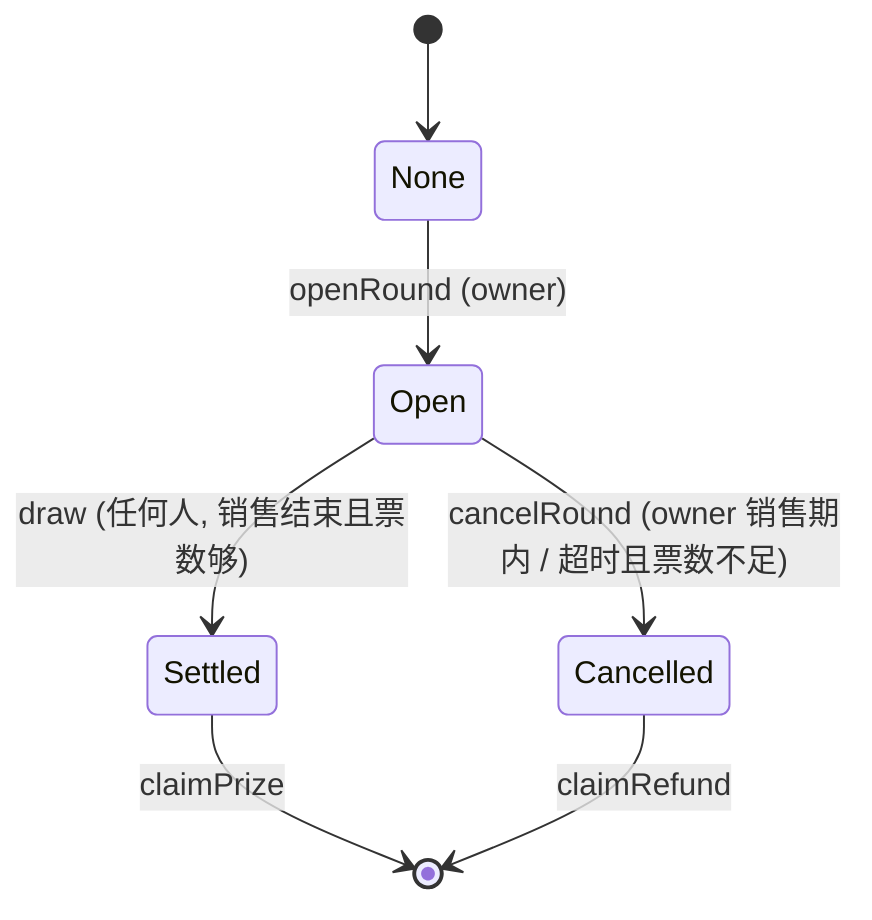
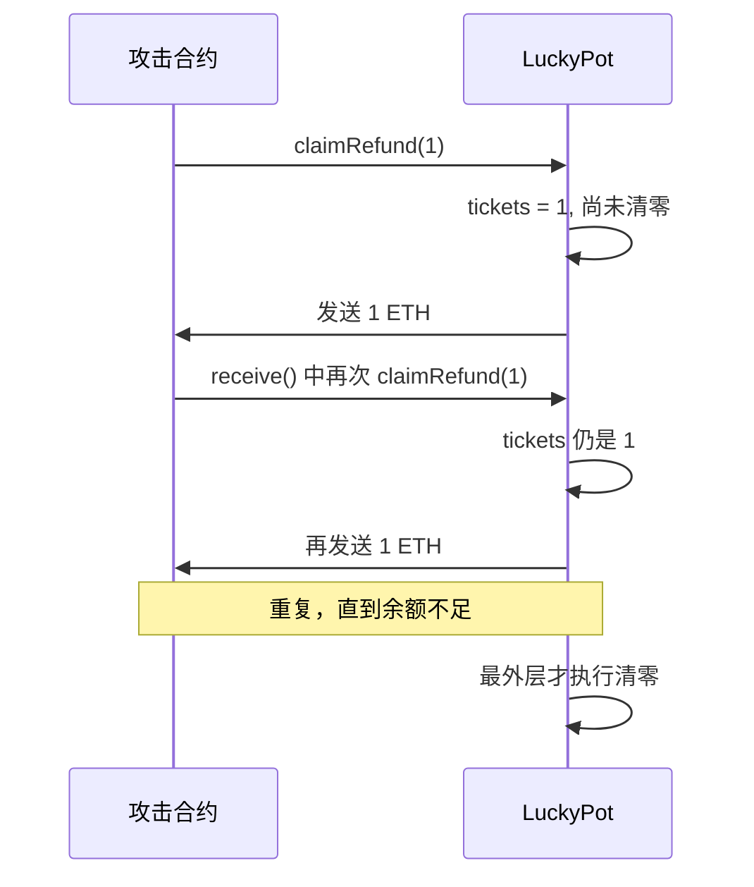

# B15 第 2 次审计：LuckyPot

> 学习目标：做完本章，你能——
> 1. 用静态分析工具 Slither 和 Aderyn 扫描合约，并逐条判断结果是真问题还是误报。
> 2. 找出并用 PoC 证明重入、弱随机数、不安全类型收窄、推送式转账拒绝服务和 ETH 记账错误。
> 3. 写出包含信息项和 Gas 项的完整审计报告。
>
> 前置章节：[B13 第 1 次审计：NoteBox](B13-audit-1-notebox.md)、[B14 写好一个发现](B14-writing-findings.md)
> 预计用时：5–8 小时。
> 靶场：[practice-example-code/range/luckypot/](../../practice-example-code/range/luckypot/README.md)
> 关联章节：[04 重入](../chapters/04-reentrancy.md)｜[02 密码学与随机数](../chapters/02-cryptography-randomness.md)｜[06 算术与精度](../chapters/06-arithmetic-precision.md)｜[07 外部调用与代币](../chapters/07-external-calls-tokens.md)｜[B31 工具工程化](B31-automation-tools.md)｜[重入实验](../interactive/reentrancy-lab.html)
> 最后核对：2026-11-10（本地运行 forge 1.5.1、Slither 0.11.5、Aderyn 0.6.8；公开发布信息显示 Slither 已有 0.11.6，版本不同时输出可能有差异）

> ⚠️ 警告：法律与道德边界。本章的攻击合约只针对本机测试中的玩具合约。不要把这些手法用于任何未授权的目标。

---

## 开场：扫描器报了 18 条，真正要命的有几条

你跑完扫描器，屏幕上有 18 条结果。一条标着 High 的说"合约向任意地址发送 ETH"。另一条说"使用了时间戳"。

老板问："这些都要修吗？"

<details class="predict"><summary>🤔 先猜再看：静态分析工具报告的结果，有多少是真实可利用的？工具能找全漏洞吗？</summary>

本章的真实结果：Slither 报告 12 类共 18 条，其中只有 3 类直接对应真实发现。LuckyPot 最严重的问题之一（256 张票 0 元买走）Slither 和 Aderyn 都没有报告。工具提供线索。人负责判断。

</details>

> 🎯 打个比方：静态分析工具像机场安检机。它会对所有金属报警，包括你的皮带扣。它也看不见陶瓷刀。
>
> 比喻的局限：安检机报警后会有人开箱检查。扫描器的结果如果没有人跟进，只是一份噪音清单。

## 1. 新工具：什么是静态分析

**静态分析**（Static Analysis）：不运行程序，只通过分析源代码或中间表示来发现可疑模式。

| 工具 | 语言 | 特点 | 本章版本 |
|---|---|---|---|
| Slither | Python | Crytic 维护；检测器多；结果带置信度 | 0.11.5 |
| Aderyn | Rust | Cyfrin 维护；输出 Markdown 报告 | 0.6.8 |
| `forge lint` | Rust | Foundry 内置 | forge 1.5.1 |

**误报**（False Positive）：工具报告了问题，但实际不构成问题。**漏报**（False Negative）：真实问题，工具没报告。

**误报分诊**（Triage）：逐条判断结果，给出结论和理由。

## 2. 准备与范围

1. 进入靶场：

```bash
cd practice-example-code/range/luckypot  # 从 web3-security-101/ 出发，进入 LuckyPot 靶场
forge build  # 先确认能编译
```

2. 阅读 `README.md`，把协议说明改写成承诺。
3. 阅读 `src/LuckyPot.sol`（195 nSLOC）。这次代码量大，按下面的顺序读：



读图要点：先看状态机，再看函数。每个箭头是一个外部函数。ETH 在 `buyTickets` 进入，在 `draw`、`claimPrize`、`claimRefund`、`withdrawFees` 离开。漏洞往往出现在资金流动的边上。

4. 写出第一个**不变量**（Invariant，任何时刻都必须成立的规则）：

> 合约的 ETH 余额 ≥ 所有未领奖金 + 未提取的手续费 + 未结算轮次的奖池 + 待退款金额。

后面你会用它检验记账错误。

## 3. 第一遍：纯人工审查

先不跑工具。工具的结果会锚定你的注意力。按第 4 节的提示逐个发现。先自己审 1 小时。

<details class="predict"><summary>🤔 提示表：本靶场有多少个发现？</summary>

共 8 个：4 个 High、1 个 Medium、1 个 Low、1 个 Informational、1 个 Gas。

</details>

## 4. 分阶段提示

### LP-01

<details class="predict"><summary>🤔 提示 1：列出所有发送 ETH 的位置。每一处，状态在转账之前还是之后更新？</summary>

共有 3 条路径用 `_send`，另有 `draw` 的循环。对比 `claimPrize` 和 `claimRefund` 的语句顺序。

</details>

<details class="predict"><summary>🤔 提示 2：claimRefund 在转账时，ticketsOf 是多少？</summary>

转账发生时，`ticketsOf[roundId][msg.sender]` 还是原值。收款方是合约时，可以在 `receive()` 中再次调用。

</details>

<details class="predict"><summary>🤔 完整发现：LP-01 claimRefund 重入（REN-1、REN-2）</summary>

```solidity
uint256 amount = tickets * ticketPrice;  // 按当前票数算退款额
// 控制权在这里离开合约，对方 receive() 可再调 claimRefund
_send(msg.sender, amount);          // ❌ 漏洞：先转账
ticketsOf[roundId][msg.sender] = 0; //         后清零
```

一张票的持有者能取走合约内所有 ETH。修复：先清零，再转账。

</details>

### LP-02

<details class="predict"><summary>🤔 提示 1：buyTickets 里，计价使用的数量和记账使用的数量是同一个值吗？</summary>

一个经过类型转换，一个没有。

</details>

<details class="predict"><summary>🤔 提示 2：uint8(256) 等于多少？</summary>

等于 0。`uint8` 最大值是 255。显式转换会截断高位，不会回滚，Solidity 0.8 的溢出检查不覆盖显式转换。

</details>

<details class="predict"><summary>🤔 完整发现：LP-02 不安全的类型收窄（ARI-2）</summary>

```solidity
// 显式收窄：quantity=256 截成 0，不会回滚
uint256 cost = quote(uint8(quantity)); // ❌ 漏洞：256 张票的价格是 0
...
// 记账和计价用的数量不一致
ticketsOf[currentRoundId][msg.sender] += quantity; // 记账用完整的 quantity
```

256 张票花 0 ETH。如果轮次取消，这些票还能按票价退款。修复：`quote` 接收 `uint256`，不做转换。

</details>

### LP-03

<details class="predict"><summary>🤔 提示 1：draw() 的随机种子由哪些值组成？调用者能提前知道吗？</summary>

`blockhash(block.number - 1)`、`block.timestamp`、`roundId`、`ticketsSold`。合约在同一笔交易内能读到这些值。

</details>

<details class="predict"><summary>🤔 提示 2：如果调用者不喜欢这个结果，他必须接受吗？</summary>

不必。攻击合约先算结果。结果不利时，回滚或者不调用，等下一个区块。`draw()` 允许任何人调用。

</details>

<details class="predict"><summary>🤔 完整发现：LP-03 可预测的开奖（ORA-8 同类，见 02 章）</summary>

```solidity
uint256 ticket = uint256(
    // 这些值在同一笔交易里都能读到，攻击合约可先算结果
    // ❌ 漏洞
    keccak256(abi.encode(blockhash(block.number - 1), block.timestamp, roundId, round.ticketsSold))
) % round.ticketsSold;
```

修复：使用可验证随机函数（VRF，Verifiable Random Function），或使用提交-揭示（commit-reveal）方案。

</details>

### LP-04

<details class="predict"><summary>🤔 提示 1：draw() 在循环里做什么？如果某一次失败，会发生什么？</summary>

循环向每个早鸟发送 ETH，失败就回滚整个交易。

</details>

<details class="predict"><summary>🤔 提示 2：谁能成为早鸟？攻击者能让这次转账永远失败吗？这时候 cancelRound 能救场吗？</summary>

任何地址都能抢到早鸟名额。没有 `receive` 函数的合约拒收 ETH。票数达标后，销售结束，`cancelRound` 的两个条件都不满足。

</details>

<details class="predict"><summary>🤔 完整发现：LP-04 推送式转账造成拒绝服务（EXT-5）</summary>

```solidity
// 推送式转账：控制权交给每个早鸟
(bool ok, ) = birds[i].call{value: bonus}("");
// 拒收者让整笔 draw 回滚，cancelRound 又不可用
if (!ok) revert TransferFailed(); // ❌ 漏洞：一个地址拒收，整轮永久无法开奖
```

修复：改为拉取模式（pull），把奖金记入 `pendingPrize`，由领取人自己提走。

</details>

### LP-05

<details class="predict"><summary>🤔 提示 1：买票时手续费何时记账？退款时退多少？</summary>

买票时立即累加 `accruedFees`。退款时按票价全额退。

</details>

<details class="predict"><summary>🤔 提示 2：一个票价 1 ETH、手续费 10% 的轮次，2 人买票后取消。合约要付多少？手里有多少？</summary>

合约收到 2 ETH。退款 2 ETH。`accruedFees` 仍然是 0.2 ETH。合约少了 0.2 ETH。还有一条路径：退款用当前的 `ticketPrice`，owner 取消后改价，退款金额也跟着变。

</details>

<details class="predict"><summary>🤔 完整发现：LP-05 退款后手续费无资金支撑（DFI-1）</summary>

修复：手续费只在结算时收取；按玩家实付金额（`paidBy`）退款。

</details>

### LP-06、LP-07、LP-08

<details class="predict"><summary>🤔 提示 1：_ownerOfTicket 的循环次数由谁决定？</summary>

由 `entries` 数组长度决定。每次买票都增加一项。

</details>

<details class="predict"><summary>🤔 提示 2：循环里哪些值重复读了存储？transferOwnership 少了什么？</summary>

`entriesOf[roundId].length` 和 `entriesOf[roundId][i]` 每次循环都访问存储。`transferOwnership` 修改状态，但没有事件。

</details>

<details class="predict"><summary>🤔 完整发现：LP-06 无界循环（EXT-6）、LP-07 缺失事件、LP-08 Gas</summary>

- LP-06（Low）：`draw()` 的 Gas 随条目数线性增长。
- LP-07（Informational）：`transferOwnership` 不发事件；链下监控看不到权限交接开始。
- LP-08（Gas）：循环里重复访问存储。把数组指针和长度缓存到局部变量，每条目省 260 Gas（2,828 → 2,568，实测）。

</details>

## 5. 运行 PoC

```bash
forge test -vv  # 运行全部 PoC；-vv 显示 Logs
```

预期输出（节选）：

```text
[PASS] test_LP01_ReentrantRefundDrainsPot()
[PASS] test_LP02_NarrowingGivesFreeTickets()
[PASS] test_LP03_PredictableDrawAlwaysWins()
Logs:
  blocks waited: 19
[PASS] test_LP04_RejecterBlocksDraw()
[PASS] test_LP05_RefundLeavesFeesUnbacked()
[PASS] test_LP05b_RefundUsesCurrentPrice()
[PASS] test_LP06_DrawGasGrowsWithEntries()
Logs:
  draw gas with    100 entries: 387922
  draw gas with  2,000 entries: 5762122
  gas per entry: 2828
...
Ran 2 test suites ...: 15 tests passed, 0 failed, 0 skipped (15 total tests)
```

读 LP-03 的 PoC。攻击者 10 张票里只有 1 张，诚实中奖率是 10%。攻击合约等了 19 个区块，中奖率变成 100%。

重入的调用过程如下。



读图要点：EVM 是单线程。第二次调用完整地发生在第一次调用中间。清零只在所有嵌套调用返回后执行。PoC 结果：攻击者投入 1 ETH，取走 11 ETH。

> 🧪 动手验证：打开[重入实验](../interactive/reentrancy-lab.html)，切换先转账和先记账两种顺序，记录合约余额的变化。

## 6. 第二遍：跑工具

### 6.1 Slither

1. 确认已安装：

```bash
slither --version  # 确认 Slither 已安装及其版本
```

本章使用 `0.11.5`。没有安装时运行 `python3 -m pip install slither-analyzer`。

2. 运行：

```bash
# 扫描当前工程，排除依赖、测试、答案目录
slither . --filter-paths "lib|test|solution"
```

`--filter-paths` 排除这些路径里的结果。预期输出的最后一行：

```text
INFO:Slither:. analyzed (1 contracts with 101 detectors), 18 result(s) found
```

下面是真实输出的节选：

```text
Detector: weak-prng
LuckyPot.draw() (src/LuckyPot.sol#142-166) uses a weak PRNG: ...
Detector: reentrancy-eth
Reentrancy in LuckyPot.claimRefund(uint256) (src/LuckyPot.sol#193-202):
	External calls:
	- _send(msg.sender,amount) (src/LuckyPot.sol#199)
	State variables written after the call(s):
	- ticketsOf[roundId][msg.sender] = 0 (src/LuckyPot.sol#200)
Detector: arbitrary-send-eth
LuckyPot._send(address,uint256) (src/LuckyPot.sol#244-247) sends eth to arbitrary user
```

3. 把 18 条结果写进分诊表。先自己判断。下面是 12 类检测器的示范结论。

| 检测器 | 条数 | 结论 | 理由 |
|---|---|---|---|
| `reentrancy-eth` | 1 | ✅ 真问题 | 即 LP-01 |
| `weak-prng` | 1 | ✅ 真问题 | 即 LP-03 |
| `calls-loop` | 1 | ✅ 线索 | 指向 LP-04；工具没有说明拒收后的后果 |
| `arbitrary-send-eth` | 1 | ❌ 误报 | `to` 只来自 `msg.sender` 或 owner 指定的地址 |
| `reentrancy-benign` | 1 | ⚠️ 不单独成项 | 状态已先置 `Settled`，再入无收益；循环问题已归入 LP-04 |
| `reentrancy-events` | 3 | ⚠️ 低价值 | 事件顺序错误不影响资金；其中 `claimRefund` 随 LP-01 一起修复 |
| `divide-before-multiply` | 1 | ❌ 误报 | `bonus` 向下取整后，余数进入 `prize`，归中奖者，没有资金丢失 |
| `uninitialized-local` | 1 | ❌ 误报 | `cursor` 的默认值 0 正是预期 |
| `missing-zero-check` | 1 | ❌ 误报 | 两步式接管：零地址无法调用 `acceptOwnership` |
| `timestamp` | 4 | ❌ 误报 | 时间窗以天计；出块者的时间偏移不构成问题 |
| `solc-version` | 1 | ⚠️ 信息 | `^0.8.20` 的范围含旧版本；实际编译用 0.8.30。建议锁定版本 |
| `low-level-calls` | 2 | ❌ 误报 | 转 ETH 必须用低级 `call`；返回值已检查 |

### 6.2 Aderyn

1. 运行：

```bash
aderyn .  # 扫描当前工程，生成 report.md
```

预期输出中有：

```text
Report printed to report.md
```

2. 打开 `report.md`。摘要表：

```text
| High | 3 |
| Low  | 7 |
```

| Aderyn 结果 | 结论 | 理由 |
|---|---|---|
| H-1 ETH transferred without address checks（3 处） | ❌ 误报 | 这 3 个函数把 ETH 发给中奖者、早鸟或调用者本人，是业务逻辑 |
| H-2 Reentrancy: State change after external call（`draw`） | ⚠️ 不成项 | 再入已被 `Settled` 状态挡住；和 LP-04 同一行 |
| H-3 Weak Randomness | ✅ 真问题 | 即 LP-03 |
| L-1 Centralization Risk | ⚠️ 信任假设 | 写进报告的"信任假设"一节 |
| L-2 Large Numeric Literal | ❌ 风格 | `10_000` 已用分隔符 |
| L-3 PUSH0 Opcode | ⚠️ 部署注意 | 只影响不支持 Shanghai 的链 |
| L-4 Loop Contains require/revert | ✅ 线索 | 指向 LP-04 |
| L-5 State Change Without Event | ✅ 真问题 | 即 LP-07 |
| L-6 Address State Variable Set Without Checks | ❌ 误报 | 同 Slither 的 `missing-zero-check` |
| L-7 Unspecific Solidity Pragma | ⚠️ 信息 | 同 `solc-version` |

> 💡 注意：Aderyn 把 `claimRefund` 这个真实重入算到 H-1 的"地址检查"里，却没有在 H-2 报告它。不同工具的分类不同。两个工具都跑，结果取并集，再做分诊。

3. 删除生成的报告，避免和审计笔记混淆：

```bash
rm report.md  # 删掉生成的报告
```

### 6.3 工具漏掉了什么

用表格对比，你会看到工具的边界。

| 发现 | 人工 | Slither | Aderyn | `forge lint` |
|---|---|---|---|---|
| LP-01 重入 | ✅ | ✅ | ⚠️ 间接 | ❌ |
| LP-02 类型收窄 | ✅ | ❌ | ❌ | ✅ `unsafe-typecast` |
| LP-03 弱随机数 | ✅ | ✅ | ✅ | ❌ |
| LP-04 拒绝服务 | ✅ | ⚠️ 线索 | ⚠️ 线索 | ❌ |
| LP-05 记账错误 | ✅ | ❌ | ❌ | ❌ |
| LP-06 无界循环 | ✅ | ❌ | ❌ | ❌ |
| LP-07 缺失事件 | ✅ | ❌ | ✅ | ❌ |

运行 `forge lint src/LuckyPot.sol`，你会看到 `unsafe-typecast` 警告同时指向第 92 行的 `uint64(...)` 和第 124 行的 `uint8(quantity)`。第 92 行是误报：时间戳在 `uint64` 范围内。第 124 行是 LP-02。

> 🪞 反思：你的团队怎么处理工具告警？一个"所有告警都要修"的规定，和一个"告警可以写明理由后关闭"的规定，哪一个能让开发者更认真？

## 7. 发现清单

| 编号 | 标题 | 严重性 | 检查项 |
|---|---|---|---|
| LP-01 | `claimRefund` 重入，掏空合约 | High | REN-1、REN-2 |
| LP-02 | `uint8` 截断造成免费买票 | High | ARI-2 |
| LP-03 | 开奖结果可预测，可挑选 | High | ORA-8 同类 |
| LP-04 | 一个拒收地址永久冻结奖池 | High | EXT-5 |
| LP-05 | 退款后手续费无资金支撑 | Medium | DFI-1 |
| LP-06 | `draw()` 无界循环 | Low | EXT-6 |
| LP-07 | 所有权转移不发事件 | Informational | — |
| LP-08 | 循环内重复读存储 | Gas | — |

LP-06 的数字：攻击者构造条目后，`draw()` 的 Gas 约为每条目 2,828。EIP-7825 从 2025 年 12 月 Fusaka 升级起，把以太坊主网单笔交易 Gas 上限固定为 16,777,216。按 16,777,216 ÷ 2,828 估算，约 5,900 个条目时单笔交易放不下（本手册估算，未在主网验证）。由于 LP-02 让条目免费，LP-06 和 LP-02 组合后成本更低。LP-06 单独定级为 Low，因为修复 LP-02 之后，每个条目至少花费一张票的价格。

## 8. 完整示范报告

````markdown
# LuckyPot 安全审计报告

- 版本：src/LuckyPot.sol（记录 SHA-256）
- 方法：人工审查、Slither 0.11.5、Aderyn 0.6.8、Foundry PoC
- 信任假设：owner 可以修改票价、手续费、最低票数和时长（非开放期），可以取消销售期内的轮次，可以提取手续费。

## 摘要

| 严重性 | 数量 |
|---|---|
| High | 4 |
| Medium | 1 |
| Low | 1 |
| Informational | 1 |
| Gas | 1 |

## [H-01] 重入可掏空合约（LP-01）

**位置**：`claimRefund()`，第 199–200 行

**描述**：合约先用 `_send` 转账，再清零 `ticketsOf`。接收方是合约时，可在 `receive()` 中再次调用。

**影响**：一张票的持有者取走合约内全部 ETH，包括其他玩家的退款和其他轮次的奖池。PoC 中攻击者投入 1 ETH，取走 11 ETH。

**PoC**：`forge test --match-test test_LP01 -vv`

**建议**：先更新状态，再转账。

```solidity
paidBy[roundId][msg.sender] = 0; // ✅ 修复
_send(msg.sender, amount);
```

## [H-02] uint8 截断造成免费买票（LP-02）

**位置**：`buyTickets()`，第 124 行

**描述**：价格用 `uint8(quantity)` 计算，记账用完整 `quantity`。当 `quantity = 256` 时，价格是 0。

**影响**：攻击者 0 ETH 买 256 张票。PoC 中只有 1 张竞争票时，攻击者的中奖率是 99.61%。轮次取消时，这些票还能按票价退款。

**PoC**：`forge test --match-test test_LP02 -vv`

**建议**：删除类型转换。需要限量时，用显式上限回滚。

## [H-03] 开奖可预测（LP-03）

**位置**：`draw()`，第 150–152 行

**描述**：种子只由调用时已知的值组成。任何人都能调用 `draw()`。

**影响**：攻击合约先算结果，只在自己中奖时调用。PoC 中持有 10% 票数的攻击者在 19 个区块后中奖。

**PoC**：`forge test --match-test test_LP03 -vv`

**建议**：接入可验证随机函数。示例修复使用提交-揭示，并在种子未揭示时允许取消。

## [H-04] 拒收 ETH 的早鸟冻结奖池（LP-04）

**位置**：`draw()`，第 158–161 行

**描述**：早鸟奖金使用推送式转账，失败时回滚整个交易。票数达标后 `cancelRound` 也不可用。

**影响**：攻击者用不带 `receive` 的合约抢占早鸟名额，全部奖池永久冻结。

**PoC**：`forge test --match-test test_LP04 -vv`

**建议**：把奖金记入 `pendingPrize`，由接收人拉取。

## [M-01] 退款后手续费无资金支撑（LP-05）

**位置**：`buyTickets()`、`claimRefund()`

**描述**：手续费在买票时记账。退款按票价全额返还。退款金额还使用当前的 `ticketPrice`，而不是玩家实付金额。

**影响**：取消的轮次使合约资不抵债。`withdrawFees` 回滚，或者占用其他轮次的资金。PoC 中合约余额是 0，账面手续费是 0.2 ETH。

**PoC**：`forge test --match-test test_LP05 -vv`

**建议**：手续费在结算时收取；按 `paidBy` 记录的实付金额退款。

## [L-01] draw() 无界循环（LP-06）

**位置**：`_ownerOfTicket()`

**描述**：线性查找中奖票，Gas 随条目数增长，实测每条目 2,828 Gas。

**建议**：存累计票号，用二分查找。修复后 2,000 个条目的 draw 用 132,711 Gas（修复前 5,762,122）。

## [I-01] transferOwnership 不发事件（LP-07）

**建议**：增加 `OwnershipTransferStarted` 事件。

## [G-01] 循环内重复读存储（LP-08）

**建议**：把 `entriesOf[roundId]` 指针和长度缓存到局部变量。实测每条目从 2,828 Gas 降到 2,568 Gas。

## 修复复查

`solution/LuckyPotFixed.sol` 修复了全部 8 项。复查证据：`test/PoC.t.sol::LuckyPotFixTest`（8 个测试通过）。
提交-揭示的残余风险：owner 知道种子，可能选择不揭示；不揭示时轮次在宽限期后可取消，玩家能全额退款。生产环境应使用 VRF。
````

## 9. 如果出错

| 现象 | 原因 | 处理 |
|---|---|---|
| `slither: command not found` | 没有安装 | `python3 -m pip install slither-analyzer` |
| Slither 报 `solc` 版本错误 | 系统 solc 不支持配置 | Slither 走 `forge build`，先确认 `forge build` 通过 |
| 结果比 18 条多 | 没有过滤路径 | 加 `--filter-paths "lib\|test\|solution"` |
| 结果条数和本章不同 | 工具版本不同 | 对比检测器名称，不要对比总数 |
| `aderyn: command not found` | 没有安装 | 按 [Aderyn 官方仓库](https://github.com/Cyfrin/aderyn) 的说明安装 |
| `test_LP06` 很慢 | 测试构造 2,000 个条目 | 这是预期结果，通常在 1 秒内完成 |
| `vm.cool` 不存在 | forge-std 太旧 | 运行 `foundryup` 并更新 forge-std |

## 10. 过关标准

- [ ] `forge test` 显示 `15 tests passed, 0 failed`。
- [ ] 不看提示 3，至少独立找到 5 个发现。
- [ ] 完成 Slither 18 条结果的分诊，每条都写了结论和理由。
- [ ] 能说出至少 2 个工具全部漏掉的发现，并解释原因。
- [ ] 报告里有 Informational 和 Gas 两节。

## 思考题

1. LP-03 的攻击在什么条件下失效？如果把 `draw()` 限制为只有 owner 能调用，问题解决了吗？
2. LP-05 的不变量怎么写成 Foundry 测试？`address(pot).balance` 和合约账面的关系，哪种方向的偏差是危险的？
3. Slither 的 `reentrancy-benign` 判定 `draw()` 是良性重入。请你说明：什么样的代码改动会让它变成真正的重入？

阶段 2 到此结束。下一章：[B16 阶段 3 导读](B16-stage3-guide.md)
