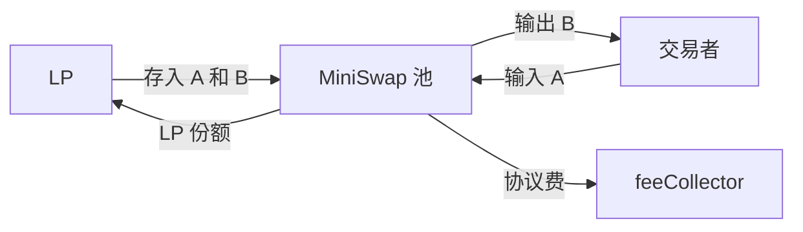
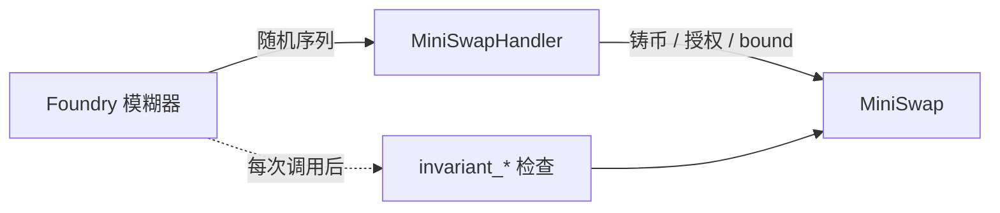

# B19 第 3 次审计：MiniSwap

> 学习目标：做完本章，你能——
> 1. 用恒定乘积公式手算一笔兑换，并说明手续费和舍入方向。
> 2. 用 Foundry 依次做无状态模糊测试、开放式不变量测试和基于 Handler 的有状态不变量测试，并解释三者的差别。
> 3. 用 Echidna 验证一条属性，并审计 DeFi 池的费率、舍入、期限和代币假设。
>
> 前置章节：[B15 第 2 次审计：LuckyPot](B15-audit-2-luckypot.md)、[B18 DEX 与 AMM](B18-dex-amm.md)
> 预计用时：8–10 小时。
> 靶场：[practice-example-code/range/miniswap/](../../practice-example-code/range/miniswap/README.md)
> 关联章节：[B18 DEX 与 AMM](B18-dex-amm.md)｜[06 算术与精度](../chapters/06-arithmetic-precision.md)｜[07 外部调用与代币](../chapters/07-external-calls-tokens.md)｜[09 MEV 与签名](../chapters/09-mev-signatures.md)｜[27 审计与测试流程](../chapters/27-audit-testing-workflow.md)｜[B25 实战项目](B25-capstone-minilend.md)｜[AMM 实验](../interactive/audit-amm.html)｜[不变量模糊测试器](../interactive/audit-fuzz.html)
> 最后核对：2026-11-10（本地运行 forge 1.5.1、Echidna 2.3.3；公开发布信息显示 Echidna 已有 2.4.0，版本不同时输出可能有差异）

> ⚠️ 警告：法律与道德边界。本章全部运行在本机。主网分叉（fork）测试只能作为只读手段，用来测试你自己的代码，不能用来攻击在线合约。未经授权不要测试任何在线协议。

---

## 开场：没有订单簿，价格从哪里来

交易所通常有买单和卖单。链上的 MiniSwap 没有。它只有一个池子，里面有两种代币。交易者把一种代币放进去，把另一种代币拿走。

<details class="predict"><summary>🤔 先猜再看：池子里有 1,000 个 A 和 1,000 个 B。你用 100 个 A 能换走 100 个 B 吗？</summary>

不能。按恒定乘积公式，你只能拿到约 90.66 个 B（已含 0.30% 手续费）。第 1 节解释原因。

</details>

## 1. 池子的两套数字

DeFi 术语（AMM、LP、滑点、价格影响）见 [B17 第 3 节](B17-defi-basics.md)。恒定乘积公式见 [B18 第 2 节](B18-dex-amm.md)。本章另外用到四个词：

| 术语 | 定义 |
|---|---|
| 储备（Reserve） | 池子账面记录的代币数量 |
| LP 份额（Share） | 代表 LP 在池子中占比的凭证 |
| Deadline | 交易的最后有效时间 |
| MEV（Maximal Extractable Value） | 通过排序交易获得的额外收益（见 [09 章](../chapters/09-mev-signatures.md)） |

### 1.1 恒定乘积公式

池子维持 `x × y = k`。如果忽略手续费，交易前后 `k` 不变。手算一次（示例）：

1. 开始：`x = 1,000`，`y = 1,000`，`k = 1,000,000`。
2. 交易者放入 `100` 个 x，`x` 变成 `1,100`。
3. 要保持 `k`，`y` 必须是 `1,000,000 ÷ 1,100 ≈ 909.09`。
4. 交易者拿走 `1,000 − 909.09 ≈ 90.91` 个 y。

交易量越大，成交价越差。这就是价格影响。

### 1.2 手续费和舍入

手续费让 `k` 随交易增长。池子只按 `输入 × (1 − 0.30%)` 计算兑换量，却收下了全部输入。

| 函数 | 问题 | 舍入方向应该 |
|---|---|---|
| `getAmountOut` | 我放入 X，能拿多少？ | 向下，少给用户 |
| `getAmountIn` | 我要拿走 Y，要放入多少？ | 向上，多收用户 |

> 🎯 打个比方：池子像天平。一边放 A，一边放 B。你每次加一些 A，就必须拿走 B，让两边的"乘积"不变小。手续费是你多放的一点点重量。
>
> 比喻的局限：真实的天平只在一点平衡。AMM 的价格随储备比例连续变化，没有"平衡点"。



读图要点：所有代币都进出同一个池子。合约里有两套数字：**储备**（账面）和**代币余额**（实际）。这两套数字不一致时，问题就来了。本章多数发现都发生在这里。

> 🧪 动手验证：打开 [AMM 实验](../interactive/audit-amm.html)，改变输入量，记录价格影响的变化。

## 2. 准备与范围

```bash
cd practice-example-code/range/miniswap  # 从 web3-security-101/ 出发，进入 MiniSwap 靶场目录
forge build # 编译；留意输出里的警告
```

预期输出里有两条警告：

```text
Warning (5667): Unused function parameter. Remove or comment out the variable name to silence this warning.
```

> 💡 注意：编译器警告是第一份免费审计线索。请记下这两条的位置。

范围：`src/MiniSwap.sol`，262 nSLOC。

写下不变量。这是本章的核心。

| 编号 | 不变量 |
|---|---|
| INV-1 | 每种代币的实际余额 ≥ 账面储备 |
| INV-2 | 任何一次交易，都不能让 `x × y` 变小 |
| INV-3 | 所有 LP 份额加起来等于 `totalSupply` |
| INV-4 | 精确输入和精确输出两种报价，收取同样的手续费 |

## 3. 模糊测试三级跳

**模糊测试**（Fuzzing）：程序生成大量随机输入，检查规则是否被打破。

| 类型 | 一次运行做什么 | 能发现什么 |
|---|---|---|
| 无状态模糊测试（Stateless Fuzz） | 一次调用，随机参数 | 单个函数的边界错误 |
| 开放式不变量测试（Open Invariant） | 随机调用目标合约的函数 | 只有不需要准备的路径 |
| Handler 式有状态不变量测试 | 通过 Handler 调用，序列中带合法准备 | 需要多步才能触发的错误 |

### 3.1 第一级：无状态模糊测试

打开 `test/Fuzz.t.sol`。测试检查 INV-4：买入 `out` 所需的金额，应该接近卖出得到 `out` 所投入的金额。

```bash
# 只跑 QuoteFuzz：检查两种报价是否一致（INV-4）
forge test --match-contract QuoteFuzz
```

预期结果（一个失败、一个通过）：

```text
[FAIL: exact-out is cheaper than exact-in: 1994618379513851 < 1999999999999998; counterexample: ... args=[1000000000000000000000000 [1e24]]] testFuzz_QuotesAgree(uint256) (runs: 0, ...)
[PASS] testFuzz_QuotesAgree(uint256) (runs: 256, ...)
```

`counterexample` 是让规则失败的具体输入。第 1 行来自漏洞版，第 2 行来自修复版。你看到的数字可能不同，取决于本地的失败缓存（`cache/test-failures`）。

<details class="predict"><summary>🤔 先猜再看：这次失败揭示的是哪一个数字写错了？</summary>

暂时保留答案。先去看 `getAmountIn` 的分母。第 4 节的 MS-01 提示会逐级解释。

</details>

### 3.2 第二级：开放式不变量测试

不变量测试让模糊器连续调用一串函数，每次调用后检查不变量。

打开 `test/Invariant.t.sol` 底部的 `OpenInvariant`。它用 `targetContract(address(pool))` 直接把池子交给模糊器。

```bash
forge test --match-contract OpenInvariant # 只跑开放式不变量：模糊器直接调用池子
```

预期输出：

```text
[PASS] invariant_open_BalanceCoversReserves() (runs: 128, calls: 4096, reverts: 3729)
| MiniSwap | swapExactIn         | 369   | 369     | 0        |
| MiniSwap | swapExactOut        | 338   | 338     | 0        |
| MiniSwap | addLiquidity        | 358   | 358     | 0        |
| MiniSwap | collectProtocolFees | 333   | 332     | 0        |
```

<details class="predict"><summary>🤔 先猜再看：测试通过了。这说明 INV-1 成立吗？</summary>

不说明。看表格：`swapExactIn` 调用 369 次，回滚 369 次。没有一次交易成功。随机地址没有代币，也没有授权，所以 4,096 次调用里有 3,729 次（91%）回滚。这个 PASS 几乎没有测试价值。

</details>

> ⚠️ 警告：一定要看 `reverts` 列。回滚率高的不变量测试会给你虚假的安全感。

### 3.3 第三级：Handler 式有状态不变量测试

**Handler** 是你写的中间合约。它替模糊器准备合法的状态：铸造代币、设置授权、把随机数约束到合理范围。



读图要点：模糊器不再直接接触池子。Handler 的每个函数表示一个用户动作。`bound(x, a, b)` 把随机数映射到 `[a, b]`。Handler 也记录"影子变量"，例如 `kDropped`。

阅读 `MiniSwapHandler`，注意 3 件事：

1. 它用 `vm.prank` 扮演 LP、交易者和费用接收者。
2. `swapOut` 用 `bound` 把金额限制在合理范围内。
3. `setUp` 里，种子储备是 `1e12` 和 `1e24`。这模拟一个 6 位小数代币和一个 18 位小数代币的交易对。

运行漏洞版：

```bash
# Handler 式不变量（漏洞版）；-vv 打印失败序列
forge test --match-contract HandlerInvariantVulnerable -vv
```

预期输出（节选）：

```text
[FAIL: reserve0 is not backed: 1256668619687 < 1256859874465]
	[Sequence] (original: 13, shrunk: 2)
		... calldata=swapOut(bool,uint256) args=[false, 999999999999999999999999999 [9.999e26]]
		... calldata=collectFees() args=[]
 invariant_BalanceCoversReserves() ...
[FAIL: a swap reduced k]
	[Sequence] (original: 4, shrunk: 1)
		... calldata=swapOut(bool,uint256) args=[true, 5212]
 invariant_SwapNeverShrinksK() ...
```

**序列缩减**（Shrinking）：模糊器把失败序列缩短，便于阅读。第一个失败从 13 步缩减到 2 步：一次交易，一次收取协议费。

> 💡 注意：再次运行时，输出会变成 `invariant_... replay failure`。Foundry 把上次找到的失败序列存在 `cache/invariant/failures`，下次直接重放。想重新看到完整序列，先删除 `cache/invariant` 目录（`rm -rf cache/invariant`）再运行。模糊测试 `QuoteFuzzVulnerable` 同理，它的反例存在 `cache/fuzz`。

运行修复版：

```bash
forge test --match-contract HandlerInvariantFixed # 同一套不变量，换成修复版
```

预期输出：

```text
[PASS] invariant_BalanceCoversReserves() (runs: 128, calls: 4096, reverts: 133)
[PASS] invariant_SharesAddUp() (runs: 128, calls: 4096, reverts: 134)
[PASS] invariant_SwapNeverShrinksK() (runs: 128, calls: 4096, reverts: 135)
Suite result: ok. 3 passed; 0 failed; 0 skipped
```

reverts 的数字每次运行会在 133–135 之间浮动。回滚只有约 3%，全部来自 `addLiquidity`。对比开放式的 91%，这才是有价值的测试。

> 🧪 动手验证：打开[不变量模糊测试器](../interactive/audit-fuzz.html)。把序列长度从 1 改到 10，记录发现错误需要的步数。

### 3.4 用 Echidna 验证一条属性

**Echidna** 是 Crytic 开发的模糊测试工具。它用 `echidna_` 开头的函数定义属性，返回 `false` 表示属性被打破。

1. 确认已安装：

```bash
echidna --version # 确认 Echidna 已安装并查看版本
```

本章使用 `Echidna 2.3.3`。没有安装时可用 Homebrew：`brew install echidna`。

2. 打开 `test/echidna/EchidnaMiniSwap.sol`。属性如下：

```solidity
// Echidna 属性：以 echidna_ 开头，返回 false 即被打破
function echidna_balance_covers_reserve0() public view returns (bool) {
    // INV-1：实际余额必须覆盖账面储备
    return token0.balanceOf(pool) >= _reserve0();
}
```

3. 对漏洞版运行：

```bash
# 对漏洞版运行；--contract 选属性合约，--config 指定参数
echidna test/echidna/EchidnaMiniSwap.sol --contract EchidnaMiniSwap --config test/echidna/config.yaml
```

预期输出（节选）：

```text
[Worker 0] Test echidna_balance_covers_reserve0 falsified!
  Call sequence:
EchidnaMiniSwap.swap0For1(5810429...)
EchidnaMiniSwap.collect()
...
call 0xee35...F221::reserve0()
 └╴← (1000000000000001000000)
call MockToken::balanceOf(address)(0xee35...F221)
 └╴← (1000000000000000999500)
```

账面储备比实际余额多 500 wei。Echidna 的序列和 Foundry 的缩减序列结构相同：先交易，再收取协议费。

4. 对修复版运行：

```bash
# 换成修复版，期望属性保持 passing
echidna test/echidna/EchidnaMiniSwap.sol --contract EchidnaMiniSwapFixed --config test/echidna/config.yaml
```

预期输出：

```text
echidna_balance_covers_reserve0: passing
Total calls: 20078
```

5. 删除生成的文件：

```bash
rm -rf echidna-corpus crytic-export # 删除语料库和编译缓存
```

> 💡 注意：模糊测试的 PASS 只表示"这些次运行没有发现反例"。它不是证明。

## 4. 分阶段提示

下面的发现按审计中更容易遇到的顺序排列。

### MS-01

<details class="predict"><summary>🤔 提示 1：对比 getAmountOut 和 getAmountIn 中手续费的写法。</summary>

一个用命名常量 `SWAP_FEE_BPS`，另一个用字面量。

</details>

<details class="predict"><summary>🤔 提示 2：BPS - 3 是多少？它代表多大的手续费？</summary>

`9,997 / 10,000`，也就是 0.03%。文档规定 0.30%。

</details>

<details class="predict"><summary>🤔 完整发现：MS-01 手续费常量错误（ARI-8）</summary>

```solidity
// 根因：BPS - 3 即 9997/10000，只收 0.03%；应使用 SWAP_FEE_BPS
// ❌ 漏洞
return (reserveIn * amountOut * BPS) / ((reserveOut - amountOut) * (BPS - 3));
```

精确输出的交易只付十分之一的手续费。理性交易者都会选择 `swapExactOut`。

</details>

### MS-02

<details class="predict"><summary>🤔 提示 1：协议费记到了哪里？储备增加了多少？</summary>

看 `_settleSwap`：`protocolFees0 += protocolFee;` 和 `reserve0 += amountIn;`。两者加起来是多少？

</details>

<details class="predict"><summary>🤔 提示 2：collectProtocolFees 转走代币后，储备变了吗？</summary>

没有。协议费被计入了两次：一次在储备里，一次在 `protocolFees` 里。

</details>

<details class="predict"><summary>🤔 完整发现：MS-02 协议费破坏储备不变量（DFI-1）</summary>

```solidity
protocolFees0 += protocolFee;  // 协议费单独记账，等待 feeCollector 取走
reserve0 += amountIn;          // ❌ 漏洞：协议费也算进了 LP 储备
// 修复：reserve0 += amountIn - protocolFee;
```

收取协议费后，账面储备大于实际余额。最后一个 LP 无法退出。修复：`reserve0 += amountIn - protocolFee;`。

</details>

### MS-03

<details class="predict"><summary>🤔 提示 1：getAmountIn 的结果应该向哪个方向舍入？代码用的是哪个方向？</summary>

向上。代码做整数除法，向下舍入。

</details>

<details class="predict"><summary>🤔 提示 2：当 reserveIn 远小于 reserveOut 时，amountOut 很小，分子分母的比值是多少？</summary>

小于 1，整数除法得 0。`amountIn` 是 0，也没有检查。

</details>

<details class="predict"><summary>🤔 完整发现：MS-03 舍入方向错误（ARI-5）</summary>

`1e12` 和 `1e24` 的池子里，买 `1e11` 的 B 需要 0 个 A。修复：结果加 1 或用向上取整。

</details>

### MS-04

<details class="predict"><summary>🤔 提示 1：第 2 节的两条编译器警告指向哪些函数？</summary>

`addLiquidity` 和 `swapExactOut` 的 `deadline` 参数。

</details>

<details class="predict"><summary>🤔 提示 2：对比 swapExactIn 和 swapExactOut 的修饰符。</summary>

`swapExactIn` 和 `removeLiquidity` 有 `beforeDeadline(deadline)`。`swapExactOut` 和 `addLiquidity` 没有。

</details>

<details class="predict"><summary>🤔 完整发现：MS-04 Deadline 被忽略（MEV-1）</summary>

```solidity
// 有 deadline 参数，修饰符却只有 guarded，缺少 beforeDeadline
// ❌ 漏洞
function swapExactOut(..., uint256 deadline) external guarded returns (uint256 amountIn) {
```

用户交易可能在内存池中等待很久。过期后成交的价格可能已大幅偏离。

</details>

### MS-05、MS-06

<details class="predict"><summary>🤔 提示 1：文档写"可以使用任意 ERC-20"。什么样的 ERC-20 会让"转入 N，收到 N"不成立？</summary>

收税代币（Fee-on-Transfer），转账时扣除一部分。

</details>

<details class="predict"><summary>🤔 提示 2：什么样的代币余额会在没有转账时变化？</summary>

变基代币（Rebasing Token），余额由合约规则自动增减。

</details>

<details class="predict"><summary>🤔 完整发现：MS-05 收税代币、MS-06 变基代币（EXT-4）</summary>

- MS-05：`_pull` 之后按 `amountIn` 记账，不按实际到账记账。1% 收税代币的池子，账面 1000e18，实际 990e18。
- MS-06：储备是缓存值，变基后不同步。负向变基导致 LP 退出失败；正向变基的收益无人能领。

</details>

## 5. 发现清单

| 编号 | 标题 | 严重性 | 检查项 | 发现手段 |
|---|---|---|---|---|
| MS-01 | 精确输出的手续费是 0.03% | High | ARI-8 | 无状态模糊测试 |
| MS-02 | 协议费重复计入储备，破坏不变量 | High | DFI-1 | Handler 不变量、Echidna |
| MS-03 | `getAmountIn` 向下舍入，可零成本取出 | Medium | ARI-5 | Handler 不变量 |
| MS-04 | `swapExactOut` 和 `addLiquidity` 忽略 deadline | Medium | MEV-1 | 编译器警告、人工 |
| MS-05 | 收税代币导致账面大于余额 | Medium | EXT-4 | 人工、PoC |
| MS-06 | 变基代币导致储备失步 | Medium | EXT-4 | 人工、PoC |

```bash
forge test --match-path test/PoC.t.sol # 运行 PoC 文件，逐条复现 MS-01 至 MS-06
```

预期输出的最后一行：

```text
Ran 2 test suites ...: 12 tests passed, 0 failed, 0 skipped (12 total tests)
```

> 💡 注意：运行不带过滤参数的 `forge test` 时，`QuoteFuzzVulnerable` 和 `HandlerInvariantVulnerable` 会失败。这是预期结果：失败就是漏洞证据。

> 🪞 反思：你的合约有哪些"账面数字"和"实际余额"并存？你测试过两者不一致时会发生什么吗？

## 6. 完整示范报告

````markdown
# MiniSwap 安全审计报告

- 版本：src/MiniSwap.sol（记录 SHA-256）
- 方法：人工审查、Foundry 无状态模糊测试、Handler 不变量测试、Echidna 2.3.3、PoC
- 信任假设：owner 可暂停交易和更换 feeCollector。

## 摘要

| 严重性 | 数量 |
|---|---|
| High | 2 |
| Medium | 4 |

## [H-01] 精确输出的手续费是 0.03%（MS-01）

**位置**：`getAmountIn()`

**描述**：分母使用 `BPS - 3`，而文档和 `getAmountOut` 使用 0.30%。

**影响**：LP 损失 90% 的手续费。PoC 中 1,000/1,000 的池子买 10 个代币，应收 10.1314 个，实收 10.1040 个，每笔少收 0.0274 个。

**PoC**：`forge test --match-test test_MS01 -vv`

**建议**：

```solidity
return (reserveIn * amountOut * BPS) / ((reserveOut - amountOut) * (BPS - SWAP_FEE_BPS)) + 1; // ✅ 修复
```

## [H-02] 协议费重复计入储备（MS-02）

**位置**：`_settleSwap()`、`collectProtocolFees()`

**描述**：协议费既计入 `reserve`，又计入 `protocolFees`。收取时只减少余额。

**影响**：账面储备大于余额。LP 按份额计算的退款超过合约持有的代币，最后的 LP 无法退出。PoC 中储备 1,100.00，余额 1,099.95，`removeLiquidity` 回滚。

**PoC**：`forge test --match-test test_MS02 -vv`；Handler 不变量 `invariant_BalanceCoversReserves`。

**建议**：`reserve += amountIn - protocolFee;`

## [M-01] getAmountIn 向下舍入（MS-03）

**位置**：`getAmountIn()`

**描述**：整数除法向下舍入，且结果为 0 时不回滚。

**影响**：储备比例悬殊时，买方能零成本拿走代币，`x × y` 变小。单笔金额小，定级为 Medium。

**PoC**：`forge test --match-test test_MS03 -vv`；Handler 不变量 `invariant_SwapNeverShrinksK`。

**建议**：向上取整。

## [M-02] deadline 被忽略（MS-04）

**位置**：`swapExactOut()`、`addLiquidity()`

**描述**：两个函数接收 `deadline`，但不检查。

**影响**：过期交易仍会成交，用户失去时间保护，增加被排序利用的空间。

**PoC**：`forge test --match-test test_MS04 -vv`

**建议**：加 `beforeDeadline(deadline)` 修饰符。

## [M-03] 收税代币导致账面大于余额（MS-05）

**位置**：`addLiquidity()`、`_settleSwap()`

**描述**：合约按请求金额记账，不按实际到账记账。

**影响**：PoC 中账面 1,000 个，余额 990 个。最后的 LP 无法退出。

**PoC**：`forge test --match-test test_MS05 -vv`

**建议**：比较转账前后余额，或拒绝这类代币。

## [M-04] 变基代币导致储备失步（MS-06）

**位置**：`reserve0`、`reserve1`

**描述**：储备是缓存值，合约没有同步机制。

**影响**：负向变基（PoC：−10%）时 LP 无法退出。正向变基的收益留在合约内，无人能领。

**PoC**：`forge test --match-test test_MS06 -vv`

**建议**：文档声明不支持变基代币，并提供 `sync()` 恢复路径。

## 修复复查

`solution/MiniSwapFixed.sol` 修复了全部 6 项。复查证据：`MiniSwapFixTest`（6 个测试通过）；`QuoteFuzzFixed`、`HandlerInvariantFixed` 和 Echidna 的 `EchidnaMiniSwapFixed` 均通过。
残余限制：`MiniSwapFixed` 拒绝收税代币存入流动性，变基代币仍不受支持，`sync()` 只是恢复路径。
````

## 7. 如果出错

| 现象 | 原因 | 处理 |
|---|---|---|
| `forge test` 显示多个失败 | 运行了含漏洞版的模糊和不变量测试 | 这是预期结果。见第 5 节的过滤命令 |
| 不变量全部通过，且 `reverts` 接近总数 | Handler 没有成功发起调用 | 检查 Handler 的铸币、授权和 `targetContract` |
| 不变量结果和本章不同 | `foundry.toml` 的 `seed` 被改动 | 恢复 `seed = "0x7"`，或删除 `cache/invariant` |
| `echidna: command not found` | 没有安装 | `brew install echidna`，或用 [官方 Release](https://github.com/crytic/echidna/releases) |
| Echidna 报编译错误 | 系统 `solc` 低于 0.8.20 | 用 `solc-select` 切换到 0.8.20 或更高 |
| Echidna 结果里有旧语料的干扰 | `echidna-corpus` 残留 | 删除该目录后重跑 |
| `Source not found` | `lib/forge-std` 软链接失效 | 在 `web3-security-101/` 目录运行 `bash practice-example-code/setup.sh` |

## 8. 过关标准

- [ ] `forge test --match-path test/PoC.t.sol` 显示 `12 tests passed, 0 failed`。
- [ ] `HandlerInvariantVulnerable` 失败 2 项，`HandlerInvariantFixed` 通过 3 项。
- [ ] 能解释开放式测试 PASS 为什么没有价值，并引用 3,729/4,096 这个数字。
- [ ] Echidna 对漏洞版给出 `falsified`，对修复版给出 `passing`。
- [ ] 能手算 `1,000/1,000` 的池子放入 100 个 A 的输出，误差小于 1。
- [ ] 完成包含全部 6 项发现的报告。

## 思考题

1. 为什么 MS-01 能被无状态模糊测试发现，而 MS-02 需要有状态测试？
2. `invariant_SwapNeverShrinksK` 用影子变量 `kDropped` 记录违规，而不是在不变量函数里直接比较前后的 `k`。为什么？`addLiquidity` 和 `removeLiquidity` 会造成什么影响？
3. 修复版的 `sync()` 允许任何人调用。这会带来什么风险？如果限制为 owner 才能调用，又有什么代价？
