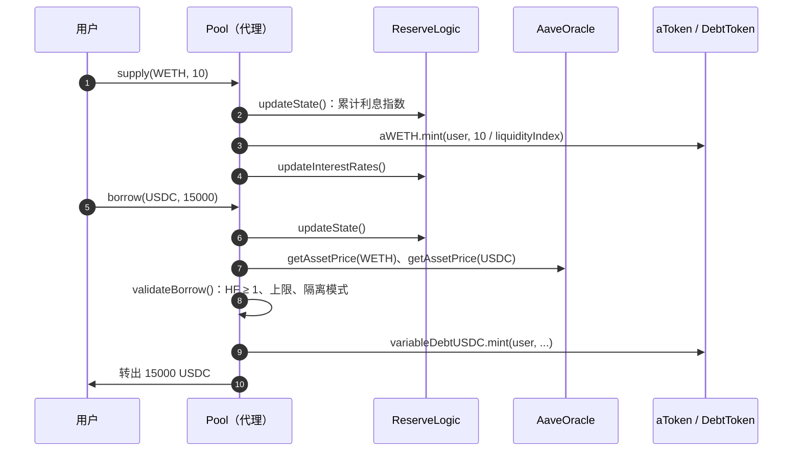

# B20 借贷与 CDP：抵押、利率与清算

> 学习目标：计算健康因子和清算价格；画出 Aave 的存借调用链；理解利率拐点模型；识别清算相关漏洞。  
> 前置章节：[B17](B17-defi-basics.md)、[B18](B18-dex-amm.md)  

> 🔗 关联：主线 [08 章](../chapters/08-oracle-flashloan.md)、[11 章](../chapters/11-defi-economic-security.md) ｜ 实验 [健康因子](../interactive/audit-lending.html)、[检查覆盖矩阵](../interactive/audit-hfmatrix.html) ｜ 评估 [A04](../assessment/A04-defi-protocol-review.md) ｜ 衔接 [B38](B38-case-aave-v3.md)

## 1. 一句话理解

**超额抵押借贷：用户存入价值更高的抵押物，借出较少的资产。抵押物价格下跌到阈值以下时，任何人都可以替他还债，并以折扣价拿走抵押物。**

> 🎯 打个比方：当铺。你押一块价值 1,000 元的手表，借 700 元。手表行情跌到 800 元时，当铺允许路人替你还 700 元，然后以 9 折价格把手表卖给这个路人。路人赚差价，当铺不亏本。

## 2. 三大协议对比

|  | MakerDAO（Sky） | Aave V2 / V3 | Compound V2 / V3 |
|---|---|---|---|
| 模型 | CDP：抵押后铸造 DAI（2024 年 8 月更名 Sky 后新增 USDS，[来源](https://blockworks.co/news/maker-rebrands-as-sky-dai-will-be-changed-to-usds)） | 资金池：存款人借给借款人 | V2 资金池 + cToken；V3（Comet）单一基础资产 |
| 存款凭证 | Vault（不可转让） | aToken（余额随利息增长） | cToken（汇率随利息增长） |
| 清算方式 | Liquidation 2.0：荷兰式拍卖 | 固定折扣，close factor 50%（可清算 100% 的条件见 [B38 第 5 节](B38-case-aave-v3.md)） | 固定折扣；V3 由协议吸收抵押物再出售 |
| 特色 | 稳定费、PSM、DSR（Sky 体系为 SSR） | V3：eMode、隔离模式、供应/借款上限、门户 | V3：基础资产与抵押资产分离，抵押物不生息 |
| 历史事件 | 2020 年 3 月"黑色星期四"：网络拥堵，部分拍卖以 0 DAI 成交，协议出现数百万美元坏账：事发当天[治理论坛](https://forum.skyeco.com/t/black-thursday-response-thread/1433)估算约 400 万美元；事后各方估算为约 450 万（[Glassnode](https://research.glassnode.com/what-really-happened-to-makerdao/)）到至多 665 万 DAI（[Cointelegraph](https://cointelegraph.com/news/maker-debt-crisis-post-mortem-recommends-new-safeguards) 转述 Maker 报告）；随后的 MKR 债务拍卖筹得约 530 万 DAI（[Blockonomi](https://blockonomi.com/makerdao-emergency-5-million-dai-raised/)） | 多个分叉被攻击（舍入、价格源） | V2 分叉的空市场汇率攻击（Hundred、Sonne）；2021 年 9 月 Comptroller 升级 bug 多发放 COMP（[来源](https://www.theblock.co/post/119086/compound-bug-comp-risk-misreward)） |

## 3. 核心公式

```
健康因子 HF = Σ(抵押物ᵢ × 价格ᵢ × 清算阈值ᵢ) / 总债务价值
HF < 1  → 可被清算
清算价格（单一抵押物）= 债务 / (抵押数量 × 清算阈值)
清算人收益 = 偿还债务 × 清算奖励（例如 5%）

利率拐点模型（Aave / Compound 通用思路）
利用率 U = 总借款 / 总存款
U ≤ U_opt: 借款利率 = base + slope1 × U / U_opt
U > U_opt: 借款利率 = base + slope1 + slope2 × (U − U_opt) / (1 − U_opt)
存款利率 = 借款利率 × U × (1 − 储备因子)
```

> 🧪 交互实验：[健康因子与利率模型](../interactive/audit-lending.html)

## 4. 一次存借的调用链（Aave V3 简化）



**读图要点：**

- 每个动作之前都先更新利息指数。漏掉更新 = 用旧指数计息 = 有人白赚利息。
- 价格在 validate 阶段读取。预言机是整个流程最敏感的外部依赖。
- 余额是"缩放后"存储的（scaled balance × index）。缩放与反缩放的取整方向必须一致有利于协议。

> 💡 项目实例：[B38 Aave V3 入口 × 检查覆盖](B38-case-aave-v3.md)。

## 5. 借贷协议漏洞模式

| 模式 | 描述 | 案例 |
|---|---|---|
| 预言机操纵 | 抬高抵押物价格，超额借款 | Cream 2021（约 1.3 亿美元，事发时估值，[复盘](https://medium.com/cream-finance/post-mortem-exploit-oct-27-507b12bb6f8e)）；Mango Markets 2022（约 1.1 亿美元，事发时估值，[CFTC](https://cftc.gov/node/243761)） |
| 缺少健康检查 | 某个改变抵押或债务的函数忘了检查 HF | Euler 2023：`donateToReserves` 不检查健康度（约 1.97 亿美元，事发时估值；完整路径见 [11 章](../chapters/11-defi-economic-security.md) 2.3 节；资金归还见 [The Block](https://www.theblock.co/post/249413/euler-finance-whitehat-unknowingly-caused-200-million-hack)） |
| 空市场汇率操纵 | 新市场 totalSupply 极小，捐赠抬高汇率 | Hundred 2023（[来源](https://cointelegraph.com/news/hundred-finance-loses-7-million-in-optimism-hack)）、Sonne 2024（[复盘](https://medium.com/@SonneFinance/post-mortem-sonne-finance-exploit-12f3daa82b06)） |
| 重入 | 借款转账回调时状态未更新 | Fei Rari 2022（[来源](https://www.theblock.co/post/144511/hackers-steal-80-million-from-rari-capitals-lending-pools)）、Lendf.Me 2020（ERC777，[来源](https://quantstamp.com/blog/how-the-dforce-hacker-used-reentrancy-to-steal-25-million)） |
| 清算不可执行 | 抵押物太小，清算 Gas 高于收益 → 坏账累积；或清算路径因暂停、黑名单 revert | 常见于竞赛报告 |
| 利息累计漏更新 | 参数修改前没有结算利息 | 常见于竞赛报告 |
| 自清算获利 | 同一用户既当借款人又当清算人，套取奖励 | 常见于竞赛报告 |

> 🪞 反思：想一个你了解的借贷仓位或协议。
> 1. 抵押品价格下跌多少时会被清算？
> 2. 清算时，预言机失效会怎样？
> 3. 你的协议里，有哪个入口会增加风险却不检查健康度？

## 6. 思考题

1. 在清算实验里，清算奖励设为 15%、清算阈值设为 90%。价格刚触发清算时，协议还会不会有坏账？
2. 利率模型中把 slope2 设为 300%。为什么协议要让高利用率区间的利率陡增？
3. Euler 事件中，为什么"捐赠"能让一个账户进入可被清算状态，而清算人又能从中获利？
