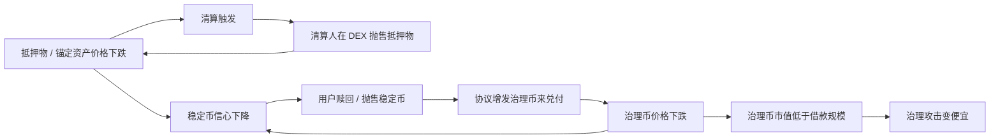

# B22 经济模型风险：代码没错，公式错了

> 学习目标：识别死亡螺旋、清算级联、治理攻击三类经济风险；用"操纵成本 vs 收益"评估攻击可行性；了解经济模拟工具。  
> 前置章节：[B17](B17-defi-basics.md)、[B18](B18-dex-amm.md)、[B20](B20-lending-cdp.md)、[11 DeFi 经济安全](../chapters/11-defi-economic-security.md)  

> 🔗 关联：主线 [11 章](../chapters/11-defi-economic-security.md) ｜ 实验 [死亡螺旋](../interactive/audit-spiral.html)、[治理攻击](../interactive/audit-governance.html) ｜ 评估 [A04](../assessment/A04-defi-protocol-review.md)、[A05](../assessment/A05-listing-due-diligence.md) ｜ 衔接 [B23](B23-complex-protocols.md)

## 1. 一句话理解

**经济漏洞是"代码完全按设计运行，但设计在某些市场状态下会自我毁灭"。审计员要在极端行情、极端资金量和恶意参与者三种条件下推演模型。**

## 2. 经济风险因果图



**读图要点：**

- 图中有两个正反馈环：清算级联（P→L→S→P）和死亡螺旋（D→R→M→G→D）。正反馈环在极端行情下自我加速。
- 2022 年 5 月 UST/LUNA：UST 赎回需要增发 LUNA。大额赎回让 LUNA 供应量在几天内从约 3.4 亿枚增至约 6.5 万亿枚，LUNA 价格近乎归零，UST 严重脱锚（[来源](https://calebandbrown.com/blog/a-week-of-terra-ust-and-luna-collapse-explained)）。
- 局限：模拟依赖参数假设（流动性深度、恐慌速度）。模拟结果是方向判断，不是精确预测。

> 🧪 交互实验：[算法稳定币死亡螺旋](../interactive/audit-spiral.html)

## 3. 治理风险

2022 年 4 月，Beanstalk 被闪电贷治理攻击，协议损失约 1.8 亿美元（事发时估值）。根因是投票权按当前余额计算，并且紧急通道可以在同一笔交易内执行提案。完整路径见 [11 章](../chapters/11-defi-economic-security.md) 3.1 节。

> 🧪 交互实验：[闪电贷治理攻击与防御](../interactive/audit-governance.html)

治理审计清单见 [11 章](../chapters/11-defi-economic-security.md) 3.2 节。学术参考：路线图列出的 arXiv 2308.04267（DeFi 治理风险研究）。

## 4. 操纵成本 vs 收益

```
攻击可行 ⇔ 收益 > 成本
成本 = 推动价格所需的滑点损失 + 手续费 + 维持时间的资金成本 + 套利者反向交易的损失
收益 = 借款上限提高部分 / 清算收益 / 套利收益
关键变量: 池子流动性深度、预言机窗口长度、借款上限、协议 TVL
```

审计时给出一个数字："以当前流动性，操纵价格 20% 约需 X 美元成本，可借出 Y 美元。"这比"价格可能被操纵"有说服力得多。

## 5. 经济建模工具（路线图原文条目）

| 工具 | 用途 |
|---|---|
| Euler Oracle Manipulation Tool | 计算操纵 Uniswap V3 TWAP 的成本 |
| Chaos Labs Uniswap V3 TWAP 风险 | 评估 TWAP 预言机的操纵风险 |
| Agent Buttercup（Cozy Finance） | 基于代理的模拟引擎 |
| curvesim | Curve 池参数模拟 |
| DELV elf-simulations | 基于代理的模拟 |
| Uniswap V3 模拟器（多个开源实现） | 集中流动性回测 |
| DeFi-Risk-Modelling-Awesome | 经济风险资料汇总 |

> 🪞 反思：选一个你了解的协议经济设计。
> 1. 在什么行情下它会自我放大亏损？
> 2. 操纵它的成本和收益各是多少？
> 3. 提案通过后，用户有多少时间退出？

## 6. 思考题

1. 在死亡螺旋模拟中，把"首轮赎回比例"从 5% 调到 15%，其余取默认值。治理币价格跌破初始一半的时间提前了几轮？这说明了什么？
2. 治理攻击实验中，只打开"投票快照"，不加时间锁。闪电贷攻击还有效吗？攻击者还能怎么做？
