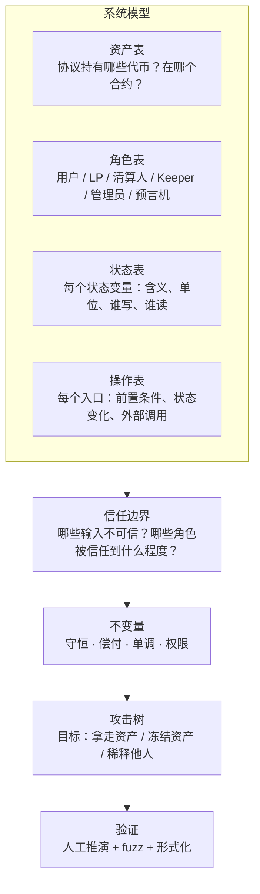

# B23 拆解复杂 DeFi 协议：建模、不变量与模糊测试

> 学习目标：对一个从没见过的协议完成系统建模；写出不变量并用模糊测试寻找反例。  
> 前置章节：[B22 经济模型风险](B22-economics-governance.md)、[B19 MiniSwap](B19-audit-3-miniswap.md)（模糊测试与不变量）；[B35 底稿方法](B35-case-method.md) 可选（阶段 5 学）  

> 🔗 关联：主线 [27 章](../chapters/27-audit-testing-workflow.md)、[11 章](../chapters/11-defi-economic-security.md) ｜ 实验 [模糊测试](../interactive/audit-fuzz.html) ｜ 评估 [A01](../assessment/A01-methodology.md)、[A04](../assessment/A04-defi-protocol-review.md) ｜ 衔接 [B31](B31-automation-tools.md)、[B35](B35-case-method.md)

## 1. 一句话理解

**原创协议没有"已知漏洞清单"可对照。你需要先把它抽象成"资产 + 角色 + 状态 + 操作"，再写下必须永远成立的性质，然后想办法打破它。**

## 2. 建模四张表



**读图要点：**

- 状态表里的"单位"一栏很重要。大量漏洞是单位混淆：份额 vs 资产、缩放 vs 未缩放、6 位 vs 18 位小数。
- 攻击树从目标倒推：要拿走资产，需要"抬高份额价值"或"降低债务"或"绕过权限"，再逐层细化。
- 局限：模型是对代码的抽象。模型与代码不一致的地方，本身就是需要检查的风险点。

## 3. 不变量的四种类型

| 类型 | 例子 |
|---|---|
| 守恒 | Σ 用户余额 = totalSupply；协议资产 = 存款 − 取款 + 利息 |
| 偿付能力 | 合约持有资产 ≥ 所有用户可赎回资产之和 |
| 单调性 | 利息指数只增不减；nonce 只增不减 |
| 权限与状态机 | 只有清算人能在 HF 低于 1 时清算；已关闭的市场不能再借款 |

## 4. 模糊测试找反例

下面的实验是一个玩具金库。其中藏了一个取整方向错误。点击"开始模糊测试"，工具会随机生成操作序列，检查"偿付能力"不变量，并自动缩减出最短反例。

> 🧪 交互实验：[不变量模糊测试器](../interactive/audit-fuzz.html)

*对应的 Foundry 不变量测试（handler 模式）*

```solidity
contract Handler is Test {
    // ghost 变量：测试侧独立记账，用于和协议账本对照
    Vault vault; address[] actors; uint256 public ghostDeposited;
    function deposit(uint256 actorSeed, uint96 amt) external {
        // 用种子选择一个参与者，模拟多用户
        address a = actors[actorSeed % actors.length];
        // bound 把随机输入压到合理区间，减少无效回滚
        amt = uint96(bound(amt, 1, 1e24));
        vm.prank(a); vault.deposit(amt);
        ghostDeposited += amt;   // 只在调用成功后更新 ghost
    }
    function withdraw(uint256 actorSeed, uint256 shares) external { /* bound + prank */ }
}

contract VaultInvariants is Test {
    // fuzzer 只调用 Handler 的函数
    function setUp() public { /* 部署 vault 与 handler */ targetContract(address(handler)); }
    function invariant_solvent() public view {
        uint256 owed;
        // 所有份额按当前价格可赎回的资产总和
        for (uint i; i < actors.length; i++) owed += vault.previewRedeem(vault.balanceOf(actors[i]));
        // 不变量：金库持有的资产足以兑付全部份额
        assertGe(token.balanceOf(address(vault)), owed);
    }
}
```

> 🪞 反思：选一个你最熟悉的协议。
> 1. 不看文档，你能写出三条不变量吗？
> 2. 其中哪一条被测试覆盖了？
> 3. 如果测试通过，你的结论能说到哪一步？

## 5. 思考题

1. 反例序列被缩减到几步？哪一步是"取整套利"的核心？
2. 切换到"修复版"后再跑 2,000 轮。没有找到反例，能证明金库安全吗？形式化验证能多给你什么？
