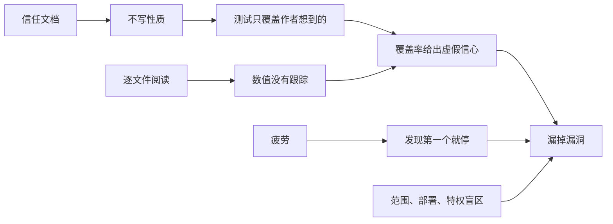

# B29 为什么会漏掉漏洞

> 学习目标：读完本章，你能——
> 1. 说出 9 种审计员漏掉漏洞的机制。
> 2. 为每种机制选择一个具体的对策。
> 3. 用清单检查自己的一次审计，并练习攻击者的思维方式。
>
> 前置章节：[B28 高频漏洞模式库](B28-bug-patterns.md)、[B27 专业审计流程](B27-what-is-audit.md)
> 预计时间：60 分钟阅读，60 分钟练习。
> 配套靶场：[practice-example-code/range/thinkaloud](../../practice-example-code/range/thinkaloud) ｜ 跟审实录：[B30](B30-think-aloud.md)

> ⚠️ 警告：本章的练习只针对本地靶场、你自己的代码和已授权的代码。攻击者思维是审计方法，不是对未授权目标动手的理由。

---

## 开场：审计通过，然后出事了

一个团队拿到干净的审计报告。上线三个月后，资金被盗。复盘时，漏洞就在报告审过的文件里。

🤔 先猜再看：审计员最可能是因为"看不懂代码"才漏掉的吗？

通常不是。常见原因是注意力和假设：审计员看过那一行，但相信了文档，或者已经找到一个问题就转向下一个函数，或者没有把数值追到另一个合约。本章把这些原因拆成可以检查的机制。本章的分析是作者的经验归纳，不是统计研究。

## 1. 一句话理解

**漏掉漏洞大多不是知识问题，是流程问题：审计员的注意力被某个东西带走了。**

> 🎯 打个比方：校对自己写的文章时，你的眼睛读到的是你想写的内容，不是纸上的内容。审计也一样。审计员读到的常常是代码"应该"做的事。
>
> 比喻的局限：错别字不会反击。代码的攻击者会专门寻找你没有看的地方。

---

## 2. 九种漏掉漏洞的机制

每种机制按"怎样发生 → 小例子 → 对策"组织。例子都是本手册自拟的。

### 2.1 范围盲区（Scope Blind Spot）

**怎样发生：** 审计员只读范围列表里的文件。漏洞在范围内外的接缝上。

**小例子（示例）：** 范围是 `Vault.sol`。`Vault` 调用范围外的 `Adapter.sol`。`Adapter` 的返回值单位是 6 位精度，`Vault` 按 18 位理解。

**对策：**

1. 画出所有跨越范围边界的调用。
2. 对每个接口写下"假定对方保证什么"。
3. 把这些假定写进报告的"信任假设"一节。

### 2.2 抄来的假设（Assumptions Copied from Docs）

**怎样发生：** 文档写"用户只能在冷却期后退出"。审计员把这句话当作事实，于是不再验证。

**小例子：** [B30](B30-think-aloud.md) 的 `MooringPool` 文档声称 7 天冷却期。代码只在首次排队时设置时间戳。追加的金额继承了旧时间。

**对策：**

1. 把文档的每句保证改写成一条待验证的性质。
2. 每条性质至少对应一个测试。
3. 代码和文档冲突时，以代码为准，并把冲突记录下来。

### 2.3 发现第一个就停（Stopping After the First Bug）

**怎样发生：** 审计员在一个函数里发现问题，感到满足，然后离开这个函数。同一函数的第二个问题没有被看到。

**小例子（示例）：** `claim` 缺少权限检查。修复时加了检查。但 `claim` 的取整方向也是错的，这一点没有人看过。

**对策：**

1. 发现问题后，先把它记下来，然后回到原来的位置。
2. 问自己："如果这个问题被修好，这个函数还能怎样出错？"
3. 问自己："这个错误还能和什么组合？"

### 2.4 不跟踪跨合约的数值（Not Following Values）

**怎样发生：** 审计员逐文件阅读。一个数值在 A 合约产生，在 C 合约使用。没有人把它从头跟到尾。

**小例子（示例）：** `Oracle` 返回 8 位价格。`Pricer` 转成 18 位。`Liquidator` 又做了一次转换。单看每个文件都合理。

**对策：**

1. 选 3–5 个关键数值：价格、份额、余额、利率。
2. 为每个数值画一条线：来源、每次转换、单位、最终用途。
3. 在每个转换点标注单位和取整方向。

### 2.5 忽略部署与配置（Ignoring Deployment and Config）

**怎样发生：** 审计只看合约代码。漏洞在部署脚本、构造参数、初始化顺序或链的差异上。

**小例子（示例）：** 代码完美。部署脚本把时间锁延迟设为 0，并且分两笔交易完成初始化。

**对策：**

1. 把部署脚本和参数文件列入范围。
2. 列出每个参数的合法区间，并验证部署值。
3. 对每条目标链，核对操作码和原生币行为（[链专题](../chains/)）。

### 2.6 特权角色隧道视野（Trusted-Role Tunnel Vision）

**怎样发生：** 审计员写下"owner 是可信的"，然后停止思考所有带 `onlyOwner` 的函数。

**小例子（示例）：** `setOracle` 需要 owner 权限。这本身合理。但这个函数没有限制新地址的精度。一次合法的运营操作就能让价格错 1e10 倍。

**对策：**

1. 区分"恶意的特权角色"和"犯错的特权角色"。
2. 对每个特权函数问：一次诚实的失误会造成什么？
3. 对每个特权函数问：私钥泄露时，时间锁能争取多少时间？

### 2.7 把测试当作真相（Tests as Truth）

**怎样发生：** 覆盖率 100%，所有测试通过。审计员因此相信行为正确。可是测试只验证作者想到的场景。

**小例子（示例）：** 测试检查 `deposit` 之后余额增加。没有任何测试把两个用户的操作交错起来。

**对策：**

1. 读测试的目的：找出作者**没有**考虑什么。
2. 写一条跨操作的不变量测试（[B28](B28-bug-patterns.md)、[27 章](../chapters/27-audit-testing-workflow.md)）。
3. 把覆盖率理解为"哪些代码没有被执行过"，不把它理解为"正确性"。

### 2.8 疲劳（Fatigue）

**怎样发生：** 审计第 5 天下午。注意力下降。最后审的文件得到的关注最少。

**小例子（示例）：** 按字母顺序审计时，`ZapHelper.sol` 总是最后一个。它正好持有用户授权。

**对策：**

1. 按风险排序，不按字母排序。先审持有资金和授权的代码。
2. 每天做一个小时的"回头审"：重读第一天的代码。
3. 限制单次连续阅读时长。

### 2.9 修复引入的新漏洞（Fix-Introduced Bugs）

**怎样发生：** 复审时只看差异部分。修复改变了别处依赖的假设。

**小例子（示例）：** 为了防重入，修复把状态更新提前。但另一个函数依赖"更新发生在转账之后"读到旧值。

**另一个小例子：** [B30](B30-think-aloud.md) 的 TA-3 修复重置了冷却期。这阻止了零等待退出，但罚金抢跑只是变得更贵，没有彻底消失。

**对策：**

1. 复审时重跑全部不变量，不只跑新测试。
2. 对每个修复问："这个修复删掉了什么假设，增加了什么假设？"
3. 问："同一根因还出现在哪里？"一次修复要覆盖所有同类位置。

---

## 3. 机制之间的关系

**读图要点：**

- 左侧是习惯，右侧是结果。
- "性质"和"跟踪数值"是两个杠杆，它们同时切断多条路径。
- 这张图表达的是作者的分析框架，不是经验测量。

---

## 4. 自审清单

每次审计结束前逐项打钩。

- [ ] **MISS-1** 我画出了所有跨越范围边界的调用。
- [ ] **MISS-2** 文档的每条保证，都已改写为性质并验证。
- [ ] **MISS-3** 每个发现之后，我回到原函数继续审完。
- [ ] **MISS-4** 至少 3 个关键数值，我跟踪了完整路径和单位。
- [ ] **MISS-5** 我审过部署脚本、构造参数和初始化顺序。
- [ ] **MISS-6** 每个特权函数都分析了"诚实失误"和"私钥泄露"两种情况。
- [ ] **MISS-7** 我写过至少一条跨操作的不变量测试。
- [ ] **MISS-8** 审计顺序按风险排序，并且安排了回头审。
- [ ] **MISS-9** 复审时重跑了全部测试，并且搜索了同一根因的其他位置。
- [ ] **MISS-10** 报告写明了未覆盖的范围。

把检查结果写进报告：

| 清单项未完成 | 报告里写什么 |
|---|---|
| MISS-1、MISS-5 | 在"范围与假设"写明未审查的接口和部署参数 |
| MISS-4 | 在"局限"写明未跟踪的数值 |
| MISS-9 | 把修复状态写成"部分复核" |

---

## 5. 攻击者思维练习

攻击者不问"这段代码做什么"。攻击者问"我能让这段代码做什么"。

全部练习只针对本地靶场 `practice-example-code/range/thinkaloud/src/MooringPool.sol`。

### 练习 1：价值地图（15 分钟）

1. 列出合约持有的资产。
2. 列出资产可以离开合约的每一条路径。
3. 在每条路径旁写下：谁决定金额，谁决定收款人。

🤔 先猜再看：`MooringPool` 里，哪条路径的收款人不由资金所有者决定？

`completeExitBySig` 的 `receiver` 由提交交易的人传入，而签名没有覆盖这个字段。这是 [B30](B30-think-aloud.md) 的 TA-2。

### 练习 2：反转文档（10 分钟）

1. 把"7 天冷却期"反过来写："我要在 0 天内取回大额资金。"
2. 找出实现这一目标所需的最小前提。

🤔 先猜再看：攻击者需要提前做什么？

提前 7 天排队 1 wei。`exitReadyAt` 只在值为 0 时设置，所以后面追加的金额沿用旧时间。

### 练习 3：组合两个小问题（20 分钟）

1. 选两个你判断为"低"或"中"的问题。
2. 问：第一个问题打开了什么能力？
3. 问：这个能力能让第二个问题变严重吗？

### 练习 4：极端状态（15 分钟）

把每个变量推到极端：0、1、最大值、"最后一个用户"。对每种情况预测结果，并写一个测试。

### 练习 5：攻击修复（20 分钟）

阅读 `solution/MooringPoolFixed.sol`。把自己当作这份修复的攻击者。回答：哪个修复没有完全消除根因？

> 🧪 动手验证：在 `practice-example-code/range/thinkaloud/` 下运行 `forge test`。预期最后一行包含 `16 tests passed, 0 failed`。然后为练习 4 增加一个你自己的测试。

---

## 如果出错

| 现象 | 原因 | 处理 |
|---|---|---|
| 清单总是全部打钩 | 打钩时没有证据 | 每项写一条证据：文件、测试名或图 |
| 练习 1 列不全路径 | 没有搜索转账 | 搜索 `transfer`、`call`，再按函数归类 |
| `forge test` 找不到 forge-std | 软链接失效 | 在 `web3-security-101/` 目录运行 `bash practice-example-code/setup.sh` |
| 找不到任何组合 | 只看发现列表 | 改为列"能力"，再对能力做配对 |

## 过关标准

- [ ] 你对最近一次代码审查，能指出至少 2 种自己的机制失误。
- [ ] 你完成了 5 个练习，并且写下了证据。
- [ ] 你为 `MooringPool` 写了一条跨操作的不变量（用一句话也行）。
- [ ] 你能说明一个修复为什么可能引入新问题。

> 🪞 反思：你的团队里，谁负责回答"这次审计没有看什么"？如果没有人负责，把它加入发布流程。

## 思考题

1. 一个审计员说："这份合约的 owner 是多签，所以 owner 函数不用看。"这句话漏掉了什么？
2. 为什么"按风险排序"既对抗疲劳，也可能带来新的盲区？怎样补偿？
3. 项目覆盖率 100%。请你设计一个能发现"跨操作错误"的测试思路，并说明覆盖率为什么发现不了这类错误。

下一章：[B30 跟审实录](B30-think-aloud.md)
