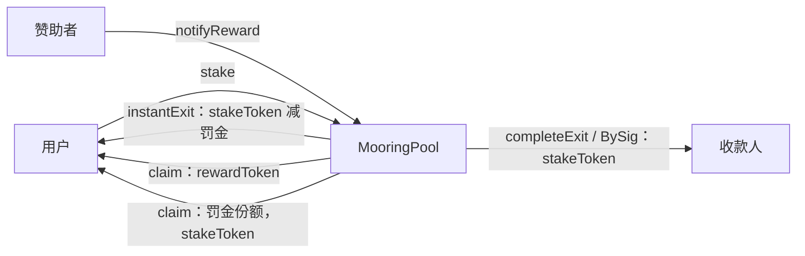

# B30 跟审实录：一个审计员怎样思考

> 学习目标：读完本章，你能——
> 1. 按"笔记 → 假设 → 证明或否定"的节奏审计一份小合约。
> 2. 记录失败的假设，并从中得到信息。
> 3. 用 PoC 和影响分析修正等级。
>
> 前置章节：[B28 模式库](B28-bug-patterns.md)、[B29 为什么会漏掉漏洞](B29-why-audits-miss.md)、[A02 风险评级](../assessment/A02-risk-rating-reporting.md)
> 预计时间：先独立审计 90 分钟，再跟读 90 分钟。
> 靶场：[code/ranges/thinkaloud](../../code/ranges/thinkaloud) ｜ 定级练习：[severity-drill.html](../interactive/severity-drill.html)

> ⚠️ 警告：`MooringPool` 是含有故意漏洞的本地玩具合约。不要部署它。本章的方法只用于自己的代码、已授权的审计和本地靶场。

> 💡 注意：本章的时间戳是教学编排，表示思路的先后，不是真实计时。所有命令输出、失败的 PoC 和数字都来自实际运行（forge 1.5.1、solc 0.8.30、slither 0.11.5）。

---

## 开场：别人的审计笔记里最有用的部分

成品报告只写成立的发现。报告不写审计员走过的弯路。可是学习审计时，弯路最有用：你要知道一个假设怎样被否定，什么时候该放弃，什么时候该继续。

<details class="predict"><summary>🤔 先猜再看：一次 2.5 小时的审计，你认为多少时间花在"最后确认成立"的漏洞上？</summary>

本章编排里不到一半。多数时间用于建立理解、验证后被否定的假设和重新定级。否定一个假设不是浪费：它把这部分代码从怀疑清单上划掉。

</details>

## 1. 一句话理解

**审计就是不断写下一个可以被否定的猜测，然后用最便宜的方法否定它。**

> 🎯 打个比方：像侦探排除嫌疑人。每排除一个人，都缩小了范围。
>
> 比喻的局限：侦探的案子通常只有一个凶手。合约里可能有多个问题，而且它们可以互相配合。

术语：

| 术语 | 英文 | 定义 |
|---|---|---|
| PoC | Proof of Concept | 证明漏洞真实存在的最小可运行示例 |
| 不变量 | Invariant | 任何操作后都必须成立的性质 |
| 累积器 | Accumulator | 记录"每份额累计收益"的全局变量 |
| 债务 | Reward Debt | 用户进入时已经存在的累计收益，领取时要扣除 |
| 夹击 | Sandwich | 在目标交易前后各插入一笔交易获利 |
| nSLOC | Normalized Source Lines of Code | 去掉空行和注释后的代码行数 |

---

## 2. 简报与范围

**项目（虚构）：** MooringPool。用户质押代币，按时间领取另一种奖励代币。用户退出有两条路：7 天冷却期，或者立即退出并支付 10% 罚金。罚金分给剩余的质押者。

| 项目 | 内容 |
|---|---|
| 范围 | `src/MooringPool.sol`，211 nSLOC |
| 代币 | 两种普通 18 位 ERC-20，构造时固定，没有回调、收税或黑名单 |
| 可信角色 | `owner`，可以暂停和救援无关代币 |
| 已知问题 | 无人质押期间的奖励不分配。这部分不算发现 |
| 定级 | [A02](../assessment/A02-risk-rating-reporting.md) 矩阵 |

**现在停下。** 先打开 `src/MooringPool.sol`，自己审计 90 分钟。不要打开 `test/` 和 `solution/`。

需要帮助时，按下面的分阶段提示逐层展开。

<details class="predict"><summary>🤔 TA-1 提示 1</summary>

看所有改变 `staked` 的入口。
</details>

<details class="predict"><summary>🤔 TA-1 提示 2</summary>

比较 `stake` 和 `movePosition` 对"结算"和"同步"的处理。特别注意接收方。
</details>

<details class="predict"><summary>🤔 TA-1 发现</summary>

`movePosition` 增加了接收方的份额，却没有结算和同步接收方的债务。详见第 7 节。
</details>

<details class="predict"><summary>🤔 TA-2 提示 1</summary>

`completeExitBySig` 有几个参数？结构哈希里有几个字段？
</details>

<details class="predict"><summary>🤔 TA-2 提示 2</summary>

谁决定 `receiver`？
</details>

<details class="predict"><summary>🤔 TA-2 发现</summary>

`receiver` 没有被签名，提交者可以指定任意收款人。
</details>

<details class="predict"><summary>🤔 TA-3 提示 1</summary>

冷却期保护的是什么？
</details>

<details class="predict"><summary>🤔 TA-3 提示 2</summary>

第二次调用 `requestExit` 时，`exitReadyAt` 会变化吗？
</details>

<details class="predict"><summary>🤔 TA-3 发现</summary>

先排队 1 wei，以后追加金额沿用旧的时间。详见第 5.3 节的组合攻击。
</details>

<details class="predict"><summary>🤔 TA-4 提示 1</summary>

把"最后一个用户"代入 `instantExit`。
</details>

<details class="predict"><summary>🤔 TA-4 提示 2</summary>

除数是什么？这时候它等于多少？
</details>

<details class="predict"><summary>🤔 TA-4 发现</summary>

最后一个质押者调用 `instantExit` 时，`totalStaked` 为 0，触发除零回滚。
</details>

<details class="predict"><summary>🤔 TA-5 提示 1</summary>

谁能调用 `notifyReward`？最少要付多少钱？
</details>

<details class="predict"><summary>🤔 TA-5 提示 2</summary>

一次很小的调用之后，`rewardRate` 和 `periodEnd` 怎样变化？
</details>

<details class="predict"><summary>🤔 TA-5 发现</summary>

任何人支付 1 wei 就能把剩余奖励摊到新的 30 天，速率下降。
</details>

---

## 3. 实录：前 30 分钟，建立地图

**[00:00] 笔记。** 读简报。两种资产，一个可信角色。我先记两件事："代币无回调"和"owner 可信"。这两条会让很多问题失效，但我要小心不被它们带偏（[B29 §2.6](B29-why-audits-miss.md)）。

**[00:06] 画资金流。** 我不从第一行读起。我先找钱从哪里出去。



**读图要点：**

- 本金和罚金都用 `stakeToken` 支付，且存放在一起。
- `claim` 有两种资产出口。这一点后面会改变一次定级。
- 图上有一条箭头的收款人不一定是所有者，这条箭头是 `BySig`。

**[00:14] 写不变量。** 还没有细读，先写"必须成立"的话：

- I1：`totalStaked` 等于所有 `staked` 的和。
- I2：合约的 `stakeToken` 余额 ≥ 全部本金 + 排队金额 + 未领取罚金。
- I3：用户不能领取自己质押之前产生的收益。
- I4：本金退出要么等 7 天，要么付罚金。
- I5：只有资金所有者能决定收款人。

**[00:18] 跑工具。**

```bash
cd code/ranges/thinkaloud  # 从 web3-security-101/ 出发，进入 thinkaloud 靶场目录
# 排除依赖、测试和答案目录，只看中高级别结果
slither . --filter-paths "lib|test|solution" --exclude-informational --exclude-optimization
```

实际结果的最后一行：

```text
INFO:Slither:. analyzed (2 contracts with 75 detectors), 12 result(s) found
```

12 条结果分属 4 个检测器：跨函数重入提示（`notifyReward` 在转账后写 `rewardRate`）、先除后乘提示、`proposeOwner` 缺零地址检查、一批时间戳比较提示。我把它们当线索。这 4 类提示都没有直接指出本章的 5 个发现。这是预期的情况：这些发现属于业务逻辑。

<details class="predict"><summary>🤔 先猜再看：下一步你会先看 slither 的重入提示，还是先看业务逻辑？</summary>

我先花几分钟关掉重入提示，因为它便宜。如果锁覆盖了所有状态入口，这条线就可以关闭，后面不用一直惦记。

</details>

## 4. 实录：三个失败的假设

**[00:24] 假设 H1：跨函数重入。** slither 提示 `notifyReward` 在外部调用后写状态。

检查：

1. 所有修改状态的外部函数都有 `nonReentrant` 吗？`stake`、`requestExit`、`cancelExit`、`completeExit`、`completeExitBySig`、`instantExit`、`movePosition`、`claim`、`notifyReward`：全有。
2. 代币有回调吗？简报说没有。

**结论：否定。** 没有可重入路径。我在笔记里写："如果未来支持带钩子的代币，这里要重审。"

**[00:31] 假设 H2：闪电质押抢奖励。** 在分配前大量质押，分走收益，然后离开。

奖励按时间累积。同一个区块内时间不变，所以 `_accrue` 增加 0。我写了一个测试确认：

```text
[PASS] test_Rejected_FlashStakeEarnsNoStreamReward()
```

**结论：对时间流奖励否定。** 但我多写了一行笔记："罚金不是按时间分配的，它是**一次性**进入累积器的。" 这是下一条线索，我先放在一旁。

**[00:38] 假设 H3：签名可延展。** `ecrecover` 接受高 s。如果翻转 s，能重放退出吗？

<details class="predict"><summary>🤔 先猜再看：这个攻击能成功吗？</summary>

不能。每次验签都会把 `nonces[user]++` 写进摘要。翻转 s 只能得到同一摘要的第二份签名，但重放时 nonce 已变，摘要不同。恢复出的地址不等于 `user`，验证失败。

</details>

```text
[PASS] test_Rejected_HighSSignatureCannotReplay()
```

**结论：否定。** 可是在读 `EXIT_TYPEHASH` 的时候，我注意到一件事。这个失败的假设把我带到了第一个发现。

## 5. 实录：发现漏洞和修正等级

### 5.1 TA-2：谁决定收款人

**[00:45] 笔记。** 第 30 行的类型字符串：

```text
CompleteExit(address owner,uint256 nonce,uint256 deadline)
```

函数参数有 `user, receiver, deadline, v, r, s`。我把参数和字段一一比对。

<details class="predict"><summary>🤔 先猜再看：哪个参数不在签名里？会发生什么？</summary>

`receiver`。任何人拿到签名（例如从内存池），都能把 `receiver` 改成自己的地址，先于中继者提交。这条路径破坏了不变量 I5。

</details>

**[00:49] PoC。** 写 `test_TA2_RelayerRedirectsSignedExit`，一次通过：Mallory 得到 Alice 的 1,000 个代币。

**[00:53] 定级。** 我的第一反应是"严重"，因为这是直接盗取本金。然后我查矩阵：

- 影响：严重（直接盗取用户资金）。
- 可能性：这需要受害者已经在用签名退出，签名要被攻击者看到。任何人都能做，但不是所有用户都走这条路径。可能性是中。
- 严重 × 中 = **高**。

### 5.2 TA-1：第一次失败的 PoC

**[00:58] 笔记。** 回到 I3。我读 `movePosition`，第 199 行增加接收方的份额。发送方有 `_settle` 和 `_sync`，接收方没有。

<details class="predict"><summary>🤔 先猜再看：如果接收方是全新地址，它的债务是多少？下一次 claim 会算出什么？</summary>

债务是 0。`claim` 计算 `staked * acc / ACC - 0`，接收方得到"自己从未参与过"的全部历史收益。

</details>

**[01:04] PoC 第一版。** 我写得太快（这两版草稿 PoC 不在靶场里；想复现，把代码放进 `test/PoC.t.sol` 的测试合约里，gas 数字可能略有不同）：

```solidity
stakeAs(mallory, 1_000 * E);  // 步骤 1：Mallory 质押
vm.prank(mallory);
pool.movePosition(mallory2, 1_000 * E);  // 步骤 2：把仓位转给新地址
vm.prank(mallory2);
pool.claim();  // 步骤 3：新地址领取奖励
// 断言新地址拿到了不该有的奖励
assertGt(rw.balanceOf(mallory2), 0, "receiver should get extra reward");
```

实际输出：

```text
[FAIL: receiver should get extra reward: 0 <= 0] test_Draft1_MoveThenClaim() (gas: 181153)
```

<details class="predict"><summary>🤔 先猜再看：漏洞不存在吗？这个失败说明什么？</summary>

这个失败说明我的 PoC 错了。累积器此时是 0：没有人质押过一段时间，也没有奖励在流动。`0 * 份额 - 0 = 0`。我必须先让累积器增长。失败的 PoC 也提供信息，但要先判断是假设错了还是实验错了。

</details>

**[01:09] PoC 第二版。** Alice 先质押，注入奖励，时间前进 10 天。然后 Mallory 质押并转移给新地址：

```text
[PASS] test_TA1_MovedPositionOverpaysReward()
```

新地址得到约 10,000 奖励代币，而它质押了 0 秒。

**[01:13] 第一次定级。** 影响：盗取未领取奖励，矩阵中是"高"。可能性：任何人，无前提，是高。高 × 高 = **高**。

**[01:16] 重新看资金流图。** 我想起 00:06 的那条记录：`claim` 有两种资产出口。罚金累积器走的是同一条错误路径，而罚金用 `stakeToken` 支付，和本金放在同一个余额里。

<details class="predict"><summary>🤔 先猜再看：这一点会怎样改变影响？</summary>

攻击者可以提取的不仅是奖励，还有 `stakeToken` 本金。累积器乘以大额份额，算出的金额能超过全部罚金，差额由其他用户的本金支付。这是直接盗取本金。影响从"高"升到"严重"。

</details>

**[01:20] PoC 第三版。** Bob 即时退出，支付 100 罚金。Mallory 质押 40,000，转移，领取：

```text
mallory stake-token profit (wei): 444444444444444440000
```

她拿到约 444 个代币，而历史上一共只产生过 100 的罚金。其中约 344 来自其他用户的本金。

**最终定级：** 严重 × 高 = **严重**。

### 5.3 TA-3：先定中危，再升级

**[01:24] 笔记。** 第 131 行：

```solidity
if (b.exitReadyAt == 0) {  // 只在第一次排队时设置到期时间
```

只有第一次设置时间。第二次 `requestExit` 增加金额，时间不变。这和不变量 I4 冲突。

**[01:27] PoC。** `test_TA3_PreArmedCooldownSkipsDelay`：第 0 天排队 1 wei，第 8 天追加 50,000，同一区块全部取回。通过。

**[01:30] 第一次定级。** 绕过了一个时间约束，但这本身没有损失资金。我先写"中"。

然后我问自己：冷却期保护的是什么（[B29 §2.3](B29-why-audits-miss.md)，发现第一个就不要停）？答案是：防止用户逃避罚金，并防止短期资金抢罚金。00:31 的笔记正好派上用场。

<details class="predict"><summary>🤔 先猜再看：如果能零等待退出，怎样组合 H2 留下的线索？</summary>

罚金是一次性进入累积器的。攻击者预先排好 1 wei，在内存池看到大额 `instantExit` 后：先大量质押，让受害者的交易支付罚金，然后领取罚金份额，追加排队并立即完成退出。

</details>

**[01:36] 组合 PoC 第一版。** 我把顺序写错了，在 Bob 退出之前就让 Mallory 完成了退出：

```text
[FAIL: mallory should earn penalty: 100000000000000000000000 <= 100000000000000000000000] test_Draft2_Sandwich() (gas: 382463)
```

Mallory 的余额没有变化，因为罚金累积时她的份额已经不在池子里。

**[01:41] 第二版。** 按抢跑、受害者、尾随的顺序：

```text
mallory penalty captured (wei): 900000000000000000000
```

在一笔 10,000 退出产生的 1,000 罚金中，她拿走 900。

**最终定级：** 影响是"高"（盗取未领取收益）。可能性是"中"（需要提前 7 天布置、需要抢跑、需要大额临时资金）。高 × 中 = **高**。

### 5.4 TA-4：先定高危，再降级

**[01:48] 笔记。** 代入极端状态。最后一个质押者调用 `instantExit` 时，第 186 行 `totalStaked` 是 0。除零，回滚。

**[01:51] 第一次定级。** "资金冻结！"我写了高。

**[01:54] 检查。** 这个用户还有别的路吗？

<details class="predict"><summary>🤔 先猜再看：资金真的被冻结了吗？</summary>

没有。`requestExit` 和 `completeExit` 不经过这个除法。用户等 7 天，能全额取回，而且不付罚金。`test_TA4_CooldownRouteStillWorks` 证明了这一点。

</details>

**最终定级：** 影响是"中"（一个功能在特定状态下不可用）。可能性是"中"（只有最后一个质押者，或者他希望立即退出时）。中 × 中 = **中**。

### 5.5 TA-5：谁能调用它

**[02:00] 笔记。** `notifyReward` 没有权限检查，NatSpec 写的是"任何人可以赞助"。这句话在文档里，我不直接相信它（[B29 §2.2](B29-why-audits-miss.md)）。我计算一次很小的赞助会发生什么。

```text
rate before: 11574074074074074
rate after : 5787037037037037
```

第 15 天，有人赞助 1 wei。剩余奖励被摊到新的 30 天，速率减半。重复调用可以持续推迟奖励发放。

**定级：** 没有人得到资金，奖励最终也能发放。这是无获利的破坏（griefing）。影响是"中"，可能性是"高"（任何人花 1 wei）。中 × 高 = **中**。

## 6. 实录：收尾

**[02:12] 假设 H4：owner 救援窃取资金。** `rescue` 排除了两种代币。

**结论：否定。** 暂停也不阻止 `requestExit`、`completeExit`、`instantExit`。我把 owner 的剩余能力记入信任假设。

**[02:18] 回看修复。** 我把自己的修复当成新代码再审一次（[B29 §2.9](B29-why-audits-miss.md)）。

<details class="predict"><summary>🤔 先猜再看：TA-3 修好之后，罚金夹击彻底消失了吗？</summary>

没有。修复后，追加金额会重置冷却期，零等待退出不再可行。但攻击者仍然可以抢在大额退出前质押，拿到罚金份额，然后接受 7 天锁定。攻击成本从"一个区块的资金"变成"7 天的资金占用和价格风险"。这是残余风险，要写进报告。彻底消除需要改罚金分配方式，例如按时间线性释放。

</details>

**[02:30] 写报告。** 下面是成品。

---

## 7. 发现列表

| 编号 | 家族 | 标题 | 影响 | 可能性 | 等级 |
|---|---|---|---|---|---|
| TA-1 | DFI | `movePosition` 不结算接收方，可盗取本金 | 严重 | 高 | 严重 |
| TA-2 | MEV | 退出签名未覆盖 `receiver` | 严重 | 中 | 高 |
| TA-3 | DFI | 冷却期可预先触发，可夹击罚金 | 高 | 中 | 高 |
| TA-4 | ARI | 最后一个质押者即时退出时除零 | 中 | 中 | 中 |
| TA-5 | ACC | 任何人可用 1 wei 摊薄奖励速率 | 中 | 高 | 中 |

## 8. 模型报告

```markdown
# MooringPool 审计报告（教学范本）

## 概述
- 范围：src/MooringPool.sol（211 nSLOC）
- 方法：人工审查、slither、Foundry PoC
- 结论：不建议按当前代码上线。存在 1 个严重、2 个高危、2 个中危发现。

## 信任假设
- 两种代币是普通 ERC-20，无回调、无收税。
- owner 可以暂停质押、转移无关代币；不能取走质押或奖励代币。
- 已知问题：无人质押时的奖励不分配。

## 发现汇总
| 编号 | 等级 | 标题 | 状态 |
|---|---|---|---|
| TA-1 | 严重 | movePosition 不结算接收方，可盗取本金 | 已在修复版处理 |
| TA-2 | 高 | 退出签名未覆盖 receiver | 已在修复版处理 |
| TA-3 | 高 | 冷却期可预先触发，可夹击罚金 | 部分修复，见残余风险 |
| TA-4 | 中 | 最后一个质押者即时退出时除零 | 已在修复版处理 |
| TA-5 | 中 | 任何人可用 1 wei 摊薄奖励速率 | 已在修复版处理 |

## TA-1 严重：movePosition 不结算接收方，可盗取本金
- 位置：MooringPool.sol:192-202
- 影响：严重 × 可能性 高 = 严重
- 描述：movePosition 增加 berths[to].staked，但没有调用 _settle(to) 和 _sync(to)。接收方的债务保持旧值，下一次结算把历史累积收益全部算给新份额。
- 影响说明：奖励代币可被盗取。罚金累积器按 stakeToken 支付，所以攻击者还能提取其他用户的本金。攻击者可以逐级转移，反复获利。
- 复现：test_TA1_MovedPositionDrainsPrincipal。Bob 产生 100 罚金后，Mallory 质押 40,000 并转移，获利约 444 枚。
- 修复：在修改份额前 _settle(to)，修改后 _sync(to)。

## TA-2 高：退出签名未覆盖 receiver
- 位置：MooringPool.sol:30-31、155-165
- 影响：严重 × 可能性 中 = 高
- 描述：EXIT_TYPEHASH 不含 receiver。任何持有签名的人都能指定收款地址。
- 影响说明：使用签名退出的用户，本金可被抢跑者盗取。
- 复现：test_TA2_RelayerRedirectsSignedExit。
- 修复：把 receiver 加入类型字符串和结构哈希。

## TA-3 高：冷却期可预先触发，可夹击罚金
- 位置：MooringPool.sol:131-133
- 影响：高 × 可能性 中 = 高
- 描述：exitReadyAt 只在首次排队时设置。追加金额沿用旧时间。
- 影响说明：攻击者提前 7 天排队 1 wei，之后大额资金可零等待退出。结合抢跑，可以夺取他人支付的罚金。
- 复现：test_TA3_ChainedPenaltySandwich。1,000 罚金中被拿走 900。
- 修复：每次追加金额时重置 exitReadyAt。
- 残余风险：攻击者仍可接受 7 天锁定后参与罚金分配。建议线性释放罚金。

## TA-4 中：最后一个质押者即时退出时除零
- 位置：MooringPool.sol:186
- 影响：中 × 可能性 中 = 中
- 描述：totalStaked 归零后作除数。
- 影响说明：最后一个用户不能即时退出。资金没有冻结，冷却路径可用。
- 复现：test_TA4_LastStakerCannotInstantExit、test_TA4_CooldownRouteStillWorks。
- 修复：totalStaked 为 0 时不收取罚金。

## TA-5 中：任何人可用 1 wei 摊薄奖励速率
- 位置：MooringPool.sol:219-228
- 影响：中 × 可能性 高 = 中
- 描述：notifyReward 无权限，并把剩余奖励摊到新的完整周期。
- 影响说明：攻击者花 1 wei 就能让速率减半，持续推迟奖励发放。没有直接获利。
- 复现：test_TA5_DustNotifyCutsRate。
- 修复：周期内追加不得降低速率；或限定赞助者。
- 残余影响：周期内的小额赞助会被拒绝。
```

## 9. 运行全部测试

在 `web3-security-101/` 目录（学习仓库根目录）运行：

```bash
cd code/ranges/thinkaloud # 进入 thinkaloud 靶场目录
forge test # 运行全部 PoC 和修复测试
```

预期结果（本机实测）：

```text
Ran 10 tests for test/PoC.t.sol:PoCTest
Ran 6 tests for test/PoC.t.sol:FixTest
Ran 2 test suites: 16 tests passed, 0 failed, 0 skipped (16 total tests)
```

> 💡 注意：实际输出的 `Ran 2 test suites` 后还带有运行耗时。

> 🧪 动手验证：打开 `solution/MooringPoolFixed.sol`，删除任意一处 `✅ 修复`，重新运行测试，观察哪个 `test_Fix_*` 失败。

> 🧪 动手验证：打开 [severity-drill.html](../interactive/severity-drill.html)，用同样的推理练习 20 个场景。

## 如果出错

| 现象 | 原因 | 处理 |
|---|---|---|
| `forge-std/Test.sol not found` | 软链接失效 | 在 `web3-security-101/` 目录运行 `bash code/setup.sh` |
| 你的 PoC 得到 0 | 累积器还是 0 | 先让时间前进，或者先产生一次罚金 |
| 组合 PoC 没有收益 | 交易顺序错误 | 按抢跑、受害者、尾随的顺序排列 |
| `slither` 找不到 forge | 环境变量 | 确认 `which forge` 有输出 |
| 你的等级和本章不同 | 假设不同 | 比较影响和可能性的假设，不只比较结果 |

## 过关标准

- [ ] `forge test` 显示 16 个测试通过。
- [ ] 独立审计时，你找到至少 3 个发现，并且写了 PoC。
- [ ] 你能解释 TA-1 为什么从高升到严重，TA-4 为什么从高降到中。
- [ ] 你写下了至少 2 个被自己否定的假设。
- [ ] 你能说明 TA-3 修复后的残余风险。

> 🪞 反思：回看你的审计笔记。你记录了多少失败的假设？如果一个都没有，你的审计过程可能没有被保存下来。

## 思考题

1. 在 TA-1 中，如果 `stakeToken` 的罚金改为付给国库，而不进入累积器，等级会怎样变化？
2. TA-2 的 `receiver` 字段修好后，提交者还能做什么恶意行为？请考虑 `deadline` 和交易顺序。
3. 把 TA-5 的修复改为"只有 owner 能调用 `notifyReward`"，它和"周期内不得降低速率"相比，各有什么权衡？

下一章：[B31 工具工程化](B31-automation-tools.md)
