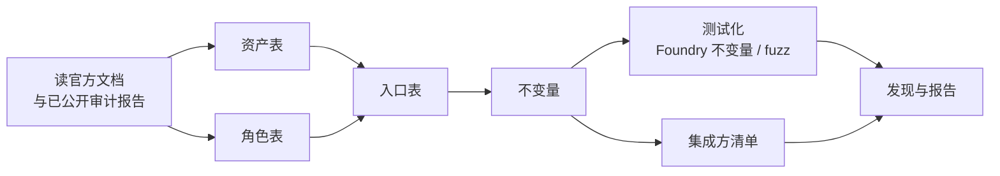

# B35 项目实例分析方法：读懂头部协议源码，拆成审计工作底稿

> 学习目标：按固定顺序读一个大型协议的源码，从文档理解走到逐行理解；用固定模板产出资产表、角色表、入口表、不变量和集成方清单五份底稿；能逐行解释 Uniswap V2 `swap()` 的每一个安全设计。  
> 前置章节：[B18 DEX/AMM](B18-dex-amm.md)、[B23 建模与不变量](B23-complex-protocols.md)、[B27 专业审计流程](B27-what-is-audit.md)（建立方法论）  
> 本组案例：B36 Uniswap V2 · B38 Aave V3 · B39 Lido stETH 集成 · B40 Safe 多签 · B41 ERC-4626 金库  
> 交互实验：[逐行源码讲解](../interactive/audit-codewalk.html) ｜ [K 值不变量检查器](../interactive/audit-v2k.html) ｜ [入口 × 检查覆盖矩阵](../interactive/audit-hfmatrix.html)

> 🔗 关联：主线 [03 章](../chapters/03-evm-solidity-basics.md)、[27 章](../chapters/27-audit-testing-workflow.md) ｜ 实验 [逐行讲解](../interactive/audit-codewalk.html)、[K 值检查](../interactive/audit-v2k.html)、[检查覆盖矩阵](../interactive/audit-hfmatrix.html)、[份额换算](../interactive/audit-steth.html)、[多签复核](../interactive/audit-safetx.html)、[取整判定](../interactive/audit-rounding.html) ｜ 评估 [A01](../assessment/A01-methodology.md)、[A04](../assessment/A04-defi-protocol-review.md) ｜ 衔接 [B36](B36-case-uniswap-v2.md)–[B41](B41-case-erc4626.md)

## 开场：面试官给你 60 行代码

示例场景：面试官给你一个 60 行的奖励池合约，说"你从哪里开始"。你可以从第一行读到最后一行。也可以先问：钱在哪里，谁能动，入口有几个。

<details class="predict"><summary>🤔 先猜再看：五份底稿中，最先写哪一份？</summary>

先写资产表。审计的目标是资金路径。资产表确定"什么东西值得保护"，然后角色表和入口表才有判断标准。

</details>

## 1. 一句话理解

**审计员面试和实战最常被问的不是"某个漏洞是什么"，而是"给你一个真实协议，你从哪里下手"。本组案例给出 5 份可以直接复用的审计底稿。**

DeFi 协议互相依赖、互相组合。头部协议是其他协议的地基。读懂地基的每一行，你才能判断上层协议对地基的假设是否成立。

> 🎯 打个比方：医生学解剖，不是背病名，而是在真实人体上认清每个器官、每条血管的位置。认清了结构，病变才看得出来。本组案例就是 5 次"解剖课"。

## 2. 五份底稿

| 底稿 | 回答的问题 | 格式 |
|---|---|---|
| ① 资产表 | 协议持有什么？在哪个合约？用什么变量记账？ | 资产 / 合约 / 记账变量 / 真实余额来源 |
| ② 角色表 | 谁能做什么？权限由谁授予？有没有时间锁？ | 角色 / 能力 / 授予者 / 约束 |
| ③ 入口表 | 每个外部函数改了什么、调用了谁、检查了什么？ | 函数 / 状态写入 / 外部调用 / 检查 |
| ④ 不变量 | 哪些性质在任何操作后都必须成立？ | 一句话 + 可执行的断言 |
| ⑤ 集成方清单 | 别的协议使用它时，最常犯什么错？ | 检查项列表 |

①–③ 是 [B23 第 2 节](B23-complex-protocols.md) 建模四张表的工作版。B23 的状态表对应这里入口表下的"变量读写表"。④ 的四种类型见 B23 第 3 节。

## 3. 工作流：从文档到逐行

读大型协议的源码，按下面 9 步走。每一步都有产出，大部分产出直接写进五份底稿。

| 步骤 | 做什么 | 产出 |
|---|---|---|
| 1 | 读官方文档、白皮书和已公开的审计报告 | 资产、角色、核心公式的初稿 |
| 2 | 跑通测试：`forge build`、`forge test`、`forge coverage` | 能运行的本地环境；覆盖率盲区 |
| 3 | 画合约关系图：继承、调用、代理 | 架构图 |
| 4 | 列出所有 `public` / `external` 函数 | ③ 入口表 |
| 5 | 列出所有状态变量：每个变量谁写、谁读 | 变量读写表（入口表的补充） |
| 6 | 追踪核心资金流：存 → 计息 → 取 / 清算 | ① 资产表、② 角色表 |
| 7 | 写下不变量：总量守恒、偿付能力、单调性 | ④ 不变量 |
| 8 | 对每个入口问：它能否打破某个不变量？ | 疑点清单 |
| 9 | 写 PoC，或写明为什么不能打破 | 发现，或被否定的疑点 |



**读图要点：**

- 先读公开审计报告：别人已经找到的问题，说明了这个代码库的"薄弱器官"在哪里。
- 入口表是交叉点：资产表告诉你"钱在哪"，角色表告诉你"谁能动"，入口表把两者连起来。
- 集成方清单常被忽略。很多资金损失发生在"使用"一个安全协议的另一个协议里。
- 第 5 步的变量读写表是最有效的工具。如果一个变量被 5 个函数写，只有 4 个函数做了检查，第 5 个就是嫌疑人。
- 第 7 步把"我觉得不对"变成"它违反了 X"。不变量可以直接写成 Foundry 不变量测试（见 [B12](B12-foundry-advanced.md) 第 1 节）。
- 工具辅助：Slither 的 `function-summary`、`vars-and-auth`、`call-graph` 打印器（用法：`slither . --print vars-and-auth`）可以快速生成第 3–5 步的表格。工具输出只是初稿，每一行仍要回到源码核对。

## 4. 练习方式

1. 先只看本组每章的"资产与架构"部分，自己写出其余四份底稿。
2. 再和章节内容对照，记录你漏掉的项。
3. 打开每章的实验，用交互方式验证一个关键不变量。
4. 选一个使用该协议的开源项目，用"集成方清单"审一遍。

## 5. 可复制的底稿模板

把下面的模板复制到审计笔记。每一行都写来源（文件和行号）。

```markdown
## 底稿头
- 协议 / 版本 / 提交哈希：
- 目标链：
- 作者 / 复核人 / 日期：
- 信任假设：

## ① 资产表
| 资产 | 合约 | 记账变量 | 真实余额来源 | 两者不一致时 | 来源 |
|---|---|---|---|---|---|

## ② 角色表
| 角色 | 能力 | 授予者 | 约束（门限、时间锁） | 被盗后的最大损失 | 来源 |
|---|---|---|---|---|---|

## ③ 入口表
| 函数 | 调用者 | 状态写入 | 外部调用 | 检查 | 疑点 |
|---|---|---|---|---|---|

### 变量读写表（入口表的补充）
| 变量 | 写入函数 | 读取函数 | 依赖它的其他变量 | 来源 |
|---|---|---|---|---|

## ④ 不变量
| 编号 | 一句话 | 断言 | 验证状态（未测 / 通过 / 反例） |
|---|---|---|---|

## ⑤ 集成方清单
| 编号 | 检查项 | 原因 | 影响的集成方 |
|---|---|---|---|

## 疑点清单
| 编号 | 疑点 | 关联入口 / 不变量 | 状态（待证 / 否定 / 已证） | 证据 |
|---|---|---|---|---|
```

> 💡 注意："被盗后的最大损失"和"验证状态"这两列最容易被省略。没有它们，底稿只能描述协议，不能驱动审计。

## 6. 完整示例：RewardPool

下面的合约是本手册示例，用的是 [B17 第 6 节](B17-defi-basics.md) 的奖励累计算法。按顺序走完五份底稿。

```solidity
// SPDX-License-Identifier: MIT
pragma solidity ^0.8.20;

interface IERC20 {
    function transfer(address to, uint256 amount) external returns (bool);
    function transferFrom(address from, address to, uint256 amount) external returns (bool);
}

/// @notice 本手册示例：质押奖励池。不得部署。
contract RewardPool {
    IERC20 public immutable stakeToken;
    IERC20 public immutable rewardToken;
    address public immutable owner;
    uint256 public rewardPerShare;   // 每份质押累计奖励，放大 1e18
    uint256 public totalStaked;
    mapping(address => uint256) public staked;
    mapping(address => uint256) public rewardDebt;   // 用户已结算到的奖励基线

    constructor(IERC20 s, IERC20 r) {
        stakeToken = s;
        rewardToken = r;
        owner = msg.sender;
    }

    function notifyReward(uint256 amount) external {
        require(msg.sender == owner, "not owner");
        require(totalStaked > 0, "no stake");
        rewardToken.transferFrom(msg.sender, address(this), amount);
        // 注入的奖励按当前总质押分摊
        rewardPerShare += amount * 1e18 / totalStaked;
    }

    function deposit(uint256 amount) external {
        _claim(msg.sender);   // 先按旧质押量结算
        stakeToken.transferFrom(msg.sender, address(this), amount);
        staked[msg.sender] += amount;
        totalStaked += amount;
        // 按新质押量重设基线
        rewardDebt[msg.sender] = staked[msg.sender] * rewardPerShare / 1e18;
    }

    // ❌ 漏洞：没有结算奖励，也没有更新 rewardDebt
    function withdraw(uint256 amount) external {
        staked[msg.sender] -= amount;   // 质押减少，但基线仍按旧质押量计算
        totalStaked -= amount;
        stakeToken.transfer(msg.sender, amount);   // 未结算的奖励随之丢失
    }

    function claim() external {
        _claim(msg.sender);
    }

    function _claim(address user) internal {
        uint256 accrued = staked[user] * rewardPerShare / 1e18;
        // 若 rewardDebt > accrued，这里下溢回滚
        uint256 pending = accrued - rewardDebt[user];
        rewardDebt[user] = accrued;
        if (pending > 0) rewardToken.transfer(user, pending);
    }
}
```

### 6.1 ① 资产表

| 资产 | 合约 | 记账变量 | 真实余额来源 | 两者不一致时 |
|---|---|---|---|---|
| 质押代币 | RewardPool | `staked`、`totalStaked` | `stakeToken.balanceOf(pool)` | 收费代币会让账面高于实际 |
| 奖励代币 | RewardPool | `rewardPerShare`、`rewardDebt` | `rewardToken.balanceOf(pool)` | 取整残留留在合约内 |

### 6.2 ② 角色表

| 角色 | 能力 | 授予者 | 约束 | 被盗后的最大损失 |
|---|---|---|---|---|
| owner | 注入奖励 | 部署者（不可变） | 无 | 只能注入，不能提走用户资产 |
| 用户 | 存、取、领奖 | 无 | 只能操作自己的记录 | 自身资产 |

### 6.3 ③ 入口表

| 函数 | 调用者 | 状态写入 | 外部调用 | 检查 | 疑点 |
|---|---|---|---|---|---|
| `notifyReward` | owner | `rewardPerShare` | 收奖励代币 | owner、`totalStaked > 0` | 取整损失 |
| `deposit` | 任何人 | `staked`、`totalStaked`、`rewardDebt` | 发奖励、收质押 | 无 | Q1 |
| `withdraw` | 任何人 | `staked`、`totalStaked` | 发质押 | 下溢检查 | **Q2：没有写 `rewardDebt`** |
| `claim` | 任何人 | `rewardDebt` | 发奖励 | 下溢检查 | Q3 |

换一个方向看同一份代码，按变量列出谁写、谁读：

| 变量 | 写入函数 | 读取函数 | 依赖它的其他变量 |
|---|---|---|---|
| `staked` | `deposit`、`withdraw` | `_claim` | `rewardDebt` |
| `rewardDebt` | `deposit`、`_claim` | `_claim` | — |
| `totalStaked` | `deposit`、`withdraw` | `notifyReward` | `rewardPerShare` |

`staked` 有两个写入函数。`rewardDebt` 依赖 `staked`，但只在 `deposit` 和 `_claim` 中重写。`withdraw` 改了 `staked`，却没有重写 `rewardDebt`。变量读写表让 Q2 直接浮现出来。

### 6.4 ④ 不变量

| 编号 | 一句话 | 断言 | 验证状态 |
|---|---|---|---|
| I1 | `totalStaked` 等于全部 `staked` 之和 | `assertEq(total, ghostSum)` | 通过（检查） |
| I2 | 任何用户都能领取已累计的奖励 | `claim()` 不回滚 | **反例** |
| I3 | `rewardDebt[user] ≤ staked[user] * rewardPerShare / 1e18` | 比较两侧 | **反例** |

### 6.5 ⑤ 集成方清单

| 编号 | 检查项 | 原因 |
|---|---|---|
| 1 | 不用收费代币或 rebase 代币作为质押代币 | `amount` 与实际到账不一致 |
| 2 | 部分取款前先调用 `claim` | Q2 的临时规避 |
| 3 | 不把池子的奖励余额当作可分配余额 | 取整残留和未领奖励共存 |

### 6.6 从疑点到发现

验证 Q2 的最小 PoC。下面的测试在本机 Forge 上通过：

```solidity
// 节选：用可铸造的 MockToken 作为两种代币
function test_partialWithdrawLocksRewards() public {
    vm.prank(alice);
    pool.deposit(100e18);   // 步骤 1：alice 质押 100
    pool.notifyReward(100e18);   // owner 注入第一笔奖励
    vm.prank(alice);
    pool.claim();                 // 第一次领取成功，rewardDebt = 100e18

    r.mint(address(this), 100e18);
    pool.notifyReward(100e18);   // 步骤 2：注入第二笔奖励
    vm.prank(alice);
    pool.withdraw(60e18);         // staked 降到 40e18，rewardDebt 仍是 100e18

    // 断言：下一次调用因算术下溢回滚
    vm.expectRevert(stdError.arithmeticError);
    vm.prank(alice);
    pool.claim();                 // 40e18 * 2 - 100e18 下溢
}
```

<details class="predict"><summary>🤔 先猜再看：Alice 部分取款后，还能再存款吗？</summary>

不一定能。`deposit` 先调用 `_claim`，并进行同样的减法。只要 `staked * rewardPerShare / 1e18` 小于 `rewardDebt`，`deposit` 也会回滚。

</details>

```solidity
// ✅ 修复：先结算，再更新余额，最后重写 rewardDebt
function withdraw(uint256 amount) external {
    _claim(msg.sender);   // 先按旧质押量结算
    staked[msg.sender] -= amount;
    totalStaked -= amount;
    // 根因修复：按新质押量重写基线
    rewardDebt[msg.sender] = staked[msg.sender] * rewardPerShare / 1e18;
    stakeToken.transfer(msg.sender, amount);   // 状态更新完毕再转账
}
```

按 [T03 报告模板](../templates/T03-finding-report.md) 写成发现：

| 字段 | 内容 |
|---|---|
| 标题 | 部分取款不更新 `rewardDebt`，导致用户领取奖励永久回滚 |
| 等级（示例） | Medium：用户损失已累计奖励，质押本金仍可取回 |
| 根因 | `withdraw` 写 `staked`，未写依赖 `staked` 的 `rewardDebt` |
| 证据 | PoC：`test_partialWithdrawLocksRewards` |
| 修复 | 见上方代码；补充不变量 I2、I3 |

> 🧪 动手验证：打开[入口 × 检查覆盖矩阵](../interactive/audit-hfmatrix.html)，把它当作入口表的交互版本。记录哪些入口缺少哪一项检查，再回到 6.3 节说明 Q2 属于哪一列。

## 7. 下一步：精读头部协议源码

五份底稿的方法，要在真实源码上反复练。下表是建议精读的源码。B36–B41 已经拆解了其中几个，其余的留给你自己用模板练习。

| 协议 | 重点文件 | 学到什么 |
|---|---|---|
| Uniswap V2 | UniswapV2Pair.sol、UniswapV2Library.sol | 最小的完整 AMM；闪电兑换；TWAP 累积（见 [B36](B36-case-uniswap-v2.md)） |
| Uniswap V3 | UniswapV3Pool.sol、TickMath、SqrtPriceMath、Position | 定点数学；tick 穿越；回调付款模式 |
| Compound V2 | CToken.sol、Comptroller.sol、JumpRateModel | 汇率模型；跨合约权限检查；被分叉最多的借贷代码 |
| Aave V3 | Pool.sol、logic/*.sol、ReserveLogic | 库合约拆分；缩放余额；eMode（见 [B38](B38-case-aave-v3.md)） |
| MakerDAO | vat.sol、dog.sol、clip.sol | 极简核心账本（Vat）；形式化风格的变量命名 |
| Curve | StableSwap 池（Vyper） | 牛顿迭代；Vyper 语法 |
| OpenZeppelin | token/、proxy/、access/、utils/cryptography | "标准答案"：别人的实现和它不同的地方就是审计点 |

> 🧪 动手验证：打开[逐行源码讲解](../interactive/audit-codewalk.html)，走完 `UniswapV2Pair.swap`。每读一行，写下它防住了哪种攻击。再打开 [K 值不变量检查器](../interactive/audit-v2k.html)，把 Pair 和 Library 的手续费改成不同的值，记录交易在什么时候回滚。

## 8. 术语表

| 术语 | 英文 | 定义 |
|---|---|---|
| 工作底稿 | Working Paper | 记录审计依据、过程和结论的文档 |
| 信任假设 | Trust Assumption | 结论成立所依赖的外部条件 |
| 疑点 | Lead | 尚未被证明或否定的潜在问题 |
| 反例 | Counterexample | 使不变量不成立的具体状态或调用序列 |

> 🪞 反思：选一个你用过的 DeFi 协议。
> 1. 你能写出它的资产表第一行吗？
> 2. 它的管理员被盗后，最大损失是多少？
> 3. 你最依赖的一条不变量，有没有被任何测试验证过？
> 4. 你的集成对它做了哪些假设？这些假设写进了文档，还是只在你脑中？

## 9. 思考题

1. 第 6 节的角色表中，owner 不能提走用户资产。如果 owner 把 `rewardToken` 设置成用户质押的同一种代币，底稿中哪些行需要修改？（示例代码的代币在构造函数中设定）
2. 在第 6 节的不变量 I3 中，取整是否可能造成误报？怎样写断言才能避免？
3. 按第 5 节的模板，只写 [B39 Lido](B39-case-lido.md) 的资产表第一行。stETH 的"记账变量"和"真实余额来源"分别是什么？
4. 在[逐行讲解](../interactive/audit-codewalk.html)中，为什么 `swap` 允许 `amount0Out` 和 `amount1Out` 同时大于 0？
5. 如果把不变量检查里的 `1000**2` 改成 `1000`，会产生什么后果？
