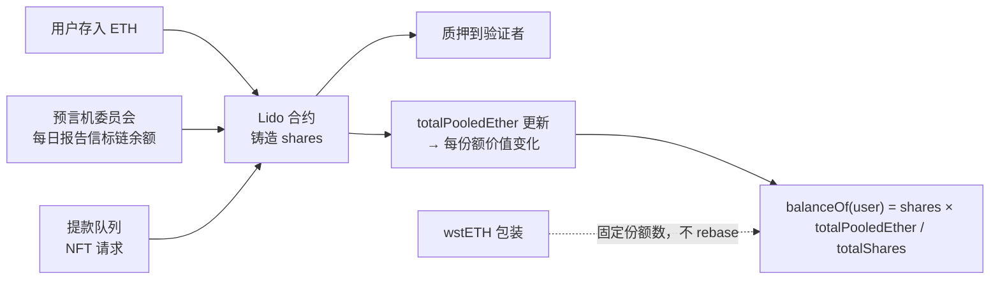

# B39 Lido stETH：审计"会自己变化的余额"

> 对象：集成 stETH / wstETH 的协议（借贷、金库、DEX、桥）。  
> 前置章节：[07 怪代币](../chapters/07-external-calls-tokens.md)、[B17 协议卡](B17-defi-basics.md)、[B35 底稿方法](B35-case-method.md)  

> 🔗 关联：主线 [07 章](../chapters/07-external-calls-tokens.md)、[08 章](../chapters/08-oracle-flashloan.md) ｜ 实验 [份额换算](../interactive/audit-steth.html) ｜ 评估 [A04](../assessment/A04-defi-protocol-review.md)、[A05](../assessment/A05-listing-due-diligence.md) ｜ 衔接 [B17](B17-defi-basics.md)

## 1. 一句话理解

**stETH 的余额不是存储值，而是"份额 × 汇率"实时算出来的。汇率每天随预言机报告变化。集成方如果把它当普通 ERC20，会在记账、转账断言和估值三处出错。**

## 2. 机制

**读图要点：**

- rebase 通常每天一次，正向（奖励）居多；罚没时可能负向。
- wstETH 余额不变，价值随汇率增长。对集成方更友好。
- 局限：提款需要排队，市场流动性紧张时 stETH 可能相对 ETH 折价。

## 3. 集成方三类问题

| 问题 | 表现 | 建议 |
|---|---|---|
| `ARI` 取整误差（1–2 wei） | `transfer(x)` 后接收方余额增加 x−1 或 x−2 wei。断言 `balanceAfter − balanceBefore == x` 失败 | 以余额差记账；或使用 `transferShares`；或改用 wstETH |
| `EXT` 余额自增 / 自减 | 合约内部记录的"用户存款"与真实余额逐渐偏离；rebase 收益归谁未定义 | 内部按份额记账；明确收益分配规则 |
| `ORA` 估值 | 按 1 stETH = 1 ETH 估值，折价时高估抵押；按市场价估值，又可能被小池子操纵 | 选择明确的估值策略并说明风险；设置折价保护和上限 |

> 🧪 交互实验：[份额与余额换算器](../interactive/audit-steth.html)

## 4. 审计清单

1. `EXT` 协议用 stETH 还是 wstETH？如果是 stETH，所有记账是否基于份额？
2. `EXT` 有没有对转账后的余额做严格相等断言？
3. `DFI` 负向 rebase（罚没）发生时，协议是否会出现某些用户无法提款？
4. `ORA` 估值来源：兑换率、Chainlink stETH/ETH、还是 DEX 价格？折价时的行为是否写在文档里？
5. `ACC` 提款队列：协议是否持有提款 NFT？NFT 转让和领取的权限是否正确？

> 🪞 反思：找一个你用过的 rebase 代币集成。
> 1. 它按余额记账还是按份额记账？
> 2. 负向 rebase 发生时，谁承担损失？
> 3. 估值用的是兑换率还是市场价？

## 5. 思考题

1. 一个金库每次存款都 `require(stETH.balanceOf(this) == before + amount)`。会发生什么？
2. 为什么借贷协议更倾向于把 wstETH 作为抵押物？
