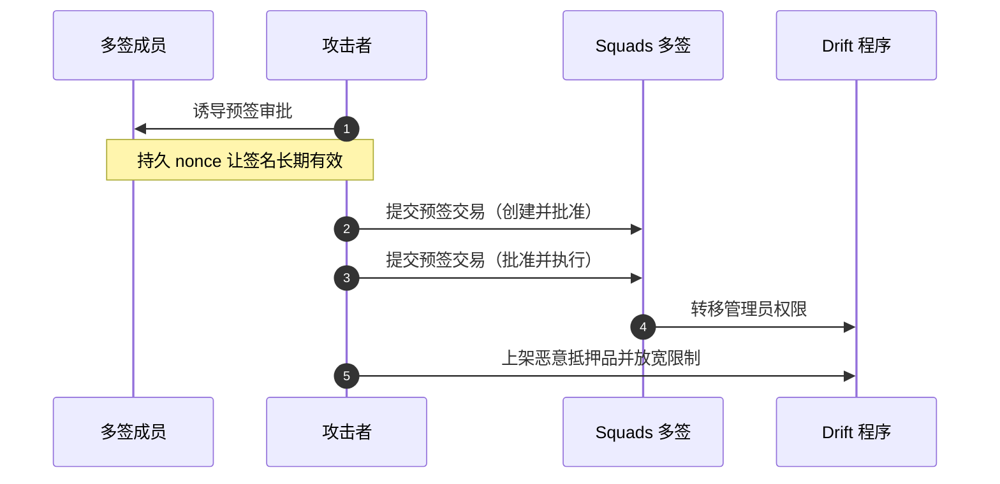

# B50 Solana 程序审计实战

> 学习目标：读完本章，你能——
> 1. 审查 Solana 指令的账户校验，包括 signer、owner、PDA、CPI 和重复初始化。
> 2. 读懂 Anchor 约束，并说出每个约束不能替你检查什么。
> 3. 把持久 nonce、多签和管理权限纳入审计范围。
>
> 前置章节：[13 非 EVM 生态](../chapters/13-non-evm-ecosystems.md)、[B27 专业审计流程](B27-what-is-audit.md)
> 交互实验：[闪电贷治理攻击与防御](../interactive/audit-governance.html) ｜ [风险评级计算器](../interactive/severity-calculator.html)
> 最后核对：2026-11-09

> 🔗 关联：主线 [05 访问控制](../chapters/05-access-control.md)、[13 非 EVM](../chapters/13-non-evm-ecosystems.md)、[18 钱包与密钥](../chapters/18-wallet-key-management.md)、[21 社会工程](../chapters/21-social-engineering-insiders.md) ｜ 实验 [治理与时间锁](../interactive/audit-governance.html) ｜ 评估 [A02 定级](../assessment/A02-risk-rating-reporting.md)、[A06 运营密钥安全](../assessment/A06-operational-key-security.md)

---

## 开场：合约没有 bug，2.85 亿美元还是没了

2026 年 4 月 1 日，Solana 上的 Drift 损失约 2.85 亿美元（事发时估值）。公开报告没有发现程序漏洞。攻击者用提前拿到的多签审批，转走了管理员权限。

<details class="predict"><summary>🤔 先猜再看：一笔普通 Solana 交易签名后，能等 9 天再上链吗？</summary>

不能。普通交易绑定最近的区块哈希，大约 150 个 slot 后过期。持久 nonce（Durable Nonce）把区块哈希换成 nonce 账户里的值，所以签名可以长期保留。这就是审计要检查签名流程的原因。

</details>

---

## 1. 一句话理解

**在 Solana 上，调用者传入指令的每一个账户都是输入。程序必须证明账户是谁的、是什么类型、由谁授权。**

> 🎯 打个比方：EVM 合约像一个自己带账本的柜台。Solana 程序像一个没有账本的柜员：客户把所有账本都抱过来，柜员要逐本核对印章和编号。
>
> 比喻的局限：真实程序的账户可以由其他程序拥有。"核对印章"包括 owner、判别字段、PDA 种子和数据字段多项检查，不是一次检查。

---

## 2. 威胁模型：攻击者能控制什么

| 攻击者能控制 | 程序必须校验 |
|---|---|
| 指令传入的全部账户 | owner、类型、地址或 PDA 种子 |
| 账户的顺序和重复账户 | 同一账户不能同时充当两个角色 |
| 指令数据 | 数值范围、权限相关字段 |
| CPI 的目标程序（如果由输入决定） | 目标 program id |
| 在同一笔交易中组合多条指令 | 指令之间的状态假设 |
| 诱导签名者预签交易 | 时间锁、执行前复核 |

Solana 程序本身无状态。程序账户只存放代码，数据放在其他账户中。

---

## 3. 漏洞机制

Solana 账户校验的概览见 [13 章 3.1 节](../chapters/13-non-evm-ecosystems.md)。本节带代码逐项展开。

### 3.1 一次指令的校验路径


**读图要点：**

- 数据从调用者进入，先经过四类校验，再进入业务逻辑。
- 任一层缺失，后面的逻辑都会基于错误账户运行。
- 局限：这张图只描述单条指令。同一笔交易的多条指令要单独分析。

### 3.2 signer 与 owner

| 检查 | 回答的问题 | 缺失时 |
|---|---|---|
| signer | 这个地址授权了本次调用吗？ | 攻击者只需传入管理员公钥 |
| owner | 这个账户的数据由谁写入？ | 攻击者伪造一个结构相同的账户 |
| 判别字段（Discriminator） | 这是哪种账户类型？ | 同一程序的另一类账户被混用 |

Anchor 的 `Account<T>` 会检查 owner，`Signer` 类型要求账户签名（[Anchor 约束文档](https://www.anchor-lang.com/docs/references/account-constraints)）。`UncheckedAccount` 不做这些检查。

### 3.3 可运行示例：管理员改费率

下面的代码是本手册示例，已在 Anchor 1.2.2 上通过 `cargo check`。不得部署。

```rust
use anchor_lang::prelude::*;

declare_id!("Fg6PaFpoGXkYsidMpWTK6W2BeZ7FEfcYkg476zPFsLnS");

#[program]
pub mod treasury {
    use super::*;

    // ❌ 漏洞：没有校验调用者身份和账户归属
    pub fn set_fee_vuln(ctx: Context<SetFeeVuln>, fee_bps: u16) -> Result<()> {
        let info = ctx.accounts.config.to_account_info();
        // 直接改原始字节，不检查账户类型
        let mut data = info.try_borrow_mut_data()?;
        // 任何人都能传入一个伪造账户并写入
        data[40..42].copy_from_slice(&fee_bps.to_le_bytes());
        Ok(())
    }

    // ✅ 修复：约束校验签名者、类型、PDA 和管理员字段
    pub fn set_fee(ctx: Context<SetFee>, fee_bps: u16) -> Result<()> {
        // 限制费率上限
        require!(fee_bps <= MAX_FEE_BPS, TreasuryError::FeeTooHigh);
        // 走到这里时，SetFee 的约束已全部通过
        ctx.accounts.config.fee_bps = fee_bps;
        Ok(())
    }

    // ✅ 修复：init 只能成功一次
    pub fn initialize(ctx: Context<Initialize>) -> Result<()> {
        let config = &mut ctx.accounts.config;
        // 记录管理员，供 has_one 校验
        config.admin = ctx.accounts.admin.key();
        config.fee_bps = 0;
        config.bump = ctx.bumps.config;   // 保存 PDA 的 bump，后续校验复用
        Ok(())
    }
}

const MAX_FEE_BPS: u16 = 1_000;

#[account]
pub struct Config {
    pub admin: Pubkey,
    pub fee_bps: u16,
    pub bump: u8,
}

impl Config {
    // 8 字节判别字段 + admin + fee_bps + bump
    pub const SIZE: usize = 8 + 32 + 2 + 1;
}

#[derive(Accounts)]
pub struct SetFeeVuln<'info> {
    /// CHECK: ❌ 漏洞：没有 owner 校验，也没有判别字段校验
    #[account(mut)]
    pub config: UncheckedAccount<'info>,
    /// CHECK: ❌ 漏洞：没有 signer 校验
    pub admin: UncheckedAccount<'info>,
}

#[derive(Accounts)]
pub struct SetFee<'info> {
    // PDA 种子 + 存储的 bump 固定账户地址；has_one 校验 admin 字段
    #[account(mut, seeds = [b"config"], bump = config.bump, has_one = admin)]
    pub config: Account<'info, Config>,
    pub admin: Signer<'info>,   // Signer：必须对交易签名
}

#[derive(Accounts)]
pub struct Initialize<'info> {
    #[account(init, payer = admin, space = Config::SIZE, seeds = [b"config"], bump)]
    pub config: Account<'info, Config>,   // 上一行 init：账户已存在时失败，杜绝重复初始化
    #[account(mut)]
    pub admin: Signer<'info>,
    pub system_program: Program<'info, System>,
}

#[error_code]
pub enum TreasuryError {
    #[msg("fee exceeds maximum")]
    FeeTooHigh,
}
```

<details class="predict"><summary>🤔 先猜再看：把 SetFee 中的 has_one = admin 删掉，只保留 Signer，谁能改费率？</summary>

任何签名者都能改费率。`Signer` 只证明这个账户签了名，不证明它是 `config.admin`。`has_one` 才把签名者和配置中的管理员绑定。

</details>

### 3.4 CPI

CPI（Cross-Program Invocation）：一个程序在执行中调用另一个程序。

| 风险 | 机制 | 防御 |
|---|---|---|
| 任意 CPI | 目标程序来自未校验的账户 | 用 `Program<'info, T>` 或校验地址 |
| 签名权限传递 | 调用者的 signer 权限随 CPI 传给被调程序 | 只调用可信程序；不把高权限账户传给外部程序 |
| PDA 代签 | 程序用种子替 PDA 签名 | 种子包含用户或资产标识，避免多用户共用 |
| 旧数据 | 被调程序修改账户后，内存数据未更新 | CPI 后调用 `reload()` |

### 3.5 PDA

PDA（Program Derived Address）：由程序 ID 和种子派生、没有私钥的地址。

- 种子决定隔离范围。如果种子只有 `b"vault"`，全部用户共用一个 PDA。
- 同一组种子可能有多个可用 bump。规范 bump 由 `find_program_address` 给出。
- Anchor 的 `seeds` + `bump` 校验账户是当前程序派生的 PDA；未指定 bump 值时使用规范 bump（[Anchor 文档](https://www.anchor-lang.com/docs/account-constraints)）。
- PDA 只证明地址。账户内的字段要另外用 `has_one` 或 `constraint` 校验。

### 3.6 重复初始化

| 写法 | 行为 | 审计问题 |
|---|---|---|
| `init` | 账户已存在时失败 | 种子设计是否允许抢先初始化？ |
| `init_if_needed` | 账户不存在时才初始化，并要求开启 `init-if-needed` 功能（[Anchor 文档](https://www.anchor-lang.com/docs/references/account-constraints)） | 已存在分支是否校验了全部字段？账户被关闭后能否重建？ |
| 手写初始化 | 由程序写字段 | 是否有"已初始化"标记或判别字段检查？ |

> ⚠️ 警告：账户关闭后，同一地址可能被重新创建。如果程序只靠"账户不存在"判断首次使用，攻击者可以在同一流程中重置状态（[Chainstack 托管模式说明](https://docs.chainstack.com/docs/solana-escrow-pattern)）。

### 3.7 Anchor 约束速查

| 约束 | 检查内容 | 不能检查 |
|---|---|---|
| `Signer` / `signer` | 账户签名 | 账户是否是正确的角色 |
| `Account<T>` | owner 与类型 | 账户是否属于当前用户 |
| `has_one = x` | 账户字段等于 `x` 的地址 | `x` 本身是否可信 |
| `seeds` + `bump` | 账户是 PDA | 账户内部字段 |
| `address = X` | 账户地址等于 `X` | 账户数据是否最新 |
| `constraint = expr` | 任意布尔表达式 | 表达式之外的条件 |
| `close = x` | 把 lamports 转给 `x`，重置数据 | 同地址之后不被重建 |
| `realloc` | 调整空间 | 新字段的初始值语义 |

> 💡 注意：`/// CHECK:` 注释只让 Anchor 接受未校验账户。注释不增加任何校验。审计时列出全部 `UncheckedAccount` 和 `AccountInfo`。

### 3.8 持久 nonce 与管理员密钥

持久 nonce（Durable Nonce）：把最近区块哈希替换为 nonce 账户内存储值的机制。使用时，交易的第一条指令推进 nonce（[Solana 文档](https://solana.com/docs/core/transactions/durable-nonces)）。

| 普通交易 | 持久 nonce 交易 |
|---|---|
| 绑定最近区块哈希 | 绑定 nonce 账户的值 |
| 约 150 个 slot 后过期 | 没有固定过期时间 |
| 签名者签名后很快失效 | 签名可以保存到 nonce 被推进 |



**读图要点：**

- 每笔交易的签名都有效。程序没有理由拒绝。
- 持久 nonce 把"签名时间"和"执行时间"分开。
- 时间锁把"执行"和"生效"分开。两者缺一，复核窗口都会消失。
- 局限：图中省略了 CVT 假代币的预备阶段。

> 🧪 动手验证：打开[闪电贷治理攻击与防御](../interactive/audit-governance.html)，勾选"时间锁"和不勾选各运行一次，记录提案是否当场执行。再思考：Drift 的 0 延迟多签对应哪一种设置？

---

## 4. 防御方法

### 4.1 代码层

1. 默认使用 `Account<T>`、`Signer`、`Program<T>`。
2. 每个 `UncheckedAccount` 都写出校验理由和校验代码。
3. PDA 种子包含隔离维度：用户、资产或池子。
4. CPI 后，读取被修改账户前先 `reload()`。
5. `init_if_needed` 的已存在分支校验全部字段。

### 4.2 权限层

1. 管理员权限用多签，门限根据可转移资产确定。
2. 权限转移、预言机更换、上架抵押品全部经过时间锁。
3. 新上架抵押品有借款上限，提款有速率限制。
4. 多签成员变更后，重新建立时间锁和撤销旧授权。

### 4.3 流程层

1. 禁止对高权限账户使用持久 nonce，或要求单独审批。
2. 硬件钱包显示完整的指令内容；禁止盲签。
3. 预签交易登记编号和用途；执行前复核。
4. 监控 nonce 账户创建、权限变更和异常提款。

---

## 5. 真实案例

### 5.1 Drift（2026 年 4 月，Solana）

- 2026 年 4 月 1 日，Drift 损失约 2.85 亿美元（事发时估值）。安全委员会是 2-of-5 Squads 多签，没有时间锁。攻击者用持久 nonce 预签的审批转走管理员权限，再上架自建抵押品取走资产。完整案例和来源见 [13 章 5.5.2 节](../chapters/13-non-evm-ecosystems.md)。

教训：审计范围要包括管理员的门限、时间锁和预签流程。有效签名不等于安全意图。

### 5.2 Wormhole（2022 年 2 月，Solana）

- Solana 侧没有校验传入的 sysvar 账户。攻击者伪造验证结果，铸造 12 万 wETH（约 3.2 亿美元，事发时估值）。完整案例见 [13 章 5.1 节](../chapters/13-non-evm-ecosystems.md)，复盘见[资损 101](https://claude.ai/artifact/1a5Nx6xTVLuJdCB8Esf2xj#c-wormhole)。
- 教训：sysvar 也是调用者传入的账户（NEV-105）。

### 5.3 Cashio（2022 年 3 月，Solana）

- 铸币检查没有把 Saber 账户的 mint 字段锚定到可信根，攻击者用伪造的账户链铸币。完整案例见 [13 章 5.1 节](../chapters/13-non-evm-ecosystems.md)。
- 教训：校验链要终止于硬编码地址或程序 PDA（NEV-104）。

---

## 6. 审计检查点

- [ ] **NEV-101** 列出每条指令的全部账户，并标注 signer、owner、类型、PDA 和关系校验。
- [ ] **NEV-102** 敏感操作的签名者与配置中的角色绑定（`has_one` 或等价检查）。
- [ ] **NEV-103** 全部 `UncheckedAccount`、`AccountInfo` 都有校验代码。
- [ ] **NEV-104** 账户校验链终止于硬编码地址或本程序 PDA。
- [ ] **NEV-105** sysvar 用带校验的 API 读取，或校验其地址。
- [ ] **NEV-106** CPI 目标 program id 已校验；高权限 signer 不传给外部程序。
- [ ] **NEV-107** CPI 后读取账户前已 `reload()`。
- [ ] **NEV-108** PDA 种子包含正确的隔离维度，并使用规范 bump。
- [ ] **NEV-109** `init_if_needed` 的已存在分支校验全部字段；关闭后重建路径已分析。
- [ ] **NEV-110** 账户 `close` 后不能被同流程重新使用。
- [ ] **NEV-111** 管理权限转移、上架抵押品、更换预言机都有时间锁。
- [ ] **NEV-112** 多签门限与资产规模匹配；持久 nonce 使用受限并被监控。
- [ ] **NEV-113** 程序升级权限明确，部署版本等于审计版本。

**把检查结果写进报告：**

| 检查项 | 发现时的证据 | 常见定级（用 [A02](../assessment/A02-risk-rating-reporting.md) 复核） | 练习位置 |
|---|---|---|---|
| NEV-101、102、103 | 账户校验表 + 伪造账户的测试 | Critical / High | 3.3 节示例 |
| NEV-104、105 | 校验链图 | Critical / High | 5.2、5.3 节 |
| NEV-106、107 | CPI 路径 + 恶意被调程序测试 | High | 3.4 节 |
| NEV-108、109、110 | PDA 种子表 + 重复调用测试 | High / Medium | 3.5、3.6 节 |
| NEV-111、112、113 | 多签配置、时间锁、签名流程记录 | 取决于管理员可动用的资产 | [A06](../assessment/A06-operational-key-security.md) |

发现按 [T03 报告模板](../templates/T03-finding-report.md) 记录。

### 6.1 工具（截至 2026 年 11 月 9 日）

| 工具 | 用途 | 版本 |
|---|---|---|
| [Anchor](https://github.com/solana-foundation/anchor/releases) | 框架与约束 | 1.2.2（2026-10-28 发布） |
| [Trident](https://github.com/Ackee-Blockchain/trident/releases) | Solana 程序模糊测试 | 0.12.0 稳定版；0.13.0-rc.4 预发布 |
| `cargo audit` | Rust 依赖漏洞扫描 | 使用时锁定版本 |
| `solana-test-validator` 或 LiteSVM | 本地指令测试 | 使用时锁定版本 |

> 💡 注意：本章的 Anchor 示例只做了类型检查，没有部署或运行集成测试。

---

## 7. 用户侧防护

1. 存款前查看协议的管理员门限和时间锁。
2. 如果管理员能立即转移权限，只放可以承受损失的金额。
3. 协议上架陌生抵押品时，降低敞口。
4. 协议宣布暂停时，按官方渠道操作，不点社交媒体里的"紧急提款"链接。

---

## 8. 术语表

| 术语 | 英文 | 定义 |
|---|---|---|
| 判别字段 | Discriminator | 标识账户类型的前 8 字节 |
| 跨程序调用 | CPI | 程序在执行中调用另一个程序 |
| 程序派生地址 | PDA | 由程序 ID 和种子派生、没有私钥的地址 |
| 规范 bump | Canonical Bump | `find_program_address` 返回的 bump |
| 持久 nonce | Durable Nonce | 用 nonce 账户的值替代最近区块哈希的机制 |
| 时间锁 | Timelock | 权限操作批准后，延迟一段时间才能执行 |

---

> 🪞 反思：打开你读过的一个 Solana 程序。
> 1. 哪个账户是用 `UncheckedAccount` 传入的？校验代码在哪一行？
> 2. 如果管理员今天签了一笔预签交易，9 天后谁能发现它？
> 3. 你的多签成员变更后，旧授权怎样失效？

## 9. 思考题

1. 在第 3.3 节的 `SetFee` 中，如果 `config` 的种子是 `[b"config", admin.key().as_ref()]`，`has_one = admin` 还有必要吗？它防的是什么？
2. 一个程序把用户金库 PDA 的种子写成 `[b"vault"]`。这对多用户资产隔离有什么影响？
3. 在[治理实验](../interactive/audit-governance.html)中，勾选时间锁但不勾选守护者。提案通过后结果是什么？把这个结果映射到 Drift 的情况，你还需要什么控制？

下一章：[B51 Move 审计实战](B51-move-audit.md) —— 另一种资源模型，另一组假设。
