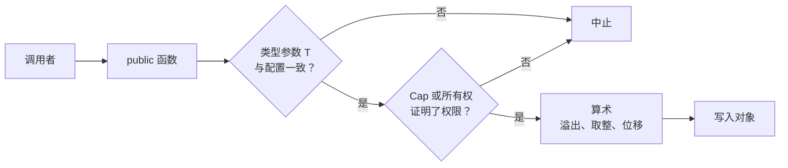
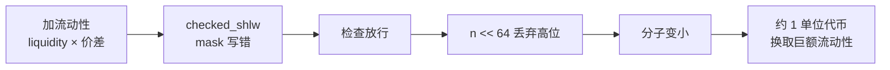

# B51 Move 审计实战

> 学习目标：读完本章，你能——
> 1. 说明 Sui 和 Aptos 的对象、能力和权限模型差异。
> 2. 找出泛型类型混淆和算术位移溢出。
> 3. 用 Move Prover 或 Sui Prover 写一条简单规格。
>
> 前置章节：[13 非 EVM 生态](../chapters/13-non-evm-ecosystems.md)、[06 算术与精度](../chapters/06-arithmetic-precision.md)
> 交互实验：[整数溢出与精度实验](../interactive/audit-overflow.html) ｜ [不变量模糊测试器](../interactive/audit-fuzz.html)
> 最后核对：2026-11-09

> 🔗 关联：主线 [05 访问控制](../chapters/05-access-control.md)、[06 算术与精度](../chapters/06-arithmetic-precision.md)、[13 非 EVM](../chapters/13-non-evm-ecosystems.md) ｜ 实验 [溢出实验](../interactive/audit-overflow.html)、[模糊测试](../interactive/audit-fuzz.html) ｜ 评估 [A02 定级](../assessment/A02-risk-rating-reporting.md)、[A04 DeFi 审查](../assessment/A04-defi-protocol-review.md)

---

## 开场：一次移位，2.23 亿美元

2025 年 5 月 22 日，Sui 上的 Cetus 损失约 2.23 亿美元（事发时估值）。问题不在业务合约，而在一个开源数学库的溢出检查。

<details class="predict"><summary>🤔 先猜再看：Move 的 u256 做 `n << 64`，高位被移出时交易会中止吗？</summary>

不会。Move 对加法、乘法溢出会中止。位移只在移位位数过大时中止，被移出的高位直接丢弃。这正是 Cetus 溢出检查要防范的情况。

</details>

---

## 1. 一句话理解

**Move 的类型系统保护"资源不能被复制或丢弃"，不保护"这笔资源该不该给这个人"。**

> 🎯 打个比方：Move 像带防伪芯片的现金。钞票不能复印，也不能凭空消失。但收银员把钱找错给人，芯片不会报警。
>
> 比喻的局限：钞票只有一种行为。Move 的结构体能按能力组合出不同行为，权限对象也由开发者设计。

---

## 2. 威胁模型：攻击者能控制什么

| 攻击者能控制 | 程序必须校验 |
|---|---|
| 泛型类型参数 | 类型与存储的配置一致 |
| Sui 共享对象的引用 | 业务权限，共享对象任何人都能传入 |
| 公开函数的调用顺序 | `public` 函数的前置条件 |
| 算术输入 | 溢出、取整、位移边界 |
| 权限对象的流转（如果带 `store`） | 转移和包装路径 |

---

## 3. 漏洞机制

### 3.1 能力（Abilities）

| 能力 | 含义 | 审计问题 |
|---|---|---|
| `copy` | 值可以复制 | 权益类结构体不能有 `copy` |
| `drop` | 值可以丢弃 | 欠条、闪电贷收据不能有 `drop` |
| `store` | 值可以存入其他结构体 | 权限对象带 `store` 时可被自由转移 |
| `key` | 值可以作为顶层对象 | Sui 对象的第一个字段必须是 `UID`（[Move Book](https://move-book.com/storage/key-ability/)） |

没有 `copy` 和 `drop` 的结构体叫烫手山芋（Hot Potato）：同一笔交易内必须被消费。它是闪电贷收据的标准做法。

### 3.2 Sui 与 Aptos 的对象模型

| 项目 | Sui | Aptos |
|---|---|---|
| 存储 | 对象，交易显式传入（[所有权文档](https://docs.sui.io/concepts/object-ownership)） | 账户资源和对象（`ObjectCore`，[框架文档](https://aptos-labs.github.io/framework-book/aptos-framework/object.html)） |
| 共享状态 | 共享对象：任何地址都能在交易中引用 | 全局存储：模块用 `borrow_global` 读取 |
| 权限 | `AdminCap` 对象 | `signer`、`ExtendRef`、`TransferRef` |
| 主要风险 | 共享对象缺鉴权；`public` 暴露内部能力 | `ExtendRef` 泄露可生成对象 signer；`TransferRef` 可强制转移 |

Sui 文档明确说明：任何人都能提交引用共享对象的交易，授权必须写在 Move 代码里。



**读图要点：**

- 类型检查、权限检查和算术检查是三层独立的防线。
- Move 编译器只保证类型规则。业务校验要写在函数里。
- 局限：图未包含包升级，升级权限要另外审查。

### 3.3 泛型类型混淆

泛型类型参数由调用者指定。如果函数没有把类型与存储的状态绑定，攻击者可以指定另一种类型。

公开研究把"缺少泛型类型检查"列为 Aptos Move 常见缺陷（[Zellic](https://www.zellic.io/blog/top-10-aptos-move-bugs)）。OpenZeppelin 指出：`Coin<SUI>` 的类型是真的，但类型不能保证业务含义正确（[OpenZeppelin](https://www.openzeppelin.com/news/critical-bug-patterns-in-sui-move)）。

下面的代码是本手册示例，使用 Sui Move 2024 语法。本机没有 Sui CLI，示例未经编译。

```move
module demo::vault;

use sui::balance::{Self, Balance};
use sui::coin::{Self, Coin};

public struct Vault<phantom T> has key {   // phantom T：类型参数只用于区分币种
    id: UID,
    funds: Balance<T>,
}

// ❌ 漏洞：Receipt 没有绑定币种和金库
public struct Receipt has key, store {   // store：收据可自由转让
    id: UID,
    vault_id: ID,   // 只记录了 ID，取款时却没有校验
    amount: u64,
}

public fun create<T>(ctx: &mut TxContext): Vault<T> {
    Vault { id: object::new(ctx), funds: balance::zero<T>() }
}

public fun deposit<T>(vault: &mut Vault<T>, c: Coin<T>, ctx: &mut TxContext): Receipt {
    let amount = c.value();
    coin::put(&mut vault.funds, c);
    // 收据记录来源金库
    Receipt { id: object::new(ctx), vault_id: object::id(vault), amount }
}

// ❌ 漏洞：任何金库的收据都能取任何金库的资金
public fun withdraw_vuln<T>(
    vault: &mut Vault<T>,
    receipt: Receipt,
    ctx: &mut TxContext,
): Coin<T> {
    let Receipt { id, vault_id: _, amount } = receipt;   // vault_id 被丢弃
    id.delete();
    coin::take(&mut vault.funds, amount, ctx)   // 直接从传入的金库取款
}

// ✅ 修复：收据带币种类型，并校验金库 ID
// 币种进入类型：Vault<T> 只接受 SafeReceipt<T>
public struct SafeReceipt<phantom T> has key, store {
    id: UID,
    vault_id: ID,
    amount: u64,
}

const EWrongVault: u64 = 1;

public fun withdraw<T>(
    vault: &mut Vault<T>,
    receipt: SafeReceipt<T>,
    ctx: &mut TxContext,
): Coin<T> {
    let SafeReceipt { id, vault_id, amount } = receipt;
    // 收据必须来自这个金库
    assert!(vault_id == object::id(vault), EWrongVault);
    id.delete();
    coin::take(&mut vault.funds, amount, ctx)
}
```

<details class="predict"><summary>🤔 先猜再看：攻击者自建 Vault&lt;FAKE&gt; 存入 100 枚假币，能用收据从 Vault&lt;USDC&gt; 取钱吗？</summary>

在 `withdraw_vuln` 中能。`Receipt` 不带类型，也不校验 `vault_id`。攻击者把收据和目标金库一起传入。修复版要求 `SafeReceipt<USDC>` 和匹配的 `vault_id`。

</details>

### 3.4 算术位移

```move
// ❌ 漏洞：简化自 Dedaub 公开的 integer-mate 代码
public fun checked_shlw(n: u256): (u256, bool) {
    // 根因：这个掩码是 2^256 - 2^192，阈值过大
    let mask = 0xffffffffffffffff << 192;
    if (n > mask) {   // n 介于 2^192 和掩码之间时，左移溢出却不报错
        (0, true)
    } else {
        // 高位被截断，返回错误结果
        ((n << 64), false)
    }
}

// ✅ 修复：左移 64 位前，n 必须小于 2^192
public fun checked_shlw_fixed(n: u256): (u256, bool) {
    if (n >= (1u256 << 192)) {   // 阈值为 2^192：大于等于它左移 64 位就会溢出
        (0, true)
    } else {
        ((n << 64), false)
    }
}
```

示例计算（本手册）：`n = 2^192 + 5`。

1. 错误的 mask 约等于 `2^256 − 2^192`，所以 `n` 小于 mask，检查通过。
2. `n << 64` 丢弃高位，结果是 `5 × 2^64`。
3. 后续除法用这个很小的值计算应付 token。



**读图要点：**

- 数据来自加流动性的金额和价格，由调用者控制。
- 错误发生在依赖库，不在 Cetus 的业务模块。
- 局限：完整攻击还包括闪电兑换和多次移除流动性。

> 🧪 动手验证：打开[整数溢出与精度实验](../interactive/audit-overflow.html)，选择位宽 8、模式"0.8 + unchecked（回绕）"、运算 `*`，输入 `a=200`、`b=2`。记录回绕结果。实验没有移位运算，乘 `2^k` 等价于左移 `k` 位；你看到的就是高位丢失。

> ⚠️ 警告：不要假设"Move 溢出都会中止"。官方整数文档列出的 `<<` 中止条件只与移位位数有关（[Move Book](https://move-book.com/reference/primitive-types/integers)）。

### 3.5 Move Prover 与 Sui Prover

| 工具 | 适用 | 入口 |
|---|---|---|
| Move Prover | Aptos Move | `aptos move prove`，先运行 `aptos update prover-dependencies`（[官方指南](https://aptos-labs.github.io/move-book/prover-guide.html)） |
| Sui Prover | Sui Move | 社区工具，Asymptotic 开发（[Sui 博客](https://blog.sui.io/asymptotic-move-prover-formal-verification/)） |

下面是 Move 规格语言（MSL）的示意片段，未在本机运行。

```move
spec checked_shlw {
    aborts_if false;   // 函数从不中止
    // 溢出标志当且仅当 n ≥ 2^192
    ensures result_2 == (n >= 6277101735386680763835789423207666416102355444464034512896);
    // 未溢出时，结果等于 n × 2^64
    ensures !result_2 ==> result_1 == n * 18446744073709551616;
}
```

- 第 2 行的数字是 `2^192`，第 3 行的数字是 `2^64`。
- 规格语言的算术不会溢出，所以第 3 行能表达"左移没有丢失高位"。
- 证明只覆盖规格。其他性质不受保护。

> 🧪 动手验证：打开[不变量模糊测试器](../interactive/audit-fuzz.html)，切换到修复版运行。页面说明"没有找到反例"不等于证明。把这个区别写到你的规格说明中。

---

## 4. 防御方法

### 4.1 代码层

1. 把类型和对象 ID 写进收据和仓位结构体。
2. 外部可见函数默认使用 `public(package)`。
3. 权限对象只在需要转移时才添加 `store`。
4. 位移前校验上界。数学库用边界值测试。
5. 乘除顺序按取整方向审查。

### 4.2 工程层

1. 把数学依赖纳入审计范围，并锁定版本。
2. 用 Prover 验证数学库的核心函数。
3. 升级权限由多签和时间锁控制。
4. 部署版本与审计版本比对。

### 4.3 运行层

1. 监控异常流动性变化和超大仓位。
2. 建立紧急暂停流程，并演练。

---

## 5. 真实案例

### 5.1 Cetus（2025 年 5 月，Sui）

- 2025 年 5 月 22 日，Cetus 损失约 2.23 亿美元（事发时估值）。根因是 `integer-mate` 中 `checked_shlw` 的 mask 写错，机制见本章 3.4 节。案例摘要见 [13 章 5.3 节](../chapters/13-non-evm-ecosystems.md)，链级冻结见 [25 章 5.2 节](../chapters/25-fund-tracing-response.md)。
- 教训：审计范围要包括数学库；移位要有显式边界检查。

### 5.2 公开审计中的 Move 缺陷模式

以下来自安全公司公开的研究，不是单一事故。

- 泛型：`cancel_order` 接收 `BaseCoinType`，没有校验它等于订单记录的类型（[Zellic](https://www.zellic.io/blog/top-10-aptos-move-bugs)）。
- 访问控制：OpenZeppelin 列举了 `public` 函数暴露内部状态、缺少类型校验的 Sui 案例（[OpenZeppelin](https://www.openzeppelin.com/news/critical-bug-patterns-in-sui-move)）。

---

## 6. 审计检查点

- [ ] **NEV-201** 全部 `public` 函数已列出，并确认是否应为 `public(package)`。
- [ ] **NEV-202** 每个泛型入口都校验了类型与存储状态的绑定。
- [ ] **NEV-203** 收据、仓位对象绑定了币种和所属对象 ID。
- [ ] **NEV-204** 共享对象的每个写入路径都有业务权限检查。
- [ ] **NEV-205** 权限对象的能力符合设计，带 `store` 的已审查流转路径。
- [ ] **NEV-206** Aptos 的 `ExtendRef`、`TransferRef` 不外泄。
- [ ] **NEV-207** 闪电贷收据没有 `copy` 和 `drop`。
- [ ] **NEV-208** 位移操作有上界检查；数学依赖在审计范围内。
- [ ] **NEV-209** 乘除顺序和取整方向已验证。
- [ ] **NEV-210** 包升级权限是多签并有时间锁；部署版本等于审计版本。

**把检查结果写进报告：**

| 检查项 | 发现时的证据 | 常见定级（用 [A02](../assessment/A02-risk-rating-reporting.md) 复核） | 练习位置 |
|---|---|---|---|
| NEV-202、203 | 跨金库提款的 Move 测试 | Critical / High | 3.3 节示例 |
| NEV-201、204、205、206 | 权限表 + 非授权调用测试 | High / Medium | 3.2 节 |
| NEV-207 | 能力声明 + 收据消费路径 | Critical / High | 3.1 节 |
| NEV-208、209 | 边界值测试或 Prover 反例 | Critical / High | 3.4、3.5 节 |
| NEV-210 | 升级权限配置、部署记录 | 取决于升级权限范围 | [A06](../assessment/A06-operational-key-security.md) |

发现按 [T03 报告模板](../templates/T03-finding-report.md) 记录。

### 6.1 工具版本（截至 2026 年 11 月 9 日）

- [Sui](https://github.com/MystenLabs/sui/releases) 主网：mainnet-v1.83.1。
- [Aptos 节点](https://github.com/aptos-labs/aptos-core/releases)：aptos-node-v1.49.8。
- Prover 版本随 CLI 变化，使用时锁定并写进底稿。

---

## 7. 用户侧防护

1. "Move 是安全语言"不是投资依据。查看协议的审计范围是否包含数学库。
2. 新的流动性池和高收益活动先小额参与。
3. 关注协议公告；事故后不点第三方的"补偿领取"链接。

---

## 8. 术语表

| 术语 | 英文 | 定义 |
|---|---|---|
| 能力 | Ability | 结构体的 copy、drop、store、key 属性 |
| 权限对象 | Capability | 持有者据此获得权限的对象 |
| 烫手山芋 | Hot Potato | 必须在同一交易内消费的结构体 |
| 共享对象 | Shared Object | 任何地址都能在交易中引用的 Sui 对象 |
| 泛型类型混淆 | Generic Type Confusion | 调用者传入错误类型参数，且模块未校验 |
| 规格 | Specification | 代码必须满足的形式化性质 |

---

> 🪞 反思：打开一个你读过的 Move 模块。
> 1. 哪个函数接收泛型参数但没有校验它？
> 2. 哪个权限对象带有 `store`？它能转到哪里？
> 3. 你的数学依赖库被谁审计过？版本是否和审计时相同？

## 9. 思考题

1. 在第 3.3 节中，只给 `Receipt` 加 `<phantom T>`，不校验 `vault_id`，还会有什么风险？
2. 用第 3.4 节的错误 `checked_shlw` 计算：`n = 2^192`、`n = 2^192 − 1` 和 `n = 2^256 − 1`。哪一个结果正确？哪一个发生了高位丢失？
3. 为什么闪电贷收据不能有 `drop`？如果给它加上 `drop`，攻击者会怎样做？

下一章：[B52 AI 辅助审计工作流](B52-ai-assisted-audit.md) —— 把新工具放进旧纪律。
