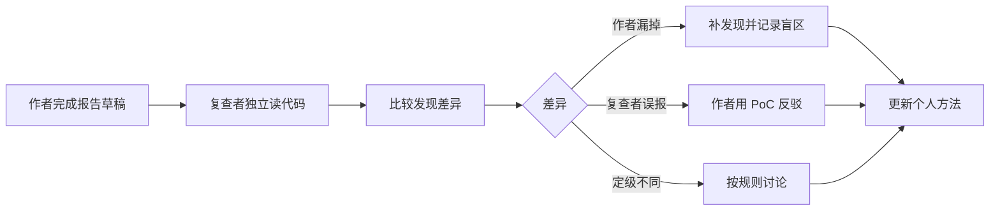

# B54 求职与专家之路

> 学习目标：读完本章，你能——
> 1. 用技能矩阵评估自己的岗位等级，并按 90 天计划准备作品集和求职。
> 2. 选择一个专精方向，建立自己的审计方法、工具和复查机制。
> 3. 处理利益冲突和披露问题，并制定 12 个月计划。
>
> 前置章节：[B53 竞赛、赏金与每日训练](B53-contests-and-habits.md)
> 预计用时：阅读 2.5 小时；求职冲刺 90 天；专家计划 12 个月。
> 交互实验：[学习路径诊断](../interactive/learning-paths.html) ｜ [审计自查清单](../interactive/audit-checklist.html) ｜ [MiniLend 审计练习台](../interactive/audit-capstone.html)

---

## 开场：专家和熟手的差别

熟手能找到清单上的漏洞。专家能发现清单上还没有的漏洞，并解释为什么这个系统的假设不成立。

专家不靠记忆更多漏洞。专家靠三样东西：一个深入的方向、一套可重复的方法、一群愿意挑战自己的同行。

🤔 先猜再看：想成为专家，应该把第 5 节的所有方向都学一遍吗？

不应该。先在一个方向做到别人会来问你的程度。其他方向保持能读懂的水平。专精带来的深度，可以迁移到相邻方向。

## 1. 一句话理解

**专家 = 一个深方向 + 一套可复用的方法 + 可验证的公开记录 + 不损害信任的职业操守。**

路线分两段。第一段是求职：用 90 天拿到可验证的作品，进入审计岗位（第 2–4 节）。第二段是专精：用 12 个月形成自己的方向和方法（第 5–10 节）。

> 🎯 打个比方：医生先做全科轮转，再选心内科。选了专科，不代表忘记全科。遇到复杂病例时，专科医生更知道什么时候找别的科室会诊。
>
> 比喻的局限：医生有统一的执照和考试。合约安全行业没有，你的公开记录就是执照。

## 2. 岗位等级与技能矩阵

### 2.1 岗位等级

| 等级 | 能力 | 证明方式 |
|---|---|---|
| 实习 / 初级审计员 | 熟悉 Solidity 和常见漏洞；能完成 Ethernaut 全部关卡；能写 Foundry 测试 | CTF 题解仓库 |
| 审计员 | 能独立审计 2,000 行以内的 DeFi 合约；能写合格报告 | 竞赛中至少有有效的中高危发现；公开审计练习报告 |
| 高级审计员 | 能审计原创复杂协议；理解经济模型；会用不变量测试和形式化工具 | 竞赛排名；赏金记录；技术文章 |
| 专家 / Lead | 能带团队；能做应急分析；熟悉多条链 | 公开的研究成果与工具；行业影响力 |

> 💡 注意：上表是业界常见的划分方式，不是统一标准。各公司的岗位名称和要求不同，以招聘说明为准。

### 2.2 技能矩阵

每项打一个等级。证据栏必须填写可打开的链接。没有证据就按低一级计算。

| 技能 | L1 入门 | L2 能独立完成 | L3 能审复杂协议 | L4 能带队 | 我的证据 |
|---|---|---|---|---|---|
| Solidity 与 EVM | 读懂合约 | 读懂字节码跟踪、存储布局 | 审内联汇编 | 分析编译器缺陷 | |
| 漏洞模式（主线 04–09 章） | 能解释 | 能写 PoC | 能发现变体 | 能写新的检查项 | |
| DeFi 机制 | 能算 AMM、HF | 能审 V2 分叉 | 能拆解原创协议 | 能审经济模型 | |
| 工具（[B31](B31-automation-tools.md)） | 会跑 Forge、Slither | 会写不变量 | 会写检测器 | 能建团队流水线 | |
| 报告（[A02](../assessment/A02-risk-rating-reporting.md)） | 能写标题和根因 | 能写完整条目 | 能主持定级 | 能对客户负责 | |
| 工作流程（[B27](B27-what-is-audit.md)） | 知道流程 | 能完成模块 | 能规划一次审计 | 能管理多项目 | |
| 多链（[B50](B50-solana-audit.md)、[B51](B51-move-audit.md)） | 知道差异 | 能读程序 | 能审一条非 EVM 链 | 能设计跨链方案 | |
| AI 辅助（[B52](B52-ai-assisted-audit.md)） | 知道边界 | 能用 PoC 验证输出 | 能建立团队规范 | 能评估工具风险 | |

HF：健康因子（Health Factor），借贷协议判断仓位能否被清算的指标。

> 🧪 动手验证：打开[学习路径诊断](../interactive/learning-paths.html)，完成入门诊断，记下它推荐的路径。再看技能矩阵的最低项是否在这条路径上。如果不在，先补最低项。

## 3. 公开作品集

作品集的目的是让陌生人能验证你的能力。简历上写了什么，面试官就问什么。

示例场景：两名候选人都写"熟悉重入"。第一名给出一个 PoC 链接。第二名给出一段定义。面试官只能验证第一名的说法。

🤔 先猜再看：只有 CTF 题解、没有竞赛成绩，能进入审计员面试吗？

能进入初级岗位的筛选，但证据偏弱。CTF 证明你能解决已知答案的题。你还需要一份公开审计练习报告，或一条有效的竞赛发现，证明你能在陌生代码里找到问题。

按阶段准备以下内容：

| 内容 | 求职阶段 | 专家阶段 | 要求 |
|---|---|---|---|
| 题解仓库 | Ethernaut 与 Damn Vulnerable DeFi 题解 | — | 用 Foundry 测试证明每关的解法 |
| 事件复现 | 3–5 个历史事件的复现与根因分析 | 持续补充 | 只在本地 fork 运行；格式可参考 DeFiHackLabs |
| 练习报告 | 1–2 份公开练习报告 | 训练营靶场报告 | 选开源协议的旧版本或公开靶场，并标注"练习" |
| 竞赛记录 | Sherlock、Cantina 等平台的个人主页 | 排名和累计有效发现 | 链接到平台公开页面，写清排名和有效发现。Code4rena 已宣布关停，历史成绩仍可列出（平台现状见 [B53](B53-contests-and-habits.md)） |
| 技术文章 | 每月 1–2 篇 | 深度文章 | 每篇只讲清一个机制，并附可运行代码 |
| 开源工具 | — | 自定义检测器、测试基类 | 写清用途、局限和测试方式 |

> ⚠️ 警告：不要公开受 NDA 约束的审计细节，也不要公开未修复的漏洞。公开前取得客户书面许可。

## 4. 90 天求职冲刺

### 4.1 逐周计划

每周固定产出一个可以链接的文件。"每周时间"按 15 小时估算（示例）。

| 周 | 学习 | 实践 | 本周可验证产出 |
|---|---|---|---|
| 1 | 主线 04–05 章、[B06](B06-foundry-basics.md) | Ethernaut 第 1–8 关 | 题解仓库，含 Foundry 测试 |
| 2 | 主线 06–07 章 | Ethernaut 第 9–16 关 | 题解 + 笔记 1 篇 |
| 3 | 主线 08–09 章 | Ethernaut 收尾 | 技能矩阵第一次打分 |
| 4 | 主线 10 章、[B45](B45-yul-opcodes.md) | 读 Solodit 高危 15 条 | 自建检查清单 v1 |
| 5 | [B17](B17-defi-basics.md)–[B18](B18-dex-amm.md) | DVDeFi 前 3 关 | PoC 3 个 |
| 6 | [B20](B20-lending-cdp.md)、[B17](B17-defi-basics.md)（头部协议） | DVDeFi 第 4–6 关 | PoC 3 个 |
| 7 | [B35](B35-case-method.md)、[B36](B36-case-uniswap-v2.md) | 复现 1 起事件（只在本地 fork） | 事件分析文章 1 |
| 8 | [B23](B23-complex-protocols.md)、[B31](B31-automation-tools.md) | 为一个开源金库写不变量 | 不变量测试仓库 |
| 9 | [B38](B38-case-aave-v3.md) | 按 [B35](B35-case-method.md) 的模板写底稿 | 五份底稿 |
| 10 | [B27](B27-what-is-audit.md)、[A02](../assessment/A02-risk-rating-reporting.md) | [B25 MiniLend](B25-capstone-minilend.md) | 练习报告草稿 |
| 11 | [B53](B53-contests-and-habits.md) | 参加 1 场竞赛 | 提交记录与复盘 |
| 12 | [B55](B55-interview.md) | 参加第 2 场竞赛；模拟面试 | 终版简历、公开报告 |
| 13 | 复盘 | 技能矩阵第二次打分；投递 | 投递记录、下一季计划 |

阶段小结：第 1–30 天打基础，产出题解仓库。第 31–60 天学 DeFi，产出事件分析和不变量测试。第 61–90 天做实战，产出练习报告、竞赛提交和简历。

> ⚠️ 警告：复现事件只在本地 fork 或测试环境进行。不要在主网或他人系统上"验证"漏洞。

> 🧪 动手验证：第 10 周打开 [MiniLend 审计练习台](../interactive/audit-capstone.html)，点击你认为有问题的行并提交。把漏选的行写进第 4 周建立的检查清单。也可以用[审计自查清单](../interactive/audit-checklist.html)逐项核对练习报告。

### 4.2 检查点

| 时间 | 通过标准 | 不通过时 |
|---|---|---|
| 第 30 天 | 能不看答案写出重入和访问控制 PoC | 延长基础阶段 2 周 |
| 第 60 天 | 有 1 篇事件分析，1 个不变量测试仓库 | 先减少新内容，补完产出 |
| 第 90 天 | 有 1 份公开练习报告，1 次竞赛提交 | 继续竞赛，暂缓中高级岗位 |

### 4.3 面试环节

审计岗位的面试通常有四个环节：

1. **简历与项目追问**：你的发现是怎么找到的？面试官会沿着作品集的链接追问。
2. **技术问答**：原理、例子、修复。题目和参考答案见 [B55 面试题库](B55-interview.md)。
3. **现场代码审计**：给 100–300 行代码，限时找问题。先列入口函数和资金流，再逐函数审。练习方法见 [B53](B53-contests-and-habits.md) 第 3 节。
4. **报告写作**：把一个发现写成完整条目。格式见 [B14](B14-writing-findings.md)。

## 5. 专精方向

| 方向 | 要学什么 | 练习材料 | 手册入口 |
|---|---|---|---|
| DeFi 数学 | AMM 不变量、利率模型、取整方向、清算 | [Updraft Uniswap V2](https://updraft.cyfrin.io/courses/uniswap-v2)、[Curve](https://updraft.cyfrin.io/courses/curve-v1) | [11](../chapters/11-defi-economic-security.md)、[B18](B18-dex-amm.md)、[B20](B20-lending-cdp.md)、[B22](B22-economics-governance.md) |
| L2 与跨链 | 排序器、证明系统、消息传递、重放防护 | L2BEAT 风险页、公开桥事故复盘 | [12](../chapters/12-cross-chain-bridges.md)、[16](../chapters/16-consensus-chain-security.md) |
| ZK | 电路约束、欠约束、可信设置 | [Updraft ZK 基础](https://updraft.cyfrin.io/courses/fundamentals-of-zero-knowledge-proofs) | [14](../chapters/14-zk-proof-systems.md)、[ZK 约束实验](../interactive/zk-constraint-lab.html) |
| 非 EVM | Solana 账户模型、Move 资源模型 | [Updraft Solana](https://updraft.cyfrin.io/courses/solana) | [13](../chapters/13-non-evm-ecosystems.md)、[B50](B50-solana-audit.md)、[B51](B51-move-audit.md) |
| 钱包与基础设施 | 签名流程、密钥管理、节点、RPC、前端供应链 | 自建测试节点和钱包流程 | [15](../chapters/15-account-abstraction-wallets.md)、[17](../chapters/17-node-rpc-infrastructure.md)、[18](../chapters/18-wallet-key-management.md)、[20](../chapters/20-frontend-dns-supply-chain.md)、[29](../chapters/29-signing-path-2026.md) |

选择方法：

1. 列出你最近 10 条有效或差一点有效的发现。
2. 看它们集中在哪类问题上。
3. 问自己：哪类问题你读论文都不觉得累？
4. 选一个方向，投入 3 个月，再复盘。

## 6. 建立自己的方法

> 💡 注意：别人的清单是起点。你的方法要能回答"我的盲区在哪里"。

个人方法文档至少包含：

1. **接单检查**：范围、提交哈希、编译设置、已知问题。见 [T01](../templates/T01-intake-checklist.md)。
2. **第一遍**：资金流、入口表、权限表。见 [T02](../templates/T02-threat-model.md)。
3. **假设账本**：每条假设的状态：待查、成立、不成立。
4. **检查项**：按手册前缀组织（REN、ACC、ARI、EXT、ORA、MEV、UPG、DFI、BRG）。
5. **工具链**：每个工具用在哪一步，误报如何处理。见 [B31](B31-automation-tools.md)。
6. **自查**：提交前对照 [T03](../templates/T03-finding-report.md)。
7. **复盘**：每次项目后更新方法，记录漏掉的问题。

工具建设原则：

- 先把手工重复 3 次以上的步骤自动化。
- 写自己的 Slither 检测器或 Foundry 测试基类，而不是只收集别人的工具。
- AI 辅助审计要有人工复核，见 [B52](B52-ai-assisted-audit.md)。
- 工具输出必须经过 PoC 验证才能写进报告。

## 7. 同行复查

读图要点：

- 复查者先独立看代码，再看报告，避免被作者的结论带偏。
- 分歧用 PoC 和规则解决，不靠资历。
- 局限：小团队难以完全独立，可以和其他公司的朋友互换练习项目。

复查规则：

1. 只针对公开或靶场代码做互审，或者只在 NDA 允许的范围内做。
2. 批评发现，不批评人。
3. 每次至少记录一条方法改进。

## 8. 职业操守与利益冲突

| 情况 | 正确做法 |
|---|---|
| 持有被审计项目的代币 | 接单前披露；存在实质冲突时回避 |
| 审计期间发现可被利用的线上漏洞 | 只走授权渠道报告。绝不利用，也不提前告诉他人 |
| 客户要求删掉或降级一条发现 | 保留独立判断。在报告中写明客户回应和未修复状态 |
| 同时审竞争对手的项目 | 告知双方可能的冲突，隔离信息 |
| 有人建议你先把资金"白帽转移"到自己控制的地址 | 未经授权不要操作。先联系项目方和律师 |
| 用审计中获得的信息交易 | 禁止。这也可能构成违法 |

> 💡 注意：各地法律不同。本章不是法律意见。涉及披露和资金时，咨询律师。

## 9. 指导他人

1. 让新人带着 [B00](B00-roadmap.md) 从自己的阶段开始。
2. 每周做一次 30 分钟的代码走读。
3. 不直接给答案，先问"你的假设是什么"。
4. 互相审一份靶场报告。教学会暴露你自己的盲区。

## 10. 12 个月计划（示例）

12 个月计划从你完成 90 天冲刺、开始独立审计之后算起。

| 月份 | 重点 | 产出 |
|---|---|---|
| 1 | 选方向，整理个人方法文档 v1 | 方法文档；方向知识清单 |
| 2 | 方向基础课程和论文 | 3 篇学习笔记 |
| 3 | 精读 2 个主流协议 | 2 份架构图和不变量清单 |
| 4 | 第一次有奖竞赛 | 复盘报告 |
| 5 | 写一个自定义检测器或测试基类 | 开源工具 v0 |
| 6 | 半年复盘，调整方向 | 方法文档 v2 |
| 7 | 高级不变量和符号测试，用于真实练习项目 | 1 套性质测试 |
| 8 | 同行互审 2 次 | 互审记录 |
| 9 | 竞赛或赏金冲刺 | ≥ 3 条累计有效发现 |
| 10 | 撰写深度技术文章 | 1 篇公开文章 |
| 11 | 指导 1 名新人完成阶段 2 | 指导记录 |
| 12 | 年度复盘 | 作品集更新；下一年计划 |

数字都是示例，请按自己的时间调整。

## 11. 如果出错

| 现象 | 原因 | 处理 |
|---|---|---|
| 三个月没有有效发现 | 方向太分散，或比赛难度过高 | 回到靶场和 First Flight，提高命中率 |
| 工具越攒越多，发现没有增加 | 用工具代替阅读 | 每周至少精读 300 行代码 |
| 对判定结果感到沮丧 | 把比赛当成唯一评价 | 看长期的方法改进记录 |
| 不确定是否有利益冲突 | 没有判定规则 | 默认披露，问资深同行或律师 |
| 投递后没有面试邀请 | 简历上的能力没有证据链接 | 每条能力配一个作品集链接 |
| 90 天计划连续两周没有产出 | 学习内容超出每周时间 | 按第 4.2 节的检查点延长阶段，不跳过产出 |

## 12. 术语表

| 术语 | 英文 | 定义 |
|---|---|---|
| 技能矩阵 | Skills Matrix | 用等级和证据描述能力的表格 |
| 作品集 | Portfolio | 可公开验证的成果集合 |
| 概念验证 | PoC | 能运行并证明漏洞的代码 |
| 利益冲突 | Conflict of Interest | 审计员的个人利益可能影响独立判断的情况 |

## 13. 过关标准

- [ ] 你给技能矩阵的每一项打了等级，并填了证据链接。
- [ ] 你通过了 90 天计划的三个检查点，或写下了延长计划。
- [ ] 你写下了专精方向，并说明了选择依据。
- [ ] 你有一份个人方法文档，并在一次审计后更新过。
- [ ] 你公开了至少 1 项可验证的作品。
- [ ] 你完成了 1 次同行互审，并指导过 1 个人。
- [ ] 你写好了 12 个月计划和月度复盘日期。

> 🪞 反思：打开你现在的简历。
> 1. 哪一行能被一个链接直接验证？
> 2. 技能矩阵里，你的最低项是否正好是目标岗位的必需项？
> 3. 如果这 90 天只能完成一个产出，你选哪一个？
> 4. 如果明年客户只能看你的公开记录，他会信任你什么？还缺什么？

## 14. 思考题

1. 你发现自己持有的代币对应协议有漏洞，你应该怎么做？哪些做法不可以？
2. 个人方法文档和公开清单有什么不同？
3. 为什么要定期复盘"漏掉的问题"，而不只复盘"找到的问题"？
4. 你的技能矩阵中，"漏洞模式"是 L3，"报告"是 L1。下一步先补哪一项？为什么？
5. 为什么第 4 节要求"每周产出一个可链接的文件"，而不是"每周学习 15 小时"？
6. 一家公司要求你在面试中"找到并利用"其主网合约的漏洞。你怎样回应？

## 15. 相关章节

- [B55 面试题库](B55-interview.md)
- [B52 AI 辅助审计](B52-ai-assisted-audit.md)
- [B45](B45-yul-opcodes.md)、[B48](B48-formal-verification.md)、[B53](B53-contests-and-habits.md)

下一章：[B55 面试题库](B55-interview.md)
