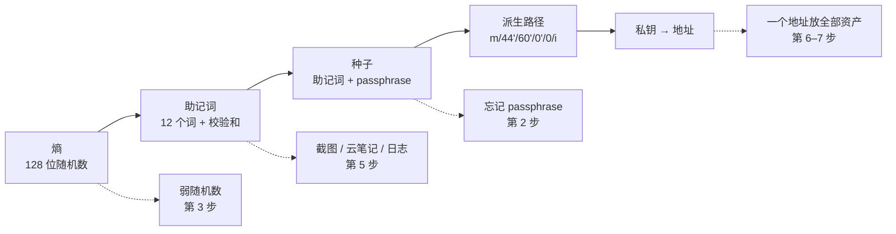

# B57 钱包与私钥实操

> 学习目标：做完本章，你能——
> 1. 在本机生成一组练习助记词，并说清"熵 → 助记词 → 种子 → 派生路径 → 地址"每一步。
> 2. 用同一组助记词派生不同地址，并演示校验和与 passphrase 的作用。
> 3. 亲手枚举一个弱随机数生成的私钥，并扫描日志里泄露的密钥材料。
> 4. 为一个示例团队完成密钥分级表和方案选择，填写 WAL 检查清单。
>
> 前置知识：完成阶段 0–1（[阶段 1 导读](B07-stage1-guide.md)）；会打开终端；已安装 Foundry（`cast`）和 Node.js。
> 预计用时：2–3 小时。
> 交互实验：[钱包方案对比器](../interactive/wallet-scheme-lab.html)
> 关联章节：[18 钱包与密钥管理](../chapters/18-wallet-key-management.md)｜[15 账户抽象与新钱包范式](../chapters/15-account-abstraction-wallets.md)｜[02 密码学基础与实现风险](../chapters/02-cryptography-randomness.md)｜[A06 运营与密钥安全](../assessment/A06-operational-key-security.md)｜[T06 运营安全自查](../templates/T06-ops-security-self-check.md)｜[B40 Safe 多签](B40-case-safe.md)｜[B58 签名识别与钓鱼防御](B58-signing-phishing-practice.md)
> 最后核对：2026-11-10（cast 1.5.1、Node.js 26、OpenSSL 3.0 均在本机运行过；下文输出来自真实运行，助记词和私钥都是一次性练习值）

> ⚠️ 警告：法律与道德边界。本章只在你自己的电脑上生成练习密钥。练习密钥永远不要接收真实资金。不要把真实助记词或私钥输入终端、网页或聊天窗口。不要用本章的枚举脚本扫描任何他人的地址。

---

## 开场：抄在纸上的 12 个词

朋友新买了一个硬件钱包。朋友把 12 个词抄在纸上，又拍了一张照片存进云笔记，"以防纸丢了"。朋友问你：这样够安全吗？

你不想讲理论。你想让朋友亲手看到：这 12 个词能做什么，哪一步最容易出错。

<details class="predict"><summary>🤔 先猜再看：抄错了一个词，钱包恢复时会发生什么？是报错，还是恢复出另一个钱包？</summary>

多数情况下会报错。BIP-39 助记词的最后一个词带有校验和（Checksum）。12 个词的校验和只有 4 位，所以随机抄错时，约有 1/16 的机会通过校验。通过校验后，钱包会恢复出一个**完全不同**的空钱包。第 2 步你会亲手看到报错。

</details>

> 🎯 打个比方：助记词像一副钥匙的"母模"。派生路径像门牌号。同一副母模，按不同门牌号能压出无数把钥匙。passphrase 像母模上的一道暗纹，暗纹不同，压出的整套钥匙都不同。
>
> 比喻的局限：真钥匙被复制会留下痕迹。母模被拍照，不会留下任何痕迹，你只会在资产被转走时才知道。

## 1. 本章做什么

原理见 [18 钱包与密钥管理 §3.2](../chapters/18-wallet-key-management.md) 和 [02 密码学基础 §3.1](../chapters/02-cryptography-randomness.md)。本章只动手。



读图要点：

- 数据从左向右只能单向计算。知道地址，算不出私钥；知道助记词，能算出全部私钥。
- 虚线是每一步的典型失误，括号里是本章对应的练习。
- 局限：图里没有"签名"。私钥安全地留在设备里，设备仍可能签错东西。签名练习见 [B58](B58-signing-phishing-practice.md)。

## 2. 第 1 步：生成一组练习助记词

1. 确认工具版本：

```bash
cast --version  # 本章用 1.5.1
```

预期输出的第一行：

```text
cast Version: 1.5.1-stable
```

2. 生成一组练习助记词，并显示前 3 个账户：

```bash
cast wallet new-mnemonic -a 3  # 仅用于练习，不要存入资金
```

输出（你的词和地址会不同）：

```text
Generating mnemonic from provided entropy...
Successfully generated a new mnemonic.
Phrase:
wool suspect nurse erode check music post butter own drastic excite make

Accounts:
- Account 0:
Address:     0x5c5f58f6796ceF352fba754497331503f49e831B
Private key: 0x856e533035605c6451b467c5fd3b5888538194d351c03c7cdcc1f1f8dad470ee

- Account 1:
Address:     0x6119B3485f65e9C4F91327A039eC5bFe5e61e531
…
```

> 💡 注意：上面的助记词和私钥已经公开在本书里。它们只是练习值。任何人都能用它们控制这些地址。

3. 看清"助记词只是熵的另一种写法"。先取 16 字节（128 位）随机数，再用同一个熵生成两次：

```bash
E=$(openssl rand -hex 16); echo $E           # 128 位熵
cast wallet new-mnemonic --entropy 0x$E | sed -n 3,4p  # 第一次
cast wallet new-mnemonic --entropy 0x$E | sed -n 3,4p  # 第二次
```

输出：

```text
8ce40890b0364896c7718a0f481217f3
Phrase:
mind cake category gather goose enter build course aunt dog magnet tower
Phrase:
mind cake category gather goose enter build course aunt dog magnet tower
```

两次结果完全相同。生成器没有"秘密"，熵就是全部秘密。

4. 用全 0 的熵生成：

```bash
cast wallet new-mnemonic --entropy 0x00000000000000000000000000000000
```

输出：

```text
Phrase:
abandon abandon abandon abandon abandon abandon abandon abandon abandon abandon abandon about
…
Address:     0x9858EfFD232B4033E47d90003D41EC34EcaEda94
```

这组词是合法的，但全世界都能算出它。Anvil 的默认助记词 `test test … junk` 也是公开的，对应地址 `0xf39Fd6e51aad88F6F4ce6aB8827279cffFb92266`。

<details class="predict"><summary>🤔 先猜再看：一个网页"助记词生成器"给了你 12 个看起来很随机的词。你能从词本身判断它安全吗？</summary>

不能。词只是熵的编码。`abandon … about` 一眼能看出来，但一个只有 32 位熵的生成器产出的词，看起来和 128 位的一样随机。安全性取决于熵的来源，而不是词的样子。所以只用主流钱包或硬件设备生成。

</details>

## 3. 第 2 步：派生地址，试校验和与 passphrase

把第 1 步的练习助记词存进变量 `M`。真实助记词不要这样做：命令行参数会进入 shell 历史。

1. 按索引和按完整路径派生，比较结果：

```bash
M="wool suspect nurse erode check music post butter own drastic excite make"
cast wallet address --mnemonic "$M" --mnemonic-index 1
cast wallet address --mnemonic "$M" --mnemonic-derivation-path "m/44'/60'/0'/0/1"
cast wallet address --mnemonic "$M" --mnemonic-derivation-path "m/44'/60'/1'/0/0"
```

输出：

```text
0x6119B3485f65e9C4F91327A039eC5bFe5e61e531
0x6119B3485f65e9C4F91327A039eC5bFe5e61e531
0x5000C30c64B43f824D0ec0852758Ef0119A15526
```

前两行相同：索引 1 就是路径末位的 1。第三行换了路径中间的账户号，地址完全不同。不同钱包软件的默认路径可能不同。恢复时"找不到币"，常见原因是路径不同，而不是币丢了。

2. 加上 passphrase（BIP-39 的可选口令，常被叫作"第 25 个词"）：

```bash
cast wallet address --mnemonic "$M" --mnemonic-passphrase "practice-only"
```

输出：

```text
0x8D40295f83a44A7b3478a7aF6c61421597e95629
```

同一组词，加了口令，账户 0 从 `0x5c5f…831B` 变成了 `0x8D40…5629`。口令错一个字符，就是另一个钱包。

3. 故意抄错。把最后一个词 `make` 改成 `mask`，再交换前两个词：

```bash
cast wallet address --mnemonic "wool suspect nurse erode check music post butter own drastic excite mask"
cast wallet address --mnemonic "suspect wool nurse erode check music post butter own drastic excite make"
```

输出：

```text
Error: the phrase `wool suspect nurse erode check music post butter own drastic excite mask` is invalid
Error: the phrase `suspect wool nurse erode check music post butter own drastic excite make` is invalid
```

校验和拦下了这两个错误。但它不是万能的，见开场的折叠块和思考题 1。

> 🧪 动手验证：在练习助记词上多试几种单词替换，记录有几次"意外通过"。每次通过时，比较派生出的账户 0 地址和原地址。

## 4. 第 3 步：枚举一个弱随机数私钥

2022 年 Profanity 的种子只有约 43 亿种（32 位），私钥可被 GPU 反推。Wintermute 因此损失约 1.6 亿美元（事发时估值）。来源：[1inch 披露](https://blog.1inch.com/a-vulnerability-disclosed-in-profanity-an-ethereum-vanity-address-tool)、[NVD CVE-2022-40769](https://nvd.nist.gov/vuln/detail/CVE-2022-40769)。原理见 [02 §3.1](../chapters/02-cryptography-randomness.md)。

下面的脚本模拟一个"只有 BITS 位种子"的坏生成器。攻击者只知道公钥，然后从 0 开始逐个试。

1. 在任意练习目录新建 `weak-seed.js`：

```javascript
// 练习用：演示"种子只有 BITS 位"时，私钥能被枚举出来
const crypto = require('crypto');
const BITS = Number(process.argv[2] || 12);           // 种子位数
const keyFromSeed = s => crypto.createHash('sha256').update(String(s)).digest(); // ❌ 漏洞：种子空间太小
const pubOf = k => { const e = crypto.createECDH('secp256k1'); e.setPrivateKey(k); return e.getPublicKey('hex'); };

const secretSeed = crypto.randomInt(2 ** BITS);       // "钱包"偷偷选的种子
const victimPub = pubOf(keyFromSeed(secretSeed));     // 攻击者只看到公钥（发过交易的地址会暴露公钥）
console.log('种子空间：2^' + BITS + ' =', 2 ** BITS);

const t0 = Date.now();
for (let s = 0; s < 2 ** BITS; s++) {                 // 攻击者逐个试
  if (pubOf(keyFromSeed(s)) === victimPub) {
    console.log('找到种子：', s, '用时', (Date.now() - t0) / 1000, '秒');
    console.log('私钥：0x' + keyFromSeed(s).toString('hex'));
    break;
  }
}
```

2. 运行 12 位和 16 位两次：

```bash
node weak-seed.js 12
node weak-seed.js 16
```

输出（种子随机，用时会不同）：

```text
种子空间：2^12 = 4096
找到种子： 3530 用时 0.852 秒
私钥：0x441df4958cb3d20cf97190ce30da5884b185e6e14cd805979b2d0f07b7907593
种子空间：2^16 = 65536
找到种子： 51529 用时 11.282 秒
私钥：0x228845f3b9f1d30569d643532483130a92ab9621185707b2e2e1e838dba80686
```

3. 用你的数字估算速度：本机约 51529 ÷ 11.3 ≈ 4,500 次/秒（单线程 JavaScript）。把这个速度代入 2³² 和 2¹²⁸，写进笔记。

> 💡 注意：不要试 20 位以上。脚本每次都新建椭圆曲线对象，速度很慢，会跑很久。真实攻击用 GPU，快很多个数量级。

## 5. 第 4 步：备份与恢复演练

备份的目标是"丢了设备能恢复"，同时"别人拿不到"。下面的演练只用练习助记词。

1. 把第 1 步的练习助记词抄在纸上。写上序号 1–12。不拍照，不复制到剪贴板。
2. 关掉终端，等 10 分钟。
3. 只看纸，重新输入，派生账户 0：

```bash
cast wallet address --mnemonic "<只看纸抄回来的 12 个词>"
```

4. 把结果和第 1 步记录的账户 0 地址逐字比较。一致才算恢复成功。
5. 记录演练日期、用时、出错的词。真实钱包的恢复演练在硬件钱包上做，只比对地址，不转账。

开发和部署用的热私钥，不要用明文放在 `.env` 文件里。至少用加密的 keystore 文件：

```bash
mkdir -p ks && cast wallet new ks --unsafe-password "practice-only-123"  # 练习口令，真实场景交互输入
grep -oE '"(cipher|kdf)":"[^"]*"' ks/*   # 查看加密方式
```

输出：

```text
Created new encrypted keystore file: …/ks/fe4fa7c1-9e54-40d2-b4d8-6449b3b3cede
Address:    0xE5EECF9fF996726A983C0C7975B0e6061cf24f04
"cipher":"aes-128-ctr"
"kdf":"scrypt"
```

用错误口令解密（`cast wallet decrypt-keystore --keystore-dir ks <文件名> --unsafe-password wrong`），输出 `Error: Mac Mismatch`。

> ⚠️ 警告：keystore 只防"文件被拷走"。它防不了"电脑被控制后，攻击者等你输入口令"。大额资金仍然要用硬件钱包或多签。

## 6. 第 5 步：扫描日志里的密钥

2022 年 8 月，Slope 钱包把助记词以明文发到它的 Sentry 日志服务器。Solana 官方通报约 9,231 个钱包受影响，损失约 410 万美元。来源：[Solana 官方通报](https://solana.com/news/8-2-2022-application-wallet-incident)、[Sentry 声明](https://blog.sentry.io/slope-wallet-solana-hack)。原理见 [18 §5.1](../chapters/18-wallet-key-management.md)。

1. 在练习目录建一个假日志 `logs/app.log`，内容如下：

```text
2026-11-10T09:00:01Z INFO  wallet created address=0x5c5f58f6796ceF352fba754497331503f49e831B
2026-11-10T09:00:02Z DEBUG form input field=seed value="wool suspect nurse erode check music post butter own drastic excite make"
2026-11-10T09:00:03Z INFO  tx sent hash=0x3f1c2b9e8d7a6f5e4d3c2b1a0f9e8d7c6b5a49382716f5e4d3c2b1a0f9e8d7c6
2026-11-10T09:00:04Z ERROR signer failed key=0x856e533035605c6451b467c5fd3b5888538194d351c03c7cdcc1f1f8dad470ee
```

2. 搜"12–24 个连续小写单词"和"带 key 字样的 64 位十六进制"：

```bash
grep -nE '([a-z]{3,8} ){11,23}[a-z]{3,8}' logs/app.log            # 疑似助记词
grep -nE '(key|secret|priv)[^ ]*=0x[0-9a-fA-F]{64}' logs/app.log   # 疑似私钥
grep -nE '0x[0-9a-fA-F]{64}' logs/app.log | wc -l                  # 只按长度搜
```

输出：

```text
2:2026-11-10T09:00:02Z DEBUG form input field=seed value="wool suspect nurse erode check music post butter own drastic excite make"
4:2026-11-10T09:00:04Z ERROR signer failed key=0x856e533035605c6451b467c5fd3b5888538194d351c03c7cdcc1f1f8dad470ee
       2
```

3. 解释第三条命令为什么返回 2：交易哈希和私钥都是 64 位十六进制。只按长度搜会误报。只按字段名搜会漏报。真实扫描两种都要，再人工复核。

<details class="predict"><summary>🤔 先猜再看：在日志里搜到并删除这一行，问题就解决了吗？</summary>

没有。日志可能已经同步到日志服务、备份和第三方平台。要做三件事：在采集端屏蔽输入框和密钥字段；把已泄露的助记词视为失陷，迁移资产；检查同一组助记词是否在其他钱包里复用。Slope 案中，复用助记词的用户也被波及。

</details>

## 7. 第 6 步：选方案

方案对比原理见 [18 §3.1](../chapters/18-wallet-key-management.md)。账户抽象钱包（Passkey、社交恢复、Session Key）的取舍见 [15 §3.3–3.4](../chapters/15-account-abstraction-wallets.md)。

> 🧪 动手验证：打开[钱包方案对比器](../interactive/wallet-scheme-lab.html)，依次选 5 个场景，记录第一名、第二名和红线。

下表是默认权重下的结果，你可以用来核对：

| 场景 | 第一名 | 第二名 | 有红线的方案 |
|---|---|---|---|
| 个人 · 日常小额 | 助记词软件钱包 3.64 | MPC 3.59 | 无 |
| 个人 · 大额长期持有 | 多签 3.52 | MPC 3.48 | 助记词软件钱包 |
| 项目方金库 | 多签 3.65 | MPC 3.50 | 硬件钱包、助记词软件钱包 |
| 交易所热钱包 | MPC 3.69 | 多签 3.38 | 助记词软件钱包 |
| 交易所冷钱包 | 多签 3.70 | MPC 3.52 | 硬件钱包、助记词软件钱包 |

然后在"个人 · 大额长期持有"里，把"可恢复性"调到 0。第一名变成 MPC（3.63），多签降到 3.38。权重表达的是你的约束，排名跟着约束变。

<details class="predict"><summary>🤔 先猜再看：对比器里"硬件钱包"在金库场景亮了红线。那多签的签名人还要用硬件钱包吗？</summary>

要。红线的意思是"单个硬件钱包不能独自控制金库"。多签决定"要几个人同意"，硬件钱包决定"每个人的钥匙不离开设备"。两者是组合，不是替代。对比器的建议栏也写了这个组合。

</details>

记住三条选型结论：

- 分数接近时，决定因素是签名人独立性和流程。Multichain 的 MPC 节点都在 CEO 个人云账户下，门限只是名义上的（[18 §5.3](../chapters/18-wallet-key-management.md)）。
- 硬件钱包的屏幕只显示哈希时，等于盲签。WazirX 的签名人看到的内容和实际签名不一致（[18 §5.4](../chapters/18-wallet-key-management.md)）。
- 对比器的分数是本手册的示例打分，不是行业标准。

## 8. 第 7 步：交付物——示例团队的密钥分级表

示例团队：5 人 DeFi 团队，有一个协议金库、一个部署者地址、一个运营热地址，成员各有个人钱包。请复制下表并填完空格。第一行已给出示范。

| 等级 | 用途（示例） | 金额上限（示例） | 方案 | 签名人 / 持有人 | 备份 | 恢复演练 |
|---|---|---|---|---|---|---|
| L3 金库 | 协议金库、合约 owner | 不设上限 | 3-of-5 多签，每人硬件钱包 | 5 人，分属 3 个城市 | 每人一份离线备份，分开保管 | 每年 1 次，多人参与 |
| L2 管理 | 部署者、参数管理 | ？ | ？ | ？ | ？ | ？ |
| L1 运营 | 自动任务、补 Gas | ？ | ？ | ？ | ？ | ？ |
| L0 交互 | 领空投、试新 DApp | ？ | ？ | ？ | ？ | ？ |

填表规则：

1. 每个等级用不同的助记词。L0 不能和 L3 共用助记词。
2. 每个等级写一个数字上限。超过上限就升级到上一级。
3. 写清"谁离职时要轮换哪些密钥，并撤销哪些链上权限"。Wintermute 转走了余额，但没撤销管理员权限（[18 §5.2](../chapters/18-wallet-key-management.md)）。

## 9. 检查清单

本章的检查项前缀是 **WAL**。机构级的密钥检查见 [18 章 KEY 清单](../chapters/18-wallet-key-management.md) 和 [T06 第 1 节](../templates/T06-ops-security-self-check.md)。

- [ ] **WAL-1** 助记词由主流钱包或硬件设备生成，熵至少 128 位；不用网页、小工具或靶号生成器。
- [ ] **WAL-2** 助记词只有离线物理备份；没有截图、云笔记、聊天记录或剪贴板历史。
- [ ] **WAL-3** 做过恢复演练：只凭备份恢复出同一地址，并记录日期。
- [ ] **WAL-4** 记录了派生路径和"是否使用 passphrase"；passphrase 本身不和助记词放在一起。
- [ ] **WAL-5** 每个地址有等级、用途和上限；大额地址与日常交互地址使用不同助记词。
- [ ] **WAL-6** 日志和崩溃上报有密钥扫描，扫描结果有人工复核。
- [ ] **WAL-7** 开发和部署私钥不以明文存放；公开测试助记词从不接收真实资金。
- [ ] **WAL-8** L2 及以上资产使用硬件钱包或多签；多签签名人在设备和账户上独立。
- [ ] **WAL-9** 人员离职、设备丢失、钱包厂商公告漏洞后，有迁移和权限撤销记录。

把检查结果写进报告：

| 检查项 | 你的证据 | 本章练习 | 结论（✅ / ⚠️ / ❌） |
|---|---|---|---|
| WAL-1 | 生成方式说明 | 第 1、3 步 | |
| WAL-2、WAL-3 | 演练记录（不含助记词） | 第 4 步 | |
| WAL-4 | 路径与口令登记表 | 第 2 步 | |
| WAL-5、WAL-8 | 分级表 | 第 6、7 步 | |
| WAL-6 | 扫描规则和一次扫描结果 | 第 5 步 | |
| WAL-7 | keystore 或硬件钱包配置 | 第 4 步 | |
| WAL-9 | 轮换记录 | 第 7 步 | |

> 🪞 反思：想一想你自己正在用的钱包。
> 1. 它的助记词是在哪台设备上生成的？那台设备上装了哪些浏览器扩展？
> 2. 如果明天你的手机丢了，你需要多长时间、哪些东西才能恢复？你试过吗？
> 3. 你有没有一个地址，既放着大额资产，又经常连接新网站？

## 10. 如果出错

| 现象 | 原因 | 处理 |
|---|---|---|
| `cast: command not found` | 没有安装 Foundry | 按 [B04](B04-setup.md) 安装，然后运行 `foundryup` |
| `the phrase … is invalid` | 词抄错、顺序错或多了空格 | 逐词核对；这正是第 2 步要练的 |
| 恢复后地址和原来不同，但没报错 | 校验和意外通过，或 passphrase、路径不同 | 逐词核对；确认路径和口令 |
| `node weak-seed.js 20` 很久不结束 | 种子空间太大，脚本很慢 | 按 `Ctrl+C` 停止，改用 12 或 16 |
| `Error: Mac Mismatch` | keystore 口令错误 | 这是预期结果；用正确的练习口令重试 |
| `grep` 没有输出 | 日志文件内容或路径不同 | 确认 `logs/app.log` 存在，内容和第 5 步一致 |

## 11. 过关标准

- [ ] 用同一个熵生成两次，得到相同的助记词，并能解释原因。
- [ ] 演示 3 个派生结果：索引 1、账户号 1、带 passphrase，并说出每个和账户 0 的关系。
- [ ] 让 `weak-seed.js` 在 16 位下找到种子，并用本机速度估算 2³² 所需时间。
- [ ] 完成一次纸质备份恢复演练，地址逐字一致。
- [ ] 日志扫描命令找到 1 个助记词和 1 个私钥，并解释 1 个误报。
- [ ] 交付分级表 4 行全部填完，WAL-1 至 WAL-9 每项都有结论。

## 12. 思考题

1. 12 个词的助记词只有 4 位校验和。如果你抄错了一个词，钱包没有报错，会发生什么？恢复演练应该比对什么，才能发现这个问题？
2. passphrase 能防"纸质备份被人拿走"。它带来了什么新风险？你会怎样备份 passphrase？
3. 按你在第 3 步测到的速度，枚举 2³² 个种子要多久？为什么 Profanity 的 32 位种子在现实中会被攻破，而 128 位熵的助记词不会？
4. 示例团队的 L3 金库是 2-of-3 多签。签名人是：创始人的硬件钱包 A、创始人的硬件钱包 B（放在同一个抽屉）、CTO 的硬件钱包。实际需要攻破几个人？你会怎么改？

- 下一章：[B58 读懂签名请求：解码、链下签名与 7702](B58-signing-phishing-practice.md)
