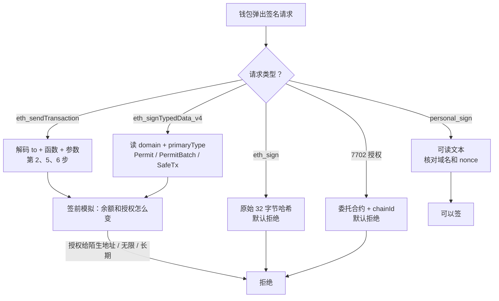

# B58 读懂签名请求与本地链演练：解码、7702、模拟、撤销与地址投毒

> 学习目标：做完本章，你能——
> 1. 读懂 `personal_sign`、`eth_sign`、EIP-712、Permit、`approve`、`setApprovalForAll` 和 7702 授权，说出每种签名授权了什么。
> 2. 用 `cast` 解码 `approve` 等交易数据，并证明用 `eth_sign` 签一个看不懂的哈希，可能就是签了一张无限 Permit。
> 3. 在本地链上亲手完成"授权 → 被转走 → 撤销"，并在签名前用快照模拟结果。
> 4. 用 `cast` 生成相似地址，测出地址投毒的成本，并逐字比对地址。
> 5. 用多签复核实验完成 6 笔签前复核，交付一份签前复核单。
>
> 前置知识：完成阶段 0–1（[阶段 1 导读](B07-stage1-guide.md)）；会用 `cast` 和 `anvil`；建议先做 [B57](B57-wallet-key-practice.md)。
> 预计用时：3–4 小时。
> 交互实验：[钓鱼签名识别](../interactive/phishing-signature-lab.html)｜[地址投毒比对](../interactive/address-poisoning-lab.html)｜[签名与重放实验](../interactive/signature-replay-lab.html)｜[多签签前复核](../interactive/multisig-review-lab.html)
> 关联章节：[19 用户侧诈骗](../chapters/19-user-scams.md)｜[29 签名路径](../chapters/29-signing-path-2026.md)｜[09 MEV 与签名安全](../chapters/09-mev-signatures.md)｜[15 账户抽象](../chapters/15-account-abstraction-wallets.md)｜[T07 防社工](../templates/T07-staff-anti-social-engineering.md)｜[B40 Safe 多签](B40-case-safe.md)｜[B57 钱包与私钥实操](B57-wallet-key-practice.md)
> 最后核对：2026-11-10（cast、anvil、forge 1.5.1 在本机运行过；链上步骤只在本地 Anvil 上执行；下文输出来自真实运行）

> ⚠️ 警告：法律与道德边界。本章只在本地 Anvil 链上用公开的测试私钥操作。不要对真实用户发送任何签名请求或粉尘转账。地址投毒和钓鱼演练，只能在公司书面授权的安全意识项目中进行，并且只用测试资产。

---

## 开场："不花 Gas，只是验证一下"

你在一个空投网站上点了"验证钱包"。钱包弹出一个签名请求，标题是"链下签名（不花 Gas）"。内容是一段 JSON。网站说："签完就能领。"

<details class="predict"><summary>🤔 先猜再看：这个签名不上链，也不花 Gas。签完以后，攻击者能转走你的代币吗？</summary>

能。如果 JSON 是一张 Permit，它就是一张授权支票。攻击者拿着签名自己提交上链，再调用 `transferFrom`。2024 年 9 月，一名受害者签了 permit 链下签名，被转走约 3,243 万美元的 spWETH（事发时估值，[19 §5.2](../chapters/19-user-scams.md)）。第 3 步你会亲手证明：一个看不懂的哈希，可能就是一张 Permit。

</details>

> 🎯 打个比方：有的签名像签到簿，签了只证明"我来过"。有的签名像空白支票，签了别人就能取钱。钱包弹窗常常不告诉你，你面前的是签到簿还是支票。
>
> 比喻的局限：纸质支票有金额栏，一眼能看出来。签名请求可能只是 32 字节十六进制，你必须用工具解码，才能知道它是哪一种。

## 1. 本章做什么

原理见 [19 §3.1 五类危险签名](../chapters/19-user-scams.md) 和 [09 §3 签名安全](../chapters/09-mev-signatures.md)。本章把每种签名都动手做一遍。第 1–4 步做"读懂"：解码交易数据、三种链下签名和 7702 授权。第 5–8 步在本地 Anvil 链上看签下去会发生什么：模拟、授权被使用、撤销、地址投毒和多签签前复核。



读图要点：

- 先看类型，再看字段。类型决定"签完后谁能做什么"。
- `eth_sign` 和网站发起的 7702 授权直接拒绝，因为你无法从屏幕判断内容。
- 局限：`personal_sign` 也会被滥用，例如消息里的域名和地址栏不一致。图只画了主路径。

## 2. 第 1 步：先凭直觉判断 10 个请求

> 🧪 动手验证：打开[钓鱼签名识别](../interactive/phishing-signature-lab.html)。只看"钱包原始显示"，对 10 个请求逐个点"签名"或"拒绝"。记录得分和判断错的题号。先不要切换到"解码视图"。

本页的正确答案中，只有 3 个可以签：第 6 题（SIWE 登录）、第 7 题（官方路由兑换）、第 10 题（精确数额授权给 Aave）。其他 7 个都应拒绝。做完第 2–4 步以后，你会回来重做一次。

## 3. 第 2 步：用 `cast` 解码交易数据

钱包显示的 `Data` 是 ABI 编码。前 4 字节是函数选择器（Selector）：函数签名的 Keccak 哈希的前 4 字节。

1. 算出三个危险函数的选择器：

```bash
cast sig "approve(address,uint256)"
cast sig "setApprovalForAll(address,bool)"
cast sig "permit(address,address,uint256,uint256,uint8,bytes32,bytes32)"
```

输出：

```text
0x095ea7b3
0xa22cb465
0xd505accf
```

把这三个值抄在便签上。以后在原始数据开头看到它们，就停下来。

2. 构造一笔"领取空投"网站会请求的 `approve`，再解码它：

```bash
A=0x70997970C51812dc3A010C7d01b50e0d17dc79C8   # 示例：攻击者地址（Anvil 测试账户 1）
D=$(cast calldata "approve(address,uint256)" $A $(cast max-uint)); echo $D
cast decode-calldata "approve(address,uint256)" $D
```

输出：

```text
0x095ea7b300000000000000000000000070997970c51812dc3a010c7d01b50e0d17dc79c8ffffffffffffffffffffffffffffffffffffffffffffffffffffffffffffffff
0x70997970C51812dc3A010C7d01b50e0d17dc79C8
115792089237316195423570985008687907853269984665640564039457584007913129639935 [1.157e77]
```

第二个参数是 `2²⁵⁶−1`，即"无限授权"。原始数据里它是 64 个 `f`。

3. 换算实验里的"大数"和时间戳：

```bash
cast to-dec 0xffffffffffffffffffffffffffffffffffffffff   # Permit2 的"无限"：2^160 − 1
date -u -r 1893456000                                   # macOS 写法；Linux 的参数不同，见 man date
date -u -r 4102444800
```

输出：

```text
1461501637330902918203684832716283019655932542975
Tue Jan  1 00:00:00 UTC 2030
Fri Jan  1 00:00:00 UTC 2100
```

实验第 2 题 Permit 的 `deadline` 是 2100 年，第 4 题 Permit2 的 `expiration` 是 2030 年。签名会长期有效。

## 4. 第 3 步：三种链下签名，一个关键实验

下面用 Anvil 的公开测试私钥签名。它只在本地有意义，不要给它转任何真实资产。

1. `personal_sign`：对可读文本签名。钱包会先加上前缀 `\x19Ethereum Signed Message:\n` 再哈希（EIP-191）：

```bash
V=0xf39Fd6e51aad88F6F4ce6aB8827279cffFb92266     # 示例：受害者（Anvil 测试账户 0）
VK=0xac0974bec39a17e36ba4a6b4d238ff944bacb478cbed5efcae784d7bf4f2ff80  # Anvil 公开测试私钥
MSG="Sign in to Example DEX. Nonce: 8f3k2LmQ"
SIG=$(cast wallet sign --private-key $VK "$MSG"); echo $SIG
cast wallet verify --address $V "$MSG" $SIG
```

输出：

```text
0xbcb0e7850ef24820fe61c771325d68f6…0681d10fdf1e4add1c
Validation succeeded. Address 0xf39Fd6e51aad88F6F4ce6aB8827279cffFb92266 signed this message.
```

2. EIP-712：对结构化数据签名。新建 `permit.json`，内容是一张示例 Permit：spender 是攻击者，数额无限，期限到 2100 年。

```json
{
  "types": {
    "EIP712Domain": [
      {"name": "name", "type": "string"},
      {"name": "version", "type": "string"},
      {"name": "chainId", "type": "uint256"},
      {"name": "verifyingContract", "type": "address"}
    ],
    "Permit": [
      {"name": "owner", "type": "address"},
      {"name": "spender", "type": "address"},
      {"name": "value", "type": "uint256"},
      {"name": "nonce", "type": "uint256"},
      {"name": "deadline", "type": "uint256"}
    ]
  },
  "primaryType": "Permit",
  "domain": {
    "name": "Toy USD",
    "version": "1",
    "chainId": 31337,
    "verifyingContract": "0x5FbDB2315678afecb367f032d93F642f64180aa3"
  },
  "message": {
    "owner": "0xf39Fd6e51aad88F6F4ce6aB8827279cffFb92266",
    "spender": "0x70997970C51812dc3A010C7d01b50e0d17dc79C8",
    "value": "115792089237316195423570985008687907853269984665640564039457584007913129639935",
    "nonce": 0,
    "deadline": 4102444800
  }
}
```

```bash
cast wallet sign --private-key $VK --data --from-file permit.json
```

输出：

```text
0x8dbfb85106acb40f33e69bcda3e4244c…ce899b8b4e917a911b
```

3. 关键实验：手算这张 Permit 的 EIP-712 摘要，再用 `eth_sign` 的方式（`--no-hash`，直接签 32 字节）签它：

```bash
A=0x70997970C51812dc3A010C7d01b50e0d17dc79C8
DOM=$(cast keccak $(cast abi-encode "f(bytes32,bytes32,bytes32,uint256,address)" \
  $(cast keccak "EIP712Domain(string name,string version,uint256 chainId,address verifyingContract)") \
  $(cast keccak "Toy USD") $(cast keccak "1") 31337 0x5FbDB2315678afecb367f032d93F642f64180aa3))  # 域分隔符
ST=$(cast keccak $(cast abi-encode "f(bytes32,address,address,uint256,uint256,uint256)" \
  $(cast keccak "Permit(address owner,address spender,uint256 value,uint256 nonce,uint256 deadline)") \
  $V $A $(cast max-uint) 0 4102444800))                                                       # 消息结构哈希
DIG=$(cast keccak $(cast concat-hex 0x1901 $DOM $ST)); echo digest=$DIG                       # 最终摘要
cast wallet sign --private-key $VK --no-hash $DIG                                             # 像 eth_sign 一样签原始哈希
```

输出：

```text
digest=0x0ba679c8e20a0198626d60e834c2930992208e706431d18350789e28a0635eb7
0x8dbfb85106acb40f33e69bcda3e4244c…ce899b8b4e917a911b
```

两个签名**逐字节相同**。钓鱼网站用 `eth_sign` 请你签 `0x0ba6…5eb7`，你签下的就是那张无限 Permit。钱包屏幕上只有一个哈希。

<details class="predict"><summary>🤔 先猜再看：同一个 32 字节，用 personal_sign 签和用 eth_sign 签，结果一样吗？</summary>

不一样。`personal_sign` 先加 EIP-191 前缀再哈希，所以签名不能被当作交易或 Permit 使用。你可以运行 `cast wallet sign --private-key $VK $DIG`（不加 `--no-hash`）验证：输出与上面不同。这个前缀正是 `personal_sign` 比 `eth_sign` 安全的原因。

</details>

## 5. 第 4 步：读一份 7702 授权

EIP-7702 授权让你的地址运行委托合约的代码。原理见 [15 §3.2](../chapters/15-account-abstraction-wallets.md)。

1. 用 Anvil 测试账户 1 的私钥，对实验第 5 题的委托合约签两份授权：一份 `chainId = 0`，一份 `chainId = 1`。

```bash
AK=0x59c6995e998f97a5a0044966f0945389dc9e86dae88c7a8412f4603b6b78690d   # Anvil 公开测试私钥 1
cast from-rlp $(cast wallet sign-auth 0x96221423681a6d52e184d440a8efcebb105c7242 --nonce 12 --chain 0 --private-key $AK)
cast from-rlp $(cast wallet sign-auth 0x96221423681a6d52e184d440a8efcebb105c7242 --nonce 12 --chain 1 --private-key $AK)
```

输出（字段顺序：chainId、委托地址、nonce、yParity、r、s）：

```text
["0x","0x96221423681a6d52e184d440a8efcebb105c7242","0x0c","0x","0x9110ef40…","0x56377b8d…"]
["0x01","0x96221423681a6d52e184d440a8efcebb105c7242","0x0c","0x","0x8c00c22f…","0x573547852…"]
```

2. 解释第一行的 `"0x"`：RLP 编码里整数 0 写成空字节串，即 `chainId = 0`。这份授权在所有支持 7702 的 EVM 链上都有效，只要该链上的 nonce 匹配。

> ⚠️ 警告：EIP-7702 原文写明，应用不应请求用户签署委托授权。网站弹出"升级为智能账户"，默认拒绝（[15 §3.2](../chapters/15-account-abstraction-wallets.md)）。

最后回到[钓鱼签名识别](../interactive/phishing-signature-lab.html)，点"重新开始"，用"解码视图"重做 10 题。比较两次得分。

## 6. 第 5 步：本地链上部署代币，并在签名前模拟

第 3 步里，你证明了一个看不懂的哈希可能就是一张无限 Permit。读懂签名请求只是第一道防线。从这一步起，在本地 Anvil 链上看签下去会发生什么：先模拟，再让授权真的被用掉，然后撤销。最后算一算地址投毒的成本，并完成 6 笔多签签前复核。

**准备**：第 5–8 步沿用第 2–4 步定义的变量。如果你换了终端，先重新设置：

```bash
V=0xf39Fd6e51aad88F6F4ce6aB8827279cffFb92266     # 示例：受害者（Anvil 测试账户 0）
VK=0xac0974bec39a17e36ba4a6b4d238ff944bacb478cbed5efcae784d7bf4f2ff80  # Anvil 公开测试私钥
A=0x70997970C51812dc3A010C7d01b50e0d17dc79C8   # 示例：攻击者地址（Anvil 测试账户 1）
AK=0x59c6995e998f97a5a0044966f0945389dc9e86dae88c7a8412f4603b6b78690d   # Anvil 公开测试私钥 1
```

1. 打开第二个终端，启动本地链：

```bash
anvil --port 18547  # 本章固定用 18547 端口
```

2. 回到第一个终端，在手册的 `code/foundry-demos/` 目录部署玩具代币，并给受害者铸造 1,000 枚：

```bash
cd code/foundry-demos  # 从 web3-security-101/ 出发
R=http://127.0.0.1:18547
forge create src/ToyERC20.sol:ToyERC20 --broadcast --rpc-url $R --private-key $VK
T=0x5FbDB2315678afecb367f032d93F642f64180aa3
cast send $T "mint(address,uint256)" $V 1000ether --rpc-url $R --private-key $VK | grep ^status
```

预期输出：

```text
Deployed to: 0x5FbDB2315678afecb367f032d93F642f64180aa3
status               1 (success)
```

3. 模拟。钱包的"交易模拟"回答一个问题：签完以后会发生什么？我们用快照做同样的事：先存档，签名，试攻击，再读档。

```bash
cast rpc evm_snapshot --rpc-url $R                                    # 存档，返回快照编号
cast send $T "approve(address,uint256)" $A $(cast max-uint) --rpc-url $R --private-key $VK | grep ^status
cast call $T "transferFrom(address,address,uint256)(bool)" $V $A 1000ether --from $A --rpc-url $R  # 攻击者能转走全部吗？
cast rpc evm_revert 0x0 --rpc-url $R                                  # 读档：撤销刚才的一切
cast call $T "allowance(address,address)(uint256)" $V $A --rpc-url $R
```

输出：

```text
"0x0"
status               1 (success)
true
true
0
```

第 3 行 `true`：签完这笔 `approve`，攻击者能一次转走全部 1,000 枚。第 5 行 `0`：读档后授权消失，什么都没发生。这就是模拟的价值：在不承担后果的情况下，看到后果。

> 💡 注意：模拟只反映模拟那一刻的链上状态。如果合约在你签名后、执行前被升级，结果会不同。模拟是一道防线，不是保证。

## 7. 第 6 步：授权被使用，然后撤销

1. 这次真的授权，然后以攻击者身份转走 100 枚：

```bash
cast send $T "approve(address,uint256)" $A $(cast max-uint) --rpc-url $R --private-key $VK | grep ^status
cast call $T "allowance(address,address)(uint256)" $V $A --rpc-url $R
cast send $T "transferFrom(address,address,uint256)" $V $A 100ether --rpc-url $R --private-key $AK | grep ^status
cast call $T "balanceOf(address)(uint256)" $V --rpc-url $R
```

输出：

```text
status               1 (success)
115792089237316195423570985008687907853269984665640564039457584007913129639935 [1.157e77]
status               1 (success)
900000000000000000000 [9e20]
```

转走 100 枚以后，授权额度仍是无限。这个玩具代币和很多真实代币一样，对无限授权不扣减额度。攻击者可以随时回来。

2. 撤销：把授权改成 0，攻击者再试一次：

```bash
cast send $T "approve(address,uint256)" $A 0 --rpc-url $R --private-key $VK | grep ^status
cast call $T "allowance(address,address)(uint256)" $V $A --rpc-url $R
cast send $T "transferFrom(address,address,uint256)" $V $A 100ether --rpc-url $R --private-key $AK
```

输出：

```text
status               1 (success)
0
Error: Failed to estimate gas: … execution reverted: panic: arithmetic underflow or overflow (0x11) …
```

授权管理工具里的"撤销"按钮，做的就是这笔 `approve(spender, 0)`。对 NFT 是 `setApprovalForAll(operator, false)`。

<details class="predict"><summary>🤔 先猜再看：如果你签的是 Permit 链下签名，攻击者还没提交。你能用同样的方法"撤销"吗？</summary>

不能直接撤销。签名不在链上，`approve(spender, 0)` 管不到一张还没提交的支票。实验第 2 题的提示是：只能抢在攻击者之前转走资产，或在 Permit 被提交后再撤销授权。所以 Permit 比 `approve` 更难处置。

</details>

## 8. 第 7 步：地址投毒，算一算成本

原理见 [19 §3.3](../chapters/19-user-scams.md)。2025 年 12 月，一名用户先转 50 USDT 测试，约 26 分钟后从记录里复制了投毒地址，转出约 5,000 万美元（[19 §5.4](../chapters/19-user-scams.md)）。

1. 零额转账不需要授权。刚才授权已经是 0，攻击者仍能"从你的地址转出 0 枚"：

```bash
cast send $T "transferFrom(address,address,uint256)" $V 0x3c489448B7e056C2458bca0c63856cebe4EA13BC 0 --rpc-url $R --private-key $AK | grep ^status
```

```text
status               1 (success)
```

真实代币会为这笔交易发出 Transfer 事件。你的钱包记录里就多了一行"转出 0 USDT 到 0x3c48…"。

2. 测一测伪造相似地址的速度。目标是 Anvil 测试账户 2：`0x3C44CdDdB6a900fa2b585dd299e03d12FA4293BC`。

```bash
time cast wallet vanity --starts-with 3c --ends-with bc     # 匹配 4 个字符
time cast wallet vanity --starts-with 3c4 --ends-with 3bc   # 匹配 6 个字符
```

本机（10 核）一次运行的输出：

```text
Successfully found vanity address in 0.023 seconds.
Address: 0x3Cc829735690DDf15f139Ef7bDc75b97AF6026bc
…
Successfully found vanity address in 24.572 seconds.
Address: 0x3c489448B7e056C2458bca0c63856cebe4EA13BC
```

> 💡 注意：每次耗时差别很大。同一台机器匹配 5 个字符，一次 0.34 秒，另一次 26.6 秒。平均次数是 16ᵏ，单次运气可好可坏。记录 3 次取平均。

3. 用你的数字估算：6 个字符平均 16⁶ ≈ 1,678 万次。按你测到的速度，算出匹配 8 个字符（前 4 后 4）要多久。

4. 用脚本比对完整地址，不用眼睛：

```bash
REAL=0x3C44CdDdB6a900fa2b585dd299e03d12FA4293BC; FAKE=0x3c489448B7e056C2458bca0c63856cebe4EA13BC
echo "${REAL:0:6}…${REAL: -4}  ${FAKE:0:6}…${FAKE: -4}"   # 模仿钱包的缩略显示
[ "$(echo $REAL | tr A-F a-f)" = "$(echo $FAKE | tr A-F a-f)" ] && echo 一致 || echo 不一致
```

```text
0x3C44…93BC  0x3c48…13BC
不一致
```

5. 在第二个终端按 `Ctrl+C` 关闭 Anvil。

> 🧪 动手验证：打开[地址投毒比对](../interactive/address-poisoning-lab.html)。在第 1 节点击你认为该复制的行。在第 3 节把匹配字符数设为 10，速度选 10⁹ / 秒，记录平均耗时。

## 9. 第 8 步：签名重放与多签复核

> 🧪 动手验证：打开[签名与重放实验](../interactive/signature-replay-lab.html)。点"全部取消"，点"签名并首次领取"，再点"尝试全部重放"。记录 5 种重放的结果。然后逐个勾选字段，直到全部变成"已拦截"。把第 3 步的 `permit.json` 对照一遍：它的 domain 和 message 里分别有哪几个字段？

> 🧪 动手验证：打开[多签签前复核](../interactive/multisig-review-lab.html)。对 #42 到 #47 每一笔，先点"运行独立解码"，再批准或拒绝。

做完后，用下表核对。左边三列是本页的参考答案。

| 交易 | 参考答案 | 关键字段 | 你的判断 | 你的理由 |
|---|---|---|---|---|
| #42 | 批准 | 全部字段一致 | | |
| #43 | 拒绝 | `operation`、`to`、`data`、`safeTxGas` | | |
| #44 | 批准 | 批量内每一项都是 CALL | | |
| #45 | 拒绝 | `data`（批量内第 3 项） | | |
| #46 | 拒绝 | `domain.chainId` | | |
| #47 | 拒绝 | `baseGas`、`gasPrice`、`gasToken`、`refundReceiver` | | |

#43 是 Bybit 的结构：界面显示转账，实际签的是 `DELEGATECALL`（[09 §4](../chapters/09-mev-signatures.md)、[29 §3.1](../chapters/29-signing-path-2026.md)）。#44 说明 `operation = 1` 不一定是攻击：MultiSend 必须用它。判断要看目标和批量内容。

## 10. 交付物

### 10.1 签名解码记录

把下面 4 项记在笔记里。它们是检查清单的证据，也是 10.2 签前复核单的基础：

- 便签上的 3 个选择器 `0x095ea7b3`、`0xa22cb465`、`0xd505accf`，以及它们对应的函数。
- 钓鱼签名识别实验的两次得分（第 1 步原始显示、第 4 步末尾解码视图），以及第一次判断错的题号。
- `permit.json` 的字段说明：domain 里有哪几个字段，message 里有哪几个字段，`deadline` 换算成哪一天。
- 第 4 步两份 7702 授权的解码结果，以及 `chainId = 0` 的含义。

### 10.2 签前复核单

为下面的场景填一份复核单。场景（示例）：团队 2-of-3 多签收到 #43，发起人在群里说"例行补充热钱包，急"。

```markdown
# 签前复核单（示例）
- 来源与带外确认：谁发起？用哪个预先登记的渠道确认？
- 类型：eth_sendTransaction / typed data / eth_sign / 7702
- 链与合约：chainId、verifyingContract 是否为本次的链和 Safe？
- to 与 operation：to 是否在白名单？operation 为 1 时，目标是否为 MultiSend，批量内每项是否为 CALL？
- 授权与退款字段：spender、数额、期限；gasPrice、refundReceiver 是否为 0？
- 独立解码与模拟：哪台设备重算哈希？与硬件钱包一致吗？余额、授权、实现地址有无变化？
- 结论（批准 / 拒绝 + 一句理由）、复核人、时间
```

"急"本身是社工信号。员工话术与上报流程见 [T07](../templates/T07-staff-anti-social-engineering.md)。

## 11. 检查清单

本章检查项前缀是 **SGN**（个人与小团队的签名习惯）。机构签名服务的检查项见 [29 章 SIG 清单](../chapters/29-signing-path-2026.md)，钱包产品的检查项见 [19 章 SCM 清单](../chapters/19-user-scams.md)。

- [ ] **SGN-1** 签名前先确认请求类型；`eth_sign` 在钱包设置里保持关闭。
- [ ] **SGN-2** 交易请求逐项解码：`to`、函数、spender 或 operator、数额。
- [ ] **SGN-3** EIP-712 请求核对 domain 的 `chainId`、`verifyingContract`，以及 `deadline` 或 `expiration`。
- [ ] **SGN-5** 网站发起的 7702 授权一律拒绝；`chainId = 0` 一律拒绝。
- [ ] **SGN-4** 不签给陌生地址的无限授权；只授权本次需要的精确数额。
- [ ] **SGN-6** 有效金额的签名先模拟，看余额、授权和代码的变化。
- [ ] **SGN-7** 每月检查一次授权列表，撤销不用的授权，包括 Permit2 子授权。
- [ ] **SGN-8** 收款地址从地址簿或安全渠道取，不从交易记录复制；用工具比对完整地址。
- [ ] **SGN-9** 多签签名人在自己的设备上独立解码并核对哈希；`operation = 1` 进入额外审批。
- [ ] **SGN-10** 签错时有处置步骤：撤销授权、转移剩余资产、上报（[19 §7](../chapters/19-user-scams.md)、[25 章](../chapters/25-fund-tracing-response.md)）。

把检查结果写进报告：

| 检查项 | 你的证据 | 本章练习 | 结论（✅ / ⚠️ / ❌） |
|---|---|---|---|
| SGN-1、SGN-2 | 便签上的选择器；两次实验得分 | 第 1、2 步 | |
| SGN-3、SGN-5 | `permit.json` 字段说明；7702 解码结果 | 第 3、4 步 | |
| SGN-4、SGN-6、SGN-7 | 模拟与撤销的命令输出 | 第 5、6 步 | |
| SGN-8 | 地址簿截图；比对脚本 | 第 7 步 | |
| SGN-9 | 多签复核表与复核单 | 第 8 步、交付物 | |
| SGN-10 | 一页处置步骤 | 第 6 步 | |

> 🪞 反思：打开你自己常用的钱包，查看它的授权列表。
> 1. 里面有几个无限授权？你还记得每一个是为什么签的吗？
> 2. 你的钱包遇到 `eth_sign` 和 7702 授权时，会显示什么？
> 3. 你上一次转账的收款地址，是从哪里复制的？

## 12. 如果出错

| 现象 | 原因 | 处理 |
|---|---|---|
| 两个签名不一致 | `permit.json` 和手算参数不一致 | 逐项核对 name、version、chainId、合约地址、数额和期限 |
| `date` 报参数错误 | 本章命令按 macOS 写，Linux 的 `date` 参数不同 | 查 `man date` 中"从时间戳显示"的参数 |
| `Connection refused` | Anvil 没启动，或端口不是 18547 | 确认第二个终端的 `anvil --port 18547` 正在运行 |
| 部署地址不是 `0x5FbD…0aa3` | Anvil 没有重启，nonce 变了 | 用你自己的输出地址，或重启 Anvil |
| `evm_revert` 返回 `false` | 快照编号不对，或已经读过档 | 用 `evm_snapshot` 返回的编号；每个快照只能读一次 |

## 13. 过关标准

- [ ] 写出 3 个选择器 `0x095ea7b3`、`0xa22cb465`、`0xd505accf` 对应的函数。
- [ ] 让 `--data` 签名和 `--no-hash` 签名逐字节相同，并用一句话解释其含义。
- [ ] 钓鱼签名实验用解码视图重做后 10/10。
- [ ] 在本地链上完成"模拟 → 授权 → 被转 100 枚 → 撤销 → 再转失败"，余额为 900 枚。
- [ ] 测出 3 次 6 字符相似地址的耗时，并估算 8 字符的平均耗时。
- [ ] 多签复核 6 笔全部判断正确，并写出关键字段。
- [ ] 交付 1 份完整的签前复核单，SGN-4、SGN-6 至 SGN-10 每项都有结论。

## 14. 思考题

1. 第 3 步中，`eth_sign` 签原始摘要和 EIP-712 签结构化数据，得到了相同的签名。这对钱包产品意味着什么？为什么多数钱包默认禁用 `eth_sign`？
2. 第 4 步中，第一份授权的 chainId 字段显示为 `"0x"`。它表示什么？为什么网站弹出"升级为智能账户"时，应该默认拒绝？
3. 第 6 步中，攻击者转走 100 枚后，无限授权的额度没有减少。如果受害者只授权了 100 枚，攻击结果和撤销的紧迫性有什么不同？
4. 按你测到的速度，伪造前 4 后 4 都相同的地址要多久？如果钱包只显示前 6 后 4 位，你会给钱包产品提什么改进建议？
5. 多签复核实验的 #44 和 #45 都是 `operation = 1` 的 MultiSend。为什么一笔批准、一笔拒绝？只看 `to` 是否在白名单，够吗？

- 下一章：[B59 识破社工：假作业、假文件与假域名](B59-social-engineering-practice.md)
