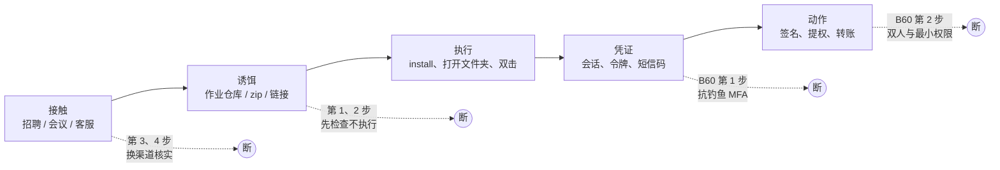

# B59 识破社工：假作业、假文件与假域名

> 学习目标：做完本章，你能——
> 1. 不运行任何代码，拆开一份"面试作业"仓库和一个"复盘 PDF"压缩包，找出其中会自动执行的入口。
> 2. 用"换渠道核实"区分假招聘、假会议、假客服和正常流程，并说出每题的判断信号。
>
> 前置知识：完成阶段 0–1（[阶段 1 导读](B07-stage1-guide.md)）；会用终端的 `cd`、`ls`；装好 Node.js 和 npm。
> 预计用时：1.5–2 小时（本篇与 [B60](B60-account-access-security.md) 合计 2–3 小时）。
> 交互实验：[社工场景判断](../interactive/social-engineering-lab.html)
> 关联章节：[21 社工与内部人](../chapters/21-social-engineering-insiders.md)｜[20 前端、DNS 与供应链](../chapters/20-frontend-dns-supply-chain.md)｜[T07 员工防社工清单](../templates/T07-staff-anti-social-engineering.md)｜[B62 前端供应链与 DNS](B62-frontend-supply-chain-practice.md)｜[B60 账号、SIM 与权限](B60-account-access-security.md)
> 最后核对：2026-11-10（node v26.12.1、npm 11.20.0、git、unzip、file、python3、dig 均在本机运行过；下文输出来自真实运行；两个实验页的题目和计算逻辑已逐条读过）

> ⚠️ 警告：法律与道德边界。本章的"恶意"样本都是你自己在空目录里造的无害文件。只在你自己的设备和账号上练习。对同事做钓鱼演练、假招聘测试或电话社工，必须先有公司的书面授权（例如安全团队主办的意识培训项目），并事先约定范围和数据处理方式。不要用本章的方法测试陌生人或其他公司。

---

## 开场：一份"今晚 12 点前"的作业

（示例场景）你是一家交易所的后端工程师。一位"DeFi 基金招聘者"在 LinkedIn 联系你，月薪很高。第一轮是代码作业：clone 一个仓库，`npm install` 后跑测试，今晚 12 点前交。

这不是虚构的套路。2026 年 9 月，一名 Binance 工程师在工作电脑上下载了面试作业仓库。仓库在安装时运行了恶意代码。原文见 [21 章 5.8 节](../chapters/21-social-engineering-insiders.md)。

<details class="predict"><summary>🤔 先猜再看：你只打算 clone 仓库，用编辑器看看代码，不运行 npm install。这样安全吗？</summary>

不一定安全。编辑器可以在"打开文件夹"时自动运行任务。VS Code 的 `.vscode/tasks.json` 支持 `"runOn": "folderOpen"`。多国机构 2026 年 9 月的联合告警专门建议检查这个文件（[21 章 5.3 节](../chapters/21-social-engineering-insiders.md)）。第 1 步你会亲手造一个这样的仓库。

</details>

> 🎯 打个比方：社工攻击像有人往你家门缝塞一张"快递取件码"。纸条本身无害。危险的是你照着纸条去做的那个动作：扫码、开门、交出钥匙。本章练的就是"先看纸条，不急着做动作"。
>
> 比喻的局限：纸条只能骗你一次。真实攻击者会长期经营关系，有时几个月后才提出请求。Drift 事件里，攻击者在行业会议上接触贡献者，经营数月后才诱导预签（[21 章 5.8 节](../chapters/21-social-engineering-insiders.md)）。

## 1. 本章怎么练

原理不在这里重讲。四类手法的攻击路径见 [21 章 §3](../chapters/21-social-engineering-insiders.md)，账号与 SIM 劫持见 [22 章 §3](../chapters/22-physical-account-security.md)。本章只做一件事：在每个环节找一个**你能亲手打断**的点。本篇练前两环：接触和诱饵。凭证和动作两环（账号、SIM 与权限）在 [B60](B60-account-access-security.md)。



读图要点：
- 实线是攻击者希望你走的路。虚线是本章每一步练习打断的位置。
- 越靠左打断，代价越小。到了"动作"一格，只能靠流程和权限兜底。
- 局限：图只画了一个人。真实事件常常攻破几个人，再横向移动，见 [23 章 5.2 节](../chapters/23-custody-exchange-ops.md)的 Binance 路径图。

## 2. 第 1 步：拆一份假面试作业

这一步在一个空目录里造一个"作业仓库"。它的 `postinstall` 和编辑器任务都会运行 `scripts/setup.js`。脚本只在当前目录写一个 `PWNED.txt`，不联网。

1. 新建一个练习目录，后面所有文件都放在里面：

```bash
mkdir b50-lab && cd b50-lab   # 练习目录，做完可以整个删除
mkdir -p interview-task/.vscode && cd interview-task
```

2. 用编辑器创建 4 个文件。`package.json`：

```json
{
  "name": "defi-interview-task",
  "version": "1.0.0",
  "scripts": {
    "test": "node test.js",
    "postinstall": "node scripts/setup.js"
  }
}
```

`scripts/setup.js`（先 `mkdir scripts`）：

```javascript
// 练习用的"恶意"脚本：只在当前目录写一个标记文件，不联网
require('fs').writeFileSync('PWNED.txt', 'postinstall ran at ' + new Date().toISOString() + '\n');
console.log('[setup] environment configured');
```

`.vscode/tasks.json`：

```json
{
  "version": "2.0.0",
  "tasks": [
    {
      "label": "prepare",
      "type": "shell",
      "command": "node scripts/setup.js",
      "runOptions": { "runOn": "folderOpen" }
    }
  ]
}
```

`test.js` 只有一行：`console.log('all tests passed')`。最后把它变成一个 git 仓库，模拟 clone 下来的样子：

```bash
git init -q && git add -A && git -c user.email=a@b -c user.name=x commit -qm init
```

3. 现在换成审查者的身份。先用普通的 `ls` 看目录：

```bash
ls      # 普通列表
```

```text
package.json
scripts
test.js
```

再加 `-A`，显示以点开头的隐藏项：

```bash
ls -A
```

```text
.git
.vscode
package.json
scripts
test.js
```

`.git` 来自你执行的 `git init`。真实作业是 clone 下来的，也会有它。

`.vscode` 在普通 `ls` 里看不见。第一遍检查一律用 `ls -A`。

4. 不运行，只读出全部 npm 脚本：

```bash
npm pkg get scripts   # 只读 package.json，不执行任何脚本
```

```text
{
  "test": "node test.js",
  "postinstall": "node scripts/setup.js"
}
```

`postinstall` 在 `npm install` 结束后自动运行。同类钩子还有 `preinstall`、`install`、`prepare`。

5. 找编辑器自动任务，再列出其他常见的自动执行入口：

```bash
grep -rn "runOn" .vscode   # 找"打开文件夹即运行"的任务
find . -path ./.git -prune -o \( -name tasks.json -o -name package.json -o -name Dockerfile -o -name '*.sh' -o -name Makefile \) -print
```

```text
.vscode/tasks.json:8:      "runOptions": { "runOn": "folderOpen" }
./package.json
./.vscode/tasks.json
```

6. 对比两种安装方式。`--no-audit --no-fund` 让 npm 不访问外部服务：

```bash
npm install --ignore-scripts --no-audit --no-fund   # A：跳过所有生命周期脚本
ls PWNED.txt
npm install --no-audit --no-fund                    # B：普通安装
cat PWNED.txt
```

真实输出：

```text
up to date in 134ms
ls: PWNED.txt: No such file or directory

> defi-interview-task@1.0.0 postinstall
> node scripts/setup.js

[setup] environment configured

up to date in 172ms
postinstall ran at 2026-11-10T17:52:20.607Z
```

A 没有产生标记文件。B 在你没有输入任何"运行"命令的情况下执行了脚本。

<details class="predict"><summary>🤔 先猜再看：既然 --ignore-scripts 能挡住 postinstall，在工作电脑上加这个参数做作业就安全了吗？</summary>

不安全。第一，它挡不住编辑器任务、`npm test` 里的代码、依赖包被 `require` 时执行的代码。第二，作业的目的就是让你"跑测试"，跑测试就是运行对方的代码。正确做法是：在不存放任何凭证的一次性虚拟机里做，或者拒绝。这是 [T07](../templates/T07-staff-anti-social-engineering.md) 的 D1 红线项。

</details>

7. 在笔记里写一条发现（格式见 [B14](B14-writing-findings.md)）：

```markdown
- 发现：作业仓库含 2 个自动执行入口
  - package.json postinstall → node scripts/setup.js
  - .vscode/tasks.json runOn=folderOpen → 同一脚本
- 证据：npm pkg get scripts、grep runOn 的输出
- 对应检查项：SOC-2；T07 D1、D2
- 处置：不在工作或签名设备打开；转交安全团队；保留招聘者账号和消息截图
```

## 3. 第 2 步：不解压，先看清一个"复盘 PDF"

2024 年 Radiant Capital 的入口是 Telegram 上的一个 zip。内容伪装成复盘 PDF，实际是 macOS 程序（[21 章 5.1 节](../chapters/21-social-engineering-insiders.md)）。这一步造一个无害的同类样本。

1. 回到 `b50-lab`，造两个文件并打包。`.command` 文件在 macOS 上双击就会在终端里运行：

```bash
cd .. && mkdir mk
printf '#!/bin/sh\necho "practice payload: nothing happens"\n' > "mk/Incident_Review.pdf.command"
chmod +x mk/Incident_Review.pdf.command
printf '%%PDF-1.4\n%%practice\n' > mk/notes.pdf
(cd mk && zip -q ../Incident_Review.zip Incident_Review.pdf.command notes.pdf) && rm -rf mk
```

2. 只列清单，不解压：

```bash
unzip -Z Incident_Review.zip   # 显示权限位和文件名
```

```text
Archive:  Incident_Review.zip
Zip file size: 420 bytes, number of entries: 2
-rwxr-xr-x  3.0 unx       51 tx stor 26-Nov-10 21:52 Incident_Review.pdf.command
-rw-r--r--  3.0 unx       19 tx stor 26-Nov-10 21:52 notes.pdf
2 files, 70 bytes uncompressed, 70 bytes compressed:  0.0%
```

3. 不落盘，直接判断内容的真实类型：

```bash
unzip -p Incident_Review.zip notes.pdf | file -
unzip -p Incident_Review.zip Incident_Review.pdf.command | file -
```

```text
/dev/stdin: PDF document, version 1.4
/dev/stdin: POSIX shell script text executable, ASCII text
```

4. 记录指纹，交给安全团队时附上：

```bash
shasum -a 256 Incident_Review.zip
```

```text
35ccf03468696f785272d49f1db44ce77b93fcc815f2b400328c286fb85c0afe  Incident_Review.zip
```

你的值和这里不同，因为 zip 里记录了文件时间。

<details class="predict"><summary>🤔 先猜再看：第 2 步的列表里，哪两个信号单独出现就足够让你停下？</summary>

一是权限位 `-rwxr-xr-x`：一份文档不需要可执行权限。二是文件名的最后一个扩展名是 `.command`，不是 `.pdf`。Finder 可能隐藏扩展名，所以只看图标和前半个文件名会被骗。`file` 命令看的是内容，不看名字。

</details>

> 💡 注意：这一步的检查只是"粗筛"。真实恶意文件可能是真 PDF 加漏洞利用。粗筛通过，也不在签名设备或工作电脑上打开。规则见 [21 章 §4.1](../chapters/21-social-engineering-insiders.md) 设备分离表。

## 4. 第 3 步：核对域名和发件渠道

假客服、收款变更、假会议链接，都靠"看起来是官方"。这一步练两件事：看穿相似域名；理解邮件认证能防什么。

1. 让 Node.js 把域名规范化。第二行的 `і` 是西里尔字母：

```bash
node -e "for (const h of ['https://binance.com','https://bіnance.com','https://safe.global','https://app.safe.globaI']) { const u=new URL(h); console.log(h.padEnd(26), '->', u.hostname) }"
```

```text
https://binance.com        -> binance.com
https://bіnance.com        -> xn--bnance-pvf.com
https://safe.global        -> safe.global
https://app.safe.globaI    -> app.safe.globai
```

2. 逐个字符看码点：

```bash
node -e "const s='bіnance.com'; console.log([...s].map(c=>c+' U+'+c.codePointAt(0).toString(16).padStart(4,'0')).join('  '))"
```

```text
b U+0062  і U+0456  n U+006e  a U+0061  n U+006e  c U+0063  e U+0065  . U+002e  c U+0063  o U+006f  m U+006d
```

`xn--` 开头的是 Punycode（国际化域名的 ASCII 编码）。最后一行的大写 `I` 被转成小写 `i`，域名变成 `globai`。肉眼看 `globaI` 和 `global` 几乎一样。

3. 查一个公开域名的 DMARC 记录。DMARC 告诉收件服务器：冒用本域名发信时怎么处理。

```bash
dig +short TXT _dmarc.google.com
```

```text
"v=DMARC1; p=reject; rua=mailto:mailauth-reports@google.com"
```

<details class="predict"><summary>🤔 先猜再看：合作方域名的 DMARC 是 p=reject。你收到一封"发件人"是这个域名的收款变更邮件，它就一定是真的吗？</summary>

不一定。`p=reject` 只说明：**精确冒用**这个域名的伪造邮件会被拒收。它挡不住相似域名（第 1 步那种），也挡不住对方邮箱本身被盗。所以 [社工场景判断](../interactive/social-engineering-lab.html) 里"收款变更"的正确动作是：用此前登记的电话联系对方，核对完整地址，再走变更审批和冷却期。回复原邮件是在同一渠道确认，没有用。

</details>

4. 把这一步的结论写成团队规则（对应 SOC-4）：

| 请求类型 | 不能用来确认的渠道 | 必须用的渠道 |
|---|---|---|
| 收款地址变更 | 原邮件、原聊天窗口 | 预先登记的电话；变更单；冷却期 |
| 紧急签名 | 发起请求的 Telegram | 登记电话；专用设备独立解码 |
| "客服"来电 | 对方给的回拨号码 | 官方 App 内的客服入口 |
| 会议软件更新 | 聊天里的安装包 | 官网或系统应用商店；浏览器入会 |

## 5. 第 4 步：在实验里练判断

> 🧪 动手验证：打开[社工场景判断](../interactive/social-engineering-lab.html)，完成全部 11 题。每题先选分类（恶意 / 需核实 / 正常业务），再选动作。分类 1 分，动作最多 2 分，满分 33。

1. 第一遍不看本章，凭直觉答。记录总分。
2. 打开结果页的"手法分项"表。它按得分率从低到高排序。记下第一行。
3. 把下表填完。最后一列写你用来区分真假的**一个**信号：

| 题目（实验中的类别） | 实验给的正确分类 | 你的分类 | 区分信号 |
|---|---|---|---|
| 紧急签名 | 恶意 | | |
| 收款变更 | 需核实 | | |
| 正常流程（变更单 CHG-2041） | 正常业务 | | |
| 冒名受雇 | 需核实 | | |
| 内部人收买 | 恶意 | | |

4. 第二遍再做一次，目标 ≥ 30 / 33。页面只在本浏览器保存历史最高分。

<details class="predict"><summary>🤔 先猜再看：为什么实验把"年度钓鱼演练通知"设为正常业务，而且把"当成钓鱼投诉安全团队"判为 0 分？</summary>

它来自已登录的内部工单系统，不要求点链接，也不要求交凭证。安全意识的目标是"按渠道判断"，不是"拒绝一切"。如果员工把所有消息都当攻击，真正的告警也会被淹没。"正常流程"两题就是用来练这一点的。

</details>

## 6. 交付物：社工判断记录

把下面 3 项整理成一页，交给团队的安全负责人：

- 第 1 步的发现（作业仓库的 2 个自动执行入口），以及第 2 步样本 zip 的 `unzip -Z`、`file -` 输出和 SHA-256 指纹。
- 第 3 步的渠道规则表（对应 SOC-4）。
- 第 4 步的判断表、两次得分和最弱手法。

这些结论在 [B60](B60-account-access-security.md) 的交付物里填进 T07 第 2 部分（D1、D2 和演练记录）。

## 7. 检查清单

检查项编号沿用 [21 章 §6](../chapters/21-social-engineering-insiders.md)（SOC）和 [22 章 §6](../chapters/22-physical-account-security.md)（PHY），含义相同。用你自己的团队填写：

| 检查项 | 本章对应练习 | 结论（✅ / ⚠️ / ❌） | 证据 |
|---|---|---|---|
| **SOC-1** 签名人专用设备，不开外部文件 | 第 2 步 | | |
| **SOC-2** 外部项目隔离运行，终端有 EDR | 第 1 步 | | |
| **SOC-4** 双人原则与带外确认 | 第 3 步表格、[B60](B60-account-access-security.md) 第 2 步 | | |
| **SOC-6** 招聘身份核验 | 第 4 步"冒名受雇" | | |
| **SOC-9** 培训与钓鱼演练 | 第 4 步两次得分 | | |
| **SOC-10** 匿名报告渠道，报告不受罚 | 第 1 步"处置" | | |

SOC-3、SOC-5、SOC-7、SOC-8 和 PHY-2 至 PHY-4 在 [B60](B60-account-access-security.md)。

定级用 [A02](../assessment/A02-risk-rating-reporting.md) 复核。涉及个人隐私的证据只写结论，不写住址和号码。

> 🪞 反思：回想你上一次在工作电脑上打开别人发来的仓库、文件或会议链接。
> 1. 你当时有没有用 `ls -A` 或同等方式看过隐藏文件？
> 2. 你用什么渠道确认过对方身份？是不是发来文件的同一个渠道？

## 8. 如果出错

| 现象 | 原因 | 处理 |
|---|---|---|
| `npm pkg get scripts` 输出 `{}` | 不在 `interview-task` 目录，或 `package.json` 拼错 | `pwd` 确认目录；`cat package.json` 检查 JSON |
| 第 6 小步 A 也生成了 `PWNED.txt` | 上一次运行留下的文件 | 先 `rm -f PWNED.txt package-lock.json` 再重做 |
| `npm install` 卡住或报网络错误 | npm 在访问 registry | 加上 `--no-audit --no-fund`；本样本没有依赖，不需要网络 |
| `zip: command not found` | 系统没有 zip | macOS 自带；Linux 用包管理器安装 `zip unzip` |
| `file -` 只显示 `data` | 内容不是已知格式 | 正常现象；"未知格式"本身也是不打开的理由 |
| Node 输出里没有 `xn--` | 终端把西里尔字母替换成了拉丁字母 | 直接复制本章命令，不要手打第二个域名 |
| `dig: command not found` | 没装 dig | macOS 自带；Linux 安装 `dnsutils` 或 `bind-utils` |

## 9. 过关标准

- [ ] 在第 1 步的仓库里，不运行任何脚本，找出 2 个自动执行入口，并说出各自的触发时机。
- [ ] 复现 `--ignore-scripts` 与普通安装的差异：A 无 `PWNED.txt`，B 有。
- [ ] 不解压，用 `unzip -Z` 和 `file -` 说出样本 zip 中哪个文件是可执行脚本。
- [ ] 解释 `xn--bnance-pvf.com` 的含义，并说出 DMARC `p=reject` 防不住的两种情况。
- [ ] [社工场景判断](../interactive/social-engineering-lab.html)第二遍得分 ≥ 30 / 33。

## 10. 思考题

1. 第 1 步里，`--ignore-scripts` 挡住了 `postinstall`。请列出至少两种它挡不住、但同样会在"做作业"时执行对方代码的途径，并说明公司规则应该怎么写才不依赖这个参数。
2. 合作方的域名 DMARC 是 `p=reject`，收款变更邮件也通过了认证。你还要做哪些核实？为什么"先转一小笔测试"不能证明地址属于对方？

- 下一篇：[B60 账号、SIM 与权限：人身账号安全与离职回收](B60-account-access-security.md)
