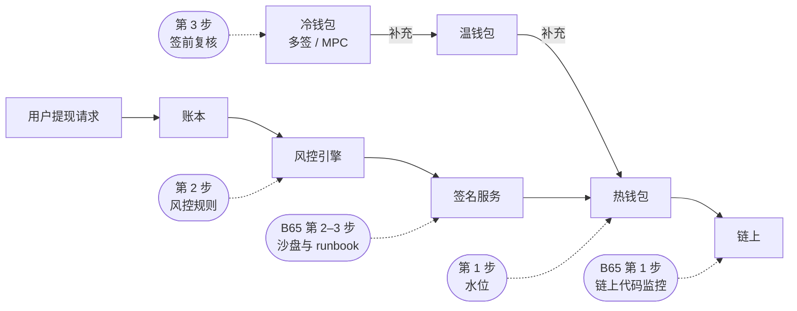

# B64 热钱包水位、提现风控与多签复核

> 学习目标：做完本章，你能——
> 1. 为一个示例交易所定出冷 / 温 / 热钱包的水位，并写一段能运行的提现风控规则。
> 2. 在签名前从原始字段重算 safeTxHash，并说出哪些字段变化会让"同一笔交易"变成另一笔。
>
> 前置知识：完成阶段 0–1（[阶段 1 导读](B07-stage1-guide.md)），建议先完成链下赛道 L1（[L1 导读](B56-offchain-l1-guide.md)）；会用 `anvil` 和 `cast`（[B06](B06-foundry-basics.md)）；读过 [B59](B59-social-engineering-practice.md) 更好。
> 预计用时：约 1.5–2 小时。
> 交互实验：[多签签前复核](../interactive/multisig-review-lab.html)
> 关联章节：[23 托管与充提安全](../chapters/23-custody-exchange-ops.md)｜[29 2026 签名路径专题](../chapters/29-signing-path-2026.md)｜[18 钱包与密钥管理](../chapters/18-wallet-key-management.md)｜[A06 运营与密钥安全](../assessment/A06-operational-key-security.md)｜[A09 应急响应](../assessment/A09-incident-response.md)｜[T06 运营安全自查](../templates/T06-ops-security-self-check.md)｜[B40 Safe 多签](B40-case-safe.md)
> 最后核对：2026-11-10（anvil / cast 1.5.1、node v26.12.1 在本机运行过；下文命令输出来自真实运行；应急演练的三组结果和多签实验 #42 的哈希在本机浏览器中跑过）

> ⚠️ 警告：法律与道德边界。本章只在本机的 Anvil 链和浏览器实验页上操作。文中的私钥是 Anvil 公开的默认测试私钥，只能用于本地，任何人都知道它，绝不能往对应地址转真实资产。不要对任何真实交易所或钱包做提现测试、签名测试或"应急演练"。真实的应急演练只在你所在组织的授权范围内进行。

---

## 开场：一张账本里没有的提现单

2026 年，Bitget 和 Binance 的热钱包事件都是"签名服务被伪造的请求驱动"（[23 章 5.2 节](../chapters/23-custody-exchange-ops.md)）。冷钱包一侧也有同样的问题：Bybit 的那笔多签交易，函数名是 `transfer`，但 `operation = 1`，目标不在白名单。

本篇在资金离开之前设三道关：水位限制热钱包一次失守的损失，风控拦下账本里没有的提现单，签前复核拦下字段被改过的多签交易。

## 1. 本章怎么练

原理不在这里重讲。三层钱包和充提攻击面见 [23 章 §3–4](../chapters/23-custody-exchange-ops.md) 和 [18 章 §4.2](../chapters/18-wallet-key-management.md)；签名服务参考架构见 [29 章 §4](../chapters/29-signing-path-2026.md)。本章沿一笔提现的路径，在 3 个事前控制点各做一个练习。事中响应放在下一篇 [B65](B65-incident-response-practice.md)。



读图要点：
- 实线是资金和请求的方向。虚线标出本章每一步练习所在的位置。
- 本篇 3 步是"事前控制"，限制一次失守的损失。[B65](B65-incident-response-practice.md) 的 3 步是"事中响应"，缩短失守的时间。
- 局限：图里没有内部人和终端失陷。那是 [B59](B59-social-engineering-practice.md) 的内容，但它们最终都会打到这条路径上。

## 2. 第 1 步：给热钱包定水位

水位（Watermark）：热钱包允许的余额区间。上限决定"热钱包被清空时最多丢多少"。下限决定"多久要从温钱包补一次"。

示例交易所"Nebula"（虚构）过去 7 天的日提现额（单位：百万美元，示例）：12、15、9、20、14、11、18。

1. 用 Node.js 算出最大值和平均值，再按示例规则算水位：

```bash
node -e "const d=[12,15,9,20,14,11,18]; const max=Math.max(...d), avg=d.reduce((a,b)=>a+b)/d.length; console.log('max', max, 'avg', avg.toFixed(2)); console.log('hot cap  =', (max*1.2).toFixed(1)); console.log('hot floor=', (avg*0.5).toFixed(1)); console.log('warm cap =', (max*3).toFixed(1))"
```

```text
max 20 avg 14.14
hot cap  = 24.0
hot floor= 7.1
warm cap = 60.0
```

2. 把结果写成配置表（本手册示例规则，不是行业标准）：

| 层 | 上限 | 下限 | 补充方式 | 超出上限时 |
|---|---|---|---|---|
| 热钱包 | 24.0M（最大日提现 × 1.2） | 7.1M（平均日提现 × 0.5） | 温钱包自动补充 | 自动归集到冷钱包 |
| 温钱包 | 60.0M（最大日提现 × 3） | — | 冷钱包多签，人工审批 | 归集到冷钱包 |
| 冷钱包 | 其余全部 | — | — | — |

<details class="predict"><summary>🤔 先猜再看：把热钱包上限从 24M 降到 5M，安全性提高了吗？代价是什么？</summary>

单次清空的损失上限降低了。代价是：5M 低于平均日提现，温钱包每天要补充多次。每次补充都是一次签名，签名越频繁，冷 / 温钱包的审批越容易变成例行公事。水位是安全与运营频率之间的取舍，要和签前复核一起设计。

</details>

## 3. 第 2 步：写一个最小提现风控

这一步把 [23 章 §4.1](../chapters/23-custody-exchange-ops.md) 的四条控制写成代码：账本绑定、地址投毒识别、白名单冷却期、分链熔断。

1. 新建练习目录：

```bash
mkdir b51-lab && cd b51-lab
```

2. 创建 `requests.json`。它包含账本、白名单、每链限额和 5 笔待处理的提现请求（全部是示例）：

```json
{
  "now": "2026-11-10T12:00:00Z",
  "ledger": ["W-1001", "W-1002", "W-1003", "W-1004"],
  "whitelist": {
    "u7": [{ "addr": "0x1a2b3c4d5e6f708192a3b4c5d6e7f8091a2b9f3e", "addedAt": "2026-10-01T00:00:00Z" },
           { "addr": "0x9999000000000000000000000000000000001111", "addedAt": "2026-11-10T11:30:00Z" }]
  },
  "chainLimitPerHour": { "ETH": 500000, "TRON": 300000 },
  "chainOutLastHour":  { "ETH": 420000, "TRON": 10000 },
  "requests": [
    { "id": "W-1001", "user": "u7", "chain": "ETH",  "to": "0x1a2b3c4d5e6f708192a3b4c5d6e7f8091a2b9f3e", "usd": 20000 },
    { "id": "W-1002", "user": "u7", "chain": "ETH",  "to": "0x9999000000000000000000000000000000001111", "usd": 5000 },
    { "id": "W-1003", "user": "u7", "chain": "ETH",  "to": "0x1a2bffffffffffffffffffffffffffffffff9f3e", "usd": 3000 },
    { "id": "W-1004", "user": "u7", "chain": "ETH",  "to": "0x1a2b3c4d5e6f708192a3b4c5d6e7f8091a2b9f3e", "usd": 90000 },
    { "id": "X-0001", "user": "u7", "chain": "TRON", "to": "0x1a2b3c4d5e6f708192a3b4c5d6e7f8091a2b9f3e", "usd": 1000 }
  ]
}
```

3. 创建 `risk.mjs`：

```javascript
// 练习用提现风控：每条请求依次过 4 条规则，任一条不过就拦截
import fs from 'fs';
const cfg = JSON.parse(fs.readFileSync(process.argv[2], 'utf8'));
const now = Date.parse(cfg.now), COOLDOWN_H = 24;
const out = { ...cfg.chainOutLastHour };
const lc = s => s.toLowerCase();
const lookalike = (a, b) => lc(a) !== lc(b) && lc(a).slice(0, 6) === lc(b).slice(0, 6) && lc(a).slice(-4) === lc(b).slice(-4);
for (const r of cfg.requests) {
  const wl = cfg.whitelist[r.user] || [];
  const hit = wl.find(w => lc(w.addr) === lc(r.to));
  let verdict = 'PASS', why = '';
  if (!cfg.ledger.includes(r.id)) { verdict = 'BLOCK'; why = 'R1 账本里没有这张提现单'; }
  else if (wl.some(w => lookalike(w.addr, r.to))) { verdict = 'BLOCK'; why = 'R2 与白名单地址首尾相同、中间不同（疑似投毒）'; }
  else if (!hit) { verdict = 'BLOCK'; why = 'R3 不在白名单'; }
  else if ((now - Date.parse(hit.addedAt)) / 36e5 < COOLDOWN_H) { verdict = 'HOLD'; why = 'R3 新地址冷却期未满 24 小时'; }
  else if (out[r.chain] + r.usd > cfg.chainLimitPerHour[r.chain]) { verdict = 'HOLD'; why = `R4 ${r.chain} 小时流出将超限（熔断）`; }
  if (verdict === 'PASS') out[r.chain] += r.usd;
  console.log(r.id.padEnd(7), verdict.padEnd(5), why);
}
console.log('ETH 本小时已放行（含历史）:', out.ETH);
```

4. 运行前，先在纸上写下你对 5 笔请求的预测。然后运行：

```bash
node risk.mjs requests.json
```

```text
W-1001  PASS  
W-1002  HOLD  R3 新地址冷却期未满 24 小时
W-1003  BLOCK R2 与白名单地址首尾相同、中间不同（疑似投毒）
W-1004  HOLD  R4 ETH 小时流出将超限（熔断）
X-0001  BLOCK R1 账本里没有这张提现单
```

最后一行输出 `ETH 本小时已放行（含历史）: 440000`。

<details class="predict"><summary>🤔 先猜再看：X-0001 的目标地址在白名单里，金额也很小。为什么 R1 要排在最前面，而且直接 BLOCK？</summary>

账本里没有这张单，说明请求不是来自正常的用户提现。它可能是攻击者伪造的上游请求。这正是开场所说的形态。这种请求不应该进入任何后续判断，也不应该"待人工复核"后放行。对应 [29 章](../chapters/29-signing-path-2026.md) 的 SIG-2。

</details>

5. 自己改一处，再跑一遍。任选一个：
   - 把 `now` 改成 `2026-11-11T12:00:00Z`，观察 W-1002 的结果。
   - 把 `chainOutLastHour.ETH` 改成 `0`，观察 W-1004 的结果。

> 💡 注意：这段脚本只演示规则顺序。真实的风控引擎和签名服务由不同团队维护，签名服务还要从原始交易字节**独立**重新校验目标和金额（CUS-2、CUS-3）。风控说"通过"，签名服务也不能只信这一句。

## 4. 第 3 步：多签签前复核

冷钱包补充热钱包，通常是一笔多签交易。原理见 [18 章 §3.3](../chapters/18-wallet-key-management.md) 和 [B40](B40-case-safe.md)。

> 🧪 动手验证：打开[多签签前复核](../interactive/multisig-review-lab.html)。队列里有 6 笔交易（#42–#47）。每笔先点"运行独立解码"，再批准或拒绝。记录你批准了几笔，再看复盘。

1. 做完实验后，用 `cast` 在本地复现 #42 的独立解码。先认识三个函数选择器：

```bash
cast sig 'transfer(address,uint256)'
cast sig 'upgradeTo(address)'
cast sig 'multiSend(bytes)'
```

```text
0xa9059cbb
0x3659cfe6
0x8d80ff0a
```

2. 构造并解码 #42 的 calldata（向示例热钱包转 5,000,000 USDT，6 位小数）：

```bash
D=$(cast calldata 'transfer(address,uint256)' 0xa01e700100000000000000000000000000000000 5000000000000)
echo $D
cast calldata-decode 'transfer(address,uint256)' $D
```

```text
0xa9059cbb000000000000000000000000a01e7001000000000000000000000000000000000000000000000000000000000000000000000000000000000000048c27395000
0xa01e700100000000000000000000000000000000
5000000000000 [5e12]
```

3. 如果有人把升级调用伪装成转账，按 `transfer` 解码会失败：

```bash
U=$(cast calldata 'upgradeTo(address)' 0xbadc0de002000000000000000000000000000000)
cast calldata-decode 'transfer(address,uint256)' $U
```

```text
Error: ABI decoding failed: buffer overrun while deserializing
```

先看前 4 字节选择器，再按对应的签名解码。

4. 创建 `safe-hash.sh`，按 Safe 的 EIP-712 规则从原始字段重算 safeTxHash：

```bash
#!/bin/sh
# 用法：sh safe-hash.sh <chainId>。按 Safe 的 EIP-712 规则本地计算 safeTxHash（示例字段）
CHAIN=$1
SAFE=0x5afe000100000000000000000000000000000000
TO=0xc0dec0de01000000000000000000000000000000      # USDT 示例
DATA=$(cast calldata 'transfer(address,uint256)' 0xa01e700100000000000000000000000000000000 5000000000000)
Z=0x0000000000000000000000000000000000000000
DTH=$(cast keccak 'EIP712Domain(uint256 chainId,address verifyingContract)')
STH=$(cast keccak 'SafeTx(address to,uint256 value,bytes data,uint8 operation,uint256 safeTxGas,uint256 baseGas,uint256 gasPrice,address gasToken,address refundReceiver,uint256 nonce)')
DOM=$(cast keccak $(cast abi-encode 'f(bytes32,uint256,address)' $DTH $CHAIN $SAFE))
ST=$(cast keccak $(cast abi-encode 'f(bytes32,address,uint256,bytes32,uint8,uint256,uint256,uint256,address,address,uint256)' \
  $STH $TO 0 $(cast keccak $DATA) 0 0 0 0 $Z $Z 42))
cast keccak $(cast concat-hex 0x1901 $DOM $ST)
```

5. 分别用主网和 Arbitrum 的 chainId 运行：

```bash
sh safe-hash.sh 1
sh safe-hash.sh 42161
```

```text
0x35ca2cd3e229ef68fc253ebdb4f5e4ea5445f2b27068e3bafff75d92bb97e5fe
0xb8dfff12f6723a8741b53e467275365b79b27691399d05c94019f7c8f7a03685
```

第一行和实验页 #42 显示的"重算的 safeTxHash"完全相同。你用另一个工具得到了同一个结果，这就是"独立解码"。

<details class="predict"><summary>🤔 先猜再看：两次运行只改了 chainId。为什么哈希完全不同？这对签名人意味着什么？</summary>

chainId 在 domainSeparator 里，domainSeparator 又进入最终哈希。改任何一个字段，哈希都会变。所以签名人只要在硬件钱包上核对哈希与自己重算的结果一致，就能发现字段被改。反过来，哈希一致只说明"前端没改字段"，不说明交易安全：还要看 `operation`、目标是否在白名单、Gas 退款字段是否为 0。实验里的 #43–#47 分别考这几点。

</details>

<details class="predict"><summary>🤔 实验答案（做完再看）：6 笔里该批准几笔？</summary>

只有 #42 和 #44 应批准。#43 是 Bybit 的结构：函数名是 `transfer`，但 `operation = 1`，目标不在白名单。#45 在批量里藏了一项对未知合约的 DELEGATECALL。#46 的 chainId 是 42161。#47 的 Gas 退款字段非零。逐题解释见实验复盘。

</details>

## 5. 检查清单

本章使用 OPS 前缀。右列给出主线章节和模板中的对应编号，便于把结论写进同一份报告：

| 检查项 | 内容 | 本章练习 | 对应 | 结论 | 证据 |
|---|---|---|---|---|---|
| **OPS-1** | 热钱包有上限和下限；超出上限自动归集 | 第 1 步 | CUS-1、T06 1.4 | | |
| **OPS-2** | 签名只为账本中存在的提现单进行；无单请求直接拒绝 | 第 2 步 R1 | CUS-2、SIG-2、T06 1.5 | | |
| **OPS-3** | 新地址有冷却期；相似地址强拦截 | 第 2 步 R2、R3 | CUS-8 | | |
| **OPS-4** | 每条链有独立的小时限额与熔断 | 第 2 步 R4、[B65](B65-incident-response-practice.md) 第 2 步 ④ | CUS-1、SIG-16、T06 1.6 | | |
| **OPS-5** | 签名人用独立工具重算 safeTxHash，核对 chainId、operation、Gas 退款字段 | 第 3 步 | SIG-10、T06 2.1–2.3 | | |

定级用 [A02](../assessment/A02-risk-rating-reporting.md) 复核。发现按 [T03](../templates/T03-finding-report.md) 记录。

> 🪞 反思：想一想你接触过的一个托管系统（交易所、项目金库或你自己的多签）。
> 1. 你上一次签名前，是自己重算的哈希，还是相信了界面？

## 6. 如果出错

| 现象 | 原因 | 处理 |
|---|---|---|
| `safe-hash.sh` 结果和实验页不同 | 字段抄错，常见是金额少了 6 个零或 nonce 不是 42 | 对照实验页 #42 的"字段对比"表逐项核对 |
| `node risk.mjs` 报 `Cannot use import statement` | 文件扩展名不是 `.mjs` | 改名为 `risk.mjs` |

## 7. 过关标准

- [ ] 用第 1 步的数据算出热钱包上下限 24.0M 和 7.1M，并说出把上限压低的代价。
- [ ] `node risk.mjs` 的 5 行结果与本章一致；改动一个参数后，能提前说出哪一行会变化。
- [ ] `sh safe-hash.sh 1` 的输出与多签实验 #42 的重算哈希完全相同。
- [ ] 多签实验 6 笔全部判断正确，并能说出 #43、#46、#47 分别违反了哪条审批规则。

## 8. 思考题

1. 第 2 步的风控脚本里，如果把 R4（分链熔断）移到 R1（账本绑定）前面，5 笔请求的结果会怎样变化？规则的先后顺序为什么重要？
2. 第 3 步里，你重算的哈希和硬件钱包显示的哈希一致。这能证明这笔交易安全吗？请结合实验 #43 和 #47 说明还要看什么。

- 下一篇：[B65 应急：检查链上委托、沙盘与 runbook](B65-incident-response-practice.md)
