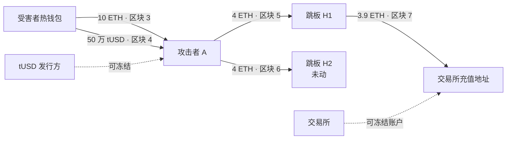

# B66 资金追踪与处置：读交易图、冻结与证据

> 学习目标：做完本章，你能——
> 1. 从一笔交易哈希出发，在本地链上画出资金流向图，并写出第一版地址清单。
> 2. 亲手验证发行方冻结能拦住什么、拦不住什么，并写出一份冻结请求包。
>
> 前置知识：完成阶段 0–1（[阶段 1 导读](B07-stage1-guide.md)），建议先完成链下赛道 L1（[L1 导读](B56-offchain-l1-guide.md)）；会运行 `anvil` 和 `cast`；读过 [25 资金追踪](../chapters/25-fund-tracing-response.md) 第 1–4 节。
> 预计用时：约 2–3 小时。
> 关联章节：[25 资金追踪与事后处置](../chapters/25-fund-tracing-response.md)｜[23 托管、充提与合规安全](../chapters/23-custody-exchange-ops.md)｜[A09 应急响应](../assessment/A09-incident-response.md)｜[T06 运营安全自查](../templates/T06-ops-security-self-check.md)｜[B65 应急：检查链上委托、沙盘与 runbook](B65-incident-response-practice.md)｜[B67 数据隐私与合规：聚类误伤、数据最小化与制裁筛查](B67-privacy-compliance-practice.md)
> 最后核对：2026-11-10（anvil / cast / forge 1.5.1、jq、openssl 3.0.13、node 26 均在本机运行过；下文输出来自真实运行）

> ⚠️ 警告：法律与道德边界。本章所有交易都发生在你本机的 Anvil 链上。地址、私钥和"被盗资金"都是练习数据。不要用本章方法追踪、标注或公开真实个人的地址。真实事件中的追踪和冻结请求，由受害方、执法机关或其授权的机构发起。

---

## 开场：凌晨 2 点，热钱包少了一笔钱

值班告警：热钱包转出 10 ETH 和 50 万 tUSD。tUSD 是一种可冻结的稳定币。交易的 `from` 是你们自己的地址，所以私钥已经泄露。3 个区块后，ETH 被分到两个新地址，其中一笔进了某交易所的充值地址。

<details class="predict"><summary>🤔 先猜再看：你手上只有第一笔交易哈希。第一个小时，你最应该联系谁？</summary>

两方并行：tUSD 的发行方，以及收到充值的交易所。发行方能冻结 tUSD。交易所掌握充值地址背后的 KYC，并能冻结账户内的余额。ETH 没有发行方，只能在它进入有运营方的出口时拦截。原理见 [25 章 4.1 节](../chapters/25-fund-tracing-response.md)。

</details>

> 🎯 打个比方：资金追踪像沿着雪地上的脚印找人。脚印不会消失，你可以一步步跟下去。
>
> 比喻的局限：脚印只告诉你"走到了哪里"，不告诉你"是谁"。把地址落到真人身上，要靠交易所的 KYC 记录或执法调取。而且对方跨链或进混币器后，脚印会断开。

## 1. 本章练什么

| 第几步 | 你做什么 | 原理在哪里 | 检查项 |
|---|---|---|---|
| 1–2 | 搭本地案发现场，读交易图 | [25 章 3 节](../chapters/25-fund-tracing-response.md) | — |
| 3 | 写地址清单 | [25 章 4.2 节](../chapters/25-fund-tracing-response.md) | TRC-4 |
| 4 | 发行方冻结 | [25 章 5.4 节](../chapters/25-fund-tracing-response.md) | TRC-3 |
| 5 | 冻结请求包与证据保全 | [A09](../assessment/A09-incident-response.md)、[25 章 7 节](../chapters/25-fund-tracing-response.md) | TRC-5、CUS-13 |

> 💡 注意：本章的检查项编号沿用主线章节（TRC-1 至 TRC-10 来自 25 章，CUS-13 来自 23 章），含义与原章一致。

聚类误判、哈希枚举和制裁筛查放在下一篇 [B67](B67-privacy-compliance-practice.md)。

## 2. 第 1 步：搭一个本地案发现场

1. 打开第一个终端，启动本地链：

```bash
anvil --port 18545  # 本地链，数据只在你的电脑上
```

2. 打开第二个终端，新建练习目录。生成 4 个一次性钱包：攻击者 A、跳板 H1、跳板 H2、交易所充值地址 DEP。

```bash
mkdir -p b52-lab/toyusd/src && cd b52-lab  # 在任意空目录下新建
cast wallet new --json  # 运行 4 次，记下 4 组地址和私钥
```

> ⚠️ 警告：这些私钥只用于本练习。不要往这些地址转任何真实资产。

3. 把下面的合约存为 `b52-lab/toyusd/src/ToyUSD.sol`。它模拟一种发行方可以冻结地址的稳定币。

```solidity
// SPDX-License-Identifier: MIT
pragma solidity ^0.8.20;

/// 练习用的玩具稳定币：发行方可以冻结地址。不要部署到任何公链。
contract ToyUSD {
    address public immutable ISSUER;           // 发行方地址
    mapping(address => uint256) public balanceOf;
    mapping(address => bool) public frozen;    // 冻结名单

    event Transfer(address indexed from, address indexed to, uint256 value);
    error Frozen(address who);
    error NotIssuer();

    constructor() { ISSUER = msg.sender; }

    function mint(address to, uint256 amt) external {
        if (msg.sender != ISSUER) revert NotIssuer();
        balanceOf[to] += amt;
    }

    function freeze(address who) external {
        if (msg.sender != ISSUER) revert NotIssuer();
        frozen[who] = true;                      // 只有发行方能冻结
    }

    function transfer(address to, uint256 amt) external returns (bool) {
        if (frozen[msg.sender]) revert Frozen(msg.sender); // 被冻结的地址不能转出
        balanceOf[msg.sender] -= amt;
        balanceOf[to] += amt;
        emit Transfer(msg.sender, to, amt);       // 追踪靠这条事件
        return true;
    }
}
```

4. 设置变量。`VICTIM` 和 `ISSUER` 用 Anvil 公开的默认测试账户 0 和 1，只用于本地。`A`、`H1`、`H2`、`DEP` 换成你生成的值。

```bash
RPC=http://127.0.0.1:18545
VICTIM=0xf39Fd6e51aad88F6F4ce6aB8827279cffFb92266
VICTIM_PK=0xac0974bec39a17e36ba4a6b4d238ff944bacb478cbed5efcae784d7bf4f2ff80
ISSUER_PK=0x59c6995e998f97a5a0044966f0945389dc9e86dae88c7a8412f4603b6b78690d
A=<攻击者地址>; A_PK=<攻击者私钥>; H1=<跳板1地址>; H1_PK=<跳板1私钥>
H2=<跳板2地址>; DEP=<充值地址>
```

5. 发行方部署 ToyUSD，给受害者铸造 100 万 tUSD：

```bash
cd toyusd
forge create src/ToyUSD.sol:ToyUSD --broadcast --rpc-url $RPC --private-key $ISSUER_PK
T=0x8464135c8F25Da09e49BC8782676a84730C318bC   # 用你输出里的 Deployed to
cast send $T 'mint(address,uint256)' $VICTIM 1000000 --private-key $ISSUER_PK --rpc-url $RPC
```

预期输出中有：

```text
Deployed to: 0x8464135c8F25Da09e49BC8782676a84730C318bC
```

6. 模拟盗币和转移。攻击者拿到了受害者私钥，所以前两笔的 `from` 是受害者：

```bash
# 盗走 ETH；--json 输出回执，jq 取出交易哈希存进 TX1
TX1=$(cast send $A --value 10ether --private-key $VICTIM_PK --rpc-url $RPC --json | jq -r .transactionHash)
# 盗走 tUSD；哈希存进 TX2
TX2=$(cast send $T 'transfer(address,uint256)' $A 500000 --private-key $VICTIM_PK --rpc-url $RPC --json | jq -r .transactionHash)
cast send $H1 --value 4ether --private-key $A_PK --rpc-url $RPC                          # 拆分
cast send $H2 --value 4ether --private-key $A_PK --rpc-url $RPC                          # 拆分
cast send $DEP --value 3.9ether --private-key $H1_PK --rpc-url $RPC                      # 进交易所
```

第一笔的交易哈希就是"起点"：

```bash
echo $TX1  # 起点交易哈希
```

示例输出（哈希由你的地址决定，你的会不同）：

```text
0x321effa9c03c0b6ebfb15b79836ed725830579157f2e6a4d529f0f10b9a8c594
```

## 3. 第 2 步：从一笔交易哈希开始读交易图

1. 读起点交易：

```bash
cast tx $TX1 --rpc-url $RPC
```

关键字段（地址是本章示例运行的，你的会不同）：

```text
blockNumber          3
from                 0xf39Fd6e51aad88F6F4ce6aB8827279cffFb92266
to                   0xEd8FF955D9036Ddd4Ae360D5D7F5C69dCC12Bf96
value                10000000000000000000
```

2. 公共浏览器能按地址列出交易。本地链没有这个索引，你自己写一个。存为 `b52-lab/trace.sh`：

```bash
#!/usr/bin/env bash
# 用法：./trace.sh <地址>   在本地链上列出这个地址发出的全部交易
ADDR=$(echo "$1" | tr 'A-F' 'a-f')
RPC=http://127.0.0.1:18545
LATEST=$(cast block-number --rpc-url $RPC)
for n in $(seq 1 "$LATEST"); do
  cast block "$n" --full --json --rpc-url $RPC \
  | jq -r --arg a "$ADDR" --arg n "$n" \
    '.transactions[] | select((.from|ascii_downcase)==$a)
     | "block=\($n) hash=\(.hash) to=\(.to) value_wei=\(.value)"'
done
```

3. 逐跳追踪：

```bash
cd .. && chmod +x trace.sh   # 回到 b52-lab
./trace.sh $A    # 攻击者发出了什么
./trace.sh $H1   # 跳板 1 发出了什么
./trace.sh $H2   # 跳板 2 发出了什么
```

输出（已缩短；哈希和地址以你的运行为准）：

```text
block=5 hash=0x6f66218b… to=0xc64da920… value_wei=0x3782dace9d900000
block=6 hash=0xe0817cf1… to=0x0c19bfc4… value_wei=0x3782dace9d900000
block=7 hash=0x0c4bfae0… to=0x789affb4… value_wei=0x361f955640060000
```

H2 没有输出，说明它的资金还没动。`cast from-wei $(cast to-dec 0x3782dace9d900000)` 输出 `4.000000000000000000`。

4. 代币转账的 `value` 是 0。要看事件或 calldata：

```bash
cast logs --from-block 1 --address $T 'Transfer(address indexed,address indexed,uint256)' --rpc-url $RPC
cast calldata-decode 'transfer(address,uint256)' $(cast tx $TX2 input --rpc-url $RPC)
```

```text
0xEd8FF955D9036Ddd4Ae360D5D7F5C69dCC12Bf96
500000 [5e5]
```

把结果画成图：



读图要点：资金从左往右流。50 万 tUSD 仍在 A，可由发行方冻结。3.9 ETH 进了交易所，可由交易所冻结。H2 的 4 ETH 和 A 剩下的约 2 ETH 没有任何一方能冻结，只能持续监控。局限：真实事件里一跳可能分出几百个地址，还会经过 DEX、跨链桥和混币器。

## 4. 第 3 步：写第一版地址清单（TRC-4）

冻结请求只需要准确的地址和交易哈希。把第 2 步的结果填进下表。这是本章的第一个交付物。

| # | 地址 | 角色 | 资产与数量 | 进入交易 | 区块 | 下一跳 | 可冻结方 | 置信度 |
|---|---|---|---|---|---|---|---|---|
| 1 | `0xEd8F…Bf96` | 攻击者 | 50 万 tUSD、约 2 ETH | `0x321e…c594`、`0xdfba…35c7` | 3、4 | H1、H2 | tUSD 发行方 | 确定（直接收款） |
| 2 | `0xc64d…dc3a` | 跳板 | 约 0.1 ETH | `0x6f66…9e9e` | 5 | DEP | — | 确定 |
| 3 | `0x0C19…e48e` | 跳板 | 4 ETH | `0xe081…c895` | 6 | 未动 | — | 确定 |
| 4 | `0x789A…9495` | 交易所充值地址 | 3.9 ETH | `0x0c4b…a42a` | 7 | — | 交易所 | 确定 |

> 💡 注意：真实清单里，地址和哈希必须写全，不能缩写。缩写只用于本页排版。每条都要写"置信度"：直接转账是确定；按启发式推断的，写明规则名称（见 [B67](B67-privacy-compliance-practice.md) 第 1 步）。

## 5. 第 4 步：发行方冻结，能拦住什么

<details class="predict"><summary>🤔 先猜再看：发行方冻结 A 之后，A 还能转出 tUSD 吗？A 还能转出 ETH 吗？</summary>

tUSD 不能，ETH 能。冻结写在 tUSD 合约里，只管这个合约的余额。ETH 是原生资产，没有任何合约能拦住它。下面的命令会证明这一点。

</details>

1. 发行方冻结 A：

```bash
cast send $T 'freeze(address)' $A --private-key $ISSUER_PK --rpc-url $RPC
cast call $T 'frozen(address)(bool)' $A --rpc-url $RPC   # 预期 true
```

2. A 尝试转出 tUSD：

```bash
cast send $T 'transfer(address,uint256)' $H2 500000 --private-key $A_PK --rpc-url $RPC
```

```text
Error: Failed to estimate gas: … execution reverted: custom error 0x8a5c4736: … Frozen(0xEd8FF955D9036Ddd4Ae360D5D7F5C69dCC12Bf96)
```

3. A 转出 ETH：

```bash
cast send $H2 --value 1ether --private-key $A_PK --rpc-url $RPC   # 预期 status 1 (success)
```

4. 攻击者自己调用 `freeze` 会怎样？运行 `cast send $T 'freeze(address)' $H2 --private-key $A_PK --rpc-url $RPC`，结果是 `custom error 0x54ec5063 … NotIssuer`。冻结权只在发行方手里。

> 💡 注意：真实发行方冻结有门槛和时延。2026 年 10 月 Binance 事件中，Tether 在主要清扫交易后 37 分钟冻结，但约 7.86 亿美元稳定币在冻结前已被换走。来源：[TRM](https://www.trmlabs.com/resources/blog/north-korea-steals-usd-6-36-billion-from-binance-in-the-largest-hack-in-history)、[Elliptic](https://www.elliptic.co/insights/binance-largest-hack-in-history/)。本地实验只演示"冻结管什么"，不演示时延。

## 6. 第 5 步：冻结请求包与证据保全

冻结方需要可核对的材料。按下面的格式写一份请求包，这是第二个交付物。流程依据 [A09 第 3 节](../assessment/A09-incident-response.md) 和 [25 章 4.2 节](../chapters/25-fund-tracing-response.md)。

```markdown
# 冻结请求（示例，本地练习）
- 请求方：示例交易所 SampleX 安全团队；联系人与 24 小时电话：……
- 事件时间：区块 3（本地链），UTC 时间见区块 timestamp
- 请求对象：tUSD 发行方 / 交易所 X 风控
- 请求冻结：0xEd8F…（50 万 tUSD）；充值地址 0x789A…（3.9 ETH）
- 证据：起点交易 0x321e…；资金路径见附表（地址清单 v1）
- 执法：已报案，回执编号 ……（真实事件中，多数冻结方需要执法请求）
- 版本：地址清单 v1，下次更新时间：1 小时后
```

证据保全按顺序做：

1. 导出交易和区块数据：`cast block 3 --full --json --rpc-url $RPC > evidence-block3.json`。
2. 对证据文件算指纹：`shasum -a 256 evidence-block3.json`。输出是 64 位十六进制串加文件名，例如 `00e401ea…8d95  evidence-block3.json`。你的值会不同。把它写进事件日志。
3. 保全服务器日志和镜像之后，才开始恢复系统。恢复会覆盖证据（TRC-5）。

> ⚠️ 警告：事发后会有人联系受害者，声称"付费即可追回"。这类"追回诈骗"几乎都是骗局（[25 章 7 节](../chapters/25-fund-tracing-response.md)）。请求包只发给你核实过联系方式的机构。

## 7. 检查清单

为虚构机构"示例交易所 SampleX"填写。状态写"通过 / 不通过 / 不适用"，证据写你在本章产生的文件或截图。

| 检查项 | 内容（原文见主线章节） | SampleX 状态 | 证据 |
|---|---|---|---|
| **TRC-3** | 有事发通知清单；每季度验证联系人 | | |
| **TRC-4** | 地址清单模板，1 小时内发出第一版 | | 第 3 步地址清单 |
| **TRC-5** | 先保全，后恢复 | | `evidence-block3.json` 及其指纹 |
| **CUS-13** | 收到执法冻结请求，24 小时内响应 | | 冻结请求包 |

> 🪞 反思：回到你自己的系统。今晚如果有钱被转走，第一份地址清单由谁写？他会用 `cast` 或浏览器逐跳追吗？

## 8. 如果出错

| 现象 | 原因 | 处理 |
|---|---|---|
| `Connection refused` | Anvil 没启动或端口不对 | 确认第一个终端在运行 `anvil --port 18545` |
| `Deployed to` 地址和本章不同 | 部署前已有交易，nonce 变了 | 用你自己的输出给 `T` 赋值 |
| `insufficient funds` | 新钱包没有 ETH 付 gas | 按第 1 步的顺序转账，A 和 H1 先收到 ETH |
| `trace.sh` 没有输出 | 地址写错，或 `jq` 未安装 | 运行 `jq --version`；检查地址 |
| `cast logs` 为空 | 合约没有 `Transfer` 事件，或地址错 | 用本章合约；确认 `T` 的值 |

## 9. 过关标准

- [ ] 从起点哈希出发，不看本章答案，写出 4 行地址清单，每行都有交易哈希和可冻结方。
- [ ] 截图证明：A 被冻结后，tUSD 转账回滚为 `Frozen`，ETH 转账成功。
- [ ] 写完冻结请求包，证据文件有 SHA-256 指纹。

## 10. 思考题

1. 第 2 步的 H2 收到 4 ETH 后一直没动。你会把它从地址清单里删掉吗？为什么？
2. 发行方冻结、交易所冻结、协议暂停，三种手段在第 2 步的玩具案例里分别能保住多少资产？哪一种必须在事发前就设计好？

- 下一篇：[B67 数据隐私与合规：聚类误伤、数据最小化与制裁筛查](B67-privacy-compliance-practice.md)
