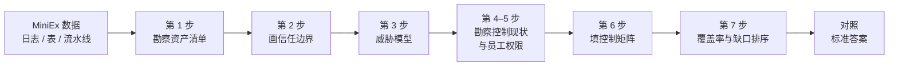
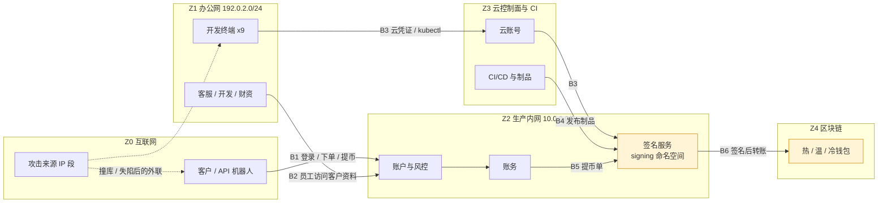

# B71 控制矩阵实战：给 MiniEx 建资产清单、威胁模型与控制矩阵

> 学习目标：做完本章，你能——
> 1. 用日志与 SQL 从 MiniEx 的数据里"勘察"出资产清单，并按"丢了会怎样"给每项资产定级。
> 2. 画出 MiniEx 的信任边界，写出每个 L1 资产的威胁，并把威胁落到控制矩阵里。
> 3. 用脚本算出 10 个保护域的覆盖率与缺口排序，并在勘察里找出全部 3 条员工权限治理发现（G1–G3）。
>
> 前置知识：读过 [B70 链下 L3 导读](B70-offchain-l3-guide.md)，读过 [X01 安全体系怎么搭](../architecture/X01-security-program-controls.md) 与 [X07 交易所安全架构总览](../architecture/X07-cex-architecture-overview.md) 更好；会运行 `python3` 和写简单 SQL。不需要 Foundry。
> 预计用时：约 2–2.5 小时。
> 交互实验：[控制矩阵覆盖率](../interactive/control-matrix-lab.html)
> 关联章节：[X01 安全体系怎么搭](../architecture/X01-security-program-controls.md)｜[X02 标准与合规映射](../architecture/X02-standards-compliance-map.md)｜[X07 交易所安全架构总览](../architecture/X07-cex-architecture-overview.md)｜[T08 控制矩阵与风险登记表](../templates/T08-control-matrix-risk-register.md)｜[靶场 API](../../code/offchain-ops/API.md)
> 最后核对：2026-11-23（python3、MiniEx 靶场默认种子 20260301 在本机运行过；下文命令输出来自真实运行）

> ⚠️ 警告：法律与道德边界。MiniEx 是虚构的交易所。所有数据由脚本合成，不含真实用户、真实地址或真实密钥。本章只在你自己的机器上读这些数据。不要用本章的方法去"勘察"不属于你的真实系统。真实机构的资产清单与控制验证，只在你所在组织的授权范围内进行。

---

## 开场：一份"都做了"的矩阵

MiniEx 的安全负责人刚到岗。老板说："给我一张控制矩阵，下周董事会要看。"

前任留下一份表：80 条控制，状态栏全是"已实施"。负责人抽了 3 条去验证。第一条是"离职员工特权自动回收"。他去查员工表，发现离职员工的权限还在，而且离职后有访问记录。

这张表的问题不在条数。问题是每一行都没有证据。本章要做的事是倒过来：先从数据里看清有什么，再写矩阵，每一行都带证据。

## 1. 本章怎么练

原理不在这里重讲。资产分级、信任边界、控制矩阵的方法见 [X01 §2、§4](../architecture/X01-security-program-controls.md)；MiniEx 对应的九个系统分区与六个保护域见 [X07 §2、§5](../architecture/X07-cex-architecture-overview.md)。本章把这些方法在一份真实的合成数据上走一遍。



读图要点：
- 数据在最左边，结论在最右边。每一步的输出是下一步的输入：资产清单决定画哪些边界，边界和资产决定威胁，威胁加勘察结果决定矩阵的每一行。
- 第 4–5 步是"勘察"：只看数据，不凭印象。看不到证据的控制，按"未实施"填。
- 局限：MiniEx 只有 14 天的日志。日志里没有出现的控制（例如从未触发的暂停开关），数据无法证明它存在。本章把这类控制记为"未见证据"，真实评估要再加访谈和配置检查。

本章产出三份东西：

| 产出 | 文件 | 谁来检查 |
|---|---|---|
| 资产清单 | `b71-lab/assets.csv` | 过关标准 1 |
| 控制矩阵 | `b71-lab/my_matrix.csv` | `matrix_gap.py` |
| 覆盖率与缺口报告 | 终端输出 | 过关标准 3、4 |

> 🎯 打个比方：给一栋大楼做消防检查。先数有几层、哪里堆着易燃物（资产清单），再看哪些门通向外面、谁有钥匙（信任边界），再问"哪里会起火"（威胁），最后对着每个消防设施问"上次试过吗"（控制矩阵）。局限：大楼不会主动变形，交易所的系统和人每周都在变，所以矩阵要每季度复核一次。

## 2. 准备

所有命令从 `web3-security-101/` 目录出发。

1. 生成靶场数据（约 2 秒，只用 Python 标准库）：

```bash
bash code/offchain-ops/setup.sh --no-tests | tail -1
```

```text
靶场已就绪：数据在 code/offchain-ops/data/，答案在 code/offchain-ops/answers/（练习做完再看）
```

2. 新建练习目录，并设置一个路径变量。后面的命令都用 `$OPS`：

```bash
mkdir -p b71-lab
OPS=code/offchain-ops
python3 --version
```

```text
Python 3.12.3
```

3. 读一遍数据字典。你只需要知道表名和列名，不需要背：[靶场 API](../../code/offchain-ops/API.md) 的第 1 节。

## 3. 第 1 步：勘察资产清单

目标：不看任何架构图，只用数据说出"MiniEx 有什么"。每个 Q 编号是一次勘察，后面的矩阵会用 Q 编号当证据。

Q1：有哪些表，各有多少行？

```bash
python3 $OPS/lib/logread.py --tables
```

```text
accounts              2000
logins               15300
recoveries              36
account_events         229
api_keys                31
api_calls            31594
orders_trades        11802
marks                16132
ledger              104620
withdrawals           1307
chain_txs             2551
approvals             1297
staff                   66
support_access        4865
signing_requests      1302
cloud_audit           4586
k8s_audit             2235
ci_events             4822
endpoint_events       2540
```

读法：账户、提币、链上转账、签名请求、云审计、K8s 审计、CI 事件、员工，都有。这已经能画出五个区域：账户与交易、资金与签名、云与 K8s、CI/CD、人。

Q2：客户账户有多少，分哪几类？

```bash
python3 $OPS/lib/logread.py --sql "SELECT risk_tag, COUNT(*) n FROM accounts GROUP BY risk_tag ORDER BY n DESC"
```

```text
risk_tag      n   
------------  ----
normal        1818
new_user      80  
watch         51  
vip           30  
institution   15  
market_maker  6   
（6 行）
```

Q3：钱包有几层，每层有几个地址，资金怎么流动？

```bash
python3 $OPS/lib/logread.py --sql "SELECT from_tier t, COUNT(DISTINCT from_addr) n FROM chain_txs WHERE from_tier IN ('hot','warm','cold') GROUP BY 1"
python3 $OPS/lib/logread.py --sql "SELECT from_tier, to_tier, kind, COUNT(*) n, ROUND(SUM(amount_usd)) usd FROM chain_txs GROUP BY 1,2,3 ORDER BY n DESC"
```

```text
t     n
----  -
cold  2
hot   3
warm  3
from_tier  to_tier   kind        n     usd      
---------  --------  ----------  ----  ---------
external   deposit   deposit     1252  2951358.0
hot        external  withdrawal  1249  2741170.0
warm       hot       rebalance   45    8074000.0
cold       warm      rebalance   3     6098000.0
hot        warm      rebalance   2     300000.0 
（3 行）
（5 行）
```

读法：热钱包向外部转出 1249 笔，是用户提币。温到热有 45 笔调拨，冷到温有 3 笔。调拨金额远大于单笔提币，所以调拨路径的单笔风险更高。

Q4：API Key 有多少，哪些带提币权限？

```bash
python3 $OPS/lib/logread.py --sql "SELECT COUNT(*) keys, SUM(perms LIKE '%withdraw%') withdraw_keys, SUM(ip_allowlist IS NULL) no_allowlist FROM api_keys"
```

```text
keys  withdraw_keys  no_allowlist
----  -------------  ------------
31    3              20          
（1 行）
```

Q5：员工有多少，角色和特权怎么分布？

```bash
python3 $OPS/lib/logread.py --sql "SELECT role, COUNT(DISTINCT staff_id) people FROM staff GROUP BY role"
python3 $OPS/lib/logread.py --sql "SELECT privilege, COUNT(*) grants FROM staff GROUP BY privilege ORDER BY grants DESC"
```

```text
role        people
----------  ------
compliance  2     
developer   12    
finance     3     
security    3     
sre         5     
support     15    
treasury    3     
privilege         grants
----------------  ------
kyc_read          17    
profile_read      14    
repo_write        12    
prod_exec         6     
cloud_admin       6     
transfer_approve  3     
siem_admin        3     
ledger_read       3     
case_manage       2     
（7 行）
（9 行）
```

读法：`staff` 表每行是一个（员工，特权）。43 名员工共 66 条授予。`cloud_admin` 与 `prod_exec` 各 6 条，`transfer_approve` 3 条。这几类特权能直接触达 L1 资产。

Q6：云账号里有哪些身份，请求从哪里来？

```bash
python3 $OPS/lib/logread.py --sql "SELECT identity_type, COUNT(DISTINCT identity) ids, COUNT(*) n FROM cloud_audit GROUP BY 1"
python3 $OPS/lib/logread.py --sql "SELECT CASE WHEN source_ip LIKE '192.0.2.%' THEN 'office' WHEN source_ip LIKE '10.%' THEN 'internal' WHEN source_ip LIKE '198.18.%' THEN 'vpn_cloud' ELSE 'unknown' END zone, COUNT(*) n FROM cloud_audit GROUP BY 1 ORDER BY n DESC"
```

```text
identity_type  ids  n   
-------------  ---  ----
role           4    589 
user           14   3997
zone       n   
---------  ----
office     3989
internal   589 
unknown    6   
vpn_cloud  2   
（2 行）
（4 行）
```

读法：14 个员工身份加 4 个服务角色。来源按 IP 段分区：办公出口 `192.0.2.0/24`，服务内网 `10.0.0.0/8`，VPN 与云 `198.18.0.0/15`。有 6 条请求来自这三个段之外（`unknown`）。这是第 2 步画边界时要标出的"边界上的异常"，细节留给 [B73](B73-detection-engineering-practice.md)。

Q7：K8s 有哪些命名空间，谁在访问？

```bash
python3 $OPS/lib/logread.py --sql "SELECT namespace, COUNT(*) n, COUNT(DISTINCT user) users FROM k8s_audit GROUP BY 1 ORDER BY n DESC"
```

```text
namespace   n    users
----------  ---  -----
web         581  6    
indexer     542  6    
risk        528  7    
monitoring  325  5    
signing     259  5    
（5 行）
```

Q8：CI/CD 有哪些仓库和流水线？

```bash
python3 $OPS/lib/logread.py --sql "SELECT repo, workflow, COUNT(DISTINCT run_id) runs FROM ci_events GROUP BY 1,2"
```

```text
repo                   workflow     runs
---------------------  -----------  ----
miniex/docs            docs.yml     28  
miniex/exchange-web    ci.yml       148 
miniex/exchange-web    release.yml  3   
miniex/infra           ci.yml       171 
miniex/wallet-service  ci.yml       138 
miniex/wallet-service  release.yml  17  
（6 行）
```

Q9：开发终端有多少台，签名服务收到什么请求？

```bash
python3 $OPS/lib/logread.py --sql "SELECT COUNT(DISTINCT host) dev_hosts FROM endpoint_events"
python3 $OPS/lib/logread.py --sql "SELECT source, wallet_tier, COUNT(*) n FROM signing_requests GROUP BY 1,2"
```

```text
dev_hosts
---------
9        
source             wallet_tier  n   
-----------------  -----------  ----
hot-withdraw-svc   hot          1252
treasury-transfer  cold         3   
treasury-transfer  hot          2   
treasury-transfer  warm         45  
（1 行）
（4 行）
```

现在把勘察结果写成资产清单。分级用 [T08](../templates/T08-control-matrix-risk-register.md) 的口径：失效后可能在 24 小时内造成不可逆资金损失，或大规模数据泄露，是 L1；会让攻击者更容易拿到 L1 入口，或造成业务中断，是 L2；其他是 L3。

```bash
cat > b71-lab/assets.csv <<'EOF'
asset_id,asset,level,worst_case,owner,location,evidence
A-01,热钱包（3 个地址）,L1,签名被滥用后资金在 24 小时内转出,财资,chain_txs,Q3
A-02,温钱包（3 个地址）,L1,调拨路径被篡改后大额资金转到陌生地址,财资,chain_txs,Q3
A-03,冷钱包（2 个地址）,L1,多签被误导后大额资金不可逆流出,财资,chain_txs,Q3
A-04,签名服务（signing 命名空间；1302 个签名请求）,L1,伪造请求被签名后资金流出,钱包安全,signing_requests / k8s_audit,Q7 Q9
A-05,内部账本（52310 笔双分录）,L1,账务被改写后账实不符,账务,ledger,Q1
A-06,客户账户（2000 个）,L1,账户接管后资金被提走,账户安全,accounts / logins,Q2
A-07,API Key（31 个，3 个带提币权限）,L1,Key 被滥用后从新 IP 提币,账户安全,api_keys / api_calls,Q4
A-08,客户 KYC 与资料,L1,批量查看或导出后大规模泄露,合规,support_access,Q1
A-09,员工特权（43 人 66 条授予）,L2,特权被滥用或遗留后成为 L1 入口,安全,staff,Q5
A-10,云账号（14 个员工身份 4 个服务角色）,L2,云凭证外泄后读到签名配置,平台,cloud_audit,Q6
A-11,K8s 集群（5 个命名空间）,L2,进入签名命名空间后读密钥或执行命令,平台,k8s_audit,Q7
A-12,CI/CD 流水线（3 个仓库 6 条流水线）,L2,被篡改的依赖或制品被发布,发布,ci_events / workflows,Q8
A-13,开发终端（9 台）,L2,终端失陷后成为云与签名的跳板,平台,endpoint_events,Q9
A-14,审计日志（云 K8s CI 终端）,L2,日志缺失或被删后无法取证,安全运营,cloud_audit 等,Q1
A-15,提币审批与风控流程,L2,审批被绕过后异常提币放行,风控,approvals / withdrawals,Q1
EOF
python3 -c "
import csv
rows = list(csv.DictReader(open('b71-lab/assets.csv', encoding='utf-8')))
from collections import Counter
print('资产', len(rows), '项；', dict(sorted(Counter(r['level'] for r in rows).items())))"
```

```text
资产 15 项； {'L1': 8, 'L2': 7}
```

<details class="predict"><summary>🤔 先猜再看：开发终端只有 9 台，出事概率很低，为什么定为 L2 而不是 L3？</summary>

分级看"最坏影响"，不看"出事概率"。开发终端能触达云凭证，云凭证能读到签名配置，签名服务能转出资金。它本身不存资金，但它是通向 L1 的跳板，所以是 L2。[X01 §2.1](../architecture/X01-security-program-controls.md) 把这条规则写成一句话：等级按它能触达的最高资产来定。第 5 步之后你会看到，靶场里确有一条"终端 → 云凭证 → 签名命名空间"的痕迹。

</details>

## 4. 第 2 步：画信任边界

信任边界（Trust Boundary）：两侧的信任程度不同的分界线。数据穿过边界时，要重新校验身份和内容。

用第 1 步的勘察结果，把 MiniEx 画成区域和边界：



读图要点：
- 实线是业务与指令方向，虚线是攻击者的入口。金色节点是最后两关：签名服务和钱包。
- 前面所有区域被攻破，B5 与 B6 这两道边界仍要独立判断。它们由账务单、审批单和签名服务的校验守住。
- 开发终端在办公网，但它有一条路通向云控制面（B3）。这就是 X07 里"办公与研发有虚线通向生产"的具体样子。
- 局限：图只画资金安全相关的部分。真实系统还有第三方 KYC 服务、支付渠道和监控系统。

每条边界，写出"穿过它的数据、能穿过的人、数据里哪里看得见"：

| 边界 | 穿过的数据 | 能穿过的人或系统 | 数据里哪里看得见 |
|---|---|---|---|
| B1 互联网 → 账户 | 登录、下单、提币申请 | 客户、API Key | `logins`、`api_calls` |
| B2 办公网 → 客户资料 | 客户 KYC 与资料 | 客服（15 人，3 人夜班）、合规 | `support_access` |
| B3 办公网 → 云 → 生产 | 云凭证、`kubectl exec` | 开发、SRE | `cloud_audit`、`k8s_audit` |
| B4 CI → 生产 | 制品、依赖 | CI 机器人 | `ci_events` |
| B5 账务 → 签名服务 | 带审批单的提币请求 | 提币服务、财资调拨 | `signing_requests`、`approvals` |
| B6 签名服务 → 链 | 已签名的转账 | 热 / 温 / 冷钱包 | `chain_txs` |

## 5. 第 3 步：威胁模型

威胁模型（Threat Model）：对每个重要资产回答"谁、从哪个入口、能做什么、会怎样"。方法是对每个 L1 资产问 STRIDE 六问加 [X01 §2.2](../architecture/X01-security-program-controls.md) 的三类增补，见 [T02 威胁建模模板](../templates/T02-threat-model.md)。

下表给出 MiniEx 的 10 条威胁。它们只写"事件会是什么样"，不写攻击步骤。"场景"列是靶场里对应的注入场景，B72 起的练习章会用它们。

| 威胁 | 资产 | 入口边界 | 靶场场景 | 要落到的控制（矩阵行） |
|---|---|---|---|---|
| T1 账户被接管后向新地址提币 | A-06 客户账户 | B1 | S1 | C-01 C-02 C-04 |
| T2 API Key 被加提币权限后从新 IP 调用 | A-07 API Key | B1 | S2 | C-05 |
| T3 多个账户小额入金后汇聚、快速提走 | A-15 提币与风控 | B1 | S3 | C-03 |
| T4 同一实体多账户对敲，或标记价被拉偏 | A-05 账本 | B1 | S4 | C-07 |
| T5 内部人批量查看或导出 KYC | A-08 客户资料 | B2 | S5 | C-21 C-22 |
| T6 签名服务收到没有审批单或被换了地址的请求 | A-04 签名服务 | B5 | S6 | C-09 C-10 |
| T7 终端失陷，云凭证被外部读取，进入签名命名空间 | A-13 A-10 A-11 | B3 | S7 | C-11 C-13 C-14 |
| T8 被篡改的依赖、未固定的 Action、未签名的制品被发布 | A-12 流水线 | B4 | S8 | C-16 C-17 C-18 |
| T9 离职或过期的特权仍然有效 | A-09 员工特权 | B2 B3 | 治理 G1 G2 | C-13 C-23 |
| T10 高危特权没有审批记录 | A-09 员工特权 | B3 | 治理 G3 | C-24 C-25 |

<details class="predict"><summary>🤔 先猜再看：T1 要三条控制（MFA、撞库告警、新地址冷却），为什么不是一条？</summary>

一条控制只对应一个失效点。MFA 是预防，防止登录被接管。撞库告警是检测，登录被接管时有人知道。新地址冷却是阻断扩散，即使账户已被接管，资金也不会立刻离开。[X01 §3.2](../architecture/X01-security-program-controls.md) 的纵深防御假设每一层都会失效，所以同一条威胁要有不同类型的控制。

</details>

## 6. 第 4 步：勘察控制现状

对每条威胁，问："数据里有没有这条控制在运行的证据？"每个 Q 的结果，决定矩阵里对应行的状态。

**账户与提币**

Q10：有多少账户在成功登录时没有使用任何 MFA？

```bash
python3 $OPS/lib/logread.py --sql "SELECT COUNT(DISTINCT account_id) no_mfa_accounts FROM logins WHERE result='success' AND mfa_method='none'"
```

```text
no_mfa_accounts
---------------
213            
（1 行）
```

Q11：提币审批是否符合"2 万美元及以上由 2 人复核"？

```bash
python3 $OPS/lib/logread.py --sql "SELECT CASE WHEN w.amount_usd>=20000 THEN '>=20000' ELSE '<20000' END band, a.approved_by='risk-engine' auto, MIN(a.approver_count) min_approvers, COUNT(*) n FROM approvals a JOIN withdrawals w ON a.subject_id=w.wd_id WHERE a.type='withdrawal' GROUP BY 1,2"
python3 $OPS/lib/logread.py --sql "SELECT a.approval_id, a.approved_by, a.approver_count, w.amount_usd FROM approvals a JOIN withdrawals w ON a.subject_id=w.wd_id WHERE w.amount_usd>=20000 AND a.approver_count<2"
```

```text
band     auto  min_approvers  n   
-------  ----  -------------  ----
<20000   0     2              9   
<20000   1     1              1223
>=20000  0     1              15  
approval_id  approved_by  approver_count  amount_usd
-----------  -----------  --------------  ----------
AP-W000889   ST033        1               25000.0   
（3 行）
（1 行）
```

读法：大额提币基本都走人工审批，控制在运行。但有 1 笔 25,000 美元的提币只有 1 个审批人。这条控制是"部分实施"。这笔提币属于 S1-03，它的处置留给 [B72](B72-withdrawal-risk-rules-practice.md) 与 [B76](B76-tabletop-postmortem-practice.md)。

Q12：24 小时内用新地址提币 ≥ 1000 美元的有几笔？

```bash
python3 $OPS/lib/logread.py --sql "SELECT COUNT(*) fast_new_addr_withdrawals FROM withdrawals WHERE amount_usd>=1000 AND (julianday(ts)-julianday(addr_added_ts))*24<24"
```

```text
fast_new_addr_withdrawals
-------------------------
11                       
（1 行）
```

读法：如果"新地址冷却 24 小时"在运行，这个数应该是 0。它是 11，所以这条控制没有生效。

Q13：带提币权限的 API Key，有没有未绑定 IP 白名单的？

```bash
python3 $OPS/lib/logread.py --sql "SELECT key_id, perms, ip_allowlist FROM api_keys WHERE perms LIKE '%withdraw%'"
```

```text
key_id  perms                ip_allowlist  
------  -------------------  --------------
K0023   read,trade,withdraw  198.18.183.105
K0019   read,trade,withdraw  198.18.190.218
K9001   read,trade,withdraw  None          
（3 行）
```

**账务、钱包与签名**

Q14：账务双分录是否借贷平衡？

```bash
python3 $OPS/lib/logread.py --sql "SELECT COUNT(*) unbalanced FROM (SELECT txn_id, asset, SUM(CASE direction WHEN 'debit' THEN amount ELSE -amount END) d FROM ledger GROUP BY 1,2 HAVING ABS(d)>0.000001)"
```

```text
unbalanced
----------
0         
（1 行）
```

Q15：有没有链上出金找不到对应的提币申请？

```bash
python3 $OPS/lib/logread.py --sql "SELECT COUNT(*) withdrawals_on_chain, SUM(wd_id IS NULL) without_request FROM chain_txs WHERE kind='withdrawal'"
```

```text
withdrawals_on_chain  without_request
--------------------  ---------------
1249                  2              
（1 行）
```

Q16：有没有签名请求没有审批单？

```bash
python3 $OPS/lib/logread.py --sql "SELECT COUNT(*) requests, SUM(approval_id IS NULL) without_approval FROM signing_requests"
```

```text
requests  without_approval
--------  ----------------
1302      1               
（1 行）
```

Q17：进入签名命名空间执行命令（exec）的，是否都有变更单？

```bash
python3 $OPS/lib/logread.py --sql "SELECT COUNT(*) execs, SUM(json_extract(annotations,'$.change_id') IS NOT NULL) with_change_id FROM k8s_audit WHERE namespace='signing' AND subresource='exec'"
```

```text
execs  with_change_id
-----  --------------
7      6             
（1 行）
```

**发布**

Q18：CI 里的第三方 Action，有多少固定到了 40 位提交哈希？

```bash
python3 $OPS/lib/logread.py --sql "SELECT COUNT(*) action_uses, SUM(length(json_extract(detail,'$.ref'))=40) pinned FROM ci_events WHERE event_type='action_use'"
```

```text
action_uses  pinned
-----------  ------
989          932   
（1 行）
```

Q19：release 通道的发布，有多少有签名事件？

```bash
python3 $OPS/lib/logread.py --sql "SELECT (SELECT COUNT(*) FROM ci_events WHERE event_type='publish' AND json_extract(detail,'$.channel')='release') release_publishes, (SELECT COUNT(*) FROM ci_events WHERE event_type='artifact_sign') sign_events"
```

```text
release_publishes  sign_events
-----------------  -----------
6                  5          
（1 行）
```

Q20：有没有依赖安装的哈希与 lockfile 不一致？

```bash
python3 $OPS/lib/logread.py --sql "SELECT COUNT(*) mismatched FROM ci_events WHERE event_type='dependency_install' AND json_extract(detail,'$.integrity') != json_extract(detail,'$.lock_integrity')"
```

```text
mismatched
----------
1         
（1 行）
```

**数据**

Q21：客户资料访问里，没有工单的占多少？

```bash
python3 $OPS/lib/logread.py --sql "SELECT COUNT(*) accesses, ROUND(SUM(ticket_id IS NULL)*100.0/COUNT(*),1) pct_no_ticket FROM support_access"
```

```text
accesses  pct_no_ticket
--------  -------------
4865      5.4          
（1 行）
```

## 7. 第 5 步：勘察员工权限

这一步是本章的核心勘察。前面的控制问的是"规则有没有跑"，这一步问的是"人和权限是否对得上"。有三类问题值得每次都查：已离职的人、已过期的特权、没有审批人的特权。

先写下你的预测：66 条授予里，这三类各有几条？然后运行。

Q22：已离职的员工，还有哪些特权，离职后有没有使用？

```bash
python3 $OPS/lib/logread.py --sql "SELECT s.staff_id, s.left_date, s.privilege, s.expires_ts, a.ts, a.action FROM staff s JOIN support_access a ON a.staff_id=s.staff_id WHERE s.employed='no' AND a.ts > s.left_date"
```

```text
staff_id  left_date   privilege  expires_ts            ts                    action  
--------  ----------  ---------  --------------------  --------------------  --------
ST015     2026-01-20  kyc_read   2026-12-31T00:00:00Z  2026-03-07T15:00:00Z  view_kyc
（1 行）
```

Q23：特权已过期，之后还有 exec 记录的是谁？

```bash
python3 $OPS/lib/logread.py --sql "SELECT s.staff_id, s.privilege, s.expires_ts, k.ts, k.namespace, k.response_code FROM staff s JOIN k8s_audit k ON k.user=s.staff_id WHERE s.privilege='prod_exec' AND k.subresource='exec' AND k.ts > s.expires_ts"
```

```text
staff_id  privilege  expires_ts            ts                    namespace  response_code
--------  ---------  --------------------  --------------------  ---------  -------------
ST050     prod_exec  2026-02-15T00:00:00Z  2026-03-07T10:00:00Z  risk       101          
（1 行）
```

响应码 101 表示连接升级成功，也就是 exec 真的执行了。

Q24：哪些特权没有审批人？

```bash
python3 $OPS/lib/logread.py --sql "SELECT staff_id, role, privilege, granted_ts FROM staff WHERE approver_id IS NULL"
```

```text
staff_id  role       privilege    granted_ts          
--------  ---------  -----------  --------------------
ST051     developer  cloud_admin  2025-09-03T00:00:00Z
（1 行）
```

三个查询各返回 1 行。把它们翻译成控制语言，就是矩阵里的三行：

| 发现 | 一句话 | 缺的控制 |
|---|---|---|
| Q22 | ST015 已离职，`kyc_read` 仍有效，离职后有 1 次 `view_kyc` | 离职联动回收（C-23） |
| Q23 | ST050 的 `prod_exec` 已过期，仍在 risk 命名空间 exec 成功 | 到期在网关侧失效（C-13） |
| Q24 | ST051 的 `cloud_admin` 没有审批人 | 授予必须有审批人（C-24） |

> 💡 注意：Q23 的要点是"目录里的字段"和"网关实际放行"是两回事。员工表里的过期日期只是一个字段。只有 K8s 网关在到期后真的拒绝，控制才算生效。

## 8. 第 6 步：填控制矩阵

模板在 `data/controls_matrix_template.csv`，每个保护域一行，只有域名和关联章节：

```bash
cat $OPS/data/controls_matrix_template.csv
```

```text
domain,related_chapters,control_id,control,priority,verification_method,owner,status,evidence_ref
身份与账户,X08,,,,,,,
提币与风控,X08/X10/X13,,,,,,,
交易与清算,X10,,,,,,,
钱包与资金,X11,,,,,,,
签名服务,X11,,,,,,,
云与生产环境,X03,,,,,,,
开发与发布,X04,,,,,,,
检测与响应,X05,,,,,,,
数据与合规,X12/X13,,,,,,,
内部人与权限,X01/X08,,,,,,,
```

要填的列：

| 列 | 写什么 |
|---|---|
| `control_id` | C-01 起编号 |
| `control` | 以 `[类型]` 开头，类型取预防 / 检测 / 阻断扩散 / 恢复 / 证据保全 / 治理。一条控制写一件事 |
| `priority` | P0 / P1 / P2，判据见 [T08](../templates/T08-control-matrix-risk-register.md)：失效后 L1 资产可能在 24 小时内遭受不可逆损失，是 P0 |
| `verification_method` | 一个能做、有结果的动作。"已配置"不是验证方法 |
| `owner` | 本章用角色代替姓名（MiniEx 是虚构的）。真实矩阵必须写具体姓名 |
| `status` | `implemented` / `partial` / `missing` |
| `evidence_ref` | 第 4–5 步的 Q 编号。尚未建立的控制，写将要建立它的章号 |

下面是一份按勘察结果填好的矩阵：10 个域，25 条控制。你可以对着 Q 编号自己填，也可以先照抄再逐行核对。每行的状态是怎么来的，见表后的说明。

```bash
cat > b71-lab/my_matrix.csv <<'EOF'
domain,related_chapters,control_id,control,priority,verification_method,owner,status,evidence_ref
身份与账户,X08,C-01,[预防] 提币、改绑与加地址要求 MFA,P0,统计成功登录里没有 MFA 的账户数，目标 0,账户安全,partial,Q10
身份与账户,X08,C-02,[检测] 撞库与低慢撞库告警,P1,用 replay.py 回放 S1，召回 3/3,风控,missing,B72
提币与风控,X08/X10/X13,C-03,[预防] 提币审批：2 万美元及以上 2 人复核，其余由风控自动审批,P0,统计 2 万美元及以上且审批人数不足 2 的提币笔数，目标 0 笔,风控,partial,Q11
提币与风控,X08/X10/X13,C-04,[预防] 新提币地址 24 小时冷却,P0,统计 24 小时内用新地址提币 ≥ 1000 美元的笔数，目标 0,风控,missing,Q12
提币与风控,X08/X10/X13,C-05,[预防] 带提币权限的 API Key 必须绑定 IP 白名单,P0,查 api_keys，无白名单的提币 Key 目标 0 个,账户安全,partial,Q13
交易与清算,X10,C-06,[预防] 账务双分录借贷平衡自检,P0,按 txn_id 与 asset 汇总借贷差，目标 0 组不平,账务,implemented,Q14
交易与清算,X10,C-07,[检测] 对敲与标记价偏离监测,P1,用 replay.py 回放 S4，召回 3/3,市场监察,missing,B72
钱包与资金,X11,C-08,[预防] 冷温热分层与调拨审批,P0,查 chain_txs 的调拨笔数与 approvals 的审批单是否一一对应,财资,partial,Q3
钱包与资金,X11,C-09,[检测] 链上出金与提币申请逐笔对账,P0,统计无提币申请的链上出金，目标 0 笔,财资,missing,Q15
签名服务,X11,C-10,[预防] 签名请求必须带审批单并独立校验地址与金额,P0,统计无审批单的签名请求，目标 0 条,钱包安全,partial,Q16
签名服务,X11,C-11,[预防] 签名命名空间 exec 必须有变更单,P0,统计 exec 事件中缺 change_id 的条数，目标 0 条,平台,partial,Q17
签名服务,X11,C-12,[恢复] 签名服务暂停开关与应急 runbook,P1,桌面推演中在目标时间内完成暂停,安全运营,missing,B76
云与生产环境,X03,C-13,[预防] 特权到期在 K8s 网关侧失效而不只是目录字段,P0,统计特权到期之后仍 exec 成功的记录，目标 0 条,平台,missing,Q23
云与生产环境,X03,C-14,[检测] 云凭证被外部来源使用时告警,P1,用 replay.py 回放 S7，召回 2/2,安全运营,missing,B73
云与生产环境,X03,C-15,[证据保全] 云与 K8s 审计日志集中保存,P1,两周内两张审计表都有每日事件,平台,implemented,Q1
开发与发布,X04,C-16,[预防] CI 第三方 Action 固定到提交哈希,P1,统计 action_use 中固定到 40 位哈希的比例，目标 100%,发布,partial,Q18
开发与发布,X04,C-17,[预防] release 通道制品必须签名,P0,对比 release 通道发布数与签名事件数，目标相等,发布,partial,Q19
开发与发布,X04,C-18,[预防] 依赖安装校验 lockfile 哈希,P1,统计 integrity 与 lock_integrity 不符的安装，目标 0 次,发布,partial,Q20
检测与响应,X05,C-19,[检测] 日志告警规则并有回放验证,P0,每条规则在 replay.py 回放中召回目标场景,安全运营,missing,B73
检测与响应,X05,C-20,[恢复] 事故 runbook、值班与桌面推演,P1,每季度一次推演并留评分表,安全运营,missing,B76
数据与合规,X12/X13,C-21,[预防] KYC 访问必须有工单,P0,统计无工单的 support_access 占比，目标 0%,合规,partial,Q21
数据与合规,X12/X13,C-22,[检测] KYC 批量查看与导出告警,P0,用 replay.py 回放 S5，召回 2/2,安全运营,missing,B73
内部人与权限,X01/X08,C-23,[预防] 离职联动回收全部特权,P0,统计已离职员工仍有效的特权数，目标 0 个,人力与平台,missing,Q22
内部人与权限,X01/X08,C-24,[预防] 特权授予必须有审批人,P0,统计 approver_id 为空的特权数，目标 0 个,平台,partial,Q24
内部人与权限,X01/X08,C-25,[治理] 每季度特权复核,P1,复核记录覆盖离职、到期与无审批三类,安全,missing,Q22-Q24
EOF
wc -l b71-lab/my_matrix.csv
```

```text
      26 b71-lab/my_matrix.csv
```

状态的判定规则（本章约定）：

- `implemented`：证据显示控制在运行，且验证结果达到目标。例如 Q14 的不平衡组数是 0。
- `partial`：控制在运行，但验证发现例外。例如 Q11 有 1 笔大额提币只有 1 个审批人。
- `missing`：验证发现控制没有生效（Q12、Q15、Q23），或数据里完全没有它的证据（回放验证、桌面推演）。按 T08 的规则，没有证据按未通过处理。

## 9. 第 7 步：覆盖率与缺口排序

`matrix_gap.py` 读你的矩阵，按保护域计算两个数：

- 覆盖率 = 各行"权重 × 得分"之和 ÷ 各行权重之和。权重：P0 为 3，P1 为 2，P2 为 1。得分：`implemented` 为 1，`partial` 为 0.5，`missing` 为 0。
- 缺口分 = 各行"权重 × (1 − 得分)"之和。它表示"还差多少没做"。

缺口排序按缺口分从大到小。缺口分相同时，覆盖率低的在前。脚本的完整说明在文件头部的注释里：[matrix_gap.py](../../code/offchain-ops/solutions/b71/matrix_gap.py)。

```bash
python3 code/offchain-ops/solutions/b71/matrix_gap.py b71-lab/my_matrix.csv
```

```text
矩阵：b71-lab/my_matrix.csv   控制 25 条（P0 16，P1 9，P2 0）
口径：权重 P0=3 P1=2 P2=1；implemented=1 partial=0.5 missing=0；无证据的 implemented/partial 降级为 missing

保护域         控制数      覆盖率     缺口分   有效预防  有效检测  有效恢复
身份与账户         2    30.0%     3.5      是        否        否
提币与风控         3    33.3%     6.0      是        否        否
交易与清算         2    60.0%     2.0      是        否        否
钱包与资金         2    25.0%     4.5      是        否        否
签名服务           3    37.5%     5.0      是        否        否
云与生产环境       3    28.6%     5.0      否        否        否
开发与发布         3    50.0%     3.5      是        否        否
检测与响应         2     0.0%     5.0      否        否        否
数据与合规         2    25.0%     4.5      是        否        否
内部人与权限       3    18.8%     6.5      是        否        否
合计              25    31.1%    45.5

缺口排序（按缺口分从大到小，前 5 个）：
  1. 内部人与权限   缺口分 6.5，覆盖率 18.8%
  2. 提币与风控   缺口分 6.0，覆盖率 33.3%
  3. 检测与响应   缺口分 5.0，覆盖率 0.0%
  4. 云与生产环境   缺口分 5.0，覆盖率 28.6%
  5. 签名服务   缺口分 5.0，覆盖率 37.5%

未完全实施的 P0 控制（15 条）：
  C-01  partial  身份与账户 | [预防] 提币、改绑与加地址要求 MFA
  C-03  partial  提币与风控 | [预防] 提币审批：2 万美元及以上 2 人复核，其余由风控自动审批
  C-04  missing  提币与风控 | [预防] 新提币地址 24 小时冷却
  C-05  partial  提币与风控 | [预防] 带提币权限的 API Key 必须绑定 IP 白名单
  C-08  partial  钱包与资金 | [预防] 冷温热分层与调拨审批
  C-09  missing  钱包与资金 | [检测] 链上出金与提币申请逐笔对账
  C-10  partial  签名服务 | [预防] 签名请求必须带审批单并独立校验地址与金额
  C-11  partial  签名服务 | [预防] 签名命名空间 exec 必须有变更单
  C-13  missing  云与生产环境 | [预防] 特权到期在 K8s 网关侧失效而不只是目录字段
  C-17  partial  开发与发布 | [预防] release 通道制品必须签名
  C-19  missing  检测与响应 | [检测] 日志告警规则并有回放验证
  C-21  partial  数据与合规 | [预防] KYC 访问必须有工单
  C-22  missing  数据与合规 | [检测] KYC 批量查看与导出告警
  C-23  missing  内部人与权限 | [预防] 离职联动回收全部特权
  C-24  partial  内部人与权限 | [预防] 特权授予必须有审批人
```

读法：

- 合计覆盖率 31.1%，缺口分 45.5。这是 MiniEx 当前的基线，不是"得分"。
- 缺口排名第 1 的是"内部人与权限"。它有 3 行 P0 / P1 控制，其中 2 行 `missing`、1 行 `partial`，对应第 5 步的 G1–G3。
- "检测与响应"覆盖率是 0%，但缺口分只排第 3，排在"提币与风控"之后。原因是它只有 2 条控制，总权重小。覆盖率告诉你"这个域有多空"，缺口分告诉你"补它能得到多少"。两个数要一起看。
- 表中"有效检测"列全部是"否"。MiniEx 在 14 天里没有任何一条检测规则被验证过。这要靠 B72 到 B73 补上。

做三个实验，确认你理解了口径：

1. 去掉一行的证据。把 C-06 的 `evidence_ref` 清空，复制成新文件后重新计算：

```bash
sed 's/,implemented,Q14$/,implemented,/' b71-lab/my_matrix.csv > b71-lab/no_evidence.csv
python3 code/offchain-ops/solutions/b71/matrix_gap.py b71-lab/no_evidence.csv | grep -E "^交易与清算|^因缺少"
```

```text
交易与清算         2     0.0%     5.0      否        否        否
因缺少 evidence_ref 被降级为 missing： 交易与清算: C-06
```

"交易与清算"的覆盖率从 60.0% 降到 0.0%，脚本报告 C-06 因缺少证据被降级。这就是"没有证据按未通过处理"。

2. 设一个门槛。要求每个域覆盖率不低于 50%，看脚本如何失败：

```bash
python3 code/offchain-ops/solutions/b71/matrix_gap.py b71-lab/my_matrix.csv --min-domain-coverage 0.5 | tail -2
python3 code/offchain-ops/solutions/b71/matrix_gap.py b71-lab/my_matrix.csv --min-domain-coverage 0.5 > /dev/null; echo "退出码 $?"
```

```text

覆盖率低于 50% 的域：身份与账户、提币与风控、钱包与资金、签名服务、云与生产环境、检测与响应、数据与合规、内部人与权限
退出码 1
```

3. 把两条 `missing` 改成 `implemented`，预测排名第 1 的域会变成哪个，再运行：

```bash
sed -e 's/,missing,Q22$/,implemented,Q22/' -e 's/,missing,Q23$/,implemented,Q23/' b71-lab/my_matrix.csv > b71-lab/what_if.csv
python3 code/offchain-ops/solutions/b71/matrix_gap.py b71-lab/what_if.csv --top 3 | grep -A3 "缺口排序"
```

```text
缺口排序（按缺口分从大到小，前 3 个）：
  1. 提币与风控   缺口分 6.0，覆盖率 33.3%
  2. 检测与响应   缺口分 5.0，覆盖率 0.0%
  3. 签名服务   缺口分 5.0，覆盖率 37.5%
```

这个实验也提醒你：把状态改成 `implemented` 很容易，但 `evidence_ref` 里的 Q22 和 Q23 仍然显示问题存在。矩阵的数字来自证据，不来自意愿。

## 10. 和标准答案对照

做完上面所有步骤后，再看标准答案。

**对照 1：员工权限治理发现（G1–G3）**

标准答案在 `answers/governance.json`。参考脚本 `staff_audit.py` 用另一种写法（Python 加 SQL）查同样的三类问题，并自动与标准答案比较：

```bash
python3 code/offchain-ops/solutions/b71/staff_audit.py
```

```text
查询结果与 answers/governance.json 对照：
  G1  查出 ['ST015']  标准答案 ['ST015']  一致
       {'staff_id': 'ST015', 'left_date': '2026-01-20', 'privilege': 'kyc_read', 'expires_ts': '2026-12-31T00:00:00Z', 'ts': '2026-03-07T15:00:00Z', 'action': 'view_kyc', 'target_account_id': 'A01139'}
  G2  查出 ['ST050']  标准答案 ['ST050']  一致
       {'staff_id': 'ST050', 'privilege': 'prod_exec', 'expires_ts': '2026-02-15T00:00:00Z', 'ts': '2026-03-07T10:00:00Z', 'namespace': 'risk', 'response_code': 101}
  G3  查出 ['ST051']  标准答案 ['ST051']  一致
       {'staff_id': 'ST051', 'privilege': 'cloud_admin', 'granted_ts': '2025-09-03T00:00:00Z'}
结论：3 条治理发现全部找到，没有多余
```

你的 Q22–Q24 应该查出同样的三个员工：ST015、ST050、ST051。如果你多查出了别人，或少了一个，检查 SQL 的时间条件和 `employed`、`approver_id` 的取值。

**对照 2：参考矩阵**

```bash
diff b71-lab/my_matrix.csv code/offchain-ops/solutions/b71/matrix.reference.csv && echo "与参考矩阵逐字相同"
```

```text
与参考矩阵逐字相同
```

如果你自己填了矩阵，`diff` 会显示差异。差异不一定是错：措辞、拆分粒度、优先级都可以不同。判据是三条：10 个域各至少有 1 行；每行有证据；3 条治理发现都落到了某一行的 `missing` 或 `partial` 状态。

**对照 3：本章勘察到的问题，与它们留给后续章节的练习**

| 勘察结果 | 矩阵行 | 靶场场景 | 在哪一章验证 |
|---|---|---|---|
| Q10：213 个账户成功登录时没有 MFA | C-01 | S1 | B72 |
| Q11：1 笔 25,000 美元提币只有 1 个审批人 | C-03 | S1-03 | B72、B76 |
| Q12：11 笔提币在新地址 24 小时内发生 | C-04 | S1 | B72 |
| Q13：1 个带提币权限的 Key 没有白名单 | C-05 | S2-02 | B72 |
| Q15、Q16：2 笔无申请链上出金，1 个无审批单的签名请求 | C-09、C-10 | S6 | B73、B74 |
| Q17：7 次 signing exec，1 次没有变更单 | C-11 | S7-01 | B73、B76 |
| Q19、Q20、Q18：release 少 1 个签名、1 次哈希不符、57 次 Action 未固定 | C-16–C-18 | S8 | B75 |
| Q21：5.4% 的客户资料访问没有工单 | C-21 | S5 | B73 |
| Q22–Q24：G1–G3 | C-23、C-13、C-24 | 治理 | 本章 |

> 💡 注意：S1–S8 的标准答案要到后续章节才会用到。本章只要求你在勘察里"看见"这些痕迹，不要求写检测规则。治理发现 G1–G3 是本章唯一要求"全部找出"的标准答案。

## 11. 检查清单

本章使用 ARC 前缀。右列给出主线章节和模板中的对应编号，便于把结论写进同一份报告：

| 检查项 | 内容 | 本章练习 | 对应 | 结论 | 证据 |
|---|---|---|---|---|---|
| **ARC-1** | 资产清单覆盖密钥、资金、用户数据、代码、基础设施，每项有分级和负责人 | 第 1 步 | X01 §2.1、T08 §1 | | |
| **ARC-2** | 信任边界图标出每条边界穿过的数据和人 | 第 2 步 | X01 §2.3、X07 §2.3 | | |
| **ARC-3** | 每个 L1 资产有威胁，每条威胁有对应的控制行 | 第 3 步 | X01 §4.1、T02 | | |
| **ARC-4** | 矩阵每行有类型、优先级、负责人、验证方法、证据 | 第 6 步 | X01 §4.2、T08 §2 | | |
| **ARC-5** | 每个域至少有一条预防和一条检测控制（有效或计划） | 第 7 步 | T08 §2.1 | | |
| **ARC-6** | 员工权限复核覆盖离职、到期、无审批三类 | 第 5 步 | X01 §4.4、X08 | | |

定级用 [A02](../assessment/A02-risk-rating-reporting.md) 复核。发现按 [T03](../templates/T03-finding-report.md) 记录。

> 🪞 反思：想一想你所在组织的一份"控制清单"。
> 1. 它的每一行，你能说出"上一次谁、用什么动作验证过"吗？

## 12. 如果出错

| 现象 | 原因 | 处理 |
|---|---|---|
| `logread.py` 报找不到表或文件 | 数据没有生成，或不在 `web3-security-101/` 目录下运行 | 回到根目录，运行 `bash code/offchain-ops/setup.sh --no-tests` |
| `$OPS` 为空，路径变成 `/lib/logread.py` | 换了终端窗口，变量丢失 | 重新运行 `OPS=code/offchain-ops` |
| Q17 的数字和本章不同 | 用了 `setup.sh --seed` 换了种子 | 本章数值按默认种子 20260301。重新运行 `setup.sh --no-tests`（不带 `--seed`） |
| `matrix_gap.py` 报"矩阵格式有问题" | `priority` 不是 P0/P1/P2，`status` 拼错，或 `control` 没有以 `[类型]` 开头 | 按报错的行号逐项修改 |
| 矩阵里的逗号让列错位 | 在字段里写了英文逗号 | 字段内用中文逗号"，"，或用引号包住整个字段 |
| `no_evidence.csv` 的实验没有变化 | `sed` 的匹配串与你的行末不一致 | 检查 C-06 一行是否以 `implemented,Q14` 结尾 |

## 13. 过关标准

- [ ] 资产清单 `assets.csv` 至少 14 项，覆盖 L1、L2 两级，且每项都有 Q 编号证据。第 1 步的 15 项是参考。
- [ ] 找出全部 3 条员工权限治理发现：G1（ST015 离职后特权有效且有 1 次访问）、G2（ST050 过期 `prod_exec` 仍 exec 成功）、G3（ST051 的 `cloud_admin` 无审批人）。`staff_audit.py` 输出"3 条治理发现全部找到，没有多余"，退出码为 0。
- [ ] 控制矩阵 10 个保护域各至少有 1 行，每行的 `evidence_ref` 不为空；`matrix_gap.py` 运行成功，退出码为 0。
- [ ] 用参考矩阵（或你自己对照 Q 编号填写的矩阵）得到：合计覆盖率 31.1%，缺口排名第 1 的域是"内部人与权限"，未完全实施的 P0 控制共 15 条。
- [ ] 能解释"检测与响应"覆盖率为 0% 而缺口排名只是第 3 的原因，并说出 `no_evidence.csv` 实验里 C-06 为什么被降级。

## 14. 思考题

1. 第 7 步里，"钱包与资金"和"数据与合规"的覆盖率都是 25.0%，缺口分也相同。如果只能先补一个域，你怎么选？请用 X01 §4.3 的"覆盖的 L1 威胁数量 ÷ 实施人天"来论证，并说出你还缺哪些信息。
2. G2 说明"目录里的到期日期"不等于"网关放行规则"。除了 `prod_exec`，矩阵里还有哪些控制也可能只存在于"字段"而不存在于"网关"？列出两条，并写出你会怎样在日志里验证。
3. 本章的矩阵没有 P2 控制。如果把 C-15（审计日志集中保存）和 C-25（季度特权复核）从 P1 降为 P2，缺口排序会变吗？先预测，再改文件运行。

- 下一篇：[B72 提币与账户风控规则实战：写规则、回放、调阈值](B72-withdrawal-risk-rules-practice.md)。本章第 4 步的 Q10–Q13 只是"看见"了账户与提币的缺口。B72 把 C-02、C-04、C-05 这几行变成可运行的规则，并用 `replay.py` 回放 S1、S2，证明它们能召回事件。
