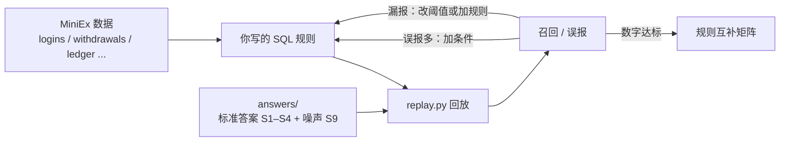

# B72 提币与账户风控规则实战：写规则、回放、调阈值

> 学习目标：做完本章，你能——
> 1. 为账户接管、API Key 滥用、洗钱漏斗、对敲和标记价偏离各写一条 SQL 规则，并用回放读出召回与误报。
> 2. 把"误报很多"的朴素规则改成可上线的规则，并说出每次改动换来了什么、放弃了什么。
> 3. 说明为什么一条规则不够用，并用"规则互补矩阵"检查哪些攻击还没人看。
>
> 前置知识：会读 SQL（`SELECT`、`JOIN`、`GROUP BY`）；读过 [X11 第 6.4 节](../architecture/X11-cex-identity-account-access.md)（规则 1–4）；建议先完成 [B70 L3 导读](B70-offchain-l3-guide.md)。
> 预计用时：约 2.5–3 小时。
> 交互实验：[风控规则调参](../interactive/risk-rule-tuning-lab.html)
> 关联章节：[X11 客户身份、账户与访问](../architecture/X11-cex-identity-account-access.md)｜[X13 交易、结算与信用](../architecture/X13-cex-trading-settlement-credit.md)｜[X14 钱包、财资与支付渠道](../architecture/X14-cex-wallet-treasury-payment.md)｜[X16 欺诈、合规与安全运营](../architecture/X16-cex-fraud-compliance-secops.md)｜[B64 热钱包水位、提现风控与多签复核](B64-custody-ops-ir-practice.md)
> 最后核对：2026-11-23（Python 3.12.3；下文每条命令都在本机用靶场默认种子 20260301 运行过，输出来自真实运行）

> ⚠️ 警告：法律与道德边界。本章的数据是虚构交易所"MiniEx"的合成数据，不含真实用户、真实地址和真实密钥。本章只教你怎样发现这些事件，不教怎样实施。不要把本章的阈值直接搬到真实系统：真实系统的数据分布不同，上线前必须用你自己的历史数据回放。

---

## 开场：同一条规则，两种结局

X11 给出的规则 2 很简单：找回成功后 24 小时内提币，就告警。它在示例里看起来完美。

在 MiniEx 的两周数据里，这条规则一共告警 11 次。其中 2 次是真的账户接管，9 次是真实用户找回账户后正常提币。值班的人看到第三条"假警报"时，就会开始不看第四条。

反过来，X16 给出的"快进快出"规则用了 20,000 美元的示例阈值。在 MiniEx 里，它只抓到 3 个洗钱漏斗中的 1 个。另外 2 个漏斗各自只有约 9,000 美元，从来没有超过阈值。

两种结局来自同一个原因：规则写完以后，没有拿数据验证。本章让你把这个动作变成习惯：**写规则，回放，读数字，改，再回放。**

## 1. 本章怎么练

原理不在这里重讲。账户接管与找回见 [X11 第 3 节](../architecture/X11-cex-identity-account-access.md)；市场监测见 [X13](../architecture/X13-cex-trading-settlement-credit.md)；快进快出见 [X16 第 6.2 节](../architecture/X16-cex-fraud-compliance-secops.md)。本章只做一件事：在 MiniEx 上把这些规则写出来、跑起来、调好。

> 🎯 打个比方：写规则像调烟雾报警器的灵敏度。太灵敏，每次煎牛排都响，住户会把电池拔掉。太迟钝，着火了才响。你要找的是"煎牛排不响，起火必响"的那个位置。局限：烟雾不会学习，而攻击者会看到你的报警器，并改变做法。



读图要点：
- 数据和答案都是固定的。你每次改规则，只有规则在变，所以数字的变化就是改动的效果。
- 回放把每次告警和答案比较。命中攻击记为 TP（真阳性）。命中 S9 噪声或未解释的事件记为误报。
- 局限：真实环境没有标准答案。B73 会讲怎样在没有答案时证明规则有效。

本章有 8 个步骤（第 0–7 步），覆盖 S1、S2、S3、S4 和 S9（噪声）。

| 步骤 | 场景 | 你要写的规则 | 要学的东西 |
|---|---|---|---|
| 0 | — | 两条"愚蠢"规则 | 读懂回放输出 |
| 1 | S1 | 撞库 | 阈值：一个误报，一个漏报 |
| 2 | S1 | 找回后提币 | 朴素规则 → 调优 |
| 3 | S1 | 改绑后加新地址再提币 | 一条规则会漏，规则要互补 |
| 4 | S2 | API Key 权限变更；新 IP 提币 | 两个视角看同一个攻击 |
| 5 | S3 | 快进快出 | 手册示例阈值在你的数据上不灵 |
| 6 | S4 | 对敲；标记价偏离 | 排除项的代价 |
| 7 | S1–S4 | 互补矩阵 | 整体覆盖 |

## 2. 第 0 步：准备，并读懂回放输出

> 💡 注意：以下所有命令都从 `web3-security-101/` 根目录出发。

1. 确认靶场数据存在：

```bash
ls code/offchain-ops/data/miniex.db
```

```text
code/offchain-ops/data/miniex.db
```

如果提示文件不存在，先运行 `bash code/offchain-ops/setup.sh --no-tests`（会生成数据，约几秒）。

2. 看一眼有哪些表。本章用到 `logins`、`recoveries`、`account_events`、`withdrawals`、`api_calls`、`ledger`、`orders_trades`、`marks`、`accounts`。字段说明见 [ops/API.md](../../code/offchain-ops/API.md)。

```bash
python3 code/offchain-ops/lib/logread.py --tables | head -12
```

```text
accounts              2000
logins               15300
recoveries              36
account_events         229
api_keys                31
api_calls            31594
orders_trades        11802
marks                16132
ledger              104620
withdrawals           1307
chain_txs             2551
approvals             1297
```

3. 建你的规则目录，写两条"愚蠢"的规则。第一条什么都不报，第二条把所有输错密码的 IP 都报出来：

```bash
mkdir -p my_rules
cat > my_rules/empty.sql <<'EOF'
-- id: empty
-- scenario: S1
SELECT ip, ts FROM logins WHERE 1 = 0
EOF
cat > my_rules/hello.sql <<'EOF'
-- id: hello
-- scenario: S1
SELECT ip, MIN(ts) AS ts FROM logins WHERE result = 'failed_password' GROUP BY ip
EOF
```

规则文件的格式：开头的 `-- id:`、`-- scenario:`、`-- param:` 是元数据。`scenario` 是你想召回的场景。后面是**一条** `SELECT`，每一行结果就是一次告警。

4. 回放：

```bash
python3 code/offchain-ops/lib/replay.py my_rules/empty.sql
python3 code/offchain-ops/lib/replay.py my_rules/hello.sql --show 2
```

```text
规则：empty   参数：无
目标场景：S1
命中 0 条：TP 0，误报 0（噪声/未解释的不同实体 0），其他场景的真阳性 0
召回：0/3 = 0%   精确率：n/a
漏掉：S1-01, S1-02, S1-03
规则：hello   参数：无
目标场景：S1
命中 358 条：TP 8，误报 350（噪声/未解释的不同实体 350），其他场景的真阳性 0
召回：3/3 = 100%   精确率：2%
  [TP] S1-01,S1-02  {"ip": "203.0.113.10", "ts": "2026-03-04T01:00:08Z"}
  [TP] S1-01,S1-02  {"ip": "203.0.113.11", "ts": "2026-03-04T01:00:14Z"}
  ……还有 356 条（用 --show N 查看更多）
```

读输出：
- **召回**：答案里有几个被你至少命中一次。`empty` 是 0/3。
- **误报**：命中了，但不是目标攻击，也不是别的场景的攻击。`hello` 有 350 条误报。
- **精确率**：TP 占命中的比例。`hello` 召回 100%，但精确率只有 2%。没有人能处理 358 条告警。

两个极端的规则都没用。好规则两个数字都要看。

5. 回放可以当门禁用。加上 `--min-recall` 和 `--max-fp`，不达标时退出码为 1：

```bash
python3 code/offchain-ops/lib/replay.py my_rules/hello.sql --min-recall 1.0 --max-fp 5 > /dev/null; echo "exit=$?"
```

```text
未达标：召回或误报不满足 --min-recall / --max-fp
exit=1
```

6. 本章还有两个辅助脚本，放在 `code/offchain-ops/solutions/b72/`：
   - `sweep.py`：对一个参数取多个值，逐个回放，打印一张表。
   - `coverage.py`：把多条规则放在一起，打印"哪条规则抓到了哪个答案"的矩阵。

它们只是 `replay.py --json` 的包装，你可以先读源码再用。

## 3. 第 1 步：S1 撞库——一个误报，一个漏报

场景：攻击者拿一批泄露的账号密码，在登录接口上逐个尝试。X11 规则 1 的思路：同一个来源 IP，在短窗口内对很多不同账户输错密码。

1. 先看数据。S1 的撞库来自 `203.0.113.10`–`15`，2026-03-04 01:00 开始。看其中一个 IP 开头 6 分钟：

```bash
python3 code/offchain-ops/lib/logread.py --sql "SELECT substr(ts,1,16) AS minute, COUNT(*) fails, COUNT(DISTINCT account_id) users FROM logins WHERE ip='203.0.113.11' AND result='failed_password' GROUP BY 1 LIMIT 6"
```

```text
（6 行）
minute            fails  users
----------------  -----  -----
2026-03-04T01:00  8      8    
2026-03-04T01:01  8      7    
2026-03-04T01:02  3      2    
2026-03-04T01:03  7      7    
2026-03-04T01:04  7      7    
2026-03-04T01:05  9      9    
```

每分钟约 8 次失败，几乎每次换一个账户。

2. 写规则。把下面的骨架存为 `my_rules/s1_stuffing.sql`，把 `___` 填完：

```sql
-- id: b72_s1_stuffing
-- scenario: S1
-- param: window_min=10
-- param: min_users=20
-- param: max_ratio=99
SELECT ip, MIN(ts) AS ts, COUNT(DISTINCT account_id) AS users, COUNT(*) AS fails,
       ROUND(1.0 * COUNT(*) / COUNT(DISTINCT account_id), 2) AS fails_per_user
FROM logins
WHERE result = '___'
GROUP BY ip, CAST(strftime('%s', ts) / (:window_min * 60) AS INTEGER)
HAVING users >= :min_users AND fails_per_user <= :max_ratio
```

提示：
- `result` 的取值见 API.md 的 `logins` 一行。
- `strftime('%s', ts)` 把时间转成秒。除以窗口秒数再取整，同一个窗口里的事件得到同一个数。这是"滚动窗口"的简单近似。
- `:max_ratio` 先设成 99，等于不启用。第 7 小步才用它。

3. 回放：

```bash
python3 code/offchain-ops/lib/replay.py my_rules/s1_stuffing.sql --show 2
```

```text
规则：b72_s1_stuffing   参数：{'window_min': 10, 'min_users': 20, 'max_ratio': 99}
目标场景：S1
命中 19 条：TP 18，误报 1（噪声/未解释的不同实体 1），其他场景的真阳性 0
召回：2/3 = 67%   精确率：95%
漏掉：S1-03
  [TP] S1-01,S1-02  {"ip": "203.0.113.10", "ts": "2026-03-04T01:00:08Z", "users": 63, "fails": 67, "fails_per_user": 1.06}
  [TP] S1-01,S1-02  {"ip": "203.0.113.10", "ts": "2026-03-04T01:10:04Z", "users": 59, "fails": 62, "fails_per_user": 1.05}
  ……还有 17 条（用 --show N 查看更多）
```

> 💡 注意：你的命中条数可能和这里不同，因为窗口取整方式不同。看召回和误报：应是召回 2/3，误报 1。

两个问题：
- 误报 1 条。它是什么？
- 漏掉 S1-03。它为什么漏？

4. 先查误报。看这四个 IP：办公室出口 `198.18.250.7`（回放里的 `[FP-噪声]` 那一行），S1-03 的两个 IP，和一个 S1-01 的 IP：

```bash
python3 code/offchain-ops/lib/logread.py --sql "SELECT ip, COUNT(DISTINCT account_id) users, COUNT(*) fails, ROUND(1.0*COUNT(*)/COUNT(DISTINCT account_id),2) per_user FROM logins WHERE result='failed_password' AND ip IN ('198.18.250.7','203.0.113.32','203.0.113.31','203.0.113.11') GROUP BY ip"
```

```text
（4 行）
ip            users  fails  per_user
------------  -----  -----  --------
198.18.250.7  30     72     2.4     
203.0.113.11  154    175    1.14    
203.0.113.31  19     19     1.0     
203.0.113.32  21     21     1.0     
```

`198.18.250.7` 是办公室出口。周一早晨 30 个员工输错密码，平均每人 2.4 次。撞库的 IP 平均每个账户只试 1 次左右。

5. 调阈值。用 `sweep.py` 扫 `min_users`：

```bash
python3 code/offchain-ops/solutions/b72/sweep.py my_rules/s1_stuffing.sql min_users 20,30,40,60
```

```text
     min_users  命中  TP  误报  召回
            20    19  18     1  2/3
            30    17  16     1  2/3
            40    13  13     0  2/3
            60     6   6     0  2/3
```

`min_users` 提到 40，误报归零。但是**召回仍是 2/3**。S1-03 没有被抓到，调高阈值只会让它更难抓。

6. 为什么漏了 S1-03？看 `203.0.113.32` 按小时的失败数：

```bash
python3 code/offchain-ops/lib/logread.py --sql "SELECT substr(ts,1,13) AS hour, COUNT(*) fails, COUNT(DISTINCT account_id) users FROM logins WHERE ip='203.0.113.32' GROUP BY 1"
```

```text
（8 行）
hour           fails  users
-------------  -----  -----
2026-03-09T06  2      2    
2026-03-09T07  2      2    
2026-03-09T08  2      2    
2026-03-09T09  1      1    
2026-03-09T10  5      5    
2026-03-09T11  2      2    
2026-03-09T12  1      1    
2026-03-09T13  6      6    
```

S1-03 是**低慢撞库**：8 小时共 21 个账户，每小时只有 1–6 个。任何 10 分钟窗口里的账户数都远低于 20。攻击者知道有窗口规则，就把速度压到窗口以下。

7. 把窗口放大到一天（1440 分钟），阈值降到 15。这会同时把办公室 NAT 带回来：

```bash
python3 code/offchain-ops/lib/replay.py my_rules/s1_stuffing.sql --param window_min=1440 --param min_users=15 --show 20 | grep -v "TP\] S1-01,S1-02"
```

```text
规则：b72_s1_stuffing   参数：{'window_min': 1440, 'min_users': 15, 'max_ratio': 99}
目标场景：S1
命中 9 条：TP 8，误报 1（噪声/未解释的不同实体 1），其他场景的真阳性 0
召回：3/3 = 100%   精确率：89%
  [TP] S1-03  {"ip": "203.0.113.31", "ts": "2026-03-09T06:17:32Z", "users": 19, "fails": 19, "fails_per_user": 1.0}
  [TP] S1-03  {"ip": "203.0.113.32", "ts": "2026-03-09T06:12:29Z", "users": 21, "fails": 21, "fails_per_user": 1.0}
  [FP-噪声] S9-S1-NAT(office_nat_failures)  {"ip": "198.18.250.7", "ts": "2026-03-02T09:00:02Z", "users": 30, "fails": 72, "fails_per_user": 2.4}
```

召回 3/3，但办公室 NAT 又回来了。现在用 `max_ratio`：撞库每账户约 1 次，办公室每账户 2.4 次。

8. 把 `max_ratio` 设成 2：

```bash
python3 code/offchain-ops/lib/replay.py my_rules/s1_stuffing.sql --param window_min=1440 --param min_users=15 --param max_ratio=2 --show 1
```

```text
规则：b72_s1_stuffing   参数：{'window_min': 1440, 'min_users': 15, 'max_ratio': 2}
目标场景：S1
命中 8 条：TP 8，误报 0（噪声/未解释的不同实体 0），其他场景的真阳性 0
召回：3/3 = 100%   精确率：100%
  [TP] S1-01,S1-02  {"ip": "203.0.113.10", "ts": "2026-03-04T01:00:08Z", "users": 135, "fails": 158, "fails_per_user": 1.17}
  ……还有 7 条（用 --show N 查看更多）
```

召回 3/3，误报 0。你得到了一条漂亮的规则。

<details class="predict"><summary>🤔 先猜再看：攻击者发现规则看 fails_per_user ≤ 2。他怎么改，才能让这条规则看不见？</summary>

他让每个账户多试几次，把 `fails_per_user` 抬到 2 以上，或者把攻击分散到更多 IP，让每个 IP 的账户数低于 15。规则不能只靠"形状"。你需要第二层：看撞库之后发生了什么。这是第 3 步的内容。

</details>

> 💡 注意：数字漂亮不等于规则安全。`max_ratio=2` 是在这份数据上调出来的。它让规则在 MiniEx 里零误报，但攻击者只要知道它，就能绕过。所以后面还要有不依赖攻击者行为"形状"的规则。

## 4. 第 2 步：S1 找回后提币——朴素规则与调优

X11 规则 2：找回成功后 24 小时内提币。你先写朴素版，再用回放告诉你"哪里错了"。

数据：`recoveries` 有找回结果，`withdrawals` 有 `addr_added_ts`（提币地址加入地址簿的时间）。

1. 把骨架存为 `my_rules/s1_recovery_naive.sql`：

```sql
-- id: b72_s1_recovery_naive
-- scenario: S1
-- param: min_usd=1000
SELECT w.account_id, w.wd_id, r.ts AS recovery_ts, w.amount_usd, w.ts
FROM recoveries r
JOIN withdrawals w ON w.account_id = r.account_id
 AND w.ts BETWEEN r.ts AND strftime('%Y-%m-%dT%H:%M:%SZ', r.ts, '+___ hours')
WHERE r.result = '___' AND w.amount_usd >= :min_usd
```

2. 回放：

```bash
python3 code/offchain-ops/lib/replay.py my_rules/s1_recovery_naive.sql --show 4
```

```text
规则：b72_s1_recovery_naive   参数：{'min_usd': 1000}
目标场景：S1
命中 11 条：TP 2，误报 9（噪声/未解释的不同实体 9），其他场景的真阳性 0
召回：2/3 = 67%   精确率：18%
漏掉：S1-01
  [TP] S1-02  {"account_id": "A00981", "wd_id": "W000293", "recovery_ts": "2026-03-04T01:31:00Z", "amount_usd": 9200.0, "ts": "2026-03-04T04:30:00Z"}
  [TP] S1-03  {"account_id": "A01432", "wd_id": "W000889", "recovery_ts": "2026-03-09T14:20:00Z", "amount_usd": 25000.0, "ts": "2026-03-10T12:40:00Z"}
  [FP-噪声] S9-S1-R06(legit_recovery_then_withdraw)  {"account_id": "A00630", "wd_id": "W000299", "recovery_ts": "2026-03-03T18:22:31Z", "amount_usd": 2046.0, "ts": "2026-03-04T05:22:31Z"}
  [FP-噪声] S9-S1-R08(legit_recovery_then_withdraw)  {"account_id": "A01340", "wd_id": "W000408", "recovery_ts": "2026-03-04T22:45:54Z", "amount_usd": 2093.0, "ts": "2026-03-05T07:45:54Z"}
  ……还有 7 条（用 --show N 查看更多）
```

11 条命中，只有 2 条是真的。真阳性和典型误报在地址上有什么不同？

3. 比较两个真阳性（W000293、W000889）和一个误报（W000299）：

```bash
python3 code/offchain-ops/lib/logread.py --sql "SELECT account_id, wd_id, amount_usd, ts, addr_added_ts FROM withdrawals WHERE wd_id IN ('W000299','W000293','W000889')"
```

```text
（3 行）
account_id  wd_id    amount_usd  ts                    addr_added_ts       
----------  -------  ----------  --------------------  --------------------
A00981      W000293  9200.0      2026-03-04T04:30:00Z  2026-03-04T01:55:00Z
A00630      W000299  2046.0      2026-03-04T05:22:31Z  2025-09-17T00:00:00Z
A01432      W000889  25000.0     2026-03-10T12:40:00Z  2026-03-09T14:50:00Z
```

误报 `W000299` 的地址在 2025 年就已经存在。用户找回账户后，用老地址提币，很正常。两个真阳性的地址都是**找回之后才加入**的。攻击者控制账户后，必须加自己的地址。

4. 调优：复制为 `my_rules/s1_recovery_tuned.sql`，id 改成 `b72_s1_recovery_tuned`，在 `WHERE` 末尾加一个条件，要求地址是找回之后才加入的。提示：比较 `w.addr_added_ts` 和 `r.ts`。

5. 回放：

```bash
python3 code/offchain-ops/lib/replay.py my_rules/s1_recovery_tuned.sql
```

```text
规则：b72_s1_recovery_tuned   参数：{'min_usd': 1000}
目标场景：S1
命中 2 条：TP 2，误报 0（噪声/未解释的不同实体 0），其他场景的真阳性 0
召回：2/3 = 67%   精确率：100%
漏掉：S1-01
  [TP] S1-02  {"account_id": "A00981", "wd_id": "W000293", "recovery_ts": "2026-03-04T01:31:00Z", "amount_usd": 9200.0, "ts": "2026-03-04T04:30:00Z"}
  [TP] S1-03  {"account_id": "A01432", "wd_id": "W000889", "recovery_ts": "2026-03-09T14:20:00Z", "amount_usd": 25000.0, "ts": "2026-03-10T12:40:00Z"}
```

误报从 9 降到 0，召回没有下降。一个条件换来了这一切。

<details class="predict"><summary>🤔 先猜再看：召回仍是 2/3，漏掉了 S1-01。为什么这条规则不可能抓到它？</summary>

S1-01 的账户没有开 MFA，攻击者直接用撞库得到的密码登录，没有走找回流程。`recoveries` 表里没有这个账户的记录。规则以"找回"为起点，就看不到不走找回的接管。这不是阈值问题，是规则的视角问题。

</details>

## 5. 第 3 步：规则互补——S1 的第三条规则

接管之后，攻击者要做的事是固定的：改绑手机或重置 MFA，加自己的提币地址，把钱提走。这些动作都在 `account_events` 里，不依赖找回，也不依赖撞库的形状。

X11 规则 3：改绑或重置 MFA 后 30 分钟内新增提币地址，且 24 小时内向该地址提币。

1. 把骨架存为 `my_rules/s1_change_addr.sql`：

```sql
-- id: b72_s1_change_addr
-- scenario: S1
-- param: gap_min=30
-- param: wd_hours=24
-- param: min_usd=1000
SELECT c.account_id, c.event_type, c.ts AS change_ts, w.wd_id, w.amount_usd, w.ts
FROM account_events c
JOIN account_events b ON b.account_id = c.account_id AND b.event_type = '___'
 AND b.ts BETWEEN c.ts AND strftime('%Y-%m-%dT%H:%M:%SZ', c.ts, '+' || :gap_min || ' minutes')
JOIN withdrawals w ON w.account_id = c.account_id AND w.addr_added_ts = b.ts
 AND w.ts BETWEEN b.ts AND strftime('%Y-%m-%dT%H:%M:%SZ', b.ts, '+' || :wd_hours || ' hours')
WHERE c.event_type IN ('___', '___', '___') AND w.amount_usd >= :min_usd
```

提示：
- `event_type` 的取值见 API.md 的 `account_events` 一行。"改绑"和"重置 MFA"共有三个取值。
- `w.addr_added_ts = b.ts` 把"新增地址事件"和"用这个地址的提币"连起来。
- `'+' || :gap_min || ' minutes'` 是在 SQLite 里拼出时间偏移的写法。

2. 回放：

```bash
python3 code/offchain-ops/lib/replay.py my_rules/s1_change_addr.sql --show 0
```

```text
规则：b72_s1_change_addr   参数：{'gap_min': 30, 'wd_hours': 24, 'min_usd': 1000}
目标场景：S1
命中 3 条：TP 3，误报 0（噪声/未解释的不同实体 0），其他场景的真阳性 0
召回：3/3 = 100%   精确率：100%
```

一条规则，S1 全部 3 次，零误报。

3. 但这不等于另外两条规则没用。把三条 S1 规则（都用默认参数）放进矩阵：

```bash
python3 code/offchain-ops/solutions/b72/coverage.py my_rules/s1_stuffing.sql my_rules/s1_recovery_tuned.sql my_rules/s1_change_addr.sql --scenarios S1
```

```text
答案     s1_stuffing        s1_recovery_tuned  s1_change_addr   
S1-01  X                  .                  X                
S1-02  X                  X                  X                
S1-03  .                  X                  X                
误报     1                  0                  0                
没有任何规则命中的答案：无
```

读矩阵：
- 撞库规则漏 S1-03（低慢）。找回规则漏 S1-01（没走找回）。改绑规则三个都抓到。
- 三条规则各自的盲区不同。这就是**规则互补**：它们看攻击链上不同的环节。
- 真实攻击不会只有 3 个。如果攻击者绕开了"改绑"（例如只加地址，不改绑），第三条规则也会漏。多一条看别的环节的规则，才是保险。

> 🪞 反思：你的系统里有没有一类攻击，只有一条规则在看？如果那条规则被绕过，你有几分钟发现？

## 6. 第 4 步：S2 API Key 滥用——两个视角

场景：攻击者拿到一个 API Key，并给它加上提币权限，然后从新 IP 调用。

X11 控制 IC-10 要求：提币权限的 Key 必须绑定 IP。MiniEx 里有两起：K0001 被加权限后从新 IP 提币两次；K9001 是新建的、带提币权限、无 IP 白名单的 Key，3 个 IP 轮换。

你可以从两个视角写规则：
- **权限变更视角**：`account_events` 里出现"给 Key 加提币权限"或"新建带提币权限的 Key"。它在攻击者**准备**时告警。
- **调用视角**：`api_calls` 里出现提币权限的调用，来自这个 Key 从没用过的 IP。它在攻击者**使用**时告警。

### 6.1 权限变更视角

1. 看 `account_events` 里的 `detail` 长什么样：

```bash
python3 code/offchain-ops/lib/logread.py --sql "SELECT event_id, event_type, ip, detail FROM account_events WHERE event_type IN ('api_key_perm_add','create_api_key')"
```

```text
（4 行）
event_id  event_type        ip             detail                                  
--------  ----------------  -------------  ----------------------------------------
AE000031  api_key_perm_add  100.75.140.75  key=K0019;perm=withdraw;ticket=CHG-100  
AE000081  api_key_perm_add  198.51.100.21  key=K0001;perm=withdraw                 
AE000113  api_key_perm_add  100.95.89.120  key=K0023;perm=withdraw;ticket=CHG-101  
AE000198  create_api_key    198.51.100.45  key=K9001;perms=read,trade,withdraw;allo
```

2. 把骨架存为 `my_rules/s2_perm_change.sql`：

```sql
-- id: b72_s2_perm_change
-- scenario: S2
-- param: need_no_ticket=0
SELECT e.account_id, e.ts, e.event_type, e.ip,
       substr(e.detail, instr(e.detail, 'key=') + 4, 5) AS key_id
FROM account_events e
WHERE e.event_type IN ('___', '___')
  AND e.detail LIKE '%___%'
  AND (:need_no_ticket = 0 OR e.detail NOT LIKE '%___%')
```

提示：`substr(... instr(detail, 'key=') ...)` 把 `key=K0001` 里的 Key 编号取出来，让回放能按 Key 对答案。四个 `___` 依次是：两种事件类型、权限名、变更单字段名。

3. 先用 `need_no_ticket=0`（朴素版）回放：

```bash
python3 code/offchain-ops/lib/replay.py my_rules/s2_perm_change.sql --show 4
```

```text
规则：b72_s2_perm_change   参数：{'need_no_ticket': 0}
目标场景：S2
命中 4 条：TP 2，误报 2（噪声/未解释的不同实体 2），其他场景的真阳性 0
召回：2/2 = 100%   精确率：50%
  [TP] S2-01  {"account_id": "A00208", "ts": "2026-03-06T03:05:00Z", "event_type": "api_key_perm_add", "ip": "198.51.100.21", "key_id": "K0001"}
  [TP] S2-02  {"account_id": "A01399", "ts": "2026-03-11T22:41:00Z", "event_type": "create_api_key", "ip": "198.51.100.45", "key_id": "K9001"}
  [FP-噪声] S9-S2-P1(legit_perm_add)  {"account_id": "A00590", "ts": "2026-03-03T09:20:00Z", "event_type": "api_key_perm_add", "ip": "100.75.140.75", "key_id": "K0019"}
  [FP-噪声] S9-S2-P2(legit_perm_add)  {"account_id": "A01077", "ts": "2026-03-07T09:20:00Z", "event_type": "api_key_perm_add", "ip": "100.95.89.120", "key_id": "K0023"}
```

两个误报是账户所有者自己加权限，且带变更单，Key 有 IP 白名单。

4. 加 `need_no_ticket=1`，只留下没有变更单的操作：

```bash
python3 code/offchain-ops/lib/replay.py my_rules/s2_perm_change.sql --param need_no_ticket=1 --show 0
```

```text
规则：b72_s2_perm_change   参数：{'need_no_ticket': 1}
目标场景：S2
命中 2 条：TP 2，误报 0（噪声/未解释的不同实体 0），其他场景的真阳性 0
召回：2/2 = 100%   精确率：100%
```

> ⚠️ 警告：这个"变更单"条件只在 MiniEx 里成立，因为 `ticket=` 是数据里的明文字段，攻击者没有伪造它。真实系统里，规则必须去工单系统核实：这张单存在吗？状态是已批准吗？申请人是这个账户的所有者吗？只看"字段里写没写 ticket"，等于把门锁交给攻击者。

### 6.2 调用视角

1. 把骨架存为 `my_rules/s2_new_ip_any.sql`（朴素版：**任何**调用来自 Key 没用过的 IP）：

```sql
-- id: b72_s2_new_ip_any
-- scenario: S2
-- param: lookback_hours=24
SELECT c.key_id, c.account_id, c.ip, MIN(c.ts) AS ts, COUNT(*) AS calls
FROM api_calls c
WHERE NOT EXISTS (
    SELECT 1 FROM api_calls p
    WHERE p.key_id = c.key_id AND p.ip = c.ip
      AND p.ts < strftime('%Y-%m-%dT%H:%M:%SZ', c.ts, '-' || :lookback_hours || ' hours'))
GROUP BY c.key_id, c.ip
```

`NOT EXISTS` 的意思：在这次调用的 24 小时之前，这个 Key 从没有从这个 IP 来过。

2. 回放：

```bash
python3 code/offchain-ops/lib/replay.py my_rules/s2_new_ip_any.sql --show 0
```

```text
规则：b72_s2_new_ip_any   参数：{'lookback_hours': 24}
目标场景：S2
命中 38 条：TP 5，误报 33（噪声/未解释的不同实体 29），其他场景的真阳性 0
召回：2/2 = 100%   精确率：13%
```

38 条命中，33 条误报。一部分是机器人迁移服务器（S9 噪声）。更多的是"未解释"的：数据从 2026-03-01 开始，这些 Key 在此之前没有任何历史，所以它们第一次出现的 IP 都算"新"。这是回放里常见的**冷启动**问题：规则需要历史，而历史在窗口外。

3. 调优：只看提币权限的调用。复制为 `my_rules/s2_new_ip_withdraw.sql`，id 改成 `b72_s2_new_ip_withdraw`，在 `WHERE` 开头加一个条件，限制 `c.perm_used`。

```bash
python3 code/offchain-ops/lib/replay.py my_rules/s2_new_ip_withdraw.sql --show 0
```

```text
规则：b72_s2_new_ip_withdraw   参数：{'lookback_hours': 24}
目标场景：S2
命中 2 条：TP 2，误报 0（噪声/未解释的不同实体 0），其他场景的真阳性 0
召回：2/2 = 100%   精确率：100%
```

38 条降到 2 条，一个条件。

<details class="predict"><summary>🤔 先猜再看：两个视角的规则都是 2/2、零误报。为什么还要保留两条？</summary>

它们告警的时刻不同。权限变更规则在攻击者准备时告警，那时还没有资金损失。调用规则在攻击者使用时告警，那时钱已经在路上，但它不依赖 `account_events` 的记录是否完整。如果日志管线丢了其中一类事件，另一条规则仍然工作。

</details>

## 7. 第 5 步：S3 洗钱漏斗——手册示例阈值不灵

场景：多个小额入账汇聚到少数账户，随后快速整笔提走。X16 第 6.2 节给了一条规则示例，阈值是 20,000 美元。

1. 把骨架存为 `my_rules/s3_funnel.sql`：

```sql
-- id: b72_s3_funnel
-- scenario: S3
-- param: min_in_usd=20000
-- param: min_sources=5
-- param: out_ratio=0.9
-- param: only_new=0
WITH inflow AS (
  SELECT account_id, SUM(amount_usd) AS in_usd, COUNT(*) AS sources, MIN(ts) AS ts
  FROM ledger
  WHERE direction = 'credit' AND sub = 'available' AND entry_type IN ('___', '___')
  GROUP BY account_id
), outflow AS (
  SELECT account_id, SUM(amount_usd) AS out_usd
  FROM withdrawals WHERE status = '___' GROUP BY account_id
)
SELECT i.account_id, i.ts, ROUND(i.in_usd) AS in_usd, ROUND(o.out_usd) AS out_usd, i.sources, a.risk_tag
FROM inflow i JOIN outflow o USING (account_id) JOIN accounts a USING (account_id)
WHERE i.in_usd >= :min_in_usd AND i.sources >= :min_sources AND o.out_usd >= :out_ratio * i.in_usd
  AND (:only_new = 0 OR a.risk_tag = 'new_user')
```

提示：
- 入金有两种来源：链上充值（`deposit`）和内部转入（`internal_transfer`）。
- 只统计真正转出的提币：`status` 取值见 API.md 的 `withdrawals` 一行。
- `sub = 'available'` 且 `direction = 'credit'`：入账到可用余额。

2. 用默认的手册示例阈值回放：

```bash
python3 code/offchain-ops/lib/replay.py my_rules/s3_funnel.sql --show 3
```

```text
规则：b72_s3_funnel   参数：{'min_in_usd': 20000, 'min_sources': 5, 'out_ratio': 0.9, 'only_new': 0}
目标场景：S3
命中 1 条：TP 1，误报 0（噪声/未解释的不同实体 0），其他场景的真阳性 0
召回：1/3 = 33%   精确率：100%
漏掉：S3-02, S3-03
  [TP] S3-01  {"account_id": "A00476", "ts": "2026-03-05T08:01:40Z", "in_usd": 24636.0, "out_usd": 22603.0, "sources": 10, "risk_tag": "new_user"}
```

精确率 100%，召回只有 1/3。看起来"很干净"，其实是看不见。

3. 看漏掉的两个账户到底有多少钱（A00476 是被抓到的那个，放在一起对比）：

```bash
python3 code/offchain-ops/lib/logread.py --sql "SELECT account_id, COUNT(*) sources, ROUND(SUM(amount_usd)) in_usd FROM ledger WHERE direction='credit' AND sub='available' AND entry_type IN ('deposit','internal_transfer') AND account_id IN ('A00476','A01228','A00112') GROUP BY 1"
```

```text
（3 行）
account_id  sources  in_usd 
----------  -------  -------
A00112      6        9435.0 
A00476      10       24636.0
A01228      6        9108.0 
```

两个漏掉的账户各约 9,100–9,400 美元，6 笔来源。总额低于 20,000。这种"把每个漏斗压在阈值以下"的做法叫结构化拆分（Structuring）。

4. 扫阈值：

```bash
python3 code/offchain-ops/solutions/b72/sweep.py my_rules/s3_funnel.sql min_in_usd 20000,15000,10000,9000,8000,5000,2000
```

```text
    min_in_usd  命中  TP  误报  召回
         20000     1   1     0  1/3
         15000     1   1     0  1/3
         10000     1   1     0  1/3
          9000     3   3     0  3/3
          8000     3   3     0  3/3
          5000     3   3     0  3/3
          2000     4   3     1  3/3
```

读这张表：
- 10,000 到 9,000 之间有一道悬崖。越过它，召回从 1/3 变成 3/3。
- 9,000 刚好贴在 S3-02 的 9,108 上。贴着悬崖设阈值，换一份数据就会掉下去。选 **8,000**，留一点余量。
- 降到 2,000，开始出现误报。

5. 为什么不直接降到 500？因为单靠金额降下去，噪声会爆炸。试一下：把 `min_sources` 放到 1、`out_ratio` 放到 0.5，再扫金额：

```bash
python3 code/offchain-ops/solutions/b72/sweep.py my_rules/s3_funnel.sql min_in_usd 8000,2000,500 --fixed min_sources=1 --fixed out_ratio=0.5
```

```text
    min_in_usd  命中  TP  误报  召回
          8000    13   3     7  3/3
          2000    29   4    22  3/3
           500    71   4    64  3/3
```

71 条告警，64 条误报。同样的召回，换来的是没人处理得了的告警量。保持 `min_sources=5` 和 `out_ratio=0.9`，用"来源多"和"整笔转出"这两个特征约束，才能把金额阈值放低。

6. 确认 `min_in_usd=8000`：

```bash
python3 code/offchain-ops/lib/replay.py my_rules/s3_funnel.sql --param min_in_usd=8000 --show 0
```

```text
规则：b72_s3_funnel   参数：{'min_in_usd': 8000, 'min_sources': 5, 'out_ratio': 0.9, 'only_new': 0}
目标场景：S3
命中 3 条：TP 3，误报 0（噪声/未解释的不同实体 0），其他场景的真阳性 0
召回：3/3 = 100%   精确率：100%
```

> 💡 注意：这个结论是"手册示例阈值在 MiniEx 的数据上不灵"。它不是说手册错了。手册的阈值只是示例，每家交易所的充值分布不同。正确的做法是：用你自己的历史数据，把阈值扫一遍，看悬崖在哪里，再在悬崖旁留余量。

<details class="predict"><summary>🤔 先猜再看：把 min_sources 从 5 提到 7，会发生什么？</summary>

召回会掉到 1/3。S3-02 和 S3-03 都只有 6 个来源，只有 S3-01 有 10 个来源。用 `sweep.py my_rules/s3_funnel.sql min_sources 1,3,5,6,7 --fixed min_in_usd=1000` 验证：来源数在 6 和 7 之间也有一道悬崖。所有阈值都有悬崖，你要找的是悬崖在哪。

</details>

## 8. 第 6 步：S4 对敲与标记价偏离

### 8.1 对敲：排除项的代价

场景：同一个实体控制多个账户，互相成交，制造虚假成交量。线索：买卖双方使用同一个 IP 或同一个设备。X13 把这类检查放在"异步市场监测"里。

1. 把骨架存为 `my_rules/s4_wash.sql`：

```sql
-- id: b72_s4_wash
-- scenario: S4-01,S4-02
-- param: min_linked=20
-- param: min_usd=50000
-- param: exclude_mm=0
WITH sides AS (
  SELECT symbol, buyer_account_id AS account_id, quote_qty, ts FROM orders_trades
   WHERE buyer_ip = seller_ip OR buyer_device = seller_device
  UNION ALL
  SELECT symbol, seller_account_id, quote_qty, ts FROM orders_trades
   WHERE buyer_ip = seller_ip OR buyer_device = seller_device
)
SELECT s.symbol, s.account_id, COUNT(*) AS linked_trades, ROUND(SUM(s.quote_qty)) AS usd, MIN(s.ts) AS ts, a.risk_tag
FROM sides s JOIN accounts a USING (account_id)
WHERE :exclude_mm = 0 OR a.risk_tag <> '___'
GROUP BY s.symbol, s.account_id
HAVING linked_trades >= :min_linked AND usd >= :min_usd
```

提示：`sides` 把每笔关联成交拆成买方和卖方两行，这样两个账户各计一次。`risk_tag` 的取值见 API.md 的 `accounts` 一行。

2. 回放：

```bash
python3 code/offchain-ops/lib/replay.py my_rules/s4_wash.sql --show 0
```

```text
规则：b72_s4_wash   参数：{'min_linked': 20, 'min_usd': 50000, 'exclude_mm': 0}
目标场景：S4-01,S4-02
命中 8 条：TP 6，误报 2（噪声/未解释的不同实体 1），其他场景的真阳性 0
召回：2/2 = 100%   精确率：75%
```

注意："误报 2"，但"不同实体 1"。那两条是同一笔对冲成交的两侧：做市商用两个账户互相成交，每个账户各出现一次。

3. 确认这两个账户是做市商：

```bash
python3 code/offchain-ops/lib/logread.py --sql "SELECT account_id, risk_tag FROM accounts WHERE account_id IN ('A00072','A00420')"
```

```text
（2 行）
account_id  risk_tag    
----------  ------------
A00072      market_maker
A00420      market_maker
```

做市商在同一个机房里用两个账户对冲，共享 IP 是正常的。

4. 用 `exclude_mm=1` 排除做市商：

```bash
python3 code/offchain-ops/lib/replay.py my_rules/s4_wash.sql --param exclude_mm=1 --show 0
```

```text
规则：b72_s4_wash   参数：{'min_linked': 20, 'min_usd': 50000, 'exclude_mm': 1}
目标场景：S4-01,S4-02
命中 6 条：TP 6，误报 0（噪声/未解释的不同实体 0），其他场景的真阳性 0
召回：2/2 = 100%   精确率：100%
```

5. 再扫 `min_linked`，找悬崖：

```bash
python3 code/offchain-ops/solutions/b72/sweep.py my_rules/s4_wash.sql min_linked 3,5,20,40,60 --fixed exclude_mm=1 --fixed min_usd=0
```

```text
    min_linked  命中  TP  误报  召回
             3     8   6     1  2/2
             5     6   6     0  2/2
            20     6   6     0  2/2
            40     3   3     0  1/2
            60     3   3     0  1/2
```

读这张表：
- 5 到 20 是一片平台：命中和误报都不变。选中间值最稳。
- 超过 40，S4-02（每账户约 33–35 笔）漏掉，只剩 S4-01（每账户 60 笔）。
- 降到 3，家庭共用设备的小额成交（每账户 3 笔，约 2,100 美元）带来 1 个误报。

> ⚠️ 警告：`exclude_mm=1` 是有代价的盲区。它假设"登记为做市商的账户都不会对敲"。如果一个攻击者控制了做市商账户，这条规则看不到他。排除名单要有人维护，并且被排除的账户要有另一套监测（例如更高的关联成交阈值）。每一个排除项都是一个盲区，要写进规则的说明里。

### 8.2 标记价偏离：连续几点才算数

场景：薄盘币种的标记价连续偏离外部指数价 5%–15%，可能被用来触发强平。线索：偏离的采样点连续出现，而且有多个价格来源。

1. 看 S4-03 那个时段：

```bash
python3 code/offchain-ops/lib/logread.py --sql "SELECT symbol, ts, source_count, ROUND(mark_price/index_price-1,3) dev FROM marks WHERE ts BETWEEN '2026-03-12T13:25:00Z' AND '2026-03-12T14:05:00Z' AND symbol='ABC-USDT' LIMIT 4"
```

```text
（4 行）
symbol    ts                    source_count  dev   
--------  --------------------  ------------  ------
ABC-USDT  2026-03-12T13:25:00Z  3             -0.001
ABC-USDT  2026-03-12T13:30:00Z  3             0.06  
ABC-USDT  2026-03-12T13:35:00Z  3             0.11  
ABC-USDT  2026-03-12T13:40:00Z  3             0.15  
```

2. 把骨架存为 `my_rules/s4_mark.sql`：

```sql
-- id: b72_s4_mark
-- scenario: S4-03
-- param: dev=0.05
-- param: min_rows=3
-- param: min_sources=3
SELECT symbol, MIN(ts) AS ts, COUNT(*) AS rows_off,
       ROUND(MAX(ABS(mark_price / index_price - 1)), 3) AS max_dev, MIN(source_count) AS min_sources
FROM marks
WHERE ABS(mark_price / index_price - 1) >= :dev AND source_count >= :min_sources
GROUP BY symbol, substr(ts, 1, ___)
HAVING rows_off >= :min_rows
```

提示：`substr(ts, 1, 13)` 取到小时（如 `2026-03-12T13`）。按"标的 + 小时"分组，数这一小时里有几个偏离的采样点。把 `___` 填成 13。

> 💡 注意：按小时分组是近似。如果偏离横跨整点，会被切成两组，每组都可能低于 `min_rows`。更准确的写法是用窗口函数找"连续"的行。本章先用简单写法，局限写进规则说明。

3. 回放：

```bash
python3 code/offchain-ops/lib/replay.py my_rules/s4_mark.sql --show 0
```

```text
规则：b72_s4_mark   参数：{'dev': 0.05, 'min_rows': 3, 'min_sources': 3}
目标场景：S4-03
命中 1 条：TP 1，误报 0（噪声/未解释的不同实体 0），其他场景的真阳性 0
召回：1/1 = 100%   精确率：100%
```

4. 去掉"连续"要求。扫 `min_rows`：

```bash
python3 code/offchain-ops/solutions/b72/sweep.py my_rules/s4_mark.sql min_rows 1,2,3,6,7
```

```text
      min_rows  命中  TP  误报  召回
             1     2   1     1  1/1
             2     1   1     0  1/1
             3     1   1     0  1/1
             6     1   1     0  1/1
             7     0   0     0  0/1
```

`min_rows=1` 带来 1 个误报：ETH 的一次新闻尖峰，只偏离了 1 个采样点。`min_rows` 在 2 到 6 之间都对。

5. 再把价格来源要求也去掉：

```bash
python3 code/offchain-ops/lib/replay.py my_rules/s4_mark.sql --param min_rows=1 --param min_sources=1 --show 5
```

```text
规则：b72_s4_mark   参数：{'dev': 0.05, 'min_rows': 1, 'min_sources': 1}
目标场景：S4-03
命中 3 条：TP 1，误报 2（噪声/未解释的不同实体 2），其他场景的真阳性 0
召回：1/1 = 100%   精确率：33%
  [TP] S4-03  {"symbol": "ABC-USDT", "ts": "2026-03-12T13:30:00Z", "rows_off": 6, "max_dev": 0.15, "min_sources": 3}
  [FP-噪声] S9-S4-SP(news_spike_single_row)  {"symbol": "ETH-USDT", "ts": "2026-03-05T16:00:00Z", "rows_off": 1, "max_dev": 0.053, "min_sources": 5}
  [FP-噪声] S9-S4-GL(price_source_glitch)  {"symbol": "XYZ-USDT", "ts": "2026-03-03T08:00:00Z", "rows_off": 2, "max_dev": 0.09, "min_sources": 1}
```

多出的第二个误报是 XYZ 的价格来源故障：只剩 1 个来源，偏离 9%。"连续"过滤掉单点尖峰，"来源数 ≥ 3"过滤掉单来源故障。两个条件挡的是不同的噪声。

## 9. 第 7 步：规则互补矩阵

把你调好的规则放在一起：

```bash
python3 code/offchain-ops/solutions/b72/coverage.py \
  my_rules/s1_stuffing.sql::window_min=1440,min_users=15,max_ratio=2 \
  my_rules/s1_recovery_tuned.sql my_rules/s1_change_addr.sql \
  my_rules/s2_perm_change.sql::need_no_ticket=1 my_rules/s2_new_ip_withdraw.sql \
  my_rules/s3_funnel.sql::min_in_usd=8000 \
  my_rules/s4_wash.sql::exclude_mm=1 my_rules/s4_mark.sql
```

`::` 后面是这条规则的参数覆盖，用逗号分隔。输出：

```text
答案     s1_stuffing         s1_recovery_tuned   s1_change_addr      s2_perm_change      s2_new_ip_withdraw  s3_funnel           s4_wash             s4_mark           
S1-01  X                   .                   X                   .                   .                   .                   .                   .                 
S1-02  X                   X                   X                   .                   .                   .                   .                   .                 
S1-03  X                   X                   X                   .                   .                   .                   .                   .                 
S2-01  .                   .                   .                   X                   X                   .                   .                   .                 
S2-02  .                   .                   .                   X                   X                   .                   .                   .                 
S3-01  .                   .                   .                   .                   .                   X                   .                   .                 
S3-02  .                   .                   .                   .                   .                   X                   .                   .                 
S3-03  .                   .                   .                   .                   .                   X                   .                   .                 
S4-01  .                   .                   .                   .                   .                   .                   X                   .                 
S4-02  .                   .                   .                   .                   .                   .                   X                   .                 
S4-03  .                   .                   .                   .                   .                   .                   .                   X                 
误报     0                   0                   0                   0                   0                   0                   0                   0                 
没有任何规则命中的答案：无
```

读矩阵：
- 11 个答案，每个至少被 1 条规则命中。8 条规则，误报全部为 0。
- S1 有 3 条规则看，S2 有 2 条，S3 和 S4 各只有 1–2 条。S3 只有 1 条规则在看：它是单点，一旦攻击者绕过，就没有后备。
- 这是"在已知答案上拟合"的结果。它证明规则**能**抓到这 11 个事件，不证明它们能抓到**下一个**事件。B73 会回到这个问题。

<details class="predict"><summary>🤔 先猜再看：矩阵上 8 条规则都是零误报。可以直接上线吗？</summary>

不可以。三个原因。第一，阈值（`min_users=15`、`min_in_usd=8000`、`max_ratio=2`）是在这份数据上调出来的，换一份数据可能不灵。第二，MiniEx 的噪声只有 103 个，真实噪声更多。第三，零误报的规则也要有人值班处理：告警给谁、多久内处理、怎样处置，见 [X16 第 4 节](../architecture/X16-cex-fraud-compliance-secops.md) 的处置权限设计。上线前先影子运行：只告警，不处置，观察 2–4 周。

</details>

## 10. 对照标准答案

做完上面的步骤再看。参考规则放在 `code/offchain-ops/answers/reference_rules/`，一共 14 条（r01–r14）。本章对应 r01–r07。

1. 回放全部参考规则，看汇总表：

```bash
python3 code/offchain-ops/lib/replay.py --dir code/offchain-ops/answers/reference_rules
```

```text
规则                                 场景          命中   TP   误报        召回
r01_credential_stuffing.sql        S1          12   11    1       2/3
r02_recovery_withdraw_naive.sql    S1          11    2    9       2/3
r02b_recovery_withdraw_tuned.sql   S1           2    2    0       2/3
r03_change_then_add_address.sql    S1           3    3    0       3/3
r04_api_key_new_ip_withdraw.sql    S2           2    2    0       2/2
r05_funnel_fast_in_out.sql         S3           3    3    0       3/3
r06_wash_trading.sql               S4-01,S4     8    6    2       2/2
r07_mark_deviation.sql             S4-03        1    1    0       1/1
r08_support_bulk_no_ticket.sql     S5           3    3    0       2/2
r09_signing_without_approval.sql   S6           5    3    2       3/3
r10_chain_tx_without_request.sql   S6-01,S6     2    2    0       2/2
r11_dev_chain_to_signing.sql       S7           2    2    0       2/2
r12_ci_pinning.sql                 S8-02        1    1    0       1/1
r13_ci_dependency_integrity.sql    S8-01        1    1    0       1/1
r14_ci_unsigned_release.sql        S8-03        1    1    0       1/1
```

r08–r14 属于 B73–B75，现在不需要看。

2. 逐条对照：

| 你的规则 | 参考规则 | 看什么 |
|---|---|---|
| `s1_stuffing` | r01 | r01 的默认值是 12 条命中、误报 1。它多了 `min_fails` 条件，你用了 `max_ratio`。两种写法各有什么取舍？ |
| `s1_recovery_naive` / `tuned` | r02 / r02b | 朴素版 11 条命中、误报 9，调优版 2 条、误报 0。 |
| `s1_change_addr` | r03 | 召回 3/3。 |
| `s2_*` | r04 | 参考规则把"权限变更"和"新 IP 调用"合成了一条。你拆成了两条，哪种更适合告警分级？ |
| `s3_funnel` | r05 | 参考规则还要求 KYC 等级低、账户为 `new_user`。你可以用 `--param only_new=1` 试试，并说出它的风险。 |
| `s4_wash` | r06 | 默认 8 条命中，`exclude_mm=1` 后误报归零。 |
| `s4_mark` | r07 | 默认 1 条命中；`min_rows=1` 多 1 个误报。 |

3. 如果你的数字与过关标准差得多，先 `diff` 你的规则和参考规则，找出条件的差别。不要直接复制参考规则：回放告诉你"错在哪里"，你自己改，才会记得为什么。

> 🧪 动手验证：打开[风控规则调参](../interactive/risk-rule-tuning-lab.html)，拖动阈值，看召回与误报怎样变化，然后和本章的悬崖对照。

## 11. 检查清单

本章使用 RRL 前缀。右列给出相关章节的控制编号，便于把结论写进同一份报告：

| 检查项 | 内容 | 本章练习 | 对应 | 结论 | 证据 |
|---|---|---|---|---|---|
| **RRL-1** | 每条规则都有回放记录：命中、TP、误报、召回 | 全部 | X11 IAM-16、X16 | | |
| **RRL-2** | 撞库规则同时看快速和低慢两种节奏 | 第 1 步 | X11 规则 1 | | |
| **RRL-3** | 对账户接管的检测不只有一条规则，且各看不同环节 | 第 2–3 步 | X11 规则 2、3；IC-07、IC-08 | | |
| **RRL-4** | 提币权限的 API Key 变更和使用都有告警；"变更单"条件会去工单系统核实 | 第 4 步 | X11 IC-10、规则 4 | | |
| **RRL-5** | 洗钱漏斗阈值来自自己数据的扫描，并留有余量 | 第 5 步 | X16 规则示例 1 | | |
| **RRL-6** | 每个排除项（做市商、办公 IP）有负责人、有复核日期，并有替代监测 | 第 6 步 | X13 市场监测 | | |
| **RRL-7** | 每条规则的盲区写在说明里 | 全部 | X05 | | |

> 🪞 反思：想一想你接触过的一个风控系统。它的规则上线前，有人用历史数据回放过吗？如果没有，你怎样知道它的误报率？

## 12. 如果出错

| 现象 | 原因 | 处理 |
|---|---|---|
| `replay.py` 报 `SQL 规则必须是单条 SELECT / WITH 语句` | 文件里有 `;` 或不止一条语句 | 删掉分号，只留一条 `SELECT` |
| 命中 0 条，但你认为应该有 | `scenario` 写错，或 `WHERE` 条件的取值拼错 | 先去掉条件，逐条加回，用 `logread.py --sql` 看取值 |
| 命中不为 0，但没有 `[TP]` 行，召回为 0 | 输出列里没有 `account_id`、`ip`、`key_id`、`wd_id`、`symbol` 等命中字段 | 在 `SELECT` 里加上能对答案的列，见 API.md 第 3.4 节 |
| `sweep.py` 的每一行都一样 | 参数名与规则里的 `-- param:` 不一致，覆盖没有生效 | 检查拼写 |
| 数字与本章略有差别 | 窗口取整、`GROUP BY` 的写法不同 | 看召回与误报，而不是命中条数；差别过大时对照 r01–r07 |
| `no such column` | SQL 里的列名不在表里 | `logread.py --schema 表名` 查看列 |

## 13. 过关标准

用靶场默认种子 20260301，在本机满足下列全部条件：

- [ ] S1 撞库：10 分钟窗口默认参数召回 2/3；`min_users=40` 时误报 0；`window_min=1440 min_users=15 max_ratio=2` 时召回 3/3、误报 0。
- [ ] S1 找回后提币：朴素版误报 ≥ 8（本章 9），调优版误报 0，召回 2/3；你能说出 S1-01 为什么不可能被它抓到。
- [ ] S1 改绑后加地址：召回 3/3，误报 0。三条 S1 规则的矩阵里，没有任何答案无规则命中。
- [ ] S2：权限变更规则（`need_no_ticket=1`）与新 IP 提币规则都是召回 2/2、误报 0；朴素版"任何调用来自新 IP"误报 > 30。
- [ ] S3：默认阈值 20000 召回 1/3；`min_in_usd` 调到 8000，召回 3/3、误报 0；你指出了 10,000 与 9,000 之间的悬崖。
- [ ] S4：对敲规则默认误报 2（不同实体 1），`exclude_mm=1` 后误报 0；标记价规则 `min_rows=3` 召回 1/1、误报 0，`min_rows=1` 误报 1。
- [ ] 矩阵：8 条规则（第 9 节命令）覆盖全部 11 个答案，误报全部为 0。
- [ ] 你写出了每条规则的一个盲区（例如 `max_ratio=2` 可被多试几次绕过；`exclude_mm=1` 盲于做市商账户；"变更单"条件要去工单系统核实）。

> 💡 注意：命中条数可能因写法不同而不同。过关看**召回**和**误报**，不看命中条数。

## 14. 思考题

1. 第 1 步里，你用 `max_ratio=2` 把办公室 NAT 排除了。攻击者发现后，让每个账户尝试 3 次。这条规则会怎样？你会用什么特征替代它？（提示：看撞库之后做了什么，而不是撞库本身长什么样。）
2. 第 4 步里，"变更单"条件在 MiniEx 里有效，在真实系统里要去工单系统核实。写出你要核实的 3 件事。如果工单系统本身被攻击者控制，规则还有用吗？
3. 第 6 步里，`exclude_mm=1` 让误报归零，但制造了盲区。设计一个替代方案：不完全排除做市商，而是给他们单独的、更高的阈值。你怎样用回放证明这个方案比"完全排除"更好？
4. 真实环境没有标准答案。你怎样估计一条规则的召回？（提示：想一想"已知的历史事件"和"红队注入"，B73 会回到这个问题。）

- 下一篇：[B73 检测工程实战：把日志变成告警，并证明它有效](B73-detection-engineering-practice.md)。本章的规则看账户、提币、成交和标记价。B73 换一类数据：客服访问、签名请求、云与 K8s 审计、开发终端日志。它还会回答第 4 题：在没有标准答案时，用回放、注入和覆盖矩阵证明规则有效。
