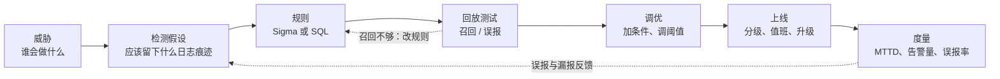
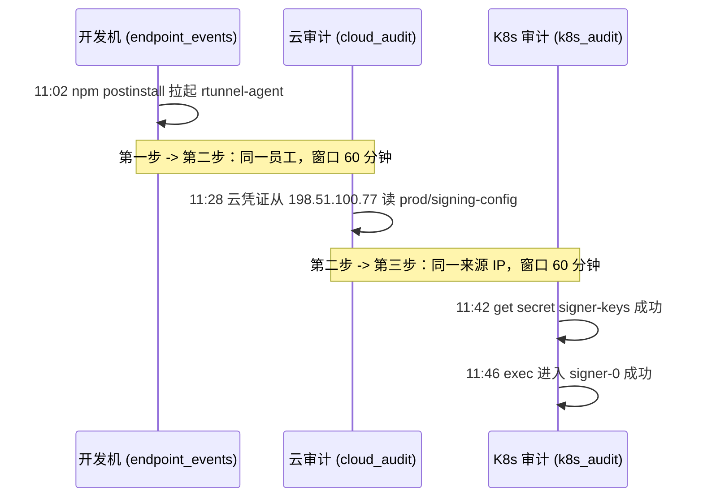

# B73 检测工程实战：把日志变成告警，并证明它有效

> 学习目标：做完本章，你能——
> 1. 从一条"检测假设"出发，写出 SQL 规则，用回放测试量出召回与误报，再调到能上线。
> 2. 写一条"关联规则"：把开发机、云审计、K8s 审计三份日志按时间窗串成一条链。
> 3. 用时间戳算出 MTTD 与分诊工作量，起草 P1–P4 分级与升级路径。
>
> 前置知识：读过 [X05 检测与响应工程](../architecture/X05-detection-response-engineering.md)（6.1、6.5、6.6、6.9、6.12、6.13 节）；会读 SQL（`SELECT`、`JOIN`、`GROUP BY`）；做过 [B72](B72-withdrawal-risk-rules-practice.md) 的规则回放更好；读过 [X03 生产基础设施安全](../architecture/X03-production-infra-security.md) 的签名命名空间部分。
> 预计用时：约 3–4 小时。
> 关联章节：[X05 检测与响应工程](../architecture/X05-detection-response-engineering.md)｜[X03 生产基础设施安全](../architecture/X03-production-infra-security.md)｜[T09 事件手册与值班](../templates/T09-incident-runbook-oncall.md)｜[B74 签名服务独立校验](B74-signing-policy-practice.md)
> 靶场：`practice-example-code/ops/`（MiniEx 模拟交易所；说明见该目录的 `README.md` 与 `API.md`）
> 最后核对：2026-11-23（本章全部命令在本机用系统 `python3` 运行过；输出来自真实运行，数值由固定种子 20260301 决定）

> ⚠️ 警告：法律与道德边界。本章的数据全部由脚本合成，不含真实用户、真实地址或真实密钥。数据里的"攻击"只是日志上的痕迹。不要把本章的规则原样放进真实环境：字段、阈值和白名单都要按你的环境重新回放。不要对你没有授权的系统采集或分析日志。

---

## 开场：一条没人敢上线的规则

X05 里有 11 条示例规则。它们读起来都合理。但没有一条证明过自己：它在哪些日志上跑过？抓到了什么？误报多少？

2025 年，Coinbase 公开披露：被收买的客服人员复制了客户数据；公司称其监控曾在勒索之前发现客服人员访问了与职责无关的数据（公司披露、媒体转述）。发现不等于有效：规则要有人负责调优，告警要有人在时限内处理，这个时限要能量出来。

本章不重讲 X05 的原理。你只做一件事：拿一份有"答案"的日志，把规则写出来，**用数字**证明它有效。

## 1. 本章怎么练

检测工程是一条流水线。本章沿着它走 6 步。



读图要点：
- 实线是一条规则从想法到上线的路。虚线是反馈：回放不达标就回到规则，上线后的度量回到假设。
- "回放测试"是这条流水线里最容易被跳过的一步。没有它，规则只是一句话。
- 局限：本章的回放是在**离线**数据上跑。真实的 SIEM 是流式的，延迟和乱序更多。

本章用到 MiniEx 靶场的 4 类场景：

| 场景 | 内容 | 用到的日志 | 对应 X05 |
|---|---|---|---|
| S5 | 客服夜间批量读 KYC | `support_access` | 规则 7 |
| S6 | 签名服务收到没有审批单、或与审批单不一致的请求 | `signing_requests`、`approvals` | 规则 10 前后的无审批转出 |
| S7 | 开发机失陷：外联工具 → 云凭证被外部使用 → 签名命名空间 | `endpoint_events`、`cloud_audit`、`k8s_audit` | 规则 3、4，6.2 节链式关联 |
| S9 | 噪声：103 个"看起来可疑但正常"的事件 | 上面所有日志 | 6.12 节回放测试 |

> 🎯 打个比方：写检测规则像给烟雾报警器定灵敏度。太敏感，每次煎蛋都响，值班的人会拔电池。太迟钝，火烧起来才响。回放测试就是拿真烟和假烟各点一遍，看它怎么响。局限：真实的"火"不会按剧本出现，靶场里的答案是事先知道的，现实里没有答案，只能靠演练和事后复盘补。

## 2. 准备

> 本章所有命令从 `web3-security-101/` 根目录出发。

1. 生成靶场数据（约 2 秒）：

```bash
bash practice-example-code/ops/setup.sh --no-tests
```

输出的最后一行是：

```text
靶场已就绪：数据在 practice-example-code/ops/data/，答案在 practice-example-code/ops/answers/（练习做完再看）
```

2. 建一个放自己规则的目录。本章所有规则都写在这里：

```bash
mkdir -p my_rules
```

3. 约定：规则文件第一行写 `-- id: 名字`。本章用固定的名字，这样你的输出和下文一致。

> 💡 注意：**先练习，再看 `practice-example-code/ops/answers/`。** `answers/` 里有标准答案和参考规则。如果你先看了，回放的数字就没有意义。

## 3. 第 1 步：从假设开始，不从 SQL 开始

规则是假设的翻译。先写假设，再写规则。每个假设回答 4 个问题：威胁是什么？日志上会留下什么？正常的事件长什么样？谁来处理？

1. 在纸上或文档里填下表。S5 一行已经示例填好，其余三行你自己填：

| 场景 | 威胁 | 日志痕迹（假设） | 正常事件里会混进来的 | 命中后谁处理 |
|---|---|---|---|---|
| S5 | 内部人批量读 KYC，准备外泄 | 没有工单；非办公时间；一小时内读几十个不同账户；有导出 | 合规集中复核；夜班客服；主管峰值 | 值班 + 客服主管 |
| S6 | 签名服务被伪造的请求驱动 | | | |
| S7 | 开发机失陷，攻击者沿云到 K8s 走向签名服务 | | | |
| S9 | 以上所有规则的误报 | — | — | 规则负责人 |

2. 看一眼数据，把"正常"的形状弄清楚。先看客服每人的访问量：

```bash
python3 practice-example-code/ops/lib/logread.py --sql "SELECT staff_id, COUNT(*) n, SUM(ticket_id IS NULL) no_ticket, SUM(ip NOT LIKE '192.0.2.%') off_office, SUM(action='export_kyc') exports FROM support_access GROUP BY staff_id ORDER BY n DESC LIMIT 6"
```

```text
（6 行）
staff_id  n    no_ticket  off_office  exports
--------  ---  ---------  ----------  -------
ST007     440  186        186         0      
ST012     439  0          0           0      
ST003     427  0          0           0      
ST011     423  75         75          1      
ST001     360  0          0           0      
ST009     358  0          0           0      
```

<details class="predict"><summary>🤔 先猜再看：只看这张表，哪两个员工最可疑？ST012 访问量第二，为什么不可疑？</summary>

ST007 和 ST011：只有他们有"无工单"和"非办公出口"的访问，ST011 还有一次导出。ST012 的访问量大，但每一条都有工单、都来自办公出口。ST012 是夜班客服。**访问量本身不是信号**，"没有工单"和"来源不对"才是。这就是写假设时要先看正常形状的原因。

</details>

> 🪞 反思：想一想你负责的系统。哪一类内部访问"量很大但完全正常"？如果规则只看数量，它会先打扰谁？

## 4. 第 2 步：S5 内部人批量读 KYC

目标：写一条规则，抓到 S5 的全部 2 个事件，误报尽量少。

### 4.1 第 1 版：只看数量

X05 规则 7 用"2 倍基线、至少 40 个客户 / 小时"。第 1 版先去掉基线，只留一个固定阈值。

1. 把下面的骨架存成 `my_rules/s5_v1_volume.sql`，把 `____` 补全：

```sql
-- id: s5_v1_volume
-- scenario: S5
-- param: min_reads=20
SELECT staff_id, substr(ts, 1, 13) AS hour, MIN(ts) AS ts, COUNT(DISTINCT ____) AS accounts
FROM support_access
WHERE action IN (____, ____)
GROUP BY staff_id, substr(ts, 1, 13)
HAVING accounts >= :min_reads
```

提示：
- 被读取的账户列是 `target_account_id`。读取 KYC 的动作是 `view_kyc` 和 `export_kyc`。
- `substr(ts, 1, 13)` 取到小时，例如 `2026-03-07T02`。
- 第一行注释里的 `scenario: S5` 告诉回放工具要召回哪个场景。`param:` 是可调参数，SQL 里用 `:min_reads` 引用。

2. 回放：

```bash
python3 practice-example-code/ops/lib/replay.py my_rules/s5_v1_volume.sql --show 4
```

```text
规则：s5_v1_volume   参数：{'min_reads': 20}
目标场景：S5
命中 16 条：TP 4，误报 12（噪声/未解释的不同实体 2），其他场景的真阳性 0
召回：2/2 = 100%   精确率：25%
  [TP] S5-01  {"staff_id": "ST007", "hour": "2026-03-07T02", "ts": "2026-03-07T02:07:06Z", "accounts": 102}
  [TP] S5-01  {"staff_id": "ST007", "hour": "2026-03-07T03", "ts": "2026-03-07T03:00:25Z", "accounts": 80}
  [TP] S5-02  {"staff_id": "ST011", "hour": "2026-03-11T23", "ts": "2026-03-11T23:48:09Z", "accounts": 21}
  [TP] S5-02  {"staff_id": "ST011", "hour": "2026-03-12T00", "ts": "2026-03-12T00:00:15Z", "accounts": 54}
  ……还有 12 条（用 --show N 查看更多）
```

读懂这几行输出：
- "命中"是告警条数。"TP"是命中了答案的告警。"误报 12"是 12 条告警，来自 2 个不同的实体（"不同实体 2"：一次合规集中复核、一个夜班客服）。
- 召回 2/2：两个事件都抓到了。精确率 25%：16 条告警里只有 4 条是真的。
- 14 天 16 条告警，其中 12 条是假的。

3. 看误报是谁。把 `--show` 调到 16，数一数 `[FP-噪声]` 行的标签：

```bash
python3 practice-example-code/ops/lib/replay.py my_rules/s5_v1_volume.sql --show 16 | grep FP | sed 's/  {.*//' | sort | uniq -c
```

```text
   3 [FP-噪声] S9-S5-C1(compliance_campaign)
   9 [FP-噪声] S9-S5-N1(night_shift_ticketed)
```

两类噪声：`compliance_campaign`（合规团队集中复核）和 `night_shift_ticketed`（夜班客服，有工单）。它们的共同点是**有工单**。

### 4.2 第 2 版：加上"没有工单"

1. 复制 v1 为 `my_rules/s5_v2_noticket.sql`，改 3 处：
   - `id` 改成 `s5_v2_noticket`，`min_reads` 改成 40。
   - 在 `WHERE` 里加一个条件：`ticket_id` 为空。
   - `HAVING` 改成"账户数达到阈值，**或者**有导出"。导出需要一列 `SUM(action = 'export_kyc') AS exports`。

提示：SQLite 里 `ticket_id IS NULL` 判断空值。`SUM(条件)` 会把条件为真的行数相加。

2. 回放：

```bash
python3 practice-example-code/ops/lib/replay.py my_rules/s5_v2_noticket.sql
```

```text
规则：s5_v2_noticket   参数：{'min_reads': 40}
目标场景：S5
命中 3 条：TP 3，误报 0（噪声/未解释的不同实体 0），其他场景的真阳性 0
召回：2/2 = 100%   精确率：100%
  [TP] S5-01  {"staff_id": "ST007", "hour": "2026-03-07T02", "ts": "2026-03-07T02:07:06Z", "accounts": 102, "exports": 0}
  [TP] S5-01  {"staff_id": "ST007", "hour": "2026-03-07T03", "ts": "2026-03-07T03:00:25Z", "accounts": 80, "exports": 0}
  [TP] S5-02  {"staff_id": "ST011", "hour": "2026-03-12T00", "ts": "2026-03-12T00:00:15Z", "accounts": 54, "exports": 1}
```

误报从 12 条降到 0 条，召回仍是 2/2。

<details class="predict"><summary>🤔 先猜再看：ST011 的事件读了 74 个账户，但告警里只有 54。其余 20 个账户去哪了？这对检测意味着什么？</summary>

事件跨过了午夜 0 点：23 点那个小时 ST011 读了 21 个账户，低于阈值 40。0 点那个小时读了 54 个，达到阈值。按"整点分桶"统计，攻击者可以把读取量拆在两个桶里。导出动作是第二道保险：只要有导出，就告警。更稳的做法是滑动窗口：任意连续 60 分钟。

</details>

> 💡 注意：这里阈值 40 是"示例"。真实阈值要按你的客服团队基线算（X05 规则 7 用团队 95 分位的 2 倍）。靶场里正常客服在**有工单**的情况下一小时最多读约 24 个账户，所以 40 有余量。

### 4.3 第 3 版：流式触发，让告警更早出现

第 2 版按"整小时"统计。小时结束后才能算出数量，告警必然晚。第 3 版改成：读到第 40 个不同账户的那一刻就触发。这版要输出一列 `fire_ts`，表示"告警该在什么时刻出现"。第 5 步会用它算 MTTD。

1. 把骨架存成 `my_rules/s5_v3_stream.sql`，补全 `____`：

```sql
-- id: s5_v3_stream
-- scenario: S5
-- param: min_reads=40
WITH reads AS (
  SELECT staff_id, substr(ts, 1, 13) AS hour, target_account_id, MIN(ts) AS first_ts
  FROM support_access
  WHERE ticket_id IS NULL AND action IN ('view_kyc', 'export_kyc')
  GROUP BY staff_id, substr(ts, 1, 13), target_account_id
), ranked AS (
  SELECT *, ROW_NUMBER() OVER (PARTITION BY staff_id, hour ORDER BY ____) AS rn FROM reads
)
SELECT staff_id, hour, first_ts AS ts, first_ts AS fire_ts, rn AS accounts, 'bulk_read' AS reason
FROM ranked WHERE rn = ____
UNION ALL
-- 导出：没有工单的导出，在导出发生的那一刻触发
SELECT staff_id, ____, ts, ts, 1, 'export_no_ticket'
FROM support_access WHERE ticket_id IS NULL AND action = 'export_kyc'
```

提示：
- `reads` 先把每个（员工，小时，账户）压成一行，取第一次读取的时间。`ROW_NUMBER()` 按这个时间排序编号。
- 编号等于阈值（`:min_reads`）的那一行，就是"第 40 个不同账户被读取"的时刻。
- 第二段 `SELECT` 的列要和第一段同样多、同样顺序。`UNION ALL` 才能合并。第二段的第二列要给出和 `hour` 同样格式的值。

2. 回放：

```bash
python3 practice-example-code/ops/lib/replay.py my_rules/s5_v3_stream.sql
```

```text
规则：s5_v3_stream   参数：{'min_reads': 40}
目标场景：S5
命中 4 条：TP 4，误报 0（噪声/未解释的不同实体 0），其他场景的真阳性 0
召回：2/2 = 100%   精确率：100%
  [TP] S5-01  {"staff_id": "ST007", "hour": "2026-03-07T02", "ts": "2026-03-07T02:27:12Z", "fire_ts": "2026-03-07T02:27:12Z", "accounts": 40, "reason": "bulk_read"}
  [TP] S5-01  {"staff_id": "ST007", "hour": "2026-03-07T03", "ts": "2026-03-07T03:20:07Z", "fire_ts": "2026-03-07T03:20:07Z", "accounts": 40, "reason": "bulk_read"}
  [TP] S5-02  {"staff_id": "ST011", "hour": "2026-03-12T00", "ts": "2026-03-12T00:23:02Z", "fire_ts": "2026-03-12T00:23:02Z", "accounts": 40, "reason": "bulk_read"}
  [TP] S5-02  {"staff_id": "ST011", "hour": "2026-03-12T00", "ts": "2026-03-12T00:34:00Z", "fire_ts": "2026-03-12T00:34:00Z", "accounts": 1, "reason": "export_no_ticket"}
```

告警时间从"整点之后"提前到"第 40 个账户被读时"。ST007 的第一条告警出现在 02:27，而不是 03:00 以后。

## 5. 第 3 步：S6 签名服务异常（检测侧）

S6 有 3 个事件，都发生在签名服务这一层：
- 有请求没有审批单。
- 请求引用了别人的审批单，但目标地址和金额被换掉。
- 审批单的目标是热钱包，请求的目标被换成陌生地址。

检测侧的想法是：**签名服务收到的每一个请求，都要能在审批表里找到一条一致的记录。** 这是 [B74](B74-signing-policy-practice.md)"独立校验"的日志版。B74 在签名前拦截，本章在事后发现。

### 5.1 第 1 版：没有审批单号

1. 写 `my_rules/s6_v1_no_approval.sql`。条件只有两个：已签名（`signer_result = 'signed'`），且 `approval_id` 为空。输出列用 `request_id, ts, to_address, amount_usd, approval_id`。`scenario` 写 S6，`id` 写 `s6_v1_no_approval`。
2. 回放：

```bash
python3 practice-example-code/ops/lib/replay.py my_rules/s6_v1_no_approval.sql
```

```text
规则：s6_v1_no_approval   参数：无
目标场景：S6
命中 1 条：TP 1，误报 0（噪声/未解释的不同实体 0），其他场景的真阳性 0
召回：1/3 = 33%   精确率：100%
漏掉：S6-02, S6-03
  [TP] S6-01  {"request_id": "SR000538", "ts": "2026-03-06T16:20:00Z", "to_address": "0xd687f6ac55a05f0c8a6c01281aae5dc7dcf5d3c2", "amount_usd": 48000.0, "approval_id": null}
```

精确率 100%，召回 33%。"漏掉"一行告诉你哪些答案没抓到。S6-02 和 S6-03 都**有**审批单号，只是单子和请求对不上。

### 5.2 第 2 版：把请求和审批单"对账"

1. 骨架（存成 `my_rules/s6_v2_mismatch.sql`，补全 `____`）：

```sql
-- id: s6_v2_mismatch
-- scenario: S6
SELECT s.request_id, s.ts, s.to_address, s.amount_usd, s.approval_id,
       CASE WHEN s.approval_id IS NULL THEN 'no_approval'
            WHEN a.approval_id IS NULL THEN 'approval_not_found'
            WHEN s.to_address <> a.to_address THEN 'address_mismatch'
            WHEN s.amount > a.amount * 1.0001 THEN 'amount_exceeds'
            ELSE 'approved_after_request' END AS reason
FROM signing_requests s LEFT JOIN approvals a ON a.approval_id = ____
WHERE s.signer_result = 'signed'
  AND (s.approval_id IS NULL OR a.approval_id IS NULL OR s.to_address <> a.to_address
       OR s.amount > a.amount * 1.0001 OR a.ts ____ s.ts)
```

提示：
- 用 `LEFT JOIN`，这样没有审批单的请求也会保留。
- 审批应该**早于**签名请求。条件反过来写：审批时间晚于请求时间就是异常。
- `1.0001` 是给浮点数留的容差。

2. 回放：

```bash
python3 practice-example-code/ops/lib/replay.py my_rules/s6_v2_mismatch.sql --show 9 | cut -c1-110
```

```text
规则：s6_v2_mismatch   参数：无
目标场景：S6
命中 9 条：TP 3，误报 6（噪声/未解释的不同实体 6），其他场景的真阳性 0
召回：3/3 = 100%   精确率：33%
  [TP] S6-01  {"request_id": "SR000538", "ts": "2026-03-06T16:20:00Z", "to_address": "0xd687f6ac55a05f0c8a6c01281aae5dc7dcf5d3c2", "amount_usd": 48000.0, "approval_id": null,
  [TP] S6-02  {"request_id": "SR000828", "ts": "2026-03-09T21:05:00Z", "to_address": "0xbf491b67d00f3b194114aba65ab6a7bc42d45892", "amount_usd": 60000.0, "approval_id": "AP-W
  [TP] S6-03  {"request_id": "SR001044", "ts": "2026-03-12T02:15:00Z", "to_address": "0x8dc7d972648c15a7fff85370057eb878a8c0c976", "amount_usd": 250000.0, "approval_id": "AP-
  [FP-噪声] S9-S6-C1(address_case_difference)  {"request_id": "SR000127", "ts": "2026-03-02T10:21:36Z", "to_address": "0xC8220d11395a0b68c826fA6bAe5972204578E88A", "amount_usd": 896.0, "approval_id": "AP-W00
  [FP-噪声] S9-S6-C4(address_case_difference)  {"request_id": "SR000235", "ts": "2026-03-03T13:00:54Z", "to_address": "0xA82A4a12b64aBd940dBcaAed2a5C12Aac699D6a3", "amount_usd": 708.0, "approval_id": "AP-W00
  [FP-噪声] S9-S6-C3(address_case_difference)  {"request_id": "SR000252", "ts": "2026-03-03T16:22:21Z", "to_address": "0xC3d532A773b8E2590755217aDd758cB0639492aE", "amount_usd": 819.0, "approval_id": "AP-W00
  [FP-噪声] S9-S6-E1(emergency_post_hoc_approval)  {"request_id": "SR000372", "ts": "2026-03-04T23:10:00Z", "to_address": "0x5f55c81e90920752dcadfaaeef268cbc86daaa8f", "amount_usd": 60000.0, "approval_id": "AP-E
  [FP-噪声] S9-S6-C2(address_case_difference)  {"request_id": "SR000634", "ts": "2026-03-07T17:21:39Z", "to_address": "0xE6724aBd776e3beD927a6627A73Af58bf663C814", "amount_usd": 60000.0, "approval_id": "AP-W00
  [FP-噪声] S9-S6-E2(emergency_post_hoc_approval)  {"request_id": "SR000835", "ts": "2026-03-09T23:10:00Z", "to_address": "0x5f55c81e90920752dcadfaaeef268cbc86daaa8f", "amount_usd": 60000.0, "approval_id": "AP-W
```

召回 3/3，但 9 条告警里有 6 条误报。6 条里 4 条是 `address_case_difference`，2 条是 `emergency_post_hoc_approval`。

### 5.3 第 3 版：处理两类噪声

两类噪声的处理方式**不一样**：

| 噪声 | 原因 | 处理 |
|---|---|---|
| 地址大小写不同 | 以太坊地址的大小写只是校验和写法，同一个地址 | 比较时两边都转小写（`lower()`）。这是**消除噪声** |
| 紧急补签 | 紧急调拨先签名，审批晚到（`approvals.status = 'approved_post_hoc'`） | 从 P1 规则里拿走，但**不能丢**：放到另一条 P3 规则里复核 |

1. 存成 `my_rules/s6_v3_final.sql`（`id` 为 `s6_v3_final`）：在 v2 的基础上，所有地址比较改成 `lower(...) <> lower(...)`；"审批晚于请求"这一项改成"审批晚于请求，**并且**状态不是 `approved_post_hoc`"。
2. 另存 `my_rules/s6_v4_post_hoc.sql`：它的 `id` 是 `s6_v4_post_hoc`，只抓"已签名、审批晚于请求、状态是 `approved_post_hoc`"的请求，输出列再加 `a.approved_by`。
3. 回放两条：

```bash
python3 practice-example-code/ops/lib/replay.py my_rules/s6_v3_final.sql --show 0
python3 practice-example-code/ops/lib/replay.py my_rules/s6_v4_post_hoc.sql --show 0
```

```text
规则：s6_v3_final   参数：无
目标场景：S6
命中 3 条：TP 3，误报 0（噪声/未解释的不同实体 0），其他场景的真阳性 0
召回：3/3 = 100%   精确率：100%
规则：s6_v4_post_hoc   参数：无
目标场景：S6
命中 2 条：TP 0，误报 2（噪声/未解释的不同实体 2），其他场景的真阳性 0
召回：0/3 = 0%   精确率：0%
漏掉：S6-01, S6-02, S6-03
```

`s6_v4_post_hoc` 的"误报"是靶场标注的正常事件。但它不是废规则：它是一条**复核队列**。补签流程本身就是一条绕过审批的路。如果攻击者知道"紧急"可以先签后批，就会把攻击伪装成紧急调拨。所以这 2 条要在次日由第二个人核对。它的级别是 P3，不是"丢弃"。

<details class="predict"><summary>🤔 先猜再看：S6-03 的审批单目标是热钱包，请求目标被换成陌生地址，金额一致。如果规则只比较金额，会抓到吗？</summary>

抓不到。金额一致，只有地址不同。这就是第 2 版里要同时比较**地址、金额、时间**三项的原因。每多一个比较字段，漏报面就小一块。比较的基准全部来自"审批表"，不是来自请求本身：请求里的任何字段都可以被攻击者伪造，审批表是另一个系统写的。

</details>

> 💡 注意：S6 的检测发生在签名**之后**。S6-01 到 S6-03 在日志里都是 `signed`，资金已经离开。事后检测只能缩短发现时间，不能代替 [B74](B74-signing-policy-practice.md) 的事前拦截。

## 6. 第 4 步：S7 开发机失陷，把三份日志串起来

S7 的难点是：每一份日志单独看都"不够可疑"。

- 端点日志：开发机上有人开了隧道工具。开发者开演示隧道很常见。
- 云审计：员工的云凭证在办公出口之外读了 secret。在家用 VPN 的人也会这样。
- K8s 审计：有人进入签名命名空间。值班 SRE 带变更单也会这样。

三件事连起来才是信号：**同一个人、一小时内、先拉起隧道、再从外面用云凭证、再碰签名服务**。

### 6.1 先把 X05 的 Sigma 翻译成 SQL

X05 规则 3 和规则 4 是 Sigma。靶场没有 SIEM，日志在 SQLite 里。翻译对照：

| Sigma 写法 | SQL 写法 | 靶场里的注意事项 |
|---|---|---|
| `logsource: kubernetes / audit` | `FROM k8s_audit` | 表名对应日志源 |
| `objectRef.resource: 'pods'` | `resource = 'pods'` | 靶场把 `objectRef.` 展平成列 |
| `objectRef.subresource: 'exec'` | `subresource = 'exec'` | 同上 |
| `objectRef.namespace: 'signer'` | `namespace = 'signing'` | **名字不同**：靶场的签名命名空间叫 `signing` |
| `Image\|endswith: ['/curl', '/wget']` | `image IN ('curl', 'wget')` | 靶场只存进程名，不存路径 |
| `ParentCommandLine\|contains: 'install'` | `cmdline LIKE '%install%'` | 注意是 `cmdline` 列 |
| `selection_a and selection_b` | `WHERE a AND b` | 多个 selection 合成一个 `WHERE` |
| `falsepositives:` | 调优条件 | 例如"有变更单号"对应 `annotations` 里的 `change_id` |

1. 把 X05 规则 3 直译成 `my_rules/x05_rule3_exec_signing.sql`（`id` 为 `x05_rule3_exec_signing`）。条件：`verb = 'create'`、`resource = 'pods'`、`subresource = 'exec'`、`namespace = 'signing'`。输出列用 `user AS staff_id, ts, source_ip AS ip, name, response_code`。`scenario` 写 S7。
2. 把 X05 规则 4 直译成 `my_rules/x05_rule4_pkg_spawns_net.sql`（`id` 为 `x05_rule4_pkg_spawns_net`）：进程启动，父进程是 `node` 或 `python3`，子进程是 `curl`、`wget`、`nc`。输出列用 `user AS staff_id, host, ts, image, parent_image`。
3. 回放：

```bash
python3 practice-example-code/ops/lib/replay.py my_rules/x05_rule3_exec_signing.sql --show 2
python3 practice-example-code/ops/lib/replay.py my_rules/x05_rule4_pkg_spawns_net.sql
```

```text
规则：x05_rule3_exec_signing   参数：无
目标场景：S7
命中 7 条：TP 1，误报 6（噪声/未解释的不同实体 6），其他场景的真阳性 0
召回：1/2 = 50%   精确率：14%
漏掉：S7-02
  [TP] S7-01  {"staff_id": "ST021", "ts": "2026-03-09T11:46:00Z", "ip": "198.51.100.77", "name": "signer-0", "response_code": 101}
  [FP-噪声] S9-S7-E1(sre_exec_with_change)  {"staff_id": "ST034", "ts": "2026-03-02T13:31:00Z", "ip": "192.0.2.2", "name": "signer-0", "response_code": 101}
  ……还有 5 条（用 --show N 查看更多）
规则：x05_rule4_pkg_spawns_net   参数：无
目标场景：S7
命中 0 条：TP 0，误报 0（噪声/未解释的不同实体 0），其他场景的真阳性 0
召回：0/2 = 0%   精确率：n/a
漏掉：S7-01, S7-02
```

这两个结果各说明一件事：
- **规则 3 直译**：召回 1/2，误报 6 条（值班 SRE 带变更单的排障）。X05 说"若允许 exec，要求 PAM 工单，规则关联工单后降级"，直译版没有做这一步。它还漏掉 S7-02：那次是 `get secrets` 被拒绝（403），不是 exec。
- **规则 4 直译**：命中 0 条。回放告诉你：这条规则在这份数据上**从不触发**。规则没有错，是攻击者用的进程不在它的列表里。S7 里的外联工具是自定义的 `rtunnel-agent`，不是 `curl`。静默的规则比吵闹的规则更危险，因为没有人会发现它没有用。

> 💡 注意：召回 0% 不一定说明规则没用。它说明"这份数据里没有这类事件"，或者"规则漏了这类事件"。要靠演练区分。X05 的规则 4 针对的是"安装脚本里下载外联工具"这一种手法，靶场里是另一种。

<details class="predict"><summary>🤔 先猜再看：如果你把规则 4 的子进程列表扩大成"任何外联隧道工具"，召回会升到 2/2，误报会怎样？</summary>

误报会升高，因为开发者开演示隧道（ngrok、cloudflared）也是隧道工具。靶场里这类噪声有 3 个。下一小节你会亲手量出来。

</details>

### 6.2 三条单源规则：各自都吵

分别写三条规则，每条只看一份日志。保存为：

| 文件 | 日志 | 条件（用自己的话写成 SQL） |
|---|---|---|
| `my_rules/s7_a_endpoint_tunnel.sql` | `endpoint_events` | 进程启动（`event_type = 'process_start'`），且 `image` 是 `ngrok`、`cloudflared`、`rtunnel-agent` 之一 |
| `my_rules/s7_b_cloud_external_secret.sql` | `cloud_audit` | `identity_type = 'user'`、`action = 'GetSecretValue'`、来源 IP 不在办公出口（`source_ip NOT LIKE '192.0.2.%'`） |
| `my_rules/s7_c_k8s_signing_no_change.sql` | `k8s_audit` | 命名空间是 `signing`、`user_type = 'human'`、`annotations` 里没有 `change_id`（用 `json_extract(annotations, '$.change_id') IS NULL`） |

三条的 `id` 就是文件名（去掉 `.sql`），`scenario` 都写 S7。输出列统一用 `staff_id`（云审计里写 `identity AS staff_id`）、`ts`、`ip` 或 `host`，至少包含一个可对答案的列。

```bash
for f in s7_a_endpoint_tunnel s7_b_cloud_external_secret s7_c_k8s_signing_no_change; do python3 practice-example-code/ops/lib/replay.py my_rules/$f.sql --show 0 | sed -n 1,4p; done
```

```text
规则：s7_a_endpoint_tunnel   参数：无
目标场景：S7
命中 5 条：TP 2，误报 3（噪声/未解释的不同实体 3），其他场景的真阳性 0
召回：2/2 = 100%   精确率：40%
规则：s7_b_cloud_external_secret   参数：无
目标场景：S7
命中 4 条：TP 2，误报 2（噪声/未解释的不同实体 2），其他场景的真阳性 0
召回：2/2 = 100%   精确率：50%
规则：s7_c_k8s_signing_no_change   参数：无
目标场景：S7
命中 3 条：TP 3，误报 0（噪声/未解释的不同实体 0），其他场景的真阳性 0
召回：2/2 = 100%   精确率：100%
```

整理成一张对比：

| 规则 | 告警 | 真阳性 | 误报 | 精确率 | 召回 |
|---|---:|---:|---:|---:|---|
| A 端点：隧道进程 | 5 | 2 | 3 | 40% | 2/2 |
| B 云：外部读 secret | 4 | 2 | 2 | 50% | 2/2 |
| C K8s：无变更单进签名命名空间 | 3 | 3 | 0 | 100% | 2/2 |

规则 C 看起来最好。但看它**什么时候**触发：它在攻击者已经走到签名命名空间之后才触发。A 和 B 早，但吵。关联规则的目的，就是用 A 和 B 的"早"，再用"同一个人、时间窗内连续发生"去掉它们的"吵"。

### 6.3 关联规则：两步与三步



读图要点：
- 三份日志没有共同的"会话 ID"。能连起来的只有两个键：**员工号**（端点、云、K8s 里都有）和**来源 IP**（云与 K8s 里都有）。
- 每一步的时间窗是 `win_min` 分钟。窗口太短，链断；窗口太长，无关事件被连到一起。
- 局限：这条链依赖"员工号一致"。攻击者如果用服务账号或别人的凭证，链就断了。关联规则不能代替单源规则。

1. 写 `my_rules/s7_d_chain2.sql`（两步）。骨架：

```sql
-- id: s7_d_chain2
-- scenario: S7
-- param: win_min=60
SELECT e.user AS staff_id, e.host, e.ts AS ts, c.ts AS fire_ts, c.source_ip AS ip
FROM endpoint_events e
JOIN cloud_audit c
  ON c.identity = ____
 AND c.action = 'GetSecretValue'
 AND c.source_ip NOT LIKE '192.0.2.%'
 AND c.ts BETWEEN e.ts AND strftime('%Y-%m-%dT%H:%M:%SZ', e.ts, '+' || :win_min || ' minutes')
WHERE e.event_type = 'process_start' AND e.image IN ('ngrok', 'cloudflared', 'rtunnel-agent')
```

提示：
- `ON` 里的第一个条件把两张表按"同一员工"连起来。端点日志的员工列是 `user`，云审计的是 `identity`。
- 时间窗用 `BETWEEN 起点 AND 起点 + N 分钟`。日期时间字符串是 ISO 格式，可以直接比较大小。
- `fire_ts` 取**最后一步**的时间。告警在整条链凑齐时才出现。

2. 写 `my_rules/s7_e_chain3.sql`（三步，`id` 为 `s7_e_chain3`）：在两步规则上，再 `JOIN k8s_audit k`。条件是 `k.user = e.user`、`k.namespace = 'signing'`、`k.source_ip = c.source_ip`，且 `k.ts` 在 `c.ts` 之后 `win_min` 分钟内。`fire_ts` 改成 `k.ts`，输出再加 `k.verb, k.resource, k.response_code`。

3. 回放，并故意把窗口调短：

```bash
python3 practice-example-code/ops/lib/replay.py my_rules/s7_d_chain2.sql
python3 practice-example-code/ops/lib/replay.py my_rules/s7_e_chain3.sql --show 3 | cut -c1-120
python3 practice-example-code/ops/lib/replay.py my_rules/s7_d_chain2.sql --param win_min=20
```

```text
规则：s7_d_chain2   参数：{'win_min': 60}
目标场景：S7
命中 2 条：TP 2，误报 0（噪声/未解释的不同实体 0），其他场景的真阳性 0
召回：2/2 = 100%   精确率：100%
  [TP] S7-01  {"staff_id": "ST021", "host": "dev-mbp-021", "ts": "2026-03-09T11:02:06Z", "fire_ts": "2026-03-09T11:28:00Z", "ip": "198.51.100.77"}
  [TP] S7-02  {"staff_id": "ST024", "host": "dev-mbp-024", "ts": "2026-03-12T15:10:06Z", "fire_ts": "2026-03-12T15:36:00Z", "ip": "198.51.100.78"}
规则：s7_e_chain3   参数：{'win_min': 60}
目标场景：S7
命中 3 条：TP 3，误报 0（噪声/未解释的不同实体 0），其他场景的真阳性 0
召回：2/2 = 100%   精确率：100%
  [TP] S7-01  {"staff_id": "ST021", "host": "dev-mbp-021", "ts": "2026-03-09T11:02:06Z", "fire_ts": "2026-03-09T11:42:00
  [TP] S7-01  {"staff_id": "ST021", "host": "dev-mbp-021", "ts": "2026-03-09T11:02:06Z", "fire_ts": "2026-03-09T11:46:00
  [TP] S7-02  {"staff_id": "ST024", "host": "dev-mbp-024", "ts": "2026-03-12T15:10:06Z", "fire_ts": "2026-03-12T15:50:00
规则：s7_d_chain2   参数：{'win_min': 20}
目标场景：S7
命中 0 条：TP 0，误报 0（噪声/未解释的不同实体 0），其他场景的真阳性 0
召回：0/2 = 0%   精确率：n/a
漏掉：S7-01, S7-02
```

关联让误报从 3 条（规则 A）和 2 条（规则 B）降到 0。但窗口从 60 分钟改成 20 分钟，召回变成 0：从隧道起到云凭证被外部使用，S7-01 和 S7-02 都隔了 26 分钟，超过 20。

<details class="predict"><summary>🤔 先猜再看：三步规则对 S7-01 给出两条告警（读 secret、exec），对 S7-02 一条（读 secret 被拒绝）。值班的人想看"一个事件一条告警"，规则该怎么改？</summary>

按"员工 + 主机 + 链起点"分组，只保留最早的一条，其余作为证据附在告警里。这叫**告警去重（Deduplication）**。靶场回放按每行算一次命中，所以 3 条里"真阳性 3"对应 2 个场景。真实的 SIEM 里要在规则输出这一层去重，否则分诊工作量会虚高。

</details>

> 💡 注意：S7-02 的最后一步是 403（被拒绝）。三步规则仍然触发了，因为它匹配的是"访问企图"，不要求成功。攻击者试过一次且被拦下，也说明凭证已经失陷，响应要按 P1 做。

## 7. 第 5 步：用时间戳算 MTTD

MTTD（Mean Time To Detect，平均检测时间）：从恶意动作**真正开始**，到告警**出现**的时间。X05 7.1 节的提醒是：起点用事后还原的，不用告警时间。

靶场的 `answers/` 给了每个事件事后还原的起点（`window.start`）。本章的脚本 `mttd.py` 把"起点"和你规则输出里的 `fire_ts`（没有就用 `ts`）相减。规则不是实时跑的，它按固定间隔调度，所以脚本把告警时间取整到下一个调度时刻。

1. 看脚本的用法（脚本在 `practice-example-code/ops/solutions/b73/`，读者可以直接用）：

```bash
python3 practice-example-code/ops/solutions/b73/mttd.py
```

```text
B73：计算规则的 MTTD（从事后还原的真实起点，到告警触发的时间）。

用法（从 web3-security-101/ 出发）：
  python3 practice-example-code/ops/solutions/b73/mttd.py 规则.sql[:调度间隔分钟] ...

起点：answers/ 里每个正例的 window.start（事后还原的真实起点）。
触发时间：规则输出的 fire_ts 列（没有就用 ts 列），再向后取整到下一个调度时刻。
调度间隔默认 5 分钟：规则每 5 分钟跑一次，事件发生后最多再等 5 分钟才出告警。
```

2. 比较 S5 的两版规则。v2 按整小时统计，每小时跑一次（文件名后加 `:60`）；v3 是流式触发，每 5 分钟跑一次：

```bash
python3 practice-example-code/ops/solutions/b73/mttd.py my_rules/s5_v2_noticket.sql:60 my_rules/s5_v3_stream.sql:5
```

```text
规则                         答案      真实起点                 告警时间                 MTTD
s5_v2_noticket             S5-01   03-07 02:07:00       03-07 03:00:00       0:53:00
s5_v2_noticket             S5-02   03-11 23:48:00       03-12 01:00:00       1:12:00
s5_v3_stream               S5-01   03-07 02:07:00       03-07 02:30:00       0:23:00
s5_v3_stream               S5-02   03-11 23:48:00       03-12 00:25:00       0:37:00
```

两版规则抓到的事件相同，但 MTTD 从 53 / 72 分钟降到 23 / 37 分钟。MTTD 由规则的**触发方式**决定，不只由阈值决定。

3. 比较 S6 与 S7 的各版规则：

```bash
python3 practice-example-code/ops/solutions/b73/mttd.py my_rules/s6_v3_final.sql my_rules/s7_c_k8s_signing_no_change.sql my_rules/s7_d_chain2.sql my_rules/s7_e_chain3.sql
```

```text
规则                         答案      真实起点                 告警时间                 MTTD
s6_v3_final                S6-01   03-06 16:20:00       03-06 16:20:00       0:00:00
s6_v3_final                S6-02   03-09 21:05:00       03-09 21:05:00       0:00:00
s6_v3_final                S6-03   03-12 02:15:00       03-12 02:15:00       0:00:00
s7_c_k8s_signing_no_change S7-01   03-09 11:02:00       03-09 11:45:00       0:43:00
s7_c_k8s_signing_no_change S7-02   03-12 15:10:00       03-12 15:50:00       0:40:00
s7_d_chain2                S7-01   03-09 11:02:00       03-09 11:30:00       0:28:00
s7_d_chain2                S7-02   03-12 15:10:00       03-12 15:40:00       0:30:00
s7_e_chain3                S7-01   03-09 11:02:00       03-09 11:45:00       0:43:00
s7_e_chain3                S7-02   03-12 15:10:00       03-12 15:50:00       0:40:00
```

读表：
- S7 的两步规则比 K8s 单源规则早 15 分钟（S7-01）和 10 分钟（S7-02）告警，因为它不等攻击者走到签名命名空间。代价是只能定 P2，因为它还没有碰签名服务。
- S6 的 MTTD 是 0，**但这是下限**。S6 的起点取的是"签名请求出现"的时刻。真实的攻击起点（伪造请求之前的动作）在靶场里没有日志。三个请求时间恰好落在 5 分钟整点，真实环境里还会有 0–5 分钟的调度延迟。
- X05 给的目标是"P1 类 MTTD < 15 分钟"。三步规则（40–43 分钟）不达标，两步规则（28–30 分钟）也不达标。要达标，需要更早的信号，例如端点上"包安装进程拉起未知外联进程"本身直接告警，并接受更高的误报。

> ⚠️ 警告：MTTD 的数字取决于"起点"怎么定。把起点定在"第一条告警"，数字会好看，但没有意义。本章的做法是用 `answers/` 里事后还原的起点。你在真实事件里要用复盘还原的起点。

> 🪞 反思：S7 的两步规则在攻击开始约 28 分钟后告警。攻击者在这 28 分钟里已经能做什么？你的 P2 响应时限（X05 示例是 15 分钟确认、1 小时处置）够不够？

## 8. 第 6 步：告警量、分诊工作量与分级

规则调优的目的不是"好看的精确率"，而是值班的人每天要处理多少告警。`triage.py` 估算这个数字：每条规则带一个级别，每个级别有一个示例分诊时间（P1 30 分钟、P2 20、P3 10、P4 3；这些是本手册示例值，按你的团队实测调整）。

1. 先算"朴素版"规则集（本章各规则的第一版）。每个参数是 `规则文件=级别`：

```bash
python3 practice-example-code/ops/solutions/b73/triage.py my_rules/s5_v1_volume.sql=P2 my_rules/s6_v2_mismatch.sql=P1 my_rules/s7_a_endpoint_tunnel.sql=P2 my_rules/s7_b_cloud_external_secret.sql=P3
```

```text
规则                           级别      告警     误报     日均告警     分诊分钟
s5_v1_volume                 P2      16     12      1.1      320
s6_v2_mismatch               P1       9      6      0.6      270
s7_a_endpoint_tunnel         P2       5      3      0.4      100
s7_b_cloud_external_secret   P3       4      2      0.3       40
合计                                   34     23      2.4      730
分诊总时间 12.2 小时；日均 52.1 分钟
```

2. 再算"调优版"规则集：

```bash
python3 practice-example-code/ops/solutions/b73/triage.py my_rules/s5_v3_stream.sql=P2 my_rules/s6_v3_final.sql=P1 my_rules/s6_v4_post_hoc.sql=P3 my_rules/s7_d_chain2.sql=P2 my_rules/s7_e_chain3.sql=P1
```

```text
规则                           级别      告警     误报     日均告警     分诊分钟
s5_v3_stream                 P2       4      0      0.3       80
s6_v3_final                  P1       3      0      0.2       90
s6_v4_post_hoc               P3       2      2      0.1       20
s7_d_chain2                  P2       2      0      0.1       40
s7_e_chain3                  P1       3      0      0.2       90
合计                                   14      2      1.0      320
分诊总时间 5.3 小时；日均 22.9 分钟
```

| 对比 | 朴素版 | 调优版 |
|---|---:|---:|
| 告警总数（14 天） | 34 | 14 |
| 误报告警 | 23 | 2 |
| 日均分诊分钟 | 52.1 | 22.9 |
| 覆盖的场景 | S5、S6、S7 | S5、S6、S7，另加补签复核队列 |

调优版把告警减少 59%，分诊时间减少 56%，同时多了一条复核队列。剩下的 2 条"误报"是故意保留的：它们是补签复核队列。

> 💡 注意：这是 **3 个场景**的数字。真实的检测库有几十条规则，每条都叠加噪声。靶场的 S9 在每个场景周围放了噪声，但没有真实系统那么多。拿这个数字估算真实工作量时要乘一个大于 1 的系数。

### 8.1 起草分级与升级路径

依据 X05 6.13 节的 P1–P4 表和你刚算出的数字，为本章的规则起草分级。示例答案一行已填，其余留给你：

| 规则 | 级别 | 理由 | 确认时限（示例） | 谁被叫醒 | 第一步动作 |
|---|---|---|---|---|---|
| s6_v3_final | P1 | 资金已经按伪造请求转出，或可能转出 | 5 分钟 | 值班、钱包负责人、安全负责人 | 暂停签名服务的出金，保留请求与审批记录 |
| s7_e_chain3 | | | | | |
| s7_d_chain2 | | | | | |
| s5_v3_stream | | | | | |
| s6_v4_post_hoc | | | | | |

要求：
1. 每一行都要写**第一步动作**。动作必须是一个人在一个控制台上能执行的，例如"吊销该员工的云会话令牌"，而不是"调查"。
2. 画一条升级路径：谁先看、多久没确认就叫谁、什么证据让 P2 升 P1。用 3–5 句话写出来，参考 [T09](../templates/T09-incident-runbook-oncall.md)。
3. 回答：`s7_d_chain2` 命中后，如果 10 分钟内同一员工又触发 `s7_c_k8s_signing_no_change`，规则应该怎么升级？写成一句"升级条件"。

<details class="predict"><summary>🤔 先猜再看：s5_v3_stream 是 P2，还是 P1？</summary>

本手册的建议是 P2：数据外泄是严重事件，但**不是资金立即被盗**。X05 的定义里，P1 是"资金或密钥正在或可能被盗"。S5 的响应动作是"冻结该客服账号的 KYC 读权限、保留日志、通知合规"。如果你的业务里 KYC 数据泄露有 24 小时内监管通报义务，你可以把它升到 P1。这个选择要和法务、合规一起定，不是安全团队单独定。

</details>

## 9. 和标准答案对照

做完上面所有步骤，再对照参考答案。

1. 参考规则在 `practice-example-code/ops/answers/reference_rules/`。和本章相关的是：
   - `r08_support_bulk_no_ticket.sql`（S5）
   - `r09_signing_without_approval.sql`、`r10_chain_tx_without_request.sql`（S6）
   - `r11_dev_chain_to_signing.sql`（S7）
2. 本章每一版规则的参考实现在 `practice-example-code/ops/solutions/b73/rules/`。文件名与你写的文件名一致。
3. 用汇总命令一次回放本章全部参考规则：

```bash
python3 practice-example-code/ops/lib/replay.py --dir practice-example-code/ops/solutions/b73/rules
```

```text
规则                                 场景          命中   TP   误报        召回
s5_v1_volume.sql                   S5          16    4   12       2/2
s5_v2_noticket.sql                 S5           3    3    0       2/2
s5_v3_stream.sql                   S5           4    4    0       2/2
s6_v1_no_approval.sql              S6           1    1    0       1/3
s6_v2_mismatch.sql                 S6           9    3    6       3/3
s6_v3_final.sql                    S6           3    3    0       3/3
s6_v4_post_hoc.sql                 S6           2    0    2       0/3
s7_a_endpoint_tunnel.sql           S7           5    2    3       2/2
s7_b_cloud_external_secret.sql     S7           4    2    2       2/2
s7_c_k8s_signing_no_change.sql     S7           3    3    0       2/2
s7_d_chain2.sql                    S7           2    2    0       2/2
s7_e_chain3.sql                    S7           3    3    0       2/2
x05_rule3_exec_signing.sql         S7           7    1    6       1/2
x05_rule4_pkg_spawns_net.sql       S7           0    0    0       0/2
```

对照时看三件事：
- 你的数字和表里的是否一致。不一致，先对比 `WHERE` 条件，再对比 `GROUP BY`。
- 参考规则 `r09` 与本章 `s6_v3_final` 的区别：参考规则把补签请求也保留在告警里（2 个误报）。本章把它们移到 P3 复核队列。两种做法都对，区别是谁来承担这 2 条告警的分诊。
- 参考规则 `r11` 额外排除了一组"已知良好进程"。本章用"隧道进程列表"。想一想：哪种做法对新出现的外联工具更敏感？

> 💡 注意：数字一致不等于你的规则和答案**一样**。回放只看命中，不看写法。两条写法不同的规则可以有相同的数字。

## 10. 检查清单

本章使用 RUL 前缀。右列给出 X05 控制项和章节的对应编号：

| 检查项 | 内容 | 本章练习 | 对应 | 结论 | 证据 |
|---|---|---|---|---|---|
| **RUL-1** | 每条规则从一条检测假设出发，写明威胁、日志痕迹、正常情况与负责人 | 第 1 步 | DET-7 | | |
| **RUL-2** | 每条规则上线前在已标注的日志上回放，记录召回与误报 | 第 2–4 步 | DET-7、DET-8、X05 6.12 | | |
| **RUL-3** | 规则的误报有分类：消除、降级到复核队列，或接受；不靠关掉规则来消除噪声 | 第 2 步 4.2、第 3 步 5.3 | DET-8 | | |
| **RUL-4** | 关键链路有关联规则，窗口和关联键有记录，并做过"窗口太短"的测试 | 第 4 步 | X05 6.2 | | |
| **RUL-5** | 规则输出带触发时间，MTTD 以事后还原的起点计算 | 第 5 步 | X05 7.1 | | |
| **RUL-6** | 每条规则有级别、确认时限、第一步动作和升级条件 | 第 6 步 | DET-4、DET-5 | | |
| **RUL-7** | 规则集的日均告警和分诊时间已估算，值班团队能承受 | 第 6 步 | DET-4、DET-8 | | |

定级用 [A02](../assessment/A02-risk-rating-reporting.md) 复核。检测覆盖缺口按 [T12](../templates/T12-security-architecture-review.md) 记录。

## 11. 如果出错

| 现象 | 原因 | 处理 |
|---|---|---|
| `replay.py` 报找不到规则文件 | 路径写错，或不在 `web3-security-101/` 根目录 | `pwd` 确认目录；规则放在 `my_rules/` |
| 命中 0 条，但你认为应该有 | 字段值写错（例如 `signer` 与 `signing`），或 `scenario` 写错 | 用 `logread.py` 查字段的真实取值：`logread.py --sql "SELECT DISTINCT namespace FROM k8s_audit"` |
| 召回里出现"漏掉：…" | 规则没有输出可对答案的列（`staff_id`、`ip`、`request_id`、`host` 等） | 查 `API.md` 3.4 节的"命中字段"列表，把输出列改名 |
| `no such column` | 列名拼错，或日志里的嵌套字段没用 `json_extract` | `logread.py --schema 表名` 查列 |
| `mttd.py` 的告警时间比预期晚很多 | 调度间隔太大，或没有输出 `fire_ts` | 给规则文件名加 `:5`；规则输出里加 `fire_ts` 列 |
| 数字与本章差 1–2 条 | 重新生成数据时换了种子 | `bash practice-example-code/ops/setup.sh --no-tests`（默认种子 20260301） |

## 12. 过关标准

用 `replay.py` 的数字判断。下面的"误报"指告警条数。数值取自靶场回放，**没有标准答案也能判断**。

- [ ] S5：`my_rules/s5_v3_stream.sql` 召回 2/2，误报 ≤ 2。（参考实现：召回 2/2，误报 0。）命令：

```bash
python3 practice-example-code/ops/lib/replay.py my_rules/s5_v3_stream.sql --min-recall 1.0 --max-fp 2 > /dev/null; echo "退出码 $?"
```

```text
退出码 0
```

- [ ] S5 的朴素版 `s5_v1_volume.sql`（阈值 20）能量出：16 条告警，误报 12 条。并能说出两类噪声的名字。
- [ ] S6：`my_rules/s6_v3_final.sql` 召回 3/3，误报 ≤ 2。（参考实现：召回 3/3，误报 0。）补签复核规则 `s6_v4_post_hoc.sql` 命中 2 条。
- [ ] S7：关联规则 `s7_d_chain2.sql` 召回 2/2，误报 0；三条单源规则的误报分别是 3、2、0 条。
- [ ] S7：能解释 `win_min=20` 时召回为什么变成 0/2。
- [ ] MTTD：S5 流式规则的 MTTD 不超过 40 分钟（参考：23 / 37 分钟）；S7 两步规则不超过 35 分钟（参考：28 / 30 分钟）。
- [ ] 工作量：调优版规则集的日均分诊时间不超过朴素版的一半（参考：22.9 与 52.1 分钟）。
- [ ] 完成 8.1 节的分级表，每条规则有第一步动作；写出"P2 升 P1"的升级条件。

## 13. 思考题

1. S5 第 2 版按"整点分桶"，ST011 的 74 个账户被拆成 21 + 54。攻击者知道了阈值是 40，会把每小时读取量压到 39。用滑动窗口能解决吗？如果攻击者连续 10 个小时每小时读 39 个，你要补一条什么规则？（提示：想"每天累计"和"与基线比"。）
2. 关联规则的关联键是"员工号"。攻击者如果换成一个服务账号去访问 K8s，链会在哪一步断？请写出一条不依赖员工号的补充规则，并说明它的误报来源。
3. S6 的补签复核队列（P3）有 2 条"误报"。如果紧急补签的数量变成每天 50 条，这个队列会发生什么？应该改审批流程，还是改检测规则？

- 下一篇：[B74 签名服务独立校验与调拨审批实战](B74-signing-policy-practice.md)。本章在签名**之后**发现 S6；B74 把同一个对账逻辑放到签名**之前**，用"独立校验"拒绝这 3 个请求，并做调拨审批。你在第 3 步写的 `approval_id` 对账 SQL，就是 B74 里签名策略的原型。
