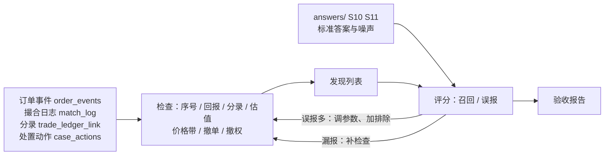

# B79 交易与账务回放验收实战：序号、撮合、分录与异常价格

> 学习目标：做完本章，你能——
> 1. 对一段订单与成交数据做"回放验收"：查订单序号的缺口与冲突，核撮合日志与成交回报，核成交与分录的借贷平衡和估值。
> 2. 对价格带、撤单与撤权后的行为做回放，说清每条检查的参数怎样在"召回"和"误报"之间取舍，并能不看标准答案就判断一条发现是不是真问题。
> 3. 自己写出验证脚本，算出召回与误报，写出一份可以交给业务负责人的验收报告。
>
> 前置知识：会读 Python 脚本和命令行输出；读过 [X21 第 4.1–4.4 节与第 5 节](../architecture/X21-cex-trading-verification.md)（验收用例与回放方法）；读过 [X13 第 3.4、3.5、3.7 节](../architecture/X13-cex-trading-settlement-credit.md)（价格保护、账务一致性、撤单）。建议先完成 [B70 L3 导读](B70-offchain-l3-guide.md)。
> 预计用时：约 3–4 小时。
> 关联章节：[X21 交易、结算与信用·工程验收](../architecture/X21-cex-trading-verification.md)｜[X13 交易、结算与信用](../architecture/X13-cex-trading-settlement-credit.md)｜[B72 提币与账户风控规则实战](B72-withdrawal-risk-rules-practice.md)｜[B80 复市与恢复演练](B80-resumption-recovery-practice.md)
> 靶场：`code/offchain-ops/`（第二批数据 `data_x/`；字段与场景见该目录的 `API_X.md`）
> 最后核对：2026-11-23（Python 3.12.3；下文每条命令都在本机从仓库根目录用系统 `python3` 运行过，输出来自真实运行，数值由第二批种子 20260302 固定）

> ⚠️ 警告：法律与道德边界。本章的数据是虚构交易所"MiniEx"的合成数据，不含真实用户、真实地址和真实密钥。本章只教你怎样在受控数据上验收交易系统，不教怎样对真实系统制造异常订单或异常价格。不要把本章的阈值直接搬到真实系统：上线前必须用你自己的历史数据回放。

---

## 开场：账是平的，钱却多了十倍

在 MiniEx 的两周数据里，有 2 笔成交的计价币分录，金额恰好是"价格 × 数量"的 10 倍。其中一笔：ETH 价格 3358.72，数量 32.4188，应入账 108,885.67 USDT，账上记了 1,088,856.70 USDT。

最麻烦的是：这两笔账的借方和贷方仍然相等。"每笔成交借贷平衡"这条最基础的对账规则，对它们完全沉默。只有把价格和数量**重新乘一遍**，才会发现。

同一个交易日里还有：一个品种的订单序号凭空少了 12 个，4 笔大额成交没有任何分录，3 笔成交的分录借贷不平。五天后，还有价格偏离标记价 36%–41% 却成交的订单，以及撤单、撤权之后仍然成交的订单。

这些问题不是黑客造成的，是系统自己出的。验收要做的，是在上线前、事故后，用**回放**把它们逐类找出来，并且知道自己的检查有多少漏报、多少误报。

## 1. 本章怎么练

原理不在这里重讲：验收对象与信任边界见 [X21 第 2 节](../architecture/X21-cex-trading-verification.md)，回放方法见 X21 第 5 节，撤权与异常价格的参考判定见 X21 第 7 节；价格保护、账务一致性设计见 [X13 第 3 节](../architecture/X13-cex-trading-settlement-credit.md)。本章只做一件事：在 MiniEx 的订单、撮合、分录数据上把这些检查跑起来，读数字，调参数，写报告。

> 🎯 打个比方：回放验收像年终盘点仓库。账面写着"入库 12 箱"，你要做的是回到仓库，把每个货架实际数一遍：箱数对不对（序号）、出库单和入库单对不对得上（回报与成交）、单价乘数量是不是账上的金额（估值）、已经作废的出库单后面有没有货被拿走（撤单后成交）。局限：仓库不会在你盘点时继续进货，而交易系统是流动的；所以真实验收还要加上 X21 第 9 节的并发与故障注入。



读图要点：
- 数据与答案固定，你每次改参数，变的只有检查。数字的变化就是改动的效果。
- 评分口径：发现命中答案记 TP；命中"其他场景"的答案不算误报；其余是误报，其中命中噪声清单的叫"噪声"。召回按答案条数算，**不按成交笔数**。这个口径会掩盖局部漏报，第 3、4 步会各撞到一次。
- 局限：真实系统没有标准答案。所以每一步都附一个"没有标准答案也能判断"的办法：用原始数据重算、让两种独立实现互相印证。

本章有 8 个步骤（第 0–7 步）：

| 步骤 | 场景 | 检查 | 要学的东西 |
|---|---|---|---|
| 0 | — | 准备数据，认识四张表 | 看懂数据 |
| 1 | S10 | 序号缺口与冲突 | 哪些"缺口"是正常的 |
| 2 | S10 | 撮合日志对成交回报 | 缺口的后果 |
| 3 | S10 | 成交对分录：缺失、不平、估值 | 平衡检查看不见的错；容忍度的单位 |
| 4 | S11 | 价格带 | 阈值贴着正常波动 |
| 5 | S11 | 撤单后成交、撤权后受理 | 竞态与宽限的取舍 |
| 6 | S10、S11 | 自己写检查并交叉印证 | 两种实现互相验证 |
| 7 | S10、S11 | 验收报告 | 把数字变成结论与整改 |

## 2. 第 0 步：准备，认识数据

> 💡 注意：以下所有命令都从 `web3-security-101/` 根目录出发。

1. 确认第二批数据存在：

```bash
ls code/offchain-ops/data_x/order_events.jsonl
```

```text
code/offchain-ops/data_x/order_events.jsonl
```

如果提示文件不存在，先运行 `bash code/offchain-ops/setup.sh --no-tests`（会生成两批数据）。

2. 数据量。四张表的行数（`wc -l` 对 CSV 含表头一行）：

```bash
wc -l code/offchain-ops/data_x/order_events.jsonl code/offchain-ops/data_x/match_log.jsonl code/offchain-ops/data_x/trade_ledger_link.csv code/offchain-ops/data_x/case_actions.jsonl
```

```text
   22242 code/offchain-ops/data_x/order_events.jsonl
    4962 code/offchain-ops/data_x/match_log.jsonl
   17820 code/offchain-ops/data_x/trade_ledger_link.csv
     424 code/offchain-ops/data_x/case_actions.jsonl
   45448 total
```

3. 四张表各管什么（完整字段见 [API_X.md 第 1 节](../../code/offchain-ops/API_X.md)）：

| 表 | 一行是什么 | 本章用来查 |
|---|---|---|
| `order_events.jsonl` | 一个订单事件：new、fill、cancel、reject、seq_skip | 序号、回报、撤单后成交 |
| `match_log.jsonl` | 撮合引擎日志：成交、主备切换、心跳 | 成交本身（以它为准） |
| `trade_ledger_link.csv` | 成交对应的分录，一行一条 | 借贷平衡、估值 |
| `case_actions.jsonl` | 案件处置：限制、解除、撤销交易权限 | 撤权的生效时间 |

4. 标记价取自第一批 `data/marks.csv`（价格带要用）。第二批的订单、成交、分录自成一套编号（`OX…`、`MT…`、`LK…`），不和第一批的 `orders_trades.csv` 关联。

5. 本章提供四个辅助脚本，放在 `code/offchain-ops/solutions/b79/`，只读数据、只用标准库：
   - `explain.py`：给定成交、订单、序号区间或账户，把原始证据摆出来。**这是"没有标准答案也能判断"的主要工具。**
   - `sweep.py`：对一个检查的一个参数取多个值，逐个评分，打印一张表。
   - `own_checks.py` 与 `report.py`：第 6、7 步的参考实现。先自己做，再对照。

## 3. 第 1 步：订单序号——缺口、冲突与"看起来像问题"的正常现象

场景 S10，2026-03-04 10:00–11:30。X21 第 4.1 节的用例：序号连续、不重复、不倒退。

每个品种有自己的网关序号，从 1 连续编号。序号缺了，意味着有事件没到、或丢了；同一个序号对应两个内容不同的事件，意味着序号服务发了两次。

1. 先看一个品种。BTC-USDT：

```bash
python3 code/offchain-ops/lib/seqcheck.py --symbol BTC-USDT --show 20
```

```text
工具：seqcheck   参数：{"check_order": false, "ignore_identical": true, "include_announced": false, "symbol": "BTC-USDT"}
发现 1 条：gap 1
  [gap] gap_key=BTC-USDT:1548-1559 missing=12 seq_from=1548 seq_to=1559 symbol=BTC-USDT
```

缺了 1548–1559，12 个序号。

2. **不看答案，自己判断这是不是真缺口。** 用 `explain.py` 把缺口两侧的事件和缺口时间窗内的撮合成交摆出来：

```bash
python3 code/offchain-ops/solutions/b79/explain.py gap BTC-USDT 1548 1559
```

```text
区间 1548–1559 两侧的事件（BTC-USDT）
  seq=1546 ts=2026-03-04T10:17:57Z event_type=fill order_id=OX002459 account_id=A00078 side=sell price=59795.2 qty=0.08682 filled_qty=0.08682 match_id=MT000773 source=gw-2
  seq=1547 ts=2026-03-04T10:19:45Z event_type=cancel order_id=OX002456 account_id=A00688 side=buy price=59270.56 qty=0.004515 filled_qty=0 source=gw-2
  seq=1560 ts=2026-03-04T10:27:45Z event_type=new order_id=OX002474 account_id=A01331 side=buy price=58546.71 qty=0.002787 filled_qty=0 source=gw-2
  seq=1561 ts=2026-03-04T10:30:16Z event_type=new order_id=OX002475 account_id=A00300 side=buy price=59317.19 qty=0.070497 filled_qty=0 source=gw-2
缺口时间窗 2026-03-04T10:19:45Z 至 2026-03-04T10:27:45Z，撮合日志里的成交 3 笔：
  MT000775 2026-03-04T10:20:16Z qty=0.824131  成交回报：全缺
  MT000776 2026-03-04T10:20:25Z qty=0.570321  成交回报：全缺
  MT000777 2026-03-04T10:20:43Z qty=0.613981  成交回报：全缺
```

三件证据：序号 1547 与 1560 之间过去了 8 分钟；这段时间撮合日志里有 3 笔成交；这 3 笔在订单事件里一条回报都没有。缺的 12 个序号里，至少有 6 个本该是这 3 笔成交买卖两侧的回报。**这是真缺口。**

3. 对全部品种跑默认检查，并对答案评分：

```bash
python3 code/offchain-ops/lib/seqcheck.py --score S10-01,S10-02
```

```text
工具：seqcheck   参数：{"check_order": false, "ignore_identical": true, "include_announced": false, "symbol": null}
发现 4 条：dup_conflict 3，gap 1
  [dup_conflict] event_ids=['OE004929', 'OE900002'] seq=1530 seq_key=ETH-USDT:1530 symbol=ETH-USDT  <TP S10-02>
  [dup_conflict] event_ids=['OE004965', 'OE900003'] seq=1546 seq_key=ETH-USDT:1546 symbol=ETH-USDT  <TP S10-02>
  [dup_conflict] event_ids=['OE004985', 'OE900001'] seq=1557 seq_key=ETH-USDT:1557 symbol=ETH-USDT  <TP S10-02>
  [gap] gap_key=BTC-USDT:1548-1559 missing=12 seq_from=1548 seq_to=1559 symbol=BTC-USDT  <TP S10-01>
评分（目标 S10-01,S10-02）：命中 4，TP 4，误报 0（噪声 0、未解释 0），其他场景 0；召回 2/2 = 100%
```

4 条发现：1 个缺口，3 个冲突序号，全部命中。冲突序号怎么看？看 ETH-USDT 的 1530：

```bash
python3 code/offchain-ops/solutions/b79/explain.py gap ETH-USDT 1530 1530
```

```text
区间 1530–1530 两侧的事件（ETH-USDT）
  seq=1528 ts=2026-03-04T10:33:02Z event_type=new order_id=OX002479 account_id=A01515 side=sell price=3365.05 qty=0.0541 filled_qty=0 source=gw-2
  seq=1529 ts=2026-03-04T10:35:52Z event_type=cancel order_id=OX002388 account_id=A01615 side=buy price=3313.73 qty=0.1177 filled_qty=0.1003 source=gw-1
  seq=1530 ts=2026-03-04T10:37:12Z event_type=new order_id=OX002481 account_id=A01556 side=sell price=3386.75 qty=2.3417 filled_qty=0 source=gw-2
  seq=1530 ts=2026-03-04T10:37:12Z event_type=new order_id=OXD00002 account_id=A00247 side=buy price=3319.19 qty=0.5 filled_qty=0 source=gw-2
  seq=1531 ts=2026-03-04T10:37:56Z event_type=new order_id=OX002483 account_id=A00974 side=buy price=3336.89 qty=0.1092 filled_qty=0 source=gw-1
  seq=1532 ts=2026-03-04T10:38:27Z event_type=new order_id=OX002484 account_id=A01279 side=sell price=3333.85 qty=0.1092 filled_qty=0 source=gw-2
缺口时间窗 2026-03-04T10:35:52Z 至 2026-03-04T10:37:56Z，撮合日志里的成交 0 笔：
```

序号 1530 出现了两次，订单号、账户、价格都不同（`OX002481` 与 `OXD00002`），是两张不同的订单。同一个序号不可能属于两张订单，所以这是序号服务双发，不是重传。

4. 现在看"没调过"的版本会怎样。把"原样重传""公告预留""到达乱序"全部打开：

```bash
python3 code/offchain-ops/lib/seqcheck.py --naive --score S10-01,S10-02 --show 3
```

```text
工具：seqcheck   参数：{"check_order": true, "ignore_identical": false, "include_announced": true, "symbol": null}
发现 41 条：dup_conflict 3，dup_identical 15，gap 1，gap_announced 8，out_of_order 14
  [out_of_order] event_id=OE000742 seq=108 seq_key=ABC-USDT:108 symbol=ABC-USDT  <FP-噪声 S10-N02(seq_out_of_order)>
  [out_of_order] event_id=OE001015 seq=215 seq_key=XYZ-USDT:215 symbol=XYZ-USDT  <FP-噪声 S10-N02(seq_out_of_order)>
  [out_of_order] event_id=OE001365 seq=406 seq_key=ETH-USDT:406 symbol=ETH-USDT  <FP-噪声 S10-N02(seq_out_of_order)>
  ……还有 38 条（--show N 查看更多）
评分（目标 S10-01,S10-02）：命中 41，TP 4，误报 37（噪声 37、未解释 0），其他场景 0；召回 2/2 = 100%
```

41 条发现，37 条是噪声。三类噪声各自打开时的数字：

```bash
python3 code/offchain-ops/lib/seqcheck.py --include-identical --score S10-01,S10-02 --show 0 | tail -1
python3 code/offchain-ops/lib/seqcheck.py --include-announced --score S10-01,S10-02 --show 0 | tail -1
python3 code/offchain-ops/lib/seqcheck.py --check-order --score S10-01,S10-02 --show 0 | tail -1
```

```text
评分（目标 S10-01,S10-02）：命中 19，TP 4，误报 15（噪声 15、未解释 0），其他场景 0；召回 2/2 = 100%
评分（目标 S10-01,S10-02）：命中 12，TP 4，误报 8（噪声 8、未解释 0），其他场景 0；召回 2/2 = 100%
评分（目标 S10-01,S10-02）：命中 18，TP 4，误报 14（噪声 14、未解释 0），其他场景 0；召回 2/2 = 100%
```

三条噪声各自的原因：

| 打开的选项 | 多出的误报 | 为什么是噪声 |
|---|---:|---|
| `--include-identical` | 15 | 同一事件原样重传，内容完全相同，下游按 `event_id` 去重即可 |
| `--include-announced` | 8 | 运维事先公告的序号预留（`seq_skip` 事件，`reserved_range`），缺口有来历 |
| `--check-order` | 14 | 事件晚到，序号都在，只是到达顺序乱了 |

判断一个缺口"是不是正常"的办法：**有没有人事先说过**（有 `seq_skip` 公告），**事件是不是后来补到了**。两条都没有，才是缺口。

> 💡 注意：公告预留本身也要验收。公告的区间是否真的只被预留、没有被拿来藏事件，是另一个用例。本章的默认检查只是"信公告"。

## 4. 第 2 步：撮合日志对成交回报

缺口的后果是什么？撮合引擎成交了，网关却没发回报，客户看不到成交，对手方也看不到。X21 第 4.2 节的用例：撮合日志与成交回报一一对应。

1. 用 `replay_match.py` 找"撮合日志有、成交回报没有"的成交。它的输出里有多种发现，这里只取 `report_missing`：

```bash
python3 code/offchain-ops/lib/replay_match.py --json | python3 -c "
import json,sys
for f in json.load(sys.stdin)['findings']:
    if f['kind']=='report_missing': print(f['trade_id'], f['symbol'], f['ts'], f['missing'])"
```

```text
MT000775 BTC-USDT 2026-03-04T10:20:16Z buy+sell
MT000776 BTC-USDT 2026-03-04T10:20:25Z buy+sell
MT000777 BTC-USDT 2026-03-04T10:20:43Z buy+sell
```

三笔成交（MT000775–777），买卖两侧回报全缺，正好落在第 1 步的缺口里。序号缺口和回报缺失是**同一件事的两个视角**：缺口告诉你"少了事件"，回报对账告诉你"少的是哪几笔"。

2. 对 S10-01 评分，注意"其他场景"这一栏：

```bash
python3 code/offchain-ops/lib/replay_match.py --score S10-01 --show 0
```

```text
工具：replay_match   参数：{"confirm_dups": true, "dup_window": 60, "epoch_changes": false, "standby_heartbeats": false}
发现 52 条：duplicate_match 16，overfill 32，report_missing 3，stale_epoch_write 1
评分（目标 S10-01）：命中 52，TP 3，误报 0（噪声 0、未解释 0），其他场景 49；召回 1/1 = 100%
```

52 条发现里只有 3 条是本章要找的（TP 3）。另外 49 条是 S12（2026-03-11 撮合主备切换时的双主写入与重复成交）。它们不是误报，是另一个场景的真问题，留给 [B80](B80-resumption-recovery-practice.md)。这也是"其他场景"这一栏存在的原因：回放检查通常会同时看到不属于本次验收范围的问题，**不能因为不在范围内就丢掉，也不能算成自己的误报**。

## 5. 第 3 步：成交对分录——平衡检查的盲区

X21 第 4.2、4.3 节与第 5.5 节的"账务三不变量"。记账约定（见 API_X.md 第 1.3 节）：买方计价币借方 = 价格 × 数量；卖方计价币贷方 = 该金额 − 手续费；`FEE-POOL` 贷方 = 手续费；卖方基础币借方 = 数量，买方基础币贷方 = 数量。每笔成交按资产汇总，借贷应相等。

1. 默认参数跑一遍：

```bash
python3 code/offchain-ops/lib/ledger_check.py --score S10-03,S10-04,S10-05
```

```text
工具：ledger_check   参数：{"late_sec": 0, "mark_tol": 0.0, "min_fee_notional": 10.0, "require_fee": false, "tol": 0.011}
发现 9 条：missing_legs 4，unbalanced 3，valuation 2
  [unbalanced] asset=BTC diff=0.0954 symbol=BTC-USDT trade_id=MT000793 txn_id=TXN-MT000793  <TP S10-04>
  [unbalanced] asset=USDT diff=-28.21 symbol=ETH-USDT trade_id=MT000787 txn_id=TXN-MT000787  <TP S10-04>
  [unbalanced] asset=USDT diff=-49.94 symbol=XYZ-USDT trade_id=MT000798 txn_id=TXN-MT000798  <TP S10-04>
  [valuation] booked=1088856.7 expected=108885.67 symbol=ETH-USDT trade_id=MT000802 txn_id=TXN-MT000802  <TP S10-05>
  [valuation] booked=459463.0 expected=45946.3 symbol=BTC-USDT trade_id=MT000803 txn_id=TXN-MT000803  <TP S10-05>
  [missing_legs] symbol=BTC-USDT trade_id=MT000770 ts=2026-03-04T10:12:58Z  <TP S10-03>
  [missing_legs] symbol=ETH-USDT trade_id=MT000767 ts=2026-03-04T10:05:41Z  <TP S10-03>
  [missing_legs] symbol=ETH-USDT trade_id=MT000782 ts=2026-03-04T10:47:22Z  <TP S10-03>
  [missing_legs] symbol=XYZ-USDT trade_id=MT000778 ts=2026-03-04T10:33:01Z  <TP S10-03>
评分（目标 S10-03,S10-04,S10-05）：命中 9，TP 9，误报 0（噪声 0、未解释 0），其他场景 0；召回 3/3 = 100%
```

9 条发现，三类各有明确的证据。下面用 `explain.py` 逐类核对。**这一步没有标准答案，只有数据：**

2. 没有分录（`missing_legs`）。取 MT000767，ETH 成交 35.9684，价值约 119,529 美元：

```bash
python3 code/offchain-ops/solutions/b79/explain.py trade MT000767
```

```text
撮合日志  2026-03-04T10:05:41Z ETH-USDT node=me-a epoch=1 price=3323.19 qty=35.9684 买=OX002437 卖=OX002439
成交回报  2 条
  seq=1512 ts=2026-03-04T10:05:41Z event_type=fill order_id=OX002437 account_id=A00797 side=buy price=3323.19 qty=35.9684 filled_qty=35.9684 match_id=MT000767 source=gw-1
  seq=1513 ts=2026-03-04T10:05:41Z event_type=fill order_id=OX002439 account_id=A00718 side=sell price=3323.19 qty=35.9684 filled_qty=35.9684 match_id=MT000767 source=gw-2
分录      0 条
按资产借方减贷方  （无分录）
重算 价格×数量 = 119529.83；买方计价币借方 = （无）
标记价 3322.7824；成交价偏离 +0.0%
```

撮合日志有成交，两侧回报也有，分录 0 条。账户的资产没动，钱货却已经换了手。

3. 借贷不平（`unbalanced`）。取 MT000787：

```bash
python3 code/offchain-ops/solutions/b79/explain.py trade MT000787
```

```text
撮合日志  2026-03-04T10:58:16Z ETH-USDT node=me-a epoch=1 price=3346.48 qty=16.8608 买=OX002505 卖=OX002506
成交回报  2 条
  seq=1552 ts=2026-03-04T10:58:16Z event_type=fill order_id=OX002505 account_id=A01707 side=buy price=3346.48 qty=16.8608 filled_qty=16.8608 match_id=MT000787 source=gw-1
  seq=1553 ts=2026-03-04T10:58:16Z event_type=fill order_id=OX002506 account_id=A01556 side=sell price=3346.48 qty=16.8608 filled_qty=16.8608 match_id=MT000787 source=gw-2
分录      5 条
  2026-03-04T10:58:17Z quote USDT    debit  A01707 56424.33
  2026-03-04T10:58:17Z quote USDT    credit A01556 56424.33
  2026-03-04T10:58:17Z fee USDT    credit FEE-POOL 28.21
  2026-03-04T10:58:17Z base ETH     debit  A01556 16.8608
  2026-03-04T10:58:17Z base ETH     credit A01707 16.8608
按资产借方减贷方  ETH=0.0, USDT=-28.21
重算 价格×数量 = 56424.33；买方计价币借方 = 56424.33
标记价 3345.7668；成交价偏离 +0.0%
```

USDT 的借方减贷方是 -28.21，恰好等于 `FEE-POOL` 的手续费 28.21。卖方应收"金额 − 手续费"，这里却收了全额，手续费又单独记了一遍：**手续费被记了两次**。差额等于一个已知的分录行，这是定性"手续费重复"的依据。

另一类 MT000793（BTC 成交）：

```bash
python3 code/offchain-ops/solutions/b79/explain.py trade MT000793 | tail -9
```

```text
分录      5 条
  2026-03-04T11:06:31Z quote USDT    debit  A00754 114363.48
  2026-03-04T11:06:31Z quote USDT    credit A00773 114306.3
  2026-03-04T11:06:31Z fee USDT    credit FEE-POOL 57.18
  2026-03-04T11:06:31Z base BTC     debit  A00773 1.907368
  2026-03-04T11:06:31Z base BTC     credit A00754 1.812
按资产借方减贷方  BTC=0.095368, USDT=0.0
重算 价格×数量 = 114363.48；买方计价币借方 = 114363.48
标记价 59956.6163；成交价偏离 +0.0%
```

买方应收基础币 1.907368，只记了 1.812（少记 5%），BTC 借方多出 0.095368。这是数量的问题，不是手续费。

4. 估值错误（`valuation`）。这是平衡检查看不见的一类。取 MT000802：

```bash
python3 code/offchain-ops/solutions/b79/explain.py trade MT000802 | tail -9
```

```text
分录      5 条
  2026-03-04T11:21:36Z quote USDT    debit  A01605 1088856.7
  2026-03-04T11:21:36Z quote USDT    credit A01036 1088312.27
  2026-03-04T11:21:36Z fee USDT    credit FEE-POOL 544.43
  2026-03-04T11:21:36Z base ETH     debit  A01036 32.4188
  2026-03-04T11:21:36Z base ETH     credit A01605 32.4188
按资产借方减贷方  ETH=0.0, USDT=0.0
重算 价格×数量 = 108885.67；买方计价币借方 = 1088856.7
标记价 3359.0594；成交价偏离 -0.0%
```

借方与贷方都平衡（USDT=0.0、ETH=0.0），但买方计价币借方是 1,088,856.7，价格 × 数量是 108,885.67，**恰好 10 倍**。小数点错了一位，账是平的，只有重新乘一遍才看得见。

> 🤔 先想想：如果只有"借贷平衡"这一条对账规则，这个错误会在什么时候、被谁发现？（提示：看这笔成交买方账户的余额，和手续费池里的 544.43。）

5. 再看没调过的版本。容忍度 0、查迟到入账、查缺手续费：

```bash
python3 code/offchain-ops/lib/ledger_check.py --naive --score S10-03,S10-04,S10-05 --show 3
```

```text
工具：ledger_check   参数：{"late_sec": 300, "mark_tol": 0.0, "min_fee_notional": 0.0, "require_fee": true, "tol": 0.0}
发现 133 条：late_posting 86，missing_fee 21，missing_legs 4，unbalanced 20，valuation 2
  [unbalanced] asset=BTC diff=0.0954 symbol=BTC-USDT trade_id=MT000793 txn_id=TXN-MT000793  <TP S10-04>
  [unbalanced] asset=USDT diff=-0.01 symbol=ABC-USDT trade_id=MT000576 txn_id=TXN-MT000576  <FP-噪声 S10-N05(rounding_cent)>
  [unbalanced] asset=USDT diff=-0.01 symbol=BTC-USDT trade_id=MT000777 txn_id=TXN-MT000777  <OTHER S10-01>
  ……还有 130 条（--show N 查看更多）
评分（目标 S10-03,S10-04,S10-05）：命中 133，TP 9，误报 123（噪声 123、未解释 0），其他场景 1；召回 3/3 = 100%
```

133 条里 123 条是噪声。三类噪声来源：

```bash
python3 code/offchain-ops/lib/ledger_check.py --tol 0 --score S10-03,S10-04,S10-05 --show 0 | tail -1
python3 code/offchain-ops/lib/ledger_check.py --late-sec 300 --score S10-03,S10-04,S10-05 --show 0 | tail -1
python3 code/offchain-ops/lib/ledger_check.py --require-fee --min-fee-notional 0 --score S10-03,S10-04,S10-05 --show 0 | tail -1
```

```text
评分（目标 S10-03,S10-04,S10-05）：命中 26，TP 9，误报 16（噪声 16、未解释 0），其他场景 1；召回 3/3 = 100%
评分（目标 S10-03,S10-04,S10-05）：命中 95，TP 9，误报 86（噪声 86、未解释 0），其他场景 0；召回 3/3 = 100%
评分（目标 S10-03,S10-04,S10-05）：命中 30，TP 9，误报 21（噪声 21、未解释 0），其他场景 0；召回 3/3 = 100%
```

| 选项 | 多出的误报 | 原因 |
|---|---:|---|
| `--tol 0` | 16 | 手续费四舍五入到分，差一分钱的舍入（噪声 S10-N05，共 17 笔，其中 1 笔落在 S10-01 的缺口里，算"其他场景"） |
| `--late-sec 300` | 86 | 批量入账，晚 5–25 分钟，不是错账（噪声 S10-N04） |
| `--require-fee --min-fee-notional 0` | 21 | 不足 10 美元的微额成交没有手续费分录（噪声 S10-N06）。默认 `min_fee_notional=10` 已经把它排除 |

16 + 86 + 21 = 123，正好是 naive 版的全部误报。

6. 容忍度的"单位"。`--tol` 是一个数，同时用于 USDT 和 BTC。扫一扫：

```bash
python3 code/offchain-ops/solutions/b79/sweep.py ledger_check tol 0,0.011,5,30,60 S10-03,S10-04,S10-05
```

```text
       tol  命中  TP  误报  其他  召回
         0    26   9    16     1  3/3
     0.011     9   9     0     0  3/3
         5     8   8     0     0  3/3
        30     7   7     0     0  3/3
        60     6   6     0     0  2/3
```

`tol=5` 时发现少了 1 条，召回栏却仍是 3/3；`tol=60` 才掉到 2/3。少的那一条是 MT000793：它的差是 0.0954 BTC，约 5,700 美元，却被"5"这个以 USDT 为单位的容忍度吞掉了。**召回按答案条数算，S10-04 里还有别的成交在，所以召回栏没动。** 看 TP 条数才对：本章 S10 三类共 9 笔，少一笔就是漏报。

> 💡 注意：一个容忍度应该有单位。好的做法是按资产分别设置（USDT 用分，BTC 用最小单位的几倍），或者把差额换算成美元再比。`ledger_check.py` 的默认 0.011 对 USDT 合理，对 BTC 却是"差 0.011 BTC 才报"。

## 6. 第 4 步：价格带——阈值贴着正常波动

场景 S11 的第一条，2026-03-09 02:41–02:44。X21 第 4.3、7.2 节，X13 第 3.4 节：价格带 ±10%，成交价偏离标记价超出就应拦截。

1. 用 `ledger_check.py` 的价格检查（对成交价与标记价）：

```bash
python3 code/offchain-ops/lib/ledger_check.py --mark-tol 0.10 --score S10-03,S10-04,S10-05,S11-01 --show 12
```

```text
工具：ledger_check   参数：{"late_sec": 0, "mark_tol": 0.1, "min_fee_notional": 10.0, "require_fee": false, "tol": 0.011}
发现 12 条：missing_legs 4，price_off_mark 3，unbalanced 3，valuation 2
  [unbalanced] asset=BTC diff=0.0954 symbol=BTC-USDT trade_id=MT000793 txn_id=TXN-MT000793  <TP S10-04>
  [unbalanced] asset=USDT diff=-28.21 symbol=ETH-USDT trade_id=MT000787 txn_id=TXN-MT000787  <TP S10-04>
  [unbalanced] asset=USDT diff=-49.94 symbol=XYZ-USDT trade_id=MT000798 txn_id=TXN-MT000798  <TP S10-04>
  [valuation] booked=1088856.7 expected=108885.67 symbol=ETH-USDT trade_id=MT000802 txn_id=TXN-MT000802  <TP S10-05>
  [valuation] booked=459463.0 expected=45946.3 symbol=BTC-USDT trade_id=MT000803 txn_id=TXN-MT000803  <TP S10-05>
  [price_off_mark] deviation=0.36 mark=2.8151 price=3.8285 trade_id=MT001901 txn_id=TXN-MT001901  <TP S11-01>
  [price_off_mark] deviation=0.385 mark=2.8151 price=3.8989 trade_id=MT001902 txn_id=TXN-MT001902  <TP S11-01>
  [price_off_mark] deviation=0.41 mark=2.8151 price=3.9693 trade_id=MT001903 txn_id=TXN-MT001903  <TP S11-01>
  [missing_legs] symbol=BTC-USDT trade_id=MT000770 ts=2026-03-04T10:12:58Z  <TP S10-03>
  [missing_legs] symbol=ETH-USDT trade_id=MT000767 ts=2026-03-04T10:05:41Z  <TP S10-03>
  [missing_legs] symbol=ETH-USDT trade_id=MT000782 ts=2026-03-04T10:47:22Z  <TP S10-03>
  [missing_legs] symbol=XYZ-USDT trade_id=MT000778 ts=2026-03-04T10:33:01Z  <TP S10-03>
评分（目标 S10-03,S10-04,S10-05,S11-01）：命中 12，TP 12，误报 0（噪声 0、未解释 0），其他场景 0；召回 4/4 = 100%
```

多了 3 条 `price_off_mark`，也就是 S11-01 的三笔。看其中第一笔：

```bash
python3 code/offchain-ops/solutions/b79/explain.py trade MT001901 | tail -3
```

```text
按资产借方减贷方  USDT=0.0, XYZ=0.0
重算 价格×数量 = 42726.79；买方计价币借方 = 42726.79
标记价 2.8151；成交价偏离 +36.0%
```

成交价 3.8285，标记价 2.8151，偏离 +36.0%。三笔偏离 +36%、+38.5%、+41%，共约 13 万美元。价格带内的偏离是市场行为；价格带外的成交，意味着"控制没有拦住"，验收结论是该用例失败。

2. 扫价格带，对 S11-01 评分：

```bash
python3 code/offchain-ops/solutions/b79/sweep.py ledger_check mark_tol 0.05,0.08,0.10,0.30,0.40 S11-01
```

```text
  mark_tol  命中  TP  误报  其他  召回
      0.05    18   3     6     9  1/1
      0.08    13   3     1     9  1/1
      0.10    12   3     0     9  1/1
      0.30    12   3     0     9  1/1
      0.40    10   1     0     9  1/1
```

读这张表：
- 5%：6 条误报。数据里 6%–9% 的偏离是价格带**内**的合法偏离（噪声 S11-N01，共 6 笔），不该报。
- 8%：还剩 1 条误报。
- 10%：0 误报，TP 3。这是 MiniEx 的价格带，也是回放能不能和生产参数一致的关键：**回放用的价格带必须等于生产实际生效的价格带**，不然你验的不是这个系统。
- 40%：发现只剩 10 条，TP 只剩 1，召回栏仍写 1/1。又是答案粒度的问题：检查阈值松过实际偏离，就会放过 2 笔。

"其他"栏的 9 是第 3 步的 9 条分录问题，它们不在 S11-01 目标里。

3. 价格带内的偏离为什么是对的？在 MiniEx 里，引擎对越带订单的处理是"拒绝"（`reject`，`reason=price_band`），数据里有 56 张这样的订单被**正确拒绝**。它们是"控制在工作"的证据，不是问题。回放时要区分：被拒绝的越带订单（好）、成交了的越带订单（坏）。

## 7. 第 5 步：撤单后成交与撤权后受理

场景 S11 的第二、三条，2026-03-09 15:30–16:40。X21 第 4.4、7.1 节。

`order_audit.py` 一次跑完 S11：

```bash
python3 code/offchain-ops/lib/order_audit.py --score S11 --show 30
```

```text
工具：order_audit   参数：{"any_scope": false, "band": 0.1, "by_ts": false, "effective": "action", "grace": 60, "include_rejects": false}
发现 23 条：fill_after_cancel 5，post_restriction_order 15，price_off_band 3
  [post_restriction_order] account_id=A00690 action_id=CT00306 event_type=new order_id=OX008543 ts=2026-03-11T16:20:34Z  <OTHER S15-04>
  [post_restriction_order] account_id=A00690 action_id=CT00306 event_type=new order_id=OX008580 ts=2026-03-11T16:45:49Z  <OTHER S15-04>
  [post_restriction_order] account_id=A00690 action_id=CT00306 event_type=new order_id=OX008601 ts=2026-03-11T17:10:44Z  <OTHER S15-04>
  [post_restriction_order] account_id=A00881 action_id=CT00307 event_type=new order_id=OX008541 ts=2026-03-11T16:20:21Z  <OTHER S15-04>
  [post_restriction_order] account_id=A00881 action_id=CT00307 event_type=new order_id=OX008578 ts=2026-03-11T16:45:25Z  <OTHER S15-04>
  [post_restriction_order] account_id=A00881 action_id=CT00307 event_type=new order_id=OX008600 ts=2026-03-11T17:10:31Z  <OTHER S15-04>
  [post_restriction_order] account_id=A01162 action_id=CT00308 event_type=new order_id=OX008542 ts=2026-03-11T16:20:30Z  <OTHER S15-04>
  [post_restriction_order] account_id=A01162 action_id=CT00308 event_type=new order_id=OX008579 ts=2026-03-11T16:45:43Z  <OTHER S15-04>
  [post_restriction_order] account_id=A01162 action_id=CT00308 event_type=new order_id=OX008602 ts=2026-03-11T17:10:56Z  <OTHER S15-04>
  [post_restriction_order] account_id=A01736 action_id=CT00224 event_type=new order_id=OX006514 ts=2026-03-09T15:33:10Z  <TP S11-03>
  [post_restriction_order] account_id=A01736 action_id=CT00224 event_type=new order_id=OX006517 ts=2026-03-09T15:38:05Z  <TP S11-03>
  [post_restriction_order] account_id=A01736 action_id=CT00224 event_type=new order_id=OX006524 ts=2026-03-09T15:41:00Z  <TP S11-03>
  [post_restriction_order] account_id=A01736 action_id=CT00224 event_type=new order_id=OX006533 ts=2026-03-09T15:47:40Z  <TP S11-03>
  [post_restriction_order] account_id=A01736 action_id=CT00224 event_type=new order_id=OX006535 ts=2026-03-09T15:51:50Z  <TP S11-03>
  [post_restriction_order] account_id=A01736 action_id=CT00224 event_type=new order_id=OX006538 ts=2026-03-09T15:58:30Z  <TP S11-03>
  [fill_after_cancel] cancel_seq=4054 cancel_ts=2026-03-09T16:03:06Z fill_seq=4056 fill_ts=2026-03-09T16:04:07Z order_id=OX006542 trade_id=MT002075  <TP S11-02>
  [fill_after_cancel] cancel_seq=4071 cancel_ts=2026-03-09T16:10:07Z fill_seq=4072 fill_ts=2026-03-09T16:11:24Z order_id=OX006551 trade_id=MT002078  <TP S11-02>
  [fill_after_cancel] cancel_seq=4077 cancel_ts=2026-03-09T16:17:11Z fill_seq=4078 fill_ts=2026-03-09T16:18:12Z order_id=OX006564 trade_id=MT002080  <TP S11-02>
  [fill_after_cancel] cancel_seq=4083 cancel_ts=2026-03-09T16:23:58Z fill_seq=4088 fill_ts=2026-03-09T16:25:14Z order_id=OX006571 trade_id=MT002083  <TP S11-02>
  [fill_after_cancel] cancel_seq=4094 cancel_ts=2026-03-09T16:31:32Z fill_seq=4098 fill_ts=2026-03-09T16:32:34Z order_id=OX006579 trade_id=MT002087  <TP S11-02>
  [price_off_band] deviation=0.36 mark=2.8151 price=3.8285 symbol=XYZ-USDT trade_id=MT001901 ts=2026-03-09T02:41:12Z  <TP S11-01>
  [price_off_band] deviation=0.385 mark=2.8151 price=3.8989 symbol=XYZ-USDT trade_id=MT001902 ts=2026-03-09T02:41:40Z  <TP S11-01>
  [price_off_band] deviation=0.41 mark=2.8151 price=3.9693 symbol=XYZ-USDT trade_id=MT001903 ts=2026-03-09T02:43:05Z  <TP S11-01>
评分（目标 S11）：命中 23，TP 14，误报 0（噪声 0、未解释 0），其他场景 9；召回 3/3 = 100%
```

23 条发现，按类：3 条价格偏离（S11-01，第 4 步见过）、5 条撤单后成交、15 条撤权后受理的订单。15 条里 6 条是账户 A01736 的（S11-03，TP），另外 9 条是 A00690、A00881、A01162 各 3 条（`<OTHER S15-04>`，另一个场景：限制指令的回报失败，订单仍被受理，见 [B80](B80-resumption-recovery-practice.md) 与 [B83](B83-fraud-rules-casework-practice.md)）。

### 7.1 撤单后成交

1. 看一张订单的全部事件：

```bash
python3 code/offchain-ops/solutions/b79/explain.py order OX006542
```

```text
seq=4052 ts=2026-03-09T16:01:37Z event_type=new order_id=OX006542 account_id=A01863 side=buy price=3601.25 qty=1.8367 filled_qty=0 source=gw-1
seq=4054 ts=2026-03-09T16:03:06Z event_type=cancel order_id=OX006542 account_id=A01863 side=buy price=3601.25 qty=1.8367 filled_qty=0 source=gw-1
seq=4056 ts=2026-03-09T16:04:07Z event_type=fill order_id=OX006542 account_id=A01863 side=buy price=3599.48 qty=1.8367 filled_qty=1.8367 match_id=MT002075 source=gw-1
```

16:01:37 下单（seq 4052），16:03:06 撤单确认（seq 4054），16:04:07 又成交（seq 4056）。**撤单确认之后 61 秒，同一张单成交了。** 判断依据是 `seq`：撮合与网关的事件顺序以序号为准，序号在撤单之后的成交就是撤单后成交。

2. 用时间戳判断呢？`--by-ts`：

```bash
python3 code/offchain-ops/lib/order_audit.py --by-ts --score S11-02 --show 0 | tail -1
```

```text
评分（目标 S11-02）：命中 31，TP 5，误报 8（噪声 8、未解释 0），其他场景 18；召回 1/1 = 100%
```

按时间戳判断，会把"撤单与成交同一秒、成交在前"的 8 笔合法竞态也报出来（噪声 S11-N04）。这类单的 `ts` 相同，序号上成交在前、撤单在后，是先成交后撤单，**没有越权**。用序号做先后，用时间戳做辅助。（"其他场景 18"是这个目标只含 S11-02，所以 S11-01、S11-03 与 S15-04 的命中都落在"其他"。）

### 7.2 撤权后仍受理

3. 账户 A01736 在 15:30:00 被撤销交易权限（动作 CT00224）。看它之后的事件：

```bash
python3 code/offchain-ops/solutions/b79/explain.py account A01736
```

```text
处置 CT00224 2026-03-09T15:30:00Z revoke_trade scope=trade 授权=ST041 回报=applied 2026-03-09T15:30:41Z
该账户 2026-03-09T15:30:00Z 之后的订单事件：
  seq=4038 ts=2026-03-09T15:30:50Z event_type=reject order_id=OX006507 account_id=A01736 side=buy price=54759.27 qty=0.05 filled_qty=0 reason=account_restricted source=gw-2
  seq=4039 ts=2026-03-09T15:30:57Z event_type=reject order_id=OX006508 account_id=A01736 side=buy price=54759.27 qty=0.05 filled_qty=0 reason=account_restricted source=gw-1
  seq=4040 ts=2026-03-09T15:31:04Z event_type=reject order_id=OX006509 account_id=A01736 side=buy price=54759.27 qty=0.05 filled_qty=0 reason=account_restricted source=gw-2
  seq=4049 ts=2026-03-09T15:33:10Z event_type=new order_id=OX006514 account_id=A01736 side=buy price=54484.1 qty=0.191225 filled_qty=0 source=gw-1
  seq=4051 ts=2026-03-09T15:38:05Z event_type=new order_id=OX006517 account_id=A01736 side=buy price=54509.93 qty=0.052062 filled_qty=0 source=gw-2
  seq=4054 ts=2026-03-09T15:41:00Z event_type=new order_id=OX006524 account_id=A01736 side=buy price=55138.94 qty=0.186417 filled_qty=0 source=gw-1
  seq=4057 ts=2026-03-09T15:41:20Z event_type=fill order_id=OX006524 account_id=A01736 side=buy price=55126.02 qty=0.186417 filled_qty=0.186417 match_id=MT002069 source=gw-1
  seq=4059 ts=2026-03-09T15:41:51Z event_type=cancel order_id=OX006517 account_id=A01736 side=buy price=54509.93 qty=0.052062 filled_qty=0 source=gw-2
  seq=4060 ts=2026-03-09T15:42:14Z event_type=cancel order_id=OX006514 account_id=A01736 side=buy price=54484.1 qty=0.191225 filled_qty=0 source=gw-1
  seq=4062 ts=2026-03-09T15:47:40Z event_type=new order_id=OX006533 account_id=A01736 side=buy price=54461.67 qty=0.129536 filled_qty=0 source=gw-1
  seq=4065 ts=2026-03-09T15:51:50Z event_type=new order_id=OX006535 account_id=A01736 side=buy price=54958.92 qty=0.146373 filled_qty=0 source=gw-2
  seq=4067 ts=2026-03-09T15:52:10Z event_type=fill order_id=OX006535 account_id=A01736 side=buy price=54926.37 qty=0.146373 filled_qty=0.146373 match_id=MT002072 source=gw-2
  seq=4069 ts=2026-03-09T15:56:57Z event_type=cancel order_id=OX006533 account_id=A01736 side=buy price=54461.67 qty=0.129536 filled_qty=0 source=gw-1
  seq=4070 ts=2026-03-09T15:58:30Z event_type=new order_id=OX006538 account_id=A01736 side=buy price=54483.86 qty=0.18592 filled_qty=0 source=gw-2
  seq=4079 ts=2026-03-09T16:08:50Z event_type=cancel order_id=OX006538 account_id=A01736 side=buy price=54483.86 qty=0.18592 filled_qty=0 source=gw-2
```

15:30:50 到 15:31:04，三张订单被正确拒绝（`reason=account_restricted`，说明权限在撮合侧起了作用）。**15:33:10 起，订单又被受理**：6 张新订单，其中 15:41 与 15:52 的两张成交了。撤权在中途失效，这是缓存或订阅延迟的典型表现。回放验收的结论不是"撤权失败"，而是"生效不稳定，需要查生效路径"。

4. `grace` 宽限：撤权指令发出到撮合侧生效需要一点时间，默认宽限 60 秒。把它调大，看会漏什么：

```bash
python3 code/offchain-ops/solutions/b79/sweep.py order_audit grace 0,60,300,3600 S11-03
```

```text
     grace  命中  TP  误报  其他  召回
         0    23   6     0    17  1/1
        60    23   6     0    17  1/1
       300    22   5     0    17  1/1
      3600    17   0     0    17  0/1
```

宽限 300 秒，TP 从 6 掉到 5（15:33:10 那张被"宽限"吞了）。宽限 3600 秒，S11-03 全部漏掉：召回 0/1。**宽限要按生效延迟的实测值设，不能按"免得吵"设。** 这里的实测值是：回报 15:30:41、第一次拒绝 15:30:50，生效延迟不到 1 分钟。

5. 范围放得太宽会怎样？`--any-scope` 把"只限制提币"的账户也算进来；`--include-rejects` 把被拒绝的订单也当成"受理"：

```bash
python3 code/offchain-ops/lib/order_audit.py --any-scope --score S11 --show 0 | tail -1
python3 code/offchain-ops/lib/order_audit.py --include-rejects --score S11 --show 0 | tail -1
```

```text
评分（目标 S11）：命中 825，TP 15，误报 799（噪声 146、未解释 653），其他场景 11；召回 3/3 = 100%
评分（目标 S11）：命中 33，TP 15，误报 9（噪声 9、未解释 0），其他场景 9；召回 3/3 = 100%
```

第一条 825 条发现，799 条误报（146 条命中已知噪声，其余 653 条是别的受限账户的订单）：只限制提币的账户本来就应该继续交易（噪声 S11-N05）。第二条多出 10 条：被拒绝的订单正是控制在生效，不是问题。

6. 汇总比较：

| 配置 | 命中 | TP | 误报 | 其他场景 | 召回 |
|---|---:|---:|---:|---:|---:|
| 默认（价格带 10%、按 seq、宽限 60 秒） | 23 | 14 | 0 | 9 | 3/3 |
| `--band 0.05` | 29 | 14 | 6 | 9 | 3/3 |
| `--by-ts` | 31 | 14 | 8 | 9 | 3/3 |
| `--include-rejects` | 33 | 15 | 9 | 9 | 3/3 |
| `--naive`（三项全开） | 47 | 15 | 23 | 9 | 3/3 |

## 8. 第 6 步：自己写检查，并让两种实现互相印证

前面都是用靶场自带的检查。验收的底线是**你能自己写一份**，并且和别人的实现一致。这既是理解，也是"没有标准答案"时的交叉验证：两种独立实现给出同一份发现，比单一实现更可信。

1. 写一个最小的估值检查。存为 `my_b79/valuation.py`：

```bash
mkdir -p my_b79
cat > my_b79/valuation.py <<'EOF'
import sys
sys.path.insert(0, "code/offchain-ops/lib")
import minix

legs = {}
for x in minix.rows("trade_ledger_link"):
    legs.setdefault(x["trade_id"], []).append(x)

hits = []
for t in minix.rows("match_log"):
    if t["event_type"] != "trade":
        continue
    quote = [x["amount"] for x in legs.get(t["match_id"], []) if x["leg"] == "quote" and x["direction"] == "debit"]
    if not quote:
        hits.append({"kind": "missing_legs", "trade_id": t["match_id"]})
    elif abs(quote[0] - round(t["price"] * t["qty"], 2)) > 0.011:
        hits.append({"kind": "valuation", "trade_id": t["match_id"]})

res, _ = minix.score(hits, minix.targets_of("S10-03,S10-05"))
print("命中 %d，TP %d，误报 %d，召回 %d/%d" % (res["hits"], res["tp_hits"], res["fp_hits"], res["recalled"], res["positives"]))
for h in hits:
    print(h["kind"], h["trade_id"])
EOF
python3 my_b79/valuation.py
```

```text
命中 6，TP 6，误报 0，召回 2/2
missing_legs MT000767
missing_legs MT000770
missing_legs MT000778
missing_legs MT000782
valuation MT000802
valuation MT000803
```

6 条：4 笔无分录、2 笔估值错。逻辑只有一句：买方计价币借方是否等于 `round(价格 × 数量, 2)`。

2. 加一条：借贷平衡（S10-04）。在 `valuation.py` 里，把每笔成交的分录按资产汇总借方减贷方，绝对值超过 0.011 就报。写完用 `minix.targets_of("S10-03,S10-04,S10-05")` 评分，应该得到 9 条、召回 3/3、误报 0。不会写的话，看参考实现 `solutions/b79/own_checks.py` 的 `ledger()`。

3. 参考实现含四条检查：序号、分录、撤单、价格带，每条不用 `lib` 的检测器，直接读数据。运行：

```bash
python3 code/offchain-ops/solutions/b79/own_checks.py seq
python3 code/offchain-ops/solutions/b79/own_checks.py ledger
python3 code/offchain-ops/solutions/b79/own_checks.py cancel
python3 code/offchain-ops/solutions/b79/own_checks.py band
```

```text
seq：命中 4，TP 4，误报 0，召回 2/2
ledger：命中 9，TP 9，误报 0，召回 3/3
cancel：命中 5，TP 5，误报 0，召回 1/1
band：命中 3，TP 3，误报 0，召回 1/1
```

与前面 `lib` 的结果逐项一致：4 条（2/2）、9 条（3/3）、5 条（撤单后成交）、3 条（价格带）。

4. 对"撤单后成交"，参考实现比 `lib` 更简单：按 `seq` 排序，见到撤单就记下订单号，之后再见到这张订单的成交就报。没有时间窗、没有宽限。这是因为同一品种的 `seq` 本身就是全序。想一想：如果网关有两个（gw-1、gw-2），它们的序号是同一个序列吗？（提示：看 `source` 列，序号由 `seq-svc` 按品种统一发。）

## 9. 第 7 步：写验收报告

分数不是结论。X21 第 8 节要求报告含：结论、用例结果表、回放结果、不符合项（带等级）、接受的风险。

1. 用 `report.py` 把数字汇总：

```bash
python3 code/offchain-ops/solutions/b79/report.py
```

```text
# MiniEx 交易与账务回放验收报告（调参后）

范围：2026-03-04（S10）与 2026-03-09（S11）；数据 data_x/，种子 20260302。

| 检查 | 工具 | 参数 | 命中 | TP | 误报 | 其他场景 | 召回 |
|---|---|---|---:|---:|---:|---:|---:|
| 序号缺口与冲突 | seqcheck | 默认 | 4 | 4 | 0 | 0 | 2/2 |
| 成交—分录平衡与估值 | ledger_check | tol=0.011 | 9 | 9 | 0 | 0 | 3/3 |
| 价格带（成交价偏离标记价） | ledger_check | mark_tol=0.1, tol=0.011 | 3 | 3 | 0 | 0 | 1/1 |
| 撤单与撤权后行为 | order_audit | band=0.1 | 23 | 11 | 0 | 12 | 2/2 |
| 合计 |  |  | 39 | 27 | 0 | 12 |  |

## 逐条答案

- S10-01 BTC-USDT 序号 1548-1559 缺失（12 个），其间 3 笔成交在撮合日志里有、成交回报里缺：已发现（seqcheck）
- S10-02 同一序号对应两个不同订单（序号服务双发），冲突序号共 3 处：已发现（seqcheck）
- S10-03 4 笔大额成交（ETH / BTC / XYZ）在 trade_ledger_link 里没有任何分录：已发现（ledger_check）
- S10-04 3 笔成交的分录借贷不平：2 笔卖方多记手续费部分、1 笔买方基础币少记 5%：已发现（ledger_check）
- S10-05 2 笔成交的计价币分录金额是 价格×数量 的 10 倍，借贷仍平衡：已发现（ledger_check）
- S11-01 3 笔成交价偏离标记价 +36% 到 +41%（价格带为 ±10%），共约 13 万美元：已发现（ledger_check）
- S11-02 5 张 ETH-USDT 买单在撤单确认 20–90 秒后仍被成交：已发现（order_audit）
- S11-03 账户 A01736 在 15:30 撤销交易权限，之后 6 张订单被受理，其中 2 张成交：已发现（order_audit）

## 结论

- 召回 8/8；误报 0 条。
- “其他场景”列不是误报：order_audit 同时命中 S11-01 的 3 笔价格带成交（上一行已统计），以及 S15-04 的 9 张受限账户订单（第二批的另一个场景）。
- 误报为 0，参数可作为日常对账的起点。
```

2. 看"没调参"的版本，写进报告的"调参前后对比"：

```bash
python3 code/offchain-ops/solutions/b79/report.py --naive | sed -n 5,13p
```

```text
| 检查 | 工具 | 参数 | 命中 | TP | 误报 | 其他场景 | 召回 |
|---|---|---|---:|---:|---:|---:|---:|
| 序号缺口与冲突 | seqcheck | check_order=True, ignore_identical=False, include_announced=True | 41 | 4 | 37 | 0 | 2/2 |
| 成交—分录平衡与估值 | ledger_check | late_sec=300, min_fee_notional=0.0, require_fee=True, tol=0.0 | 133 | 9 | 123 | 1 | 3/3 |
| 价格带（成交价偏离标记价） | ledger_check | mark_tol=0.05, tol=0.011 | 9 | 3 | 6 | 0 | 1/1 |
| 撤单与撤权后行为 | order_audit | band=0.05, by_ts=True, include_rejects=True | 47 | 12 | 23 | 12 | 2/2 |
| 合计 |  |  | 230 | 28 | 189 | 13 |  |

## 逐条答案
```

调参前后召回一样（8/8），误报从 189 条降到 0 条。这是"为什么要调参"最直接的论据：189 条告警没人能处理。

3. 把数字写成一份报告。存为 `my_b79/report.md`（模板见 [X21 第 8.1 节](../architecture/X21-cex-trading-verification.md)）。下面是 S10、S11 不符合项的分级示例（等级定义见 X21 第 8.2 节）：

| 编号 | 描述 | 等级 | 整改与复测 |
|---|---|---|---|
| NC-01 | 4 笔成交无分录（MT000767、770、778、782） | 严重 | 补记分录；加"成交无分录"实时告警；复测 S10-03 |
| NC-02 | 2 笔计价币分录金额为 价格 × 数量 的 10 倍 | 严重 | 冲正重记（保留原分录）；日终加"重算估值"对账；复测 S10-05 |
| NC-03 | 3 笔分录借贷不平（手续费重复 2 笔，基础币少记 5% 1 笔） | 高 | 冲正；复核记账模板；复测 S10-04 |
| NC-04 | BTC-USDT 序号 1548–1559 缺失；ETH-USDT 3 处序号冲突 | 严重 | 从撮合日志重放补齐回报；序号服务加"一号一事件"约束；复测 S10-01、S10-02 |
| NC-05 | XYZ-USDT 3 笔成交价偏离标记价 36%–41%，价格带未拦截 | 严重 | 暂停该品种撮合或收紧价格带；核对价格带参数的生效路径；复测 S11-01 |
| NC-06 | 5 张订单撤单确认后仍成交 | 高 | 核对撤单与撮合的先后；复测 S11-02 |
| NC-07 | 账户 A01736 撤权 3 分钟后订单被受理（6 张，2 张成交） | 高 | 查撤权的生效路径（缓存或订阅延迟）；撤权后订单全部复核；复测 S11-03 |

写报告时有两个容易漏的细节：
- 回放结果里要写**参数**，不是只写数字。"召回 100%、误报 0"没有"价格带 10%、分录容忍度 0.011"就不能复现。
- "其他场景"栏单独列。S12、S15-04 的发现要写进"待处理"，交给 B80、B83，不要吞掉。

## 10. 和标准答案对照

做完上面所有步骤，再对照答案。

1. 答案在 `code/offchain-ops/answers/S10.json`、`S11.json`。列出本章要找的 8 条：

```bash
python3 -c "
import json
for s in ('S10','S11'):
    for p in json.load(open('code/offchain-ops/answers/%s.json'%s))['positives']: print(p['id'], p['name'])"
```

```text
S10-01 BTC-USDT 订单序号缺口，期间的成交缺少成交回报
S10-02 ETH-USDT 同一序号出现两条内容不同的事件
S10-03 成交没有任何分录
S10-04 分录借贷不平
S10-05 分录平衡但估值错误（计价币金额放大 10 倍）
S11-01 XYZ-USDT 成交价高于标记价 36%–41%，未被价格带拦截
S11-02 撤单确认之后订单仍成交
S11-03 撤销交易权限后仍被受理的订单
```

2. 噪声清单在同一文件的 `decoys` 里，按类别分组。核对：你的哪条检查命中了哪类噪声？本章遇到的有：

| 噪声 | 内容 | 哪一步遇到 |
|---|---|---|
| S10-N01 | 公告的序号预留 8 处 | 第 1 步 |
| S10-N02 | 到达乱序 14 处 | 第 1 步 |
| S10-N03 | 原样重传 15 行 | 第 1 步 |
| S10-N04 | 分录延迟 5–25 分钟入账 86 笔 | 第 3 步 |
| S10-N05 | 一分钱舍入差 17 笔 | 第 3 步 |
| S10-N06 | 不足 10 美元的微额成交没有手续费分录 21 笔 | 第 3 步 |
| S11-N01 | 价格带内 6%–9% 偏离 6 笔 | 第 4 步 |
| S11-N04 | 撤单与成交同一秒、成交在前 8 笔 | 第 5 步 |
| S11-N05 | 只限制提币的账户继续交易 12 张 | 第 5 步 |

3. 对照报告：`report.py` 的输出是参考。你的报告里数字应一致；写法不必一致。

> 💡 注意：数字一致不等于你的检查和参考实现**一样**。回放只看命中，不看写法。

## 11. 检查清单

- [ ] 序号检查区分了"缺口""冲突""原样重传""公告预留""乱序"，只对前两类告警。
- [ ] 撮合日志与成交回报对账：日志有而回报无，要报；本章只查了这个方向，反方向（回报有而日志无，`report_orphan`）也要有用例。
- [ ] 分录检查含三项：有无分录、借贷平衡、**重算估值**。只有平衡不够。
- [ ] 容忍度有单位；舍入、迟到入账、微额无手续费各有明确的处理。
- [ ] 价格带参数与被测系统生效的参数一致，且区分"被拒绝"与"被成交"。
- [ ] 撤单后成交按 `seq` 判断，竞态按 `ts` 辅助。
- [ ] 撤权的宽限按实测的生效延迟设置，写进报告。
- [ ] 每个发现都有一条"原始证据"（`explain.py` 或等价工具）。
- [ ] 报告写了参数、"其他场景"、不符合项的等级与复测条件。

## 12. 如果出错

| 现象 | 原因 | 处理 |
|---|---|---|
| `找不到 .../data_x/...` | 第二批数据没生成 | `bash code/offchain-ops/setup.sh --no-tests` |
| 数字与本章差几条 | 重新生成数据时换了种子 | 用默认种子 20260302（`gen/generate_x.py` 不带 `--seed`） |
| `No such file` 指向 `my_b79/valuation.py` | 没有先创建目录，或不在仓库根目录 | `pwd` 确认在 `web3-security-101/`，先运行 `mkdir -p my_b79` |
| `explain.py` 提示没有该订单或成交 | ID 写错 | 订单是 `OX` 加 6 位，成交是 `MT` 加 6 位 |
| 自己写的检查"召回 0/…" | 输出的字段名与答案不一致 | 用 `trade_id`、`order_id`、`seq_key`、`gap_key`（见 API_X.md 第 3.10 节） |
| `python3` 版本报错 | 版本过旧 | 需要 Python 3.9 以上 |

## 13. 过关标准

下面的数字都来自靶场的实际运行。第一组需要答案对照，第二组**没有标准答案也能判断**。

第一组：和答案对照。

- [ ] S10-01、S10-02：`seqcheck.py` 默认参数，命中 4 条，TP 4，误报 0，召回 2/2。
- [ ] S10-01 的后果：`report_missing` 恰好 3 条（MT000775–777）。
- [ ] S10-03、04、05：`ledger_check.py` 默认参数，命中 9 条，TP 9（4 无分录、3 不平、2 估值），误报 0，召回 3/3。
- [ ] S11-01：`--mark-tol 0.10` 时，`price_off_mark` 恰好 3 条，且全部是 TP；5% 时误报 6。
- [ ] S11-02、S11-03：`order_audit.py` 默认参数，`fill_after_cancel` 5 条、A01736 的 `post_restriction_order` 6 条，误报 0。
- [ ] 用一条命令确认序号检查的门禁，达标退出码为 0，没调过的版本退出码为 1：

```bash
python3 code/offchain-ops/lib/seqcheck.py --score S10-01,S10-02 --min-recall 1.0 --max-fp 0 --show 0 > /dev/null 2>&1; echo "退出码 $?"
python3 code/offchain-ops/lib/seqcheck.py --naive --score S10-01,S10-02 --min-recall 1.0 --max-fp 0 --show 0 > /dev/null 2>&1; echo "退出码 $?"
```

```text
退出码 0
退出码 1
```

- [ ] 能说明为什么 `ledger_check --tol 5` 的召回栏仍是 3/3，但已经漏了 1 笔（答案粒度 vs 成交粒度）。

第二组：没有标准答案，也能判断做对了没有。

- [ ] **缺口数能独立算出来。** BTC-USDT 缺口 `1559 - 1548 + 1 = 12`，与发现里的 `missing=12` 一致；公告预留的 8 处不算。
- [ ] **差额能被一个已知的数解释。** MT000787 的借贷差 -28.21 等于该笔 `FEE-POOL` 手续费 28.21；MT000802 的入账 1,088,856.7 除以重算 108,885.67 等于 10。解释不了的差额才是 G 类（X21 第 6.1 节）。
- [ ] **两个独立实现一致。** `own_checks.py` 与 `lib` 对序号、分录、撤单后成交、价格带给出同样的发现条数（4、9、5、3）。你自己写的 `my_b79/valuation.py` 给出 6 条。
- [ ] **每条发现附得上原始证据。** 对任意一条，`explain.py` 能打出支持它的原始行；打不出来的发现不写进报告。
- [ ] **调参前后同时给数字。** 报告里写得出：序号检查 41 → 4 条、分录检查 133 → 9 条、撤单撤权检查 47 → 23 条（其中 9 条属于 S15-04）。
- [ ] 报告里有 7 条不符合项（NC-01 到 NC-07），每条有等级与复测条件，"其他场景"栏单独写了待处理项。

## 14. 思考题

1. 第 3 步的估值错误，借贷平衡的对账抓不到。除了"重算价格 × 数量"，还有哪些独立事实源可以抓到它？（提示：X21 第 6.1 节的 A 类差异，账本总量与钱包总量。）
2. 第 5 步的 `grace=60` 是怎么来的？如果撤权的生效路径经过一个 5 分钟的缓存，你的检查应该怎么改，才能既不漏又不吵？
3. 价格带回放用的是第一批的 5 分钟标记价。如果被测系统的标记价来自多源并剔除离群值（X13 第 3.4 节），而你的回放用的是另一个来源，会发生什么？写出一条能发现这个差异的用例。
4. 序号缺口里有 8 处是"运维公告"的。如果有人能写 `seq_skip` 公告，会怎样绕过这条规则？你会加什么控制？
5. S10-05 的错误金额如果也被用来算手续费，手续费池里会多出多少？这类错误在哪一天的"手续费对账"会暴露？

- 下一篇：[B80 复市与恢复演练：对账差异与分阶段恢复](B80-resumption-recovery-practice.md)。本章用回放发现问题；B80 讲发现问题之后怎样恢复（撮合主备切换的重复成交、强平穿仓、复市与限制解除的授权缺口）。
