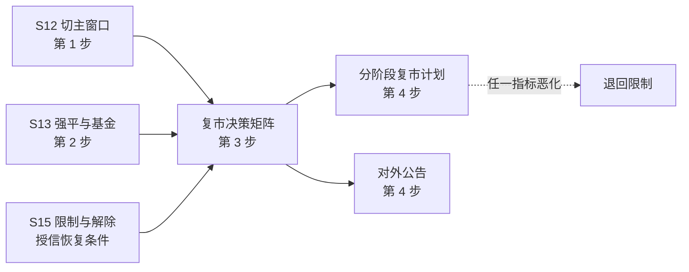

# B80 复市与恢复演练实战：过载、切主、对账差异与分阶段恢复

> 学习目标：做完本章，你能——
> 1. 在撮合切主窗口里找出重复成交与超量成交，说清哪些能冲销、哪些要人工裁定，并列出冲销清单（场景 S12）。
> 2. 算出强平延迟造成的穿仓缺口，找到保险基金的耗尽点和未覆盖亏损（场景 S13）。
> 3. 用对账差异、未决订单、授信恢复条件做一张复市决策矩阵，判断"现在能不能复市、最高能进哪一档"。
> 4. 写出一份分阶段复市计划和一份对外公告，并用脚本检查它们"够不够格"。
>
> 前置章节：[B73 检测工程实战](B73-detection-engineering-practice.md)（会用回放脚本和 `--score`）；建议先读 [B76 桌面推演与事故复盘实战](B76-tabletop-postmortem-practice.md)（事故时间线、复盘）。
> 前置知识：会读 CSV 与 JSON 行日志；能看懂 20 行以内的 Python；知道撮合、强平、保险基金的基本含义（见 X22 第 1–2 节）。
> 预计用时：约 3–4 小时（S12 与 S13 各 1 小时；决策矩阵 1 小时；计划与公告 1 小时）。
> 配套章节：[X22 交易、结算与信用·运营与恢复](../architecture/X22-cex-trading-recovery-ops.md)（恢复状态机、验停写、复市清单、分阶段复市、穿仓善后）｜[X26 生产环境与数据·运营与恢复](../architecture/X26-cex-production-recovery-ops.md)（证据保全、决策矩阵、对外沟通模板）｜[T09 事故 runbook](../templates/T09-incident-runbook-oncall.md)｜[T10 推演剧本与复盘模板](../templates/T10-tabletop-script-scorecard.md)
> 最后核对：2026-11-23（命令在本机 Python 3.12.3 上运行过；下文输出来自真实运行）

> ⚠️ 警告：本章的数据全部是合成的。MiniEx 是虚构交易所，账户、订单、成交都不对应任何真实对象。本章只做事后分析与决策演练，不含对任何真实系统的操作。不要把"冲销""限制""注资"这些动作用到真实系统上，除非你有授权并走了变更流程。

---

## 开场：事故修好了，谁敢说"可以开了"

事故的修复和事故的结束，是两件事。

3 月 11 日 14:07，MiniEx 的撮合引擎在过载中切主。新主 me-a 已经接管，旧主 me-b 却又写了 2 分 30 秒的成交。第二天 09:15，QRS-PERP 暴跌，强平引擎积压，保险基金被一笔笔穿仓抽干。技术团队说"都修好了，可以开了"。

风控负责人只问一句：**凭什么？**

要回答这个问题，你手里得有数：重复成交多少笔、涉及多少钱、超量的订单还剩几张、保险基金还够不够下一次、被限制的账户解除得合不合规。数字没拿出来之前，"可以开"只是一个愿望。

<details class="predict"><summary>🤔 先猜再看：切主重叠窗口只有 150 秒。你猜旧主在这 150 秒里写了多少笔成交？其中有几笔是和新主重复的？</summary>

旧主写了 28 笔，其中 16 笔与新主的成交是"同一对订单、同价同量"，各成交了一次。另外 12 笔只有旧主写过，新主不知道。第 2 步你会把这三个数字算出来，并看到为什么"借贷平衡"的账务检查完全看不出这件事。

</details>

> 🎯 打个比方：像一家店里同时开了两个收银台，都以为自己是唯一的收银员。同一位顾客的同一单，被两个台各收了一次钱，两边的小票都打得整整齐齐。每个收银台自己对账都是平的，错在"两个台之间"。
>
> 比喻的局限：收银台的重复收费，店员一眼能看到。撮合引擎里的重复成交，用户收到的是两条都"合法"的成交回报，要靠订单号和序号对照才看得出来。

## 1. 本章怎么练

本章走完一次完整的"复市评审"：先取证，再算账，再做决策，最后写计划和公告。



读图要点：
- 决策矩阵是汇合点：三类证据进来，计划和公告出去。没有矩阵，计划里的门槛就是拍脑袋。
- 虚线是 X22 的原则：复市不是单向的，任何一档指标恶化都退回"限制"。
- 局限：本章只覆盖撮合与强平两条线。钱包、银行、储备的对账（S14）在 [B81](B81-wallet-channel-recon-practice.md)、B82 里做，它们同样是复市门槛，但不在本章的矩阵里。

本章用到的场景（时间窗均为 2026 年 3 月，UTC；答案以 `answers/` 为准）：

| 场景 | 答案编号 | 时间窗 | 一句话 |
|---|---|---|---|
| S12 撮合过载与切主 | S12-01、S12-02、S12-03 | 03-11 14:07:10–14:09:40 | 旧主在新主晋升后仍写成交，出现重复与超量成交 |
| S13 强平延迟与穿仓 | S13-01、S13-02、S13-03 | 03-12 09:15–09:55 | 10 笔强平超 SLA，8 笔穿仓，保险基金耗尽 |
| S15 限制与解除限制 | S15-01 至 S15-04 | 03-11 至 03-13 | 解除限制的授权与回报有缺口（本章只用它做授信恢复条件） |

准备工作。从 `web3-security-101/` 根目录出发（下文所有命令都从这里运行）：

```bash
bash code/offchain-ops/setup.sh --no-tests | tail -1
mkdir -p my_b80
```

```text
靶场已就绪：数据在 code/offchain-ops/data/ 与 data_x/，答案在 code/offchain-ops/answers/（练习做完再看）
```

`setup.sh` 生成数据并装载。本章只读数据；你的产出放在 `my_b80/`，参考实现放在 `code/offchain-ops/solutions/b80/`。

## 2. 第 1 步：在切主窗口里找重复成交与超量成交（S12）

X22 第 5 节说切主有三步：先停写，再验停写，再验停发。"验停写"的做法就是：以新主的晋升时刻为起点，看旧主还有没有在写。

### 2.1 用 replay_match 找出三类发现

```bash
python3 code/offchain-ops/lib/replay_match.py --score S12 --show 3
```

```text
工具：replay_match   参数：{"confirm_dups": true, "dup_window": 60, "epoch_changes": false, "standby_heartbeats": false}
发现 52 条：duplicate_match 16，overfill 32，report_missing 3，stale_epoch_write 1
  [stale_epoch_write] count=28 engine_seq_collisions=25 epoch=2 first_ts=2026-03-11T14:07:13Z last_ts=2026-03-11T14:09:24Z newer_epoch=3 node=me-b split_key=me-b:e2>e3  <TP S12-01>
  [duplicate_match] dup_trade_id=MT002632 nodes=me-b,me-a qty=2.1207 symbol=ETH-USDT trade_id=MT002630  <TP S12-02>
  [duplicate_match] dup_trade_id=MT002633 nodes=me-b,me-a qty=0.032826 symbol=BTC-USDT trade_id=MT002631  <TP S12-02>
  ……还有 49 条（--show N 查看更多）
评分（目标 S12）：命中 52，TP 49，误报 0（噪声 0、未解释 0），其他场景 3；召回 3/3 = 100%
```

怎么读这 52 条：

| 类型 | 条数 | 意思 | 对应答案 |
|---|---|---|---|
| `stale_epoch_write` | 1 | 旧主 me-b 在 epoch 3 晋升后仍写了 28 笔成交，其中 25 个 `engine_seq` 与新主撞车；`split_key` 是 `me-b:e2>e3` | S12-01 |
| `duplicate_match` | 16 | 同一对订单、同价同量，被两个节点各成交一次 | S12-02 |
| `overfill` | 32 | 订单累计成交量是订单量的 2 倍 | S12-03 |
| `report_missing` | 3 | 03-04 的成交缺回报，属于 S10-01，与本场景无关 | 其他场景 |

这就是评分行里"其他场景 3"的来历。召回 3/3，误报 0。

> 💡 注意：`engine_seq` 撞车是切主事故最硬的证据。正常切主时，新主**接续**旧主的序号（03-06 03:00 的计划切主就是这样，没有任何发现）。脑裂时，两个节点从同一个值各自往下数。

### 2.2 确认规则：为什么要"不同节点或超量"

脚本默认对重复成交做"确认"：只有来自不同节点、或订单被超量成交，才算重复。关掉确认，看会发生什么：

```bash
python3 code/offchain-ops/lib/replay_match.py --no-confirm-dups --score S12 --show 0
```

```text
工具：replay_match   参数：{"confirm_dups": false, "dup_window": 60, "epoch_changes": false, "standby_heartbeats": false}
发现 64 条：duplicate_match 28，overfill 32，report_missing 3，stale_epoch_write 1
评分（目标 S12）：命中 64，TP 49，误报 12（噪声 12、未解释 0），其他场景 3；召回 3/3 = 100%
```

多出来的 12 条是 S12-N01：同一对订单的合法两次部分成交（订单量是单笔的 2 倍，同一节点，累计不超量）。它们长得和重复成交一样，区别只有一个：**累计成交量有没有超过订单量**。

这条经验和 B73 的调参一样：检测规则要写"确认条件"，否则值班会被合法的部分成交淹没。

### 2.3 为什么账务对账看不出来

很多团队的复市清单里有一行"分录借贷平衡"。用 `ledger_check.py` 看 S12：

```bash
python3 code/offchain-ops/lib/ledger_check.py --score S12 --show 0
```

```text
工具：ledger_check   参数：{"late_sec": 0, "mark_tol": 0.0, "min_fee_notional": 10.0, "require_fee": false, "tol": 0.011}
发现 9 条：missing_legs 4，unbalanced 3，valuation 2
评分（目标 S12）：命中 9，TP 0，误报 0（噪声 0、未解释 0），其他场景 9；召回 0/3 = 0%
漏掉：S12-01, S12-02, S12-03
```

召回 0/3。它报出的 9 条全是 S10 的问题，和切主窗口无关。原因是旧主写的每一笔重复成交，**都完整地记了账**：借贷平衡，估值正确，只是同一笔交易记了两遍。

**平衡的账不等于正确的账。** 借贷平衡检查回答的是"每笔分录自己平不平"，不回答"这笔成交该不该存在"。后者要靠撮合日志与订单回报的回放。X22 第 6.2 节把"撮合与成交"和"分录"分成两行，就是这个原因。

### 2.4 算出窗口、数量、金额，并写出冲销清单

`replay_match` 告诉你"有问题"。复市评审要的是"多少、多大、先做什么"。参考实现 `split_brain.py` 把发现整理成这几个数：

```bash
python3 code/offchain-ops/solutions/b80/split_brain.py --out my_b80/reversal.csv
```

```text
== 双主重叠窗口
新主晋升  2026-03-11T14:07:10Z  me-a epoch 3
旧主围栏  2026-03-11T14:09:40Z  me-b 降为 standby（epoch 2 -> 3）
重叠时长  150 秒

== 窗口内成交（分钟 x 节点）
分钟       me-a   me-b
14:07       4      8
14:08      16     17
14:09       7      3
合计         27     28

== 汇总
旧主 me-b 在窗口内写成交      28 笔（engine_seq 与新主撞车 25 个）
  其中与新主重复（同一对订单同价同量） 16 对，副本已入账金额 67409.72 USD，涉及账户 31 个
  其中只有旧主写过（陈旧，待裁定）     12 笔，成交额 54703.78 USD，涉及账户 24 个、订单 24 张
超量成交订单（累计成交 = 订单量 2 倍）  32 张
过载限流拒绝（14:00 起，窗口之前）       25 张订单

== 模拟冲销 16 笔重复副本后，再跑 replay_match
duplicate_match=0  overfill=0  stale_epoch_write=1（旧主陈旧写入记录仍在，剩余 12 笔单边成交待裁定）

冲销清单已写入 my_b80/reversal.csv（28 行：reverse 16，hold_for_review 12）
```

逐段读：

1. **窗口**：新主 14:07:10 晋升，旧主 14:09:40 才被围栏，重叠 150 秒。这 150 秒就是"围栏延迟"，是后面写复盘时要问的第一件事。
2. **分钟表**：14:07 旧主写 8 笔、新主写 4 笔；14:08 两边各 16、17 笔。两个节点同时在高速写成交，是"双主"最直接的画面。
3. **重复 16 对**：旧主的副本已入账 67,409.72 美元（按计价币借方合计），涉及 31 个账户。这些副本要冲销，以新主日志为准。
4. **单边陈旧 12 笔**：只有旧主写过，成交额 54,703.78 美元，涉及 24 个账户、24 张订单。它们**不能自动冲销**：用户已经收到了成交回报，新主并不知道这些订单已成交。要逐笔裁定：补写到新主，或冲销并通知用户。
5. **模拟冲销**：去掉 16 笔重复副本后再跑 `replay_match`，`duplicate_match` 和 `overfill` 都归零。这是验证"冲销做对了"的办法：不看谁说做完了，让回放告诉你。

看一眼冲销清单：

```bash
head -4 my_b80/reversal.csv
```

```text
trade_id,node,symbol,price,qty,notional_usd,action,kept_trade_id
MT002630,me-b,ETH-USDT,3664.0,2.1207,7770.24,reverse,MT002632
MT002631,me-b,BTC-USDT,54378.59,0.032826,1785.03,reverse,MT002633
MT002634,me-b,ETH-USDT,3659.33,0.629,2301.72,reverse,MT002636
```

```bash
grep -c ",reverse," my_b80/reversal.csv; grep -c ",hold_for_review," my_b80/reversal.csv
```

```text
16
12
```

`reverse` 是确定要冲销的重复副本，`kept_trade_id` 指向被保留的新主成交；`hold_for_review` 是等待裁定的单边陈旧成交。

> 💡 注意：清单里"保留谁、冲销谁"的规则是 X22 的原则：以新主日志为准。如果你所在的系统有另一套规则（例如以先到达账务库的为准），要在复市前写下来，并由指挥官批准。

## 3. 第 2 步：算穿仓缺口与保险基金耗尽点（S13）

<details class="predict"><summary>🤔 先猜再看：S13 里 10 笔强平都超过了 60 秒的 SLA，8 笔穿仓。假如它们都在触发那一刻按触发时的标记价成交，你猜还会有几笔穿仓？</summary>

零笔。10 笔账户在触发价下的权益都是正的，合计约 56,639.52 美元。穿仓的 178,985.13 美元缺口，几乎全是"等待"造成的：价格在 70–660 秒里继续往下走。这是估算（忽略滑点），但它说明：**强平引擎的延迟本身就是风险敞口。** 第 3.3 节会算出来。

</details>

### 3.1 用 liq_audit 找出强平问题

```bash
python3 code/offchain-ops/lib/liq_audit.py --score S13 --show 0
```

```text
工具：liq_audit   参数：{"min_shortfall": 0.01, "sla": 60, "verify": false}
发现 27 条：bankruptcy 15，delayed_liquidation 10，fund_exhausted 2
评分（目标 S13）：命中 27，TP 20，误报 7（噪声 7、未解释 0），其他场景 0；召回 3/3 = 100%
```

默认规则"任何穿仓都报"，会多出 7 条误报：4 笔价格跳空造成的小额穿仓（延迟 1–8 秒，缺口 125–1,520 美元，基金正常覆盖，S13-N02）和 3 笔不足 5 美元的穿仓（S13-N03）。它们是正常的运营噪声，不是事故。

把穿仓下限调到 5,000 美元，再强制要求误报为 0：

```bash
python3 code/offchain-ops/lib/liq_audit.py --min-shortfall 5000 --score S13 --max-fp 0 --show 0; echo "退出码 $?"
```

```text
工具：liq_audit   参数：{"min_shortfall": 5000.0, "sla": 60, "verify": false}
发现 20 条：bankruptcy 8，delayed_liquidation 10，fund_exhausted 2
评分（目标 S13）：命中 20，TP 20，误报 0（噪声 0、未解释 0），其他场景 0；召回 3/3 = 100%
退出码 0
```

召回仍是 3/3，误报 0，退出码 0。

> 💡 注意：5,000 美元是**告警分诊**的阈值，不是**赔付**的阈值。小额穿仓照样要由保险基金覆盖、照样要入账。别把"不告警"理解成"不处理"。

### 3.2 先验证数据本身

算缺口之前，先确认强平记录自洽：`--verify` 会重算每笔执行后的权益，并检查保险基金余额前后连续。

```bash
python3 code/offchain-ops/lib/liq_audit.py --verify --show 0
```

```text
工具：liq_audit   参数：{"min_shortfall": 0.01, "sla": 60, "verify": true}
发现 27 条：bankruptcy 15，delayed_liquidation 10，fund_exhausted 2
```

`--verify` 没有额外发现（和默认的 27 条一致），说明权益与基金余额都能重算对上。先验数据再下结论，是复市评审的习惯：如果这一步不平，后面所有数字都不可信。

### 3.3 走一遍保险基金：耗尽点在哪

```bash
python3 code/offchain-ops/solutions/b80/fund_walk.py
```

```text
liq_id   账户         延迟s 穿仓?              缺口        基金支付        基金余额       未覆盖亏损       触发价权益
LQ00082  A00127      70 -              0.00        0.00   131380.14        0.00     4476.04
LQ00083  A01068     300 穿仓         12954.12    12954.12   118426.02        0.00     4967.58
LQ00084  A00273     240 穿仓          8825.94     8825.94   109600.08        0.00     4711.24
LQ00085  A01870      75 -              0.00        0.00   109688.42        0.00     2918.68
LQ00086  A00182     420 穿仓         22565.28    22565.28    87123.14        0.00     7442.36
LQ00087  A01279     360 穿仓         11862.97    11862.97    75260.17        0.00     4968.45
LQ00088  A00525     480 穿仓         29930.96    29930.96    45329.21        0.00     8065.53
LQ00089  A00695     540 穿仓         38853.48    38853.48     6475.73        0.00     7395.74
LQ00090  A01607     660 穿仓         33863.86     6475.73        0.00    27388.13     6958.77  <- 耗尽点
LQ00091  A00149     600 穿仓         20128.52        0.00        0.00    20128.52     4735.14

== 汇总（窗口 2026-03-12T09:15:00Z 至 2026-03-12T09:55:00Z，SLA 60 秒）
强平 10 笔；超 SLA 10 笔（延迟 70–660 秒）
穿仓 8 笔，缺口合计 178985.13（最小 8825.94，最大 38853.48）
窗口起点基金余额 130548.76；耗尽点 LQ00090（基金余额 6475.73 不够付缺口 33863.86）
未覆盖亏损合计 47516.65（LQ00090+LQ00091），触发 ADL 2 笔
耗尽点之前的累计缺口 124992.75 = 起点基金 130548.76 + 期间清算费 919.72 - 耗尽点余额 6475.73
反事实：10 笔若按触发价成交，权益合计 56639.52，全部为正（是）
核对：基金余额链连续 是；缺口 = 基金支付 + 未覆盖亏损 是
```

读法：

1. **耗尽点是 LQ00090。** 它之前的 6 笔穿仓把基金从 130,548.76 一路抽到 6,475.73；LQ00090 的缺口是 33,863.86，基金只剩 6,475.73，**付不起**。
2. **未覆盖亏损 47,516.65 美元**：LQ00090 的 27,388.13，加 LQ00091 的 20,128.52。两笔都触发了 ADL（自动减仓）。这是对外公告里最难写的数字：它由谁承担，必须在公告里说清楚。
3. **缺口 = 基金支付 + 未覆盖亏损**，每笔都对得上（最后一行的核对）。
4. **反事实**：按触发价成交，10 笔权益都是正的，合计 56,639.52 美元。缺口不是"价格暴跌"一个原因，是"暴跌加上积压了最多 11 分钟"。

这个反事实只是估算：它忽略了滑点，也忽略了触发后价格可能继续变化。用法是说明"延迟值多少钱"，而不是精确赔付。

### 3.4 用另一种办法交叉核对一个数

别只信一个脚本。用 `awk` 直接从 CSV 把 LQ00082 到 LQ00091 的穿仓缺口加起来：

```bash
awk -F, 'NR>1 && $1>="LQ00082" && $1<="LQ00091" {s+=$14} END {printf "%.2f\n", s}' code/offchain-ops/data_x/liquidations.csv
```

```text
178985.13
```

和 `fund_walk.py` 的缺口合计一致。这个办法也能用在真实环境：把关键数字用第二条独立路径算一遍。

## 4. 第 3 步：判断"能不能复市"

### 4.1 门槛从哪来

X22 第 6.2 节给出复市前的清单，第 6.4 节给出四档放量。本章把它们落成 9 个能算的检查：

| 项 | 要进入 | 检查 | 门槛 | 来自 X22 |
|---|---|---|---|---|
| V1 | 仅撤单 | 围栏后旧主还在写的成交数 | = 0 | 6.2 序号、停写 |
| V2 | 仅撤单 | 重复成交未冲销（笔） | = 0 | 6.2 撮合与成交 |
| V3 | 仅撤单 | 未决订单：超量成交 + 陈旧单边（张） | = 0 | 5.4 未确认订单 |
| V4 | 仅撤单 | 窗口内成交的分录借贷差异（笔） | = 0 | 6.2 分录 |
| V5 | 仅撤单 | 窗口内成交的回报缺失或不符（笔） | = 0 | 6.3 回放 |
| P1 | 仅平仓 | 事故后强平最大延迟（秒） | <= 60 | 6.4 强平引擎无异常 |
| P2 | 仅平仓 | ADL 与补偿规则已公告（人工项） | = 1 | 7.2 补偿规则 |
| C1 | 限价交易 | 保险基金余额 | >= 最大单笔缺口 | 7 穿仓善后（数值为示例） |
| C2 | 限价交易 | 限制 / 解除授权与回报缺口（动作数） | = 0 | 授信恢复条件 |

> 💡 注意：C1 的"最大单笔缺口"是本章为了练习选的示例门槛。真实的门槛由风控按合约规模、波动率与风险偏好定，写进平台规则，并经 CRO 批准。V3 里的"未决订单"在本章指窗口内状态不确定的订单：32 张被超量成交的 + 24 张只有旧主成交过的，共 56 张。

### 4.2 授信恢复条件里的 S15

C2 要用到 S15。事故当天，S12 与 S13 涉及的账户被限制；03-13 批量解除。解除合不合规，`case_audit.py` 能告诉你：

```bash
python3 code/offchain-ops/lib/case_audit.py --score S15 --show 0
```

```text
工具：case_audit   参数：{"allow_policy": true, "asof": "2026-03-15T00:00:00Z", "include_retried": false, "report_sla": 1800}
发现 16 条：authorizer_role 1，legal_no_ref 1，no_report 4，release_no_authorizer 5，report_failed 3，self_authorized 2
评分（目标 S15）：命中 16，TP 16，误报 0（噪声 0、未解释 0），其他场景 0；召回 4/4 = 100%
```

16 条发现，对应 15 个动作：5 笔解除没有授权人、2 笔授权人就是执行人、4 笔解除没有业务端回报、1 笔法定冻结被越权解除且没有文书编号（算 2 条发现）、3 个账户的限制指令回报失败后无人重试。恢复授信，就是把这些账户的交易权限还给它们。**授权没补齐，不能恢复。**

### 4.3 跑决策矩阵：现在能不能复市

```bash
python3 code/offchain-ops/solutions/b80/resume_gate.py
```

```text
假设：无（按数据现状）

| 项 | 要进入 | 检查 | 当前值 | 门槛 | 判定 |
| V1 | 仅撤单 | 围栏后旧主成交数 | 0 | = 0 | 通过 |
| V2 | 仅撤单 | 重复成交未冲销（笔） | 16 | = 0 | 不通过 |
| V3 | 仅撤单 | 未决订单：超量成交 + 陈旧单边（张） | 56 | = 0 | 不通过 |
| V4 | 仅撤单 | 窗口内成交分录借贷差异（笔） | 0 | = 0 | 通过 |
| V5 | 仅撤单 | 窗口内成交回报缺失 / 不符（笔） | 0 | = 0 | 通过 |
| P1 | 仅平仓 | 事故后强平最大延迟（秒） | 7 | <= 60 | 通过 |
| P2 | 仅平仓 | ADL 与补偿规则已公告（未覆盖亏损 47516.65） | 0 | = 1（人工项） | 不通过 |
| C1 | 限价交易 | 保险基金余额（USD） | 3227.84 | >= 38853.48（最大单笔缺口） | 不通过 |
| C2 | 限价交易 | 限制 / 解除授权与回报缺口（动作数） | 15 | = 0 | 不通过 |

结论：当前最高可进入阶段 = 无（停在验证）
卡点：要进入「仅撤单」，门槛 V2、V3 未过
```

结论：**不能复市，停在"验证"。** 卡点是 V2（16 笔重复成交还在账里）和 V3（56 张订单状态不确定）。注意别的项也不过：P2、C1、C2。但第一道门就没过，后面的不过是"还要做的事"。

读矩阵的两条规则：
1. **从上往下，遇到第一个不通过就停。** 仅撤单的门槛没过，谈仅平仓没有意义。
2. **通过的项也要看证据。** V4 和 V5 通过了，但你已经在 2.3 节看到：借贷平衡不能证明成交该存在。V1 通过（围栏后旧主没有再写）是真正的进展。

### 4.4 假设整改，看每一步能解锁什么

矩阵不只是判决书，也是整改清单的排序器。用 `--assume` 声明你打算做的事，看矩阵怎么变。

先冲销 16 笔重复副本：

```bash
python3 code/offchain-ops/solutions/b80/resume_gate.py --assume reverse-dups | tail -2
```

```text
结论：当前最高可进入阶段 = 无（停在验证）
卡点：要进入「仅撤单」，门槛 V3 未过
```

卡点只剩 V3：V2 已通过，V3 从 56 降到 24（去掉 `| tail -2` 能看到全表）。32 张超量订单随副本冲销而恢复正常，剩下 24 张是单边陈旧成交的订单。再对这 12 笔做出裁定：

```bash
python3 code/offchain-ops/solutions/b80/resume_gate.py --assume reverse-dups,rule-stale | tail -2
```

```text
结论：当前最高可进入阶段 = 仅撤单
卡点：要进入「仅平仓」，门槛 P2 未过
```

验证通过，可以进入"仅撤单"。下一个卡点是 P2：ADL 与补偿规则没有公告（人工项）。公告发出后：

```bash
python3 code/offchain-ops/solutions/b80/resume_gate.py --assume reverse-dups,rule-stale,adl-announced | tail -2
```

```text
结论：当前最高可进入阶段 = 仅平仓
卡点：要进入「限价交易」，门槛 C1、C2 未过
```

可以进入"仅平仓"。最后两项是授信恢复条件：保险基金余额只有 3,227.84 美元，要达到 38,853.48 美元的门槛，至少要注资 35,625.64 美元；S15 的 15 个动作要补齐授权和回报。全部做完：

```bash
python3 code/offchain-ops/solutions/b80/resume_gate.py --assume reverse-dups,rule-stale,adl-announced,topup=36000,fix-s15
```

```text
假设：reverse-dups,rule-stale,adl-announced,topup=36000,fix-s15

| 项 | 要进入 | 检查 | 当前值 | 门槛 | 判定 |
| V1 | 仅撤单 | 围栏后旧主成交数 | 0 | = 0 | 通过 |
| V2 | 仅撤单 | 重复成交未冲销（笔） | 0 | = 0 | 通过 |
| V3 | 仅撤单 | 未决订单：超量成交 + 陈旧单边（张） | 0 | = 0 | 通过 |
| V4 | 仅撤单 | 窗口内成交分录借贷差异（笔） | 0 | = 0 | 通过 |
| V5 | 仅撤单 | 窗口内成交回报缺失 / 不符（笔） | 0 | = 0 | 通过 |
| P1 | 仅平仓 | 事故后强平最大延迟（秒） | 7 | <= 60 | 通过 |
| P2 | 仅平仓 | ADL 与补偿规则已公告（未覆盖亏损 47516.65） | 1 | = 1（人工项） | 通过 |
| C1 | 限价交易 | 保险基金余额（USD） | 39227.84 | >= 38853.48（最大单笔缺口） | 通过 |
| C2 | 限价交易 | 限制 / 解除授权与回报缺口（动作数） | 0 | = 0 | 通过 |

结论：当前最高可进入阶段 = 限价交易
卡点：数据上已无阻塞；全面交易还要等 2 小时稳定观察期（时间门槛，数据算不出）
```

数据上已无阻塞，可以进入"限价交易"。"全面交易"要再等 2 小时稳定观察期，这是时间门槛，数据算不出来，也不能提前宣布。

> 💡 注意：`--assume` 只是推演，不会改任何数据。**真实复市时，没有"假设"这个选项**：每一项必须有证据（脚本输出、工单、对账报告），而不是有人说"已经做了"。

### 4.5 把矩阵写成你的决策文档

把 4.3 节的结果整理成一张你自己的表，存成 `my_b80/matrix.md`。表头：

| 项 | 当前值 | 门槛 | 通过？ | 整改动作 | 负责人（角色） | 授权人（角色） | 证据 | 预计完成 |
|---|---|---|---|---|---|---|---|---|

每个不通过的项至少一行。"授权人"必须是角色，并和 X22 第 3.2 节的"有权推动的人"一致：指挥官、风控负责人、合规、财务、业务负责人（CRO 或同级）。"证据"写你将看到什么，例如"`resume_gate.py` 的 V2 为 0""公告链接"。

## 5. 第 4 步：写分阶段复市计划与对外公告

### 5.1 分阶段复市计划

X22 第 6.4 节的四档是计划的骨架：**仅撤单 -> 仅平仓 -> 限价交易 -> 全面交易**。每一档必须写四样东西：

| 要素 | 写什么 | 反例 |
|---|---|---|
| 门槛 | 进入这一档要满足什么，有数字 | "没问题了再开" |
| 观察 | 这一档要观察多久、看哪些指标 | "观察一段时间" |
| 授权 | 谁批准（角色，不是人名；涉及资金要财务） | "负责人同意" |
| 回退 | 什么情况退回哪一档 | （没写） |

用下面的骨架写 `my_b80/plan.md`。每一档用 `###` 开头，标题里带阶段名：

```markdown
# 复市计划：BTC-USDT、ETH-USDT、QRS-PERP

当前状态与卡点（引用第 3 步的数字）

## 前置整改（不对外开放）
1. ……（动作、负责人、批准人）

### 阶段一：仅撤单
- 开放：……
- 门槛：……（有数字）
- 观察：……
- 授权：……
- 回退：……

### 阶段二：仅平仓
……（同样五行）
### 阶段三：限价交易
……
### 阶段四：全面交易
……
```

先故意写一份空洞的草稿，看检查脚本怎么说：

```bash
cat > my_b80/plan_draft.md <<'DRAFT'
# 复市计划
### 仅撤单
先开撤单，没问题再往后。
### 全面交易
最后全面开放。
DRAFT
python3 code/offchain-ops/solutions/b80/plan_check.py plan my_b80/plan_draft.md; echo "退出码 $?"
```

```text
不通过  P1 四个阶段按顺序出现
不通过  P2 每个阶段有 门槛/观察/授权/回退，门槛含数字（仅撤单 缺 门槛/观察/授权/回退；仅平仓无小节；限价交易无小节；全面交易 缺 门槛/观察/授权/回退）
不通过  P3 引用至少 4 个本章数字（现有 0：）
不通过  P4 至少两个批准角色（现有：）
0 项通过，4 项不通过
退出码 1
```

脚本只查结构与数字，不评价措辞：四档是否齐全并按顺序、每档是否写了门槛/观察/授权/回退且门槛里有数字、是否引用了本章算出的数字（`16`、`67409.72`、`54703.78`、`56`、`47516.65`、`38853.48`、`35625.64`、`178985.13`、`15` 中至少 4 个）、是否写明至少两个批准角色。

写完自己的计划后检查：

```bash
python3 code/offchain-ops/solutions/b80/plan_check.py plan my_b80/plan.md
```

目标是 4 项全部通过。参考写法 `code/offchain-ops/solutions/b80/plan-reference.md` 通过时是这样（做完再看）：

```bash
python3 code/offchain-ops/solutions/b80/plan_check.py plan code/offchain-ops/solutions/b80/plan-reference.md
```

```text
通过  P1 四个阶段按顺序出现
通过  P2 每个阶段有 门槛/观察/授权/回退，门槛含数字
通过  P3 引用至少 4 个本章数字（现有 8：16,67409.72,54703.78,56,47516.65,38853.48,35625.64,15）
通过  P4 至少两个批准角色（现有：指挥官,风控,合规,业务负责人）
4 项通过，0 项不通过
```

### 5.2 对外公告

公告要回答用户最关心的五件事：发生了什么、影响了谁、你们做了什么、用户该做什么、什么时候恢复。X26 第 6.7 节有通用模板，本章的要点：

| 要素 | 写什么 | 本章的数字 |
|---|---|---|
| 时间 | 窗口用 UTC，复市分阶段并说明条件 | 14:07–14:09；09:15–09:55 |
| 范围 | 品种、账户数 | BTC-USDT、ETH-USDT、QRS-PERP；31 个、24 个、8 个账户 |
| 处置 | 做了什么，包括坏消息 | 冲销重复成交；保险基金耗尽；2 笔 ADL |
| 用户该做什么 | 先撤单检查旧挂单；联系渠道 | 事故前挂单仍有效（X22 第 6.5 节） |
| 不说 | 没有证据的原因与承诺 | 不写"黑客""被盗"（本事故是主备切换与强平延迟，不是攻击）、不写"完全恢复""保证不会再发生" |

先看一份"坏公告"：

```bash
cat > my_b80/announcement_draft.md <<'DRAFT'
各位用户：系统遭到攻击，现已完全恢复，保证不会再发生。
DRAFT
python3 code/offchain-ops/solutions/b80/plan_check.py announce my_b80/announcement_draft.md; echo "退出码 $?"
```

```text
不通过  A1 有时间（14:07、14:09 与复市阶段）
不通过  A2 有范围（三个品种 + 账户数）
不通过  A3 说明处置（冲销、ADL、保险基金）
不通过  A4 告诉用户怎么做（撤单；联系/客服）
不通过  A5 没有未证实的说法（出现：攻击,完全恢复,保证,不会再发生）
不通过  A6 长度 150–900 字符（现在 27）
0 项通过，6 项不通过
退出码 1
```

把自己的公告写到 `my_b80/announcement.md`（150–900 字符，中文），检查：

```bash
python3 code/offchain-ops/solutions/b80/plan_check.py announce my_b80/announcement.md
```

目标是 6 项全部通过。参考公告 `announcement-reference.md` 通过时是这样（做完再看）：

```bash
python3 code/offchain-ops/solutions/b80/plan_check.py announce code/offchain-ops/solutions/b80/announcement-reference.md
```

```text
通过  A1 有时间（14:07、14:09 与复市阶段）
通过  A2 有范围（三个品种 + 账户数）
通过  A3 说明处置（冲销、ADL、保险基金）
通过  A4 告诉用户怎么做（撤单；联系/客服）
通过  A5 没有未证实的说法
通过  A6 长度 150–900 字符（现在 367）
6 项通过，0 项不通过
```

> 💡 注意：公告里写的数字必须能从你的矩阵里查到。如果公告说"影响账户 31 个"，矩阵里就要有证据。公告发出后改口，比晚发 1 小时代价大得多。

## 6. 过关标准

下面每一条，不看参考答案也能判断自己做没做对。

- [ ] 你用 `replay_match.py --score S12` 召回 S12-01、S12-02、S12-03 全部 3 个答案，误报 0；你说得清评分行里"其他场景 3"是什么。
- [ ] 你说得出切主窗口是 14:07:10 到 14:09:40（150 秒）、旧主写了 28 笔成交（25 个 `engine_seq` 撞车）、其中 16 对是重复（副本 67,409.72 美元，31 个账户）、12 笔是单边陈旧（54,703.78 美元，24 个账户、24 张订单）、32 张订单被超量成交。
- [ ] 你的 `my_b80/reversal.csv` 有 28 行：16 行 `reverse`、12 行 `hold_for_review`；模拟冲销后重复成交与超量都是 0。
- [ ] 你演示了 `ledger_check.py --score S12` 召回 0/3，并能用一句话解释"借贷平衡不等于正确"。
- [ ] 你用 `liq_audit.py --min-shortfall 5000 --score S13 --max-fp 0` 得到 20 条、误报 0、退出码 0。
- [ ] 你算出：10 笔强平延迟 70–660 秒；8 笔穿仓，缺口合计 178,985.13 美元（最小 8,825.94，最大 38,853.48）；保险基金耗尽点是 LQ00090；未覆盖亏损 47,516.65 美元，ADL 2 笔；`awk` 的交叉核对与脚本一致。
- [ ] 你的 `my_b80/matrix.md` 覆盖 9 项门槛；初始结论是"不能复市，停在验证"，卡点 V2、V3；并写出了每一步整改能解锁哪一档：冲销 + 裁定 -> 仅撤单；再公告 -> 仅平仓；再注资至少 35,625.64 美元并补齐 15 个授权缺口 -> 限价交易。
- [ ] 你的 `my_b80/plan.md` 用 `plan_check.py plan` 得到 4 项全部通过；每一档都有门槛（含数字）、观察、授权（角色）、回退。
- [ ] 你的 `my_b80/announcement.md` 用 `plan_check.py announce` 得到 6 项全部通过；不含"黑客""被盗""完全恢复"这类没有证据的说法。

## 7. 和标准答案对照

做完再看。对照的做法：

1. 打开 `code/offchain-ops/answers/S12.json`、`S13.json`，把 `expected_response` 与你的计划逐条比对。答案里 S12 的第一条是"停写停发：先隔离旧主，停止对外成交回报与清算"。你的计划如果没有把它放在所有放量动作之前，就是顺序错了。
2. 打开参考实现目录 `code/offchain-ops/solutions/b80/`：

| 文件 | 内容 |
|---|---|
| `split_brain.py` | 第 1 步：切主窗口分析、冲销清单、冲销后复查 |
| `fund_walk.py` | 第 2 步：强平延迟、缺口、保险基金走势、耗尽点、反事实 |
| `resume_gate.py` | 第 3 步：复市决策矩阵，支持 `--assume` 推演 |
| `plan_check.py` | 第 4 步：检查计划与公告的结构与数字 |
| `plan-reference.md` | 一份参考复市计划 |
| `announcement-reference.md` | 一份参考公告 |

3. 比对计划时看三处：门槛是不是数字而不是形容词；每一档的授权是不是角色；回退条件是不是比放量条件更容易触发。参考计划只是一种写法，不是唯一答案。
4. 关于数字：本章的数字都来自脚本对数据的实算。若你发现 `API_X.md` 里 S13-03 的摘要（基金余 5,557、未覆盖亏损 28,307 与 20,129）与本章不同，以数据实算为准：LQ00090 时基金余 6,475.73，未覆盖亏损 27,388.13 与 20,128.52，合计 47,516.65。

## 8. 常见错误

| 错误 | 为什么错 | 怎么改 |
|---|---|---|
| 用"借贷平衡"证明复市条件通过 | 重复成交也平衡（2.3 节） | 先看撮合日志与订单回报的回放，再看账务 |
| 看到 `duplicate_match` 就全部冲销 | 12 对合法的两次部分成交长得一样（2.2 节） | 要求"不同节点或超量"才确认 |
| 把 12 笔单边陈旧成交也自动冲销 | 用户已收到成交回报，新主不知道这些订单已成交 | 先列入 `hold_for_review`，逐笔裁定后补写或冲销并通知 |
| 保险基金"余额还有"就说够用 | 基金到 LQ00090 就耗尽，之后 47,516.65 美元没有来源 | 用逐笔走一遍的耗尽点，而不是看期末余额 |
| 把 5,000 美元的告警下限当成赔付下限 | 小额穿仓也要由基金覆盖 | 告警阈值和处理范围分开 |
| 公告里写"系统遭攻击" | 没有证据，且与事实（主备切换、强平延迟）相反 | 只写已证实的事实，未确认的原因写"调查中" |
| 计划里只写"观察一段时间" | 无法判断何时可以放量 | 每一档写观察多久、看哪些指标、阈值是多少 |
| 授权人写具体人名 | 人员变动后计划失效，也无法审计"有权推动" | 写角色，名字在 runbook 里另列 |
| 不等稳定观察期就宣布"全面恢复" | 观察期是为了抓延迟出现的问题 | 全面交易之后 2 小时内不宣布"已完全恢复"，进入复盘再总结 |

## 9. 思考题

1. 12 笔单边陈旧成交，你倾向"补写到新主"还是"冲销并通知"？各自会让用户的账户发生什么变化？如果其中一笔的订单已被用户在新主上撤销了，你的方案还成立吗？
2. 本章 C1 的门槛用了"最大单笔缺口"。你觉得这个门槛太松还是太紧？如果换成"事故前基金水位的 50%"，当前 3,227.84 美元需要注资多少？谁有权决定这个门槛？
3. 公告里要不要写"未覆盖亏损 47,516.65 美元由谁承担"？如果规则事先没有写好，你在公告里能说什么、不能说什么？
4. 复市计划的"回退"条件，为什么应该比"放量"条件更容易触发？举一个会导致"仅平仓"退回"仅撤单"的具体指标。

> 🪞 反思：你所在团队上一次"服务恢复"之后，是谁、凭什么证据、在什么时候说"可以放量"的？那份证据能不能在一个月后被别人复核？

## 10. 下一步

你已经能在切主窗口里找重复成交、算穿仓缺口与基金耗尽点，并把它们变成复市决策与计划。矩阵里没有覆盖的是钱：钱包、银行与链上三方是否对得上，储备是否覆盖负债。

进入 [B81 钱包与渠道三方对账实战](B81-wallet-channel-recon-practice.md)。
