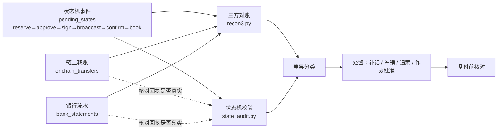

# B81 钱包与渠道三方对账实战：未决状态、假回执与复付

> 学习目标：做完本章，你能——
> 1. 对链上、账务、银行三份记录做三方对账，把差异按"外部有账务无 / 账务有外部无 / 记两次 / 记晚了 / 金额差 / 日期差"分类。
> 2. 调 `--tol-days` 与 `--amount-tol`，把默认的 18 条误报压到 0，并说出调过头会漏掉什么。
> 3. 用 `--asof` 回到某个时点，看当时的未决状态，并区分"真异常"和"外部还没到账"。
> 4. 在提币 / 充值状态机里找出超时悬挂、重复回执、假回执，写出差异处置和"复付前核对"清单。
>
> 前置知识：会用 Python 3（≥ 3.9，只用标准库）和命令行；读过 [X26 域间交接](../architecture/X26-cex-ledger-wallet-handoff.md) 的 §3.2–§3.6 更好；做过 [B72](B72-withdrawal-risk-rules-practice.md) 或 [B73](B73-detection-engineering-practice.md) 的调参练习更好。
> 预计用时：约 2–3 小时。
> 关联章节：[X20 钱包、财资与支付·工程验收](../architecture/X20-cex-treasury-verification.md)｜[X21 钱包、财资与支付·恢复运营](../architecture/X21-cex-treasury-recovery-ops.md)｜[X26 域间交接：原单、预留、批准、实收、实付与未决状态](../architecture/X26-cex-ledger-wallet-handoff.md)｜[B74 签名服务独立校验](B74-signing-policy-practice.md)｜[B80 复市与恢复演练](B80-resumption-recovery-practice.md)｜[B82 储备与偿付对账](B82-reserves-solvency-practice.md)｜[T09 事故运行手册](../templates/T09-incident-runbook-oncall.md)
> 最后核对：2026-11-23（Python 3.12.3；下文命令在本机从 `web3-security-101/` 根目录逐条运行，输出来自真实运行）

> ⚠️ 警告：法律与道德边界。本章的数据全部由脚本合成，银行账户、链上地址、单据编号都是虚构的，不对应任何真实系统。本章只写"怎样发现并处置差异"，不写任何针对真实银行或渠道的操作。本章的参考实现只读数据，不会向任何系统发起付款；不要把"复付"的判断直接接到真实的付款流程上。

---

## 开场：账上没有这笔钱，银行有

2026-03-10 11:42（UTC），MiniEx 的银行账户 BK-OPS-1 向一个陌生账户 `ACCT-9F31A2` 汇出 480,000 美元。账务系统里没有任何单据。

同一天 08:20，一笔 380,000 USDT 的提币已经广播上链，状态机却停在"已广播"。客户在等，客服在问。有人说：重新付一次吧。

下午 14:30，另一笔 40,000 USDT 的提币收到了"已确认"回执，账务扣了客户的钱。可是链上没有这笔交易。

三件事发生在同一天，指向三种不同的东西：外部有、账务没有；外部有、账务晚了；账务有、外部没有。只看账务的人，一件也看不到；只看银行流水的人，看不出 380,000 USDT 已经付出；只看状态机的人，会相信那份"已确认"。

三方对账的作用，是让每笔钱都有三张纸互相印证。本章在靶场数据上做一遍。

## 1. 本章怎么练

原理不在这里重讲：提币状态机和未决状态的处理见 [X26 §3.2–§3.5](../architecture/X26-cex-ledger-wallet-handoff.md)；验收用例里的假回执见 [X20 §4.3](../architecture/X20-cex-treasury-verification.md)；事故后复付前要过的三道门见 [X21 §3.2](../architecture/X21-cex-treasury-recovery-ops.md)。三方对账（Three-way Reconciliation）：把账务记录、链上转账、银行流水按单据逐笔对，再反过来查外部流水里有没有"没有单据"的行。未决状态（Pending State）：单据已经发出，但还没有确定的结果，既不能算成功，也不能算失败。



读图要点：
- 账务这一侧取状态机里的 `book` 事件，外部这一侧取链上转账与银行流水。两边用单据号和 `ref`（链上哈希或银行参考号）对上。
- `recon3.py` 看"账和外部对不对得上"，`state_audit.py` 看"状态机自己走得对不对"。同一笔问题单据常常两边都会亮，互相印证。
- 局限：本章的数据是离线快照。真实对账要面对流式数据、渠道方延迟和多币种，见 [X26 §3.6](../architecture/X26-cex-ledger-wallet-handoff.md) 与 [X21](../architecture/X21-cex-treasury-recovery-ops.md)。

本章用 S14 里的 4 个答案：

| 答案 | 内容 | 本章在哪里抓 |
|---|---|---|
| S14-02 | 银行外流 BKX-77001 与回拨 RTX-77001，均无账务单据 | 三方对账：外部有账务无 |
| S14-03 | 假回执：PW000762，回执哈希在链上不存在，状态从 sign 直接跳到 confirm | 三方对账：账务有外部无；状态机：跳步、回执无法核实 |
| S14-04 | 悬挂：PW000761 已上链 48.7 小时后才记账；PW000764 批准后 8 天未签名 | 三方对账：记账太晚；状态机：悬挂 |
| S14-05 | PD000763 重复回执并重复记账 | 三方对账：重复记账；状态机：重复回执、二次记账 |

S14-01（储备低于负债）是同一起事件的另一面，留给 [B82](B82-reserves-solvency-practice.md)。

先准备靶场（只依赖 Python 标准库）：

```bash
bash practice-example-code/ops/setup.sh | tail -1
```

```text
靶场已就绪：数据在 practice-example-code/ops/data/ 与 data_x/，答案在 practice-example-code/ops/answers/（练习做完再看）
```

## 2. 第 1 步：默认对账，看差异分类

先不调任何参数，直接对账：

```bash
OPS=practice-example-code/ops
python3 $OPS/lib/recon3.py | sed -n 2p
```

```text
发现 24 条：amount_mismatch 3，duplicate_booking 1，external_only 2，internal_only 1，late_booking 1，timing 16
```

24 条差异，7 个类别里出现了 6 个。每个类别的意思：

| 类别 | 含义 | 处理时先问什么 |
|---|---|---|
| external_only | 外部有流水，账务没有任何单据 | 谁发起的？钱去了哪？ |
| external_unbooked | 外部已执行，单据存在但还没记账（用 `--asof` 才会出现） | 是不是还在途？账龄多久？ |
| internal_only | 账务已记账，外部没有对应流水 | 回执从哪来的？钱真的出去了吗？ |
| duplicate_booking | 同一单据记账多次 | 有没有幂等键？ |
| amount_mismatch | 外部金额与记账金额之差超过 `--amount-tol` | 是费用，还是改了金额？ |
| timing | 外部与记账的日期相差超过 `--tol-days` | 是周末 / 假日，还是真延迟？ |
| late_booking | 记账比外部执行晚超过 `--late-hours` | 钱已经出去了多久，账才记上？ |

先看"不是日期差、不是金额差"的 5 条：

```bash
OPS=practice-example-code/ops
python3 $OPS/lib/recon3.py --show 30 | grep -E "^  \[(duplicate_booking|internal_only|external_only|late_booking)\]" | cut -c1-150
```

```text
  [duplicate_booking] amount=3200.0 asset=USDT booked=2 item_id=PD000763 rail=chain ref=0xdc1bb6bc4795d5e4d5438d6c925f338effbda7542fff24cedc122fc15657
  [internal_only] amount=40000.0 asset=USDT item_id=PW000762 rail=chain ref=0xd8dc1eb702d03ec8bdd26675b2de499b1f751e4eabf786e52b2328c9678a8980
  [external_only] amount=480000.0 asset=USD channel=return counterparty=ACCT-9F31A2 direction=credit rail=bank ref=RTX-77001 ts=2026-03-13T10:15:03Z
  [external_only] amount=480000.0 asset=USD channel=wire counterparty=ACCT-9F31A2 direction=debit rail=bank ref=BKX-77001 ts=2026-03-10T11:42:17Z
  [late_booking] asset=USDT book_ts=2026-03-12T09:00:40Z ext_ts=2026-03-10T08:21:00Z hours=48.7 item_id=PW000761 rail=chain ref=0x29d3d250235af677612d
```

每一行对应一个问题：同一笔 3,200 USDT 充值记了两次；40,000 USDT 提币记了账但链上没有这笔交易；480,000 美元汇出与回拨都没有账务单据；380,000 USDT 提币上链 48.7 小时后才记账。

再看其余的 timing 与 amount_mismatch 是什么样子（只看前 8 条）：

```bash
OPS=practice-example-code/ops
python3 $OPS/lib/recon3.py --show 30 | grep -E "^  \[(timing|amount_mismatch)\]" | cut -c1-120 | head -8
```

```text
  [timing] asset=USD book_ts=2026-03-02T17:43:59Z days=2 ext_ts=2026-03-04T11:10:43Z item_id=PW000616 rail=bank ref=BK00
  [timing] asset=USD book_ts=2026-03-03T12:45:14Z days=3 ext_ts=2026-03-06T15:46:31Z item_id=PW000629 rail=bank ref=BK00
  [timing] asset=USD book_ts=2026-03-03T13:52:52Z days=2 ext_ts=2026-03-05T16:22:29Z item_id=PW000634 rail=bank ref=BK00
  [timing] asset=USD book_ts=2026-03-03T17:36:01Z days=3 ext_ts=2026-03-06T11:22:12Z item_id=PW000635 rail=bank ref=BK00
  [timing] asset=USD book_ts=2026-03-04T12:15:47Z days=5 ext_ts=2026-03-09T12:35:53Z item_id=PW000650 rail=bank ref=BK00
  [timing] asset=USD book_ts=2026-03-06T08:51:41Z days=3 ext_ts=2026-03-09T11:57:15Z item_id=PW000677 rail=bank ref=BK00
  [timing] asset=USD book_ts=2026-03-06T12:59:50Z days=3 ext_ts=2026-03-09T16:38:09Z item_id=PW000684 rail=bank ref=BK00
  [timing] asset=USD book_ts=2026-03-06T14:39:47Z days=3 ext_ts=2026-03-09T09:49:36Z item_id=PW000682 rail=bank ref=BK00
```

它们全是银行单据：账务先记，银行流水两到五天后才出现，中间隔着周末。这是电汇的常态，不是问题。另外 3 条 `amount_mismatch` 是中间行手续费，每条差 15 美元。

> 🧪 动手验证：不看答案，回答三个问题。（1）24 条里，哪几类"一看就不是周末和手续费"？（2）这些类别里，哪些单据的钱已经出去了？哪些没有？（3）最大的日期差是几天？

<details class="predict"><summary>🤔 先猜再看：16 条 timing 里，有几条是真问题？</summary>

1 条。`PW000761`（380,000 USDT）也被标成了 timing，日期差 2 天；它同时是 late_booking，是真正的问题。其余 15 条是周末造成的银行入账日期差，最大 5 天。

</details>

**本步过关**：知道默认对账共 24 条，其中 `external_only` 2、`internal_only` 1、`duplicate_booking` 1、`late_booking` 1 需要处置；`timing` 与 `amount_mismatch` 里混着噪声。

## 3. 第 2 步：调参，把误报压到 0

噪声来自两个参数：日期容忍 `--tol-days`（默认 1 天）和金额容忍 `--amount-tol`（默认 1 美元）。先扫一遍组合，用 `--score` 看命中与误报：

```bash
OPS=practice-example-code/ops
for t in 1 2 3 4 5; do for m in 1 25; do echo -n "tol-days $t amount-tol $m  "; python3 $OPS/lib/recon3.py --tol-days $t --amount-tol $m --score S14-02,S14-03,S14-04,S14-05 | tail -1 | sed 's/评分（目标 S14-02,S14-03,S14-04,S14-05）：//'; done; done
```

```text
tol-days 1 amount-tol 1  命中 24，TP 6，误报 18（噪声 18、未解释 0），其他场景 0；召回 4/4 = 100%
tol-days 1 amount-tol 25  命中 21，TP 6，误报 15（噪声 15、未解释 0），其他场景 0；召回 4/4 = 100%
tol-days 2 amount-tol 1  命中 19，TP 5，误报 14（噪声 14、未解释 0），其他场景 0；召回 4/4 = 100%
tol-days 2 amount-tol 25  命中 16，TP 5，误报 11（噪声 11、未解释 0），其他场景 0；召回 4/4 = 100%
tol-days 3 amount-tol 1  命中 10，TP 5，误报 5（噪声 5、未解释 0），其他场景 0；召回 4/4 = 100%
tol-days 3 amount-tol 25  命中 7，TP 5，误报 2（噪声 2、未解释 0），其他场景 0；召回 4/4 = 100%
tol-days 4 amount-tol 1  命中 10，TP 5，误报 5（噪声 5、未解释 0），其他场景 0；召回 4/4 = 100%
tol-days 4 amount-tol 25  命中 7，TP 5，误报 2（噪声 2、未解释 0），其他场景 0；召回 4/4 = 100%
tol-days 5 amount-tol 1  命中 8，TP 5，误报 3（噪声 3、未解释 0），其他场景 0；召回 4/4 = 100%
tol-days 5 amount-tol 25  命中 5，TP 5，误报 0（噪声 0、未解释 0），其他场景 0；召回 4/4 = 100%
```

读法：
- 两个参数都要调。只调日期（`tol-days 5 amount-tol 1`）还剩 3 条误报，正好是 3 条 15 美元的手续费差；只调金额（`tol-days 1 amount-tol 25`）还剩 15 条，是周末的日期差。
- `tol-days 4` 和 `tol-days 3` 结果一样：数据里没有 4 天的日期差，只有 2、3、5 天。要压到 0，必须覆盖到 5。
- 最后一行 `TP 5`（比默认少 1）是因为 `PW000761` 的 timing 被容忍掉了，但它的 `late_booking` 还在，答案仍然被召回。

一个组合能不能接受，不能只看误报。给自己立门槛：召回满分，误报 0，退出码为 0：

```bash
OPS=practice-example-code/ops
python3 $OPS/lib/recon3.py --tol-days 5 --amount-tol 25 --score S14-02,S14-03,S14-04,S14-05 --max-fp 0 --min-recall 1 >/dev/null 2>&1; echo "退出码 $?"
python3 $OPS/lib/recon3.py --score S14-02,S14-03,S14-04,S14-05 --max-fp 0 --min-recall 1 >/dev/null 2>&1; echo "退出码 $?"
```

```text
退出码 0
退出码 1
```

第一条是调过的参数，通过；第二条是默认参数，误报超标，不通过。

再看调过头会怎样。`--late-hours` 是"记账比外部执行晚多少小时算 late_booking"，默认 24。把它放宽到 72：

```bash
OPS=practice-example-code/ops
python3 $OPS/lib/recon3.py --tol-days 5 --amount-tol 25 --late-hours 72 --score S14-02,S14-03,S14-04,S14-05 | tail -2
```

```text
评分（目标 S14-02,S14-03,S14-04,S14-05）：命中 4，TP 4，误报 0（噪声 0、未解释 0），其他场景 0；召回 3/4 = 75%
漏掉：S14-04
```

误报还是 0，但漏掉了 S14-04：`PW000761` 晚了 48.7 小时，72 小时的容忍把它放过去了；`tol-days 5` 又吞掉了它的日期差，两道防线一起放宽，这笔 380,000 USDT 就从对账里消失了。**调参的底线是召回，不是误报。**

最后看"完全没调过"是什么样子（`--naive`：容忍为 0，含手续费行、行间划转、利息、微额转入）：

```bash
OPS=practice-example-code/ops
python3 $OPS/lib/recon3.py --naive --score S14-02,S14-03,S14-04,S14-05 | sed -n '2p;$p'
```

```text
发现 175 条：amount_mismatch 3，duplicate_booking 1，external_only 97，internal_only 1，late_booking 1，timing 72
评分（目标 S14-02,S14-03,S14-04,S14-05）：命中 175，TP 6，误报 169（噪声 113、未解释 56），其他场景 0；召回 4/4 = 100%
```

175 条里 169 条是误报。没人会读 175 条，真问题就这样淹没了。

**本步过关**：`--tol-days 5 --amount-tol 25` 下命中 5、误报 0、召回 4/4、退出码 0；能说出把 `--late-hours` 放宽到 72 会漏掉 S14-04。

## 4. 第 3 步：用 --asof 看某个时点的未决状态

对账不只在事后做。事故当天要回答的是"此刻哪些单据状态不明"，所以要回到当时。`--asof` 把截止时间设为某个时刻：晚于它的单据事件和流水都不看。

看 4 个时点：事发当晚 03-10 20:00、03-11 日终、03-12 日终、03-13 中午。

```bash
OPS=practice-example-code/ops
for t in 2026-03-10T20:00:00Z 2026-03-11T23:59:59Z 2026-03-12T23:59:59Z 2026-03-13T12:00:00Z; do echo "-- $t"; python3 $OPS/lib/recon3.py --tol-days 5 --amount-tol 25 --asof $t | grep -E "^发现|^  \[" | cut -c1-175 | sed -E 's/ ref=0x[0-9a-f]{64}//'; done
```

```text
-- 2026-03-10T20:00:00Z
发现 5 条：duplicate_booking 1，external_only 1，external_unbooked 1，internal_only 2
  [internal_only] amount=19522.88 asset=USD item_id=PW000680 rail=bank ref=BK000068
  [duplicate_booking] amount=3200.0 asset=USDT booked=2 item_id=PD000763 rail=chain
  [external_unbooked] amount=380000.0 asset=USDT ext_ts=2026-03-10T08:21:00Z hours=11.7 item_id=PW000761 rail=chain ref=0x29d3d250235af677612daccd6cec3f9d6bfbcb7e0db9773c954ef
  [internal_only] amount=40000.0 asset=USDT item_id=PW000762 rail=chain
  [external_only] amount=480000.0 asset=USD channel=wire counterparty=ACCT-9F31A2 direction=debit rail=bank ref=BKX-77001 ts=2026-03-10T11:42:17Z
-- 2026-03-11T23:59:59Z
发现 4 条：duplicate_booking 1，external_only 1，external_unbooked 1，internal_only 1
  [duplicate_booking] amount=3200.0 asset=USDT booked=2 item_id=PD000763 rail=chain
  [external_unbooked] amount=380000.0 asset=USDT ext_ts=2026-03-10T08:21:00Z hours=39.6 item_id=PW000761 rail=chain ref=0x29d3d250235af677612daccd6cec3f9d6bfbcb7e0db9773c954ef
  [internal_only] amount=40000.0 asset=USDT item_id=PW000762 rail=chain
  [external_only] amount=480000.0 asset=USD channel=wire counterparty=ACCT-9F31A2 direction=debit rail=bank ref=BKX-77001 ts=2026-03-10T11:42:17Z
-- 2026-03-12T23:59:59Z
发现 4 条：duplicate_booking 1，external_only 1，internal_only 1，late_booking 1
  [duplicate_booking] amount=3200.0 asset=USDT booked=2 item_id=PD000763 rail=chain
  [internal_only] amount=40000.0 asset=USDT item_id=PW000762 rail=chain
  [external_only] amount=480000.0 asset=USD channel=wire counterparty=ACCT-9F31A2 direction=debit rail=bank ref=BKX-77001 ts=2026-03-10T11:42:17Z
  [late_booking] asset=USDT book_ts=2026-03-12T09:00:40Z ext_ts=2026-03-10T08:21:00Z hours=48.7 item_id=PW000761 rail=chain ref=0x29d3d250235af677612daccd6cec3f9d6bfbcb7e0db97
-- 2026-03-13T12:00:00Z
发现 5 条：duplicate_booking 1，external_only 2，internal_only 1，late_booking 1
  [duplicate_booking] amount=3200.0 asset=USDT booked=2 item_id=PD000763 rail=chain
  [internal_only] amount=40000.0 asset=USDT item_id=PW000762 rail=chain
  [external_only] amount=480000.0 asset=USD channel=return counterparty=ACCT-9F31A2 direction=credit rail=bank ref=RTX-77001 ts=2026-03-13T10:15:03Z
  [external_only] amount=480000.0 asset=USD channel=wire counterparty=ACCT-9F31A2 direction=debit rail=bank ref=BKX-77001 ts=2026-03-10T11:42:17Z
  [late_booking] asset=USDT book_ts=2026-03-12T09:00:40Z ext_ts=2026-03-10T08:21:00Z hours=48.7 item_id=PW000761 rail=chain ref=0x29d3d250235af677612daccd6cec3f9d6bfbcb7e0db97
```

逐个时点读：

| 看什么 | 03-10 20:00 | 03-11 日终 | 03-12 日终 | 03-13 中午 |
|---|---|---|---|---|
| 380,000 USDT（PW000761） | `external_unbooked`，已上链 11.7 小时 | `external_unbooked`，39.6 小时 | `late_booking`（03-12 09:00 补记） | 同左 |
| 480,000 美元汇出 | `external_only` | `external_only` | `external_only` | `external_only` |
| 480,000 美元回拨 | 还没发生 | 还没发生 | 还没发生 | `external_only`（03-13 10:15 出现） |
| 40,000 USDT（PW000762） | `internal_only` | `internal_only` | `internal_only` | `internal_only` |

两个要点。第一，`external_unbooked` 与 `late_booking` 是同一笔钱在不同时点的名字：没记账时是"未决"，记了账就变成"记晚了"。03-11 日终的 380,000 USDT，就是 [B82](B82-reserves-solvency-practice.md) 里 USDT 储备低于负债的原因之一。第二，03-10 20:00 多出一条 `internal_only`（`PW000680`，19,522.88 美元）：它是银行提币，账务 03-06 已记，银行流水要到 03-11 才出现，当晚外部还没到账，所以暂时像"账务有外部无"。到了后面的时点它变成日期差，被 `--tol-days 5` 容忍掉。

怎么区分这条和 `PW000762`（真的假回执）？看后续时点：`PW000680` 的外部流水之后会出现，`PW000762` 到 03-15 都没有。**`--asof` 看到的 `internal_only` 只是线索，要靠"之后还有没有外部流水"和"状态机是否跳步"来定性。**

用 `--score` 验证当晚的结果：

```bash
OPS=practice-example-code/ops
python3 $OPS/lib/recon3.py --tol-days 5 --amount-tol 25 --asof 2026-03-10T20:00:00Z --score S14-02,S14-03,S14-04,S14-05 | tail -1
```

```text
评分（目标 S14-02,S14-03,S14-04,S14-05）：命中 5，TP 4，误报 1（噪声 1、未解释 0），其他场景 0；召回 4/4 = 100%
```

当晚 4 个答案全部召回，多 1 条误报，就是 `PW000680`。

**本步过关**：03-11 日终的结果是 4 条（重复记账 1、外部有账务无 1、外部未记账 1、账务有外部无 1），其中 `external_unbooked` 是 380,000 USDT；03-10 20:00 的结果里能指出哪一条是"外部还没到账"而不是假回执。

## 5. 第 4 步：状态机里的超时、重复与假回执

三方对账看的是结果。状态机看的是过程：每一步用了多久、有没有跳步、同一件事有没有被确认两次。先用默认参数跑 `state_audit.py`：

```bash
OPS=practice-example-code/ops
python3 $OPS/lib/state_audit.py | sed -n 2,20p | cut -c1-170 | sed -E 's/ ref=0x[0-9a-f]{64}//'
```

```text
发现 7 条：double_book 1，dup_receipt_conflict 1，hanging 1，receipt_unverified 1，slow_transition 2，state_skip 1
  [hanging] amount=15000.0 hours=199.5 item_id=PW000764 state=approve
  [receipt_unverified] amount=40000.0 item_id=PW000762
  [double_book] from_state=book item_id=PD000763 to_state=book ts=2026-03-09T17:08:00Z
  [slow_transition] from_state=broadcast hours=48.7 item_id=PW000761 to_state=confirm
  [slow_transition] from_state=sign hours=0.3 item_id=PW000762 to_state=confirm
  [state_skip] from_state=sign item_id=PW000762 to_state=confirm ts=2026-03-10T14:30:00Z
  [dup_receipt_conflict] item_id=PD000763 receipts=['RC-dc1bb6bc4795', 'RC-dc1bb6bc47ff']
```

| 类别 | 本例 | 意思 |
|---|---|---|
| hanging | PW000764，停在 approve，199.5 小时 | 批准了，一直没有签名，也没有释放预留：钱被冻着，客户在等 |
| slow_transition | PW000761，broadcast → confirm 用了 48.7 小时 | 已广播，很久之后才确认。默认广播的 SLA 是 6 小时 |
| state_skip | PW000762，sign → confirm，没有 broadcast | 没广播就收到"已确认"，路径被跳过 |
| receipt_unverified | PW000762，回执里的哈希在链上查不到 | 回执是假的，或链上数据缺失 |
| dup_receipt_conflict | PD000763，两个不同的回执编号 | 同一次充值有两份编号不同的回执，不能当作"重复发送" |
| double_book | PD000763，book → book | 同一充值记了两次账 |

PW000762 的故障线索不只是一条：路径跳步、哈希核实失败，加上回执来源（`actor` 是 `svc-chain-callback`，常规回执来自 `svc-chain`）。**一条异常可能是误会，三条互相印证就是证据。**

### 5.1 为什么默认值是这样

`state_audit.py` 默认只报"必须有人看"的类别，同样需要调参。看几种配置的误报：

```bash
OPS=practice-example-code/ops
python3 $OPS/lib/state_audit.py --score S14-03,S14-04,S14-05 | tail -1
python3 $OPS/lib/state_audit.py --sla approve=600 --score S14-03,S14-04,S14-05 | tail -1
python3 $OPS/lib/state_audit.py --sla approve=600 --sla reserve=600 --score S14-03,S14-04,S14-05 | tail -1
python3 $OPS/lib/state_audit.py --flag-timeouts --flag-dup-same --flag-reorg --score S14-03,S14-04,S14-05 | tail -1
python3 $OPS/lib/state_audit.py --naive --score S14-03,S14-04,S14-05 | sed -n '2p;$p'
```

```text
评分（目标 S14-03,S14-04,S14-05）：命中 7，TP 7，误报 0（噪声 0、未解释 0），其他场景 0；召回 3/3 = 100%
评分（目标 S14-03,S14-04,S14-05）：命中 15，TP 7，误报 8（噪声 8、未解释 0），其他场景 0；召回 3/3 = 100%
评分（目标 S14-03,S14-04,S14-05）：命中 191，TP 8，误报 183（噪声 36、未解释 147），其他场景 0；召回 3/3 = 100%
评分（目标 S14-03,S14-04,S14-05）：命中 44，TP 7，误报 37（噪声 37、未解释 0），其他场景 0；召回 3/3 = 100%
发现 228 条：double_book 1，dup_receipt_conflict 1，dup_receipt_same 18，hanging 5，receipt_unverified 1，reorg 6，slow_transition 182，state_skip 1，timeout 13
评分（目标 S14-03,S14-04,S14-05）：命中 228，TP 8，误报 220（噪声 73、未解释 147），其他场景 0；召回 3/3 = 100%
```

要点：
- 把"批准"的 SLA 压到 10 分钟，误报 8 条：批准后几分钟内取消的单据，和截止前刚批准的单据，都会被当成慢。预留的 SLA 也压到 10 分钟，就是 191 条，几乎每一单都"慢"。SLA 要贴着业务真实的节奏定，不要贴着理想值。
- 三个可选标志（超时、同回执重复、重组）合起来多出 37 条：13 条超时后的重广播、18 条同一回执重复发送但只记一次账、6 条充值重组。它们是合法的恢复路径，不应当作异常；但它们的**数量**值得监控，突然翻倍就该看一看。
- 噪声里"同回执重复发送、只记一次账"（18 条）与 PD000763 的区别在于：编号相同还是不同，记账一次还是两次。这正是幂等键起作用的地方（[X26 §3.6](../architecture/X26-cex-ledger-wallet-handoff.md)）。

### 5.2 回执核实可以关掉吗

`receipt_unverified` 需要把回执去外部流水里核对。关掉核对（`--no-verify`）会怎样：

```bash
OPS=practice-example-code/ops
python3 $OPS/lib/state_audit.py --no-verify --score S14-03,S14-04,S14-05 | sed -n '2p;$p'
```

```text
发现 6 条：double_book 1，dup_receipt_conflict 1，hanging 1，slow_transition 2，state_skip 1
评分（目标 S14-03,S14-04,S14-05）：命中 6，TP 6，误报 0（噪声 0、未解释 0），其他场景 0；召回 3/3 = 100%
```

召回仍然是 3/3：`PW000762` 靠"跳步"被抓到，但"回执在链上不存在"这条证据没有了。如果造假的人让状态机走完整个流程（reserve → approve → sign → broadcast → confirm → book），跳步这条也会消失，只有回执核实能抓到它。**状态机自证不可信，要有一条不靠状态机的外部证据。** 这是 [X26](../architecture/X26-cex-ledger-wallet-handoff.md) 控制项 HND-C09（实付回执需多源观察确认）要防的。

### 5.3 回到当时看悬挂

悬挂最怕"事后才看到"。同样用 `--asof`：

```bash
OPS=practice-example-code/ops
for t in 2026-03-07T12:00:00Z 2026-03-10T20:00:00Z 2026-03-11T23:59:59Z; do echo "-- $t"; python3 $OPS/lib/state_audit.py --asof $t | grep -E "^发现|^  \[hanging" | sed -E 's/ ref=0x[0-9a-f]{64}//'; done
```

```text
-- 2026-03-07T12:00:00Z
发现 1 条：hanging 1
  [hanging] amount=15000.0 hours=19.5 item_id=PW000764 state=approve
-- 2026-03-10T20:00:00Z
发现 7 条：double_book 1，dup_receipt_conflict 1，hanging 2，receipt_unverified 1，slow_transition 1，state_skip 1
  [hanging] amount=15000.0 hours=99.5 item_id=PW000764 state=approve
  [hanging] amount=380000.0 hours=11.7 item_id=PW000761 state=broadcast
-- 2026-03-11T23:59:59Z
发现 7 条：double_book 1，dup_receipt_conflict 1，hanging 2，receipt_unverified 1，slow_transition 1，state_skip 1
  [hanging] amount=15000.0 hours=127.5 item_id=PW000764 state=approve
  [hanging] amount=380000.0 hours=39.7 item_id=PW000761 state=broadcast
```

15,000 美元那笔在 03-07 中午就已经是悬挂（19.5 小时），当时发现，一个提醒就能解决；等到 03-11 已是 127.5 小时。380,000 USDT 那笔在 03-10 当晚就是"已广播 11.7 小时"：这和 `recon3.py` 在同一时点说的 `external_unbooked`、11.7 小时是同一件事，两个工具互相印证。

> 🪞 反思：你所在的系统里，哪类单据最容易"批准后没人管"？它们有没有账龄告警？告警是看单据的状态，还是看"状态停留了多久"？

**本步过关**：默认 `state_audit.py` 命中 7、误报 0、召回 3/3；能指出 PW000762 的三条独立证据（状态跳步、回执无法核实、回执来自 `svc-chain-callback`）；能说出为什么 `--no-verify` 不是一个好选择。

## 6. 第 5 步：差异处置与复付前核对

到这里你已经知道 5 笔单据各自出了什么问题。最后一步是回答：**该怎么处理，能不能再付一次？**

先把差异和处置对上。`T09` 的事故运行手册给出了处置栏目的写法，这里按本章的类别填：

| 差异 | 单据 | 钱出去了吗 | 处置 | 负责人 |
|---|---|---|---|---|
| external_only | BKX-77001（汇出）、RTX-77001（回拨） | 出去了，3 天后又回来了 | 向银行发起查询 / 回拨确认，向对手账户追索；补记账务；回拨到账后核对金额与来源 | 财资、法务 |
| internal_only | PW000762 | 没有 | 冲销这笔记账，恢复客户余额；查回执的调用方（`svc-chain-callback`）与来源，必要时停用该回执通道 | 账务、安全 |
| late_booking | PW000761 | 出去了，已确认 | 补记（已补）；追查 48.7 小时没记账的原因；给"已广播未确认"设账龄告警 | 钱包、账务 |
| hanging | PW000764 | 没有 | 批准已过期，作废；预留保持或释放由客户沟通结果决定；加"批准后未签名"超时告警 | 财资 |
| duplicate_booking | PD000763 | 不涉及（充值） | 冲正多记的一次；以回执编号或 `ref` 做幂等键 | 账务 |

"钱出去了吗"决定后面的路。出去了的（BKX-77001、PW000761），**重新付一次就是多付一次**；没出去的（PW000762、PW000764），客户确实还没收到钱，但复付之前要先把旧单收拾干净。

### 6.1 复付前核对

复付是最容易放大事故的一步：开场里"重新付一次吧"，对 PW000761 是错的，对 PW000762 要先冲销再说。下面是核对清单，每一项都要有证据（[X21 §3.2](../architecture/X21-cex-treasury-recovery-ops.md) 的"复付三道门"解决"现在能不能放量"，本清单解决"这一笔能不能再付"）：

| 编号 | 核对项 | 怎么查 | 不通过说明什么 |
|---|---|---|---|
| C1 | 外部流水存在吗（按 `ref`） | 链上浏览器 / 银行流水 | 不存在才可能"没付出"；存在就不能复付 |
| C2 | 外部金额与单据一致吗 | 对账差异里的金额 | 不一致说明被改过，或有手续费 |
| C3 | 状态路径完整吗 | 有 sign 与 broadcast 才有 confirm | 跳步，回执不可信 |
| C4 | 回执来自常规通道吗 | 看回执的 `actor` | 来源异常，要查调用方 |
| C5 | 该单据只记过一次账吗 | 计 book 事件数 | 重复记账，先冲正 |
| C6 | 批准还有效吗 | 批准到现在的小时数，且没签名 | 过期批准作废，复付要重新批准 |

最后判断：C1 通过（外部已执行）→ 不复付，改账；C1 不通过 → 先处理 C3–C6 的异常，**复付走新单、重新批准、重新签名**，不重用旧回执、旧批准。账户模型下重发要用同一个 nonce 替换，而不是新 nonce（[X26 §3.5](../architecture/X26-cex-ledger-wallet-handoff.md) 的警告）。

### 6.2 参考实现：逐单核对

先自己对着清单给 4 笔单据写结论，再运行参考实现 `solutions/b81/prerepay_check.py`（只读数据，不发起任何付款）：

```bash
OPS=practice-example-code/ops
python3 $OPS/solutions/b81/prerepay_check.py PW000761 PW000762 PW000764 PD000763 PW000616 | grep -E "^P|结论"
```

```text
PW000761  withdrawal/chain  380000.0 USDT
  结论：PAID；外部已执行并已记账：无需处理，不要复付
PW000762  withdrawal/chain  40000.0 USDT
  结论：NOT_PAID；账务已扣减但外部没有流水：先冲销记账并查回执来源；复付必须走新单、重新批准，禁止按旧回执复付
PW000764  withdrawal/bank  15000.0 USD
  结论：NOT_PAID；外部没有流水：旧批准已过期，作废；复付走新单重新批准，并先确认客户资金仍在预留中
PD000763  deposit/chain  3200.0 USDT
  结论：FIX_BOOK；充值被重复记账 2 次：冲正多出的 1 次，补幂等键（receipt_id 或 ref）
PW000616  withdrawal/bank  46780.44 USD
  结论：PAID；外部已执行并已记账：无需处理，不要复付
```

`PW000616` 是正常的银行提币（对照组，只有周末造成的日期差），6 项核对全部通过。看 PW000762 的完整输出：

```bash
OPS=practice-example-code/ops
python3 $OPS/solutions/b81/prerepay_check.py PW000762
```

```text
PW000762  withdrawal/chain  40000.0 USDT
  状态：reserve > approve > sign > confirm > book
  [不通过] C1 外部流水存在（按 ref）
  [不通过] C2 外部金额与单据一致
  [不通过] C3 路径完整（有 sign 与 broadcast 才有 confirm）
  [不通过] C4 回执来自常规通道（actor 为 svc-chain / svc-bank / svc-watch）
  [通过] C5 同一单据只有一次记账
  [通过] C6 批准未过期（未签名的批准不超过 24 小时）
  结论：NOT_PAID；账务已扣减但外部没有流水：先冲销记账并查回执来源；复付必须走新单、重新批准，禁止按旧回执复付
```

时点也会改变结论。PW000761 在 03-11 日终（还没补记）时：

```bash
OPS=practice-example-code/ops
python3 $OPS/solutions/b81/prerepay_check.py PW000761 --asof 2026-03-11T23:59:59Z | grep 结论
python3 $OPS/solutions/b81/prerepay_check.py PW000764 --asof 2026-03-07T12:00:00Z | grep 结论
```

```text
  结论：PAID；外部已执行但没记账：补记，不要复付；盯住账务延迟
  结论：NOT_PAID；外部没有流水：旧批准仍在有效期内，可继续但要有人盯；复付走新单重新批准，并先确认客户资金仍在预留中
```

第一条是最危险的时点：客户在催，状态机里这笔还没有 confirm，外部却已经执行了 39 小时。**这时"复付"就是多付 380,000 USDT。** 第二条说明，03-07 中午批准刚过 19.5 小时，批准还在有效期内，提醒签名人就能解决，不需要走新单。

**本步过关**：能对 5 笔单据各写出"钱出去了吗 / 处置 / 能否复付"，其中 PW000761 与 PW000762 的结论正相反（前者不能复付，只补记；后者没付出，但要先冲销再走新单）；参考实现的 5 个结论与你手写的一致，不一致的能解释原因。

## 7. 对照答案

做完全部练习再看答案。只打印本章用到的 4 个答案：

```bash
OPS=practice-example-code/ops
python3 -c "
import json
for p in json.load(open('$OPS/answers/S14.json'))['positives'][1:]:
    print(p['id'], p['summary'])
"
```

```text
S14-02 BK-OPS-1 在 03-10 11:42 向陌生账户 ACCT-9F31A2 汇出 480,000 美元，03-13 10:15 同额回拨；账务没有任何对应记录
S14-03 40,000 USDT 提币从签名直接跳到确认，回执哈希在链上不存在，账务已扣减
S14-04 380,000 USDT 已上链却 48 小时后才确认记账；15,000 美元银行提币批准后 8 天未签名
S14-05 3,200 USDT 充值收到两份不同编号的回执，并被记账两次
```

对照检查：

| 答案 | 你应该找到的证据 | 对应的工具输出 |
|---|---|---|
| S14-02 | 汇出与回拨各 1 条，对手账户同为 `ACCT-9F31A2` | `recon3` 的 2 条 `external_only` |
| S14-03 | 跳步、哈希核实失败、账务有外部无 | `state_audit` 的 `state_skip`、`receipt_unverified`；`recon3` 的 `internal_only` |
| S14-04 | 已上链 48.7 小时后才记账；批准后 199.5 小时没签名 | `recon3` 的 `late_booking`；`state_audit` 的 `slow_transition`、`hanging` |
| S14-05 | 两份回执编号不同，记账两次 | `state_audit` 的 `dup_receipt_conflict`、`double_book`；`recon3` 的 `duplicate_booking` |

靶场自检的基线是：默认参数下 `recon3.py` 命中 24、误报 18；调过后命中 5、误报 0。`state_audit.py` 默认命中 7、误报 0。你的结果应该与此一致。

## 8. 检查清单

本章使用 RCN 前缀。右列给出主线章节中的对应编号：

| 检查项 | 内容 | 本章练习 | 对应 | 结论 | 证据 |
|---|---|---|---|---|---|
| **RCN-1** | 账务、链上、银行三方按单据号与 `ref` 逐笔对账，外部流水里没有单据的行也要查 | 第 1 步 | HND-C14 | | |
| **RCN-2** | 对账容忍（日期、金额、账龄）有数字依据，调参前后的召回与误报都留记录 | 第 2 步 | X20 §5 | | |
| **RCN-3** | 能回到任意时点看未决单据，未决单据按账龄分级、计入"在途" | 第 3 步 | X26 §3.5、HND-C06 | | |
| **RCN-4** | 实付回执有不依赖状态机的外部证据；状态不得跳步 | 第 4 步 | HND-C09、X20 TSV-T22 | | |
| **RCN-5** | 重复回执只记一次账，幂等键为回执编号或 `ref` | 第 4 步 | HND-C13、X20 TSV-T25 | | |
| **RCN-6** | 复付前逐单核对（外部流水、金额、路径、回执来源、记账次数、批准有效期），复付走新单 | 第 5 步 | X21 §3.2、HND-C05、HND-C07 | | |
| **RCN-7** | "批准后未签名""已广播未确认"有超时告警与升级 | 第 4 步 | HND-C06 | | |

定级用 [A02](../assessment/A02-risk-rating-reporting.md) 复核；写进控制矩阵时用 [T08](../templates/T08-control-matrix-risk-register.md)。

## 9. 如果出错

| 现象 | 原因 | 处理 |
|---|---|---|
| `找不到 ... data_x/...，请先运行 bash practice-example-code/ops/setup.sh` | 第二批数据还没生成 | 在 `web3-security-101/` 根目录运行 `bash practice-example-code/ops/setup.sh` |
| `can't open file '.../lib/recon3.py'` | 不在 `web3-security-101/` 根目录，或没有设 `OPS` | `cd` 到根目录，并先运行 `OPS=practice-example-code/ops` |
| 循环命令只出来一行或报语法错 | 复制时丢了换行或分号 | 整段复制；`for ... do ...; done` 必须完整 |
| 调参后 `timing` 仍有 3 条 | `--tol-days` 小于 5 | 数据里最大日期差是 5 天，要设到 5 |
| 调参后 `amount_mismatch` 仍有 3 条 | `--amount-tol` 小于 15 | 中间行手续费 15 美元，设到 25 |
| 把 `--late-hours` 放宽后召回变 3/4 | 把 PW000761 放过了 | 这是预期，不要放宽；用 `--asof` 看未决状态 |
| `--asof` 的结果里多出 `PW000680` | 银行流水还没到账，被当成账务有外部无 | 预期。看后续时点它是否出现外部流水 |
| 参考实现对 PW000761 报 PAID，你认为应该复付 | 只看了状态机，没看链上 | 链上已有确认 31 次的转账；复付会多付一次 |

## 10. 过关标准

不看答案也能判断做对没有：

- [ ] 默认 `python3 $OPS/lib/recon3.py | sed -n 2p` 的结果是 24 条；你能把它们拆成：5 个真问题（480,000 美元汇出与回拨、PW000762、PW000761、PD000763，对应 6 条发现，PW000761 同时报了 timing 与 late_booking）和 18 条噪声（15 条周末造成的日期差、3 条 15 美元的手续费差）。
- [ ] `--tol-days 5 --amount-tol 25` 下命中 5、误报 0、召回 4/4，且 `--max-fp 0 --min-recall 1` 的退出码为 0；默认参数下退出码为 1。
- [ ] 能解释为什么 `--late-hours 72` 虽然误报仍是 0 却不可接受：召回降到 3/4，漏掉 S14-04。
- [ ] 03-11 日终的对账结果是 4 条，其中 `external_unbooked` 为 380,000 USDT、已上链 39.6 小时；03-12 日终同一笔变成 `late_booking`；03-13 中午才出现 480,000 美元回拨。
- [ ] 默认 `state_audit.py` 命中 7、误报 0；能指出 PW000762 的三条证据、PD000763 的两条证据（编号不同的两份回执、记账两次）、PW000764 的悬挂时长（199.5 小时）。
- [ ] 能说出 `--sla approve=600` 为什么多出 8 条误报，以及 `--no-verify` 为什么不可取。
- [ ] 对 5 笔单据写出"钱出去了吗 / 处置 / 能否复付"，与 `prerepay_check.py` 的结论一致：PW000761 PAID、PW000762 NOT_PAID（先冲销）、PW000764 NOT_PAID（批准作废）、PD000763 FIX_BOOK、PW000616 PAID。
- [ ] 能背出复付前核对的 6 项（外部流水、金额、路径、回执来源、记账次数、批准有效期），并说出"复付走新单，不重用旧回执与旧批准"。

## 11. 思考题

1. 本章的对账用状态机的 `book` 事件代表"账务"。如果状态机和总账是两个系统，对账键应该选哪个？如果只能选一个，选 `withdrawal_id` 还是 `tx_hash`？（提示：[X26 §3.6](../architecture/X26-cex-ledger-wallet-handoff.md)，替换交易会产生新哈希。）
2. `PW000762` 的假回执来自 `svc-chain-callback`，一个与常规通道不同的调用方。如果造假的人用的就是常规的 `svc-chain` 身份，状态机会走完整个流程。你还能靠什么发现它？（提示：回执核实、多源观察、三方对账里的 `internal_only`。）
3. 本章把 `--tol-days` 设为 5 来容忍周末。如果银行流水延迟 5 天以上才到，你的对账会漏掉什么？你会怎样把"节假日日历"做进对账，而不是只靠一个固定天数？
4. 480,000 美元汇出与回拨都没有账务单据。假设回拨没有发生，你的处置顺序是什么？先暂停提币，还是先确认储备差额的原因（[B82](B82-reserves-solvency-practice.md)）？写出每一步的证据和负责人。

- 上一篇：[B80 复市与恢复演练实战](B80-resumption-recovery-practice.md)。那一章处理"撮合与账务的恢复"，本章处理"钱包与渠道的恢复"。
- 下一篇：[B82 储备与偿付对账](B82-reserves-solvency-practice.md)。本章找到了"钱出去了但账没记"的单据，B82 回答：这些差额让储备低于负债多少，该不该暂停提币。
