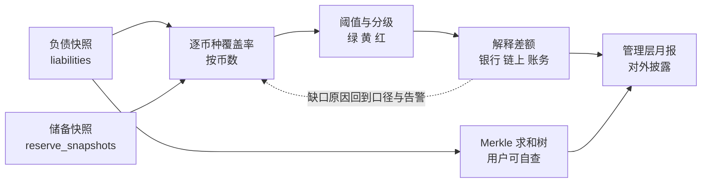

# B82 储备与偿付对账实战：负债、储备与差额分级

> 学习目标：做完本章，你能——
> 1. 用负债与储备快照算出逐币种覆盖率，按"币数"与"美元"两种口径对账，调覆盖率阈值把误报压到 0 而不丢缺口。
> 2. 把一次储备低于负债的差额拆成"已解释"和"未解释"，给每个币种日定级（绿 / 黄 / 红），并说清升级条件。
> 3. 用 Python 标准库自己写一个 Merkle 求和树负债证明小工具，验证某用户余额被包含，并演示"被漏掉的用户"为什么能被发现、又为什么只靠树发现不了。
> 4. 写一份给管理层的偿付能力月报和一份对外披露草稿，并用检查脚本验证它没有漏项、没有夸大。
>
> 前置知识：读过 [X27 储备与偿付能力](../architecture/X27-cex-reserves-solvency.md)（3.1–3.4、6.2、6.3、7.7 节）；会读 CSV；会写几十行 Python（`hashlib`、`json`、`csv`）；做过 [B81](B81-wallet-channel-recon-practice.md) 的三方对账更好。
> 预计用时：约 3–4 小时（Merkle 小工具占一半）。
> 关联章节：[X27 储备与偿付能力](../architecture/X27-cex-reserves-solvency.md)｜[X26 账务与钱包交接](../architecture/X26-cex-ledger-wallet-handoff.md)｜[X11 钱包、资金调拨与支付](../architecture/X11-cex-wallet-treasury-payment.md)｜[Merkle 树实验](../interactive/audit-merkle.html)｜[T09 事件手册与值班](../templates/T09-incident-runbook-oncall.md)
> 靶场：`practice-example-code/ops/`（MiniEx 模拟交易所；第二批数据说明见该目录的 `API_X.md`）
> 最后核对：2026-11-23（本章全部命令在本机用系统 `python3` 运行过；输出来自真实运行，数值由固定种子 20260302 决定）

> ⚠️ 警告：法律与道德边界。本章的数据、账户和"用户余额"全部由脚本合成，不含真实用户、真实地址或真实密钥。Merkle 小工具是教学版，没有做生产级安全加固（盐的保管、叶子顺序随机化、每币种一棵树、可验证的树更新都没做）。不要把本章的阈值、分级和披露措辞原样用到真实平台：先在你自己的历史快照上回放，再让法务与合规复核对外措辞。本章不涉及对任何真实系统的攻击步骤。

---

## 开场：合并之后，99.5% 看上去并不吓人

03-12 晚上，MiniEx 的财务把四种资产的储备和负债都折成美元，合并算了一个数：覆盖率 **99.50%**。差 0.5%，看上去像取价时点的误差，日报写了"基本持平"。

同一天，把 USD 单独拿出来算：储备 6,164,485.16，负债 6,457,333.69，覆盖率 **95.46%**，缺 29 万美元。USD 已经连续第三天低于 100%。它被 BTC 和 ETH 的盈余、以及 USDT 的盈余（03-12 USDT 已经回到 102.34%）稀释掉了。

> 🎯 打个比方：像一家医院只看"全院床位使用率 80%"，没人发现急诊科已经满到走廊。偿付也一样：用户存的是 USD，就要用 USD 去覆盖；别的币的盈余不能替它还账。局限：比喻里的床位可以临时调配，而不同币种的储备不能互相替代，这是 X27 3.2 节"同币种原则"的原因。

本章拿这一次真实感很强的合成事件做练习：2026-03-10 至 03-12，USD 与 USDT 的储备先后低于负债。你要回答四个问题：

1. 缺口有多大，哪天开始、哪天结束？（第 1–2 步）
2. 阈值怎么定，既不漏真缺口，又不被"取价时点差"吵醒？（第 3–4 步）
3. 缺口是怎么来的，解释完了没有？（第 5–6 步）
4. 怎样让别人**独立核对**你欠用户多少，又怎样不夸大地对外说？（第 7–8 步）

## 1. 本章怎么练

偿付对账是一条每天跑的流水线。本章沿着它走 8 步。



读图要点：
- 左半是"每天算"：覆盖率、阈值、分级。右半是"算完说清楚"：解释、月报、证明。
- 差额解释有一条虚线回到覆盖率：解释清楚之后，要把原因变成新的告警或口径，否则下个月同样的缺口再来一次。
- 局限：靶场只有日终快照，看不到盘中；X27 7.1 节的盘中预警在这里只能在思考题里讨论。

本章用到的脚本：

| 步骤 | 脚本 | 位置 | 谁写的 |
|---|---|---|---|
| 1、6 | `solvency_grade.py`（算覆盖率、分级、假设对账） | `practice-example-code/ops/solutions/b82/` | 参考实现 |
| 2–5 | `reserve_check.py`、`recon3.py` | `practice-example-code/ops/lib/` | 靶场自带 |
| 7 | `merkle_sum.py` | 你写在 `b82-lab/`；参考实现在 `solutions/b82/` | 你 |
| 8 | `report_check.py`（查月报与披露草稿） | `solutions/b82/` | 参考实现 |

用到的场景：**S14-01**（覆盖率低于 100%：USD@03-10、03-11、03-12，USDT@03-10、03-11）。造成缺口的另外四件事 S14-02…S14-05 在第 5 步作为"原因证据"出现，它们的专项练习在 [B81](B81-wallet-channel-recon-practice.md)。

## 2. 准备

> 本章所有命令从 `web3-security-101/` 根目录出发。

1. 生成靶场数据（约 5 秒）：

```bash
bash practice-example-code/ops/setup.sh --no-tests | tail -1
```

```text
靶场已就绪：数据在 practice-example-code/ops/data/ 与 data_x/，答案在 practice-example-code/ops/answers/（练习做完再看）
```

2. 建工作目录，并设两个变量（每开新终端都要重设）：

```bash
mkdir -p b82-lab
OPS=practice-example-code/ops
SOL=$OPS/solutions/b82
```

3. 看数据长什么样。USD 在 03-10 的全部负债行与储备行：

```bash
grep "^2026-03-10,USD," $OPS/data_x/liabilities.csv $OPS/data_x/reserve_snapshots.csv | sed "s#$OPS/data_x/##"
```

```text
liabilities.csv:2026-03-10,USD,user_balance,6489381.53,6489381.53
liabilities.csv:2026-03-10,USD,pending_withdrawal,65549.31,65549.31
reserve_snapshots.csv:2026-03-10,USD,bank,6247537.35,6247537.35
```

读法：`liabilities.csv` 有 4 列科目（`user_balance` 用户余额、`pending_withdrawal` 在途提币、`accrued_fees` 应付手续费、`margin_net` 保证金净权益，后两项只出现在 USDT）。`reserve_snapshots.csv` 的 `source` 有钱包三层、`bank`、`custodian`（USD 只有 `bank`）。

> 💡 注意：**先练习，再看 `practice-example-code/ops/answers/S14.json`。** 答案里有 S14-01 的标准命中清单；先看了，第 2 步的数字就没有意义。

## 3. 第 1 步：手算一次覆盖率，再让脚本算

覆盖率 = 储备合计 ÷ 负债合计，**按（日期、币种）算，不跨币种**。

1. 用上一节的两行，手算 USD 在 03-10 的覆盖率和差额：
   - 负债 = 6,489,381.53 + 65,549.31 = ？
   - 储备 = ？
   - 覆盖率 = ？  差额 = 储备 − 负债 = ？

<details class="predict"><summary>🤔 先猜再看：覆盖率是多少？这个数在 X27 的红 / 黄 / 绿里算哪一级？</summary>

负债 6,554,930.84，储备 6,247,537.35，覆盖率 **95.31%**，差额 **−307,393.49**。按 X27 3.4 节的阈值（差异在 5% 以内算黄，超过 5% 算红），95.31% 是**黄**，只差 0.31 个百分点就是红。这说明：只看一天的百分比，会低估问题。后面第 6 步会加上"连续几天"。

</details>

2. 让脚本算 USD 和 USDT 在 03-09 至 03-13 的覆盖率（`--assets` 选币种，`--from`/`--to` 选日期）：

```bash
python3 $SOL/solvency_grade.py --assets USD,USDT --from 2026-03-09 --to 2026-03-13
```

```text
基准 native  互抵 是  调整 0 项
date       asset         reserve       liability  coverage            gap 级    连续 备注  
2026-03-09 USD        6734901.17      6521131.95   103.28%      213769.22 绿     0     
2026-03-09 USDT       9194022.54      9059520.95   101.48%      134501.59 绿     0     
2026-03-10 USD        6247537.35      6554930.84    95.31%     -307393.49 黄     1     
2026-03-10 USDT       8778519.62      8976667.34    97.79%     -198147.72 黄     1     
2026-03-11 USD        6220464.38      6486589.54    95.90%     -266125.16 红     2 升级  
2026-03-11 USDT       8638897.45      8868378.02    97.41%     -229480.57 红     2 升级  
2026-03-12 USD        6164485.16      6457333.69    95.46%     -292848.53 红     3 升级  
2026-03-12 USDT       8726211.93      8526399.08   102.34%      199812.85 绿     0     
2026-03-13 USD        6461233.23      6280222.79   102.88%      181010.44 绿     0     
2026-03-13 USDT       8691919.45      8474815.88   102.56%      217103.57 绿     0     
合计 10 行，非绿 5 行，其中红 3 行
```

3. 再看"合并口径"为什么会骗人。下面这段把四种资产按美元合并，算 03-10 至 03-12 的总覆盖率：

```bash
python3 - <<'PY'
import csv
D = "practice-example-code/ops/data_x/"
for d in ["2026-03-10", "2026-03-11", "2026-03-12"]:
    R = sum(float(r["amount_usd"]) for r in csv.DictReader(open(D + "reserve_snapshots.csv")) if r["date"] == d)
    L = sum(float(r["amount_usd"]) for r in csv.DictReader(open(D + "liabilities.csv")) if r["date"] == d)
    print(d, "合并覆盖率 %.2f%%" % (R / L * 100))
PY
```

```text
2026-03-10 合并覆盖率 98.53%
2026-03-11 合并覆盖率 99.50%
2026-03-12 合并覆盖率 99.50%
```

**过关标准（第 1 步）：**
- 手算的 USD@03-10 与脚本一致：95.31%，差额 −307,393.49。
- 能说出：03-12 合并覆盖率 99.50%，而 USD 单币 95.46%，差在哪里。

> 🪞 反思：你的平台日报里，覆盖率是按币种报，还是按总值报？如果是总值，谁来发现 USD 这样的单币缺口？

## 4. 第 2 步：用 reserve_check 找缺口，并读懂每一条

1. 用默认参数（覆盖率低于 100% 就报，按币数）跑一遍，并对标准答案 S14-01 评分：

```bash
python3 $OPS/lib/reserve_check.py --score S14-01
```

```text
工具：reserve_check   参数：{"basis": "native", "threshold": 1.0, "verify": false}
发现 7 条：shortfall 7
  [shortfall] asset=USD basis=native coverage=0.9531 date=2026-03-10 gap=-307393.49 reserve_key=USD@2026-03-10  <TP S14-01>
  [shortfall] asset=USD basis=native coverage=0.9546 date=2026-03-12 gap=-292848.53 reserve_key=USD@2026-03-12  <TP S14-01>
  [shortfall] asset=USD basis=native coverage=0.959 date=2026-03-11 gap=-266125.16 reserve_key=USD@2026-03-11  <TP S14-01>
  [shortfall] asset=USDT basis=native coverage=0.9741 date=2026-03-11 gap=-229480.57 reserve_key=USDT@2026-03-11  <TP S14-01>
  [shortfall] asset=USDT basis=native coverage=0.9779 date=2026-03-10 gap=-198147.72 reserve_key=USDT@2026-03-10  <TP S14-01>
  [shortfall] asset=USDT basis=native coverage=0.9986 date=2026-03-04 gap=-13079.88 reserve_key=USDT@2026-03-04  <FP-噪声 S14-N02(usdt_inflight)>
  [shortfall] asset=USDT basis=native coverage=0.9989 date=2026-03-08 gap=-9508.91 reserve_key=USDT@2026-03-08  <FP-噪声 S14-N02(usdt_inflight)>
评分（目标 S14-01）：命中 7，TP 5，误报 2（噪声 2、未解释 0），其他场景 0；召回 1/1 = 100%
```

2. 读结果。7 条命中里，5 条标 `TP S14-01`，2 条标 `FP-噪声 S14-N02(usdt_inflight)`。后两条是 USDT 在 03-04（99.86%）和 03-08（99.89%）：它们的缺口只有 13,079.88 和 9,508.91，是在途提币 / 充值造成的取数时点差，第二天就回到 100% 以上。

<details class="predict"><summary>🤔 先猜再看：这 2 条噪声和 5 条真缺口，仅凭覆盖率数字能分开吗？有没有一条线？</summary>

能。噪声的覆盖率是 0.9986 与 0.9989，真缺口最高的是 0.9779（USDT@03-10），中间有一段空档。这段空档就是第 4 步要找的阈值范围。注意：靶场数据里空档很干净，真实平台的噪声分布更宽，要用更多天的数据确定。

</details>

3. 注意最后一行写的是"召回 1/1"。`S14-01` 在答案里是**一个条目**，对应 5 个币种日（`match` 里列了 5 个 `reserve_key`）。所以召回 1/1 并不代表 5 个都找到了，要看 `TP 5`。第 4 步会演示这个陷阱。

> 💡 注意：评分行里"误报 2（噪声 2、未解释 0）"的意思是：这 2 条被靶场标成了已知噪声。"未解释"是既不是答案也不是已知噪声的命中，那一项应该是 0；如果不是 0，说明你的规则报了靶场作者也没想到的东西，要回去查。

**过关标准（第 2 步）：** 默认参数下命中 7 条、TP 5、误报 2，并能写出 5 个 `reserve_key`：`USD@2026-03-10`、`USD@2026-03-11`、`USD@2026-03-12`、`USDT@2026-03-10`、`USDT@2026-03-11`。

## 5. 第 3 步：按币数还是按美元——口径比阈值更重要

`reserve_check.py` 默认 `--basis native`（按币数）。X27 3.2 节的"同币种原则"就是这个意思。现在看看换成美元口径会发生什么。

1. 按美元口径：

```bash
python3 $OPS/lib/reserve_check.py --basis usd --score S14-01 --show 0
```

```text
工具：reserve_check   参数：{"basis": "usd", "threshold": 1.0, "verify": false}
发现 16 条：shortfall 16
评分（目标 S14-01）：命中 16，TP 5，误报 11（噪声 11、未解释 0），其他场景 0；召回 1/1 = 100%
```

2. 命中从 7 条涨到 16 条，误报从 2 条涨到 11 条。多出来的 9 条都是 BTC 和 ETH 的"价格噪声"。用分级脚本对比 BTC 在 03-07 的两种口径：

```bash
python3 $SOL/solvency_grade.py --assets BTC --from 2026-03-07 --to 2026-03-07
python3 $SOL/solvency_grade.py --assets BTC --from 2026-03-07 --to 2026-03-07 --basis usd
```

```text
基准 native  互抵 是  调整 0 项
date       asset         reserve       liability  coverage            gap 级    连续 备注  
2026-03-07 BTC            154.49          153.33   100.76%           1.16 绿     0     
合计 1 行，非绿 0 行，其中红 0 行
基准 usd  互抵 是  调整 0 项
date       asset         reserve       liability  coverage            gap 级    连续 备注  
2026-03-07 BTC        8257636.70      8536149.84    96.74%     -278513.14 黄     1     
合计 1 行，非绿 1 行，其中红 0 行
```

<details class="predict"><summary>🤔 先猜再看：同一天、同一种币，为什么按币数是 100% 以上，按美元却低于 100%？</summary>

`liabilities.csv` 的 `amount_usd` 按当日 **00:00** 标记价折算，`reserve_snapshots.csv` 的 `amount_usd` 按当日 **23:55** 标记价折算。BTC 一天里价格变了，同样数量的 BTC 折成美元就差出几个百分点。币数一样，缺口就不存在。**这类噪声不是阈值能解决的**：BTC 的价格噪声（最低 96.74%）和 USD 的真缺口（最低 95.31%）在数值上重叠，调阈值要么漏、要么吵（第 4 步会量出来）。

</details>

3. 经验：能按币数对账的，按币数对账；需要折美元（比如给管理层汇总）时，**两边用同一个取价时点**，并把取价时点写进口径文件（X27 6.1 节）。

**过关标准（第 3 步）：**
- 美元口径：命中 16、TP 5、误报 11。
- 能解释 BTC@03-07 两种口径的差：币数口径 100.76%（绿），美元口径 96.74%（红），原因是 00:00 与 23:55 的取价时点不同。

## 6. 第 4 步：调覆盖率阈值，压误报

阈值 `--threshold` 的意思是：覆盖率**低于**它才报。默认 1.0 太灵敏。

1. 扫描一组阈值，看命中、TP 与误报。每个阈值一行：

```bash
for t in 1.0 0.999 0.998 0.995 0.98 0.978 0.97; do
  echo "阈值 $t:"
  python3 $OPS/lib/reserve_check.py --threshold $t --score S14-01 --show 0 | grep '^评分'
done
```

```text
阈值 1.0:
评分（目标 S14-01）：命中 7，TP 5，误报 2（噪声 2、未解释 0），其他场景 0；召回 1/1 = 100%
阈值 0.999:
评分（目标 S14-01）：命中 7，TP 5，误报 2（噪声 2、未解释 0），其他场景 0；召回 1/1 = 100%
阈值 0.998:
评分（目标 S14-01）：命中 5，TP 5，误报 0（噪声 0、未解释 0），其他场景 0；召回 1/1 = 100%
阈值 0.995:
评分（目标 S14-01）：命中 5，TP 5，误报 0（噪声 0、未解释 0），其他场景 0；召回 1/1 = 100%
阈值 0.98:
评分（目标 S14-01）：命中 5，TP 5，误报 0（噪声 0、未解释 0），其他场景 0；召回 1/1 = 100%
阈值 0.978:
评分（目标 S14-01）：命中 5，TP 5，误报 0（噪声 0、未解释 0），其他场景 0；召回 1/1 = 100%
阈值 0.97:
评分（目标 S14-01）：命中 3，TP 3，误报 0（噪声 0、未解释 0），其他场景 0；召回 1/1 = 100%
```

2. 读表，回答：
   - 哪个阈值开始把 2 条噪声压到 0？（0.999 仍报 2 条，0.998 起为 0 条；噪声里最低的一天是 0.9986。）
   - 哪个阈值开始丢真缺口？（0.97：只剩 3 条，丢了 USDT 的 2 条，但评分仍写"召回 1/1"。）
   - 5/5 召回、0 误报的阈值落在 0.978 到 0.998 之间（上面两个端点都实测成立）。理论范围是：高于真缺口里最好的一天（0.9779），不高于噪声里最差的一天（0.9986）。

3. 选一个值。本手册选 **0.995**：离噪声上界有余量，离真缺口下界也有余量。把"选了什么、为什么"写进你的口径文件。然后用退出码做成一个"门"：

```bash
python3 $OPS/lib/reserve_check.py --threshold 0.995 --score S14-01 --max-fp 0 --show 0 > /dev/null; echo "阈值 0.995 退出码 $?"
python3 $OPS/lib/reserve_check.py --score S14-01 --max-fp 0 --show 0 > /dev/null; echo "默认阈值 退出码 $?"
```

```text
阈值 0.995 退出码 0
默认阈值 退出码 1
未达标：召回或误报不满足 --min-recall / --max-fp
```

4. 美元口径能用阈值救回来吗？试两个：

```bash
for t in 0.995 0.97 0.96; do
  echo "美元口径 阈值 $t:"
  python3 $OPS/lib/reserve_check.py --basis usd --threshold $t --score S14-01 --show 0 | grep '^评分'
done
```

```text
美元口径 阈值 0.995:
评分（目标 S14-01）：命中 12，TP 5，误报 7（噪声 7、未解释 0），其他场景 0；召回 1/1 = 100%
美元口径 阈值 0.97:
评分（目标 S14-01）：命中 4，TP 3，误报 1（噪声 1、未解释 0），其他场景 0；召回 1/1 = 100%
美元口径 阈值 0.96:
评分（目标 S14-01）：命中 3，TP 3，误报 0（噪声 0、未解释 0），其他场景 0；召回 1/1 = 100%
```

美元口径下，阈值降到 0.96 才能做到误报 0，但这时 TP 只剩 3（丢了两个 USDT 缺口）。**口径错了，调阈值只能在"漏"和"吵"之间二选一。**

> 💡 注意：把阈值从 1.0 放宽到 0.995，意味着最多允许储备比负债少 0.5% 而不报警。对一个负债 650 万美元的币种，0.5% 是 3.2 万美元。这是业务决定，不是工程决定：X27 3.4 节说"第一版阈值宁可窄，用两周数据再放宽"。放宽的理由要有数据（本章是 14 天，两个噪声点），并写进变更单（POR-1）。

**过关标准（第 4 步）：**
- 在币数口径下找到一个阈值，评分为 TP 5、误报 0；写出这个阈值范围的上下界（下界约 0.978，上界约 0.998）。
- 能解释"召回 1/1"为什么在阈值 0.97 时也显示，而实际只命中 3 个币种日。
- 退出码：阈值 0.995 为 0；默认阈值（有 2 条噪声）为 1。

## 7. 第 5 步：解释差额——银行、链上、账务三方证据

缺口出现了，下一个问题是"钱去哪了"。覆盖率只告诉你有缺口，不告诉你原因。

1. 先排除"数据本身不一致"。`--verify` 把储备里的链上部分和 `wallet_balances.csv` 比，把 USD 的银行储备和银行流水日终余额比：

```bash
python3 $OPS/lib/reserve_check.py --verify --show 0 | grep -c "wallet_mismatch\|bank_mismatch"; python3 $OPS/lib/reserve_check.py --verify --show 0 | tail -1
```

```text
0
发现 7 条：shortfall 7
```

没有 `wallet_mismatch` / `bank_mismatch`（计数 0）：储备数字和钱包、银行流水对得上，缺口不是"储备快照写错了"。

2. 用三方对账找原因。先看全部时间：

```bash
python3 $OPS/lib/recon3.py --tol-days 5 --amount-tol 25 --score S14-02,S14-03,S14-04,S14-05 --show 10
```

```text
工具：recon3   参数：{"amount_tol": 25.0, "asof": "2026-03-15T00:00:00Z", "dust": 5.0, "include_fees": false, "include_interest": false, "include_sweeps": false, "late_hours": 24.0, "tol_days": 5}
发现 5 条：duplicate_booking 1，external_only 2，internal_only 1，late_booking 1
  [duplicate_booking] amount=3200.0 asset=USDT booked=2 item_id=PD000763 rail=chain ref=0xdc1bb6bc4795d5e4d5438d6c925f338effbda7542fff24cedc122fc156570371  <TP S14-05>
  [internal_only] amount=40000.0 asset=USDT item_id=PW000762 rail=chain ref=0xd8dc1eb702d03ec8bdd26675b2de499b1f751e4eabf786e52b2328c9678a8980  <TP S14-03>
  [external_only] amount=480000.0 asset=USD channel=return counterparty=ACCT-9F31A2 direction=credit rail=bank ref=RTX-77001 ts=2026-03-13T10:15:03Z  <TP S14-02>
  [external_only] amount=480000.0 asset=USD channel=wire counterparty=ACCT-9F31A2 direction=debit rail=bank ref=BKX-77001 ts=2026-03-10T11:42:17Z  <TP S14-02>
  [late_booking] asset=USDT book_ts=2026-03-12T09:00:40Z ext_ts=2026-03-10T08:21:00Z hours=48.7 item_id=PW000761 rail=chain ref=0x29d3d250235af677612daccd6cec3f9d6bfbcb7e0db9773c954ef7b5663826b5  <TP S14-04>
评分（目标 S14-02,S14-03,S14-04,S14-05）：命中 5，TP 5，误报 0（噪声 0、未解释 0），其他场景 0；召回 4/4 = 100%
```

3. 再看 03-11 日终那一刻的样子（`--asof` 把之后的事件和流水都藏起来）：

```bash
python3 $OPS/lib/recon3.py --asof 2026-03-11T23:59:59Z --tol-days 5 --amount-tol 25 --show 10
```

```text
工具：recon3   参数：{"amount_tol": 25.0, "asof": "2026-03-11T23:59:59Z", "dust": 5.0, "include_fees": false, "include_interest": false, "include_sweeps": false, "late_hours": 24.0, "tol_days": 5}
发现 4 条：duplicate_booking 1，external_only 1，external_unbooked 1，internal_only 1
  [duplicate_booking] amount=3200.0 asset=USDT booked=2 item_id=PD000763 rail=chain ref=0xdc1bb6bc4795d5e4d5438d6c925f338effbda7542fff24cedc122fc156570371
  [external_unbooked] amount=380000.0 asset=USDT ext_ts=2026-03-10T08:21:00Z hours=39.6 item_id=PW000761 rail=chain ref=0x29d3d250235af677612daccd6cec3f9d6bfbcb7e0db9773c954ef7b5663826b5
  [internal_only] amount=40000.0 asset=USDT item_id=PW000762 rail=chain ref=0xd8dc1eb702d03ec8bdd26675b2de499b1f751e4eabf786e52b2328c9678a8980
  [external_only] amount=480000.0 asset=USD channel=wire counterparty=ACCT-9F31A2 direction=debit rail=bank ref=BKX-77001 ts=2026-03-10T11:42:17Z
```

4. 把证据对到缺口上，填这张表（参考答案在第 11 节）：

| 缺口 | 可能的原因 | 三方证据（`ref` / `item_id`） | 方向：对储备、对负债 | 补记后能否关闭 |
|---|---|---|---|---|
| USD 03-10 至 03-12 | | | | |
| USDT 03-10、03-11 | | | | |
| USDT 被掩盖的部分 | | | | |

5. 做一次"假设对账"：**如果这两笔外流和在途款没有发生**，缺口会不会消失？用 `--adjust` 把已解释的金额加回储备：

```bash
python3 $SOL/solvency_grade.py --only-breach --adjust USD@2026-03-10:2026-03-12=480000 --adjust USDT@2026-03-10:2026-03-11=380000; echo "退出码 $?"
```

```text
基准 native  互抵 是  调整 2 项
date       asset         reserve       liability  coverage            gap 级    连续 备注  
2026-03-04 USDT       9053493.71      9066573.59    99.86%      -13079.88 黄     1     
2026-03-08 USDT       8952585.63      8962094.54    99.89%       -9508.91 黄     1     
合计 56 行，非绿 2 行，其中红 0 行
退出码 0
```

只剩两条黄（03-04、03-08 的 USDT 噪声）。说明 **480,000 美元的银行外流（S14-02）与 380,000 USDT 的记账延迟（S14-04）解释了全部 5 个缺口币种日**。再看只解释一半会怎样：

```bash
python3 $SOL/solvency_grade.py --only-breach --adjust USD@2026-03-10:2026-03-12=480000; echo "退出码 $?"
```

```text
基准 native  互抵 是  调整 1 项
date       asset         reserve       liability  coverage            gap 级    连续 备注  
2026-03-04 USDT       9053493.71      9066573.59    99.86%      -13079.88 黄     1     
2026-03-08 USDT       8952585.63      8962094.54    99.89%       -9508.91 黄     1     
2026-03-10 USDT       8778519.62      8976667.34    97.79%     -198147.72 黄     1     
2026-03-11 USDT       8638897.45      8868378.02    97.41%     -229480.57 红     2 升级  
合计 56 行，非绿 4 行，其中红 1 行
退出码 1
```

USDT 的缺口依旧在（03-10、03-11），并且 03-11 仍是红。**只解释了一个币种，不等于解释了差额。**

<details class="predict"><summary>🤔 先猜再看：40,000 USDT 的假回执（PW000762）在这张图里扮演什么角色？</summary>

假回执那笔提币没有真的广播，链上不存在，但账务收到"已确认"回执后把用户的 40,000 USDT 从负债里扣了。结果：负债**少算**了 40,000，覆盖率**看上去更好**。所以 USDT 的真实缺口比表面数字更大，大约多 40,000。它不是缺口的"原因"，而是缺口的"遮盖"。这一类差错只有三方对账（账务有扣减、链上没有这笔）才看得见，单看覆盖率发现不了。

</details>

**过关标准（第 5 步）：**
- `--verify` 没有 `wallet_mismatch` 与 `bank_mismatch`。
- 对账命令能找出 `BKX-77001`（480,000 美元银行外流，无账务单据）、`PW000761`（380,000 USDT，已上链未记账）、`PW000762`（40,000 USDT，假回执）、`PD000763`（3,200 USDT 重复记账）。
- 假设对账加回 480,000 美元与 380,000 USDT 之后，**没有红、没有 USD、没有 03-10 至 03-12 的 USDT 缺口**，退出码 0。
- 能说出：只解释 USD 的缺口为什么不够。

> 🪞 反思：480,000 美元外流之后，USD 在 03-13 又"回来"了（回拨 `RTX-77001`）。覆盖率回到 100% 以上，这件事算解决了吗？账务上两条流水都没有单据，你会让日报写"已恢复"吗？

## 8. 第 6 步：给差额分级，并定升级条件

X27 3.4 节的分级：差异在阈值内为绿；超阈值为黄；超过 24 小时未解释为红。靶场只有日快照，我们用"连续几天不是绿"近似"超过 24 小时"。本章用的规则（`solvency_grade.py` 里实现，你可以改）：

| 级别 | 条件 | 谁处置、多久 |
|---|---|---|
| 绿 | 覆盖率 ≥ 100% | 写日报 |
| 黄 | 95% ≤ 覆盖率 < 100% | 财资负责人，4 小时内出原因与凭证 |
| 红 | 覆盖率 < 95%，或黄且连续 2 天及以上非绿 | P1：通知风控与管理层，授权人决定是否限制出金 |

1. 对 14 天全部数据分级：

```bash
python3 $SOL/solvency_grade.py --only-breach; echo "退出码 $?"
```

```text
基准 native  互抵 是  调整 0 项
date       asset         reserve       liability  coverage            gap 级    连续 备注  
2026-03-04 USDT       9053493.71      9066573.59    99.86%      -13079.88 黄     1     
2026-03-08 USDT       8952585.63      8962094.54    99.89%       -9508.91 黄     1     
2026-03-10 USD        6247537.35      6554930.84    95.31%     -307393.49 黄     1     
2026-03-10 USDT       8778519.62      8976667.34    97.79%     -198147.72 黄     1     
2026-03-11 USD        6220464.38      6486589.54    95.90%     -266125.16 红     2 升级  
2026-03-11 USDT       8638897.45      8868378.02    97.41%     -229480.57 红     2 升级  
2026-03-12 USD        6164485.16      6457333.69    95.46%     -292848.53 红     3 升级  
合计 56 行，非绿 7 行，其中红 3 行
退出码 1
```

2. 读表：`连续` 一列是该币种连续非绿的天数。USD 03-10 是黄（连续 1 天），03-11 升级为红，03-12 连续 3 天仍是红。USDT 03-10 黄，03-11 红。**红级共 3 行**，退出码 1。

<details class="predict"><summary>🤔 先猜再看：USD 03-10 的覆盖率 95.31% 只差 0.31 个百分点就是红。差额其实是 30.7 万美元，这一天值得叫"黄"吗？</summary>

按纯百分比是黄。但如果这一天就把"差额 ≥ 30 万美元"也写进分级条件，可以直接定红。分级要同时看**比例**和**绝对金额**，这是 X27 里留给你的口径选择（POR-6）。本章的参考实现只用比例加连续天数；你在口径文件里可以加一条金额条件，加完要回放，看 14 天里会不会多出新的红。

</details>

3. 再看"负余额是否互抵"对结果的影响。`liabilities.csv` 的 `margin_net` 有 7 天是负数（保证金净权益为负）。X27 3.1 节的硬规则是**负余额不与正余额互抵**。对比不互抵时：

```bash
python3 $SOL/solvency_grade.py --no-netting --only-breach; echo "退出码 $?"
```

```text
基准 native  互抵 否  调整 0 项
date       asset         reserve       liability  coverage            gap 级    连续 备注  
2026-03-04 USDT       9053493.71      9095374.14    99.54%      -41880.43 黄     1     
2026-03-08 USDT       8952585.63      8962094.54    99.89%       -9508.91 黄     1     
2026-03-10 USD        6247537.35      6554930.84    95.31%     -307393.49 黄     1     
2026-03-10 USDT       8778519.62      8976667.34    97.79%     -198147.72 黄     1     
2026-03-11 USD        6220464.38      6486589.54    95.90%     -266125.16 红     2 升级  
2026-03-11 USDT       8638897.45      8921458.26    96.83%     -282560.81 红     2 升级  
2026-03-12 USD        6164485.16      6457333.69    95.46%     -292848.53 红     3 升级  
合计 56 行，非绿 7 行，其中红 3 行
退出码 1
```

对比第 1 步：03-11 USDT 覆盖率从 97.41% 降到 96.83%，缺口从 229,480.57 变成 282,560.81；03-04 USDT 从 99.86% 变成 99.54%。互抵让负债看起来更小。**这条规则要在口径文件里写明，并与风控确认负余额的科目归属**。

4. 起草一页"差额分级与处置表"，放到 `b82-lab/grading.md`。至少包含：三级的触发条件、每级的负责人与响应时间、"黄转红"的升级条件、"红级是否限制出金"的授权人、"已解释"需要附的凭证（单据、链上哈希、对账单）。参考 [T09](../templates/T09-incident-runbook-oncall.md) 的值班与升级格式。

**过关标准（第 6 步）：**
- 分级脚本：非绿 7 行，红 3 行（USD@03-11、USD@03-12、USDT@03-11），退出码 1。
- 不互抵：USDT@03-11 覆盖率 96.83%，缺口 −282,560.81。
- `grading.md` 写清三级触发条件、升级条件、限制出金的授权人、"已解释"所需凭证；不接受"口头确认"。

## 9. 第 7 步：写一个 Merkle 求和树负债证明小工具

到这一步，你已经能内部对账。但外部人凭什么相信你的"负债"？X27 6.3 节的做法：给每个用户一个叶子，叶子里放加盐的用户标识哈希与余额；父节点的余额等于两个子节点余额之和；根节点给出总负债。每个用户拿到自己叶子到根的路径，就能自己验证"我被计入了"。

### 9.1 先看规格

你要写的程序有 4 个子命令，用标准库 `hashlib`、`csv`、`json`、`argparse` 就够：

| 子命令 | 做什么 |
|---|---|
| `build --date D --asset A --out DIR [--omit 用户号]` | 读 `data/accounts.csv` 的 2000 个账户与 `liabilities.csv` 的 `user_balance`，生成叶子、建树，写 `DIR/leaves.csv` 与 `DIR/root.json`（公布的根） |
| `check --dir DIR` | 把树的总额与账务的 `user_balance` 比较，一致才算对得上 |
| `prove --dir DIR --user U --out FILE` | 给用户 U 生成证明：盐、余额、叶子到根的兄弟节点路径 |
| `verify --root ROOT.json --proof FILE` | 只用公布的根和证明，重算根，判断通过与否 |

编码约定（**照此写，你的根哈希才会与本章一致**）：

- 余额用整数"分"，**不用浮点数**。
- 叶子 = `(sha256("leaf|" + 用户号 + "|" + 盐 + "|" + 余额分), 余额分)`；父节点 = `(sha256("node|" + 左哈希 + "|" + 左和 + "|" + 右哈希 + "|" + 右和), 左和 + 右和)`。哈希都写成 64 位小写十六进制。
- 叶子按用户号升序排列；某一层个数为奇数时，补一个 `(sha256("pad"), 0)`。
- 盐 = `sha256("b82-demo-salt|" + 用户号)` 的前 16 个十六进制字符（只为可复现；生产必须是每个用户一个随机盐，并保密）。
- 余额来源：靶场只有负债总额，没有逐用户余额。教学用的分摊：权重 = `int(sha256("w|" + 用户号)[:8], 16) % 1000 + 1`；把 `user_balance` 的总额（分）按权重比例整除分摊，余数加到排序后的第一个用户。**这是合成数据，不是真实余额。**
- 验证时要拒绝负的兄弟节点余额（否则恶意的树可以用负数"抵消"别人）。

骨架（把 `TODO` 补全，存成 `b82-lab/merkle_sum.py`）：

```python
import argparse, csv, hashlib, json, os, sys
from decimal import Decimal

def H(s):                      # sha256 十六进制
    return hashlib.sha256(s.encode()).hexdigest()

def leaf(uid, salt, cents):
    # TODO: cents < 0 时抛 ValueError；返回 (哈希, cents)
    ...

def parent(l, r):
    # TODO: 按上面的约定拼接，返回 (哈希, 左和 + 右和)
    ...

def levels(leaves):
    # TODO: 逐层向上；奇数个就补 (H("pad"), 0)；返回每一层的列表（最后一层是根）
    ...

# TODO: build / check / prove / verify 四个子命令，用 argparse 的 subparsers
```

提示：`prove` 沿着叶子的下标一层层向上，每层取"兄弟"（下标 `i ^ 1`），记下它在左还是右；`verify` 从叶子开始，按 `side` 决定 `parent(兄弟, 当前)` 还是 `parent(当前, 兄弟)`。

### 9.2 运行并验证

下面的命令用参考实现（`solutions/b82/merkle_sum.py`）。把 `MS` 改成你自己的 `b82-lab/merkle_sum.py`，输出应当一样；不一样时，先对比"编码约定"。

1. 建树并核对总额：

```bash
MS=$SOL/merkle_sum.py
rm -rf b82-lab/tree b82-lab/tree_omit
python3 $MS build --date 2026-03-10 --asset USDT --out b82-lab/tree
python3 $MS check --dir b82-lab/tree
cat b82-lab/tree/root.json
```

```text
已建树：2026-03-10 USDT，叶子 2000，总额 8746382.49，根哈希 64e691ef68af7ed5
树总额 8746382.49，账务 user_balance 8746382.49，差额 0.00
结论：一致
{
 "date": "2026-03-10",
 "asset": "USDT",
 "root_hash": "64e691ef68af7ed53d086716cdc91a57af1d84e91f8369015270de61ca2b4e7f",
 "total_cents": 874638249,
 "leaves": 2000
}
```

树的总额 8,746,382.49 与账务 `user_balance` 一致。

2. 为 `A00689` 生成证明，并验证：

```bash
MS=$SOL/merkle_sum.py
python3 $MS prove --dir b82-lab/tree --user A00689 --out b82-lab/proof_A00689.json
python3 $MS verify --root b82-lab/tree/root.json --proof b82-lab/proof_A00689.json
```

```text
已生成证明：A00689，路径 11 层，写入 b82-lab/proof_A00689.json
验证通过：A00689 的余额 1846.47 已计入根（总额 8746382.49）
```

2000 个叶子，路径 11 层：`2^11 = 2048 ≥ 2000`。

3. **改余额**：把证明里的余额改大一位（`184647` 改成 `1184647`），验证应该失败：

```bash
MS=$SOL/merkle_sum.py
sed 's/"cents": \([0-9]*\)/"cents": 1\1/' b82-lab/proof_A00689.json > b82-lab/proof_bad.json
python3 $MS verify --root b82-lab/tree/root.json --proof b82-lab/proof_bad.json; echo "退出码 $?"
```

```text
验证失败：算出的根与公布的根不一致
退出码 1
```

4. **漏掉一个用户**（对应 X27 验收用例 POR-T11）：平台建树时悄悄去掉 A00689，其余照旧：

```bash
MS=$SOL/merkle_sum.py
python3 $MS build --date 2026-03-10 --asset USDT --out b82-lab/tree_omit --omit A00689
python3 $MS check --dir b82-lab/tree_omit; echo "退出码 $?"
python3 $MS prove --dir b82-lab/tree_omit --user A00689 --out b82-lab/x.json; echo "退出码 $?"
python3 $MS verify --root b82-lab/tree_omit/root.json --proof b82-lab/proof_A00689.json; echo "退出码 $?"
```

```text
已建树：2026-03-10 USDT，叶子 1999，总额 8744536.02，根哈希 1d2c68c43e4b8839
树总额 8744536.02，账务 user_balance 8746382.49，差额 -1846.47
结论：不一致，树少算了 1846.47（有用户被漏掉，或余额被改小）
退出码 1
用户 A00689 不在这棵树里
退出码 1
验证失败：算出的根与公布的根不一致
退出码 1
```

三件事同时发生：
- `check` 发现树少算了 1,846.47，恰好是 A00689 的余额。因为**平台自己的账务总额**还在，对比能发现。
- 平台没法给 A00689 出证明（`prove` 失败）。
- A00689 拿着旧证明去验新公布的根，验证失败。**如果 A00689 真去验了，就能发现自己被漏掉。**

<details class="predict"><summary>🤔 先猜再看：如果平台同时把账务里的总额也改小呢？树还能发现被漏掉的用户吗？</summary>

发现不了。`check` 比的是"树总额"和"账务总额"，如果两者一起被改，比较就是一致的。这正是 X27 6.3 节的警告：Merkle 求和树**不能保证所有用户都在树里**，防护要靠 (1) 足够多的用户真的去验证自己的叶子，(2) 外部鉴证对负债完整性的程序，(3) 把树与账务系统的绑定核对（POR-11）。本章的 `check` 只防"没改账务就漏人"这一类。

</details>

5. **树没有证明什么**。这棵树只覆盖 `user_balance` 一个科目。看 USDT 03-10 的其余负债：

```bash
grep "^2026-03-10,USDT," $OPS/data_x/liabilities.csv | sed "s#$OPS/data_x/##"
```

```text
2026-03-10,USDT,user_balance,8746382.49,8746382.49
2026-03-10,USDT,pending_withdrawal,142205.81,142205.81
2026-03-10,USDT,accrued_fees,4393.19,4393.19
2026-03-10,USDT,margin_net,83685.85,83685.85
```

树的总额是第一行 8,746,382.49，而这天 USDT 全部负债是 8,976,667.34。多出的 230,284.85 来自在途提币 142,205.81、应付手续费 4,393.19 和保证金净权益 83,685.85。**树不说明这三项，也不说明储备**：它只回答"负债清单里有没有我"。要回答"钱够不够"，还要储备证明（地址签名、第三方鉴证）。

**过关标准（第 7 步）：**
- 建树：2000 个叶子，总额 8,746,382.49，`check` 输出"一致"；根哈希前 16 位 `64e691ef68af7ed5`（用本章的编码约定，你的程序应当一致）。
- A00689 的证明验证通过，余额 1,846.47，路径 11 层。
- 改余额后验证失败，退出码 1。
- 漏掉 A00689：`check` 报"树少算了 1,846.47"；旧证明验新根失败。
- 能用一句话说出：树证明了什么（我被计入了、总额等于各叶子之和）、没证明什么（所有用户都被计入、储备足够、负债的其他科目）。

> 🪞 反思：盐为什么必须是每用户随机并保密？如果盐是固定的，或者只用用户号哈希，别人能反推出什么？（提示：用户号如果是连续编号，攻击者可以枚举。）

## 10. 第 8 步：写月报与对外披露草稿

数字都在手上了，最后一步是**说清楚**。X27 POR-14 要求把覆盖率、差异天数、未解释差额金额写进管理层月报；POR-10 要求对外证明稿写明范围、时点与局限，并有双人复核。

1. 在 `b82-lab/monthly_report.md` 里写一份文档，分成两大块：
   - **内部月报**（给管理层）：结论、逐币种指标表、差额与原因、本期行动（谁、几号前）、局限。
   - **对外披露草稿**（待法务与合规复核）：标题里要有"对外披露"四个字。这四个字**只在这个标题里出现一次**（检查脚本以它为界，前面算内部月报，后面算对外草稿）。

2. 写之前定下三条内部规则：
   - 月报先说结论，再说证据，不用"基本持平""暂时性"这类词替代数字。
   - 内部月报可以写单据号、银行流水号、对手账户；**对外草稿不写**（调查中的事、用户和对手方的信息，披露前要法务确认）。
   - 对外草稿只说你**有证据**的事，并写清楚"不包含什么"。不写"完全偿付""绝对安全"。

3. 月报用到的数字都能从前面的步骤里找到：
   - 逐币种最低覆盖率与低于 100% 的天数：第 6 步的分级表。
   - 缺口原因与证据：第 5 步。
   - 本期末覆盖率：运行 `python3 $SOL/solvency_grade.py --from 2026-03-14 --to 2026-03-14`。
   - 未关闭项：假回执冲销、重复记账冲正。

```bash
python3 $SOL/solvency_grade.py --from 2026-03-14 --to 2026-03-14
```

```text
基准 native  互抵 是  调整 0 项
date       asset         reserve       liability  coverage            gap 级    连续 备注  
2026-03-14 BTC            152.98          151.36   101.07%           1.62 绿     0     
2026-03-14 ETH           3072.91         3042.30   101.01%          30.61 绿     0     
2026-03-14 USD        6465045.68      6288511.32   102.81%      176534.36 绿     0     
2026-03-14 USDT       8663299.14      8502296.54   101.89%      161002.60 绿     0     
合计 4 行，非绿 0 行，其中红 0 行
```

4. 用检查脚本验证你的文件（它只检查"有没有漏项、有没有说多"，不评价写得好不好）：

```bash
python3 $SOL/report_check.py b82-lab/monthly_report.md
```

脚本检查 14 项：内部 9 项（5 个关键数字、缺口日期、红与黄、行动项有负责人和截止日期、局限），对外 5 项（范围与局限、没有"完全偿付"类断言、没有对手账户号、没有内部单据号、没有用户号）。全部通过时退出码 0。

**过关标准（第 8 步）：**
- `report_check.py` 14 项全部通过（"不通过 0 项"）。
- 月报里能指出"尚未关闭"的项（假回执冲销、重复记账冲正、480,000 美元的来源），并为每一项写了负责人与截止日期。
- 对外草稿能回答三个问题：缺口多大、多久、现在怎样；不含内部单据与对手账户；写明"不是第三方鉴证、不涵盖的科目"。

## 11. 和标准答案对照

做完上面所有步骤，再对照参考答案。

1. 靶场答案在 `practice-example-code/ops/answers/S14.json`；本章的参考实现在 `practice-example-code/ops/solutions/b82/`：

| 文件 | 内容 |
|---|---|
| `solvency_grade.py` | 覆盖率、分级、`--no-netting`、`--adjust` |
| `merkle_sum.py` | Merkle 求和树的 4 个子命令 |
| `report_check.py` | 月报与披露草稿检查 |
| `report.reference.md` | 参考月报与对外披露草稿 |

2. 用检查脚本跑参考月报，应当 14 项全部通过：

```bash
python3 $SOL/report_check.py $SOL/report.reference.md; echo "退出码 $?"
```

```text
通过  内部：写了 USD 最低覆盖率 95.31%
通过  内部：写了 USDT 最低覆盖率 97.41%
通过  内部：写了 480,000 美元的汇出
通过  内部：写了 380,000 USDT 的记账延迟
通过  内部：写了 40,000 USDT 假回执
通过  内部：写了缺口起止日期 03-10 与 03-12
通过  内部：区分了黄与红
通过  内部：行动项有负责人和截止日期
通过  内部：写了局限（不含的科目）
通过  对外：写了范围与局限
通过  对外：没有“完全偿付”类断言
通过  对外：没有对手账户号 ACCT-
通过  对外：没有内部单据号 PW / PD
通过  对外：没有用户号
合计 14 项，不通过 0 项
退出码 0
```

3. 第 5 步表格的参考答案：

| 缺口 | 可能的原因 | 三方证据 | 方向 | 补记后能否关闭 |
|---|---|---|---|---|
| USD 03-10 至 03-12 | 480,000 美元从 BK-OPS-1 汇给陌生账户，账务无记录 | 银行流水 `BKX-77001`（03-10 11:42），回拨 `RTX-77001`（03-13 10:15）；账务无单据 | 对储备：减少；对负债：不变 | 03-13 回拨后储备恢复；账务补记后可关，但来源须调查 |
| USDT 03-10、03-11 | 380,000 USDT 已上链，账务 03-12 09:00 才记账 | `PW000761`；链上转账（TRON） | 对储备：先减；对负债：晚减 | 03-12 补记后关闭（03-12 USDT 回到 102.34%） |
| USDT 被掩盖的部分 | 40,000 USDT 提币收到不存在的"已确认"回执，账务多扣 | `PW000762`：状态从 sign 直接跳到 confirm，回执哈希链上不存在 | 对储备：不变；对负债：多扣 40,000 | 不能自行关闭：要冲销记账，查回执来源，必要时停用该回执通道 |

4. 对照时看三件事：
   - 你的阈值落在 0.978 到 0.998 之间，并说明为什么没选 1.0 或 0.97。
   - 你的分级表有没有把"连续天数"或"金额"写成条件，而不是只看单日百分比。
   - 你的对外草稿有没有一处让读者以为"平台整体完全偿付"。如果有，改掉。

> 💡 注意：参考月报和你的月报可以措辞完全不同。检查脚本只看"必要的事实有没有、不该有的内容有没有"。

## 12. 检查清单

本章使用 SOL 前缀。右列给出 X27 控制项的对应编号：

| 检查项 | 内容 | 本章练习 | 对应 | 结论 | 证据 |
|---|---|---|---|---|---|
| **SOL-1** | 负债与储备按币种逐一对账，不用跨币种合并值作为偿付结论 | 第 1–3 步 | POR-3、X27 3.2 | | |
| **SOL-2** | 覆盖率阈值有回放依据（噪声上界与真缺口下界），改阈值走变更单 | 第 4 步 | POR-1、POR-6 | | |
| **SOL-3** | 负余额科目不与正余额互抵，口径文件写明科目归属 | 第 6 步 | POR-3 | | |
| **SOL-4** | 每个缺口币种日有原因与凭证，"已解释"不接受口头 | 第 5 步 | POR-6、X26 | | |
| **SOL-5** | 差额分级写明触发条件、升级条件、负责人与响应时间、限制出金的授权人 | 第 6 步 | POR-6、POR-14 | | |
| **SOL-6** | 用户可自助验证自己被计入负债树；漏人场景做过验收 | 第 7 步 | POR-11 | | |
| **SOL-7** | 证明或披露写明范围、时点、不含科目与局限，不用"完全偿付"措辞，双人复核 | 第 8 步 | POR-10、POR-13 | | |
| **SOL-8** | 月报含覆盖率、差异天数、未解释差额，并写明负责人与整改日期 | 第 8 步 | POR-14 | | |

定级用 [A02](../assessment/A02-risk-rating-reporting.md) 复核。

## 13. 如果出错

| 现象 | 原因 | 处理 |
|---|---|---|
| `reserve_check.py` 报找不到 `data_x` 文件 | 没跑 `setup.sh`，或不在 `web3-security-101/` 根目录 | `pwd` 确认目录；运行 `bash practice-example-code/ops/setup.sh --no-tests` |
| 覆盖率与本章差几分钱 | 用了浮点数求和 | 用整数"分"（或 `Decimal`） |
| `--basis usd` 的数字与本章不同 | 手工改了数据，或换了种子 | 重新运行 `setup.sh`（第二批种子固定为 20260302） |
| `solvency_grade.py` 的 `--adjust` 没有效果 | 日期范围写成了 `起-止`，或币种写错 | 格式是 `资产@起:止=金额`，例如 `USD@2026-03-10:2026-03-12=480000` |
| Merkle 根与本章不一致 | 编码约定里一处不同（分隔符、是否补 `pad`、用户顺序、盐、分摊的余数给了谁） | 逐项对照 9.1 节；先用 3 个叶子手算，和你的程序对照 |
| `verify` 对正确的证明也失败 | `side` 写反（兄弟在左还是在右），或余额用了"元"而不是"分" | 打印每一层的 `(哈希前 8 位, 和)`，与建树时对照 |
| `report_check.py` 报"缺少标题含对外披露的小节" | 标题里没有"对外披露" | 加一个标题，例如 `# 对外披露（草稿）` |

## 14. 过关标准

下面的数字取自靶场运行，**没有标准答案也能判断**。

- [ ] 手算 USD@03-10：覆盖率 95.31%，差额 −307,393.49，与脚本一致。
- [ ] `reserve_check.py --score S14-01` 默认：命中 7、TP 5、误报 2；写出 5 个 `reserve_key`。
- [ ] 美元口径：命中 16、误报 11；能说出 00:00 与 23:55 取价时点的差异。
- [ ] 阈值：找到 TP 5、误报 0 的值；写出范围（约 0.978 至 0.998）；`--threshold 0.995 --max-fp 0` 退出码 0。
- [ ] 能解释阈值 0.97 时"召回 1/1"为什么不可信（TP 只有 3）。
- [ ] `--verify` 无 `wallet_mismatch` 与 `bank_mismatch`。
- [ ] 三方对账找到 `BKX-77001`、`PW000761`、`PW000762`、`PD000763`；假设对账加回 480,000 美元与 380,000 USDT 后无红、无 USD 缺口，退出码 0。
- [ ] 分级：非绿 7 行、红 3 行；不互抵时 USDT@03-11 为 96.83%。
- [ ] 自己的 Merkle 工具：总额 8,746,382.49 与账务一致；A00689 验证通过；改余额失败；漏人被 `check` 发现；写得出"树没证明什么"。
- [ ] `report_check.py b82-lab/monthly_report.md` 14 项通过，退出码 0。

## 15. 思考题

1. 靶场只有日终快照。X27 7.1 节要求盘中预警。如果 480,000 美元在 03-10 11:42 汇出，你的覆盖率检查最早什么时候才会告警？如果要在 15 分钟内发现，需要哪几类实时数据？（提示：银行流水推送、钱包余额轮询、账务到钱包的差额。）
2. 第 4 步选 0.995 是因为 14 天的数据。如果平台有 365 天快照，你会怎样验证这个阈值？噪声上界一般会变宽还是变窄？
3. 第 5 步里，"假回执"让负债少算 40,000，所以掩盖了缺口。再想一种方向相反的差错：它会让覆盖率**低估**偿付能力。你的月报要不要把这种情况也写出来？
4. Merkle 树的盐如果每用户随机，平台必须把盐安全地发给用户。想一想：盐怎样发？发错了人会怎样？用户拿着验证失败的证明去投诉，平台要怎样证明不是自己漏人？
5. 对外披露草稿里的"调查仍在进行"，在法务看来可能带来什么风险？写一句"在不知道结论之前，你**可以**确认的事实"。

- 下一篇：[B83 反欺诈规则验收与调查取证实战](B83-fraud-rules-casework-practice.md)。本章对的是"钱够不够"，B83 对的是"哪个账户、哪个案件该被限制或解除"，用的是同一批靶场的案件与处置数据。
