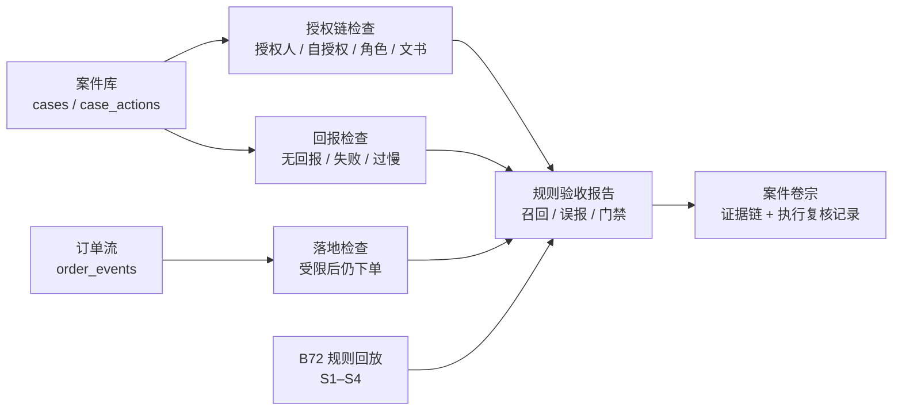

# B83 反欺诈规则验收与调查取证实战：授权、限制与解除

> 学习目标：做完本章，你能——
> 1. 对案件系统做授权链验收：解除有没有授权人、授权人是不是自己、角色对不对、法定冻结有没有被风控或客服解除、业务端有没有回报。
> 2. 找出"限制指令发了，但业务端没落地"的账户，并用订单流证明它们在受限期间仍能下单。
> 3. 写一份规则验收报告：每条规则和检查器的召回、误报、门禁结论、盲区，以及整体覆盖。
> 4. 像调查员一样，把一个案件整理成带哈希的证据链和一份执行复核记录。
>
> 前置知识：会读 SQL；做过 [B72 提币与账户风控规则实战](B72-withdrawal-risk-rules-practice.md)（会用 `replay.py` 读召回与误报）；读过 [X24 第 4.2、4.3、5 节](../architecture/X24-cex-fraud-verification.md) 和 [X25 第 4、5、7 节](../architecture/X25-cex-fraud-recovery-ops.md)。
> 预计用时：约 3 小时。
> 关联章节：[X24 反欺诈、合规与安全运营·工程验收](../architecture/X24-cex-fraud-verification.md)｜[X25 反欺诈、合规与安全运营·运营与恢复](../architecture/X25-cex-fraud-recovery-ops.md)｜[X13 欺诈、合规与安全运营](../architecture/X13-cex-fraud-compliance-secops.md)｜[B72 提币与账户风控规则实战](B72-withdrawal-risk-rules-practice.md)｜[B80 复市与恢复演练实战](B80-resumption-recovery-practice.md)
> 最后核对：2026-11-23（Python 3.12.3；下文每条命令都在本机用靶场默认种子运行过，输出来自真实运行。第一批种子 20260301，第二批种子 20260302）

> ⚠️ 警告：法律与道德边界。本章的数据是虚构交易所"MiniEx"的合成数据，不含真实用户、真实地址和真实密钥。本章教你验收"限制与解除"这套内部控制，不教怎样绕过它。案件、文书编号（`LO-`、`SAN-`）和员工编号都是编出来的，与任何真实案件无关。

---

## 开场：冻对了，但解不了；解开了，却没人批

X25 的开场讲了一个周一：风控冻对了一批账户，复市那天又要把它们解开。冻结有一套授权，解除也应该有。但事故当天人人都想"快点恢复"，批量解除最容易出三种事：

- 没有授权人。操作员点了"批量解除"，系统没有要求第二个人。
- 授权人就是操作员。表面上有两个字段，其实是一个人。
- 解除了，但业务端没回报"已执行"。案件库里状态是"已解除"，真实账户还是冻着，或者反过来，案件里还冻着，账户其实已经放开。

还有一件更危险的事：**法定冻结**（法院令、制裁命中）不是风控的权力。风控没有依据，不能解。

反过来，冻结也可能没落地。限制指令发出去，业务端回一个"失败"，没人重试，账户就继续下单。案件库里写着"已限制"，没人再看。

在 MiniEx 的两周数据里，S15 把这些事都放了进去：2026-03-11 的事故后，40 个账户被限制；03-13 09:00–10:40 批量解除；其中有授权缺口，有一笔法定冻结被客服执行、安全人员批准解除，还有 3 个账户的限制从没落地。你要做的，是用数据把它们一个个找出来，并写成验收和取证的记录。

## 1. 本章怎么练

原理不在这里重讲。验收用例和回放方法见 [X24 第 4.2、4.3、5 节](../architecture/X24-cex-fraud-verification.md)；案件生命周期、证据链和解除条件见 [X25 第 3、4、5、7 节](../architecture/X25-cex-fraud-recovery-ops.md)。本章只做一件事：在案件数据上把这些检查写出来、跑起来、读数字，并留下可以交给别人复核的记录。

> 🎯 打个比方：授权链验收像查一本门禁登记簿。每次开门都该有"谁开的、谁批的、门是不是真开了"。你不是在问"这个人好不好"，而是在问"登记簿上每一行有没有缺格子"。局限：登记簿全对，不代表门真的锁上了。要回头去门口看一眼，这就是"业务端回报"和"独立回读"。



读图要点：
- 左边三类检查都读"记录"。只有"落地检查"读另一个独立来源（订单流），这是它能发现"记录说冻了、实际没冻"的原因。
- 验收报告把 B72 的风控规则和本章的案件检查放进同一张表，用同一个门禁：目标答案全部召回，且误报为 0。
- 局限：本章的"答案"来自靶场。真实环境里，你的答案来自复核人的回读和历史事件，B73 讲过没有答案时怎么办。

本章有 7 个步骤（第 0–6 步），覆盖第二批的 S15，并回看第一批 S1–S4：

| 步骤 | 场景 | 你要做的事 | 要学的东西 |
|---|---|---|---|
| 0 | — | 读懂案件数据；跑一次基线 | 三个角色、五种动作、两类自动动作 |
| 1 | S15-01 | 解除的授权链：无授权人、自授权、角色不符 | 排除策略自动动作 |
| 2 | S15-03 | 法定冻结的解除：角色、文书编号 | 解除要引用冻结时的依据 |
| 3 | S15-02 | 业务端回报：缺失、过慢 | 回报 SLA 的取舍；"没回报"要等到 SLA 之后 |
| 4 | S15-04 | 限制未落地的账户与其后订单 | 用独立来源验证记录；回报时间不能当生效时间 |
| 5 | S1–S4、S11、S15 | 规则验收报告（回看 B72） | 门禁、整体覆盖、盲区 |
| 6 | S15 | 案件卷宗：证据链与执行复核记录 | 引用、哈希、"待复核人填" |

## 2. 第 0 步：准备，并读懂案件数据

> 💡 注意：以下所有命令都从 `web3-security-101/` 根目录出发，并在同一个终端里按顺序运行。

1. 设两个路径变量，确认第二批数据存在：

```bash
export OPS=practice-example-code/ops
export B83=$OPS/solutions/b83
ls $OPS/data_x/case_actions.jsonl $OPS/data_x/cases.csv $OPS/data/staff.csv
```

```text
practice-example-code/ops/data/staff.csv
practice-example-code/ops/data_x/case_actions.jsonl
practice-example-code/ops/data_x/cases.csv
```

如果提示文件不存在，先运行 `bash practice-example-code/ops/setup.sh --no-tests`（会生成第一批和第二批数据，约几秒到二十秒）。字段说明见 [ops/API_X.md 第 1.7 节](../../practice-example-code/ops/API_X.md)。

2. 本章的辅助脚本在 `practice-example-code/ops/solutions/b83/`：
   - `casesql.py`：把案件数据装进内存 SQLite，运行你的 SQL 并对答案评分（同 B72 的 `replay.py`，但读第二批的案件库）。表有 `case_actions`、`cases`、`staff_roles`（员工角色）、`order_events`。
   - `sla_sweep.py`：扫回报 SLA。
   - `acceptance_report.py`：生成规则验收报告。
   - `casefile.py`：生成案件卷宗。

   它们只读数据，不改任何文件。`rules/` 里是参考规则，练习做完再看。

```bash
python3 $B83/casesql.py --tables
```

```text
case_actions   424
cases          245
order_events   22242
staff_roles    43
```

3. 先看一眼动作的构成：

```bash
python3 $B83/casesql.py --sql "SELECT action, scope, COUNT(*) n FROM case_actions GROUP BY 1,2 ORDER BY 1,2"
```

```text
（9 行）
action          scope     n
--------------  --------  ---
legal_freeze    all       17
legal_unfreeze  all       3
release         all       57
release         trade     14
release         withdraw  101
restrict        all       70
restrict        trade     19
restrict        withdraw  142
revoke_trade    trade     1
```

五种动作：`restrict` 限制、`release` 解除、`legal_freeze` 法定冻结、`legal_unfreeze` 解除法定冻结、`revoke_trade` 撤销交易权限。范围 `scope` 是 `withdraw`（提币）、`trade`（交易）或 `all`（全部）。

4. 看谁执行、谁授权。`system:` 开头的是自动动作，授权来自策略 `policy:*`，不是人：

```bash
python3 $B83/casesql.py --sql "SELECT CASE WHEN actor LIKE 'system:%' THEN 'auto' ELSE 'human' END kind, COUNT(*) n, SUM(authorizer IS NULL) no_authorizer, SUM(authorizer = actor) self_auth FROM case_actions GROUP BY 1"
```

```text
（2 行）
kind   n    no_authorizer  self_auth
-----  ---  -------------  ---------
auto   74   0              0
human  350  5              2
```

5. 看角色。授权规则取自 X25 第 5.1 节的授权矩阵，在靶场里这样落地：范围为 `all` 的限制或解除，以及全部法定冻结和解除，必须由**合规（compliance）**授权；范围为 `trade` 或 `withdraw` 的，由**安全（security）**或合规授权。

```bash
python3 $B83/casesql.py --sql "SELECT role, COUNT(*) staff, MIN(staff_id) first, MAX(staff_id) last FROM staff_roles GROUP BY 1 ORDER BY 1"
```

```text
（7 行）
role        staff  first  last
----------  -----  -----  -----
compliance  2      ST048  ST049
developer   12     ST020  ST051
finance     3      ST044  ST046
security    3      ST040  ST042
sre         5      ST034  ST038
support     15     ST001  ST015
treasury    3      ST031  ST033
```

合规是 ST048、ST049；安全是 ST040–ST042；客服（support）是 ST001–ST015。

6. 跑一次基线，看现成的检查器报多少。**先只看汇总，不看明细**（`--show 0`），把明细留给后面的练习：

```bash
python3 $OPS/lib/case_audit.py --score S15 --show 0
```

```text
工具：case_audit   参数：{"allow_policy": true, "asof": "2026-03-15T00:00:00Z", "include_retried": false, "report_sla": 1800}
发现 16 条：authorizer_role 1，legal_no_ref 1，no_report 4，release_no_authorizer 5，report_failed 3，self_authorized 2
评分（目标 S15）：命中 16，TP 16，误报 0（噪声 0、未解释 0），其他场景 0；召回 4/4 = 100%
```

S15 有 4 个答案，检查器发现 16 条，全部是真阳性，误报 0。后面 4 步，你自己把这 16 条找出来，并说清楚每一条是什么。

## 3. 第 1 步：S15-01 解除的授权链

场景：03-13 09:00–10:40，40 个账户被批量解除。检查每一笔解除的授权链：有没有授权人；授权人是不是执行人自己；授权人的角色对不对。

1. 先看这个窗口里谁执行、谁授权。每行是一种（执行人，授权人）组合，前 8 种：

```bash
python3 $B83/casesql.py --sql "SELECT actor, authorizer, COUNT(*) n FROM case_actions WHERE action='release' AND ts>='2026-03-13T09:00:00Z' AND ts<'2026-03-13T11:45:00Z' GROUP BY 1,2 ORDER BY 3 DESC, 1, 2 LIMIT 8"
```

```text
（8 行）
actor  authorizer  n
-----  ----------  -
ST005  ST048       3
ST007  ST049       3
ST012  ST049       3
ST001  ST048       2
ST001  ST049       2
ST002              2
ST005  ST049       2
ST007  ST048       2
```

注意最后几行里 `authorizer` 是空的：`ST002` 的 2 笔解除没有授权人。

2. 写规则。把下面的骨架存为 `my_b83/f1.sql`，把 `___` 填完：

```sql
-- id: b83_f1_authchain
-- scenario: S15-01
SELECT action_id, account_id, actor, authorizer
FROM case_actions
WHERE action = 'release'
  AND (authorizer ___ OR authorizer = ___)
```

提示：第一个空是"没有授权人"，SQL 里判断空值用 `IS NULL`，不能写 `= NULL`；第二个空是"授权人就是执行人"，应该是同一行的另一列。

下面的命令在目录里创建你的规则文件（这里写的是填好的版本；你自己的写法只要结果一致即可）：

```bash
mkdir -p my_b83
cat > my_b83/f1.sql <<'EOF'
-- id: b83_f1_authchain
-- scenario: S15-01
SELECT action_id, account_id, actor, authorizer
FROM case_actions
WHERE action = 'release'
  AND (authorizer IS NULL OR authorizer = actor)
EOF
```

3. 回放：

```bash
python3 $B83/casesql.py my_b83/f1.sql --show 7
```

```text
规则：b83_f1_authchain   参数：无
目标：S15-01
命中 7 条：TP 7，误报 0（噪声 0、未解释 0），其他场景 0
召回：1/1 = 100%
  [TP] S15-01  account_id=A01331 action_id=CT00362 actor=ST010
  [TP] S15-01  account_id=A00645 action_id=CT00363 actor=ST014
  [TP] S15-01  account_id=A00689 action_id=CT00364 actor=ST002
  [TP] S15-01  account_id=A00979 action_id=CT00365 actor=ST014
  [TP] S15-01  account_id=A00703 action_id=CT00366 actor=ST002
  [TP] S15-01  account_id=A00112 action_id=CT00367 actor=ST008 authorizer=ST008
  [TP] S15-01  account_id=A00182 action_id=CT00368 actor=ST013 authorizer=ST013
```

7 条命中，全部命中 S15-01：5 笔没有授权人，2 笔授权人就是执行人。注意 `CT00367` 和 `CT00368`：`ST008`、`ST013` 是客服，他们既执行又自己授权。这类问题在管理页面上看不出来，因为"授权人"一栏确实有值。

4. 再检查授权人的角色。把下面的骨架存为 `my_b83/f2.sql`。它按 X25 的授权矩阵判断：范围为 `all` 的限制与解除、全部法定冻结与解除，授权人必须是合规；`trade` 或 `withdraw` 的，授权人必须是安全或合规。

```sql
-- id: b83_f2_role
-- scenario: S15-03
-- param: allow_policy=0
SELECT a.action_id, a.account_id, a.action, a.scope, a.authorizer, r.role AS authorizer_role
FROM case_actions a
LEFT JOIN staff_roles r ON r.staff_id = a.authorizer
WHERE a.authorizer IS NOT NULL
  AND NOT (:allow_policy = 1 AND a.actor LIKE 'system:%')
  AND ( ((a.scope = 'all' OR a.action LIKE 'legal_%') AND COALESCE(r.role, '?') <> '___')
     OR (a.scope IN ('trade', 'withdraw') AND a.action NOT LIKE 'legal_%' AND COALESCE(r.role, '?') NOT IN ('___', '___')) )
```

```bash
cat > my_b83/f2.sql <<'EOF'
-- id: b83_f2_role
-- scenario: S15-03
-- param: allow_policy=0
SELECT a.action_id, a.account_id, a.action, a.scope, a.authorizer, r.role AS authorizer_role
FROM case_actions a
LEFT JOIN staff_roles r ON r.staff_id = a.authorizer
WHERE a.authorizer IS NOT NULL
  AND NOT (:allow_policy = 1 AND a.actor LIKE 'system:%')
  AND ( ((a.scope = 'all' OR a.action LIKE 'legal_%') AND COALESCE(r.role, '?') <> 'compliance')
     OR (a.scope IN ('trade', 'withdraw') AND a.action NOT LIKE 'legal_%' AND COALESCE(r.role, '?') NOT IN ('security', 'compliance')) )
EOF
python3 $B83/casesql.py my_b83/f2.sql --show 2
```

```text
规则：b83_f2_role   参数：{'allow_policy': 0}
目标：S15-03
命中 77 条：TP 1，误报 74（噪声 74、未解释 0），其他场景 2
召回：1/1 = 100%
  [FP-噪声] S15-N01(auto_policy)  account_id=A01631 action=restrict action_id=CT00004 authorizer=policy:R-KYC-HOLD scope=withdraw
  [FP-噪声] S15-N01(auto_policy)  account_id=A00334 action=restrict action_id=CT00005 authorizer=policy:R-KYC-HOLD scope=withdraw
  ……还有 75 条（--show N）
```

这条"朴素版"命中 77 条，其中 74 条是误报：它们都是策略自动动作，授权人是 `policy:R-KYC-HOLD`，不在员工表里，所以"角色不是合规"。这是 S15-N01 的噪声：自动动作的授权来自策略，应该用另一套检查（策略的版本和变更记录）去管，而不是用"人的角色"去管。

5. 把 `allow_policy` 设成 1，放行 `system:` 执行、`policy:` 授权的自动动作：

```bash
python3 $B83/casesql.py my_b83/f2.sql --param allow_policy=1
```

```text
规则：b83_f2_role   参数：{'allow_policy': 1}
目标：S15-03
命中 3 条：TP 1，误报 0（噪声 0、未解释 0），其他场景 2
召回：1/1 = 100%
  [TP] S15-03  account_id=A00122 action=legal_unfreeze action_id=CT00349 authorizer=ST040 authorizer_role=security scope=all
  [OTHER] S15-01  account_id=A00112 action=release action_id=CT00367 authorizer=ST008 authorizer_role=support scope=all
  [OTHER] S15-01  account_id=A00182 action=release action_id=CT00368 authorizer=ST013 authorizer_role=support scope=all
```

命中 3 条，误报 0。其中 `CT00349` 是 S15-03 的答案（下一步细看）；另外两条 `CT00367`、`CT00368` 是第 3 步里的自授权，授权人是客服，角色也不对，所以被另一个答案（S15-01）命中，计在"其他场景"。同一个动作有两个缺陷，两条规则各看一面。

> ⚠️ 警告：放行自动动作是有代价的盲区。这一步之后，**没有任何检查**在看 `system:risk-engine` 能不能凭一条策略就把一个账户限制或放开。它要由策略自己的检查（谁能改 `R-KYC-HOLD`、改动有没有回放，见 X24 第 5.5 节的变更门禁）来覆盖。把噪声排除，要同时写下"谁来接这个盲区"。

<details class="predict"><summary>🤔 先猜再看：只检查 `authorizer IS NULL` 的规则，会放过什么？</summary>

会放过自授权（授权人有值，但就是执行人）和角色不符（授权人有值，但没有权限）。这一步的三个条件是三种不同的缺陷。只看"授权人栏有没有值"，是验收里最常见的假通过。

</details>

## 4. 第 2 步：S15-03 法定冻结不得由风控解除

场景：法定冻结来自法院令或制裁命中。X25 第 7.2 节的决策矩阵写得很清楚：执法保留要书面撤销，制裁要官方结果，决定人是合规官和法务。**风控没有权力解它。**

1. 看全部的法定冻结解除（一共 3 笔）：

```bash
python3 $B83/casesql.py --sql "SELECT u.action_id, u.account_id, u.actor, u.authorizer, COALESCE(u.authority_ref, '(无)') AS unfreeze_ref, f.authority_ref AS freeze_ref FROM case_actions u LEFT JOIN case_actions f ON f.case_id = u.case_id AND f.action = 'legal_freeze' WHERE u.action = 'legal_unfreeze' ORDER BY 1"
```

```text
（3 行）
action_id  account_id  actor  authorizer  unfreeze_ref    freeze_ref
---------  ----------  -----  ----------  --------------  ------------
CT00349    A00122      ST001  ST040       (无)             LO-2026-0417
CT00358    A01609      ST049  ST048       LO-2026-0592-R  LO-2026-0592
CT00359    A00721      ST048  ST049       LO-2026-0322-R  LO-2026-0322
```

`CT00358`、`CT00359` 的解除文书编号是冻结编号加 `-R`（撤销令），授权的是合规。`CT00349` 没有文书编号，执行人 `ST001` 是客服，授权人 `ST040` 是安全人员。

2. 写规则：解除的文书编号必须存在，并且以同一案件的冻结编号开头（解除依据要引用冻结依据）。把骨架存为 `my_b83/f3.sql`：

```sql
-- id: b83_f3_legal
-- scenario: S15-03
SELECT u.action_id, u.account_id, u.actor, u.authorizer, u.authority_ref
FROM case_actions u
LEFT JOIN case_actions f ON f.case_id = u.case_id AND f.action = 'legal_freeze'
WHERE u.action = 'legal_unfreeze'
  AND (u.authority_ref ___ OR u.authority_ref ___ f.authority_ref || '%')
```

提示：两个空是 `IS NULL` 和 `NOT LIKE`。

```bash
cat > my_b83/f3.sql <<'EOF'
-- id: b83_f3_legal
-- scenario: S15-03
SELECT u.action_id, u.account_id, u.actor, u.authorizer, u.authority_ref
FROM case_actions u
LEFT JOIN case_actions f ON f.case_id = u.case_id AND f.action = 'legal_freeze'
WHERE u.action = 'legal_unfreeze'
  AND (u.authority_ref IS NULL OR u.authority_ref NOT LIKE f.authority_ref || '%')
EOF
python3 $B83/casesql.py my_b83/f3.sql
```

```text
规则：b83_f3_legal   参数：无
目标：S15-03
命中 1 条：TP 1，误报 0（噪声 0、未解释 0），其他场景 0
召回：1/1 = 100%
  [TP] S15-03  account_id=A00122 action_id=CT00349 actor=ST001 authorizer=ST040
```

1 条命中：`CT00349`，账户 `A00122`。它同时违反两项：没有法律文书编号；授权角色不是合规（第 1 步的 `f2` 也抓到它）。两条独立的规则对同一个动作都响，说明它的缺陷是"实质性"的，不是某条规则的口径问题。

3. 和现成的检查器对照：

```bash
python3 $OPS/lib/case_audit.py --score S15-03 --show 5
```

```text
工具：case_audit   参数：{"allow_policy": true, "asof": "2026-03-15T00:00:00Z", "include_retried": false, "report_sla": 1800}
发现 16 条：authorizer_role 1，legal_no_ref 1，no_report 4，release_no_authorizer 5，report_failed 3，self_authorized 2
  [self_authorized] account_id=A00112 action=release action_id=CT00367 actor=ST008 case_id=CS00191 ts=2026-03-13T09:13:04Z  <OTHER S15-01>
  [legal_no_ref] account_id=A00122 action=legal_unfreeze action_id=CT00349 actor=ST001 authorizer=ST040 case_id=CS00033 ts=2026-03-12T18:20:00Z  <TP S15-03>
  [authorizer_role] account_id=A00122 action=legal_unfreeze action_id=CT00349 authorizer=ST040 case_id=CS00033 need=compliance role=security ts=2026-03-12T18:20:00Z  <TP S15-03>
  [self_authorized] account_id=A00182 action=release action_id=CT00368 actor=ST013 case_id=CS00226 ts=2026-03-13T09:15:36Z  <OTHER S15-01>
  [no_report] account_id=A00217 action=release action_id=CT00371 age_s=139012 case_id=CS00196 ts=2026-03-13T09:23:08Z  <OTHER S15-02>
  ……还有 11 条（--show N 查看更多）
评分（目标 S15-03）：命中 16，TP 2，误报 0（噪声 0、未解释 0），其他场景 14；召回 1/1 = 100%
```

`case_audit` 对同一个动作报了两条（`legal_no_ref` 和 `authorizer_role`），评分按答案编号去重，所以召回是 1/1。

> 💡 注意：这个案件本身（`CS00033`）在 03-03 被正确冻结，执行人和授权人都是合规，文书编号 `LO-2026-0417`。第 6 步会把它整理成卷宗。要恢复的事实是：这个账户应该仍处于法定冻结。

## 5. 第 3 步：S15-02 业务端回报

场景：案件库里写"已解除"，只代表**指令发出去了**。业务端回一个"已执行"，才代表账户真的变了。X25 第 5.2 节的时序里，复核人不信执行器的回执，要自己回读；本章先从回报缺失开始。

1. 写规则：没有回报，并且距离统计时间已经超过 SLA。把骨架存为 `my_b83/f4.sql`：

```sql
-- id: b83_f4_report
-- scenario: S15-02
-- param: sla=1800
-- param: asof=2026-03-15T00:00:00Z
SELECT action_id, account_id, action, ts,
       CAST(strftime('%s', :asof) - strftime('%s', ts) AS INTEGER) AS age_s
FROM case_actions
WHERE report_status ___
  AND strftime('%s', :asof) - strftime('%s', ts) > :___
```

提示：第一个空是 `IS NULL`，第二个空是 SLA 的参数名。

```bash
cat > my_b83/f4.sql <<'EOF'
-- id: b83_f4_report
-- scenario: S15-02
-- param: sla=1800
-- param: asof=2026-03-15T00:00:00Z
SELECT action_id, account_id, action, ts,
       CAST(strftime('%s', :asof) - strftime('%s', ts) AS INTEGER) AS age_s
FROM case_actions
WHERE report_status IS NULL
  AND strftime('%s', :asof) - strftime('%s', ts) > :sla
EOF
python3 $B83/casesql.py my_b83/f4.sql --show 4
```

```text
规则：b83_f4_report   参数：{'sla': 1800, 'asof': '2026-03-15T00:00:00Z'}
目标：S15-02
命中 4 条：TP 4，误报 0（噪声 0、未解释 0），其他场景 0
召回：1/1 = 100%
  [TP] S15-02  account_id=A01575 action=release action_id=CT00369 age_s=139309 ts=2026-03-13T09:18:11Z
  [TP] S15-02  account_id=A00273 action=release action_id=CT00370 age_s=139146 ts=2026-03-13T09:20:54Z
  [TP] S15-02  account_id=A00217 action=release action_id=CT00371 age_s=139012 ts=2026-03-13T09:23:08Z
  [TP] S15-02  account_id=A01166 action=release action_id=CT00372 age_s=138880 ts=2026-03-13T09:25:20Z
```

4 条命中：4 笔解除一直没有回报。

2. "没回报"要等到 SLA 过了才算缺陷。同一条规则，把统计时间 `asof` 提前到 03-13 09:40（这几笔解除发生在 09:18–09:25，不到 30 分钟），再推到 10:00：

```bash
python3 $B83/casesql.py my_b83/f4.sql --param asof=2026-03-13T09:40:00Z --show 0 | sed -n 3,4p
python3 $B83/casesql.py my_b83/f4.sql --param asof=2026-03-13T10:00:00Z --show 0 | sed -n 3,4p
```

```text
命中 0 条：TP 0，误报 0（噪声 0、未解释 0），其他场景 0
召回：0/1 = 0%
命中 4 条：TP 4，误报 0（噪声 0、未解释 0），其他场景 0
召回：1/1 = 100%
```

09:40 时一条都不报：它们只是"还没到时间"。10:00 全部报出。所以"没回报"规则必须有 `asof` 和 SLA：它是"超时"规则，不是"空值"规则。实时跑的时候，用当前时间做 `asof`，SLA 要和业务端约定。

3. 另一面：回报**太慢**也是缺陷，但没有回报缺失严重。用 `sla_sweep.py` 扫 `report_sla`，看每个值的命中、TP、误报：

```bash
python3 $B83/sla_sweep.py 60,300,600,1200,1800,3600
```

```text
report_sla    命中   TP    误报  召回
        60   305   24   281  4/4
       300    24   16     8  4/4
       600    20   16     4  4/4
      1200    16   16     0  4/4
      1800    16   16     0  4/4
      3600    16   16     0  4/4
```

读表：
- SLA 太紧（60 秒）：正常的回报通常几十秒到几分钟，281 条误报，没人能看。
- SLA 300 秒：8 条误报，都是"偏慢但已到"的回报（S15-N03）。
- SLA 1200 秒（20 分钟）起：误报 0，召回仍 4/4。
- 召回一直是 4/4，因为"没回报"的 4 条无论 SLA 多紧都会报。SLA 影响的是**噪声**，不是这 4 条。

先自己量一下"最慢的合法回报"有多慢，再定 SLA：

```bash
python3 $B83/casesql.py --sql "SELECT COUNT(*) AS reported, MAX(CAST(strftime('%s', report_ts) AS INTEGER) - CAST(strftime('%s', ts) AS INTEGER)) AS max_delay_s FROM case_actions WHERE report_status IS NOT NULL"
```

```text
（1 行）
reported  max_delay_s
--------  -----------
420       865
```

最慢的回报是 865 秒（约 14 分钟）。所以 SLA 要大于 865 秒才不会误报，表里 1200 秒起误报为 0，正好对上。

> 💡 注意：默认值 1800 秒（30 分钟）是在"最慢的合法回报"之外留的余量。真实系统的 SLA 来自业务端的 P99 回报延迟加缓冲，不是拍脑袋的整数。

4. 还有一种回报：`failed`。看全部回报失败的动作，以及其中有没有后续重试成功：

```bash
python3 $B83/casesql.py --sql "SELECT a.action_id, a.account_id, a.action, a.scope, COALESCE(b.action_id, '(无重试)') AS retry_id, COALESCE(b.report_status, '-') AS retry_status FROM case_actions a LEFT JOIN case_actions b ON b.retry_of = a.action_id WHERE a.report_status = 'failed' ORDER BY 1"
```

```text
（7 行）
action_id  account_id  action    scope     retry_id  retry_status
---------  ----------  --------  --------  --------  ------------
CT00013    A01370      restrict  withdraw  CT00015   applied
CT00017    A00243      restrict  trade     CT00018   applied
CT00027    A01182      restrict  all       CT00028   applied
CT00306    A00690      restrict  all       (无重试)     -
CT00307    A00881      restrict  all       (无重试)     -
CT00308    A01162      restrict  all       (无重试)     -
CT00413    A00320      restrict  withdraw  CT00414   applied
```

7 笔回报失败，其中 4 笔有重试且重试成功（S15-N02，正常），3 笔没有重试：`CT00306`、`CT00307`、`CT00308`。下一步看它们。

## 6. 第 4 步：S15-04 限制没落地，账户还在下单

场景：03-11 事故当天，这 3 个账户的限制（范围 `all`）回报 `failed`，没人重试。案件库里仍然"已限制"。限制实际上没生效，这个账户后来还能不能下单？

1. 先找"回报失败且没有成功重试"的限制。把骨架存为 `my_b83/f5.sql`：

```sql
-- id: b83_f5_unapplied
-- scenario: S15-04
-- param: allow_retry=1
SELECT a.action_id, a.account_id, a.action, a.scope, a.ts
FROM case_actions a
WHERE a.action IN ('restrict', 'legal_freeze', 'revoke_trade')
  AND a.report_status = '___'
  AND NOT (:allow_retry = 1 AND EXISTS (
        SELECT 1 FROM case_actions b WHERE b.retry_of = a.action_id AND b.report_status = 'applied'))
```

```bash
cat > my_b83/f5.sql <<'EOF'
-- id: b83_f5_unapplied
-- scenario: S15-04
-- param: allow_retry=1
SELECT a.action_id, a.account_id, a.action, a.scope, a.ts
FROM case_actions a
WHERE a.action IN ('restrict', 'legal_freeze', 'revoke_trade')
  AND a.report_status = 'failed'
  AND NOT (:allow_retry = 1 AND EXISTS (
        SELECT 1 FROM case_actions b WHERE b.retry_of = a.action_id AND b.report_status = 'applied'))
EOF
python3 $B83/casesql.py my_b83/f5.sql
python3 $B83/casesql.py my_b83/f5.sql --param allow_retry=0 --show 0
```

```text
规则：b83_f5_unapplied   参数：{'allow_retry': 1}
目标：S15-04
命中 3 条：TP 3，误报 0（噪声 0、未解释 0），其他场景 0
召回：1/1 = 100%
  [TP] S15-04  account_id=A00690 action=restrict action_id=CT00306 scope=all ts=2026-03-11T15:11:33Z
  [TP] S15-04  account_id=A00881 action=restrict action_id=CT00307 scope=all ts=2026-03-11T15:12:59Z
  [TP] S15-04  account_id=A01162 action=restrict action_id=CT00308 scope=all ts=2026-03-11T15:17:43Z
规则：b83_f5_unapplied   参数：{'allow_retry': 0}
目标：S15-04
命中 7 条：TP 3，误报 4（噪声 4、未解释 0），其他场景 0
召回：1/1 = 100%
  ……还有 7 条（--show N）
```

允许"已成功重试"的排除时命中 3 条，没有误报。把排除关掉（`allow_retry=0`），命中 7 条，4 条误报：就是第 3 步看到的 4 笔"失败后重试成功"。

2. 记录说"没落地"，订单流能不能证明？这是第 4 步最重要的一环：**拿第二个来源去验第一个来源**。把骨架存为 `my_b83/f6.sql`，把限制指令与同账户的新订单相连：

```sql
-- id: b83_f6_unapplied_orders
-- scenario: S15-04
-- param: grace=60
-- param: min_orders=1
SELECT a.account_id, a.action_id, COUNT(DISTINCT e.order_id) AS orders, MIN(e.ts) AS first_order
FROM case_actions a
JOIN order_events e
  ON e.account_id = a.account_id AND e.event_type = '___'
 AND CAST(strftime('%s', e.ts) AS INTEGER) > CAST(strftime('%s', a.ts) AS INTEGER) + :grace
WHERE a.action IN ('restrict', 'revoke_trade', 'legal_freeze')
  AND a.scope IN ('trade', 'all')
  AND a.report_status = 'failed'
  AND NOT EXISTS (SELECT 1 FROM case_actions b WHERE b.retry_of = a.action_id AND b.report_status = 'applied')
GROUP BY a.account_id, a.action_id
HAVING orders >= :min_orders
```

提示：空填 `new`（新订单，被受理的下单事件）。`a.scope IN ('trade','all')` 是因为只有包含交易的限制，才应该挡住下单。

```bash
cat > my_b83/f6.sql <<'EOF'
-- id: b83_f6_unapplied_orders
-- scenario: S15-04
-- param: grace=60
-- param: min_orders=1
SELECT a.account_id, a.action_id, COUNT(DISTINCT e.order_id) AS orders, MIN(e.ts) AS first_order
FROM case_actions a
JOIN order_events e
  ON e.account_id = a.account_id AND e.event_type = 'new'
 AND CAST(strftime('%s', e.ts) AS INTEGER) > CAST(strftime('%s', a.ts) AS INTEGER) + :grace
WHERE a.action IN ('restrict', 'revoke_trade', 'legal_freeze')
  AND a.scope IN ('trade', 'all')
  AND a.report_status = 'failed'
  AND NOT EXISTS (SELECT 1 FROM case_actions b WHERE b.retry_of = a.action_id AND b.report_status = 'applied')
GROUP BY a.account_id, a.action_id
HAVING orders >= :min_orders
EOF
python3 $B83/casesql.py my_b83/f6.sql
```

```text
规则：b83_f6_unapplied_orders   参数：{'grace': 60, 'min_orders': 1}
目标：S15-04
命中 3 条：TP 3，误报 0（噪声 0、未解释 0），其他场景 0
召回：1/1 = 100%
  [TP] S15-04  account_id=A00690 action_id=CT00306 first_order=2026-03-11T16:20:34Z orders=3
  [TP] S15-04  account_id=A00881 action_id=CT00307 first_order=2026-03-11T16:20:21Z orders=3
  [TP] S15-04  account_id=A01162 action_id=CT00308 first_order=2026-03-11T16:20:30Z orders=3
```

3 个账户，各 3 张订单，都发生在限制指令之后约 1 小时（16:20 起）。这和 API_X.md 里 S15-04 的描述一致：回报失败且无人重试，其后各提交 3 张订单仍被受理。

3. 看其中一个账户的订单流，确认这些订单确实被受理（`new`），之后又被撤了（`cancel`），没有成交：

```bash
python3 $B83/casesql.py --sql "SELECT event_id, ts, event_type, symbol, side, order_id FROM order_events WHERE account_id = 'A00690' AND ts > '2026-03-11T15:00:00Z' ORDER BY event_id"
```

```text
（6 行）
event_id  ts                    event_type  symbol    side  order_id
--------  --------------------  ----------  --------  ----  --------
OE017117  2026-03-11T16:20:34Z  new         BTC-USDT  buy   OX008543
OE017128  2026-03-11T16:26:24Z  cancel      BTC-USDT  buy   OX008543
OE017190  2026-03-11T16:45:49Z  new         BTC-USDT  buy   OX008580
OE017208  2026-03-11T16:54:48Z  cancel      BTC-USDT  buy   OX008580
OE017237  2026-03-11T17:10:44Z  new         ETH-USDT  buy   OX008601
OE017241  2026-03-11T17:12:32Z  cancel      ETH-USDT  buy   OX008601
```

没有成交，也没有损失，但这是靶场的设计：重点在于**限制没挡住**。真实系统里，同样的缺口放大后，就是被限制的账户在继续成交、继续提币。

4. 阈值陷阱：把 `min_orders` 调到 4（"至少下了 4 张订单才算"）：

```bash
python3 $B83/casesql.py my_b83/f6.sql --param min_orders=4 --show 0
```

```text
规则：b83_f6_unapplied_orders   参数：{'grace': 60, 'min_orders': 4}
目标：S15-04
命中 0 条：TP 0，误报 0（噪声 0、未解释 0），其他场景 0
召回：0/1 = 0%
漏掉：S15-04
```

召回 0/1。3 个账户各只有 3 张订单，一个"至少 4 张"的阈值就把它们全部放过。限制没落地的账户**一张订单**就已经是缺陷，不应该用数量过滤。

5. 一个更隐蔽的陷阱：用回报时间当生效时间。`order_audit.py` 提供 `--effective report`，把限制的生效时间取为业务端回报时间，回报失败的限制视为"从未生效"：

```bash
python3 $OPS/lib/order_audit.py --score S15-04 --show 0 | tail -2
python3 $OPS/lib/order_audit.py --effective report --score S15-04 --show 0 | tail -2
```

```text
发现 23 条：fill_after_cancel 5，post_restriction_order 15，price_off_band 3
评分（目标 S15-04）：命中 23，TP 9，误报 0（噪声 0、未解释 0），其他场景 14；召回 1/1 = 100%
评分（目标 S15-04）：命中 37，TP 0，误报 23（噪声 0、未解释 23），其他场景 14；召回 0/1 = 0%
漏掉：S15-04
```

默认（按指令时间）召回 1/1。改成"按回报时间"后，召回 0/1，还多出 23 条误报。道理：回报失败的限制被当成"没发生"，这 3 个账户就不再被当作"受限"，其后订单自然不会被报。检查"限制是否生效"的规则，不能用被检查对象自己的回执来定义"生效"。这也是 X25 要求复核人**独立回读**的原因。

6. 还有一个观察。`A01162` 在 03-11 17:20 又有一个**别的案件**对它做了限制（`CT00312`，范围 `withdraw`，已落地；03-13 再被 `CT00415` 解除）：

```bash
python3 $B83/casesql.py --sql "SELECT action_id, case_id, action, scope, report_status FROM case_actions WHERE account_id = 'A01162' ORDER BY ts"
```

```text
（3 行）
action_id  case_id  action    scope     report_status
---------  -------  --------  --------  -------------
CT00308    CS00206  restrict  all       failed
CT00312    CS00208  restrict  withdraw  applied
CT00415    CS00208  release   withdraw  applied
```

这条限制是**提币**范围，不挡交易。所以"这个账户有一条已落地的限制"并不代表"它被限制了交易"。检查限制时，一定要按**范围**分别核对（X24 的入口矩阵也是这个思路，见第 4.3 节 FRV-T17–T19）。

## 7. 第 5 步：规则验收报告（回看 B72）

到这里你有了一组"案件检查"。B72 里你还有 S1–S4 的风控规则。验收的最后一步，是把它们放在**一张表**里，用同一个门禁读：召回、误报、盲区、结论。X24 第 5 节讲的就是这个动作。

1. 先回看 B72 的门禁用法。`replay.py` 的 `--min-recall` 和 `--max-fp` 在不达标时退出码为 1。把洗钱漏斗规则用默认阈值（手册示例 20000 美元）与调过的阈值（8000）各跑一次：

```bash
python3 $OPS/lib/replay.py $OPS/solutions/b72/rules/s3_funnel.sql --min-recall 1.0 --max-fp 0 > /dev/null; echo "exit=$?"
python3 $OPS/lib/replay.py $OPS/solutions/b72/rules/s3_funnel.sql --param min_in_usd=8000 --min-recall 1.0 --max-fp 0 > /dev/null; echo "exit=$?"
```

```text
未达标：召回或误报不满足 --min-recall / --max-fp
exit=1
exit=0
```

默认阈值召回 1/3，退出码 1；8000 召回 3/3、误报 0，退出码 0。这就是 X24 第 5.5 节说的"让回放成为合并条件"：阈值一变，回放必须重跑，过不了门禁就不能合并。

2. 用 `acceptance_report.py` 把 10 行放在一起：B72 的 8 条规则（撞库、找回后提币、改绑后加地址、API Key 权限变更、API Key 新 IP 提币、洗钱漏斗、对敲、标记价偏离）、本章的案件检查（`case_audit`）、受限后仍下单（`order_audit`）。先看调过的配置：

```bash
python3 $B83/acceptance_report.py; echo "exit=$?"
```

```text
规则                  目标           召回  误报 门禁
撞库                  S1             3/3   0    通过
找回后提币            S1-02,S1-03    2/2   0    通过
改绑后加地址          S1             3/3   0    通过
API Key 权限变更      S2             2/2   0    通过
API Key 新 IP 提币    S2             2/2   0    通过
洗钱漏斗              S3             3/3   0    通过
对敲                  S4-01,S4-02    2/2   0    通过
标记价偏离            S4-03          1/1   0    通过
案件授权与回报        S15            4/4   0    通过
受限后仍下单          S11-03,S15-04  2/2   0    通过
整体覆盖：16/16 个答案至少被一行命中
结论：放行
exit=0
```

读表：
- "目标"列是这行声明要抓的答案。例如"找回后提币"只声明 S1-02、S1-03：它不可能抓 S1-01（B72 第 2 步），所以把 S1-01 算进目标是对这行规则不公平。
- 门禁：目标全部召回，且误报为 0，才算"通过"。
- 整体覆盖：S1–S4（11 个）、S11-03、S15-01～S15-04，共 16 个答案，每个至少被一行命中。

3. 再看没调过的配置（B72 的朴素规则、默认阈值，案件检查用 `--naive`）：

```bash
python3 $B83/acceptance_report.py --naive; echo "exit=$?"
```

```text
规则                  目标           召回  误报 门禁
撞库                  S1             2/3   1    未通过
找回后提币            S1-02,S1-03    2/2   9    未通过
改绑后加地址          S1             3/3   0    通过
API Key 权限变更      S2             2/2   2    未通过
API Key 新 IP 提币    S2             2/2   33   未通过
洗钱漏斗              S3             1/3   0    未通过
对敲                  S4-01,S4-02    2/2   2    未通过
标记价偏离            S4-03          1/1   1    未通过
案件授权与回报        S15            4/4   86   未通过
受限后仍下单          S11-03,S15-04  2/2   23   未通过
整体覆盖：14/16 个答案至少被一行命中；未覆盖：S3-02, S3-03
结论：不放行。撞库（召回不足，误报 1）；找回后提币（误报 9）；API Key 权限变更（误报 2）；API Key 新 IP 提币（误报 33）；洗钱漏斗（召回不足）；对敲（误报 2）；标记价偏离（误报 1）；案件授权与回报（误报 86）；受限后仍下单（误报 23）
exit=1
```

没调过的配置，10 行里只有 1 行通过，整体不放行：
- 撞库默认窗口漏了 S1-03（低慢撞库），还有 1 条办公室 NAT 的误报。
- 洗钱漏斗默认阈值漏了 S3-02、S3-03，整体覆盖掉到 14/16。
- 案件检查在朴素参数下误报 86 条（授权角色把 74 条策略自动动作都当违规，回报 SLA 300 秒又多出 8 条慢回报，再加 4 条已重试的失败）。
- 全部召回不等于可以上线：`API Key 新 IP 提币`的朴素版 33 条误报，没人能处理。

> ⚠️ 警告：门禁通过，不等于"没问题"。调过的配置是在这一份数据上调出来的。它证明规则**能**抓到这 16 个事件，不证明抓得到下一个。验收报告的"盲区"一栏，是写给下一个读者的警告，不是装饰。

4. 生成可以直接贴进报告的 Markdown 表格（X24 第 8.4 节"回放结果"一节的字段：规则、数据与标签来源、召回、精确、漏报路径、达标）：

```bash
python3 $B83/acceptance_report.py --markdown
```

```text
| 规则 | 配置 | 目标 | 召回 | 误报 | 门禁 | 盲区 |
|---|---|---|---|---:|---|---|
| 撞库 | s1_stuffing window_min=1440,min_users=15,max_ratio=2 | S1 | 3/3 | 0 | 通过 | 每账户多试几次可绕过 max_ratio |
| 找回后提币 | s1_recovery_tuned | S1-02,S1-03 | 2/2 | 0 | 通过 | 看不到不经找回的接管（S1-01） |
| 改绑后加地址 | s1_change_addr | S1 | 3/3 | 0 | 通过 | 要求改绑与加地址在 30 分钟内 |
| API Key 权限变更 | s2_perm_change need_no_ticket=1 | S2 | 2/2 | 0 | 通过 | 变更单字段要去工单系统核实 |
| API Key 新 IP 提币 | s2_new_ip_withdraw | S2 | 2/2 | 0 | 通过 | 攻击者先用无提币权限的调用养 IP |
| 洗钱漏斗 | s3_funnel min_in_usd=8000 | S3 | 3/3 | 0 | 通过 | 阈值在 9,000 与 10,000 附近有悬崖 |
| 对敲 | s4_wash exclude_mm=1 | S4-01,S4-02 | 2/2 | 0 | 通过 | 做市商账户整体被排除 |
| 标记价偏离 | s4_mark | S4-03 | 1/1 | 0 | 通过 | 按小时分组，偏离横跨整点会被切开 |
| 案件授权与回报 | case_audit 默认 | S15 | 4/4 | 0 | 通过 | 只看案件库自己的记录，不回读业务端状态 |
| 受限后仍下单 | order_audit 默认 | S11-03,S15-04 | 2/2 | 0 | 通过 | 宽限 60 秒内的订单不报；withdraw 范围的限制不算交易限制 |
整体覆盖：16/16 个答案至少被一行命中
结论：放行
```

把这张表放进你的验收报告第 4 节。报告其余部分（结论、不符合项、与上次的差异、证据索引、签字）按 X24 第 8.4 节的模板填。针对本章，给出下面这份"不符合项"示例，作为对照：

| 编号 | 用例 | 控制 | 描述 | 等级 | 负责人 | 到期 | 状态 |
|---|---|---|---|---|---|---|---|
| NC-01 | FRV-T12 | FRD-C03 | 批量解除中 5 笔没有授权人，2 笔授权人即执行人（`CT00362`–`CT00368`） | High | 风控与合规（示例） | 下个版本 | 待修复 |
| NC-02 | FRV-T10 | FRD-C03 | 客服 `ST001` 执行、安全人员 `ST040` 授权解除法定冻结，无文书编号（`CT00349`） | Critical | 合规官（示例） | 立即 | 待恢复冻结 |
| NC-03 | FRV-T17–T19 | FRD-C05 | 3 个账户限制指令回报 failed 无人重试，其后各有 3 张订单被受理（`CT00306`–`CT00308`） | Critical | 安全运营（示例） | 立即 | 待重新执行与复核 |
| NC-04 | X25 第 5.2 节 | FRR-C03 | 4 笔解除没有业务端回报（`CT00369`–`CT00372`） | Medium | 业务系统负责人（示例） | 下个版本 | 待核对 |

等级按 X24 第 8.4 节的判据：限制在某个入口失效、可直接出款或交易的，是 Critical；授权不被强制但另有缓冲的，是 High。表里的"控制"一列引用 X24、X25 的控制编号，示例用；你的组织里应换成自己的。

## 8. 第 6 步：像调查员一样整理案件

验收找到的是"哪几个动作有问题"。调查要回答的是：**这件事经过是什么，每一个事实出自哪份记录，别人能不能独立核对。** X25 第 4 节给了三问和证据链，第 5.2 节给了执行与复核。`casefile.py` 把一个案件的数据整理成卷宗：

1. 先整理 `CS00033`（法定冻结被无依据解除）：

```bash
python3 $B83/casefile.py CS00033
```

```text
## 1. 案件摘要
案件 CS00033  账户 A00122  类型 legal_order  来源 agency  严重度 medium  状态 closed  开立 2026-03-03T11:00:00Z  关闭 2026-03-12T18:21:00Z
法律保留（legal_hold）：是（类型为 legal_order / sanction）

## 2. 处置时间线
动作 | 时间 | 操作 | 范围 | 执行人(角色) | 授权人(角色) | 文书编号 | 回报 | 证据
CT00048 | 2026-03-03T11:20:00Z | legal_freeze | all | ST049(compliance) | ST048(compliance) | LO-2026-0417 | applied +35s | case_actions:48
CT00349 | 2026-03-12T18:20:00Z | legal_unfreeze | all | ST001(support) | ST040(security) | — | applied +71s | case_actions:349

## 3. 授权与回报核对
  [符合] CT00048  授权链与回报均通过
  [不符] CT00349  authorizer_role  （要求授权角色：compliance）
  [不符] CT00349  legal_no_ref  （要求授权角色：compliance）

## 4. 同账户的订单（受理的新订单）
  指令 CT00048（2026-03-03T11:20:00Z，已落地）之后 6 小时内：
    无

## 5. 执行复核记录
case_id: CS00033
subjects: [A00122]
actions: CT00048, CT00349
授权链结论: 存在 2 项不符（CT00349/authorizer_role, CT00349/legal_no_ref）
限制落地: 回报已落地（仍需复核人独立回读：提币、交易、内部划转）
复核结论: 不一致，需要补救
复核人: 待填    回读时间: 待填    回读结果（提币/交易/划转）: 待填
身份问 / 资金归属问: 本靶场没有对应数据，待填
evidence_manifest_sha256: ae3c82ce39ae1366ae1739db92d821f4df062c6d5ba3b1e90f7c09daa7c76205  （2 条引用）

## 6. 证据清单
  case_actions.jsonl   行 48     CT00048   94b9476f5f1c78bf
  case_actions.jsonl   行 349    CT00349   4046a689e31f4259
```

读卷宗：
- 第 2 部分：这个账户有两个动作，冻结（合规执行、合规授权、有文书）和解除（客服执行、安全授权、无文书）。对比一眼就能看出差别。
- 第 3 部分：`CT00349` 有两项不符。要求的授权角色写在行尾：合规。
- 第 4 部分：冻结之后没有新订单。冻结是有效的；问题出在解除上。
- 第 5 部分：执行复核记录。**数据能填的已经填了，需要人确认的写"待填"**：复核人、回读时间、三条路径的回读结果。
- 第 6 部分：证据清单：每条引用的原始行，所在文件、行号、SHA-256 的前 16 位。`evidence_manifest_sha256` 是整张清单的哈希，对应 X25 第 4.1 节案件记录里的同名字段。

2. 再整理 `CS00204`（限制没落地）。这个案件的第 4 部分有内容：

```bash
python3 $B83/casefile.py CS00204
```

```text
## 1. 案件摘要
案件 CS00204  账户 A00690  类型 incident_review  来源 ticket  严重度 high  状态 open  开立 2026-03-11T15:10:03Z  关闭 —
法律保留（legal_hold）：否

## 2. 处置时间线
动作 | 时间 | 操作 | 范围 | 执行人(角色) | 授权人(角色) | 文书编号 | 回报 | 证据
CT00306 | 2026-03-11T15:11:33Z | restrict | all | ST002(support) | ST048(compliance) | — | failed +20s | case_actions:306

## 3. 授权与回报核对
  [不符] CT00306  report_failed  （要求授权角色：compliance）

## 4. 同账户的订单（受理的新订单）
  指令 CT00306（2026-03-11T15:11:33Z，未落地（回报 failed，无人重试））之后 6 小时内：
    2026-03-11T16:20:34Z  BTC-USDT  buy 0.015221  订单 OX008543  order_events:17117
    2026-03-11T16:45:49Z  BTC-USDT  buy 0.003752  订单 OX008580  order_events:17190
    2026-03-11T17:10:44Z  ETH-USDT  buy 1.1163  订单 OX008601  order_events:17237

## 5. 执行复核记录
case_id: CS00204
subjects: [A00690]
actions: CT00306
授权链结论: 存在 1 项不符（CT00306/report_failed）
限制落地: 未落地 CT00306；其后受理订单 3 张
复核结论: 不一致，需要补救
复核人: 待填    回读时间: 待填    回读结果（提币/交易/划转）: 待填
身份问 / 资金归属问: 本靶场没有对应数据，待填
evidence_manifest_sha256: 974663359c44b2529e4b65080050871a1837047ee43c166194e590903b1a1c21  （4 条引用）

## 6. 证据清单
  case_actions.jsonl   行 306    CT00306   263c9c949a64a7ab
  order_events.jsonl   行 17117  OE017117  620542fdc7608b51
  order_events.jsonl   行 17190  OE017190  3caa87bd469cb848
  order_events.jsonl   行 17237  OE017237  8d0d026dca81fdad
```

这份卷宗说清楚了三件事：这个账户的限制指令发出过（`CT00306`，合规授权）；业务端回报了"失败"，没人重试；之后 16:20、16:45、17:10 各有一张订单被受理（`OX008543`、`OX008580`、`OX008601`）。每一个事实都有 `文件:行号` 可以去核对。

3. 同一个案件，两次运行的哈希完全一致。再跑一次，只取清单哈希那一行：

```bash
python3 $B83/casefile.py CS00204 | grep evidence_manifest
```

```text
evidence_manifest_sha256: 974663359c44b2529e4b65080050871a1837047ee43c166194e590903b1a1c21  （4 条引用）
```

哈希相同说明卷宗是**可复现的**：别人拿同一份数据，会得到同一份清单。如果有人改了其中一条原始记录，哈希就会变。这是证据链最小的"防篡改"保证，也是 X25 第 6.1 节"先封存再清理"的基础。

> 💡 注意：这个哈希只证明"这几行此刻是这样"。它不防止有人在你取哈希之前改了源数据。真实的证据保全要把源数据存进只追加存储，并记录谁访问过。见 X25 第 6.1 节。

4. 现在你自己做一次：选一个**还没有人看过的案件**，整理卷宗，并填写"待填"的部分。给你两个入口：

```bash
python3 $B83/casesql.py --sql "SELECT c.case_id, c.account_id, c.type, a.action_id, a.report_status FROM cases c JOIN case_actions a ON a.case_id = c.case_id WHERE a.action = 'release' AND a.authorizer IS NULL ORDER BY a.action_id LIMIT 5"
```

```text
（5 行）
case_id  account_id  type             action_id  report_status
-------  ----------  ---------------  ---------  -------------
CS00186  A01331      incident_review  CT00362    applied
CS00219  A00645      incident_review  CT00363    applied
CS00195  A00689      incident_review  CT00364    applied
CS00175  A00979      incident_review  CT00365    applied
CS00183  A00703      incident_review  CT00366    applied
```

任选一个 `case_id`，运行 `casefile.py`，并回答（写在你自己的笔记里）：

- 这个案件的授权链问题是什么？它属于哪一类（无授权人、自授权、角色、文书）？
- "复核结论"栏，机器给出的是"不一致，需要补救"。复核人要回读哪三条路径？（提示：X25 第 5.2 节。）
- 如果你是复核人，你会先问业务端要什么，才敢在"复核人"一栏签字？

## 9. 对照标准答案

做完上面的步骤再看。第二批答案在 `practice-example-code/ops/answers/S15.json`；参考规则在 `practice-example-code/ops/solutions/b83/rules/`。

1. 把参考规则和你的各回放一遍，看是否一致：

```bash
for f in f1_authchain f2_role f3_legal_ref f4_report f5_unapplied f6_unapplied_orders; do python3 $B83/casesql.py $B83/rules/$f.sql --show 0 | sed -n 1,4p | sed -n '1p;3p;4p' | tr '\n' ' '; echo; done
```

```text
规则：f1_authchain   参数：{'allow_policy': 1} 命中 7 条：TP 7，误报 0（噪声 0、未解释 0），其他场景 0 召回：1/1 = 100%
规则：f2_role   参数：{'allow_policy': 1} 命中 3 条：TP 1，误报 0（噪声 0、未解释 0），其他场景 2 召回：1/1 = 100%
规则：f3_legal_ref   参数：无 命中 1 条：TP 1，误报 0（噪声 0、未解释 0），其他场景 0 召回：1/1 = 100%
规则：f4_report   参数：{'sla': 1800, 'asof': '2026-03-15T00:00:00Z'} 命中 4 条：TP 4，误报 0（噪声 0、未解释 0），其他场景 0 召回：1/1 = 100%
规则：f5_unapplied   参数：{'allow_retry': 1} 命中 3 条：TP 3，误报 0（噪声 0、未解释 0），其他场景 0 召回：1/1 = 100%
规则：f6_unapplied_orders   参数：{'grace': 60, 'min_orders': 1} 命中 3 条：TP 3，误报 0（噪声 0、未解释 0），其他场景 0 召回：1/1 = 100%
```

2. 逐条对照：

| 你的规则 | 参考规则 | 看什么 |
|---|---|---|
| `f1` | `f1_authchain` | 参考版不限定 `action = 'release'`，并带 `allow_policy` 参数。你的版本只看解除，参考版看全部动作；两种写法各有什么取舍？ |
| `f2` | `f2_role` | 参考版 `allow_policy=1` 为默认，你的朴素版默认 0；对照第 3 步的 77 与 3。 |
| `f3` | `f3_legal_ref` + `f2_role` | 参考版只看"文书编号为空"，你的版本多了"必须以冻结编号开头"。多出来的这个条件在 MiniEx 里没有额外命中，在真实系统里会抓"引用了别的案件的文书"。 |
| `f4` | `f4_report` | 带 `asof` 与 `sla`。 |
| `f5` / `f6` | `f5_unapplied` / `f6_unapplied_orders` | `f6` 把"限制未落地"和"其后有订单"合成一条，更接近"值得立刻处理"的告警。 |

3. 和 `case_audit.py` 对照：

```bash
python3 $OPS/lib/case_audit.py --score S15 --show 0
```

```text
工具：case_audit   参数：{"allow_policy": true, "asof": "2026-03-15T00:00:00Z", "include_retried": false, "report_sla": 1800}
发现 16 条：authorizer_role 1，legal_no_ref 1，no_report 4，release_no_authorizer 5，report_failed 3，self_authorized 2
评分（目标 S15）：命中 16，TP 16，误报 0（噪声 0、未解释 0），其他场景 0；召回 4/4 = 100%
```

你的 6 条规则合起来，应能覆盖这 16 条里的全部 4 个答案：S15-01（7 个动作）、S15-02（4 个）、S15-03（1 个）、S15-04（3 个账户的指令）。

> 🧪 动手验证：打开[风控规则调参](../interactive/risk-rule-tuning-lab.html)，回顾 B72 的悬崖：本章第 4 步 `min_orders=4` 的"悬崖"和它是同一种现象，阈值在数据里正好有一个断层。

## 10. 检查清单

本章使用 FCW 前缀。右列给出相关章节的控制编号，便于把结论写进同一份报告：

| 检查项 | 内容 | 本章练习 | 对应 | 结论 | 证据 |
|---|---|---|---|---|---|
| **FCW-1** | 每笔解除有授权人，授权人不等于执行人，角色符合授权矩阵 | 第 1 步 | X24 FRV-T10–T12；X25 FRR-C02 | | |
| **FCW-2** | 自动动作的授权来自策略，且策略变更有门禁（单独验收，不用人的角色检查） | 第 1 步 | X24 第 5.5 节；X25 第 5.1 节 | | |
| **FCW-3** | 法定冻结与解除必须由合规授权，带法律文书编号，解除引用冻结依据 | 第 2 步 | X25 FRR-C13、第 7.2 节 | | |
| **FCW-4** | 每笔限制与解除都有业务端回报；回报有 SLA；失败必须有人重试或升级 | 第 3 步 | X25 第 5.2 节；FRR-C03 | | |
| **FCW-5** | 限制是否生效，用独立来源（订单流、业务系统回读）验证，不用执行器的回执 | 第 4 步 | X24 FRV-T17–T19；X25 FRR-C03 | | |
| **FCW-6** | 限制按范围核对：提币、交易、内部划转各一遍 | 第 4 步 | X24 FRV-2 | | |
| **FCW-7** | 每条规则和检查器有回放记录，门禁是"召回满且误报 0"，变更必须重跑 | 第 5 步 | X24 FRV-8、FRV-9 | | |
| **FCW-8** | 验收报告写明盲区，不只写数字 | 第 5 步 | X24 FRV-11 | | |
| **FCW-9** | 案件卷宗每个事实有出处，证据清单有哈希，复核人独立回读 | 第 6 步 | X25 FRR-C03、FRR-C04 | | |

> 🪞 反思：想一想你接触过的案件或工单系统。"解除"按钮要几个人确认？确认的人和点按钮的人，在系统里是两个独立的身份吗？解除之后，有谁回头去业务系统里看过一眼？

## 11. 如果出错

| 现象 | 原因 | 处理 |
|---|---|---|
| `找不到 .../data_x/...` | 第二批数据没生成 | `bash practice-example-code/ops/setup.sh --no-tests` |
| `casesql.py` 报 `no such column` | SQL 里的列名不在表里 | `--sql "SELECT * FROM case_actions LIMIT 1"` 看列名；表有 `case_actions`、`cases`、`staff_roles`、`order_events` |
| 回放命中不为 0，但没有 `[TP]` | 输出列里没有 `action_id` 或 `account_id` | 在 `SELECT` 里加上这两列之一 |
| `f1` 命中 0 条 | `authorizer = NULL` 永远为假 | 判断空值写 `IS NULL` |
| `f4` 比本章多命中或少命中 | `asof` 不是 `2026-03-15T00:00:00Z` | 默认 `asof` 在参数里，别改它；或检查 `strftime('%s', ...)` 是否对时间字符串用对 |
| `f6` 命中 0，但你认为应该有 | 事件类型写成了 `fill` 或 `reject` | 受理的新订单是 `new` |
| 比较 `strftime(...)` 的结果出了奇怪的数字 | SQLite 里 `strftime` 返回文本，文本和数字比较时文本永远更大 | 用 `CAST(strftime('%s', x) AS INTEGER)` |
| `acceptance_report.py` 很慢 | 它要调用 8 次 `replay.py` | 正常，约几秒 |
| 数字与本章略有差别 | 写法、窗口、参数不同 | 看召回与误报，不看命中条数；差别过大时对照 `rules/` |

## 12. 过关标准

用靶场默认种子（第一批 20260301，第二批 20260302），在本机满足下列全部条件。**每一条都能在没有标准答案的前提下自查**，括号里是自查办法。

- [ ] 第 1 步：解除授权链规则命中 7 条，其中 5 笔无授权人、2 笔自授权，误报 0。（自查：7 条全部落在 03-13 09:00–11:45 之内，没有一条是 `system:` 动作；这个窗口共有 40 笔解除，所以通过授权链的有 33 笔。）
- [ ] 第 1 步：角色规则的朴素版命中 77 条、误报 74；放行策略自动动作后命中 3 条、误报 0。（自查：被排除的 74 条授权人全部以 `policy:` 开头，用 `casesql.py --sql` 数一数。）你写出了放行自动动作留下的盲区，以及谁来接它。
- [ ] 第 2 步：法定冻结解除规则命中 1 条（`CT00349`，账户 `A00122`），召回 1/1，误报 0。（自查：另外 2 笔法定冻结解除都有文书编号，且以冻结编号开头。）
- [ ] 第 3 步："没回报"规则（SLA 1800 秒）召回 4/4、误报 0；`asof` 提前到 `2026-03-13T09:40:00Z` 时命中 0 条，`10:00:00Z` 时命中 4 条。`sla_sweep.py` 的表里，SLA 300 秒误报 8，SLA 1200 秒起误报 0。（自查：最慢的已到回报是 865 秒，SLA 要大于它。）
- [ ] 第 4 步：未落地限制规则命中 3 条（`CT00306`、`CT00307`、`CT00308`），误报 0；关闭重试排除后命中 7 条、误报 4。`f6` 命中 3 个账户，各 3 张订单；`min_orders=4` 时命中 0 条。（自查：3 个账户的订单全部在限制指令之后约 1 小时，并且全部是 `new` 事件。）
- [ ] 第 4 步：`order_audit.py --effective report` 对 S15-04 的召回是 0/1、误报 23；你能说出为什么不能用回报时间当生效时间。
- [ ] 第 5 步：调过的验收报告 10 行全部"通过"，整体覆盖 16/16，退出码 0；没调过的配置只有 1 行通过，整体覆盖 14/16，退出码 1。（自查：退出码就是门禁；不需要看答案文件。）
- [ ] 第 5 步：你写出一份不符合项清单，至少 4 项，每项有动作编号、等级、负责人。
- [ ] 第 6 步：`CS00033` 卷宗显示 `CT00349` 有 2 项不符、证据清单 2 条；`CS00204` 卷宗显示限制未落地、其后受理订单 3 张、证据清单 4 条。两次运行的 `evidence_manifest_sha256` 相同。（自查：重跑一遍，哈希一致。）
- [ ] 第 6 步：你自己整理了一个案件，并写出复核人要回读的三条路径和你要先向业务端要的东西。

> 💡 注意：命中条数可能因写法不同而不同。过关看**召回**和**误报**，不看命中条数。

## 13. 思考题

1. 第 1 步里，角色规则把策略自动动作整体放行了。攻击者（或一次误配置）改了 `R-KYC-HOLD` 策略，让它把一批账户全部放开。你的哪一个检查会看到？设计一条规则，只用 `case_actions` 这一张表：同一个策略在很短的时间内做了超过 N 次解除。N 你怎么定？（提示：先看策略动作的日常分布。）
2. 第 2 步里，`CT00349` 的执行人是客服，授权人是安全人员。如果规则只检查"授权人是不是合规"，会不会漏掉"执行人是不是客服"？X24 FRV-T10 要求客服角色**根本发不了**冻结令。验收环境里，你怎么证明"发不了"，而不是"发了但被事后检查到"？
3. 第 3 步里，"没回报"要等 SLA。但 SLA 期内账户的真实状态是未知的。你怎么设计一个更短的、只针对"法定冻结与高风险账户解除"的 SLA，同时不增加噪声？
4. 第 4 步里，`f6` 只看被受理的订单。如果限制没落地的账户做的不是下单，而是提币或内部划转，你需要哪些数据源？它们和 `order_events` 有什么不同？
5. 第 5 步里，门禁是"召回满且误报 0"。真实环境没有标准答案，召回怎么算？（提示：B73 的红队注入与历史事件回放；X24 第 5.4 节的三个陷阱。）
6. 第 6 步里，证据清单的哈希只能证明"此刻"。如果源数据本身可以被改，你需要什么额外的控制？写出两个（提示：只追加存储、外部时间戳、访问日志）。

- 上一篇：[B82 储备与偿付对账实战](B82-reserves-solvency-practice.md)
- 回到本赛道：[B72 提币与账户风控规则实战](B72-withdrawal-risk-rules-practice.md)（规则回放）｜[B80 复市与恢复演练实战](B80-resumption-recovery-practice.md)（复市日的批量解除就在那里发生）｜[B77 毕业项目](B77-security-architecture-capstone.md)
