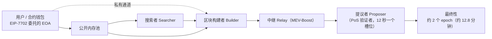
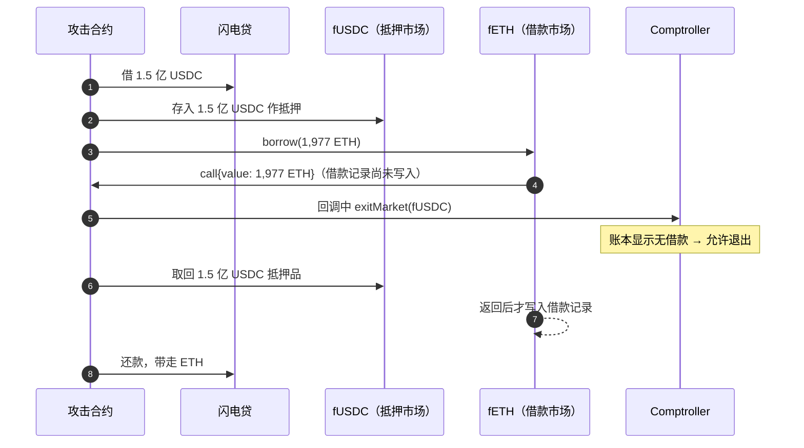
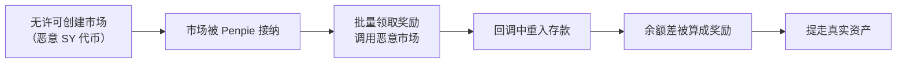
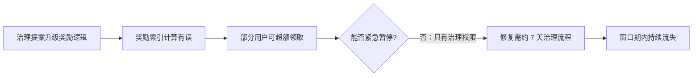

# C00 以太坊：参照环境、协议升级与案例深潜

> 学习目标：读完本章，你能——
> 1. 说出以太坊主网作为"参照环境"的 5 项安全相关特性，包括 EIP-6780、EIP-1153、EIP-7702 和 PBS。
> 2. 用 INV-1 至 INV-8 自查合约对 Glamsterdam gas 重定价的依赖。
> 3. 说出 EIP-7702 之后哪些"调用者是不是普通钱包"的检查不再可靠。
> 4. 复盘 9 起以太坊主网事故的攻击路径和根因代码，并把每一起归入主线章节的漏洞类别。
> 5. 用"同一模式、不同外衣"的视角，把新事故快速对应到已知模式。
>
> 前置章节：[03 EVM 与 Solidity 安全基础](../chapters/03-evm-solidity-basics.md)、[04 重入](../chapters/04-reentrancy.md)、[06 算术与精度](../chapters/06-arithmetic-precision.md)、[07 外部调用](../chapters/07-external-calls-tokens.md)、[08 预言机](../chapters/08-oracle-flashloan.md)、[09 MEV 与签名安全](../chapters/09-mev-signatures.md)、[10 代理升级](../chapters/10-upgradeable-proxy.md)、[15 账户抽象与新钱包范式](../chapters/15-account-abstraction-wallets.md)
> 交互实验：[reentrancy-lab.html](../interactive/reentrancy-lab.html)、[oracle-manipulation-lab.html](../interactive/oracle-manipulation-lab.html)、[incident-explorer.html](../interactive/incident-explorer.html) ｜ 示例合约：[code/snippets/08-RouterCallback.sol](../../code/snippets/08-RouterCallback.sol)
>
> 最后核对：2026-11-09

---

## 开场：一条 gas 规则，让 Glamsterdam 停在测试网

2026 年 10 月，以太坊核心开发者取消了 Glamsterdam 在 Hoodi 测试网的激活。原因不是客户端故障，而是审计发现：新的 gas 规则会让一些已部署的合约出现漏洞。合约代码一行没改，安全假设变了。

<details class="predict"><summary>🤔 先猜再看：一个函数在外部调用耗尽 gas 后，靠"剩下的 1/64 gas 不够写存储"来保证整笔交易回滚。Glamsterdam 的重定价之后，这个保证还成立吗？</summary>

不一定成立。新规则把部分状态 gas 记在单独的储备里，失败路径可能有足够的 gas 写完失败记录并成功返回。这正是 [INV-1 和 INV-6](https://github.com/ethereum/glamsterdam-gas-invariants) 记录的问题。

</details>

---

## 1. 一句话理解

**以太坊是所有 EVM 链的"原件"。绝大多数合约漏洞模式最早在以太坊主网上出现、被复盘、被修复；其他链上的事故，多数是这些模式换了参数后复发。**

> 🎯 打个比方：以太坊像一座**有百年病历档案的大医院**。
>
> - 这里的病例最多、记录最全（事故复盘、审计报告、链上数据都公开）。
> - 别的医院（BNB Chain、Mantle 等 EVM 链）用的是同一套医学教材，所以病人得的病大同小异。
> - 读懂这里的病历，你在任何一家医院都能更快认出症状。
>
> 比喻的局限：病历只记录被发现的病。很多以太坊漏洞在被利用之前已经存在了数月甚至数年，期间没有人察觉。

---

## 2. 以太坊作为参照环境



**读图要点：**

- 以太坊的出块权和排序权已经分离（PBS，Proposer-Builder Separation，业界通过 MEV-Boost 实现）。排序由构建者竞价决定，这是三明治攻击的土壤（[09 章](../chapters/09-mev-signatures.md)）。
- 区块"最终确定"需要约两个 epoch。跨链桥和交易所在以太坊上通常等待最终性或足够确认数（[12 章](../chapters/12-cross-chain-bridges.md)）。
- 局限：此图省略了 blob 交易和 L2 结算。L2 的安全依赖以太坊的这部分机制（[C03 Mantle](C03-mantle.md)）。
- PBS 目前仍由协议外的 MEV-Boost 实现。协议内的 ePBS（EIP-7732）属于 Glamsterdam，尚未上线（2.3 节）。

### 2.1 影响合约安全的协议升级

| 升级 | 时间（主网） | 改变了什么 | 对合约安全的影响 |
|---|---|---|---|
| EIP-150 | 2016 | 外部调用最多转发 63/64 的剩余 gas | gas 不足型失败；调用方总能保留一点 gas 收尾 |
| EIP-1884 / EIP-2929 | 2019 / 2021 | 提高 SLOAD 等操作的 gas | 依赖 2300 gas 的 `transfer` 可能失败 |
| EIP-1153（Cancun） | 2024 年 3 月 | 瞬态存储 TSTORE / TLOAD | 低成本重入锁；新的"交易内状态"语义 |
| EIP-6780（Cancun） | 2024 年 3 月 | `SELFDESTRUCT` 只在同一交易内创建的合约上删除代码 | Parity 式"自毁库合约"不再能删除代码；强制转入 ETH 仍然可行 |
| EIP-7702（Pectra） | 2025 年 5 月 | EOA 可以签名委托一段合约代码 | `tx.origin == msg.sender` 不再代表"调用者是普通钱包"；出现新的钓鱼方式（第 3 节） |
| EIP-7825（Fusaka） | 2025 年 12 月 | 单笔交易 gas 上限 16,777,216 | 依赖单笔大交易的批处理、部署脚本和清算要拆分 |
| EIP-7823 / EIP-7883（Fusaka） | 2025 年 12 月 | MODEXP 输入设上限，gas 上调 | 链上 RSA 等验证要重测 gas 和输入长度 |
| EIP-7951（Fusaka） | 2025 年 12 月 | 新增 secp256r1（P-256）验签预编译 | Passkey 钱包可用协议内置验签；更换验签实现后要重测（[15 章](../chapters/15-account-abstraction-wallets.md)） |

### 2.2 Fusaka、PeerDAS 与 BPO（截至 2026 年 11 月 9 日）

Fusaka 于 2025 年 12 月 3 日 21:49:11 UTC 在主网激活，slot 13,164,544（[以太坊基金会公告](https://blog.ethereum.org/2025/11/06/fusaka-mainnet-announcement)）。

PeerDAS（Peer Data Availability Sampling，EIP-7594）：节点只下载并抽样部分 blob 数据，就能确认数据可用。

BPO（Blob Parameter Only）分叉：只调整 blob 参数的小型配置分叉。

| 阶段 | 时间（UTC） | blob 目标 / 上限（每块） |
|---|---|---|
| Fusaka 激活 | 2025-12-03 | 6 / 9 |
| BPO1 | 2025-12-09 14:21:11 | 10 / 15 |
| BPO2 | 2026-01-07 01:01:11 | 14 / 21 |

Fusaka 的 EIP-7935 把客户端默认 gas 上限提高到 6,000 万。2026 年 11 月 9 日读取主网最新区块，`gasLimit` 为 60,000,000（公开 RPC）。

<details class="predict"><summary>🤔 先猜再看：blob 上限从 9 增加到 21。每个全节点是否都要下载全部 blob 数据？</summary>

不需要。PeerDAS 让节点抽样部分数据，仍能确认数据可用。这也是 BPO 能继续提高 blob 数量的前提。

</details>

> 💡 注意：blob 数量增加，主要影响 L2 的成本和数据可用性假设。合约看不到 blob 内容。L2 的信任假设见 [C03](C03-mantle.md)。

### 2.3 Glamsterdam：状态与审计含义（截至 2026 年 11 月 9 日）

| 项目 | 状态 | 来源 |
|---|---|---|
| Sepolia | 2026 年 10 月 6 日激活 | [EIP-7773](https://eips.ethereum.org/EIPS/eip-7773) |
| Hoodi | 原定 10 月 26 日，已取消；没有新日期 | [EF 公告（10 月 22 日）](https://blog.ethereum.org/2026/10/22/glamsterdam-hoodi-delay) |
| 主网 | 没有日期。部分媒体估计推迟到 2027 年，这不是官方结论 | [EIP-7773](https://eips.ethereum.org/EIPS/eip-7773) |
| 暂停原因 | EIP-8037 和 EIP-8038 改变 gas 计费，会打破一些已部署项目依赖的 8 条不变量；问题解决前不分叉 Hoodi | [EF 公告（11 月 6 日）](https://blog.ethereum.org/2026/11/06/glamsterdam-8037-8038)、[ChainSecurity](https://www.chainsecurity.com/blog/glamsterdam-gas/) |
| 主要内容 | EIP-7732 协议内 PBS（ePBS）、EIP-7928 区块级访问列表，以及 EIP-8037、EIP-8038 等 gas 重定价 | [EIP-7773](https://eips.ethereum.org/EIPS/eip-7773) |

> ⚠️ 警告：以下规则尚未上线，数值可能随修复方案改变。现在就要做的是自查，而不是按新规则写代码。

以太坊基金会列出的 8 条假设（[glamsterdam-gas-invariants](https://github.com/ethereum/glamsterdam-gas-invariants)）：

| 编号 | 旧假设 | 重定价后的问题 | 建议 |
|---|---|---|---|
| INV-1 | 调用耗尽 gas 会让整笔交易失败 | 失败后的代码仍可能写存储 | 允许失败项重试，或在 gas 不足时回滚 |
| INV-2 | 同一交易内清零的槽位，结束时才退 gas | 新建后清零会立即返还状态 gas | 锁和标志位用瞬态存储，或保持非零 |
| INV-3 | 回滚调用消耗的 gas 已经没了 | 回滚调用会把状态 gas 还给调用方 | 检查 `CREATE` / `CREATE2` 的结果 |
| INV-4 | 固定 gas 数额够用 | 新建存储、账户和合约的成本升到 5–8 倍 | gas 上限可调，按新规则估算并留余量 |
| INV-5 | `gasleft()` 差值等于工作成本 | gas 余量可能在调用中增加 | 不按 `gasleft()` 差值计费 |
| INV-6 | 耗尽后剩余的 1/64 gas 不够做事 | 剩余 gas 可能足够记录失败 | 调用前检查 gas 是否足够 |
| INV-7 | 现有 gas 储备和 2300 津贴够用 | 2300 gas 无法新建存储槽 | 储备可调，或不依赖储备 |
| INV-8 | 已上链的 7702 委托不能再次使用 | 委托耗尽 gas 时回滚，签名可被再次使用 | 初始化绑定签名，交易后检查账户代码 |

维护者说明，多数发现涉及 INV-4 和 INV-7，应优先检查。如果项目受影响，可联系公告中的邮箱。

---

## 3. EIP-7702 委托钓鱼（2025 年）

**背景**：Pectra 升级（2025 年 5 月）引入 EIP-7702。EOA 签署一份"授权"，就能让自己的地址执行某个合约的代码。

**现象**（The Block 报道 Wintermute 的链上统计）：

- Wintermute 发现，主网上超过 80% 的 EIP-7702 委托指向同一类复制粘贴的"清扫合约"。这类合约会把私钥已泄露的钱包里的资产自动转给攻击者。
- Scam Sniffer 发现一个钱包通过一笔恶意批量交易损失近 15 万美元，与 Inferno Drainer 钓鱼服务有关。
- 安全研究者指出，根本问题仍是私钥泄露；EIP-7702 让清扫更便宜、更自动化。

**对合约开发者的含义**：

| 旧假设 | EIP-7702 之后 |
|---|---|
| `msg.sender == tx.origin` 说明调用者是普通钱包 | 委托后的 EOA 可以执行任意代码，也可以回调 |
| `addr.code.length == 0` 说明对方没有代码 | 委托后的 EOA 带有委托指示代码 |
| 只有合约才会在收到 ETH 时执行逻辑 | 委托后的 EOA 也会 |

> ⚠️ 警告：任何用"是不是 EOA"来防重入、防闪电贷或限制调用者的代码，在 EIP-7702 之后都需要重新审视。用户侧：钱包必须清楚显示委托目标合约；不要签署看不懂的授权。

---

## 4. 案例深潜

2022 年 4 月 1 日，Rari 加强了 Fuse 池的重入保护。4 月 30 日，Fuse 池仍被重入，损失约 8,000 万美元。那把锁没有覆盖 `exitMarket()`。本节的 9 起以太坊主网事故都是这样：模式在主线章节里早有记录，只是换了外衣。

### 4.0 案例总览

本节深潜 9 起以太坊主网事故。第 10 起 EIP-7702 委托钓鱼见第 3 节。它们大多不在主线章节的"代表案例"中，但模式完全一致：

| # | 时间 | 事故 | 约损失（事发时估值） | 模式 | 主线章节 |
|---|---|---|---|---|---|
| 4.1 | 2022-04 | Fei Rari（Fuse 池） | 约 8,000 万美元 | 重入：先转 ETH 后记账；锁没有覆盖全部函数 | [04](../chapters/04-reentrancy.md) |
| 4.2 | 2024-09 | Penpie | 约 2,700 万美元 | 重入 + 无许可市场注册 | [04](../chapters/04-reentrancy.md)、[07](../chapters/07-external-calls-tokens.md) |
| 4.3 | 2022-04 | Akutars NFT | 11,539.5 ETH 永久锁定（超过 3,400 万美元） | 逻辑错误 + 推送退款 DoS | [07](../chapters/07-external-calls-tokens.md) |
| 4.4 | 2023-11 | KyberSwap Elastic | 约 5,620 万美元（受影响资产，多链合计，官方口径） | 舍入方向错误 | [06](../chapters/06-arithmetic-precision.md) |
| 4.5 | 2020-10 | Harvest Finance | 约 3,380 万美元（后归还 250 万美元） | 金库份额价格被 Curve 池价格操纵 | [08](../chapters/08-oracle-flashloan.md) |
| 4.6 | 2022-04 | Inverse Finance | 约 1,560 万美元 | 低流动性池的 TWAP 被持续操纵（非闪电贷） | [08](../chapters/08-oracle-flashloan.md) |
| 4.7 | 2023-04 | Sushi RouteProcessor2 | 约 330 万美元 | 用户可控的回调地址 + 授权 | [05](../chapters/05-access-control.md)、[07](../chapters/07-external-calls-tokens.md) |
| 4.8 | 2021-09 | Compound 提案 62 | 最多约 28 万 COMP（约 8,000 万美元）面临错误发放 | 升级引入 bug + 无紧急开关 | [10](../chapters/10-upgradeable-proxy.md)、[11](../chapters/11-defi-economic-security.md) |
| 4.9 | 2024-07 | WazirX 多签 | 约 2.3 亿美元 | 签名界面与实际交易不一致 | [09](../chapters/09-mev-signatures.md) |
| 第 3 节 | 2025 | EIP-7702 委托钓鱼 | 单个钱包损失近 15 万美元（Scam Sniffer 案例） | 签名委托代码 | [03](../chapters/03-evm-solidity-basics.md)、[09](../chapters/09-mev-signatures.md) |

> 💡 注意：以下代码片段是**根据公开复盘整理的简化示意**，用于说明根因，不是原始合约的逐行复制。

### 4.1 Fei Rari：分叉 Compound 的重入（2022 年 4 月）

**背景**：Rari Capital 的 Fuse 是基于 Compound 分叉的借贷池。Fei Protocol 与 Rari 合并后，Fuse 池在 2022 年 4 月 30 日被攻击（CertiK 公开分析）。

```solidity
// 简化示意 —— ❌ borrow 先转出 ETH，后更新借款记录
function borrowFresh(address payable borrower, uint borrowAmount) internal {
    // 检查：风控允许借款
    require(comptroller.borrowAllowed(address(this), borrower, borrowAmount) == 0);
    // ① 对 ETH 市场：borrower.call{value: …}
    doTransferOut(borrower, borrowAmount);
    accountBorrows[borrower].principal = newDebt;    // ② 太晚
    totalBorrows = newTotalBorrows;   // 回调期间 totalBorrows 也是旧值
}
```



**读图要点：**

- 攻击者在回调里退出抵押市场并取回抵押品。此时 Comptroller 读到的借款记录还是 0。
- CertiK 分析指出，4 月 1 日加强的锁没有覆盖 `exitMarket()`。这正是 [04 章](../chapters/04-reentrancy.md) 3.2 节"跨函数重入"的真实版本。
- Compound 原版的 ETH 市场用 `transfer`（只转发 2300 gas）发送 ETH，这在当时恰好挡住了回调重入。公开分析指出，被攻击的 Fuse 版本用低级 `call` 发送 ETH，把足够的 gas 和控制权交给了接收方，而状态更新顺序没有同步调整。
- 损失约 8,000 万美元。

**教训**：修改"转账方式"会改变重入面。从 `transfer` 改成 `call` 时，必须同时改成 CEI，并让所有读写借贷状态的入口共用一把锁。

### 4.2 Penpie：无许可注册 + 重入（2024 年 9 月）

**背景**：Penpie 是建在 Pendle 之上的收益协议，为 Pendle 市场的 LP 代币提供额外奖励。

**攻击路径**（Halborn、Verichains 等公开分析）：

1. 攻击者在 Pendle 上创建一个新市场。市场创建无需许可。
2. 新市场使用攻击者自己部署的"SY 代币"（Pendle 的标准化收益代币）。
3. Penpie 允许新市场注册进奖励系统，并相信市场合约的行为是良性的。
4. 攻击者调用 Penpie 批量领取奖励的函数。该函数在领取过程中调用市场合约，而市场合约由攻击者控制。
5. 领取函数没有重入保护。攻击者在回调中存入真实资产，使 Penpie 把这部分资产误算为"奖励"。
6. 损失约 2,700 万美元。



**教训**：

- "无许可上架"和"信任上架对象的代码"不能同时成立。参见 [04 章](../chapters/04-reentrancy.md) 5.3 节"允许任意代币就等于允许任意回调"。
- 用"调用前后余额差"计算奖励或存款时，必须加重入锁，否则回调中的转账会污染差值（[07 章](../chapters/07-external-calls-tokens.md) 3.2 节）。

### 4.3 Akutars：一个变量名锁死 11,539 ETH（2022 年 4 月）

**背景**：Akutars 是一个荷兰式拍卖发行的 NFT 项目。拍卖结束后，合约先向出价者退还差价，再允许项目方提取收入（BlockSec 公开分析）。

```solidity
// 简化示意 —— 两个缺陷
function processRefunds() external {
    // 推送模式：一次性给所有人退款
    for (uint256 i = refundProgress; i < _bidIndex; i++) {
        // ❌ 缺陷 1：推送退款。任何一个出价者合约拒收，整笔回滚，所有人都退不了款
        (bool ok, ) = bids[i].bidder.call{value: refundAmount(i)}("");
        require(ok, "refund failed");
        refundProgress++;   // 只有成功一笔才前进
    }
}
function claimProjectFunds() external onlyOwner {
    // ❌ 缺陷 2：比较对象写错。totalBids 是 NFT 数量之和，大于出价笔数 _bidIndex，
    //    refundProgress 最多等于 _bidIndex，条件永远不成立
    require(refundProgress >= totalBids, "Refunds not yet processed");
    // 永远走不到：项目资金被锁死
    payable(owner).transfer(address(this).balance);
}
```

**结果**：11,539.5 ETH（当时超过 3,400 万美元）被永久锁在合约中。合约不可升级，无法修复。缺陷 1 是潜在的 DoS 入口；缺陷 2 才是锁死资金的直接原因（BlockSec 分析）。

**教训**：

1. 推送式退款是 DoS 入口，改为拉取式（[07 章](../chapters/07-external-calls-tokens.md) 第 4 节）。
2. 资金出口的条件必须有测试覆盖：写一个测试"所有退款处理完后，项目方能提取"——它会立刻失败。
3. 不可升级合约的上线门槛要更高。没有维修门，就只能一次做对。

### 4.4 KyberSwap Elastic：舍入方向导致"跳过 tick"（2023 年 11 月）

**背景**：KyberSwap Elastic 是集中流动性 AMM，类似 Uniswap V3，并带有手续费自动再投资。

**根因**（BlockSec 公开分析）：

- `SwapMath.estimateIncrementalLiquidity` 中，`deltaL` 用 `mulDivFloor` 向下取整，而代码注释表明它应该向上取整。
- 结果是计算出的下一个价格 `nextSqrtP` 偏大。攻击者精心构造交换数量，使价格实际已经越过某个 tick 边界，池子却认为"没有跨越"，于是没有更新该 tick 的流动性。
- 反向交换时，同一段流动性被计算了两次。攻击者用"重复计算的流动性"换出了池子资产。
- 攻击者先从 Aave 借 2,000 WETH 闪电贷，完成操纵后还款。据[官方复盘](https://blog.kyberswap.com/post-mortem-kyberswap-elastic-exploit/)，多条链上受影响资产约 5,620 万美元，其中主攻击者提取约 4,867 万美元，抢跑机器人提取约 656 万美元。
- 受影响的链：以太坊、Optimism、Polygon、Arbitrum、Avalanche、Base（[BlockSec](https://blocksec.com/blog/yet-another-tragedy-of-precision-loss-an-in-depth-analysis-of-the-kyber-swap-incident-1)）。
- 金额口径：BlockSec 称超过 4,800 万美元；[Infosecurity Magazine](https://infosecurity-magazine.com/news/kyberswap-says-hackers-stole-55m) 报道接近 5,500 万美元。本手册采用官方口径约 5,620 万美元。

**教训**：这是 [06 章](../chapters/06-arithmetic-precision.md) 第 3 节"舍入方向对协议有利"的教科书案例。注释写对了、代码写错了——**代码与注释不一致时，审计要把它当作漏洞线索**。集中流动性 AMM 的边界条件（恰好落在 tick 上、跨越 tick 的一瞬间）必须用模糊测试覆盖。

### 4.5 Harvest Finance：金库份额价格被操纵（2020 年 10 月）

**背景**：Harvest 的 fUSDC、fUSDT 金库把资金投入 Curve 的 Y 池。金库在计算份额价格时，依赖 Curve 池中稳定币之间的价格。

**攻击路径**（The Block 报道、项目方说明）：

1. 闪电贷借入大量 USDT。
2. 在 Curve Y 池中把 USDT 换成 USDC，压低 USDC 相对价格。金库持仓的估值随之下降。
3. 以"偏低的份额价格"存入 USDC，获得更多份额。
4. 在 Curve 中反向交换，价格恢复。
5. 以"恢复后的份额价格"赎回，取回更多 USDC。
6. 重复多轮。攻击者共取走约 3,380 万美元，后来退还约 250 万美元。

**教训**：

- 金库份额价格 = 持仓估值 ÷ 份额总数。只要持仓估值依赖一笔交易内可变的价格，份额价格就可以被操纵（[08 章](../chapters/08-oracle-flashloan.md)）。
- Harvest 事后提出"提交-揭示"式存款，阻止在同一笔交易内存入并取出。这是"把攻击从一笔交易拉长到多个区块"的防御思路，和 Mantle mETH 的提款延迟同源（[C03](C03-mantle.md)）。

### 4.6 Inverse Finance：不用闪电贷的 TWAP 操纵（2022 年 4 月）

**背景**：Inverse Finance 的借贷市场 Anchor 用 INV 作为抵押品，INV 价格来自基于 SushiSwap 池的 TWAP 预言机。

**攻击路径**（项目方事故报告）：

1. 攻击者投入大量自有资金，在流动性很浅的 INV 交易池中买入 INV，把价格推高到约 20,926 美元。
2. 攻击者同时发送大量垃圾交易，抑制套利机器人把价格拉回。
3. TWAP 窗口内的价格被持续抬高，预言机输出的 INV 价格随之上升（报告还提到 TWAP 窗口设置存在问题）。
4. 攻击者以 INV 抵押，借出约 1,560 万美元的 DOLA、ETH、WBTC、YFI。
5. 价格回落后，INV 抵押品被清算，协议留下坏账。

**教训**：

- 项目方强调这是"资本密集型、非闪电贷"攻击。**TWAP 能挡住单笔交易的闪电贷操纵，挡不住有资本、能持续数个区块的操纵**——尤其是浅池（[08 章](../chapters/08-oracle-flashloan.md) 第 4 节）。
- 低流动性的治理代币作抵押品，是 Venus XVS 事件（[C01](C01-bnb-chain.md)）在以太坊上的翻版。
- 在 [oracle-manipulation-lab.html](../interactive/oracle-manipulation-lab.html) 中切换到 TWAP，把"被操纵的区块数"调大，可以复现这个思路。

### 4.7 Sushi RouteProcessor2：回调地址由用户指定（2023 年 4 月）

**背景**：RouteProcessor2 是 Sushi 的路由合约，上线仅 4 天。用户需要先给它授权（approve），它才能代用户交换代币。

```solidity
// 简化示意 —— ❌ 池子地址来自用户输入的路由，没有校验它是否为真实池子
function swapUniV3(bytes calldata route) internal {
    address pool = readAddress(route);            // 攻击者填入自己部署的"池子"
    lastCalledPool = pool;   // 白名单指向攻击者池子
    // 恶意池子立即回调 uniswapV3SwapCallback
    IUniswapV3Pool(pool).swap(...);
}
function uniswapV3SwapCallback(int256 a0, int256 a1, bytes calldata data) external {
    // 检查通过：就是攻击者的池子
    require(msg.sender == lastCalledPool, "RP2: callback from unknown source");
    // from 可以是任意授权过的用户
    (address tokenIn, address from) = abi.decode(data, (address, address));
    // 以 from 的授权把代币转给攻击者
    IERC20(tokenIn).safeTransferFrom(from, msg.sender, uint256(a0 > 0 ? a0 : a1));
}
```

**结果**（Hacken、The Block 等公开分析）：攻击者把任意一个授权过 RouteProcessor2 的用户填为 `from`，把对方的代币转给自己。约 330 万美元被盗，其中一位用户损失 1,800 ETH。风险波及 14 条链上的部署。白帽当天抢先救出了 1,000 多 ETH。

**教训**：

- "回调来自 `lastCalledPool`"只证明了"回调来自我刚才调用的地址"，没有证明"那是一个真实的池子"。正确做法是用工厂地址和代币对**计算**出池子地址再比较（Uniswap V3 的 `CallbackValidation` 思路），见 [code/snippets/08-RouterCallback.sol](../../code/snippets/08-RouterCallback.sol)。
- 持有用户授权的合约，等于持有用户钱包的钥匙。它的任何"用户可控地址"都必须视为攻击入口（[05 章](../chapters/05-access-control.md) 3.4 节、[07 章](../chapters/07-external-calls-tokens.md) 第 5 节）。
- 用户侧：只授权需要的额度；不用的授权及时撤销。

### 4.8 Compound 提案 62：升级 bug 遇上"没有刹车"（2021 年 9 月）

**背景**：Compound 通过治理提案 62 升级了 Comptroller 合约中的 COMP 奖励分发逻辑。

**事件**（The Block 报道）：

1. 升级生效后，部分用户可以从 Comptroller 领取远超应得的 COMP。可领取量约 16.8 万 COMP；创始人估计最坏情况约 28 万 COMP（约 8,000 万美元）。
2. 创始人公开表示：协议**没有管理员开关或社区工具可以停止 COMP 分发**。
3. 任何修复都必须走治理流程，到生产环境需要约 7 天。在此期间，被错误发放的 COMP 只能被动等待用户领取或"自愿归还"。



**教训**：

- 时间锁保护用户免受**恶意**升级；但当升级本身有 bug 时，同一把时间锁也阻止了**快速修复**。
- 设计上要把两类权限分开：可以快速执行、只能"停"的守护者权限；必须经过时间锁、可以"改"的升级权限（[05 章](../chapters/05-access-control.md) 4.1 节）。
- 升级前应在主网分叉环境中跑奖励分发的不变量测试："每个用户累计领取 ≤ 按份额应得"（[27 章](../chapters/27-audit-testing-workflow.md)）。

### 4.9 WazirX：又一起多签签名界面事故（2024 年 7 月）

**背景**：印度交易所 WazirX 的以太坊冷钱包是一个 4/6 多签：5 个签名人来自 WazirX，1 个来自托管服务商 Liminal。交易需要 3 个 WazirX 签名，再由 Liminal 做策略检查后签署（Mudit Gupta 公开分析）。

**事件**：签名人以为在签一笔日常交易，界面显示的也是正常内容，但发送到硬件钱包签名的数据是恶意的。这笔交易把多签升级为攻击者控制的版本。约 2.3 亿美元被盗。WazirX 与 Liminal 都否认自己的系统被攻破，公开分析认为至少一方的签名环境被入侵。

完整复盘见资损 101：[WazirX](https://claude.ai/artifact/1a5Nx6xTVLuJdCB8Esf2xj#c-wazirx)、[Bybit](https://claude.ai/artifact/1a5Nx6xTVLuJdCB8Esf2xj#c-bybit)。

**与 Bybit（2025 年 2 月）的对照**：

| | WazirX 2024 | Bybit 2025 |
|---|---|---|
| 钱包 | 4/6 多签 + 托管服务商 | Safe 多签 |
| 被篡改的环节 | 签名界面（具体位置有争议） | Safe{Wallet} 前端 |
| 恶意交易做了什么 | 升级多签，去掉签名要求 | delegatecall 替换多签实现 |
| 约损失 | 2.3 亿美元 | 15 亿美元 |

**教训**：同一种攻击在 7 个月内两次命中大型交易所。签名流程的防御见 [09 章](../chapters/09-mev-signatures.md) 第 4 节：独立解码 calldata、硬件钱包逐字段核对、对"升级 / delegatecall"类操作设置额外审批。这也是《CEX 交易所学习手册》中冷钱包管理的现实背景。

---

## 5. 模式归纳：以太坊案例与其他链的同类事故

| 模式 | 以太坊案例 | 其他链上的同类 | 主线章节 |
|---|---|---|---|
| 先交互后记账 | The DAO、Fei Rari、Penpie、Curve/Vyper | BNB Chain 分叉项目回调重入 | [04](../chapters/04-reentrancy.md) |
| 舍入与精度 | KyberSwap、Balancer V2 | Uranium（BNB Chain，常数不一致） | [06](../chapters/06-arithmetic-precision.md) |
| 可变价格被当作事实 | Harvest、Cream、Inverse | PancakeBunny、Venus（BNB Chain） | [08](../chapters/08-oracle-flashloan.md) |
| 用户可控地址 + 授权 | Sushi RouteProcessor2 | Qubit（零地址存款，以太坊 → BNB Chain） | [07](../chapters/07-external-calls-tokens.md) |
| 资金出口条件错误 / DoS | Akutars | TRON 上依赖 `receive()` 的等式检查 | [07](../chapters/07-external-calls-tokens.md)、[C02](C02-tron.md) |
| 升级与应急权限设计 | Compound 62、Nomad、Parity | Mantle 无延迟升级（信任假设） | [10](../chapters/10-upgradeable-proxy.md)、[C03](C03-mantle.md) |
| 签名界面 | Bybit、WazirX | TRON 账户权限诈骗 | [09](../chapters/09-mev-signatures.md)、[C02](C02-tron.md) |

---

## 6. 链下风险：以太坊主网的运营与用户攻击面

以太坊主网资产最多，链下攻击也最集中。下表把第六篇的内容映射到以太坊上的典型形态：

| 风险 | 以太坊上的典型形态 | 代表事件 | 详细章节 |
|---|---|---|---|
| 多签签名界面 | Safe 多签前端被篡改或签名人终端被控 | Bybit（2025）、WazirX（2024）、Radiant（2024，Arbitrum/BSC） | [18](../chapters/18-wallet-key-management.md)、[20](../chapters/20-frontend-dns-supply-chain.md)、[21](../chapters/21-social-engineering-insiders.md) |
| 钓鱼签名 | Permit、Permit2、`setApprovalForAll`、7702 批量调用 | 2024 年 5,500 万美元 DAI 金库 owner 被改 | [19](../chapters/19-user-scams.md)、[15](../chapters/15-account-abstraction-wallets.md) |
| 地址投毒 | 零额 `transferFrom` 与同名假币 | 2024 年 1,155 WBTC、2025 年约 5,000 万美元 USDT | [19](../chapters/19-user-scams.md) |
| 前端与 DNS | 注册商被入侵、CDN 边缘脚本注入、npm 投毒 | Curve（2022、2025）、BadgerDAO（2021）、Ledger Connect Kit（2023） | [20](../chapters/20-frontend-dns-supply-chain.md) |
| 节点与客户端 | 单一 RPC、执行层客户端份额过高 | Infura（2020）、2023 年终局性丢失 | [16](../chapters/16-consensus-chain-security.md)、[17](../chapters/17-node-rpc-infrastructure.md) |
| MEV 基础设施 | relay、构建者高度集中 | 2023 年 MEV-Boost relay 漏洞 | [17](../chapters/17-node-rpc-infrastructure.md) |

> 💡 注意：ScamSniffer 的年度钓鱼统计只覆盖 EVM 链，其中以太坊主网占大头。主网用户的资产规模大，攻击者愿意为单个目标投入更多准备。

---

## 7. 在以太坊主网开发的检查清单

- [ ] **ETH-2** 不用 `tx.origin == msg.sender` 或 `code.length == 0` 判断"调用者是普通用户"。
- [ ] **ETH-3** 使用瞬态存储锁时确认编译器版本，并对锁做跨函数测试。
- [ ] **ETH-8** 所有交换有 `minOut` 与 `deadline`；关键交易考虑私有通道。
- [ ] **ETH-10** 合约和链下代码已按 INV-1 至 INV-8 自查 Glamsterdam 影响。
- [ ] **ETH-1** 重入分析覆盖所有回调来源：原生 ETH、ERC-777/721/1155 钩子、闪电贷回调、用户指定的池子与路由、**EIP-7702 委托的 EOA**。
- [ ] **ETH-4** 价格来源区分"单笔交易可操纵"与"多区块可操纵"；浅池资产不作为高抵押率抵押品。
- [ ] **ETH-5** 回调校验基于"计算出的合法地址"，不基于"上一次调用的地址"。
- [ ] **ETH-6** 资金出口（提款、项目方领取、退款）都有端到端测试；不可升级合约尤其如此。
- [ ] **ETH-7** 守护者暂停权与升级权分离；奖励、铸币类功能有独立的紧急开关。
- [ ] **ETH-9** 多签操作有独立的 calldata 解码与核对流程。

**把检查结果写进报告：**

| 检查项 | 发现时的证据 | 常见定级（用 [A02](../assessment/A02-risk-rating-reporting.md) 复核） | 练习位置 |
|---|---|---|---|
| ETH-2 | `tx.origin` 或 `code.length` 的代码位置 | High / Medium | [15 章](../chapters/15-account-abstraction-wallets.md) |
| ETH-3 | 调用图、跨函数重入 PoC | Critical / High | [B25](../bootcamp/B25-capstone-minilend.md) |
| ETH-8 | 滑点参数 | High / Medium | [B41](../bootcamp/B41-case-erc4626.md) |
| ETH-10 | 受影响调用点和 gas 测试结果 | 取决于资金路径 | [B47 Gas](../bootcamp/B47-gas.md) |
| ETH-1 | 调用图、跨函数重入 PoC | Critical / High | [B25](../bootcamp/B25-capstone-minilend.md) |
| ETH-4、ETH-5 | 价格来源分析、伪造回调的测试 | Critical / High | [B36](../bootcamp/B36-case-uniswap-v2.md)、[B38](../bootcamp/B38-case-aave-v3.md) |
| ETH-6、ETH-7 | 端到端测试、权限配置 | High / Medium | [B41](../bootcamp/B41-case-erc4626.md) |
| ETH-9 | 独立解码记录 | Critical | [B40 Safe](../bootcamp/B40-case-safe.md)、[A06](../assessment/A06-operational-key-security.md) |

发现按 [T03 报告模板](../templates/T03-finding-report.md) 记录。

---

## 8. 术语表

| 术语 | 英文 | 定义 |
|---|---|---|
| 提议者-构建者分离 | PBS | 出块的验证者与构造区块内容的构建者分离 |
| 最终性 | Finality | 区块不可被回滚的状态；以太坊约需 2 个 epoch |
| 瞬态存储 | Transient Storage | EIP-1153 引入，交易结束自动清零的存储 |
| 委托 | Delegation (EIP-7702) | EOA 签名授权执行某个合约代码 |
| 集中流动性 | Concentrated Liquidity | 流动性只在指定价格区间内生效的 AMM 设计 |
| tick | tick | 集中流动性 AMM 中离散的价格刻度 |
| 回调校验 | Callback Validation | 确认回调来自合法合约的检查 |

---

> 🪞 反思：选一个你信任的以太坊合约。
> 1. 它的安全依赖哪些 gas 数值？这些数值写在哪里？
> 2. 它的哪条检查假设"调用者是普通钱包"？
> 3. 一次协议升级之后，谁负责重新检查这些假设？

## 9. 思考题

1. 你的合约用固定的 gas 数额调用外部合约，或依赖 2300 gas 津贴。按 2.3 节的 INV 表，Glamsterdam 的 gas 重定价上线后，这段代码会遇到什么问题？维护者建议优先检查哪两条？
2. 你的协议使用 `require(msg.sender == tx.origin)` 来阻止合约调用。EIP-7702 之后，这个检查还能达到目的吗？
3. Fei Rari 的 Fuse 池在 4 月 1 日已经加了重入锁，为什么 4 月 30 日仍被重入？用 [reentrancy-lab.html](../interactive/reentrancy-lab.html) 的"只给 withdraw 加锁 + 跨函数重入"组合复现这个思路。
4. Akutars 的 `claimProjectFunds` 只需要改一个变量名就能修复。如果你是审计者，用什么测试能在上线前发现它？
5. Sushi RouteProcessor2 的回调校验"看起来"做了。请写出一个更强的校验方式，并说明它为什么能挡住恶意池子。

下一专题：[C01 BNB Chain](C01-bnb-chain.md)
