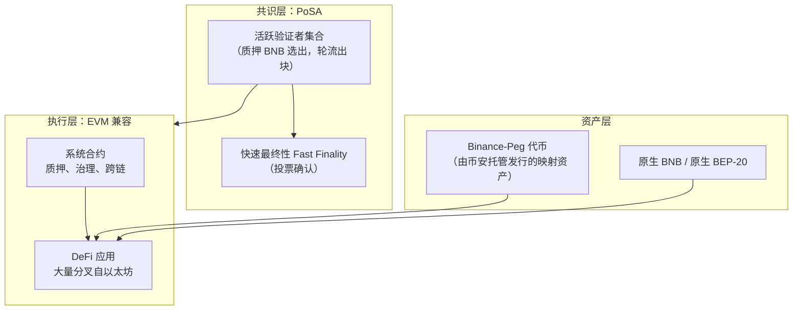
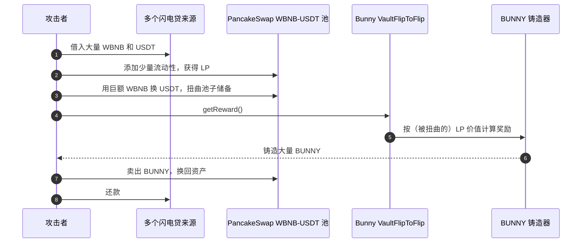
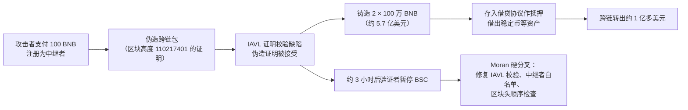

# C01 BNB Chain：合约安全专题

> 学习目标：读完本章，你能——
> 1. 说出 BNB Smart Chain（BSC）与以太坊在共识、出块、代币精度上的 4 项差异，以及它们对合约的影响。
> 2. 复盘 5 起 BSC 代表性事故的攻击路径和根因代码。
> 3. 用"迁移检查清单"评估一个以太坊合约能否直接部署到 BSC。
>
> 前置章节：[06 算术与精度](../chapters/06-arithmetic-precision.md)、[07 外部调用与代币兼容性](../chapters/07-external-calls-tokens.md)、[08 预言机与闪电贷](../chapters/08-oracle-flashloan.md)、[12 跨链桥安全](../chapters/12-cross-chain-bridges.md)
> 交互实验：[chain-porting-lab.html](../interactive/chain-porting-lab.html)、[oracle-manipulation-lab.html](../interactive/oracle-manipulation-lab.html)
>
> 最后核对：2026-11-09

---

## 开场：参数没变，奖励快了 6.7 倍

示例场景：一个 BSC 农场在 3 秒出块时设置了"每块奖励 10 枚"。合约没有升级，也没有人改参数。2026 年 1 月 Fermi 硬分叉之后，国库突然比预算更快见底。

<details class="predict"><summary>🤔 先猜再看：Fermi 之后，这个农场每天发放多少枚？</summary>

约 192 万枚（86,400 ÷ 0.45 × 10）。3 秒出块时约 28.8 万枚，发放速度变为约 6.7 倍。3.1 节解释了原因。

</details>

---

## 1. 一句话理解

**BSC 的字节码和以太坊兼容，但"参数"不同：出块更快、代币精度不同、验证者更少、分叉项目更多。漏洞往往藏在"我以为一样"的地方。**

> 🎯 打个比方：BSC 像一座按照以太坊城市**同一套图纸**建造的新城。
>
> - 街道布局一样（EVM 字节码兼容），所以以太坊的"车"（合约）可以直接开进来。
> - 但红绿灯的节奏快了约 27 倍（出块从 12 秒级到 0.45 秒），按"每个路口等多久"计时的司机会算错时间。
> - 同名的商店卖的东西规格不同（BSC-USD 是 18 位精度，以太坊 USDT 是 6 位）。
> - 城里有很多"山寨店"——照抄名店的装修，却改了几处细节（分叉项目）。
> - 交通管理局人少，出了事能很快封路（验证者可协调暂停链），但封路的权力也集中。
>
> 比喻的局限：城市可以慢慢改规则。BSC 的参数通过硬分叉一次性改变，所有依赖旧参数的合约同时受到影响。

---

## 2. 链的安全模型



**读图要点：**

- PoSA（Proof of Staked Authority）：质押权益 + 授权验证者的混合共识。验证者数量远少于以太坊，所以协调速度快。
- 系统合约由硬分叉升级。2022 年 Token Hub 事故的修复就通过 Moran 硬分叉完成。
- Binance-Peg 代币（例如 BSC-USD、BTCB 等）是**托管型映射资产**。它们的安全依赖发行方的托管和铸造权限，而不只是合约代码。
- 局限：图中没有画 opBNB（BSC 的 L2）和 BNB Greenfield。它们有各自的信任假设。

### 2.1 出块参数的变化（截至 2026 年公开资料）

| 阶段 | 出块间隔 | 来源 |
|---|---|---|
| 早期 | 约 3 秒 | BNB Chain 官方博客 |
| Lorentz 硬分叉（2025 年 4 月） | 1.5 秒 | BNB Chain 官方文档 |
| Maxwell 硬分叉（2025 年 6 月 30 日主网） | 0.75 秒；快速最终性约 1.875 秒 | BNB Chain 官方博客 |
| Fermi 硬分叉（2026 年 1 月 14 日主网） | 0.45 秒；快速最终性约 1.125 秒 | BNB Chain 官方博客 |

Maxwell 公告明确提醒开发者："必须更新基于时间的逻辑，以避免竞态或同步问题"。Fermi 硬分叉再次缩短出块间隔，同样的提醒依然适用。

### 2.2 2026 年的其他变化（截至 2026 年 11 月 9 日）

| 硬分叉或变更 | 主网时间（UTC） | 内容 | 对合约和运营的影响 | 来源 |
|---|---|---|---|---|
| Osaka/Mendel（BEP-658） | 2026-04-28 02:30 | 发布说明只写明 Osaka/Mendel 硬分叉，完整内容以 BEP-658 原文为准 | v1.7.7 发布说明写明，单笔交易 gas 上限由 EIP-7825 执行；大批量交易要拆分 | [bsc v1.7.2](https://github.com/bnb-chain/bsc/releases/tag/v1.7.2)、[v1.7.7](https://github.com/bnb-chain/bsc/releases/tag/v1.7.7) |
| Pasteur（BEP-673） | 2026-08-25 02:30 | BEP-682 拒绝含重复验证者的集合；BEP-695 收紧共识密钥轮换；BEP-675 允许构建者提交已执行的区块 | 跨链验证阈值不能用重复项凑数；出块间隔仍是 0.45 秒 | [BNB Chain 博客](https://www.bnbchain.org/en/blog/pasteur-hardfork-arrives-on-bsc-mainnet-on-august-25) |
| 区块 gas 上限 | 2026 年 9 月中旬 | 验证者把目标上限调到 7,000 万 | 2026 年 11 月 9 日读取主网最新区块，`gasLimit` 为 70,000,000（公开 RPC） | [Cryptonomist](https://en.cryptonomist.ch/2026/09/14/bnb-smart-chain-upgrade/) |
| Jenner（BEP-718，尚未激活） | 计划 2026-12-08 02:30 | BEP-702 合规资产预编译；BEP-703 默认预留 5% 区块 gas 给支付交易；BEP-706 在预编译 `0x70` 提供毫秒时间戳 | `block.timestamp` 仍以秒为单位；治理可调整支付通道比例和合约列表 | [bsc v1.8.2](https://github.com/bnb-chain/bsc/releases/tag/v1.8.2) |

<details class="predict"><summary>🤔 先猜再看：BSC 出块间隔 0.45 秒。两个相邻区块的 `block.timestamp` 可能相同吗？</summary>

可能。`block.timestamp` 以秒为单位，一秒内可以产生两个区块。所以"同一时间戳只允许一次操作"这类限制，不能理解成"同一区块只允许一次操作"。

</details>

---

## 3. 与以太坊的差异

| 差异 | 以太坊 | BSC | 合约风险 | 对策 |
|---|---|---|---|---|
| 出块间隔 | 12 秒 | 0.45 秒（2026 年 1 月 Fermi 后；历史上多次变化） | 用区块数计算的奖励、利息、锁定期，每次硬分叉后速度变为原来的 2 倍到约 6.7 倍 | 用 `block.timestamp` 计时；或把"每区块"参数做成可治理调整 |
| 稳定币精度 | USDT / USDC 为 6 位 | BSC-USD、Binance-Peg USDC 为 18 位 | 写死 `1e6` 导致金额偏差 10^12 倍 | 读取 `decimals()` |
| 资产性质 | 多数稳定币由发行方原生发行 | 大量 Binance-Peg 映射资产 | 映射资产可能被冻结、脱锚或暂停 | 风险披露；不把映射资产等同于原生资产 |
| 验证者规模 | 约百万级验证者 | 少量活跃验证者 | 链可被协调暂停；审查风险 | 重大资产的最终性和审查风险要单独评估 |
| 生态构成 | 原创协议多 | 分叉协议多 | 分叉时修改的代码未审计 | 差异审计（diff audit） |
| gas 成本 | 高 | 低 | 攻击者试错成本低；粉尘攻击、垃圾代币多 | 不依赖"攻击成本高"做防御 |

### 3.1 区块数计时：一个真实的风险

许多 BSC 农场合约分叉自 SushiSwap 的 MasterChef，按"每区块奖励"发放代币：

```solidity
// 设计时假设 3 秒一个块：每天约 28.8 万枚
uint256 public rewardPerBlock = 10e18;
function pendingReward(address user) public view returns (uint256) {
    uint256 blocks = block.number - lastRewardBlock;   // 按块数而非时间计算
    // 出块加快后，每天奖励按比例增加
    return blocks * rewardPerBlock * userShare / totalShare;
}
```

出块间隔从 3 秒降到 0.75 秒后，同样的参数每天发放约 115 万枚——**排放速度变为 4 倍**。2026 年 1 月 Fermi 硬分叉把间隔再降到 0.45 秒，每天发放约 192 万枚，**排放速度变为约 6.7 倍**。如果奖励来自固定预算的国库，国库会提前耗尽；如果奖励是增发，代币通胀率同比例上升。借贷协议中"每区块利率"也有同样问题。

> 🧪 动手验证：打开[链迁移风险检查器](../interactive/chain-porting-lab.html)，选择 BNB Chain，点"全选"。找到基于 `block.number` 的风险项，记录它写明的速度倍数。

> ⚠️ 警告：硬分叉改变出块间隔时，所有依赖 `block.number` 的经济参数都需要同步调整。这不是攻击，但造成的经济损失可能和攻击一样大。

---

## 4. 案例深潜

### 4.1 Uranium Finance（2021 年 4 月）：分叉改常数

- Uranium 分叉自 Uniswap V2。把手续费从 0.3% 改成 0.16% 时，`swap()` 左侧放大到 10000，右侧仍按 `1000**2` 比较，k 检查放宽了 100 倍。攻击者用极少量代币换走每个交易对约 99% 的储备，损失约 5,000 万美元。根因代码和推导见 [06 章](../chapters/06-arithmetic-precision.md) 第 5 节。
- 教训：常数必须集中定义（`uint constant FEE_DENOMINATOR = 10000;`），不能散落在多处。分叉的每一处改动都要做差异审计，并测试 `x × y ≥ k` 在每次 swap 后成立。

### 4.2 PancakeBunny（2021 年 5 月）：LP 定价被操纵



**读图要点：**

- 铸造器按池子储备给 LP 和收益估值。储备在同一交易里被改写。
- 攻击者铸造的 BUNNY 被抛售，BUNNY 价格从约 146 美元跌到约 6 美元（REKT 报道），损失约 4,500 万美元。
- 审计方事后表示，被利用的是其审计之后上线的新版本。
- 教训：奖励铸造是"无中生有"的操作，它的输入必须完全抗操纵（[08 章](../chapters/08-oracle-flashloan.md)）。

### 4.3 Venus（2021 年 5 月 XVS 事件；2022 年 5 月 LUNA 事件）：抵押品风险

- **XVS（2021 年 5 月）**：协议自有治理代币作抵押，价格被快速拉升后回落。清算超过 2 亿美元，坏账超过 9,500 万美元。见 [11 章](../chapters/11-defi-economic-security.md) 2.2 节。
- **LUNA（2022 年 5 月）**：喂价停在下限约 0.1 美元，有人低价买入 LUNA 抵押借款，损失约 1,100 万美元。见 [08 章](../chapters/08-oracle-flashloan.md) 5.2 节。
- BSC 视角的教训：危机时要能快速暂停单个市场。

### 4.4 Qubit Bridge（2022 年 1 月）：零地址存款

完整分析见 [07 章](../chapters/07-external-calls-tokens.md) 2.1 节。BSC 视角的要点：

- 被利用的漏洞在**以太坊一侧**的存款合约，资金损失却发生在**BSC 一侧**的借贷池（凭空铸造的 qXETH 被用作抵押）。
- 跨链协议的风险评估必须覆盖两侧。只审计 BSC 侧代码，看不到这个漏洞。

### 4.5 BSC Token Hub（2022 年 10 月）：系统级跨链桥



**读图要点：**

- 被攻击的不是某个 DeFi 协议，而是**链的系统合约**（BSC 与 BNB Beacon Chain 之间的跨链 Token Hub）。
- 攻击者把凭空铸造的 BNB 存入 BSC 上的借贷协议作抵押，借出其他资产再跨链转走。**系统层的漏洞会传导到应用层**：借贷协议代码正确，却接收了"凭空铸造"的抵押品。
- 停链是一种只有小规模验证者集合才能执行的应急手段。验证者约 3 小时内协调暂停整条链，冻结了大部分资金（Nansen 等分析）。它也引发了关于去中心化的讨论。
- 公开资料显示，2024 年完成 BC Fusion 后，BNB Beacon Chain 已退役，Token Hub 这条跨链路径也随之成为历史。但"注册即可成为中继者"和"证明校验缺陷"两类教训仍然适用于所有跨链桥。

---

## 5. 分叉项目的权限风险

BSC 上大量农场和 DEX 分叉自 SushiSwap / PancakeSwap，常见的高危权限：

| 函数 / 设计 | 风险 | 审计时要问 |
|---|---|---|
| `setMigrator()`（MasterChef 早期版本） | owner 可以把所有用户的 LP 迁移到任意合约 | 是否删除？是否经过时间锁？ |
| `mint()` 由 owner 直接调用 | 无限增发 | 增发权是否只授予农场合约？ |
| `setRewardPerBlock()` | 参数可被瞬间改到极端值 | 是否有上限和时间锁？ |
| 可升级 + 单签 owner | 随时替换实现 | 升级权限归属？ |
| 代币合约带黑名单 / 交易税开关 | owner 可阻止卖出（貔貅盘） | 税率上限？黑名单是否存在？ |

> ⚠️ 警告：低 gas 成本让 BSC 上的"垃圾代币"和"貔貅盘"（只能买不能卖的代币）数量很多。协议如果允许任意代币上架或作为抵押品，就要把这类代币当作攻击工具来建模（[04 章](../chapters/04-reentrancy.md) 5.3 节、[07 章](../chapters/07-external-calls-tokens.md)）。

---

## 6. 链下风险：BNB Chain 的运营与用户入口

| 风险 | BNB Chain 上的形态 | 代表事件 | 详细章节 |
|---|---|---|---|
| 官方社交账号 | 被盗账号发布假空投和钱包连接链接 | 2025 年 10 月 BNB Chain 官方 X 账号被盗，链接被关联到 Inferno Drainer，约 8,000 美元，官方承诺赔偿 | [22](../chapters/22-physical-account-security.md) |
| 发射平台 | meme 币发射平台在"迁移到 DEX"这一步被抢跑或夹击 | 2025 年 2 月、3 月 four.meme 两次被攻击，约 18.3 万和 12 万美元 | [09](../chapters/09-mev-signatures.md)、[19](../chapters/19-user-scams.md) |
| 验证者集中 | 少数验证者可以协调停链和冻结 | 2022 年 10 月 Token Hub 事件后停链（第 4.5 节） | [16](../chapters/16-consensus-chain-security.md) |
| 精度与假币 | BSC 上的 USDT 是 18 位；同名假币 | 交易所入账按合约地址和精度校验 | [23](../chapters/23-custody-exchange-ops.md) |
| 社工入口 | 多签签名人终端被控 | Radiant Capital（2024，Arbitrum 和 BSC） | [21](../chapters/21-social-engineering-insiders.md) |

- 来源：[Cointelegraph（X 账号）](https://cointelegraph.com/news/bnb-chain-x-account-hacked-inferno-links)、[Decrypt（X 账号）](https://decrypt.co/342364/bnb-chain-x-account-compromised-binance-founder)、[Cointelegraph（four.meme）](https://cointelegraph.com/news/bnb-chain-memecoin-fourmeme-hacked-183k)、[Decrypt（four.meme）](https://decrypt.co/310388/meme-coin-launchpad-four-meme-falls-victim-to-another-exploit)

> 💡 注意：BNB Chain 的 Gas 费低，攻击者批量发送钓鱼交易和粉尘转账的成本也低。交易所在这条链上更要默认折叠零额转账和未知代币。

---

## 7. 迁移检查清单：以太坊 → BSC

- [ ] **BSC-1** 所有代币精度从合约读取；稳定币相关的常数已检查（BSC-USD 为 18 位）。
- [ ] **BSC-2** 所有基于 `block.number` 的时间、奖励、利息计算已改为基于时间戳，或参数可治理调整。
- [ ] **BSC-3** 价格来源：BSC 上的 DEX 池深度是否足够？是否有可用的链下聚合喂价？
- [ ] **BSC-4** 映射资产（Binance-Peg）的冻结、暂停、脱锚风险已披露。
- [ ] **BSC-5** 分叉代码的所有改动点已做差异审计；修改过的常数已集中定义。
- [ ] **BSC-6** 高危 owner 函数（migrator、mint、参数设置）已删除或置于时间锁之后。
- [ ] **BSC-7** 跨链组件的两侧代码都在审计范围内。
- [ ] **BSC-8** 主网分叉测试已在 BSC 上运行。
- [ ] **BSC-9** 代码不把秒级 `block.timestamp` 当作区块唯一标识；需要毫秒时间时，确认 Jenner 已在目标网络激活。

**把检查结果写进报告：**

| 检查项 | 发现时的证据 | 常见定级（用 [A02](../assessment/A02-risk-rating-reporting.md) 复核） | 练习位置 |
|---|---|---|---|
| BSC-1、BSC-2、BSC-9 | 写死的常数、按区块计算的公式 | High / Medium | [迁移检查器](../interactive/chain-porting-lab.html) |
| BSC-3 | 池子深度、操纵成本估算 | Critical / High | [预言机实验](../interactive/oracle-manipulation-lab.html) |
| BSC-4、BSC-7 | 资产风险披露、两侧代码范围 | High | [A04](../assessment/A04-defi-protocol-review.md)、[A05](../assessment/A05-listing-due-diligence.md) |
| BSC-5、BSC-6 | 分叉差异、owner 权限清单 | Critical / High | [B36](../bootcamp/B36-case-uniswap-v2.md)、[B38](../bootcamp/B38-case-aave-v3.md) |
| BSC-8 | 分叉测试结果 | 取决于资金路径 | [A08](../assessment/A08-reproduce-attacks.md) |

发现按 [T03 报告模板](../templates/T03-finding-report.md) 记录。

去 [chain-porting-lab.html](../interactive/chain-porting-lab.html) 选择 "BNB Chain"，勾选你的代码假设，生成迁移风险清单。

---

## 8. 术语表

| 术语 | 英文 | 定义 |
|---|---|---|
| PoSA | Proof of Staked Authority | BSC 使用的质押 + 授权验证者共识 |
| 快速最终性 | Fast Finality | 验证者投票使区块在数秒内不可逆 |
| 映射资产 | Pegged Token | 由托管方锁定原资产后在本链发行的等值代币 |
| 硬分叉 | Hard Fork | 不向后兼容的协议升级，所有节点必须升级 |
| 差异审计 | Diff Audit | 只针对相对已审计版本的改动进行审计 |
| 貔貅盘 | Honeypot Token | 合约限制卖出、只能买入的代币 |

---

> 🪞 反思：想一个部署在多条链上的合约。
> 1. 它有哪些数字是按以太坊的参数定的？
> 2. 下一次硬分叉改变这些参数时，谁会收到通知？
> 3. 它依赖的映射资产，由谁保管？

## 9. 思考题

1. 一个 BSC 借贷协议用"每区块利率"计息，参数在 2024 年设定（当时出块约 3 秒）。Maxwell 和 Fermi 两次硬分叉之后，借款人的实际年化利率变成了原来的几倍？
2. Token Hub 事故中，借贷协议接收了凭空铸造的 BNB 作为抵押。借贷协议能做什么来降低这类"系统层风险"的传导？
3. 打开 [oracle-manipulation-lab.html](../interactive/oracle-manipulation-lab.html)，把池子储备调小到 1/10。同样的闪电贷金额，攻击利润如何变化？这对 BSC 上的长尾资产意味着什么？

下一专题：[C02 TRON](C02-tron.md)
