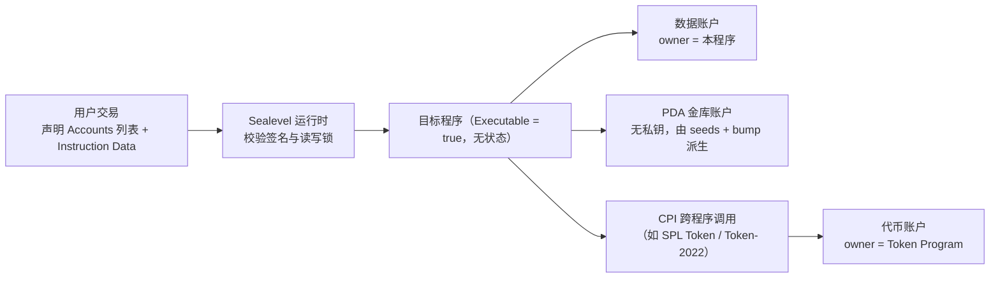
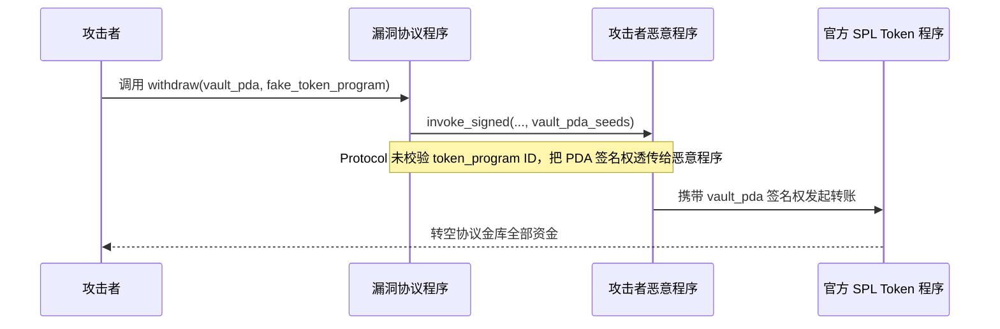

# C04 Solana：合约与账户安全专题

> 学习目标：读完本章，你能——
> 1. 说出 Solana 代码与状态分离的账户模型，以及它与以太坊合约存储的根本差异。
> 2. 识别 Solana 审计中最常引发资损的五类漏洞：缺失 Signer/Owner 校验、PDA 规范 Bump 绕过、任意 CPI、账户关闭复活和 Token-2022 扩展钩子。
> 3. 使用 `SOL-1`–`SOL-8` 清单评审 Solana/Anchor 程序与交易所代币接入。
>
> 前置章节：[13 非 EVM 生态](../chapters/13-non-evm-ecosystems.md)、[05 访问控制与权限](../chapters/05-access-control.md)
> 配套练习：[B50 Solana 程序审计实战](../bootcamp/B50-solana-audit.md) ｜ 代码靶场：[non-evm/solana-vault/](../../code/non-evm/solana-vault/README.md) ｜ 交互实验：[链迁移检查](../interactive/chain-porting-lab.html)
> 最后核对：2026-11-23

## 开场：为什么“参数是调用者传进来的”会毁掉整个协议

2022 年 2 月，Wormhole 跨链桥在 Solana 侧被盗约 3.2 亿美元（事发时估值；公开来源：Wormhole 复盘与安全公司分析）。攻击者没有破解密码学签名，也没有攻破守护者私钥。他只向合约传入了一个自己伪造的假账户，冒充系统的指令内省账户（Instructions Sysvar）。合约没有校验该账户的地址，直接采信了其中的虚假验证结果。

<details class="predict">
<summary>🤔 先猜再看：在以太坊上，合约读写自己的状态变量不需要调用者传参。为什么 Solana 程序必须反复校验每个传入账户的 Owner 和地址？</summary>

因为 Solana 程序本身是无状态的。所有状态都保存在外部数据账户（Account）中，由交易发起方显式传入。攻击者可以传入任意自己控制的假账户。如果程序不检查 `owner`、`is_signer`、类型鉴别器（Discriminator）和 PDA 派生地址，就会把假账本当成真账本。
</details>

## 1. 一句话理解

Solana 把“代码”和“状态”拆开存放，**所有状态账户都由调用者传入，程序必须把每一个传入账户当作不可信输入来验明正身**。

> 🎯 打个比方：以太坊合约像自带保险柜的银行柜员，钱和账本都在柜台里；Solana 程序像只拿印章的公证员，账本由客户自己抱过来。如果公证员不核对账本封面的防伪印章（Owner）和编号（PDA），客户就能抱一本假账本来盖章取钱。
> 比喻的局限：Solana 运行时（Sealevel）仍会强制执行一条底线——只有账户的 `owner` 程序才能修改该账户的 `data` 字段并扣减其 Lamports 余额。

## 2. 链的安全模型

Solana 采用 Proof of History（PoH）加 Tower BFT 共识，执行层为支持并行执行的 Sealevel 运行时。交易在提交前必须显式声明所有要读写的账户列表。



读图要点：
- **输入来源**：交易调用方构造完整的 `Accounts` 数组并传入程序。
- **运行时边界**：Sealevel 只保证带 `is_signer` 标记的账户确实签了名，且只有 `owner` 程序能写入账户数据。
- **出错位置**：运行时不校验“这个账户是不是本协议创建的合法金库”，也不校验“CPI 目标程序是不是官方 Token Program”。
- **模型局限**：Anchor 框架通过宏自动生成大量校验，但一旦开发者使用 `UncheckedAccount`、`AccountInfo` 或手写 `remaining_accounts`，这些保护会立即失效。

## 3. 与以太坊的差异

| 维度 | 以太坊（EVM） | Solana（Sealevel） | 合约安全风险 | 对策 |
|---|---|---|---|---|
| 状态存储 | 绑定在合约内部 Storage | 独立 Account，调用时由用户传入 | 假账户注入、类型混淆（Type Cosplay） | 校验 `owner`、8 字节 Discriminator 与 PDA 派生 |
| 跨合约调用 | `call` 显式写死目标地址 | CPI 需将目标程序也作为账户传入 | 任意 CPI 攻击（传入恶意程序冒充官方程序） | 用 Anchor `Program<'info, Token>` 固定校验 `program_id` |
| 权限上下文 | `msg.sender` 隐式全局提供 | 账户元数据 `is_signer` 标志 | 忘记校验 `is_signer` 导致任何人可冒充管理员 | 用 `Signer<'info>` 类型约束替代裸 `AccountInfo` |
| 账户生命周期 | 合约部署后持久存在 | 需维持免租（Rent-exempt）余额；可关闭回收 | 关闭账户未清零引发同交易复活（Revival）攻击 | 关闭时清零数据、写入关闭标识并转空 Lamports |
| 代币标准 | ERC-20（钩子需 ERC-777 等） | SPL Token 与 Token-2022 扩展 | Token-2022 转账税、Transfer Hook、永久委托破坏记账 | 按实收记账，对高危扩展（Permanent Delegate 等）建白名单 |
| 交易原子性 | 单笔交易调用单个入口合约 | 单笔交易可串联多条指令（Instruction） | 闪电贷或前置指令在同一交易内操纵状态 | 校验指令内省（Instructions Sysvar）与全局不变量 |

## 4. 核心漏洞模式与案例深潜

### 4.1 缺失 Signer 与 Owner 校验

如果提款指令只核对 `vault.authority == authority.key()`，却没有核对 `authority.is_signer`，攻击者只需把管理员公钥放进账户列表，无需私钥就能提走资金。

```rust
// ❌ 漏洞：使用裸 AccountInfo，既未校验 authority 是否签名，也未校验 vault 归属与 PDA
pub fn withdraw_vulnerable(ctx: Context<WithdrawVulnerable>, amount: u64) -> Result<()> {
    let vault = &mut ctx.accounts.vault;
    require!(vault.authority == ctx.accounts.authority.key(), ErrCode::Unauthorized);
    // 遗漏 ctx.accounts.authority.is_signer 检查
    vault.balance -= amount;
    Ok(())
}

// ✅ 修复：使用 Anchor 类型系统强制校验 Signer、Owner、Discriminator 与规范 PDA
#[derive(Accounts)]
pub struct WithdrawSafe<'info> {
    #[account(
        mut,
        seeds = [b"vault", authority.key().as_ref()],
        bump = vault.bump,
        has_one = authority
    )]
    pub vault: Account<'info, VaultState>,
    pub authority: Signer<'info>,
}
```

### 4.2 任意 CPI 与权限透传（Signer Privilege Escalation）



读图要点：
- **权限透传**：`invoke_signed` 会把本程序的 PDA 签名权授予被调用程序。
- **出错位置**：协议未校验 `token_program.key() == spl_token::ID`。
- **防御底线**：凡涉及 `invoke_signed`，目标程序 ID 必须硬编码校验，禁止由调用方自由指定。

### 4.3 PDA 规范 Bump 与账户关闭复活（Revival）

- **非规范 Bump（Non-canonical Bump）**：`create_program_address` 接受小于最大合法值（Canonical Bump）的其他 Bump。如果程序允许用户传入任意 `bump` 派生账户，攻击者可为同一用户创建多个影子 PDA，绕过单账户限额或重复领奖。对策：始终使用 `find_program_address` 计算并将规范 Bump 持久化存入状态。
- **账户复活（Revival Attack）**：关闭账户时如果只把 Lamports 转走而未清零 `data`，攻击者可在同一笔交易的后续指令中向该账户补足免租 Lamports，使账户逃过垃圾回收并带着旧余额“复活”。对策：使用 Anchor `#[account(mut, close = recipient)]`（自动清零数据并写入 `CLOSED_ACCOUNT_DISCRIMINATOR`）。

### 4.4 Token-2022 扩展陷阱

截至 2026 年公开资料（Solana 官方文档），Token-2022（Token Extensions）已广泛用于新型资产，接入 DeFi 或交易所时必须逐项识别：
- **Transfer Fee（转账税）**：实际到账金额小于转账入参，按入参记账会造成金库亏空。
- **Transfer Hook（转账钩子）**：转账时自动触发外部自定义程序，可能引入重入或恶意回滚阻断清算。
- **Permanent Delegate（永久委托）**：发行方随时可划走或销毁任意地址（包括协议金库和交易所热钱包）中的该代币。
- **Confidential Transfer（隐私转账）**：余额密文存储，传统链上监控与余额对账会失效。

### 4.5 真实案例摘要

- **Wormhole（2022 年 2 月，Solana，损失约 3.2 亿美元，事发时估值；公开来源：Wormhole 复盘与安全公司分析）**：程序使用已废弃的 `load_instruction_at` 读取指令，未校验传入的 Sysvar 账户地址，导致攻击者伪造验证指令凭空铸造 12 万枚 wETH。
- **Cashio（2022 年 3 月，Solana，损失约 5200 万美元，事发时估值；公开来源：Ackee Blockchain 等安全分析）**：抵押品验证链路缺失根账户（Root of Trust）校验，攻击者伪造一整条假的抵押品账户与 Mint 账户链，零成本铸造大量 CASH 稳定币。
- **Crema Finance（2022 年 7 月，Solana，损失约 880 万美元，事发时估值；公开来源：Halborn 复盘）**：CLMM 流动性池未校验传入的 Tick Account 归属（Owner），攻击者伪造假 Tick 账户配合闪电贷领走全部手续费。

## 5. 迁移与审计检查清单

- [ ] **SOL-1** 所有特权操作账户是否强制校验 `is_signer`（Anchor `Signer<'info>`）？
- [ ] **SOL-2** 所有数据账户是否校验 `owner == program_id` 且验证 8 字节 Discriminator，杜绝类型混淆？
- [ ] **SOL-3** 所有 PDA 是否强制使用规范 Bump（`find_program_address`），并将 `bump` 存入状态账户？
- [ ] **SOL-4** 所有 CPI 目标程序（SPL Token、System Program、Associated Token Program 等）是否硬编码校验 `program_id`？
- [ ] **SOL-5** `remaining_accounts` 和 `UncheckedAccount` 的每个账户是否均有手动 `owner`、地址与重复账户（Duplicate Mutable Accounts）校验？
- [ ] **SOL-6** 账户关闭逻辑是否清空数据、写入关闭标识并转走全部 Lamports，防止同交易复活？
- [ ] **SOL-7** 接入 SPL 代币时是否检测并拦截高危 Token-2022 扩展（Permanent Delegate、Transfer Hook、Transfer Fee、Mint Close Authority）？
- [ ] **SOL-8** Rust 算术运算是否开启 `overflow-checks = true` 并使用 `checked_add`/`checked_mul`，禁止静默溢出或截断？

| 检查项 | 报告对应位置 | 失守时的典型定级 |
|---|---|---|
| SOL-1、SOL-2、SOL-4 | 访问控制 / 账户校验缺陷 | 严重（Critical） |
| SOL-3、SOL-5、SOL-6 | 状态一致性 / 账户生命周期缺陷 | 高危（High） |
| SOL-7、SOL-8 | 代币集成风险 / 算术安全 | 高危至中危（High / Medium） |

## 6. 用户侧防护

1. 在钱包弹窗中核对**余额变更模拟（Transaction Simulation）**结果，拒绝模拟失败或提示“无法模拟”的未知交易。
2. 警惕 Solana 的单笔多指令特性：一笔看似领空投的交易，可能同时捆绑了 `SetAuthority`（转移代币账户所有权）指令。
3. 大额资产使用硬件钱包，并定期清理代币账户的已授权 Delegate。

## 7. 术语表

| 术语 | 英文 | 一句话定义 |
|---|---|---|
| 程序派生地址 | PDA（Program Derived Address） | 不在 Ed25519 曲线上、没有私钥、仅能由特定程序通过 `seeds + bump` 签名的确定性地址。 |
| 跨程序调用 | CPI（Cross-Program Invocation） | 一个 Solana 程序在执行期间调用另一个程序指令的机制。 |
| 鉴别器 | Discriminator | Anchor 在账户数据前 8 字节写入的类型哈希前缀，用于防止不同结构体账户被混用。 |
| 账户复活 | Account Revival | 账户被清空余额后，攻击者在同一交易后续指令中转入 Lamports 使其免于销毁并保留旧状态的攻击。 |

> 🪞 反思：如果你的团队把一个以太坊 DeFi 协议移植到 Solana，哪些在 EVM 里由 `msg.sender` 和合约内部存储隐式保证的安全假设，必须在 Solana 端重写为显式账户约束？

## 8. 思考题

1. 为什么在 Solana 上即使校验了 `vault.owner == program_id`，攻击者仍可能通过传入本程序的另一个结构体账户（例如把 `UserConfig` 冒充 `VaultState`）完成攻击？Anchor 如何防御？
2. Token-2022 的 `Transfer Fee` 与以太坊上的收税代币在集成防护上有哪些共同点与不同点？
3. 打开 [non-evm/solana-vault/](../../code/non-evm/solana-vault/README.md)，对比漏洞版与修复版提款逻辑，说明如果只补齐 `Signer` 校验却遗漏 PDA `seeds` 约束，攻击者还能如何绕过。
