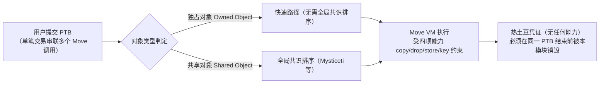
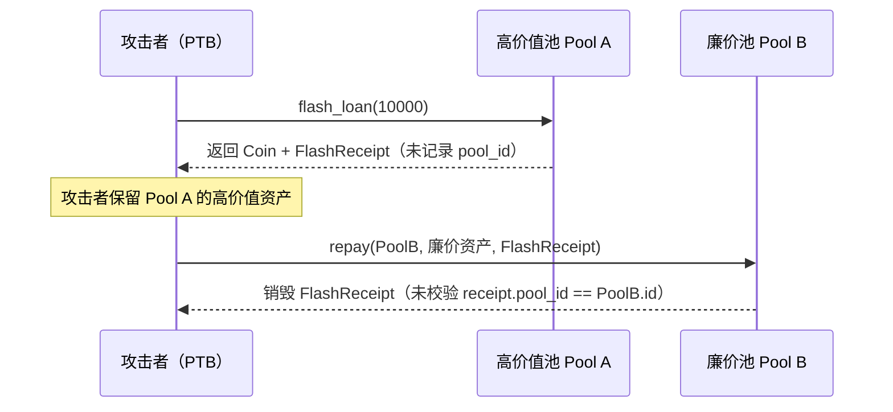

# C05 Move（Sui / Aptos）：对象与资源安全专题

> 学习目标：读完本章，你能——
> 1. 说出 Move 的线性资源与四项能力（`copy / drop / store / key`）如何从语言层消除重入与双花，以及它无法消除哪些业务逻辑漏洞。
> 2. 区分 Sui 的对象模型（独占对象、共享对象、PTB）与 Aptos 的全局账户存储模型在安全边界上的差异。
> 3. 识别 Move 审计中的高频漏洞：位运算截断溢出、热土豆（Hot Potato）跨池还款绕过、`AdminCap` 权限泄露与泛型类型伪造。
>
> 前置章节：[13 非 EVM 生态](../chapters/13-non-evm-ecosystems.md)、[06 算术与精度](../chapters/06-arithmetic-precision.md)
> 配套练习：[B51 Move 审计实战](../bootcamp/B51-move-audit.md) ｜ 代码靶场：[non-evm/sui-move-lending/](../../code/non-evm/sui-move-lending/README.md) ｜ 交互实验：[链迁移检查](../interactive/chain-porting-lab.html)
> 最后核对：2026-11-23

## 开场：当“不会重入、默认防溢出”的语言依然损失上亿美元

2025 年 5 月，Sui 生态头部 DEX 协议 Cetus 遭遇攻击，损失约 2.23 亿美元（事发时估值；公开来源：Cetus 复盘与 Dedaub 等安全公司分析）。Move 语言默认拦截整数加减乘溢出，也不支持动态派发重入，但它的**位左移运算符（`<<`）在溢出时不会中止交易，而是静默截断高位**。攻击者利用数学库中一处宽松的左移上界检查，用极小代价铸造了巨额流动性并抽空资金池。

<details class="predict">
<summary>🤔 先猜再看：Move 的字节码验证器在发布前就能拦截未初始化、类型错误和加减溢出，为什么 Move 协议仍然会出现严重资损？</summary>

字节码验证器只能保证“类型与内存安全”，不能理解“经济与业务不变量”。位运算静默截断、整数除法向零舍入、闪电贷凭证（Hot Potato）未绑定池子 ID、权限对象（Capability）意外带有 `store` 或 `copy` 能力，都会在完全合法的 Move 字节码下直接导致资金被盗。
</details>

## 1. 一句话理解

Move 把资产建模为不可凭空复制或丢弃的**线性资源（Linear Resource）**，天然免疫动态重入，但审计重心随之转移到**能力标记（Abilities）、对象所有权、泛型约束与数学边界**。

> 🎯 打个比方：EVM 的代币像记在银行总账本里的数字，改错了容易多记一笔或被中途插队（重入）；Move 的代币像盖着防伪钢印的实体金条（Resource），不能复印（无 `copy`）也不能随手扔掉（无 `drop`）。但它防不住柜员算错汇率（数学截断）或把金库钥匙（`AdminCap`）错发给了外人。
> 比喻的局限：Move 里的 `Coin<T>` 只是结构体封装；一旦开发者在自定义结构体上误加 `copy` 或 `drop`，这套物理防伪约束就会立刻失效。

## 2. 链的安全模型

Sui 与 Aptos 同源 Move，但底层状态模型不同：Aptos 沿用“地址 → 全局资源表”的账户模型；Sui 采用“一切皆对象（Object）”模型，并通过可编程交易块（PTB）在单笔交易中串联多步 Move 调用。



读图要点：
- **并行与排序**：Sui 上独占对象走快速路径，共享对象（如 AMM 资金池）必须经过共识排序，因此共享对象仍面临抢跑和三明治风险。
- **PTB 组合性**：攻击者无需部署攻击合约，只需在一个 PTB 里组合“借闪电贷 → 操纵价格 → 偿还热土豆”。
- **模型局限**：热土豆模式强依赖“凭证只能由对应还款函数销毁”；如果还款函数没有校验凭证里的 `pool_id` 或币种泛型 `T`，攻击者就能跨池还款套利。

## 3. 与以太坊的差异

| 维度 | 以太坊（Solidity） | Move（Sui / Aptos） | 合约安全风险 | 对策 |
|---|---|---|---|---|
| 重入机制 | 存在动态外部调用重入 | 无动态派发，天然免疫传统重入 | 开发者放松警惕，忽视跨函数状态不一致与 PTB 组合攻击 | 仍需维护核心偿付不变量与单交易价格防护 |
| 资产表示 | 合约内 `mapping` 记账 | 一等公民对象 / 线性资源 | 误给凭证或代币结构体加 `copy` / `drop` 能力 | 严格最小化能力集；热土豆不赋予任何能力 |
| 权限控制 | `msg.sender == owner` | 权限对象（Capability，如 `AdminCap`） | `AdminCap` 误加 `store` 后被转移/包装，或特权函数漏传 Cap 参数 | 关键权限对象限制 `store`，或绑定唯一 `object::ID` |
| 算术溢出 | 0.8+ 默认回滚（`unchecked` 除外） | `+ - *` 默认中止，**`<<` 位左移静默截断** | 自定义大数/定点数库左移溢出导致算错份额 | 严检所有 `<<`、`>>` 与宽位转换（`as u64`），使用严格上界检查 |
| 泛型安全 | 无原生泛型，靠地址区分代币 | 原生泛型 `Pool<CoinA, CoinB>` | 未校验泛型类型导致用假币 `FakeCoin` 冒充真币还款 | 校验 `TypeName`、绑定池子 `ID` 并拒绝未注册币种 |
| 升级与包不可变性 | Proxy 代理模式 | Sui `UpgradeCap` / Aptos 包升级策略 | `UpgradeCap` 泄露导致恶意升级，或升级破坏旧对象兼容性 | 多签 + 时间锁托管 `UpgradeCap`，兼容旧版本函数入口 |

## 4. 核心漏洞模式与案例深潜

### 4.1 位左移（`<<`）静默截断与自定义数学库风险

Move 对 `+`、`-`、`*` 执行溢出检查，但 `<<` 不会在溢出时报错。如果开发者手写 `checked_shlw` 时上界常量多了一位或边界判断写成 `>` 而非 `>=`，超大输入就会绕过检查并在左移后被截断成极小值。

```move
// ❌ 漏洞：左移上界判断过宽，导致溢出时静默截断为极小值
public fun unsafe_shl64(x: u256): u256 {
    // 若上界掩码错误，高位被截断而不触发 abort
    assert!(x <= 0xffffffffffffffffffffffffffffffffffffffffffffffff0000000000000000, 1);
    x << 64
}

// ✅ 修复：先右移验证或用严格上界 (1 << (256 - 64)) - 1 拦截任何会溢出的输入
public fun safe_shl64(x: u256): u256 {
    let max_val: u256 = (1u256 << 192) - 1;
    assert!(x <= max_val, 1);
    x << 64
}
```

### 4.2 热土豆（Hot Potato）闪电贷跨池绑定缺陷



读图要点：
- **核心缺陷**：`FlashReceipt` 没有记录借出池的 `pool_id`（或还款函数未比对 `pool_id`）。
- **后果**：攻击者从高价值池借款，向低价值池或自建假池还款并销毁热土豆，白拿本金。
- **修复**：在 `FlashReceipt` 中写入 `pool_id: ID` 与精确 `repay_amount`，还款时强制 `assert!(receipt.pool_id == object::id(pool), EWrongPool)`。

### 4.3 能力系统（Abilities）与权限对象误配

- **误加 `drop` 给债务/闪电贷凭证**：借款人可直接丢弃凭证，永远不用还款。
- **误加 `copy` 给权益/权限对象**：持有人可无限复制 `AdminCap` 或仓位凭证。
- **`public` vs `entry` 混用**：在 Sui 上，把内部敏感函数标成 `public` 会允许其他外部模块或 PTB 组合调用它；涉及闪电贷防护或随机数调用的函数应审慎控制可见性（如仅限 `entry` 或 `public(package)`）。

### 4.4 真实案例摘要

- **Cetus Protocol（2025 年 5 月，Sui，损失约 2.23 亿美元，事发时估值；公开来源：Cetus 复盘与 Dedaub 等安全分析）**：集中流动性数学库 `checked_shlw` 的溢出上界掩码存在缺陷，攻击者输入精心构造的流动性数量触发左移截断，仅支付 1 单位代币即获得巨额流动性份额并抽干资金池。
- **Thala Labs（2024 年 11 月，Aptos，损失约 2550 万美元，事发时估值，后经协商追回大部分；公开来源：Thala 公告与 Halborn 复盘）**：v1 农场合约升级引入漏洞，允许攻击者在未满足条件的情况下提取 LP 代币，凸显 Move 生态中升级门禁与权限审计同等关键。

## 5. 迁移与审计检查清单

- [ ] **MOV-1** 所有资产、仓位、债务和热土豆结构体是否遵循最小能力原则（热土豆无任何能力，权限对象无 `copy`）？
- [ ] **MOV-2** 热土豆凭证是否同时绑定 `pool_id`、币种类型与应还金额（含手续费），并在还款时全部校验？
- [ ] **MOV-3** 代码中全部位运算（`<<`、`>>`）和整数窄化强转（`as u64` / `as u128`）是否有严格上界断言，防止静默截断？
- [ ] **MOV-4** 整数除法舍入方向是否始终对协议有利（铸造份额向下取整、赎回/还款向上取整）？
- [ ] **MOV-5** 所有特权函数是否强制传入并校验对应的 Capability 对象（如 `AdminCap`），并核对其归属 `ID`？
- [ ] **MOV-6** 泛型函数（如 `deposit<T>`、`swap<X, Y>`）是否校验泛型类型合法性，防止传入假币或 `X == Y` 自交易？
- [ ] **MOV-7** 链上随机数（如 Sui `sui::random`）入口函数是否限制为非 `public` 的 `entry` 函数，防止 PTB 失败回滚作弊？
- [ ] **MOV-8** 包升级权限（`UpgradeCap`）是否由多签与时间锁托管，且升级后不会破坏已部署共享对象的字段布局？

| 检查项 | 报告对应位置 | 失守时的典型定级 |
|---|---|---|
| MOV-1、MOV-2、MOV-5 | 权限控制 / 闪电贷凭证绕过 | 严重（Critical） |
| MOV-3、MOV-4、MOV-6 | 数学精度 / 泛型校验缺陷 | 严重至高危（Critical / High） |
| MOV-7、MOV-8 | 随机数操纵 / 升级治理风险 | 高危至中危（High / Medium） |

## 6. 用户侧防护

1. 在 Sui 钱包确认 PTB 交易时，逐项核对**对象变更预览（Object Changes）**，确认没有意外交出高价值 NFT、仓位对象或 `Cap` 对象。
2. 警惕同名假币：Move 链上任何人都可以发布同符号的 `Coin<T>`，交易前必须核对完整包地址与模块路径（`0x...::usdc::USDC`）。
3. 关注协议的 `UpgradeCap` 状态：已销毁或由多签+时间锁托管的协议，单点恶意升级风险更低。

## 7. 术语表

| 术语 | 英文 | 一句话定义 |
|---|---|---|
| 线性资源 | Linear Resource | Move 中不能被隐式复制或丢弃、必须显式转移或销毁的数据类型。 |
| 能力系统 | Abilities | Move 通过 `copy`、`drop`、`store`、`key` 四个标签编译期约束结构体行为的机制。 |
| 热土豆模式 | Hot Potato Pattern | 没有任何能力的结构体，必须在同一笔交易结束前交回指定函数销毁，常用于原生闪电贷。 |
| 可编程交易块 | PTB（Programmable Transaction Block） | Sui 允许单笔交易原子化串联多达上千个 Move 函数调用的交易机制。 |

> 🪞 反思：如果你的项目使用 Move 开发，团队是否因为“Move 不会重入、默认防溢出”而省去了对自定义数学库和 PTB 组合调用的模糊测试？

## 8. 思考题

1. 为什么在 Sui 上调用链上随机数的抽奖函数如果声明为 `public fun` 而不是 `entry fun`，攻击者就能实现“必中”？
2. 对比 Solidity 的 `onlyOwner` 与 Move 的 `AdminCap` 权限模型：各自最容易被忽略的权限泄露路径是什么？
3. 打开 [non-evm/sui-move-lending/](../../code/non-evm/sui-move-lending/README.md)，查看漏洞版与修复版 `repay` 函数，说明为什么漏掉 `pool_id` 校验会直接击穿热土豆防线。
