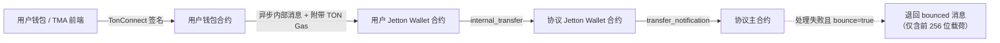
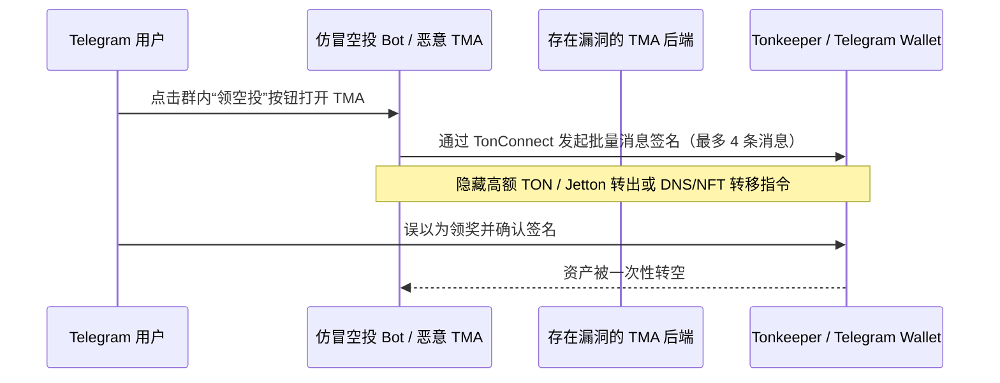

# C06 TON 与 Telegram Mini App：异步消息与生态安全专题

> 学习目标：读完本章，你能——
> 1. 理解 TON 的 Actor 异步消息模型，说明为什么以太坊的“原子回滚”思维在 TON 上会导致严重状态损坏。
> 2. 识别 TON 合约与生态的核心攻击面：`bounced` 弹回处理遗漏、Gas 转发耗尽、Jetton 假通知、TonConnect 钓鱼与 TMA `initData` 验签绕过。
> 3. 使用 `TON-1`–`TON-8` 清单审计 TON（FunC / Tact）合约、交易所充提接入与 Telegram Mini App。
>
> 前置章节：[13 非 EVM 生态](../chapters/13-non-evm-ecosystems.md)、[19 用户侧诈骗](../chapters/19-user-scams.md)、[20 前端、DNS 与供应链](../chapters/20-frontend-dns-supply-chain.md)
> 配套工具：[链迁移检查](../interactive/chain-porting-lab.html) ｜ [钓鱼签名识别](../interactive/phishing-signature-lab.html)
> 最后核对：2026-11-23

## 开场：当一笔跨合约转账失败时，账本并不会自动回滚

在以太坊上，合约 A 扣减用户余额后调用合约 B；如果合约 B 报错回滚，整笔交易全部撤销，合约 A 的余额自动恢复。但在 TON 上，合约 A 扣减余额并向合约 B 发出一封异步消息后，A 的交易就已经成功落块。几秒后合约 B 处理失败，给 A 退回一封 `bounced`（弹回）消息。如果 A 没有编写弹回恢复逻辑，用户的钱就直接蒸发了。

<details class="predict">
<summary>🤔 先猜再看：除了资金蒸发，攻击者能否故意让跨合约调用在目标合约失败，反过来利用“缺乏原子回滚”获利？</summary>

可以。如果合约 A 在发消息前就给用户发放了凭证、积分或记了账，却没有处理下游失败后的 `bounced` 回滚，或者攻击者故意只附带刚好够执行 A、不够执行 B 的 TON Gas，就能让下游扣款失败而上游奖励已经生效。
</details>

## 1. 一句话理解

TON 是基于 **Actor 模型的异步消息分片链**，合约之间不能同步读取状态，也没有跨合约原子回滚；而 Telegram Mini App（TMA）又把海量用户带进了 WebView 与 TonConnect 交互层。

> 🎯 打个比方：以太坊合约交互像打通一通实时电话，任何一方挂断（revert）整笔交易作废；TON 合约交互像寄挂号信，信寄出后邮局先盖章生效。如果收件人拒收，邮局只会退回一封“退信通知（bounced）”，你必须在拆退信时自己把账改回去。
> 比喻的局限：TON 退回的 `bounced` 消息体默认只保留原消息的前 256 位载荷（截断），设计合约时必须把恢复状态所需的关键字段放在消息头最前面。

## 2. 链的安全模型

TON 通过工作链（Workchain）和动态分片链（Shardchain）实现高并发，每个智能合约都是独立 Actor，通过有向异步消息通信；同时每个合约（包括 Jetton 用户的代币钱包）都是一个独立的合约实例。



读图要点：
- **分散存储**：在 TON 上，代币（Jetton）余额不存在于单一中心合约的 `mapping` 里，而是每个持有者各有一个独立的 Jetton Wallet 合约。
- **异步链条**：一笔完整的 Jetton 存款至少跨越 3–4 个独立合约消息，每一步都要独立支付 Gas 和存储费（Storage Fee）。
- **出错位置**：协议主合约收到 `transfer_notification` 时，如果只看消息里的 `op` 和 `amount`，不核对发送方地址是不是自己合法的 `protocol_jetton_wallet`，任何人都能直接伪造一封假通知免费入账。

## 3. 与以太坊的差异

| 维度 | 以太坊（EVM） | TON（TVM） | 安全风险 | 对策 |
|---|---|---|---|---|
| 调用模型 | 同步调用，失败全链回滚 | 异步消息，无跨合约原子回滚 | 下游失败导致状态撕裂、资金永久锁定 | 显式编写 `on_bounce` 恢复逻辑，关键字段放消息前 256 位 |
| Gas 与存储费 | 一次性估算 Gas，无持续存储租金 | 每条消息显式附带 TON 充当 Gas；合约持续扣存储费 | Gas 不足中途中断；余额耗尽合约被冻结（Frozen） | 严格校验 `msg_value >= min_gas`，保留最低 TON 储备 |
| 代币架构 | 单一 ERC-20 合约存所有余额 | Jetton Master + 每人一个 Jetton Wallet | **假通知攻击**：攻击者直接向主合约发 `transfer_notification` | 校验 `sender_address == expected_protocol_jetton_wallet` |
| 地址编码 | 单一 `0x` 十六进制地址 | 同一原始地址有 Bounceable（`EQ...`）与 Non-bounceable（`UQ...`）两种 Base64 形式 | 交易所或用户向未部署合约发 Bounceable 转账导致资金退回或入账识别失败 | 统一解析为原始 `workchain:hash` 内部地址再入账与比对 |
| 合约重放保护 | 协议层自动递增 `nonce` | 钱包合约层自行维护 `seqno` 或 Highload Wallet 查询 ID | 自定义钱包忘记更新 `seqno` 或校验 `valid_until` 导致签名重放 | 强制校验 `seqno`、`subwallet_id` 与过期时间 |
| 前端入口 | 独立网页浏览器 + 扩展 | Telegram Mini App（内置 WebView）+ TonConnect | 假 Bot、TMA 跳转钓鱼、服务端跳过 `initData` HMAC 验签 | 服务端用 Bot Token 校验 `initData` 签名与 `auth_date` 时效 |

## 4. 核心攻击路径与案例深潜

### 4.1 Jetton 假通知攻击（Fake `transfer_notification`）

这是 TON DeFi 与交易所接入中最经典的高危漏洞。由于任何人都可以构造一条 `op == 0x7362d09c`（`transfer_notification`）的内部消息直接发给协议主合约，合约必须把 `sender_address` 与自己事先绑定或按标准公式推导出的 `protocol_jetton_wallet` 严格比对。

```tact
// ❌ 漏洞：收到 Jetton 通知后未校验 sender() 是否为协议自己的 Jetton Wallet
receive(msg: TokenNotification) {
    // 攻击者可直接发送伪造的 TokenNotification，零成本增加余额
    self.balances.set(msg.from, self.getBalance(msg.from) + msg.amount);
}

// ✅ 修复：严格校验发送方地址等于本协议已绑定的 Jetton Wallet 地址
receive(msg: TokenNotification) {
    require(sender() == self.protocolJettonWallet, "Invalid Jetton Wallet");
    require(msg.amount > 0, "Zero amount");
    self.balances.set(msg.from, self.getBalance(msg.from) + msg.amount);
}
```

### 4.2 弹回消息（`bounced`）缺失与 Gas 转发耗尽

- **缺失 `bounced` 处理**：在 FunC 中，如果 `recv_internal` 开头直接忽略 `flags & 1`（弹回标志），跨合约退款或提款失败时协议不会恢复用户余额；反之，如果合约没检查 `flags & 1` 就把弹回消息当成正常请求再次执行，可能触发重复记账。
- **`forward_ton_amount` 过小**：用户发起 Jetton 转账时若将 `forward_ton_amount` 设得过低，Jetton 虽已转到协议的 Jetton Wallet，但通知主合约的消息因 Gas 不足被丢弃，导致“钱到了但账没记”。对策：在协议前端和合约内强校验最低附带 TON 数量，并建立人工/自动补单对账机制。

### 4.3 Telegram Mini App（TMA）与 TonConnect 攻击链



读图要点：
- **批量消息风险**：TON 钱包（如 v4/v5）支持单笔外部消息打包多条出站转账，钓鱼页面常把“0.01 TON 领奖”与“转空全部 USDT Jetton”混在同一笔 TonConnect 请求中。
- **TMA 后端漏洞**：TMA 打开时会把用户信息放在 `Telegram.WebApp.initData` 中传给后端。如果后端直接信任前端传来的 `user_id` 而不使用 `Bot Token` 对 `initData` 做 HMAC-SHA256 验签并校验 `auth_date`，攻击者可伪造任意管理员或大户身份提现。

### 4.4 公开安全事件与风险教训

- **TON 生态假通知与钓鱼潮（2024–2025 年，TON；公开来源：慢雾、CertiK 等安全团队披露）**：随着 Notcoin 等 TMA 爆发，大量 Drainer 通过仿冒 Telegram Bot 和 TonConnect 批量消息诱导用户签出 TON、USDT Jetton 与高价值 Telegram 用户名（Fragment NFT）；同时多家中小项目与充值扫块脚本因未校验 Jetton Wallet 地址或忽略 `bounced` 标志导致假充值资损。

## 5. 迁移与审计检查清单

- [ ] **TON-1** 接收 Jetton `transfer_notification` 时，是否强制校验 `sender_address == protocol_jetton_wallet`？
- [ ] **TON-2** `recv_internal` 入口是否第一时间解析并分流 `bounced` 标志（`flags & 1`），且为所有关键跨合约出站消息编写了状态回滚处理？
- [ ] **TON-3** 出站消息是否把弹回恢复所需的关键业务 ID 放在消息体前 256 位内？
- [ ] **TON-4** 所有入口是否校验附带 TON 数量足以覆盖完整异步链路 Gas 与合约最低存储费（`raw_reserve` 保留底座）？
- [ ] **TON-5** 交易所充值扫块是否将地址统一规范化为原始 `workchain:hash`，且严格剔除 `aborted`、`bounced` 与未成功执行 `action phase` 的交易？
- [ ] **TON-6** 合约或自定义钱包是否实现防重放机制（`seqno` / `query_id` 与 `valid_until`），并检查 `subwallet_id`？
- [ ] **TON-7** TMA 后端是否对 `Telegram.WebApp.initData` 执行完整的 HMAC-SHA256 签名验证与 `auth_date` 有效期检查？
- [ ] **TON-8** 出站消息的 Send Mode（如 `64` 携带剩余价值、`128` 携带全部余额、`+2` 忽略错误）是否核对无误，避免误用 `128` 清空整个协议合约余额？

| 检查项 | 报告对应位置 | 失守时的典型定级 |
|---|---|---|
| TON-1、TON-5、TON-8 | 假通知 / 假充值 / 金库清空 | 严重（Critical） |
| TON-2、TON-6、TON-7 | 异步状态撕裂 / 重放 / 身份伪造 | 高危（High） |
| TON-3、TON-4 | 弹回恢复失效 / Gas 耗尽卡死 | 中危至高危（Medium / High） |

## 6. 用户侧防护

1. 在 TonConnect 确认界面逐条核对**每一笔出站消息**的目标地址和金额，拒绝任何包含多笔不明转账的“领空投”签名。
2. 仅从官方认证渠道启动 Telegram Mini App，不要点击群聊私信发送的“客服/补领” Bot 链接。
3. 存放高价值 TON 资产或 Fragment 用户名时，使用独立冷钱包，不与日常玩 TMA 游戏的钱包混用。

## 7. 术语表

| 术语 | 英文 | 一句话定义 |
|---|---|---|
| 弹回消息 | Bounced Message | 当 TON 内部消息目标执行失败且 `bounce` 标志开启时，系统自动退回给发送方的截断消息。 |
| Jetton | Jetton | TON 上的同质化代币标准，由一个 Master 合约和每个用户各自的 Jetton Wallet 合约组成。 |
| 行动阶段 | Action Phase | TON 交易中在计算阶段（Compute Phase）之后实际执行出站消息发送的阶段，计算成功不代表行动阶段一定成功。 |
| TMA 校验串 | `initData` | Telegram 客户端注入给 Mini App 的查询字符串，后端必须用 Bot Token 校验其 HMAC 签名。 |

> 🪞 反思：如果你的交易所或钱包已接入 TON 充提，你的扫块程序是否同时校验了 `compute_ph.success`、`action_ph.success` 和 `bounced == false`，并且校验了 Jetton Master 源地址？

## 8. 思考题

1. 为什么在 TON 上如果误把出站消息的 Send Mode 写成 `128`（`CARRY_ALL_BALANCE`）而不是 `64`（`CARRY_REMAINING_VALUE`），单次正常提款就可能把整个协议合约的 TON 余额全部转给用户？
2. 交易所接入 TON USDT（Jetton）充值时，除了校验 `transfer_notification` 的发送方地址，为什么还必须校验交易的 `action_phase` 是否成功？
3. 设计一个跨合约的 TON 兑换流程：合约 A 扣减余额并向合约 B 发消息，如果 B 执行失败退回 `bounced` 消息，你应该把哪些字段放在消息体前 256 位才能完整恢复用户状态？
