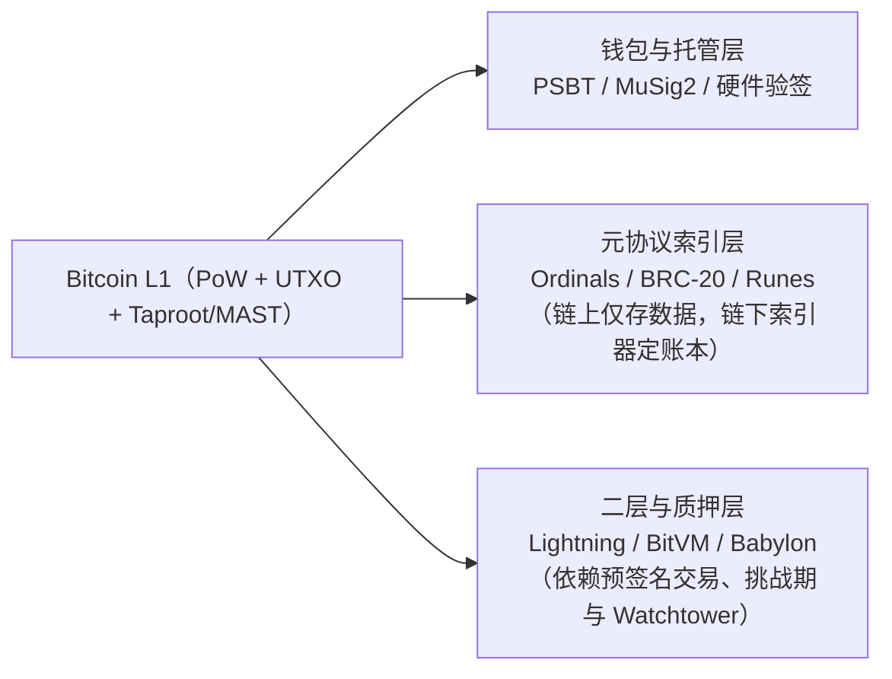
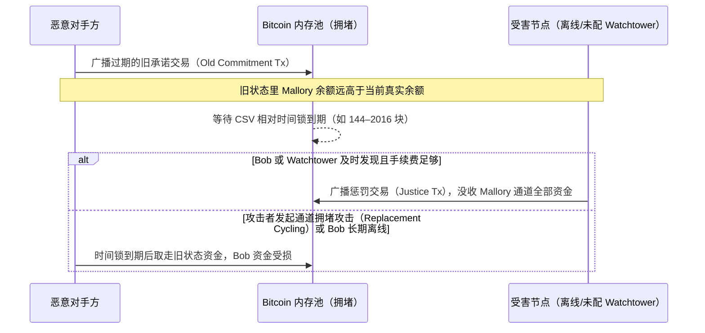

# C07 Bitcoin：UTXO、元协议与二层安全专题

> 学习目标：读完本章，你能——
> 1. 理解 Bitcoin 的 UTXO 模型、Taproot/Schnorr 签名和 PSBT 在钱包与交易所场景下的核心攻击面。
> 2. 识别 Ordinals / BRC-20 / Runes 元协议的索引器分歧与“铭文误花”风险，以及闪电网络的通道攻击。
> 3. 评估 BitVM、Babylon 等新兴比特币二层与质押方案的信任边界，并使用 `BTC-1`–`BTC-8` 清单完成自查。
>
> 前置章节：[02 密码学基础与实现风险](../chapters/02-cryptography-randomness.md)、[13 非 EVM 生态](../chapters/13-non-evm-ecosystems.md)、[16 共识层与链级安全](../chapters/16-consensus-chain-security.md)
> 配套工具：[链迁移检查](../interactive/chain-porting-lab.html) ｜ [签名重放](../interactive/signature-replay-lab.html)
> 最后核对：2026-11-23

## 开场：没有图灵完备合约，为什么依然会丢掉上百万美元的 BTC

Bitcoin 没有 Solidity，也没有重入漏洞。但 2023 年以来，多位用户和市场参与者在使用部分签名交易（PSBT）买卖 Ordinals 铭文或 Runes 代币时，因为没有核对输入输出的差额，把本应支付 0.001 BTC 的矿工费误签成了数枚 BTC；另一些钱包则因为把附带稀有铭文的“546 聪粉尘 UTXO”当成普通零钱凑单花掉，直接烧毁了高价值资产。

<details class="predict">
<summary>🤔 先猜再看：为什么在 Bitcoin 上“手续费”不会像以太坊那样作为一个显式字段写在交易里，这会带来什么签名风险？</summary>

Bitcoin 交易没有独立的 `fee` 字段，手续费等于“所有输入 UTXO 金额之和减去所有输出金额之和”。在旧版签名或恶意构造的 PSBT 中，如果硬件钱包没有校验每个输入的真实前置交易金额（PrevOut），攻击者就能虚报输入金额，诱导受害者签出天价矿工费或把找零转入攻击者地址。
</details>

## 1. 一句话理解

Bitcoin 的安全核心不在复杂合约代码，而在 **UTXO 选币与找零、Schnorr/Taproot 签名实现、链下元协议索引一致性，以及二层通道的在线看护（Liveness）**。

> 🎯 打个比方：以太坊像银行活期账户，转账时直接扣减数字；Bitcoin 像一沓面额各异的现金钞票（UTXO），每次消费都要把整张钞票交出去，再把找零退回自己口袋。如果有的钞票上还印着限量版收藏邮票（Ordinals/Runes），随手拿去买咖啡就会把邮票一起花掉。
> 比喻的局限：Bitcoin 的 Taproot 脚本路径（Script Path）允许把多签、时间锁、哈希锁组合成 Merkle 树（MAST），在复杂托管与二层桥接中仍存在脚本逻辑与密码学交互风险。

## 2. 链的安全模型

Bitcoin 主网采用 PoW（SHA-256）共识与非图灵完备的栈式脚本（Bitcoin Script），安全性依赖算力门槛、节点全量验证和链下协议的博弈惩罚机制。



读图要点：
- **共识与解释分离**：L1 节点只验证 BTC 账本与脚本是否合法，**完全不理解** BRC-20 或 Runes 的余额规则。
- **风险转移**：元协议的安全高度依赖索引器共识一致性；闪电网络和 BitVM 的安全高度依赖参与方在挑战期内在线广播惩罚或欺诈证明交易。
- **模型局限**：一旦主网内存池长期严重拥堵（高费率），依赖及时上链的二层惩罚交易或强制退出交易可能因费率不足无法按时打包。

## 3. 与以太坊的差异

| 维度 | 以太坊（EVM） | Bitcoin（UTXO + Script） | 安全风险 | 对策 |
|---|---|---|---|---|
| 账本模型 | 账户余额模型 | UTXO 集合模型 | 选币错误误花铭文/Runes；找零地址被篡改 | 隔离铭文 UTXO 与支付 UTXO；硬件屏幕核对全部输出与找零 |
| 手续费计算 | 显式 `maxFeePerGas × gas` | `sum(inputs) - sum(outputs)` 隐式差额 | PSBT 虚报输入金额导致天价矿工费攻击 | 使用 BIP-341（Taproot 承诺输入金额）或要求硬件钱包校验完整前置交易 |
| 签名与多签 | ECDSA + 智能合约多签（Safe） | ECDSA / Schnorr（BIP-340）+ MuSig2 / FROST | 交互式多签（MuSig2）随机数（Nonce）重用直接泄露私钥 | 严格执行一次性随机 Nonce（如 RFC 6979 变体 + 额外熵）且禁止状态回滚重签 |
| 代币账本 | 链上 EVM 合约强制执行 | 元协议（BRC-20/Runes）由链下索引器解释 | 索引器升级分歧导致双花或交易所账实不符 | 交易所与市场运行多版本索引器交叉校验，锁定官方规范版本 |
| 零确认交易 | 几乎不依赖零确认 | 存在 RBF（按费用替换）与双花 | 接受 0-conf 充值被攻击者用更高费率替换覆盖 | 强制等待足够区块确认（小额 ≥ 1–3，大额 ≥ 6） |
| 二层退出 | Rollup 合约验证状态根 | Lightning 通道惩罚 / BitVM 挑战期 | 离线未广播惩罚交易导致旧状态生效（被盗资金） | 部署独立 Watchtower 与动态费率提升（CPFP / RBF） |

## 4. 核心攻击路径与案例深潜

### 4.1 PSBT 钓鱼与 `SIGHASH_SINGLE | ANYONECANPAY` 陷阱

在 NFT/铭文交易市场中，挂单常使用 `SIGHASH_SINGLE | SIGHASH_ANYONECANPAY` 签名，允许买家补充输入输出完成撮合。攻击者常通过以下方式实施钓鱼：
- **输入输出错位**：诱导用户签名未绑定正确输出索引的 PSBT，使卖家的铭文被 0 元买走。
- **隐藏高额矿工费**：在非 Taproot 输入中伪造 `witness_utxo` 金额，使硬件钱包以为手续费只有 500 聪，实际链上差额高达数枚 BTC。

```text
// ❌ 漏洞：钱包仅检查第一个输出地址，未校验所有输入总额与找零输出归属
PSBT Inputs:  [UTXO_1: 1.5 BTC (用户), UTXO_2: 546 sats (含稀有铭文)]
PSBT Outputs: [Output_0: 0.01 BTC -> 卖家]  // 缺失找零输出！
// 实际矿工费 = 1.5 - 0.01 = 1.49 BTC，且铭文 UTXO 被当作普通输入烧毁！

// ✅ 修复：硬件钱包与签名服务强制校验完整前置交易、铭文隔离与找零路径派生
1. 校验每个输入的真实前置交易（PrevTx）并计算精确 fee = sum(in) - sum(out)。
2. 若 fee 超过阈值（如 > 0.01 BTC 或 > 支付额 10%），硬件端直接拒绝签名。
3. 核对找零输出脚本是否属于本钱包 BIP-32/86 派生路径，并禁止普通支付混入铭文 UTXO。
```

### 4.2 闪电网络（Lightning Network）通道攻击



读图要点：
- **安全前提**：闪电网络的安全不是纯密码学静态保证，而是依赖**在线监控 + 链上及时打包**。
- **真实风险**：2023 年公开披露的 **Replacement Cycling（替换循环）攻击** 表明，攻击者可通过反复利用 RBF 替换踢出受害节点的 HTLC 结算交易，迫使超时路径生效从而窃取路由资金（公开来源：Antoine Riard 公开披露与闪电网络客户端修复公告）。

### 4.3 元协议索引器分歧与 BitVM / Babylon 信任边界

- **Ordinals / BRC-20 / Runes 索引器分歧**：2023–2024 年间曾多次出现因 `ord` 索引器版本升级或边界规则变更导致不同平台对同一笔 BRC-20 余额解析不一致的情况。交易所若在索引器版本不同步时开放充提，极易引发套利与账实不符。
- **BitVM 与 Babylon 信任模型**：
  - **BitVM（含 BitVM2）**：采用乐观挑战模型，核心假设是**“1-of-N 诚实挑战者”**与运营商预先垫付流动性；若预签名设置（Presigned Transaction Graph）的参与方全员串谋，或挑战期内因主网拥堵导致反欺诈交易未能上链，桥接资金将面临风险。
  - **Babylon 比特币质押**：利用 Extractable One-Time Signatures（EOTS）在 PoS 链发生双签时自动暴露质押者私钥从而执行罚没；审计重点在于 EOTS 签名器的防重放与密钥隔离，防止误触发双签导致 BTC 本金被自动罚没。

## 5. 迁移与审计检查清单

- [ ] **BTC-1** 钱包与签名服务是否强制校验输入前置交易（PrevTx）并设置矿工费绝对值与比例双上限？
- [ ] **BTC-2** 普通 BTC 支付与 Ordinals / BRC-20 / Runes 资产是否严格分 UTXO / 分地址隔离管理，禁止自动混选？
- [ ] **BTC-3** 交易所充值是否拒绝 0-conf 与未确认 RBF 交易，并按金额梯度要求确认深度（大额 ≥ 6 块）？
- [ ] **BTC-4** 交互式多签（MuSig2 / FROST）实现是否保证每次签名的 Nonce 严格一次性，且持久化状态防虚拟机快照回滚？
- [ ] **BTC-5** 元协议资产（BRC-20 / Runes）接入是否部署多实例/多版本索引器比对，且在协议升级窗口自动暂停充提？
- [ ] **BTC-6** 闪电网络节点是否配置高可用 Watchtower、足够长的 CSV 惩罚窗口以及自动费率加速（Anchor Outputs + CPFP）？
- [ ] **BTC-7** 找零地址是否由硬件端或独立策略引擎按标准派生路径（BIP-84 / BIP-86）重新推导校验，而非信任前端传入？
- [ ] **BTC-8** 接入 Bitcoin L2 / 质押桥（如 BitVM / Babylon）时，是否明确记录预签名多签方数量、挑战期长度与 EOTS 防双签机制？

| 检查项 | 报告对应位置 | 失守时的典型定级 |
|---|---|---|
| BTC-1、BTC-4、BTC-7 | 签名服务 / 密钥泄露 / 资金被盗 | 严重（Critical） |
| BTC-2、BTC-3、BTC-5 | 假充值 / 索引分歧 / 铭文误花 | 高危（High） |
| BTC-6、BTC-8 | 二层通道丢币 / 桥接信任风险 | 高危至中危（High / Medium） |

## 6. 用户侧防护

1. 存放 Ordinals 铭文或 Runes 的地址与日常转账 BTC 的地址彻底分开，避免通用钱包把附带资产的 546 聪 UTXO 当作矿工费花掉。
2. 签署 PSBT 挂单或购买交易时，务必在钱包界面核对**总输入、总输出、找零归属和矿工费**四项数值。
3. 使用支持 BIP-341 Taproot 输入金额承诺与全量前置交易校验的硬件钱包。

## 7. 术语表

| 术语 | 英文 | 一句话定义 |
|---|---|---|
| 未花费交易输出 | UTXO（Unspent Transaction Output） | Bitcoin 账本中代表可用余额的最小独立单元，消费时必须整笔花出并通过新输出找零。 |
| 部分签名交易 | PSBT（Partially Signed Bitcoin Transaction） | BIP-174 定义的标准交易交换格式，用于在多签方、硬件钱包与撮合市场之间传递待签数据。 |
| 按费用替换 | RBF（Replace-By-Fee） | 允许发件人用更高矿工费的新交易覆盖内存池中尚未打包的旧交易的机制。 |
| 可提取一次性签名 | EOTS（Extractable One-Time Signature） | 对同一区块高度签署两条不同消息就会自动暴露私钥的签名原语，用于 Bitcoin 质押罚没。 |

> 🪞 反思：如果你的钱包或交易所只按“普通 BTC 充值”的思路处理 Bitcoin 主网，一旦用户充入带 Runes 或 Ordinals 铭文的 UTXO，归集脚本会不会直接把用户的元协议资产当作矿工费或零钱销毁？

## 8. 思考题

1. 为什么在 MuSig2 或 FROST 这类基于 Schnorr 的多签方案中，哪怕只发生一次“虚拟机快照回滚后用同一个 Nonce 重签另一笔交易”，也会直接导致私钥泄露？
2. 交易所同时支持 BTC 与 Runes 充提时，为什么要为两者分配隔离的 UTXO 池，且在索引器升级期间暂停入账？
3. 在闪电网络中，如果 Bitcoin 主网持续数天高费率拥堵，为什么会削弱通道的惩罚安全模型？节点运维方有哪些工程缓解手段？
