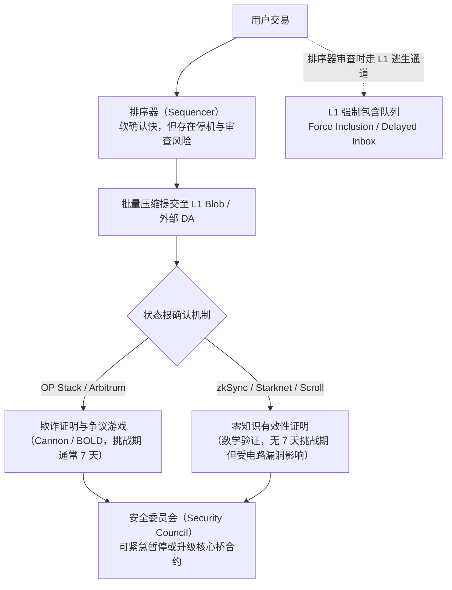

# C08 主流 Rollup 差异：OP Stack、Arbitrum 与非等效 zkEVM 安全专题

> 学习目标：读完本章，你能——
> 1. 对比 OP Stack（Base/OP Mainnet）、Arbitrum Nitro 与非等效 zkEVM（zkSync Era / Starknet）在安全模型、欺诈/有效性证明与逃生舱上的核心差异。
> 2. 识别把以太坊主网合约迁移到非等效 zkEVM 或 Arbitrum 时最易踩中的 6 类底层陷阱（`CREATE2` 地址、`tx.origin`、`msg.value`、`gasleft()`、重试票据与 L1→L2 别名地址）。
> 3. 使用 `RLP-1`–`RLP-9` 清单评估 Rollup 协议部署与交易所接入风险。
>
> 前置章节：[C00 以太坊](C00-ethereum.md)、[C03 Mantle](C03-mantle.md)、[14 ZK 与证明系统](../chapters/14-zk-proof-systems.md)、[16 共识层与链级安全](../chapters/16-consensus-chain-security.md)
> 配套章节：[X32 L2、跨链桥与预言机运营方](../architecture/X32-l2-bridge-oracle-ops.md) ｜ 交互实验：[链迁移检查](../interactive/chain-porting-lab.html)
> 最后核对：2026-11-23

## 开场：同一份 Solidity 源码，为什么换一条 L2 就会算错地址甚至锁死资金

某多链协议使用 `CREATE2` 在所有 EVM 链上为多签钱包和资金池部署“相同确定性地址”。当团队把同一套脚本直接部署到 zkSync Era 时，生成出来的合约地址与以太坊主网完全不同——导致用户按旧地址跨链转入的资产落入无人控制的地址。原因不是脚本写错，而是 zkSync Era 的 `CREATE2` 地址推导公式把**字节码哈希**纳入了输入，而非 EVM 的 `init_code` 哈希。

<details class="predict">
<summary>🤔 先猜再看：除了 `CREATE2` 地址不同，把依赖 `block.number` 或 `gasleft()` 的以太坊合约直接部署到 Arbitrum 或 zkSync，还会出现什么问题？</summary>

Arbitrum 的 `block.number` 返回的是 L1 区块号（而非 L2 自己约 0.25 秒一次的区块节奏），若合约拿它当时间或短期防重入锁会导致逻辑异常；而 L2 交易费包含动态 L1 数据费（L1 Data Fee），硬编码固定 Gas 转发（如 `transfer()` 的 2300 gas）在 L2 状态读取或非等效 zkEVM 计费模型下极易直接耗尽失败。
</details>

## 1. 一句话理解

Rollup 虽然大多兼容 Solidity，但**“兼容语法”不等于“等效 EVM”**；链级风险藏在排序器、欺诈/有效性证明与安全委员会里，合约风险藏在每条 L2 细微的操作码与跨层消息差异里。

> 🎯 打个比方：把以太坊主网合约搬到不同 Rollup，就像把同一份中国大陆驾照拿到不同地区开车——方向盘和油门长得一样（Solidity 语法），但有的地方靠左行驶（非等效 zkEVM 的操作码差异），有的高速路段只有一个收费站管理员（中心化排序器 + 安全委员会）。
> 比喻的局限：L2 并非完全独立的主权链，它仍通过 L1 结算合约继承以太坊的终局性与强制包含（Force Inclusion）兜底能力，只是不同 L2 的兜底成熟度（L2BEAT Stage 0 / 1 / 2）差距很大。

## 2. 链的安全模型

主流 Rollup 按证明机制分为乐观 Rollup（OP Stack、Arbitrum Nitro）和零知识 Rollup（zkSync Era、Starknet、Scroll、Linea）。两类 Rollup 都包含四大信任边界：排序器、证明系统（争议游戏或 ZK 验证器）、数据可用性（DA）和升级治理（安全委员会）。



读图要点：
- **抗审查底线**：只有支持无许可 L1 强制包含（Force Inclusion）的 L2，用户才能在排序器宕机或恶意审查时把资产安全撤回 L1。
- **证明成熟度**：根据 L2BEAT 公开的 Stage 划分（截至 2026 年公开资料），Stage 1 要求上线无许可或受限证明系统且安全委员会满足高门槛（如 ≥ 75% 同意与外部成员）；Stage 2 要求完全无许可证明且安全委员会仅能在明确链上漏洞时介入。
- **治理覆盖风险**：即使底层欺诈证明或 ZK 证明数学完备，如果 L1 桥合约仍可被低门槛多签即时升级，安全边界就退化为该多签的密钥安全。

## 3. 与以太坊主网的核心差异对照

| 差异项 | OP Stack / Base | Arbitrum Nitro（含 Stylus） | zkSync Era / 非等效 zkEVM | 合约安全风险与对策 |
|---|---|---|---|---|
| 区块号与时间 | L2 固定出块（约 2 秒），`block.number` 为 L2 块号 | 出块约 0.25 秒，但 `block.number` 返回 **L1 块号** | 批次（Batch）与 L2 区块分离 | **严禁**用 `block.number` 估算时间间隔，统一改用 `block.timestamp` |
| `CREATE2` 地址 | 与主网一致 | 与主网一致 | 纳入 `bytecodeHash` 且需经 `ContractDeployer` 系统合约 | 跨链确定性地址不可盲目假设一致；zkSync 需单独测试地址推导 |
| `tx.origin` 与原生 AA | EOA 行为与主网一致 | EOA 行为与主网一致 | 支持原生账户抽象，Paymaster/AA 场景下 `tx.origin` 行为异于传统假设 | 禁止用 `tx.origin == msg.sender` 防合约调用或做鉴权 |
| `msg.value` 与系统调用 | 与主网一致 | 与主网一致 | `delegatecall` / `msg.value` 经 `MsgValueSimulator` 处理，手写内联汇编调用易踩坑 | 避免在 zkSync 中用裸 `assembly { call(...) }` 转发 ETH，使用标准高级调用 |
| Gas 模型与 `2300 gas` | 额外收取 L1 数据费 | 二维 Gas + Stylus（WASM 合约互操作） | 独有 Ergs / 计费表，冷热存储与系统调用开销不同 | 弃用 `transfer()`/`send()`，避免硬编码固定 Gas 限额 |
| L1→L2 跨层消息 | 触发地址别名（`addr + 0x1111...1111`） | 触发地址别名 + **Retryable Ticket（重试票据）** | L1→L2 优先队列与别名机制 | 合约发出的 L1→L2 消息需校验别名后地址；Arbitrum 重试票据必须防过期丢资金 |

## 4. 核心漏洞模式与案例深潜

### 4.1 排序器停机与预言机陈旧价格（L2 Sequencer Uptime）

当 L2 排序器宕机数小时后重启，L1 市场价格可能已暴跌 30%，但 L2 链上预言机尚未完成首轮喂价更新，借贷协议如果直接放行交易，攻击者就能趁旧价格瞬间借空资金池或触发恶意清算。

```solidity
// ❌ 漏洞：在 L2 上直接读取 Chainlink 喂价，未校验排序器在线状态与重启宽限期
function getPriceVulnerable(AggregatorV3Interface feed) external view returns (uint256) {
    (, int256 price, , uint256 updatedAt, ) = feed.latestRoundData();
    require(price > 0 && block.timestamp - updatedAt <= 3600, "stale");
    return uint256(price);
}

// ✅ 修复：先查 L2 Sequencer Uptime Feed，并强制要求重启后经过宽限期（如 3600 秒）
function getPriceSafe(
    AggregatorV3Interface feed,
    AggregatorV3Interface sequencerUptimeFeed
) external view returns (uint256) {
    (, int256 answer, uint256 startedAt, , ) = sequencerUptimeFeed.latestRoundData();
    require(answer == 0, "sequencer down");
    require(block.timestamp - startedAt > 3600, "grace period not over");
    (, int256 price, , uint256 updatedAt, ) = feed.latestRoundData();
    require(price > 0 && block.timestamp - updatedAt <= 3600, "stale");
    return uint256(price);
}
```

### 4.2 Arbitrum 重试票据（Retryable Ticket）与地址别名陷阱

- **Retryable Ticket 过期丢资金**：L1 向 Arbitrum 发送跨链消息（例如治理提案或跨链存款）时，如果附带的 `maxFeePerGas` 或 `gasLimit` 在 L2 自动执行时不足，消息会进入“待重试”状态。若 7 天内无人手动赎回（Redeem），票据过期销毁，附带的逻辑永远不会执行，若未设置正确的 `excessFeeRefundAddress` 和 `callValueRefundAddress`，资金将永久卡死。
- **L1→L2 地址别名（Address Aliasing）**：为防止攻击者在 L2 部署与 L1 治理合约同地址的恶意合约冒充跨链消息，OP Stack 和 Arbitrum 会把 L1 合约发来的 `msg.sender` 加上固定偏移量 `0x1111000000000000000000000000000000001111`。如果 L2 接收合约忘记做 `applyL1ToL2Alias` 转换，合法治理消息会被永久拒绝；如果未校验来源确实来自跨链桥别名，则可能被本地地址绕过。

### 4.3 Arbitrum Stylus 与非等效 zkEVM 新攻击面

- **Arbitrum Stylus（Rust/WASM 与 EVM 互操作）**：WASM 合约可与 Solidity 合约互相调用，共享同一状态树。新风险在于两种语言的算术溢出行为、ABI 编解码边界以及重入防护假设不一致（例如 Rust 合约默认行为与 Solidity 的 `reentrancyGuard` 跨语言共享状态）。
- **Starknet（Cairo）**：并非 EVM 兼容链，使用 Cairo 语言与内置原生账户抽象。审计重点除业务逻辑外，还需关注 Felt252 有限域算术回绕（与 `uint256` 溢出完全不同）以及 L1↔L2 消息消耗校验。

### 4.4 公开案例与教训

- **zkSync Era 生态合约锁死资金事件（2023 年 4 月，zkSync Era；公开来源：Gemholic 公告与 zkSync 团队说明）**：某项目在部署至 zkSync Era 时仍沿用 Solidity `.transfer()` 固定 2300 Gas 逻辑提取募集资金，因 zkSync 计费模型差异导致 `transfer()` 始终耗尽 Gas 回滚，约 921 ETH 一度锁死在合约中，后经网络层面调整才得以恢复。
- **OP Stack / Arbitrum 排序器停机演练教训（公开来源：L2BEAT 与 Chainlink 文档）**：多家 L2 借贷协议（如 Aave、Compound L2 部署）均在部署规范中将“接入 Sequencer Uptime Feed + 宽限期”列为强制上线门禁。

## 5. 迁移与审计检查清单

- [ ] **RLP-1** 合约是否彻底移除基于 `block.number` 的时间计算，统一改用 `block.timestamp`？
- [ ] **RLP-2** 涉及 ETH 转账处是否全部弃用固定 2300 Gas 的 `.transfer()` / `.send()`，改用 `.call{value: ...}("")` 加重入保护？
- [ ] **RLP-3** L2 上的借贷、永续与清算协议是否接入 Sequencer Uptime Feed 并设置排序器重启后的宽限期？
- [ ] **RLP-4** 部署到 zkSync Era 等非等效 zkEVM 时，是否重新核对 `CREATE2` 地址推导、编译器版本（`zksolc`）与内联汇编行为？
- [ ] **RLP-5** L1→L2 跨层消息接收方是否正确校验地址别名（Address Aliasing）与官方 Messenger 地址？
- [ ] **RLP-6** Arbitrum 跨层调用是否处理了 Retryable Ticket 自动执行失败后的手动重试监控与退款地址校验？
- [ ] **RLP-7** 是否核查目标 L2 在 L2BEAT 上的 Stage 等级、安全委员会多签门槛与提款挑战期，并将升级风险写入协议风控？
- [ ] **RLP-8** 交易所接入 L2 充提时，是否区分“排序器软确认”与“L1 批量数据落盘确认（L1 Finality）”，大额充值是否等待 L1 确认？
- [ ] **RLP-9** 若项目使用 Arbitrum Stylus 或原生 AA，是否对跨 VM 调用与 Paymaster 验签逻辑执行独立安全测试？

| 检查项 | 报告对应位置 | 失守时的典型定级 |
|---|---|---|
| RLP-3、RLP-5、RLP-8 | 预言机失效 / 跨层权限绕过 / 充提重组风险 | 严重（Critical） |
| RLP-2、RLP-4、RLP-6 | 资金永久锁死 / 跨链地址错配 | 高危（High） |
| RLP-1、RLP-7、RLP-9 | 时间偏差 / 链级治理依赖 / 跨 VM 边界 | 中危至高危（Medium / High） |

## 6. 用户侧防护

1. 大额跨链桥接前，先在 L2BEAT 查询目标 L2 的 Stage 等级、是否支持 L1 强制退出（Force Inclusion）以及安全委员会是否具备“无延迟即时升级”权限。
2. 切勿默认自己在不同 L2 上部署的智能合约钱包（如 Safe 多签）拥有完全相同的地址，向 zkSync Era 等非等效链转账前务必先做小额测试。
3. 遇到 L2 排序器长时间停机时，避免在恢复后的最初几分钟内高杠杆开仓，以防陈旧价格导致异常清算。

## 7. 术语表

| 术语 | 英文 | 一句话定义 |
|---|---|---|
| 强制包含 | Force Inclusion | 当 L2 排序器审查或宕机时，用户直接向 L1 合约提交交易以强制打包进 L2 账本的兜底机制。 |
| 争议游戏 | Dispute Game | OP Stack / Arbitrum 用于在 L1 上无许可挑战错误 L2 状态根的交互式欺诈证明协议。 |
| 地址别名 | Address Aliasing | L1 合约向 L2 发送跨层消息时，协议自动在原地址上加固定偏移量以防与 L2 合约地址冲突的机制。 |
| 重试票据 | Retryable Ticket | Arbitrum 用于执行 L1→L2 消息的机制，自动执行失败后可在 7 天窗口内手动重试。 |

> 🪞 反思：如果你的协议同时部署在以太坊主网、Base、Arbitrum 和 zkSync Era，你们的 CI/CD 是否对每条 L2 的操作码、Gas 模型和排序器停机场景跑过独立的差异测试？

## 8. 思考题

1. 为什么在 L2 排序器停机恢复后的第一秒，即使 `sequencerUptimeFeed` 已经显示“在线”，借贷协议依然要等待一段宽限期（Grace Period）才恢复清算？
2. 如果一家交易所为了极致体验，在 L2 排序器刚返回“软确认” 2 秒后就给大额充值入账，一旦发生排序器重组或 L1 批次提交失败，会面临什么资损场景？
3. 比较 OP Stack 的 7 天挑战期欺诈证明与 ZK Rollup 的即时有效性证明：两者各自的“最坏单点失效模式”分别是什么？
