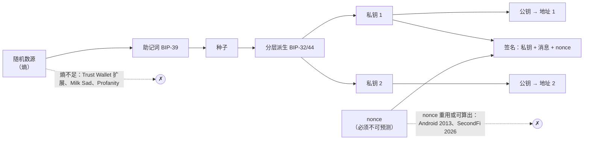

# 02 密码学基础与实现风险：私钥的随机性从哪里来

> 学习目标：读完本章，你能——
> 1. 说清椭圆曲线签名、哈希、助记词派生（BIP-32/39/44）各自保护什么、不保护什么。
> 2. 识别弱随机数、nonce 重用或可预测、靶号地址生成器三类"私钥可被算出"的缺陷。
> 3. 评估门限签名（TSS / MPC）协议实现的已知漏洞类别，并说出后量子迁移的现状。
>
> 前置章节：[01 Web3 安全全景](01-security-landscape.md)
> 相关章节：[18 钱包与密钥管理](18-wallet-key-management.md)
> 交互实验：[signature-replay-lab.html](../interactive/signature-replay-lab.html)

---

## 开场：一个 32 位种子，1.6 亿美元

2022 年 9 月，Wintermute 的金库被盗约 1.6 亿美元。它的地址由靶号工具 Profanity 生成。这个工具的随机数只有 32 位种子。

🤔 先猜再看：示例：攻击者每秒试 10 亿个种子。遍历全部 32 位种子，最多需要多久？

约 4.3 秒（2³² ≈ 43 亿，除以 10⁹）。真实攻击还要从种子算出地址，所以实际耗时更长，但一张 GPU 几分钟就够（见第 1 节）。256 位私钥强度的前提，是生成它的熵也有 256 位。

---

## 1. 一句话理解

**密码学算法几乎从不被"破解"。被攻破的是实现：私钥生成时随机数不够随机，签名时 nonce 可以被算出，门限签名库省略了一步证明。私钥的安全上限由它的生成和使用过程决定。**

熵（Entropy）：随机性的度量。一把私钥有 256 位熵，攻击者需要尝试约 2²⁵⁶ 次；只有 32 位熵，攻击者只需要约 43 亿次，一张 GPU 几分钟就够。

> 🎯 打个比方：保险柜的密码有 77 位数字，理论上没人猜得出。但如果设密码的人总是用"自己的生日 + 一串固定数字"，小偷只需要试几万个生日。
>
> 比喻的局限：小偷试生日要站在保险柜前。链上的公钥和地址全部公开，攻击者可以离线、并行、无限次地试，不会触发任何告警。

---

## 2. 密码学原语速览：各自保护什么

| 原语 | 用在哪里 | 保护什么 | **不**保护什么 |
|---|---|---|---|
| ECDSA（secp256k1） | 以太坊、比特币交易签名 | 没有私钥的人不能伪造签名 | 私钥生成质量；nonce 质量；签名内容是否被用户看懂 |
| EdDSA（Ed25519） | Solana、Cardano 等 | 同上；nonce 按标准确定性派生 | 实现偏离标准时，nonce 可能被算出 |
| BLS | 以太坊共识层签名聚合 | 多个签名合并为一个 | 密钥管理；罚没风险（见 [17 章](17-node-rpc-infrastructure.md)） |
| Keccak-256 / SHA-256 | 地址、交易哈希、Merkle 树 | 数据没有被改动 | 数据本身是否正确 |
| BIP-39 | 助记词 ↔ 种子 | 人能抄写和恢复 | 助记词生成时的熵 |
| BIP-32 / 44 | 从一个种子派生一组地址 | 一个备份恢复全部地址 | 一个种子泄露 = 全部地址泄露 |

**读图要点：**

- 整条链路有两处需要随机性：生成私钥时的熵，签名时的 nonce。任何一处出错，私钥都能被算出。
- 从种子往下的派生是确定性的。种子安全，所有地址安全；种子泄露，所有地址一起泄露。
- 局限：图里没有画"签名内容"。签名算法正确，用户签了攻击者的交易，见 [19 章](19-user-scams.md)。

---

## 3. 攻击路径

### 3.1 熵不足：私钥空间被缩小

1. 生成器用了一个状态很小的伪随机数生成器（PRNG），例如只用 32 位种子初始化的 mt19937。
2. 32 位种子只有约 43 亿种可能，所以生成器只能产出约 43 亿种私钥。
3. 攻击者在 GPU 上枚举全部种子，算出每个种子对应的地址。
4. 攻击者把结果与链上有余额的地址比对，命中后直接转走资产。

> ⚠️ 警告：PRNG 输出"看起来随机"不等于安全。私钥必须来自操作系统或硬件提供的密码学安全随机数生成器（CSPRNG），并且是完整的 256 位熵。

### 3.2 ECDSA nonce：一次签名泄露私钥

ECDSA 每次签名都需要一个一次性随机数 k（nonce）。

| 情况 | 后果 |
|---|---|
| 两次签名用了同一个 k | 用两个签名可以直接解出私钥 |
| k 有偏置（例如高几位总是 0） | 收集足够多签名后，用格方法恢复私钥 |
| k 可以由公开数据算出 | **单个签名**就能反推私钥 |

> 💡 注意：RFC 6979 用私钥和消息确定性地派生 k，可以消除前两种风险。EdDSA 标准也要求 nonce 由私钥的秘密部分派生。风险来自"偏离标准"的实现。

🤔 先猜再看：两笔 ECDSA 签名使用了同一个 k，签的是不同消息。攻击者还需要什么才能算出私钥？

不需要别的。两个签名和两个消息哈希都公开，直接解方程就能得到 k 和私钥。

> 🧪 动手验证：打开[签名与重放实验](../interactive/signature-replay-lab.html)，点"签名并首次领取"，再点"提交翻转后的签名 (r, n − s)"。记录结果，并说明它和 nonce 重用的区别：翻转签名不泄露私钥。

### 3.3 靶号地址生成器

靶号地址（Vanity Address）：首尾字符符合指定模式的地址，例如 `0x0000…`。生成器需要海量尝试，有些工具为了速度牺牲了随机性。Profanity 只用 32 位种子，私钥可以从公开的地址反推（见 5.1 节）。

### 3.4 门限签名（TSS / MPC）实现漏洞

MPC 门限签名的安全性依赖协议里的每一步零知识证明。实现者为了性能或简化，省略或弱化某个证明，恶意参与方就能在多次签名中逐步提取其他人的密钥分片。

| 漏洞类别 | 机制 | 公开披露 |
|---|---|---|
| 缺少参数证明 | 没有证明 Paillier 公钥不含小素因子 | BitForge（GG18 / GG20） |
| 迭代次数被减少 | 证明的重复次数从 128 降到 1，可以猜中 | TSSHOCK c-guess |
| 哈希编码有歧义 | Fiat-Shamir 哈希的输入编码可被重组 | TSSHOCK α-shuffle |
| 实现偏离论文 | 签名失败的处理方式不对，可反复试探 | BitForge（Lindell17） |

### 3.5 后量子：现在需要关心什么

- 足够大的量子计算机可以从公钥算出 ECDSA 和 EdDSA 私钥。哈希函数受影响较小。
- 公钥只在地址第一次签名后暴露（比特币 P2PKH 等）。从未签过名的地址比已签名的地址更安全。
- 迁移需要整条链升级签名方案，周期以年计。现在要做的是：盘点资产，避免地址重复使用，跟踪各链的迁移计划。

---

## 4. 防御方法

| 层面 | 措施 |
|---|---|
| 生成 | 使用 CSPRNG 或硬件随机源；完整 256 位熵；不在 WASM、浏览器 JS 中自行替换随机源 |
| 签名 | 使用 RFC 6979 或标准 EdDSA；用已知答案测试（KAT）和差分测试验证封装层 |
| 监控 | 扫描自家地址的签名，检测重复的 r 值 |
| 靶号 | 不用靶号工具生成任何管理员或金库地址 |
| MPC 库 | 逐项审计零知识证明、迭代次数、哈希编码；订阅上游安全公告并及时升级 |
| 修复后 | 生成缺陷修复后，**强制**用户迁移到新地址；修代码不能修好已经生成的弱私钥 |
| 后量子 | 资产清单标注公钥是否已暴露；跟踪 NIST 标准和各链迁移进度 |

---

## 5. 真实案例

> 💡 注意：以下每个案例只写摘要和教训。金额为事发时美元估值。

### 5.1 Profanity 与 Wintermute（2022 年 9 月，以太坊）

- Profanity 1.60 及以前的版本只用一个 32 位种子初始化随机数，种子空间约 43 亿（CVE-2022-40769）。攻击者拿到公钥后，可以用 GPU 逆推私钥。
- 1inch 于 2022 年 9 月 15 日公开披露。5 天后，Wintermute 的金库被盗约 1.6 亿美元。同期还有 Indexed Finance、QANplatform 等多个受害者。
- 教训：私钥熵必须满 256 位。见 [18 章](18-wallet-key-management.md) 5.2 节的运营教训。
- 来源：[1inch 披露](https://blog.1inch.com/a-vulnerability-disclosed-in-profanity-an-ethereum-vanity-address-tool)、[NVD](https://nvd.nist.gov/vuln/detail/CVE-2022-40769)、[Amber Group 复现](https://medium.com/amber-group/exploiting-the-profanity-flaw-e986576de7ab)、[资损 101](../../web3-loss-101/index.html#c-wintermute)

### 5.2 Trust Wallet 浏览器扩展（2022 年 11 月，2023 年 4 月公开）

- Wallet Core 的 WASM 版本用 mt19937 生成助记词，只用 32 位种子，熵从 256 位降到 32 位。受影响的是 2022 年 11 月 14 日至 23 日期间新建的扩展钱包。
- Ledger Donjon 于 11 月 17 日报告，11 月 21 日修复。部分弱钱包后来被盗，损失约 17 万美元。Trust Wallet 承诺补偿。
- 教训：在 WASM 或 JS 环境里替换随机源要单独审计。修复后必须让用户迁移旧钱包。
- 来源：[Ledger 披露](https://www.ledger.com/blog/Funds-of-every-wallet-created-with-the-Trust-Wallet-browser-extension-could-have-been-stolen)、[The Block](https://www.theblock.co/post/227730/trust-wallet-vulnerability-fix)

### 5.3 Libbitcoin Explorer "Milk Sad"（2023 年 7 月，BTC 等）

- `bx seed` 命令用 mt19937 生成种子，种子是 32 位时间值（CVE-2023-39910）。攻击者遍历全部种子，与链上地址比对。2023 年 7 月 12 日发生集中盗取，损失至少约 90 万美元。
- 厂商认为文档早已警告不要用 `bx seed` 生成真实密钥。研究者指出，类似问题也出现在 Cake Wallet 早期版本中。
- 教训：文档里的警告挡不住误用。生成密钥的接口必须默认安全。
- 来源：[Milk Sad 技术报告](https://milksad.info/disclosure.html)、[NVD](https://nvd.nist.gov/vuln/detail/CVE-2023-39910)

### 5.4 nonce 的三个案例（2013–2026）

- **Android SecureRandom（2013 年 8 月）**：Android 的随机数缺陷让不同签名使用了相同的 nonce，攻击者直接算出私钥。多款比特币钱包受影响。来源：[bitcoin.org 公告](https://bitcoin.org/android)、[The Hacker News](https://thehackernews.com/2013/08/hacking-bitcoin-android-vulnerability-digital-wallets.html)。
- **"Biased Nonce Sense"（2019 年）**：研究者用格方法分析链上签名中有偏置的 nonce，恢复出数百个比特币私钥和数十个以太坊私钥。RFC 6979 可以完全防住这类攻击。来源：[论文](https://eprint.iacr.org/2019/023.pdf)。
- **SecondFi（2026 年 6 月，Cardano）**：钱包 Android 版的 Ed25519 签名器用公开交易数据派生 nonce，漏掉了秘密部分。nonce 人人可算，单个签名就能反推私钥。374 个钱包被盗约 1,600 万 ADA（约 240 万美元，官方口径；SlowMist 估计更高）。硬件钱包签名走另一条路径，不受影响。来源：[rekt.news](https://rekt.news/secondfi-rekt)、[Halborn](https://www.halborn.com/blog/post/explained-the-secondfi-hack-june-2026)。
- 教训：nonce 必须确定性派生，并包含私钥的秘密材料。封装层要做已知答案测试，不能只信任底层库。

### 5.5 MPC 实现漏洞：BitForge 与 TSSHOCK（2023 年 8 月）

- **BitForge（Fireblocks）**：GG18 / GG20 的实现缺少参数证明，恶意参与方可以提取完整私钥；Lindell17 的实现偏离论文，约 200 次签名请求可提取私钥。影响 15 家以上钱包服务商。来源：[Fireblocks](https://www.fireblocks.com/blog/bitforge-fireblocks-researchers-uncover-vulnerabilities-in-over-15-major-wallet-providers)、[技术报告](https://www.fireblocks.com/blog/gg18-and-gg20-paillier-key-vulnerability-technical-report)。
- **TSSHOCK（Verichains，Black Hat 2023）**：三类攻击，影响 BNB tss-lib、Multichain、THORChain、Axelar 等多个开源库。来源：[Verichains](https://verichains.io/tsshock/)。
- 两项披露都没有报告实际资金损失。
- 教训：MPC 库不能"按论文简化"。选择 MPC 供应商时，要问它是否修复了这两类漏洞，并要求审计报告。

### 5.6 后量子迁移现状（截至 2026 年 11 月）

| 项目 | 状态 | 来源 |
|---|---|---|
| NIST 标准 | 2024 年 8 月发布 FIPS 203（ML-KEM）、204（ML-DSA）、205（SLH-DSA） | [NIST](https://csrc.nist.gov/news/2024/postquantum-cryptography-fips-approved) |
| 比特币 | BIP-360（P2MR）仍是草案，去掉 Taproot 的公钥路径，不含后量子签名；主网未激活 | [BIP-360](https://github.com/bitcoin/bips/blob/master/bip-0360.mediawiki) |
| 以太坊 | 以太坊基金会 2026 年成立后量子团队，规划共识层转向哈希签名，目标约 2029 年完成核心基础设施（规划，非承诺） | [ethereum.org](https://ethereum.org/roadmap/security/quantum-resistance/)、[CoinDesk](https://www.coindesk.com/tech/2026/03/25/ethereum-foundation-prepares-for-quantum-threat-with-new-cryptography-roadmap) |

---

## 6. 审计检查点

- [ ] **CRY-1** 私钥和助记词由 CSPRNG 或硬件随机源生成，熵为 256 位；代码中没有 `Math.random`、mt19937、时间戳种子。
- [ ] **CRY-2** 签名使用 RFC 6979 或标准 EdDSA；封装层有已知答案测试。
- [ ] **CRY-3** 有对自家地址的重复 r 值监控。
- [ ] **CRY-4** 没有靶号生成器生成的管理员或金库地址。
- [ ] **CRY-5** MPC 库已修复 BitForge 和 TSSHOCK 公开的漏洞类别，并有审计报告。
- [ ] **CRY-6** 订阅了所用密码学库的安全公告。
- [ ] **CRY-7** 生成缺陷修复后，有强制迁移旧地址的流程。
- [ ] **CRY-8** 资产清单标注了哪些地址的公钥已经暴露。

**把检查结果写进报告：**

| 检查项 | 发现时的证据 | 常见定级（用 [A02](../assessment/A02-risk-rating-reporting.md) 复核） | 练习位置 |
|---|---|---|---|
| CRY-1、CRY-2、CRY-4 | 随机源代码位置、已知答案测试结果 | Critical | [18 章](18-wallet-key-management.md) |
| CRY-3、CRY-8 | 监控规则、地址清单 | Medium | [A06](../assessment/A06-operational-key-security.md) |
| CRY-5、CRY-6 | 库版本、修复证明、审计报告 | Critical / High | [A03](../assessment/A03-exchange-contracts-wallets.md) |
| CRY-7 | 迁移流程和演练记录 | High | [T06](../templates/T06-ops-security-self-check.md) |

发现按 [T03 报告模板](../templates/T03-finding-report.md) 记录。

---

## 7. 用户侧防护

1. 只用主流钱包生成助记词。不用网页、在线工具或命令行小工具生成真实资金的助记词。
2. 不用靶号工具生成存放资产的地址。
3. 钱包厂商公告"随机数缺陷"或"建议迁移"时，立刻把资产转到新钱包生成的新地址。
4. 硬件钱包和软件钱包使用不同的助记词。
5. 长期持有的资产，尽量放在没有对外签过名的地址里。

---

## 8. 术语表

| 术语 | 英文 | 定义 |
|---|---|---|
| 熵 | Entropy | 随机性的度量，单位为位 |
| 密码学安全随机数生成器 | CSPRNG | 输出不可预测、适合生成密钥的随机数生成器 |
| 伪随机数生成器 | PRNG | 由种子确定输出的生成器；种子空间小则不安全 |
| nonce | Nonce (k) | ECDSA / EdDSA 签名中每次使用的一次性数值 |
| 确定性 nonce | RFC 6979 | 由私钥和消息派生 nonce 的标准方法 |
| 分层确定性钱包 | HD Wallet（BIP-32） | 从一个种子派生多把私钥的钱包结构 |
| 靶号地址 | Vanity Address | 首尾字符符合指定模式的地址 |
| 门限签名 | TSS / MPC | 多方各持分片、合作产生签名的方案 |
| 后量子密码 | Post-Quantum Cryptography | 能抵抗量子计算机攻击的密码算法 |

---

> 🪞 反思：想一想你现在用的一把私钥。
> 1. 它是在什么设备、什么软件里生成的？
> 2. 你能确认它的熵来自 CSPRNG 吗？确认的依据是什么？
> 3. 如果生成它的软件明天发布"随机数缺陷"公告，你多久能迁移完？

## 9. 思考题

1. 一个钱包用 `Date.now()` 作为种子生成助记词。如果攻击者知道钱包是在某一天创建的，他需要尝试多少次？
2. 为什么修复了随机数缺陷之后，还必须让用户迁移旧钱包？
3. 你的交易所准备采购一家 MPC 供应商。根据第 3.4 节，你会在尽调问卷里加入哪三个问题？

下一章：[03 EVM 与 Solidity 基础](03-evm-solidity-basics.md) —— 先看懂这台机器。
