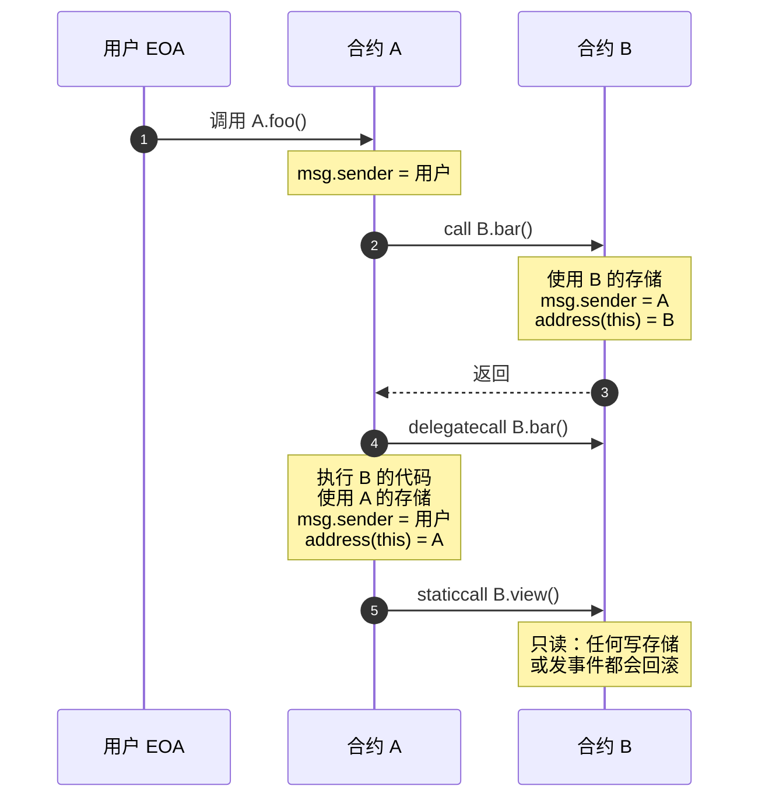

# 03 EVM 与 Solidity 安全基础：先看懂这台机器

> 学习目标：读完本章，你能——
> 1. 区分 `msg.sender`、`tx.origin`、`address(this)`，并说清 `call`、`delegatecall`、`staticcall` 的差别。
> 2. 画出一个合约的存储槽布局，包括变量打包、映射和动态数组的位置。
> 3. 说出 Solidity 中最容易误解的 8 个语言特性及其安全影响。
>
> 前置章节：[01 合约安全全景](01-security-landscape.md)
> 交互实验：[storage-proxy-lab.html](../interactive/storage-proxy-lab.html)
>
> 最后核对：2026-11-09

---

## 开场：一笔转账为什么走到了 owner 头上

示例场景：管理员的钱包访问了一个钓鱼页面，调用了攻击者的合约。攻击者的合约随后调用你的金库。金库用 `tx.origin` 检查权限。

<details class="predict"><summary>🤔 先猜再看：金库函数写着 `require(tx.origin == owner)`。这次调用能通过吗？</summary>

能。`tx.origin` 是发起整笔交易的 EOA，也就是被骗的管理员。中间经过多少个合约都不改变它。第 2.2 节解释四个调用上下文变量。

</details>

---

## 1. 一句话理解

**EVM 是一台单线程的栈式计算机。每个合约有自己的代码和存储；合约之间靠"消息调用"通信；每次调用都可能把控制权交给别人。**

以太坊虚拟机（EVM, Ethereum Virtual Machine）：执行合约字节码的虚拟机。BNB Chain 和 Mantle 直接使用 EVM；TRON 使用兼容 EVM 的 TVM（差异见 [C02](../chains/C02-tron.md)）。

> 🎯 打个比方：EVM 像一个**只有一个窗口的政务大厅**。
>
> - 每个合约是一个科室。科室有自己的档案柜（storage）和办事规程（code）。
> - 科室 A 要找科室 B 办事，就派人带着材料（calldata）去 B 的窗口（call）。B 处理完再回来。
> - `delegatecall` 是另一种方式：A 把 B 的**规程手册借过来**，在 **A 自己的档案柜**上按 B 的规程操作。如果 B 的手册写着"把第 0 号抽屉清空"，被清空的是 A 的第 0 号抽屉。
>
> 比喻的局限：真实的大厅里，你离开窗口后就不能插队回来。EVM 里，科室 B 办事中途可以**反过来再找 A**，此时 A 的上一件事还没办完。这就是重入。

---

## 2. 账户、交易与调用上下文

### 2.1 两类账户

| 账户 | 英文 | 有无代码 | 能否主动发起交易 | 控制者 |
|---|---|---|---|---|
| 外部账户 | EOA | 无（EIP-7702 委托后可以有） | 能 | 私钥 |
| 合约账户 | Contract Account | 有 | 不能，只能被调用 | 代码 |

> 💡 注意：EIP-7702（以太坊 Pectra 升级，2025 年 5 月上线）允许 EOA 委托执行一段合约代码。因此 `extcodesize(addr) == 0` 和 `msg.sender == tx.origin` 都**不能**再作为"调用者是普通用户"的可靠判断。

### 2.2 调用上下文中的四个变量

| 变量 | 含义 | 在 A → B → C 调用链中，C 看到的值 |
|---|---|---|
| `tx.origin` | 发起整笔交易的 EOA | 用户 EOA |
| `msg.sender` | 直接调用当前函数的地址 | B |
| `msg.value` | 本次调用附带的原生币数量 | B 转给 C 的数量 |
| `address(this)` | 当前执行代码的合约地址 | C |

> ⚠️ 警告：不要用 `tx.origin` 做权限判断。如果 owner 被骗去调用一个恶意合约，恶意合约再调用你的合约，`tx.origin` 仍然是 owner。详见 [05 章](05-access-control.md)。

### 2.3 三种调用方式



**读图要点：**

- `call`：执行 B 的代码，修改 B 的存储。最常见。
- `delegatecall`：执行 B 的代码，修改 **A** 的存储，`msg.sender` 和 `msg.value` 保持不变。代理合约（Proxy）和库合约依赖它。
- `staticcall`：只读调用。`view` 函数被外部调用时使用。
- 局限：低级 `call` 失败时**不会自动回滚**调用者，只返回 `false`。忘记检查返回值是 [07 章](07-external-calls-tokens.md) 的主题。

去 [storage-proxy-lab.html](../interactive/storage-proxy-lab.html) 的"call vs delegatecall"小节，逐步观察四个变量的变化。

---

## 3. 存储布局：漏洞的藏身处

### 3.1 槽位规则

存储（Storage）：每个合约持有的一个巨大键值表，键和值都是 32 字节。键叫"槽位"（slot）。

1. 状态变量按声明顺序从 slot 0 开始分配。
2. 如果相邻变量合计不超过 32 字节，编译器把它们**打包**进同一个槽。
3. `mapping(k => v)` 本身占一个槽 p（内容为空）。元素 `m[k]` 位于 `keccak256(abi.encode(k, p))`。
4. 动态数组占一个槽 p，存长度。元素 `a[i]` 位于 `keccak256(p) + i`。
5. 常量（`constant`）和不可变量（`immutable`）不占存储槽。

```solidity
// 状态变量按声明顺序从 slot 0 依次排布，每槽 32 字节
contract Layout {
    address owner;        // slot 0：20 字节
    bool    paused;       // slot 0：1 字节，与 owner 打包
    // slot 1：12 字节，slot 0 已放不下（20+1+12 = 33 > 32）
    uint96  fee;
    uint256 total;        // slot 2
    mapping(address => uint256) bal; // slot 3（内容在哈希位置）
}
```

> 💡 注意：`fee` 放不进 slot 0，所以它从 slot 1 开始，`total` 在 slot 2。打包规则按"剩余空间能否放下"判断。如果把 `fee` 改成 `uint88`（11 字节），三个变量正好 32 字节，全部挤进 slot 0。

<details class="predict"><summary>🤔 先猜再看：把上面的 `uint96 fee` 改成 `uint88`，`total` 会落在哪个槽？</summary>

slot 1。`owner`、`paused`、`fee` 合计 20 + 1 + 11 = 32 字节，全部进入 slot 0，`total` 顺延到 slot 1。这种变动在代理升级时会让后面的变量全部错位。

</details>

> 🧪 动手验证：打开[存储布局实验](../interactive/storage-proxy-lab.html)第 3 节，载入"03 章示例"，再载入"03 章变体"。记录 `total` 所在的槽位变化。

### 3.2 存储布局为什么是安全问题

| 场景 | 风险 | 章节 |
|---|---|---|
| 代理合约与实现合约的变量顺序不一致 | 实现合约写 `owner`，实际改写了代理的 `implementation` | [10](10-upgradeable-proxy.md) |
| 升级时在中间插入新变量 | 后面的变量全部错位，余额被当成地址读取 | [10](10-upgradeable-proxy.md) |
| `private` 变量存放密码或种子 | 任何人用 `eth_getStorageAt` 都能读出 | 本章 4 节 |
| 用 `delegatecall` 调用不受信任的合约 | 对方代码可以改写你的任何槽位，甚至自毁 | [05](05-access-control.md) |

EIP-1967 为代理定义了固定的"随机"槽位，避免和实现合约冲突。例如实现地址槽：

```
bytes32(uint256(keccak256("eip1967.proxy.implementation")) - 1)
= 0x360894a13ba1a3210667c828492db98dca3e2076cc3735a920a3ca505d382bbc
```

---

## 4. 最容易误解的 8 个语言特性

| # | 特性 | 常见误解 | 事实 | 安全影响 |
|---|---|---|---|---|
| 1 | `private` | 别人看不到 | 只限制其他合约**调用**，存储完全公开 | 不能存秘密 |
| 2 | `receive` / `fallback` | 转账只是改余额 | 向合约转 ETH 会执行它的代码 | 重入入口 |
| 3 | `selfdestruct` | 可以删除合约 | EIP-6780（2024 年 Cancun）后，只有同一交易内创建的合约才会被删除；其他情况只转走余额 | 强制转入 ETH 仍可发生 |
| 4 | 合约余额 | 只能通过我的函数增加 | 任何人可强制转入（`selfdestruct`、出块奖励地址、直接转代币） | 用 `address(this).balance` 记账会被"捐赠"操纵 |
| 5 | 检查型算术 | 0.8 以后不会出错 | 溢出会回滚，但 `unchecked {}` 块、类型转换（`uint8(x)`）、除法截断不会报错 | [06 章](06-arithmetic-precision.md) |
| 6 | `block.timestamp` | 精确时间 | 出块者可在小范围内调整；L2 由排序器决定 | 不能做随机数，不能做秒级判断 |
| 7 | `block.number` | 每块固定时间 | BSC 已从 3 秒缩短到 0.45 秒（2026 年 1 月 Fermi）；L2 的语义因链而异 | 用区块数计算利息或锁定期会出错（[C01](../chains/C01-bnb-chain.md)、[C03](../chains/C03-mantle.md)） |
| 8 | 函数选择器 | 函数名唯一 | 选择器只有 4 字节，不同签名可能碰撞 | 2021 年 Poly Network 事故的关键一步（[12 章](12-cross-chain-bridges.md)） |

### 4.1 审计时还要留意的语法点

| 语法点 | 事实 | 安全影响 |
|---|---|---|
| `storage` 与 `memory` | `Struct storage s` 是引用，修改会写回。`Struct memory s` 是副本，修改不写回 | 写错位置时，余额或标志位没有更新，资金可被重复领取 |
| `msg.value` 与循环 | 一次调用内，`msg.value` 的值不变 | 如果 `multicall` 用 `delegatecall` 循环调用读取 `msg.value` 的函数，一份 ETH 被记账多次 |
| `try/catch` | 目标没有代码或返回数据解码失败时，错误发生在调用方，`catch` 接不住 | 依赖 `catch` 兜底的流程仍会回滚 |
| 多重继承 | Solidity 按 C3 线性化决定 `super` 的调用顺序 | 继承顺序写错时，父合约的修饰器或初始化不按预期执行 |
| `immutable` | 值写在实现合约的字节码里 | 代理模式下，该值随实现合约变化，不在代理存储里（[10 章](10-upgradeable-proxy.md)） |
| `selfdestruct` 的跨链差异 | EIP-6780 只在已启用该规则的链上生效 | 审计时要确认目标链的版本 |

---

## 5. Gas、回滚与错误处理

1. 每条指令消耗 gas。gas 用完，当前调用帧回滚。
2. `require(cond, "msg")` 和自定义错误 `revert Err()` 回滚当前调用，并向上冒泡。
3. 低级 `call` 失败**不冒泡**，只返回 `(false, returndata)`。
4. `try/catch` 只能捕获外部调用的失败，不能捕获本合约内部的失败。
5. 外部调用最多转发 63/64 的剩余 gas（EIP-150）。被调用方耗尽 gas 时，调用方还有 1/64 可以收尾。

> ⚠️ 警告：`transfer()` 和 `send()` 只转发 2300 gas。它们曾被当作防重入手段。gas 价格调整（例如 EIP-1884、EIP-2929）后，这种写法会让接收方是合约钱包时转账失败。现在的推荐做法是：用 `call` 转账，并用 CEI 或重入锁防重入（[04 章](04-reentrancy.md)）。

> 💡 注意：gas 规则还在变。Fusaka 和尚未上线的 Glamsterdam 都会打破"固定 gas 够用"这类假设。详见 [C00](../chains/C00-ethereum.md) 2.1、2.3 节。

---

## 6. 编译器与版本

| 版本区间 | 关键变化 | 安全含义 |
|---|---|---|
| < 0.8.0 | 算术默认不检查溢出 | 必须使用 SafeMath |
| ≥ 0.8.0 | 算术默认检查，溢出回滚 | `unchecked` 块内仍会回绕 |
| ≥ 0.8.24 | 支持 `transient` 存储（EIP-1153 的 TSTORE/TLOAD） | 可以实现低成本重入锁；跨链部署要确认目标链支持（TRON 需相应硬分叉开关，见 [C02](../chains/C02-tron.md)） |

> 💡 注意：编译器本身也会有 bug。锁定编译器版本，并关注编译器的已知 bug 列表。案例见 [04 章](04-reentrancy.md) 5.2 节的 Curve / Vyper 事故。

> 💡 注意：栈、内存、存储和字节码的深入讲解见 [B45 深入 EVM](../bootcamp/B45-yul-opcodes.md)。

---

## 7. 术语表

| 术语 | 英文 | 定义 |
|---|---|---|
| 存储槽 | Storage Slot | 合约存储中 32 字节的键位 |
| 调用数据 | Calldata | 调用合约时传入的只读输入字节 |
| 函数选择器 | Function Selector | `keccak256(函数签名)` 的前 4 字节 |
| 委托调用 | delegatecall | 用调用者的存储执行被调用者的代码 |
| 静态调用 | staticcall | 禁止修改状态的调用 |
| 回滚 | Revert | 撤销当前调用帧的全部状态修改 |
| 瞬态存储 | Transient Storage | 只在当前交易内有效的存储，交易结束自动清零 |

---

> 🪞 反思：打开你最近读过的一个合约。
> 1. 它的权限检查依赖 `msg.sender` 还是 `tx.origin`？
> 2. 它有没有 `delegatecall`？目标地址由谁决定？
> 3. 你能不看工具，写出它前三个存储槽的内容吗？

## 8. 思考题

1. 合约 A 用 `delegatecall` 调用库合约 L。L 里有一句 `owner = msg.sender;`。执行后，哪个合约的哪个槽位被改了？`msg.sender` 是谁？
2. 一个合约用 `require(address(this).balance == totalDeposits)` 做安全检查。攻击者能让它永久失败吗？怎样做？
3. 打开 [storage-proxy-lab.html](../interactive/storage-proxy-lab.html)，选择"在前面插入变量"的升级方案。哪个变量被覆盖了？旧值被解释成了什么？

下一章：[04 重入攻击](04-reentrancy.md) —— 最古老、也最常复发的合约漏洞。
