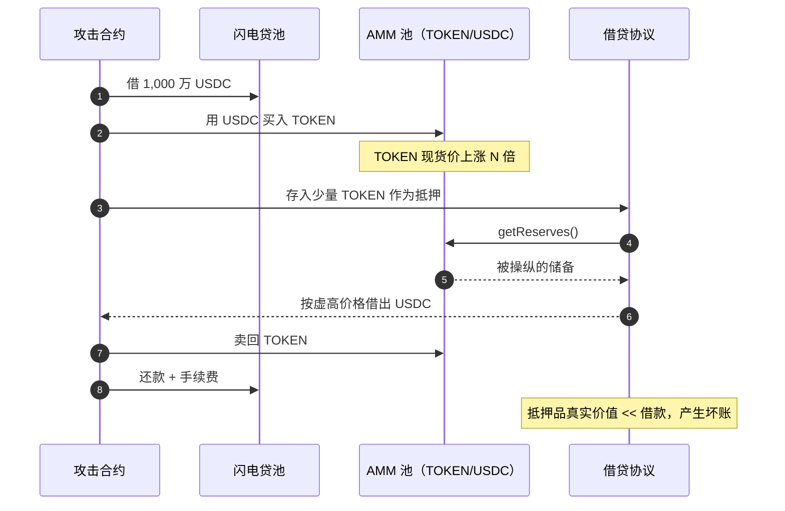

# 08 预言机与闪电贷：一笔交易就能改写的价格

> 学习目标：读完本章，你能——
> 1. 解释闪电贷为什么让"本金"不再是攻击门槛。
> 2. 比较 AMM 现货价、TWAP、链下聚合预言机三类价格源的抗操纵能力。
> 3. 写出安全读取 Chainlink 类预言机的检查清单，包括 L2 排序器状态检查。
>
> 前置章节：[06 算术与精度](06-arithmetic-precision.md)
> 交互实验：[oracle-manipulation-lab.html](../interactive/oracle-manipulation-lab.html) ｜ 示例合约：[practice-example-code/04-SpotOracle.sol](../../practice-example-code/04-SpotOracle.sol)

> 最后核对：2026-11-09

---

## 开场：价格是新的，也是错的

2026 年 2 月 15 日，Moonwell 在 Base 上执行治理提案 MIP-X43 后，cbETH 的美元价格只用了 cbETH/ETH 汇率。合约把约 2,200 美元的 cbETH 报成约 1.12 美元。清算机器人清算了 1,096.317 枚 cbETH，协议留下约 178 万美元坏账（[The Block](https://www.theblock.co/post/390302/defi-lending-protocol-moonwell-hit-with-1-8-million-bad-debt-after-oracle-misconfiguration)）。

<details class="predict"><summary>🤔 先猜再看：这个价格大于 0，并且刚刚更新。只检查正值和时效，能拦住这次错误吗？</summary>

不能。两项检查都会通过。要拦住这类错误，协议需要合理的价格上下限，或者与第二个价格源比较。第 5 节列出完整的读取检查。

</details>

---

## 1. 一句话理解

**如果合约用"同一笔交易里可以被改变的数据"来定价，攻击者就会先借一大笔钱改变它，再按错误的价格和合约做交易，最后把钱还回去。**

预言机（Oracle）：把链外或其他合约中的数据（通常是价格）提供给合约使用的机制。

闪电贷（Flash Loan）：借款、使用、还款都在同一笔交易里完成的贷款。如果交易结束时没有还款，整笔交易回滚，所以出借方没有风险，也不需要抵押。

> 🎯 打个比方：一家当铺按"隔壁菜市场的最新成交价"给黄金估价。
>
> 1. 你从朋友那里借来 1 亿（闪电贷）。
> 2. 你在菜市场以离谱的高价买下全部黄金（推高现货价）。
> 3. 你拿 1 克黄金去当铺，当铺按刚才的成交价估值 100 万，借给你 75 万。
> 4. 你把黄金卖回菜市场，还给朋友 1 亿。
> 5. 你净赚 75 万减去交易损耗。当铺手里只剩 1 克普通价格的黄金。
>
> 比喻的局限：现实中这些步骤需要几天。链上它们发生在**同一个区块的同一笔交易里**，没有人来得及反应。

---

## 2. 威胁模型

攻击者在一笔交易内能做到：

1. 借到几乎无限的资金（闪电贷池的全部流动性）。
2. 把任何 AMM 池子的现货价格推到任意位置（只要付得起滑点）。
3. 直接向合约转入资产，改变 `balanceOf` 类读数。
4. 把以上操作和对目标协议的调用任意组合。

因此，**任何在一笔交易内可变的读数都是攻击者的输入参数**：

| 读数 | 一笔交易内可变？ |
|---|---|
| AMM 池子储备比例 `reserve1 / reserve0` | 是 |
| Uniswap V3 `slot0.sqrtPriceX96` | 是 |
| LP 代币价格（按储备直接计算） | 是 |
| 金库份额价格 `totalAssets / totalSupply`（`totalAssets` 读余额） | 是（捐赠） |
| 代币的 `balanceOf(合约)` | 是 |
| Uniswap V2/V3 TWAP（时间加权平均价） | 当前区块影响很小；多区块持续操纵可以 |
| Chainlink 类链下聚合价格 | 否（但可能过时或触及上下限） |

---

## 3. 漏洞机制：AMM 现货价

恒定乘积 AMM（x × y = k）中：

```
现货价 P = y / x
买入 Δx 需要支付 Δy = y × Δx / (x − Δx)   （忽略手续费）
```

<details class="predict"><summary>🤔 先猜再看：池子有 1,000 ETH 和 200 万 USDC（示例，x × y = k，忽略手续费）。攻击者用 400 万 USDC 买入 ETH 后，现货价大约是多少？</summary>

大约 18,000 USDC。USDC 储备变为 600 万。ETH 储备变为 `2e9 / 6e6 ≈ 333.3`。现货价为 `6,000,000 / 333.3 ≈ 18,000`，是初始价格的 9 倍。

</details>

```solidity
// ❌ 漏洞：用 AMM 储备直接计算价格
function getPrice() public view returns (uint256) {
    // 储备量可被同一交易内的大额交换或闪电贷操纵
    (uint112 r0, uint112 r1, ) = pair.getReserves();
    return uint256(r1) * 1e18 / r0;   // 现货价：一笔交易即可推高
}
function borrow(uint256 collateralAmt) external {
    // 抵押物价值直接依赖被操纵的价格
    uint256 value = collateralAmt * getPrice() / 1e18;
    uint256 maxBorrow = value * 75 / 100;   // LTV 75%（示例）
    ...
}
```



**读图要点：**

- 攻击者的利润 = 借出金额 − 两次交换的滑点和手续费 − 闪电贷费用。
- 池子越浅，推高价格越便宜。所以长尾资产和低流动性代币风险最高。
- 局限：如果借贷协议使用 TWAP 或链下聚合价格，第 5 步读到的价格几乎不变，攻击失败。

> 🧪 动手验证：打开[闪电贷操纵预言机实验](../interactive/oracle-manipulation-lab.html)，保持"AMM 现货价"和闪电贷金额 400 万 USDC，点击"全部执行"，记录净利润和坏账。切换到"AMM TWAP（30 分钟）"，再拖动"被操纵的区块数"，记录利润转正需要的区块数。

---

## 4. 三类价格源对比

| 价格源 | 抗单笔操纵 | 抗多区块操纵 | 延迟 | 主要风险 |
|---|---|---|---|---|
| AMM 现货价 | ✗ | ✗ | 无 | 闪电贷操纵 |
| AMM TWAP | ✓ | 取决于窗口和流动性 | 窗口长度 | 低流动性池仍可被持续操纵；窗口越长价格越滞后 |
| 链下聚合（Chainlink 类） | ✓ | ✓ | 心跳 / 偏离阈值 | 价格过时、上下限熔断、预言机节点或喂价方失效 |
| 多源组合 + 偏离检查 | ✓ | ✓ | 取决于组成 | 实现复杂；源之间分歧时如何处理 |

> 💡 注意：没有完美的预言机。工程上要回答两个问题：价格错了会怎样？价格停了会怎样？

> 💡 注意：在 PoS 下，同一提议者连续出块时，TWAP 的多区块操纵成本会下降。评估 TWAP 窗口时要考虑这一点。

---

## 5. 安全读取链下预言机

```solidity
// ✅ 读取 Chainlink 类聚合器的检查清单
// roundId 用于判断轮次是否完整
(uint80 roundId, int256 answer, , uint256 updatedAt, ) = feed.latestRoundData();
require(answer > 0, "invalid price");
// 按喂价心跳设置
require(block.timestamp - updatedAt <= MAX_DELAY, "stale price");
require(uint256(answer) > MIN_BOUND && uint256(answer) < MAX_BOUND, "out of bounds");
// 不要写死 8
uint8 dec = feed.decimals();
```

### 5.1 L2 上的额外检查：排序器是否在线

在 Mantle 这样的 L2 上，交易由排序器（Sequencer）打包。排序器宕机时：

1. 喂价交易无法上链，价格停留在宕机前。
2. 恢复后的第一批区块里，普通用户和清算机器人同时涌入。能通过 L1 强制提交交易的少数人占优。

业界通用做法：读取"排序器在线状态"喂价（Chainlink 在多条 L2 上提供 Sequencer Uptime Feed）。排序器恢复后设置一段宽限期（例如 1 小时，示例），宽限期内暂停清算或新借款。[Chainlink 文档](https://docs.chain.link/data-feeds/l2-sequencer-feeds)截至 2026 年 11 月列出了 Mantle 主网的在线状态喂价。部署前要按官方文档核对喂价地址。

> 💡 注意：根据 L2BEAT 截至 2026 年 11 月的页面，Mantle 排序器宕机时，用户可以通过 L1 强制提交交易，延迟最长 12 小时。见 [C03](../chains/C03-mantle.md)。

### 5.2 熔断上下限：Venus 与 LUNA（2022 年 5 月，BNB Chain）

<details class="predict"><summary>🤔 先猜再看：喂价的 minAnswer 是 0.10 美元。LUNA 的市场价跌到 0.01 美元。喂价返回多少？抵押品被高估多少倍？</summary>

喂价返回约 0.10 美元。抵押品被高估约 10 倍。价格为正，时间戳也可能是新的，所以只检查正值和时效不够。

</details>

- 公开报道：Chainlink 的 LUNA/USD 喂价设置了最低价（minAnswer）0.10 美元。
- LUNA 崩盘到远低于 0.10 美元时，喂价停在下限附近。
- BNB Chain 上的 Venus 协议仍按约 0.1 美元给 LUNA 抵押品估值。有人在市场上低价买入 LUNA，存入 Venus 借出其他资产，协议损失约 1,100 万美元（公开报道）。
- 教训：读取价格时，检查是否触碰上下限；为抵押资产设置供应上限和紧急下架流程。

### 5.3 其他读取陷阱

- 不要用 `latestAnswer()` 判断价格是否新鲜。[Chainlink API 文档](https://docs.chain.link/data-feeds/api-reference)说明它不含时间戳，没有写入时返回 0。改用 `latestRoundData()`，它包含时间戳。
- 每个喂价的心跳不同。不要对所有资产用同一个 `MAX_DELAY` 常量。
- 喂价失效时要有降级路径。用 `try/catch` 包裹读取，切换备用价格源或暂停。不要让清算全部回滚。
- 拉取式预言机（Pull Oracle）：用户在交易中提交签名价格。提交者可以挑选对自己有利的更新，所以合约要自己检查价格时间戳和置信区间（[Pyth 文档](https://docs.pyth.network/price-feeds/best-practices)）。

### 5.4 随机数：VRF 与链上数据

可验证随机函数（VRF, Verifiable Random Function）：链下生成随机数和证明，链上验证证明后再使用。

`block.timestamp`、`blockhash`、`block.prevrandao` 不能作为随机数来源：

1. 这些值对同一区块内的所有合约相同。攻击合约可以先算出结果，再决定是否参与。
2. `blockhash(n)` 只能读最近 256 个区块。更早的区块返回 0。
3. PoS 下，提议者可以放弃出块，避开不利的 `prevrandao`。

安全方案是 VRF 或提交-揭示（[09 章](09-mev-signatures.md) 2.4 节）。使用 VRF 时检查以下几点（[Chainlink VRF 安全文档](https://docs.chain.link/vrf/v2-5/security)）：

1. `fulfillRandomWords` 不能回滚。回滚后，VRF 服务不会再次回调。
2. 发出请求后，合约不再接受会影响结果的输入。
3. 确认数 `requestConfirmations` 要按链的重组风险设置。
4. 任何一方都不能通过重新请求或取消来丢弃不利结果。

---

## 6. 真实案例：BNB Chain 上的价格操纵

BNB Chain 早期 DeFi 生态快速扩张，大量协议使用 PancakeSwap 池子价格。以下案例按机制分类，详见 [C01](../chains/C01-bnb-chain.md)。

| 时间 | 协议 | 约损失 | 被操纵的读数 |
|---|---|---|---|
| 2021-05 | PancakeBunny | 约 4,500 万美元 | 按 PancakeSwap 池储备计算 LP 代币价值，并据此铸造 BUNNY 奖励 |
| 2021-05 | Venus（XVS 事件） | 清算超过 2 亿美元，坏账超过 9,500 万美元 | 低流动性治理代币 XVS 作为抵押品，价格被快速拉升后回落（项目方称"可能"操纵） |
| 2022-05 | Venus（LUNA） | 约 1,100 万美元 | 预言机下限熔断 |

以太坊上的对照案例：

- **bZx（2020 年 2 月）**：最早被广泛报道的闪电贷价格操纵之一，两次合计约 95 万美元。
- **Cream Finance（2021 年 10 月）**：攻击者通过向 yUSD 金库"捐赠"抬高份额价格，而 Cream 用份额价格给抵押品估值，损失约 1.3 亿美元。
- **Harvest Finance（2020 年 10 月）**：金库份额价格依赖 Curve Y 池中的稳定币价格。攻击者用闪电贷反复"压价存入、抬价赎回"，取走约 3,380 万美元。
- **Inverse Finance（2022 年 4 月）**：攻击者**没有使用闪电贷**，而是投入自有资金持续推高浅池中的 INV 价格，并用垃圾交易抑制套利，使 TWAP 预言机输出虚高价格，借走约 1,560 万美元。TWAP 挡不住有资本的多区块操纵。

以上以太坊案例的完整路径见 [C00 以太坊案例深潜](../chains/C00-ethereum.md) 4.5、4.6 节。

2026 年的配置错误案例：

- **Moonwell（2026 年 2 月，Base）**：见本章开场。教训：预言机配置变更要和合约代码一样测试。上线前要用真实喂价核对输出的美元价格。

> ⚠️ 警告：LP 代币不能用 `储备 × 现货价 / 总供应` 定价。应使用"公平储备"法：用外部预言机价格和不变量 k 反推出公平储备，再计算 LP 价值。

---

## 7. 防御清单

1. 不用 AMM 现货价、`balanceOf` 或可被捐赠改变的份额价格作为关键定价依据。
2. 如果必须用 AMM 价格，使用足够长窗口的 TWAP，并评估池子深度。
3. 读取链下预言机时，检查正值、时效、上下限、精度；L2 上检查排序器状态。
4. 关键资产使用多源价格，源之间偏离超过阈值时暂停。
5. 对低流动性抵押品设置供应上限（Supply Cap）和更低的抵押率。
6. 把"一笔交易内借款 + 还款"的模式纳入监控告警（[27 章](27-audit-testing-workflow.md)）。

### 7.1 用代码验证修复

示例合约 [04-SpotOracle.sol](../../practice-example-code/04-SpotOracle.sol) 同时包含 `SpotPriceLending` 和 `FeedPriceLending`。Foundry 靶场 `practice-example-code/foundry/test/SpotOracle.t.sol` 用于对照这两个版本。

```bash
# 运行现货价预言机操纵示例的测试
cd practice-example-code/foundry && forge test --match-path test/SpotOracle.t.sol -vv  # 从 web3-security-101/ 出发
```

> 💡 注意：修复验证需要两个结果：漏洞版上操纵价格能多借，修复版上操纵不改变可借额度（[A08](../assessment/A08-reproduce-attacks.md)）。

---

## 8. 审计检查点

- [ ] **ORA-1** 列出协议使用的全部价格来源，标注"一笔交易内是否可变"。
- [ ] **ORA-2** 所有 `getReserves()`、`balanceOf(address(this))`、`totalAssets()` 的读取，是否用于定价？
- [ ] **ORA-3** LP 代币和金库份额的估值方法是否抗操纵？
- [ ] **ORA-4** 预言机读取是否检查了时效、正值、上下限、精度？
- [ ] **ORA-5** L2 部署是否检查排序器在线状态？
- [ ] **ORA-6** 没有用 `latestAnswer()` 判断新鲜度（它不含时间戳）；每个喂价使用各自的心跳阈值。
- [ ] **ORA-7** 预言机读取失败时有降级路径。
- [ ] **ORA-8** 使用 VRF 时，回调不会回滚，请求后不接受影响结果的输入。
- [ ] **ORA-9** 低流动性抵押品是否有供应上限？

**把检查结果写进报告：**

| 检查项 | 发现时的证据 | 常见定级（用 [A02](../assessment/A02-risk-rating-reporting.md) 复核） | 练习位置 |
|---|---|---|---|
| ORA-1、ORA-2、ORA-3 | 价格读取路径 + 单笔交易操纵 PoC | Critical / High | [B38 Aave V3](../bootcamp/B38-case-aave-v3.md)、[闪电贷操纵实验](../interactive/oracle-manipulation-lab.html) |
| ORA-4、ORA-6 | 缺失的检查项 + 过时或越界价格的影响 | High / Medium | [B38 Aave V3](../bootcamp/B38-case-aave-v3.md) |
| ORA-5 | 排序器宕机场景的清算路径 | High / Medium | [C03 Mantle](../chains/C03-mantle.md)、[链迁移风险检查器](../interactive/chain-porting-lab.html) |
| ORA-7 | 喂价失败时的回滚路径 | Medium，清算被阻断时升高 | [B25 MiniLend](../bootcamp/B25-capstone-minilend.md) |
| ORA-8 | 回调和请求流程 + 可影响结果的入口 | High / Medium | [B25 MiniLend](../bootcamp/B25-capstone-minilend.md) |
| ORA-9 | 抵押品深度、供应上限配置 | 取决于下游敞口 | [健康因子与利率模型](../interactive/audit-lending.html) |

发现按 [T03 报告模板](../templates/T03-finding-report.md) 记录。 评估 DeFi 协议时用 [A04](../assessment/A04-defi-protocol-review.md)。

---

## 9. 用户侧防护

普通用户看不到合约代码，但可以通过几个公开信号降低风险。

1. 使用借贷协议前，查看它用什么价格源。依赖单一 DEX 现货价的协议风险更高。
2. 低流动性代币做抵押时，价格可能被操纵，清算也可能来得很突然。保持更高的健康度。
3. 极端行情时（大幅暴跌、预言机暂停、L2 排序器宕机），先降低杠杆，不要等清算。
4. 关注协议是否有价格偏差保护和暂停机制。
5. 不要在价格异常波动的几分钟内进行大额兑换；设置合理的滑点。

---

## 10. 术语表

| 术语 | 英文 | 定义 |
|---|---|---|
| 预言机 | Oracle | 向合约提供外部数据的机制 |
| 闪电贷 | Flash Loan | 同一笔交易内借出并归还的无抵押贷款 |
| 现货价 | Spot Price | AMM 池当前储备比例决定的瞬时价格 |
| 时间加权平均价 | TWAP | 一段时间内价格按时间加权的平均值 |
| 心跳 | Heartbeat | 预言机在价格不变时也强制更新的最长间隔 |
| 抵押率 | LTV, Loan-to-Value | 借款额与抵押品价值的最大比例 |
| 坏账 | Bad Debt | 抵押品价值低于借款、无法通过清算收回的部分 |
| 排序器 | Sequencer | L2 上负责排序和打包交易的节点 |

---

> 🪞 反思：列出你的系统读取的一个外部数据，例如价格、余额或汇率。
> 1. 同一笔交易内，谁能改变这个数据？
> 2. 如果这个数据错了 1,000 倍，哪一行代码会拦住它？
> 3. 如果这个数据停止更新，用户还能做什么？

## 11. 思考题

1. 打开 [oracle-manipulation-lab.html](../interactive/oracle-manipulation-lab.html)。在"AMM 现货价"模式下，闪电贷金额多大时攻击利润最高？为什么金额再大利润反而下降？
2. 一个协议用 30 分钟 TWAP。攻击者能否通过连续多个区块买入来操纵它？需要承担什么成本和风险？
3. 你要在 Mantle 上部署一个借贷协议。除了价格本身，还需要读取哪个"状态"喂价？

下一章：[09 MEV 与签名安全](09-mev-signatures.md) —— 交易顺序和签名，都可以被别人利用。
