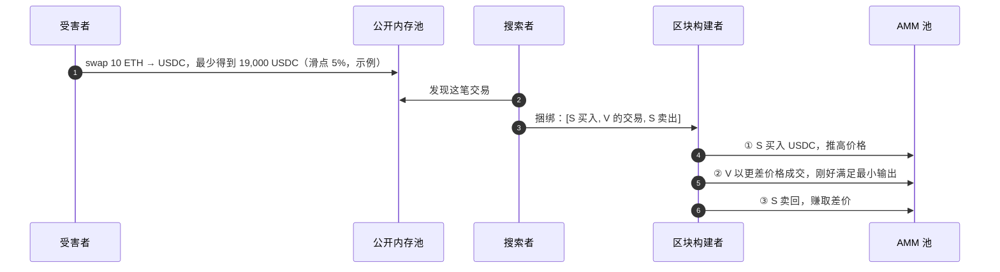
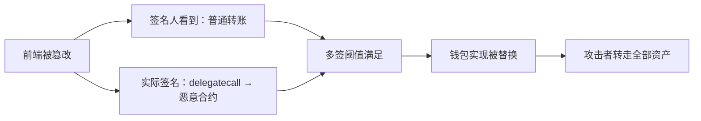

# 09 MEV 与签名安全：顺序可以被买，签名可以被重放

> 学习目标：读完本章，你能——
> 1. 解释抢跑、三明治、尾随三种 MEV，并说出用户侧和协议侧的防御。
> 2. 列出一份安全签名消息必须包含的 5 个字段，并解释缺少每个字段会被怎样重放。
> 3. 比较 BNB Chain、TRON、Mantle 三条链的交易排序机制对 MEV 的影响。
>
> 前置章节：[08 预言机与闪电贷](08-oracle-flashloan.md)
> 交互实验：[signature-replay-lab.html](../interactive/signature-replay-lab.html) ｜ 示例合约：[code/snippets/06-SignatureReplay.sol](../../code/snippets/06-SignatureReplay.sol)

> 最后核对：2026-11-09

---

## 开场：滑点设 5%，就可能真的付 5%

你在 DEX 上用 10 ETH 换 USDC。池子现价是 1 ETH = 2,000 USDC（示例）。你把滑点设成 5%，所以 `amountOutMin` 是 19,000 USDC。你的交易进入公开内存池，搜索者在打包前读到了它。

<details class="predict"><summary>🤔 先猜再看：搜索者把你的交易夹在中间。你最少收到多少 USDC？搜索者能让你收到更少吗？</summary>

你最少收到 19,000 USDC。搜索者不能让你收到更少。如果输出低于 `amountOutMin`，你的交易回滚，搜索者也赚不到钱。所以搜索者把价格推到刚好满足 19,000 USDC 的位置。下面的 2.1 节逐步解释。

</details>

---

## 1. 一句话理解

**交易在被打包之前是公开的，打包顺序由别人决定；签名在被使用之后仍然存在，能否再次使用取决于你签了什么。**

MEV（Maximal Extractable Value，最大可提取价值）：区块生产者或搜索者通过调整、插入、排除交易所能获得的额外收益。

> 🎯 打个比方：
>
> - **MEV**：你在拍卖会上举牌前，大声说出了你的最高出价。旁边的人抢先用低一点的价格买下，再加价转卖给你（三明治）。
> - **签名重放**：你签了一张"支付 100 元"的支票，没写日期、没写收款银行、没写支票编号。拿到支票的人可以复印它，去每一家银行各兑一次。
>
> 比喻的局限：拍卖会上你能看到谁插了队。链上的三明治交易和你的交易在同一个区块里，普通用户往往只看到"成交价比预期差"。

---

## 2. MEV 的三种形态

| 类型 | 顺序 | 攻击者利用什么 | 受害者 |
|---|---|---|---|
| 抢跑（Front-running） | 攻击者 → 受害者 | 受害者交易的信息（例如"先到先得"的奖励） | 原交易者 |
| 三明治（Sandwich） | 攻击者买 → 受害者买 → 攻击者卖 | 受害者设置的滑点容忍度 | 交易者 |
| 尾随（Back-running） | 受害者 → 攻击者 | 受害者交易制造的价差或清算机会 | 通常无直接受害者 |

### 2.1 三明治攻击



**读图要点：**

- 搜索者的最大利润由受害者的 `amountOutMin` 决定。滑点设得越宽，被夹得越狠。
- 受害者的交易**没有失败**。它只是以允许范围内最差的价格成交。
- 局限：如果受害者通过私有通道提交交易，搜索者在打包前看不到它。

### 2.2 防御

| 层级 | 措施 |
|---|---|
| 用户 | 设置合理滑点；使用私有交易通道（如 Flashbots Protect 一类服务） |
| 前端 | 默认滑点保守；按池子深度动态计算 |
| 合约 | 所有交换函数必须接受 `minOut` 和 `deadline` 参数；**不要在合约内部用现货价计算 `minOut`**（那等于没有保护） |
| 协议设计 | 提交-揭示（Commit-Reveal）；批量拍卖（同一批订单统一价格清算） |

> ⚠️ 警告：合约内部调用 DEX 时写 `amountOutMin = 0`，等于告诉全世界"我接受任何价格"。金库、自动复投合约、清算合约常犯这个错误。

### 2.3 三条链的排序机制

| 链 | 谁决定顺序 | 对 MEV 的影响（截至 2026 年公开资料） |
|---|---|---|
| BNB Chain | 验证者轮流出块（PoSA）；出块间隔经 Lorentz、Maxwell、Fermi 硬分叉缩短到 0.45 秒（2026 年 1 月） | 有公开内存池和区块构建者市场；出块更快，抢跑窗口更短，但三明治依然存在 |
| TRON | 27 个超级代表轮流出块 | 能量单价是超级代表投票设定的网络参数（2025 年 8 月社区提案 #789 把单价从 210 sun 降到 100 sun，[Cointelegraph](https://cointelegraph.com/news/tron-proposal-789-transaction-fees-vote)）；TRON 没有 EIP-1559 优先费（TRON 官方文档），所以不能靠"出更高 gas 价"插队；但出块者本身仍可以决定顺序 |
| Mantle | 单一中心化排序器 | 排序器按自己的规则排序。L2BEAT 列出风险："运营者可以抢跑用户交易提取 MEV"。用户依赖运营者的诚实 |

> 💡 注意："没有公开内存池"不等于"没有 MEV"。它只是把排序权从市场集中到了一个运营者手里。

### 2.4 合约层面的抢跑场景

| 场景 | 攻击 | 防御 |
|---|---|---|
| 谜题奖励：第一个提交答案的人领奖 | 机器人复制答案并提高小费 | 提交-揭示：先提交 `hash(answer, salt, sender)`，下一阶段再揭示 |
| 初始化与部署分离 | 抢先初始化（[10 章](10-upgradeable-proxy.md)） | 同一笔交易部署并初始化 |
| 预言机更新可被看见 | 在价格更新交易之前下单 | 拉取式预言机，更新与使用在同一笔交易；延迟执行 |
| 通过公共工厂用 CREATE2 部署 | 抢先在预测地址部署 | salt 中包含 `msg.sender` |
| 修改授权额度 | 先花旧额度，再花新额度（[07 章](07-external-calls-tokens.md) 第 5 节） | 先归零并核对，或相对减少 |
| 清算 | 机器人互相抢跑，属于正常竞争 | 对协议无害；要保证清算激励足够 |

> 💡 注意：提交-揭示的承诺必须绑定 `msg.sender`。否则机器人复制承诺后，也能完成揭示。

提议者-构建者分离（PBS, Proposer-Builder Separation）：搜索者把交易捆绑包交给构建者，构建者把区块卖给提议者。排序权因此可以被购买。

> 🧪 动手验证：打开[抢跑攻击模拟](../interactive/audit-frontrun.html)，不勾选"启用 commit-reveal"，点"运行"，记录谁领走奖励。再勾选"启用 commit-reveal"，记录赢家的变化。

---

## 3. 签名安全：一份签名能被用几次

链下签名在 DeFi 中很常见：`permit`（免 gas 授权）、元交易（Meta-transaction）、订单簿签名订单、跨链桥验证者签名、空投领取凭证。

### 3.1 签名必须绑定的五个字段

<details class="predict"><summary>🤔 先猜再看：一张领取凭证绑定了 nonce，但没有绑定 chainId。同一份合约以相同地址部署在以太坊和 BNB Chain。凭证在以太坊用过后，还能在 BNB Chain 领取吗？</summary>

能。两条链上的 nonce 各自计数，BNB Chain 上的 nonce 仍是 0。摘要里没有 chainId，所以两条链算出相同的摘要。

</details>

| 字段 | 缺少它会怎样 | 被重放的方式 |
|---|---|---|
| `nonce` | 同一签名可以反复提交 | 同一合约重放 |
| `chainId` | 签名在分叉链或多链部署上同样有效 | 跨链重放 |
| `verifyingContract` | 同一代码部署两次，签名在两个合约都有效 | 跨合约重放 |
| `deadline` | 签名永久有效 | 用户撤销意图后仍被使用 |
| 函数意图（typehash） | 为 A 函数签的数据被拿去调用 B 函数 | 跨函数重放 |

EIP-712 把 `name`、`version`、`chainId`、`verifyingContract` 合成"域分隔符"（Domain Separator），把消息结构合成"类型哈希"（typehash）。正确使用 EIP-712 可以一次解决后四个字段。

```solidity
// ❌ 漏洞：只签了 to 和 amount
// 无 nonce / 链 ID / 合约地址：同一签名可重放
bytes32 h = keccak256(abi.encodePacked(to, amount));
// ecrecover 失败返回 0 地址，且接受可延展的高 s 签名
address signer = ecrecover(toEthSigned(h), v, r, s);
require(signer == admin);

// ✅ 修复：EIP-712 + nonce + deadline + OpenZeppelin ECDSA
bytes32 structHash = keccak256(abi.encode(
    // nonce 递增：每个签名只能用一次
    CLAIM_TYPEHASH, to, amount, nonces[to]++, deadline));
bytes32 digest = _hashTypedDataV4(structHash);   // 含 chainId 与合约地址
address signer = ECDSA.recover(digest, sig);       // 拒绝高 s 值与零地址
// deadline 限制签名有效期
require(signer == admin && block.timestamp <= deadline);
```

> 🧪 动手验证：打开[签名与重放实验](../interactive/signature-replay-lab.html)，点"全部取消"，点"签名并首次领取"，再点"尝试全部重放"。记录 5 种重放的结果。然后只勾选 `nonce`，重新签名并重放，记录哪一种变成"已拦截"。

### 3.2 三个经典陷阱

1. **`ecrecover` 返回零地址**：签名无效时 `ecrecover` 返回 `address(0)`，不会回滚。如果 `admin` 未初始化（默认为 0），任何无效签名都能通过。
2. **签名可塑性（Malleability）**：对同一消息，`(r, s)` 和 `(r, n − s)` 都是有效签名。如果用"签名本身"作为已使用标记，攻击者翻转 s 就得到一个"新"签名。修复：用 nonce 或消息哈希做标记，并使用拒绝高 s 值的库。
3. **`abi.encodePacked` 碰撞**：`encodePacked("ab", "c")` 和 `encodePacked("a", "bc")` 结果相同。签名多个动态类型时使用 `abi.encode`。

> 🧪 动手验证：在[签名与重放实验](../interactive/signature-replay-lab.html)的"签名可塑性"卡片，保持"已使用标记 = 签名字节的哈希"，点"提交翻转后的签名 (r, n − s)"，记录结果。再选择"已使用标记 = nonce（或消息哈希）"，提交一次并比较。在"ecrecover 返回零地址"卡片，取消勾选"构造函数设置了 signer（非零）"，点"提交一个随机垃圾签名"，记录结果。

### 3.3 `permit` 的两面

- **抢跑型 DoS**：用户提交 `permitAndDeposit(签名)`。攻击者从内存池复制签名，先单独调用 `token.permit(...)`。用户的交易因 nonce 已使用而回滚。修复：把 `permit` 包在 `try/catch` 里，失败后检查授权额度是否已经足够。
- **钓鱼**：`permit` 是链下签名，不花 gas，钱包界面常常只显示一段十六进制数据。用户签下后，攻击者可以随时拿去执行。

### 3.4 TRON 上的签名差异

TRON 的 TVM 在签名上有三处与 EVM 不同：`CHAINID` 是 `728126428`，不是小整数；账户没有 nonce，交易层用 TAPOS 防重放；地址在链边界带 `0x41` 前缀。合约层的签名仍然要自己维护 nonce。验证 TRON 账户多签要用 `ValidateMultiSign` 预编译。细节见 [C02](../chains/C02-tron.md) 4.6 节。

### 3.5 合约钱包与域分隔符缓存

- 合约钱包没有私钥。合约要用 ERC-1271 的 `isValidSignature` 校验，不能只用 `ecrecover`。
- 如果域分隔符只在构造函数里缓存，链分叉后 `chainId` 改变，缓存值仍指向旧链。运行时要读取 `block.chainid`，变化时重新计算（OpenZeppelin `EIP712` 已这样实现）。

### 3.6 用代码验证修复

示例合约 [06-SignatureReplay.sol](../../code/snippets/06-SignatureReplay.sol) 同时包含漏洞版 `VulnerableClaim` 和修复版 `SafeClaim`。Foundry 靶场 `code/foundry-demos/test/SignatureReplay.t.sol` 对比这两个版本。`code/foundry-demos` 中还有 Permit2 演示。

```bash
# 运行签名重放示例的测试
cd code/foundry-demos && forge test --match-path test/SignatureReplay.t.sol -vv  # 从 web3-security-101/ 出发
```

> 💡 注意：修复验证需要"修复前失败、修复后通过"两个结果。只跑通修复版，不能证明测试真的覆盖了重放（[A08](../assessment/A08-reproduce-attacks.md)）。

---

## 4. 签名界面的安全：Bybit（2025 年 2 月）

签名再安全，签名人也可能签错东西。公开分析报告（Sygnia、Verichains 等）指出：

<details class="predict"><summary>🤔 先猜再看：签名人在被篡改的界面上看到一笔普通转账，实际签下的是 delegatecall。多签合约校验这些签名时会拒绝吗？</summary>

不会。合约只校验签名是否对应交易摘要，以及签名数量是否达到阈值。签名真实有效，只是内容不是签名人以为的内容。

</details>

1. 攻击者篡改了 Safe{Wallet} 的前端代码，只针对 Bybit 的冷钱包多签地址生效。
2. 签名人看到的是一笔正常的转账。实际签名的交易是 `delegatecall` 到攻击者合约，把多签钱包的实现合约替换成恶意合约。
3. 多签阈值满足后，攻击者转走约 40 万 ETH 及其他资产，总计约 15 亿美元（事发时估值）。FBI 把这次盗窃归因于朝鲜，并称该活动为 TraderTraitor。来源：[FBI IC3 公告](https://www.ic3.gov/PSA/2025/PSA250226)。完整复盘：[资损 101](https://claude.ai/artifact/1a5Nx6xTVLuJdCB8Esf2xj#c-bybit)。



**读图要点：**

- 多签防的是"单把私钥被盗"。它防不了"所有签名人看到同一个假界面"。
- `operation = delegatecall` 是高危信号。正常转账不需要 delegatecall。
- 防御：用硬件钱包逐字段核对交易；独立工具解码 calldata；对 delegatecall 和修改实现地址的操作设白名单或额外审批。

> 🧪 动手验证：打开[多签交易签前复核面板](../interactive/audit-safetx.html)，把 operation 从"0 · CALL"改成"1 · DELEGATECALL"。记录新增的风险标记，并比较 safeTxHash 是否改变。

同类事故并不罕见。2024 年 7 月，印度交易所 WazirX 的 4/6 多签冷钱包被盗约 2.3 亿美元：签名人在界面上看到的是日常交易，硬件钱包签下的却是升级多签的恶意数据（公开分析）。2025 年 EIP-7702 上线后，又出现了诱导用户签署"委托授权"的钓鱼方式。WazirX 见 [C00](../chains/C00-ethereum.md) 4.9 节；EIP-7702 钓鱼见 [C00](../chains/C00-ethereum.md) 第 3 节。WazirX 完整复盘：[资损 101](https://claude.ai/artifact/1a5Nx6xTVLuJdCB8Esf2xj#c-wazirx)。

> 💡 注意：这起事故中，mETH 协议的 8 小时提款延迟帮助追回了部分资产，见 [C03](../chains/C03-mantle.md) 4.1 节。

---

## 5. 审计检查点

- [ ] **MEV-1** 所有交换函数都有 `minOut` 和 `deadline` 参数，且不是在合约内部用现货价计算的。
- [ ] **MEV-2** 所有签名验证使用 EIP-712，包含 nonce、chainId、合约地址、deadline、typehash。
- [ ] **MEV-3** 使用 OpenZeppelin `ECDSA`，拒绝零地址和高 s 值。
- [ ] **MEV-4** 已使用标记基于 nonce 或消息哈希，不基于签名字节。
- [ ] **MEV-5** `permit` 调用有抢跑容错。
- [ ] **MEV-6** 需要支持合约钱包时，使用 ERC-1271 校验。
- [ ] **MEV-7** 域分隔符在 `chainId` 变化时重新计算。
- [ ] **MEV-8** 动态类型签名使用 `abi.encode`，不使用 `encodePacked`。
- [ ] **MEV-9** 部署到 TRON 时，签名工具链和合约对 chainId、地址格式的处理一致。
- [ ] **MEV-10** 特权操作的签名流程有独立的交易解码与核对步骤。

**把检查结果写进报告：**

| 检查项 | 发现时的证据 | 常见定级（用 [A02](../assessment/A02-risk-rating-reporting.md) 复核） | 练习位置 |
|---|---|---|---|
| MEV-1 | `minOut` 的计算来源 + 被夹价差的估算 | High / Medium | [B36 Uniswap V2](../bootcamp/B36-case-uniswap-v2.md)、[抢跑攻击模拟](../interactive/audit-frontrun.html) |
| MEV-2、MEV-3、MEV-4 | 同一签名第二次成功的 PoC | Critical / High | [签名与重放实验](../interactive/signature-replay-lab.html) |
| MEV-5、MEV-6 | `permit` 被抢跑后的回滚记录；合约钱包签名被拒的测试 | Medium / Low | [B40 Safe](../bootcamp/B40-case-safe.md) |
| MEV-7、MEV-8 | `chainId` 变化后的测试；编码碰撞的输入样例 | High / Medium | [签名与重放实验](../interactive/signature-replay-lab.html) |
| MEV-9 | 链下工具与合约的编码对比 | 取决于资金路径 | [C02 TRON](../chains/C02-tron.md) |
| MEV-10 | 签名流程记录 + 独立解码结果 | Critical / High | [多签交易签前复核面板](../interactive/audit-safetx.html)、[B40 Safe](../bootcamp/B40-case-safe.md) |

发现按 [T03 报告模板](../templates/T03-finding-report.md) 记录。交易所钱包的签名流程，按 [A03](../assessment/A03-exchange-contracts-wallets.md) 第 4 节评估。

---

## 6. 用户侧防护

普通用户看不到合约代码，但可以通过几个公开信号降低风险。

1. 大额兑换设置合理的滑点，不要用默认的高滑点或"自动"。
2. 大额交易可以使用私有交易通道（Private RPC），减少被三明治攻击。
3. 签名前看清签名内容：链 ID、合约地址、数额、期限。看不懂的签名不签。
4. 钱包提示"盲签"或只显示哈希时，不签。
5. 练习：打开 [phishing-signature-lab.html](../interactive/phishing-signature-lab.html)，判断 10 个签名请求。

---

## 7. 术语表

| 术语 | 英文 | 定义 |
|---|---|---|
| 最大可提取价值 | MEV | 通过控制交易顺序获得的额外收益 |
| 搜索者 | Searcher | 寻找 MEV 机会并提交交易捆绑的人或程序 |
| 三明治攻击 | Sandwich Attack | 在受害者交易前后各插入一笔交易获利 |
| 滑点容忍度 | Slippage Tolerance | 用户愿意接受的最差成交价偏离 |
| 签名重放 | Signature Replay | 把已使用的签名再次提交 |
| 域分隔符 | Domain Separator | EIP-712 中绑定链 ID 和合约地址的哈希 |
| 签名可塑性 | Signature Malleability | 同一消息存在多个有效签名 |
| 盲签 | Blind Signing | 签名人无法看懂自己所签内容 |

---

> 🪞 反思：找出你的系统里最近一个需要签名的操作。
> 1. 这份签名绑定了哪几个字段？缺了哪一个？
> 2. 如果界面被篡改，签名人靠什么发现内容不对？
> 3. 你的合约内部调用 DEX 时，`minOut` 从哪里来？

## 8. 思考题

1. 打开 [signature-replay-lab.html](../interactive/signature-replay-lab.html)，只保留 nonce 和 deadline。哪几种重放仍然成功？分别缺了哪个字段？
2. 一个自动复投金库每小时把奖励代币换成本金，`amountOutMin` 用池子当前价格乘以 99% 计算。这个保护有效吗？
3. 在 Mantle 上，用户交易不进入公开内存池。三明治攻击还可能发生吗？谁有能力发起？

下一章：[10 可升级合约与代理](10-upgradeable-proxy.md) —— 留给自己的维修门，也是留给攻击者的门。
