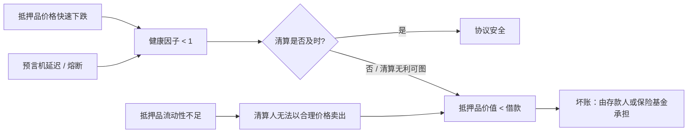
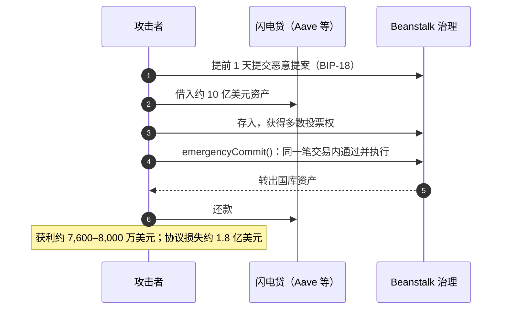
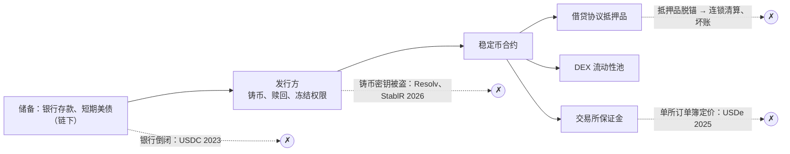

# 11 DeFi 经济安全：代码没错，规则错了

> 学习目标：读完本章，你能——
> 1. 区分"实现漏洞"和"机制漏洞"，并用不变量描述一个借贷协议的偿付能力。
> 2. 解释 Euler 和 Beanstalk 两类经济攻击的完整路径。
> 3. 为治理、清算、奖励分发三个模块写出风险参数清单。
>
> 前置章节：[06 算术与精度](06-arithmetic-precision.md)、[08 预言机与闪电贷](08-oracle-flashloan.md)
> 交互实验：[oracle-manipulation-lab.html](../interactive/oracle-manipulation-lab.html)、[incident-explorer.html](../interactive/incident-explorer.html)

> 最后核对：2026-11-09

---

## 开场：一个没有检查的捐赠函数

2023 年 3 月 13 日，Euler Finance 损失约 1.97 亿美元（事发时估值）。攻击入口是 `donateToReserves()`。这个函数减少账户的抵押品，但不检查账户是否仍然健康。来源：[Omniscia 复盘](https://medium.com/@omniscia.io/euler-finance-incident-post-mortem-1ce077c28454)、[BlockSec](https://blocksec.com/blog/euler-finance-incident-the-largest-hack-of-2023)。完整复盘：[资损 101](https://claude.ai/artifact/1a5Nx6xTVLuJdCB8Esf2xj#c-euler)。

<details class="predict"><summary>🤔 先猜再看：账户有 100 美元抵押品和 90 美元债务（示例）。账户捐出 30 美元抵押品，函数不检查健康因子。如果债务不变且没有人偿还，协议缺口是多少？</summary>

缺口是 20 美元。账户剩下 70 美元抵押品，却欠 90 美元。这 20 美元成为坏账，由存款人或保险基金承担。2.3 节说明攻击者怎样把缺口变成利润。

</details>

---

## 1. 一句话理解

**经济攻击不依赖代码 bug。攻击者严格按照协议规则操作，只是组合了设计者没想到的顺序、规模或时间。**

> 🎯 打个比方：一家超市规定"任何商品可以 7 天无理由退货，退货时按**当前**标价退款"。
>
> 规则没有 bug。但如果有人能在退货前让标价翻倍（操纵价格），或者在同一天买入、改价、退货（闪电贷），超市就会亏钱。
>
> 比喻的局限：超市可以修改规则并拒绝可疑退货。合约规则一旦部署，只能靠升级或治理修改——而治理本身也可以被攻击。

---

## 2. 借贷协议：偿付能力不变量

借贷协议的核心不变量：

```
对每个账户：  Σ(抵押品价值 × 清算阈值) ≥ Σ(借款价值)       （否则可被清算）
对整个协议：  Σ(所有资产) ≥ Σ(所有存款人的债权)             （否则资不抵债）
```

健康因子（Health Factor）：`Σ(抵押品价值 × 清算阈值) / Σ(借款价值)`。小于 1 时账户可被清算。

### 2.1 坏账从哪里来



**读图要点：**

- 坏账不一定来自攻击。市场暴跌和流动性枯竭也会产生坏账。
- 清算人是逐利的。如果清算奖励覆盖不了 gas 和滑点，就没人清算。
- 局限：这张图只画了单一抵押品。多抵押品、跨资产相关性会让风险评估复杂得多。

> 🧪 动手验证：打开[健康因子与利率模型](../interactive/audit-lending.html)，保持默认值，记录健康因子。把"ETH 价格 (USD)"拖到 2000，记录健康因子，并查看结果是否提示"产生坏账"。

### 2.2 案例：Venus XVS（2021 年 5 月，BNB Chain）

- Venus 允许用户以自己的治理代币 XVS 作为抵押品。
- XVS 价格在短时间内从约 76 美元涨到约 144 美元，抵押能力随之上升，有人借出大量 BTC 和 ETH。
- XVS 回落后，清算超过 2 亿美元，仍留下超过 9,500 万美元坏账（The Block 报道）。项目方称价格"可能"被操纵。
- 教训：**协议自己的治理代币作为抵押品，是反身性风险**。价格上涨 → 借款增加 → 卖压增加 → 价格下跌 → 坏账。低流动性抵押品必须有供应上限和更低的抵押率。

### 2.3 案例：Euler Finance（2023 年 3 月，以太坊）

Euler 的 `donateToReserves()` 允许用户把自己的存款（eToken）捐给协议储备，但**没有检查捐赠后账户的健康因子**（公开复盘）。

1. 攻击者用闪电贷借入 DAI，存入 Euler，并用 Euler 的杠杆铸造功能放大头寸。
2. 攻击者调用 `donateToReserves()` 捐出大量 eToken。账户的抵押品减少，债务（dToken）不变。账户变得严重资不抵债。
3. 攻击者用另一个账户清算这个资不抵债的账户。Euler 的清算折扣随资不抵债程度增大，清算人以极大折扣拿走抵押品。
4. 攻击者归还闪电贷，获利约 1.97 亿美元。后来攻击者归还了大部分资金。

> 💡 注意：每个函数单独审计都"正确"。漏洞在于一个新增函数（donate）改变了账户状态，却没有走所有其他函数都会走的健康检查。**任何会减少抵押品或增加债务的路径，都必须在结束时检查健康因子。**

> 🧪 动手验证：打开[入口 × 检查覆盖矩阵](../interactive/audit-hfmatrix.html)，保持初始状态，记录工具列出的缺口。勾选 `donateToReserves（分叉新增）` 行的"有 HF 校验？"，记录结论的变化。

---

## 3. 治理攻击

治理攻击（Governance Attack）：攻击者获得足够投票权，通过恶意提案，合法地转走协议资产。

### 3.1 案例：Beanstalk（2022 年 4 月，以太坊）

<details class="predict"><summary>🤔 先猜再看：投票权按当前余额计算，提案通过后可在同一笔交易内执行。闪电贷必须在同一笔交易内归还。攻击者能用借来的代币通过提案吗？</summary>

能。借款、投票、执行、还款都在同一笔交易内完成。闪电贷的归还限制没有挡住任何一步。

</details>



**读图要点：**

- 关键缺陷：投票权按**当前**存款计算，并且存在可在同一交易内执行的紧急提案通道。获利口径各方不同：CertiK 称约 7,600 万美元，Beanstalk 称约 7,700 万美元（[BIP-18](https://bean.money/bip-18)），PeckShield 估约 8,000 万美元（[Cointelegraph](https://cointelegraph.com/news/beanstalk-farms-loses-182m-in-defi-governance-exploit)）。
- 紧急执行的条件是：提案满 1 天，并获得 2/3 投票（[CertiK](https://www.certik.com/blog/revisiting-beanstalk-farms-exploit)）。攻击者提前一天提交提案。投票权没有快照。
- 修复：投票权使用过去区块的快照（例如 ERC20Votes 的 `getPastVotes`）；提案通过后经过时间锁才能执行。

> 🧪 动手验证：打开[闪电贷治理攻击与防御](../interactive/audit-governance.html)，保持默认值，记录结果。勾选"投票权按提案创建前的快照计算"，记录有效票数的变化。

### 3.2 治理防御清单

| 风险 | 防御 |
|---|---|
| 闪电贷借票 | 投票权快照在提案创建之前的区块 |
| 低投票率下被少数人通过 | 法定人数（Quorum）要求 |
| 恶意提案通过后立即执行 | 执行时间锁 + 守护者否决 |
| 提案内容难以理解 | 提案必须附带可读的 calldata 解码 |
| 治理代币集中在交易所 | 监控大额转入和委托变化 |
| 提案内容在投票期间被修改 | 提案内容锁定；修改后重新计时 |
| 紧急通道的权限不清 | 写明紧急通道由谁控制，以及它能做什么 |

---

## 4. 奖励分发与"无风险套利"

| 缺陷 | 说明 | 修复 |
|---|---|---|
| 存入即领奖 | 奖励按存款时点余额计算，闪电贷存入、领奖、取出 | 奖励随时间累积；存入后最短锁定期 |
| 奖励代币与质押代币相同 | 合约的 `balanceOf` 同时包含奖励和质押，计算份额出错 | 质押量用内部变量记录 |
| 奖励速率可被调用者影响 | 按"本区块成交量"或"池子价格"计算奖励 | 奖励参数由治理设定，不读一笔交易可变的数据 |
| 按 LP 价值铸币 | 见 [08 章](08-oracle-flashloan.md) PancakeBunny | 公平储备定价 |

---

## 5. 流动性质押与提款延迟：Mantle 的 mETH

流动性质押（Liquid Staking）：用户质押 ETH，获得可交易的凭证代币（例如 mETH）。重质押凭证（例如 cmETH）进一步叠加收益和风险。

| 设计要素 | 风险 | 好处 |
|---|---|---|
| 凭证可在 DEX 交易 | 凭证与 ETH 脱锚 | 用户无需等待即可退出 |
| 赎回有延迟队列 | 用户体验差 | 给协议留出反应时间 |
| 多层叠加（质押 → 重质押 → 再抵押） | 风险层层传导 | 收益叠加 |

2025 年 2 月 Bybit 被盗后，攻击者尝试赎回 cmETH。mETH 协议的 8 小时提款延迟让团队有时间暂停合约，追回 15,000 cmETH（约 4,300 万美元）（The Block 报道）。

> 💡 注意：**延迟是一种安全参数**，不只是体验问题。它把"攻击者完成攻击的时间"从一笔交易拉长到若干小时，让监控和人工响应有机会介入。代价是正常用户也要等待。详见 [C03](../chains/C03-mantle.md)。

---

## 6. 稳定币与 RWA：发行方是最大的"外部依赖"

稳定币（Stablecoin）和代币化现实资产（RWA，Real-World Asset）把链下资产带上链。它们的价值不取决于合约代码，而取决于**链下的储备、赎回和发行方的权限**。DeFi 协议把它们当作抵押品时，就继承了这些链下风险。

> 🎯 打个比方：稳定币像一张银行开的提货单。提货单印得再精美（合约再安全），仓库里的货不够、仓库被封、或者银行能随时作废你的提货单，它都不值一美元。
>
> 比喻的局限：提货单作废要走法律程序。发行方冻结或销毁一个地址上的代币，通常只需要一笔交易。

### 6.1 五类发行方风险

<details class="predict"><summary>🤔 先猜再看：一种稳定币的合约没有任何漏洞。发行方的一部分储备存放在一家倒闭的银行。这种稳定币的市场价格会跌破 1 美元吗？</summary>

会。稳定币的价值来自储备和赎回，不来自合约代码。2023 年 3 月，USDC 最低跌到约 0.87 美元（见 6.2 节）。

</details>

| 风险 | 机制 | 案例 |
|---|---|---|
| 储备与托管 | 储备存放的银行出问题，赎回暂停 | USDC 2023 年 3 月脱锚 |
| 设计缺陷 | 没有外部资产支撑，挤兑时进入死亡螺旋 | Terra UST 2022 年 5 月 |
| 铸币权限 | 铸币密钥被盗或多签门限过低，凭空增发 | Resolv USR、StablR（2026） |
| 链下策略 | 收益来自不透明的链下管理人，亏损后冻结提款 | Stream Finance xUSD（2025） |
| 定价来源 | 平台用自家薄订单簿给抵押品估值 | USDe 在 Binance 单所脱锚（2025） |



**读图要点：**

- 风险沿箭头向下传导：储备出问题，所有把它当抵押品的协议同时受影响。2023 年 USDC 脱锚时，以 USDC 为主要抵押的 DAI 也一起下跌。
- 发行方的冻结和销毁权限，对执法是工具（见 [25 章](25-fund-tracing-response.md)），对持有人是对手方风险。
- 局限：图里没有画监管。监管变化（例如某地区下架某个稳定币）会直接改变流动性。

### 6.2 案例

> 💡 注意：以下每个案例只写摘要和教训。金额为事发时美元估值。

- **USDC 脱锚（2023 年 3 月）**：Circle 约 33 亿美元储备存在倒闭的硅谷银行，USDC 最低约 0.87 美元，DAI 跟随跌到约 0.90 美元。监管宣布储户全额兑付后恢复。教训：托管银行集中度本身就是脱锚风险，并会通过抵押品传导。来源：[Circle 声明](https://www.circle.com/pressroom/3-3-billion-of-usdc-reserve-risk-removed-dollar-de-peg-closes)、[The Block](https://www.theblock.co/post/218993/usdc-and-dai-remain-at-about-0-90-following-circles-disclosure-of-funds-at-svb)。
- **Terra UST（2022 年 5 月）**：算法稳定币挤兑后进入死亡螺旋，约 400 亿美元市值蒸发。创始人 2025 年在美国认罪，同年 12 月被判 15 年。来源：[美国司法部](https://www.justice.gov/usao-sdny/pr/crypto-enabled-fraudster-sentenced-orchestrating-40-billion-fraud)、[Decrypt](https://decrypt.co/352066/do-kwon-sentenced-15-years-prison-40-billion-terra-crypto-collapse)。
- **USDe 单所脱锚（2025 年 10 月 10 日）**：在全市场约 190 亿美元的单日清算潮中，USDe 只在 Binance 现货跌到约 0.65 美元，链上和其他交易所基本保持在 0.90 美元以上。Binance 用自家订单簿给抵押品估值，触发了用户清算，之后赔付约 2.83 亿美元。来源：[The Block](https://www.theblock.co/amp/post/374278/binance-to-compensate-some-users-after-several-markets-depeg-there-are-no-excuses)、[21Shares 研究](https://www.21shares.com/research/why-did-ethenas-stablecoin-remain-stable-onchain-but-depegged-on-binance)。
- **Stream Finance xUSD（2025 年 11 月）**：一名外部基金管理人亏掉约 9,300 万美元用户资产，提款冻结，xUSD 大幅脱锚。借给 Stream 的 Elixir 随后停用自己的 deUSD。链上研究者统计各借贷市场对 Stream 的敞口约 2.85 亿美元。来源：[Decrypt](https://decrypt.co/347285/stream-finance-stablecoin-plunges-77-protocol-fund-manager-loses-93-million)、[Cointelegraph](https://cointelegraph.com/news/defi-sleuths-trace-284m-stream-finance-exposure)。
- **铸币权限被滥用（2025–2026）**：
  - Paxos 2025 年 10 月在内部转账中误铸约 300 万亿 PYUSD，约 20–30 分钟后销毁，无资金损失。来源：[The Block](https://www.theblock.co/post/374870/paxos-mistakenly-mints-300-trillion)。
  - Resolv 2026 年 3 月 22 日被凭空铸出约 8,000 万枚 USR，攻击者套现约 2,500 万美元，Curve 池中 USR 价格一度跌到约 0.025 美元。2026 年 4 月的项目复盘称这是针对链下基础设施的攻击。安全公司分析指出，攻击者拿到了 `SERVICE_ROLE` 铸币密钥，合约也没有校验铸币量与存入资产的比例。本手册未取得复盘原文，以上依据转述。来源：[QuillAudits](https://www.quillaudits.com/blog/hack-analysis/resolv-labs-exploit-explained)、[CertiK](https://www-cn.certik.com/skynet-report/resolv-protocol-incident-analysis)、[The Block](https://www.theblock.co/post/394582/resolvs-usr-stablecoin-depegs-after-attacker-mints-80-million-unbacked-tokens-extracts-roughly-25-million)、[Blockaid](https://blockaid.io/blog/how-a-compromised-key-minted-80m-in-resolvs-usr-stablecoin-and-triggered-a-depeg)。
  - StablR 2026 年 5 月：铸币由 1-of-3 多签控制，攻击者拿下一个签名人后替换了全部 owner，增发约 1,350 万美元的 USDR 和 EURR。来源：[The Block](https://www.theblock.co/news/regulation/2026-05-24-stablrs-eurr-and-usdr-depeg-after-attacker-mints-13-5-million-in-unbacked-tokens-through-multisig-exploit-402429)。
  - 教训：铸币权必须有单笔和日累计限额、多人审批和异常熔断；持牌不等于密钥治理合格，1-of-N 多签等于单签。
- **RWA 协议（2023–2025）**：
  - Goldfinch 多笔链下贷款违约并减记，DL News 统计累计损失近 1,800 万美元。教训：链上透明不等于底层资产安全。来源：[The Defiant](https://thedefiant.io/rwa-protocol-goldfinch-writes-down-usd7m-of-usd20m-loan-to-usd0)、[DL News](https://www.dlnews.com/articles/defi/goldfinch-borrower-lend-east-defaults-says-warbler-labs/)。
  - Zoth 2025 年 3 月：管理员私钥被控制，可升级代理被换成恶意实现，约 840 万美元被盗。来源：[Cointelegraph](https://cointelegraph.com/news/zoth-exploit-admin-leak-causes-8m-losses)、[Halborn](https://www.halborn.com/blog/post/explained-the-zoth-hack-march-2025)。

> 🧪 动手验证：打开[算法稳定币死亡螺旋](../interactive/audit-spiral.html)，保持默认值，记录结果提示。把"储备占供应 (%)"从 5 调到 50，记录结果提示的变化。这个模型高度简化。

### 6.3 监管框架（截至 2026 年公开资料）

| 法规 | 要点 | 来源 |
|---|---|---|
| 美国 GENIUS 法案（2025 年 7 月） | 1:1 合格储备；发行方破产时持有人优先受偿；适用反洗钱要求；发行方必须能执行冻结、销毁等合法命令 | [白宫说明](https://www.whitehouse.gov/fact-sheets/2025/07/fact-sheet-president-donald-j-trump-signs-genius-act-into-law/)、[法律原文](https://www.congress.gov/119/plaws/publ27/PLAW-119publ27.htm) |
| 欧盟 MiCA | 稳定币规则 2024 年 6 月生效；多家交易所对欧洲用户下架未获授权的稳定币；服务商过渡期 2026 年 7 月结束 | [ESMA 声明](https://www.esma.europa.eu/sites/default/files/2026-04/ESMA75-113276571-1679_Statement_on_the_end_of_transitional_periods_under_MiCA.pdf)、[DL News](https://www.dlnews.com/articles/markets/kraken-delists-tether-usdt-in-europe-as-mica-rules-take-hold/) |

### 6.4 评估要点

1. 把稳定币当作抵押品时，单独评估它的储备构成、托管银行、赎回规则和审计或储备证明。
2. 检查铸币权限：谁能铸、多签门限、有无限额和时间锁。
3. 抵押品估值不能只看单一交易所的订单簿；对生息和合成资产设置更保守的抵押率。
4. 记录发行方的冻结和销毁权限，作为对手方风险写进上币评估（见 [A05](../assessment/A05-listing-due-diligence.md)）。
5. 收益型稳定币要穿透到底层策略；冻结提款本身就是违约信号。

---

## 7. 审计检查点

- [ ] **DFI-1** 写出协议级偿付不变量，并用不变量测试验证（[27 章](27-audit-testing-workflow.md)）。
- [ ] **DFI-2** 所有减少抵押品或增加债务的路径，最后都检查健康因子。
- [ ] **DFI-3** 清算奖励在极端行情下仍有吸引力；清算折扣有上限。
- [ ] **DFI-4** 低流动性抵押品有供应上限；协议自有代币作为抵押品时有额外限制。
- [ ] **DFI-5** 投票权使用历史快照；提案执行经过时间锁。
- [ ] **DFI-6** 奖励计算不依赖一笔交易内可变的数据。
- [ ] **DFI-7** 提款/赎回是否需要延迟？延迟期内谁能暂停？

**把检查结果写进报告：**

| 检查项 | 发现时的证据 | 常见定级（用 [A02](../assessment/A02-risk-rating-reporting.md) 复核） | 练习位置 |
|---|---|---|---|
| DFI-1、DFI-2 | 不变量测试的失败序列；入口与健康校验的覆盖表 | Critical / High | [入口 × 检查覆盖矩阵](../interactive/audit-hfmatrix.html)、[B25 MiniLend](../bootcamp/B25-capstone-minilend.md) |
| DFI-3、DFI-4 | 极端行情下的清算收益测算；抵押品上限配置 | High / Medium | [健康因子与利率模型](../interactive/audit-lending.html)、[B38 Aave V3](../bootcamp/B38-case-aave-v3.md) |
| DFI-5 | 投票权计算代码 + 时间锁配置 | Critical / High | [闪电贷治理攻击与防御](../interactive/audit-governance.html) |
| DFI-6 | 奖励公式读取的状态 + 同一交易内领奖的 PoC | High / Medium | [B41 ERC-4626](../bootcamp/B41-case-erc4626.md) |
| DFI-7 | 延迟参数、暂停权限、响应演练记录 | 取决于资金路径 | [B39 Lido](../bootcamp/B39-case-lido.md)、[C03 Mantle](../chains/C03-mantle.md) |

发现按 [T03 报告模板](../templates/T03-finding-report.md) 记录。协议的经济安全按 [A04](../assessment/A04-defi-protocol-review.md) 第 4 节评估。稳定币和抵押品上币按 [A05](../assessment/A05-listing-due-diligence.md) 评估。

---

## 8. 用户侧防护

普通用户看不到合约代码，但可以通过几个公开信号降低风险。

1. 高收益通常对应高风险。收益来源说不清楚的产品，不要投入大额。
2. 查看协议的清算机制和坏账历史；坏账多的协议，存款人可能承担损失。
3. 治理代币集中在少数地址的协议，可能被治理攻击。关注异常的治理提案。
4. 流动性质押代币（如 mETH、stETH）在极端行情下可能折价，提款也可能有延迟。
5. 稳定币不是无风险资产：了解它的储备、赎回规则和发行方的冻结权限（见本章第 6 节）。

---

## 9. 术语表

| 术语 | 英文 | 定义 |
|---|---|---|
| 健康因子 | Health Factor | 加权抵押品价值与借款价值的比值 |
| 清算 | Liquidation | 第三方偿还不健康账户的债务，并以折扣获得抵押品 |
| 坏账 | Bad Debt | 无法通过清算收回的借款 |
| 治理攻击 | Governance Attack | 通过获得投票权合法地通过恶意提案 |
| 投票快照 | Vote Snapshot | 按历史区块的余额计算投票权 |
| 反身性 | Reflexivity | 价格变化通过协议机制反过来强化价格变化 |
| 流动性质押 | Liquid Staking | 质押资产并获得可交易凭证 |

---

> 🪞 反思：选一个你使用或维护的 DeFi 协议。
> 1. 它的偿付不变量是什么？你能用一行公式写出来吗？
> 2. 哪一个入口减少抵押品或增加债务，却没有走健康检查？
> 3. 它依赖的稳定币发行方出问题时，你的头寸会怎样？

## 10. 思考题

1. Euler 的 `donateToReserves()` 如果在最后加一行 `require(healthFactor(msg.sender) >= 1)`，攻击还能成功吗？还需要检查什么？
2. 一个治理合约使用"提案创建时的余额快照"计算投票权。攻击者能否提前一天借入代币并保持仓位来通过提案？成本是什么？
3. 打开 [incident-explorer.html](../interactive/incident-explorer.html)，筛选"业务逻辑"和"治理攻击"。这些事故中，有几起使用了闪电贷？

下一章：[12 跨链桥安全](12-cross-chain-bridges.md) —— 损失最大的一类事故。
