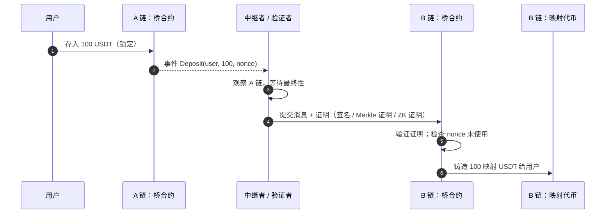

# 12 跨链桥安全：两条链之间的那条缝

> 学习目标：读完本章，你能——
> 1. 画出"锁定-铸造"跨链桥的消息流，标出验证发生在哪里。
> 2. 比较多签、轻客户端、乐观证明、零知识证明四种验证方式的信任假设。
> 3. 把跨链桥事故归入"私钥、验证逻辑、初始化、存款伪造"四类根因。
>
> 前置章节：[05 访问控制与权限](05-access-control.md)、[09 MEV 与签名安全](09-mev-signatures.md)、[10 可升级合约与代理](10-upgradeable-proxy.md)
> 交互实验：[signature-replay-lab.html](../interactive/signature-replay-lab.html)、[incident-explorer.html](../interactive/incident-explorer.html)

> 最后核对：2026-11-09

---

## 开场：9 个验证者，两个组织

2022 年 3 月 23 日，攻击者控制了 Ronin 桥的验证者节点，用两笔交易提走 173,600 ETH 和 2,550 万 USDC。桥有 9 个验证者，5 个签名即可放行。来源：[Ronin 复盘](https://roninchain.com/blog/posts/back-to-building-ronin-security-breach-6513cc78a5edc1001b03c364)、[Elliptic](https://www.elliptic.co/blog/analysis/north-korea-s-lazarus-group-identified-as-exploiters-behind-540-million-ronin-bridge-theft)。完整复盘：[资损 101](https://claude.ai/artifact/1a5Nx6xTVLuJdCB8Esf2xj#c-ronin)。

🤔 先猜再看：9 个验证者中，4 个由 Sky Mavis 运营，第 5 个签名可以通过 Axie DAO 的授权取得。要达到 5 个签名，攻击者最少要攻破几个组织？

两个：Sky Mavis 和 Axie DAO 的授权路径。门限写的是 5/9，实际独立的防线只有 2 道。4.1 节解释这个差距。

---

## 1. 一句话理解

**跨链桥让 B 链上的合约相信"A 链上发生了某件事"。B 链看不到 A 链，所以它只能相信某种证明。证明机制被骗，桥上的全部资产就被骗走。**

跨链桥（Bridge）：在两条链之间转移资产或消息的系统。

> 🎯 打个比方：两座城市之间没有电话。A 城的银行收下你的金条，给你开一张"提货单"，你拿到 B 城银行兑换等值金券。
>
> - B 城银行怎么知道提货单是真的？
>   - 看 5 个公证人的签章（多签 / MPC）。
>   - 自己派人常驻 A 城核对账本（轻客户端）。
>   - 先兑付，但留 7 天让任何人举报造假（乐观证明）。
>   - 用一种数学方法，不看账本也能确认账本内容（零知识证明）。
> - 公证人的印章被偷，或者核对方法有漏洞，B 城银行就会兑出不存在的金子。
>
> 比喻的局限：两座城的银行金库加起来，往往是整个系统里最大的一笔钱。所以跨链桥是攻击者的首选目标。

---

## 2. 跨链桥的基本流程

**读图要点：**

- 第 2 → 4 步是信任边界。B 链只能通过第 5 步的"验证"来判断真伪。
- 第 5 步要同时检查：证明有效、消息未被处理过（防重放）、消息来自正确的源链和源合约。
- 局限：这张图没有画反向流程（销毁 → 解锁）。反向流程有同样的风险，金额往往更大。

> 🧪 动手验证：打开[签名与重放实验](../interactive/signature-replay-lab.html)，点"一键全部勾选（EIP-712 完整版）"，再取消勾选 `chainId`。点"签名并首次领取"和"尝试全部重放"，记录第 ② 种重放的结果。

---

## 3. 四种验证方式

| 验证方式 | 信任谁 | 典型风险 | 例子 |
|---|---|---|---|
| 外部多签 / MPC | M-of-N 个验证者 | 私钥泄露、验证者共谋、阈值过低 | Ronin（2022） |
| 轻客户端 / 原生证明 | 源链共识 + 证明验证代码 | 证明验证代码有漏洞 | BNB Chain Token Hub（2022） |
| 乐观证明 | 至少一个诚实的挑战者 | 挑战期内无人监控；挑战者被审查 | 多数乐观 Rollup 的原生桥 |
| 零知识证明 | 数学 + 证明系统实现 + 可信设置 | 电路或验证器实现错误；验证器路由被替换 | 部分 ZK Rollup 原生桥（包括 Mantle 当前的 OP Succinct 方案） |

🤔 先猜再看：一座 ZK 桥的证明系统完全正确，但桥合约可以被多签无延迟升级。用户只需要信任数学吗？

不是。多签可以把桥合约换成新实现，绕过证明系统。用户同时信任证明系统和升级权限的持有人。

> 💡 注意：L2 的"原生桥"也是一种跨链桥。它的安全性取决于证明系统**和**升级权限。根据 L2BEAT 截至 2026 年的页面，Mantle 使用 OP Succinct（SP1）有效性证明，但输出预言机可由工程多签切换到"乐观模式"，桥合约可由安全多签无延迟升级。详见 [C03](../chains/C03-mantle.md)。

### 3.1 证明验证的密码学检查项

| 主题 | 检查项 |
|---|---|
| Merkle 树 | 叶子与中间节点使用不同的哈希前缀或双重哈希；根值不能取默认零值；已使用的叶子要标记 |
| 门限签名校验 | 恢复地址非零；签名人地址去重；限制 s 在低半区（[09 章](09-mev-signatures.md)） |
| BLS 聚合签名 | 公钥注册时要求持有证明（Proof of Possession），防止恶意公钥抵消聚合结果 |
| 哈希拼接 | 多个动态类型用 `abi.encode`，不用 `abi.encodePacked` |

> 🧪 动手验证：打开[Merkle 证明验证与验证者门限评估](../interactive/audit-merkle.html)，修改"提交的叶子内容"，记录验证结果。再把"独立运营商数量"从 4 改成 2，记录需要攻破的运营商数量。

---

## 4. 四类根因与案例

### 4.1 私钥与运营：Ronin（2022 年 3 月）

- 9 个验证者中 5 个签名即可放行。攻击者控制了 5 把私钥，伪造两笔提款，损失约 6.2 亿美元。
- 其中 4 把属于同一机构，1 把来自一个本应撤销的授权（公开复盘）。公开报道称，私钥通过社会工程获得。
- 教训：阈值的意义取决于签名人的**独立性**。4 把钥匙放在同一个地方，等于 1 把。

### 4.2 验证逻辑：BNB Chain Token Hub（2022 年 10 月）

攻击者支付 100 BNB 注册为中继者，用伪造的 IAVL Merkle 证明骗过 Token Hub 的证明校验，凭空铸造 200 万 BNB（约 5.7 亿美元），其中 1 亿多美元被转到其他链。攻击者没有偷私钥。被利用的是证明验证代码。BSC 验证者约 3 小时后暂停全链，Moran 硬分叉修复了校验。完整路径图和风险传导见 [C01](../chains/C01-bnb-chain.md) 4.5 节。

### 4.3 签名验证：Wormhole（2022 年 2 月）与 Poly Network（2021 年 8 月）

- **Wormhole**：Solana 一侧的合约使用了一个已弃用的系统指令加载函数，没有校验传入的"系统账户"是否真实。攻击者传入伪造账户，绕过守护者签名验证，铸造约 12 万 wETH（约 3.2 亿美元）。完整复盘：[资损 101](https://claude.ai/artifact/1a5Nx6xTVLuJdCB8Esf2xj#c-wormhole)。
- **Poly Network**：跨链管理合约允许跨链消息调用任意目标合约的函数。攻击者构造一个函数名，使其 4 字节选择器与 `putCurEpochConPubKeyBytes`（替换验证者公钥）相同，通过跨链消息把验证者公钥换成自己的，然后签发任意提款。损失约 6.1 亿美元，后来攻击者归还。完整复盘：[资损 101](https://claude.ai/artifact/1a5Nx6xTVLuJdCB8Esf2xj#c-poly)。

> ⚠️ 警告：跨链消息执行器**不能**调用持有特权的合约。消息的目标地址和函数选择器都要白名单化。

### 4.4 初始化：Nomad（2022 年 8 月）

升级时把可信根设为 `0x00`，导致任何消息都被视为已证明。见 [10 章](10-upgradeable-proxy.md) 第 4 节。完整复盘：[资损 101](https://claude.ai/artifact/1a5Nx6xTVLuJdCB8Esf2xj#c-nomad)。

### 4.5 存款伪造：Qubit（2022 年 1 月）

对 `address(0)` 调用 `safeTransferFrom` 返回成功，桥记录了不存在的 ETH 存款。见 [07 章](07-external-calls-tokens.md) 第 2.1 节。

### 4.6 单一验证者：KelpDAO（2026 年 4 月）

🤔 先猜再看：一条跨链路径只有一个验证者，合约代码完全正确。验证者读取的 RPC 节点返回了假数据。桥能拒绝这条消息吗？

不能。桥只相信验证者的结论，验证者只相信 RPC 返回的数据。这条路径上没有第二个独立来源可以比对。

- 2026 年 4 月 18 日，攻击者伪造了一条 LayerZero 跨链消息。Ethereum 上的适配器放出 116,500 枚 rsETH，约 2.92 亿美元。
- 该路径只有一个验证者（DVN）。LayerZero 称，攻击者控制了 DVN 依赖的两个 RPC 节点，替换了节点程序，让验证者看到假数据。
- 责任有争议：LayerZero 称问题限于 KelpDAO 的配置，KelpDAO 称单验证者来自 LayerZero 的默认设置。2026 年 9 月，KelpDAO 的开发方 Evercrest Technologies 起诉了 LayerZero Labs 及其 CEO。
- LayerZero 初步归因于 Lazarus / TraderTraitor。KelpDAO 暂停合约、拉黑攻击者地址，拦下第二次约 40,000 rsETH 的伪造消息（[Chainalysis](https://www.chainalysis.com/blog/kelpdao-bridge-exploit-april-2026/)）。LayerZero 后来公开道歉，承认不应允许其 DVN 单独验证高价值交易（[The Block](https://www.theblock.co/post/400629)）。
- 来源：[LayerZero 声明](https://layerzero.network/blog/kelpdao-incident-statement)、[Chainalysis](https://www.chainalysis.com/blog/kelpdao-bridge-exploit-april-2026/)、[CoinDesk](https://www.coindesk.com/tech/2026/04/20/kelp-dao-claims-layerzero-s-default-settings-are-what-actually-caused-the-usd290-million-disaster)、[Crypto Times（诉讼）](https://www.cryptotimes.io/2026/09/25/kelpdao-sues-layerzero-and-ceo-bryan-pellegrino-in-canada-over-292m-rseth-exploit/)、[Crypto Briefing（诉讼）](https://cryptobriefing.com/kelpdao-developer-sues-layerzero-ceo-over-292-million-exploit-and-blame-shifting/)。
- 教训：合约代码没有错，桥一样会被掏空。验证者数量和数据来源都要有冗余。RPC 的可信度见 [17 章](17-node-rpc-infrastructure.md)。

---

## 5. 交易所充值也是一座"桥"

CEX 的充值系统做的事情和跨链桥一样：**相信链上发生了一笔转账，然后在内部账本上记账**（见《CEX 交易所学习手册》05 章）。同类风险：

| 跨链桥风险 | CEX 充值对应的风险 | 防御 |
|---|---|---|
| 伪造存款事件 | 假币合约发出同名 `Transfer` 事件 | 校验代币合约地址，而不是代币名称或符号 |
| 消息未检查执行状态 | 交易执行失败（例如 TRON 上能量不足导致 REVERT），但日志或回执被误读为成功 | 检查交易回执状态为成功，再检查事件 |
| 重放 | 同一笔交易被重复入账 | 以 (txHash, logIndex) 为幂等键 |
| 源链重组 | 入账后区块被回滚 | 等待足够确认数或最终性 |
| 收税/变基代币 | 入账金额 ≠ 实收 | 以余额变化为准 |

> 💡 注意：TRON 上 TRC-20 转账失败（例如"FAILED – TRANSACTION REVERT"、能量不足）的交易仍然会上链，并有交易哈希。只看"交易存在"就入账，就会产生"假充值"。必须检查交易结果字段。详见 [C02](../chains/C02-tron.md)。

---

## 6. 防御清单

1. 验证者集合：阈值高于 2/3；签名人在组织、地域、基础设施上独立；定期审计签名权清单。
2. 消息格式：包含源链 ID、源合约、目标链 ID、目标合约、nonce；目标侧逐项校验。
3. 消息执行：目标地址和函数白名单；不允许调用特权合约。
4. 限额：单笔、单位时间提款上限；超过上限进入延迟队列。
5. 监控：两侧总供应量对账（锁定量 ≥ 铸造量）；异常时自动暂停。
6. 升级：桥合约升级必须有时间锁；初始化参数必须审计。

### 6.1 用代码验证修复

`code/foundry-demos` 中有跨链验证器演示。修复验证需要"修复前失败、修复后通过"两个结果（[A08](../assessment/A08-reproduce-attacks.md)）。

---

## 7. 审计检查点

- [ ] **BRG-1** 消息哈希包含源链、源合约、目标链、目标合约、nonce。
- [ ] **BRG-2** 已处理消息有防重放标记。
- [ ] **BRG-3** 证明验证代码（Merkle、签名、ZK 验证器）有独立审计和测试向量。
- [ ] **BRG-4** 零值、空数组、未初始化根不会被当作有效证明。
- [ ] **BRG-5** Merkle 叶子与中间节点的哈希域已分离。
- [ ] **BRG-6** 原生币和 ERC-20 走不同路径，且彼此不能混用。
- [ ] **BRG-7** 有速率限制和全局供应量对账。
- [ ] **BRG-8** 签名人清单、阈值、私钥存放方式已披露。

**把检查结果写进报告：**

| 检查项 | 发现时的证据 | 常见定级（用 [A02](../assessment/A02-risk-rating-reporting.md) 复核） | 练习位置 |
|---|---|---|---|
| BRG-1、BRG-2 | 消息哈希字段清单 + 重放 PoC | Critical / High | [签名与重放实验](../interactive/signature-replay-lab.html) |
| BRG-3、BRG-5 | 证明验证测试向量 + 伪造证明的结果 | Critical / High | [Merkle 证明验证与验证者门限评估](../interactive/audit-merkle.html) |
| BRG-4 | 零值输入的测试 + 配置检查结果 | Critical / High | [Merkle 证明验证与验证者门限评估](../interactive/audit-merkle.html) |
| BRG-6 | 原生币和 ERC-20 的路径对比 | High / Medium | [C01 BNB Chain](../chains/C01-bnb-chain.md) |
| BRG-7 | 限额配置 + 两侧供应量对账记录 | High / Medium | [C03 Mantle](../chains/C03-mantle.md) |
| BRG-8 | 签名人与运营商的独立性清单 | Critical / High | [Merkle 证明验证与验证者门限评估](../interactive/audit-merkle.html)、[C03 Mantle](../chains/C03-mantle.md) |

发现按 [T03 报告模板](../templates/T03-finding-report.md) 记录。桥协议按 [A04](../assessment/A04-defi-protocol-review.md) 第 3.6 节评估。验证者私钥和运营按 [A06](../assessment/A06-operational-key-security.md) 评估。

---

## 8. 用户侧防护

普通用户看不到合约代码，但可以通过几个公开信号降低风险。

1. 跨链前确认桥的验证方式：多签、轻客户端、乐观证明还是零知识证明。L2BEAT 会列出风险。
2. 不要把资产长期放在桥的映射代币上；用完尽快换回原生资产。
3. 只用官方入口跨链。搜索结果和社交媒体里的"官方桥"可能是钓鱼站。
4. 跨链后检查目标链上收到的代币合约地址是否正确。
5. 桥出事时，映射代币可能大幅折价，见 Ronin、Wormhole 等案例。

---

## 9. 术语表

| 术语 | 英文 | 定义 |
|---|---|---|
| 跨链桥 | Bridge | 在两条链之间转移资产或消息的系统 |
| 锁定-铸造 | Lock-and-Mint | 源链锁定资产，目标链铸造映射资产 |
| 中继者 | Relayer | 把消息和证明从一条链搬到另一条链的角色 |
| 轻客户端 | Light Client | 在链上验证另一条链区块头和证明的合约 |
| 乐观证明 | Optimistic Proof | 默认有效，挑战期内可被欺诈证明推翻 |
| 有效性证明 | Validity Proof | 用零知识证明直接证明状态转换正确 |
| 速率限制 | Rate Limit | 单位时间内允许的最大流出量 |
| 假充值 | Fake Deposit | 交易所把失败或伪造的转账误记为充值 |

---

> 🪞 反思：选一座你用过或集成过的跨链桥。
> 1. 它的目标链靠什么相信源链发生了某件事？
> 2. 攻破几个独立组织就能放行一条伪造消息？
> 3. 它出事时，你的系统多久能发现，并停止接收映射资产？

## 10. 思考题

1. 一个桥的验证者是 7 个地址，阈值 4。这 7 个地址中有 3 个由同一家云服务商托管。实际的安全阈值是多少？
2. BSC 在 Token Hub 事故后暂停了整条链。从用户角度，这是好事还是坏事？从"去中心化"角度呢？
3. 打开 [incident-explorer.html](../interactive/incident-explorer.html)，筛选"跨链"。按根因分组，哪一类损失最多？

下一章：[27 审计、测试与开发流程](27-audit-testing-workflow.md) —— 把前面所有知识变成一套可执行的流程。
