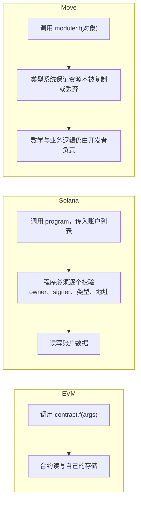

# 13 非 EVM 生态：换一种账户模型，换一组漏洞

> 学习目标：读完本章，你能——
> 1. 对比 EVM、Solana、Move、Bitcoin UTXO、Cosmos SDK 五种执行模型的信任边界。
> 2. 说出每种模型最常见的漏洞类别，以及它们和 EVM 漏洞的对应关系。
> 3. 为一个跨生态集成（例如交易所接入新链）列出必须额外检查的项目。
>
> 前置章节：[03 EVM 与 Solidity 基础](03-evm-solidity-basics.md)、[12 跨链桥安全](12-cross-chain-bridges.md)
> 交互实验：[chain-porting-lab.html](../interactive/chain-porting-lab.html)

---

## 开场：12 万 wETH 和一个没校验的账户

2022 年 2 月，攻击者在 Solana 上向 Wormhole 传入一个伪造的系统账户，铸造了 12 万 wETH（约 3.2 亿美元）。复盘见[资损 101](https://claude.ai/artifact/1a5Nx6xTVLuJdCB8Esf2xj#c-wormhole)。

🤔 先猜再看：在 EVM 上，合约调用另一个合约时地址写在代码或存储里。Solana 程序读取的账户由谁提供？

由调用者在交易里传入。所以程序必须自己校验每个账户的 owner、类型和地址。Wormhole 缺的就是对 sysvar 账户的校验。

---

## 1. 一句话理解

**漏洞的本质不变：程序相信了一个不该相信的输入。变的是"输入"长什么样。EVM 里是参数和外部调用；Solana 里是调用者传进来的账户；Move 里是对象和数学库；Bitcoin 生态里是链下索引器的解释。**

执行模型（Execution Model）：一条链如何存储状态、如何调用程序、如何决定谁能改什么。

> 🎯 打个比方：五个国家的海关都要防走私。A 国查行李（EVM 查参数），B 国查护照（Solana 查账户），C 国给每件货物贴防伪芯片（Move 资源），D 国只查集装箱封条、不管里面装什么（Bitcoin 脚本），E 国和邻国互认海关章（Cosmos IBC）。走私者在每个国家都找最薄弱的那一环。
>
> 比喻的局限：真实的跨生态集成里，同一笔资产会经过几个"国家"。每多一种模型，就多一组需要专门知识的检查项。

---

## 2. 五种执行模型对比

| 模型 | 状态放在哪里 | 谁能改状态 | 最常见的漏洞类别 | 对应的 EVM 漏洞 |
|---|---|---|---|---|
| EVM | 合约自己的存储 | 合约代码 | 重入、访问控制、预言机 | —（见 04–12 章） |
| Solana | 独立的账户；程序无状态 | 账户的 owner 程序 | 缺失 owner / signer 检查、账户类型混淆、任意 CPI | 访问控制、外部调用 |
| Move（Sui / Aptos） | 资源 / 对象，有类型和能力 | 持有对象的地址或模块 | 数学库溢出、对象权限、升级权限 | 算术与精度、访问控制 |
| Bitcoin UTXO | 未花费输出；元协议在链下 | 满足脚本的签名者 | 索引器分歧、mempool 策略攻击、桥的信任假设 | 预言机（链下数据） |
| Cosmos SDK / IBC | 各模块的存储 | 模块和消息处理器 | 证明验证缺陷、非确定性、模块权限 | 跨链桥、签名验证 |

**读图要点：**

- EVM 的合约"拥有"自己的存储，攻击者不能替换它。
- Solana 的程序不持有状态。所有账户都由调用者传入，程序不校验，攻击者就能换成伪造账户。这是 Solana 最大的一类漏洞。
- Move 的类型系统消除了"代币被复制"这一类问题，但溢出、权限和业务逻辑错误不会消失。
- 局限：图里没有画 Bitcoin 和 Cosmos，它们的风险主要在链下软件和跨链证明，见第 3.3、3.4 节。

### 2.1 另外四种环境的审计要点

| 环境 | 语言 | 执行模型 | 审计关注点 |
|---|---|---|---|
| TON | FunC / Tact / Tolk | Actor 模型；消息全部异步；失败消息可退回（bounce） | 异步状态一致性；bounce 消息处理；Gas 与存储费预留 |
| Starknet | Cairo | felt252 模素数运算；原生账户抽象；L1↔L2 消息 | felt 运算按模数回绕；L1 消息处理器校验来源 |
| EOS | C++ | 账户与权限分层；通知机制 | 通知来源校验 |
| EVM L2 | Solidity | 排序器排序，向 L1 提交 | 排序器状态检查；L1→L2 地址别名；`block.number` 语义；操作码支持差异 |

---

## 3. 攻击路径

### 3.1 Solana：调用者传入的每一个账户都不可信

| 漏洞类别 | 机制 | 防御 |
|---|---|---|
| 缺失 owner 检查 | 程序读取一个账户的数据，但没检查该账户归本程序所有 | 只信任本程序拥有的账户 |
| 缺失 signer 检查 | 敏感操作没有检查 `is_signer` | 管理员账户必须是签名者 |
| 账户类型混淆 | 两种账户结构相同，攻击者传入错误类型 | 使用判别字段（discriminator） |
| 任意 CPI | 跨程序调用的目标 program id 由调用者传入 | 校验 program id |
| 系统账户伪造 | 读取 sysvar 时没有校验它是不是真的系统账户 | 使用带校验的 API，校验地址 |
| 信任链没有终点 | 账户之间互相一致，但没有锚定到可信根 | 校验链终止于硬编码地址或本程序派生地址（PDA） |
| PDA 未用规范 bump | 同一组种子可能有多个有效 bump，攻击者传入非规范 PDA | 使用规范 bump（`find_program_address` 或 Anchor 的 `bump` 约束） |
| CPI 后使用旧数据 | 被调程序修改了账户，内存中的数据仍是旧值 | CPI 后重新加载账户（Anchor 的 `reload()`） |

> 💡 注意：Anchor 框架的账户约束能自动完成大部分检查。但约束是开发者写的，漏写一个就等于没有。

### 3.2 Move：资源安全不等于业务安全

1. 类型系统保证：代币对象不能被复制，不能被凭空丢弃。
2. 类型系统**不**保证：数学正确、权限正确、升级正确。
3. Move 的位移运算溢出时直接截断，**不会**中止交易。依赖"溢出会报错"的代码会出错。
4. 字节码验证器本身也可能有缺陷。验证器出错，类型系统的保证全部失效。
5. 能力（ability）和权限对象（Capability）由开发者分配。分配错误等于权限错误。
6. 泛型类型参数由调用者指定。模块不校验类型，攻击者就能传入错误的代币类型。

### 3.3 Bitcoin 生态：链只记录，链下软件解释

- **元协议**：铭文、BRC-20 等资产的余额不由比特币共识决定，而由链下索引器解释同一批交易。索引器版本不一致，同一个地址在不同平台上余额不同。
- **闪电网络**：资金安全依赖用户能在截止时间前把交易打包上链。攻击者可以利用 mempool 的替换规则，把受害者的交易挤出去。
- **桥**：比特币脚本不能验证其他链的状态。BTC 跨链桥多依赖多签或联盟。BitVM 类方案把假设降到"至少一个诚实挑战者"，代价是挑战期和挑战成本。

### 3.4 Cosmos SDK 与 IBC

- IBC 用轻客户端和 Merkle 证明验证对方链的状态。证明验证代码有缺陷，攻击者就能伪造"对方链上发生了某事"，这与 [12 章](12-cross-chain-bridges.md) 的跨链桥风险相同。
- 状态机必须是确定性的。如果某个模块用了节点本地时间这类非确定性输入，不同节点算出不同结果，链会停机。
- 每条应用链有自己的验证者集合。小链的验证者集合小，可以协调停链或回滚，见 [16 章](16-consensus-chain-security.md)。
- `BeginBlock` 和 `EndBlock` 由链自动执行。这些钩子中的 panic 或无界循环会让整条链停止出块。

---

🤔 先猜再看：一个 Bitcoin 铭文代币在两家平台显示的余额不同。比特币共识能裁决谁对吗？

不能。比特币共识只验证交易本身，不解释铭文内容。代币余额由链下索引器计算，所以检查项要求明确索引器版本并独立对账。

## 4. 防御方法：交易所接入新链的检查清单

| 类别 | 检查项 |
|---|---|
| 交易模型 | 失败交易会不会上链？交易结果字段叫什么？实际到账金额怎么读？（见 [23 章](23-custody-exchange-ops.md) 3.2 节） |
| 资产识别 | 代币由什么唯一标识：合约地址、mint 地址、对象类型、denom？是否有同名假币？ |
| 账户模型 | 充值地址是否需要预先创建（例如 Solana 的关联代币账户）？是否需要租金或最低余额？ |
| 最终性 | 多少个区块或多长时间后不可回滚？历史上是否发生过停链或回滚？ |
| 节点 | 是否有至少两个独立实现或独立运营方的节点？见 [17 章](17-node-rpc-infrastructure.md) |
| 签名 | 用什么曲线和签名算法？现有的 HSM / MPC 是否支持？见 [02 章](02-cryptography-randomness.md) |
| 元协议 | 资产是否依赖链下索引器？用哪个版本？多个索引器结果是否一致？ |
| 治理 | 验证者能否冻结地址或回滚交易？历史上是否发生过？ |
| SDK 供应链 | 链官方的 SDK 是否锁定版本？签名服务是否与 SDK 隔离？ |

> ⚠️ 警告：照搬以太坊的接入逻辑是假充值、错账和资金丢失的主要来源。每条新链都要按它自己的交易模型重新设计。用 [chain-porting-lab.html](../interactive/chain-porting-lab.html) 检查迁移假设。

---

## 5. 真实案例

> 💡 注意：以下每个案例只写摘要和教训。完整复盘见《[Web3 行业安全资损 101](../../web3-loss-101/index.html)》。金额为事发时美元估值。

### 5.1 Solana：Wormhole 与 Cashio（2022 年）

- **Wormhole（2022 年 2 月）**：Solana 一侧的签名验证使用了一个已弃用的指令 sysvar 读取函数，没有校验传入的 sysvar 账户是不是真的系统账户。攻击者传入伪造账户，绕过守护者签名验证，铸造 12 万 wETH（约 3.2 亿美元）。Jump Crypto 补足了全部 ETH。修复方式是改用带校验的函数。来源：[Kudelski](https://kudelskisecurity.com/research/quick-analysis-of-the-wormhole-attack)、[Halborn](https://www.halborn.com/blog/post/explained-the-wormhole-hack-february-2022)、[资损 101](../../web3-loss-101/index.html#c-wormhole)。
- **Cashio（2022 年 3 月）**：存抵押品时只检查各账户之间互相一致。铸币检查没有把 Saber 账户的 mint 字段锚定到可信根。攻击者伪造了整条账户链，用无价值的代币铸出约 20 亿 CASH。损失约 4,800–5,280 万美元：rekt.news 估约 4,800 万，CertiK 估约 5,280 万。来源：[CertiK](https://www.certik.com/blog/cashio-app-incident-analysis)、[rekt.news](https://rekt.news/cashio-rekt/)、[Halborn](https://www.halborn.com/blog/post/explained-the-cashio-hack-march-2022)。
- 教训：在 Solana 上，sysvar 和"看起来合理的账户"都是用户输入。账户校验链必须终止于程序硬编码的可信根。

### 5.2 Solana：Mango Markets（2022 年 10 月）

- 攻击者在 Mango 上开出巨量 MNGO 永续仓位，同时在现货市场拉高 MNGO 价格。预言机价格随之上涨，他以未实现盈利为抵押借空金库，约 1.14 亿美元。DAO 投票后，攻击者归还约 6,700 万美元。
- 2024 年 4 月，陪审团认定三项罪名成立。2025 年 5 月，法官撤销两项商品罪（审判地不当），对电汇欺诈改判无罪。
- 教训：低流动性资产不能按现货喂价给高抵押率。机制分析见 [08 章](08-oracle-flashloan.md) 和 [11 章](11-defi-economic-security.md)。
- 来源：[美国司法部（定罪）](https://www.justice.gov/usao-sdny/pr/man-convicted-110-million-cryptocurrency-scheme)、[The Block（判决推翻）](https://www.theblock.co/post/355666/u-s-judge-overturns-fraud-convictions-of-mango-markets-exploiter-eisenberg-determining-improper-venue)、[资损 101](../../web3-loss-101/index.html#c-mango)

### 5.3 Move：Cetus 的溢出检查（2025 年 5 月，Sui）

**读图要点：**

- 2025 年 5 月 22 日，Cetus 被攻击。漏洞不在 Cetus 的业务代码，而在它依赖的开源数学库。
- "Move 是安全语言"的假设在这里失效：位移溢出不会自动中止。
- Sui 验证者冻结了约 1.62 亿美元，治理投票后转入共管多签用于赔付。链级冻结的争议见 [25 章](25-fund-tracing-response.md) 5.2 节。
- 教训：审计范围必须覆盖数学依赖库。
- 来源：[Dedaub](https://dedaub.com/blog/the-cetus-amm-200m-hack-how-a-flawed-overflow-check-led-to-catastrophic-loss/)、[The Block](https://www.theblock.co/post/355795/sui-dex-cetus-open-source-library-flaw-smart-contract-223-million-usd-exploit)、[Cyfrin](https://www.cyfrin.io/blog/inside-the-223m-cetus-exploit-root-cause-and-impact-analysis)、[资损 101](../../web3-loss-101/index.html#c-cetus)

### 5.4 Move：验证器漏洞与部署流程（2023–2025）

- **Move 字节码验证器（2023 年）**：Zellic 发现共享的验证器在处理超长函数时漏掉控制流边，两道安全检查被绕过，影响 Sui、Aptos 等链。已修复，无损失。来源：[Zellic](https://www.zellic.io/blog/the-billion-dollar-move-bug)。
- **Sui HamsterWheel（2023 年）**：CertiK 发现恶意合约可以让节点陷入无限循环，导致全网停摆。主网上线前修复。来源：[CertiK](https://certik.medium.com/the-hamsterwheel-an-in-depth-exploration-of-a-novel-attack-vector-on-the-sui-blockchain-a02aba49afca)。
- **Nemo Protocol（2025 年 9 月，Sui，约 240–260 万美元）**：开发者在审计后私自部署了未审计的代码，内部闪电贷函数被误设为公开。升级权限只有单签。安全公司此前已经预警，项目方没有处理。来源：[The Block](https://www.theblock.co/post/370273/nemo-protocol-unaudited-code-exploit)、[Cointelegraph](https://cointelegraph.com/news/2-6-million-lost-in-nemo-hack-due-to-unaudited-code-and-ignored-vulnerability)。
- 教训：语言层的保证依赖验证器正确；协议层的风险仍然来自升级权限和部署流程。

### 5.5 Bitcoin 生态（2018–2024）

- **CVE-2018-17144（2018 年 9 月）**：Bitcoin Core 的一次性能优化跳过了区块内重复输入检查，后续版本把它从拒绝服务漏洞变成了通胀漏洞。0.16.3 版修复，主网无损失。来源：[Bitcoin Core 公告](https://bitcoincore.org/en/2018/09/20/notice/)、[Bitcoin Optech](https://bitcoinops.org/en/topics/cve-2018-17144/)。
- **闪电网络替换循环攻击（2023 年 10 月）**：攻击者反复替换并挤出受害者的超时交易，让它在截止前无法上链。四家主要实现在披露前已发布缓解。未见在野利用。来源：[开发者邮件列表](https://mirror.b10c.me/lists/bitcoindev/CALZpt+FSn6ox9cnDVuWX0pjR-R_mxQCRTORR_XiPDEOVkx9YsA@mail.gmail.com)。
- **BRC-20 索引器分歧（2023–2024 年）**：各平台使用的索引器版本不一致，Magic Eden 暂停交易，UniSat 警告存在双花风险。来源：[Cointelegraph](https://cointelegraph.com/news/bitcoin-ordinals-community-debates-fix-after-inscription-validation-bug)。
- 教训：比特币元协议和二层的安全边界在链下软件，不在比特币共识。交易所接入铭文类资产时，必须明确用哪个索引器的结果。

### 5.5.1 Liquid 侧链：无担保的 L-BTC（2026 年 9 月）

- 2026 年 9 月 6 日，攻击者凭空铸出约 4,000 枚 L-BTC，并通过联盟的正常提现流程换成真实 BTC，约 3.19 亿美元。
- 第三方重建的根因：Elements 软件的范围证明验证缓存可能把无效输出当作已验证。这一结论尚未有官方完整复盘确认。
- Blockstream 称签名密钥没有泄露。联盟按软件给出的链状态正常签名。
- 攻击者自称白帽，归还约 3,400 BTC（约 85%），另有约 598.5 BTC 未归还。来源：[TRM](https://trmlabs.com/resources/blog/2026s-biggest-hack-to-date-attackers-drained-usd-319-million-in-bitcoin-from-liquid-network-then-returned-85-of-funds)、[The Block](https://theblock.co/news/defi/2026-09-07-liquid-network-attacker-says-they-will-return-most-of-4000-btc-after-bug-fix-413673)。
- 教训：门限签名只保证"多数人同意"，不保证被同意的状态正确。储备要由独立的对账程序实时核对。

### 5.5.2 Solana：Drift 的持久 nonce 与预签名（2026 年 4 月）

- 2026 年 4 月 1 日约 16:05 UTC 起，Drift 损失约 2.85 亿美元，超过 TVL 的 50%（[Chainalysis](https://www.chainalysis.com/blog/lessons-from-the-drift-hack/)）。项目方称没有利用程序漏洞，助记词未泄露，3 月 23 日至 30 日做准备（[BleepingComputer](https://www.bleepingcomputer.com/news/security/drift-loses-280-million-north-korean-hackers-seize-security-council-powers/)）。
- Drift 的安全委员会是 2-of-5 Squads 多签。迁移日期有 3 月 26 日（Chainalysis）和 3 月 27 日（[TRM](https://www.trmlabs.com/resources/blog/north-korean-hackers-attack-drift-protocol-in-285-million-heist)）两种说法，迁移后时间锁为零。至少两名成员签了自己没有完全理解的审批。Solana 的持久 nonce（Durable Nonce）让这些签名长期有效。
- 攻击者用这些审批转移了管理员权限，再上架自建的 CVT 代币，用自控的预言机抬价，放宽提款限制后取走资产（[BlockSec](https://blocksec.com/blog/drift-protocol-incident-multisig-governance-compromise-via-durable-nonce-exploitation)）。
- 入侵线索：贡献者克隆了恶意仓库，并安装了 TestFlight 测试应用。Drift 与 SEAL 911 以"中高置信度"归因于朝鲜相关团体，TRM 也指向朝鲜；Mandiant 没有正式归因（[The Block](https://www.theblock.co/post/396361/drift-links-280-million-exploit-to-six-month-social-engineering-op-run-by-suspected-north-korean-actors)）。
- 未确认：Chainalysis 称以上描述来自 Drift 自身调查，未经独立验证。
- 教训：持久 nonce 去掉了 Solana 签名约 1 分钟的自然过期。管理操作要加时间锁，并在执行前重新确认。

### 5.6 Cosmos 与 IBC（2021–2024）

| 时间 | 名称 | 机制 | 结果 | 来源 |
|---|---|---|---|---|
| 2021-10 | Jackfruit | 授权模块用节点本地时钟判断过期，非确定性，任何人可致链停机 | 修复，无资金损失 | [Cosmos 论坛](https://forum.cosmos.network/t/cosmos-sdk-vulnerability-retrospective-security-advisory-jackfruit-october-12-2021/5349) |
| 2022-06 | Osmosis LP | 加流动性函数多发 LP 份额，被多人利用，约 500 万美元 | 链停机；部分归还，开发基金兜底 | [CertiK](https://www.certik.com/blog/1o2gR0mG6wP83aHp5jzoor-osmosis-incident-analysis) |
| 2022-10 | Dragonberry | ICS-23 接受伪造的不存在证明，可伪造 IBC 超时，掏空托管账户 | 协调修复，无损失 | [Cosmos 论坛](https://forum.cosmos.network/t/cosmos-sdk-ibc-vulnerability-retrospective-security-advisories-dragonberry-and-elderflower-october-2022/8735) |
| 2024-04 | ASA-2024-007 | ibc-hooks 超时回调可重入，恶意合约可重复触发 | 修复，无损失 | [ibc-go 安全公告](https://github.com/cosmos/ibc-go/security/advisories/GHSA-j496-crgh-34mx) |

- 教训：IBC 的证明验证是跨链资金的单点；状态机里不能有非确定性输入；重入在非 EVM 环境里同样存在。

### 5.7 SDK 供应链：@solana/web3.js（2024 年 12 月）

- npm 维护者被钓鱼，两个恶意版本被植入私钥外传代码，约 5 小时后撤下。只影响直接在代码里处理私钥的后端和机器人，损失约 16 万美元。
- 教训：链官方 SDK 也是供应链。签名服务不应与业务代码共用依赖，见 [20 章](20-frontend-dns-supply-chain.md)。
- 来源：[The Register](https://www.theregister.com/2024/12/05/solana_javascript_sdk_compromised/)、[GitLab 漏洞库](https://advisories.gitlab.com/npm/@solana/web3.js/CVE-2024-54134/)

---

## 6. 审计检查点

**Solana 程序：**

- [ ] **NEV-1** 每个账户都校验 owner；敏感操作校验 signer。
- [ ] **NEV-2** 账户结构有判别字段；不同类型不能互换。
- [ ] **NEV-3** CPI 的目标 program id 已校验。
- [ ] **NEV-4** sysvar 使用带校验的读取方式。
- [ ] **NEV-5** 账户校验链终止于硬编码地址或本程序 PDA。
- [ ] **NEV-6** PDA 使用规范 bump；CPI 后重新加载账户。

**Move 模块：**

- [ ] **NEV-7** 数学依赖库在审计范围内；位移和乘法溢出有显式检查。
- [ ] **NEV-8** 对象的所有权和共享状态符合设计。
- [ ] **NEV-9** 泛型类型参数和权限对象的分配已校验。
- [ ] **NEV-10** 升级权限是多签，有时间锁；部署版本等于审计版本。

**Bitcoin 元协议与 Cosmos：**

- [ ] **NEV-11** 元协议资产明确了索引器和版本，并与至少一个独立索引器对账。
- [ ] **NEV-12** Cosmos 模块不使用非确定性输入。
- [ ] **NEV-13** `BeginBlock` / `EndBlock` 中没有无界循环和未处理的 panic。
- [ ] **NEV-14** IBC 依赖版本已包含公开的安全修复。

**把检查结果写进报告：**

| 检查项 | 发现时的证据 | 常见定级（用 [A02](../assessment/A02-risk-rating-reporting.md) 复核） | 练习位置 |
|---|---|---|---|
| NEV-1 至 NEV-6 | 缺失校验的账户、伪造账户的测试交易 | Critical / High | [12 章](12-cross-chain-bridges.md) |
| NEV-7 至 NEV-9 | 数学库版本、溢出边界测试、对象所有权和泛型校验 | Critical / High | [06 章](06-arithmetic-precision.md) |
| NEV-10 | 升级权限配置、部署版本与审计版本的差异 | High | [A05](../assessment/A05-listing-due-diligence.md) |
| NEV-11 | 两个索引器的对账结果 | High / Medium | [A05](../assessment/A05-listing-due-diligence.md) |
| NEV-12 至 NEV-14 | 非确定性代码位置、依赖版本 | Critical / High | [A03](../assessment/A03-exchange-contracts-wallets.md) |

发现按 [T03 报告模板](../templates/T03-finding-report.md) 记录。

---

## 7. 用户侧防护

1. 跨链转账前，确认目标链和代币的唯一标识（合约地址、mint 地址、denom），不只看名称。
2. 在 Solana 上签名时，钱包会列出交易涉及的账户和程序。看到陌生程序，不签。
3. 铭文和 BRC-20 资产的余额取决于平台的索引器。在不同平台看到的余额不一致时，以你要交易的平台为准，并谨慎交易。
4. 新链、新生态的 DeFi 协议，先用小额，并查看它的审计范围是否覆盖依赖库。

---

## 8. 术语表

| 术语 | 英文 | 定义 |
|---|---|---|
| 执行模型 | Execution Model | 链如何存储状态、调用程序、控制修改权限 |
| 账户所有者 | Account Owner | Solana 中有权修改某账户数据的程序 |
| 程序派生地址 | PDA | Solana 中由程序和种子派生、没有私钥的地址 |
| 跨程序调用 | CPI | Solana 程序调用另一个程序 |
| 资源 | Resource | Move 中不能复制或丢弃的值 |
| 字节码验证器 | Bytecode Verifier | 在部署前检查 Move 字节码安全性的组件 |
| UTXO | Unspent Transaction Output | 比特币中未被花费的交易输出 |
| 元协议 | Meta-protocol | 在比特币交易上叠加、由链下索引器解释的协议 |
| 索引器 | Indexer | 读取链上数据并计算元协议状态的链下软件 |
| IBC | Inter-Blockchain Communication | Cosmos 生态的跨链通信协议 |

---

> 🪞 反思：想一个你熟悉的非 EVM 系统，或者你准备接入的一条链。
> 1. 这条链上，"谁决定输入可信"？
> 2. 你现有的 EVM 审计清单里，哪几项到了这里完全失效？
> 3. 你能找到谁来审这条链的代码？

## 9. 思考题

1. 把 Cashio 的漏洞翻译成 EVM 的语言：它对应 04–12 章中的哪一类漏洞？
2. 交易所准备上线一个 Sui 上的代币。按第 4 节的清单，你需要项目方提供哪些信息？
3. 打开 [chain-porting-lab.html](../interactive/chain-porting-lab.html)。如果要增加一条"非 EVM 链"，你会加入哪五个检查项？

下一章：[14 ZK 与证明系统](14-zk-proof-systems.md) —— 证明对了，电路错了。
