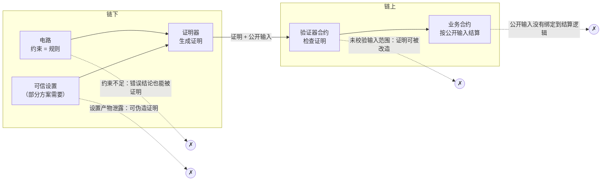

# 14 ZK 与证明系统：证明对了，电路错了

> 学习目标：读完本章，你能——
> 1. 解释零知识证明系统的三个组件（电路、证明器、验证器）各自的失败方式。
> 2. 识别电路约束不足（under-constrained）这一最常见的 ZK 漏洞，以及"公开输入没有绑定"的问题。
> 3. 比较欺诈证明与有效性证明两类 L2 的信任假设，并用 L2BEAT Stages 评估一条 L2。
>
> 前置章节：[12 跨链桥安全](12-cross-chain-bridges.md)、[02 密码学基础与实现风险](02-cryptography-randomness.md)
> 相关：[C03 Mantle](../chains/C03-mantle.md)（OP Succinct 有效性证明）
> 交互实验：[zk-constraint-lab.html](../interactive/zk-constraint-lab.html)

> 最后核对：2026-11-09

---

## 开场：证明全部有效，钱还是丢了

2026 年 6 月，两名攻击者从已弃用的 Aztec Connect 合约取走约 228 万美元（事发时估值）。每一个证明都通过了验证。密码学没有失效。

<details class="predict"><summary>🤔 先猜再看：证明有效，L1 结算却少处理了一行数据。只修验证器合约能解决问题吗？</summary>

不能。验证器确认的是“证明对这些公开输入成立”。漏洞在业务合约：`numRealTxs` 决定处理几行，这个边界没有和证明绑定。5.4 节解释完整路径。

</details>

---

## 1. 一句话理解

**验证器只检查"这个证明是否满足这个电路"，不检查"这个电路是否写对了"。电路少写一条约束，攻击者就能为一个错误的结论生成一个完全有效的证明。**

零知识证明（Zero-Knowledge Proof）：证明者让验证者相信某个计算结果正确，而不需要验证者重新计算，也不泄露计算的秘密输入。
电路（Circuit）：把要证明的计算写成一组数学约束。满足全部约束的输入，才被视为正确。

> 🎯 打个比方：考试的阅卷机只核对"答题卡上的格子是否按规则涂满"。如果出题人在规则里漏写了"第 5 题只能涂一个格子"，考生把 5 题的 4 个格子全涂上，阅卷机照样判对。阅卷机没坏，规则漏了一条。
>
> 比喻的局限：真实的电路有成千上万条约束。漏写一条，从外面看不出任何异常，只能靠审计、形式化验证和测试去找。

---

## 2. 威胁模型：三个组件，三种失败



**读图要点：**

- 四个失败点中，只有 X3 在"验证器代码"里，其他三个都在验证器看不到的地方。
- X4 最容易被忽视：证明是对的，但业务合约结算时没有使用证明里的数据，或只用了一部分。
- 局限：图里没有画升级权限。验证器合约可以被升级，安全委员会可以切换证明模式，见第 3.4 节。

| 组件 | 攻击者能控制什么 | 失败方式 |
|---|---|---|
| 电路 | 证明者的私有输入 | 约束不足：错误的输入也满足全部约束 |
| 可信设置 | 设置仪式产生的秘密 | 秘密没有销毁或产物多余：可伪造任意证明 |
| 证明器 / zkVM | 证明者自己运行证明器 | 证明器或 zkVM 实现的漏洞让无效执行通过 |
| 验证器合约 | 证明和公开输入 | 输入未做域范围检查；预编译使用错误 |
| 业务合约 | 交易参数 | 公开输入与结算数据没有一一绑定 |

---

## 3. 攻击路径

### 3.1 约束不足与过度约束

- **约束不足（Under-constrained）**：某个值被"计算"出来了，但没有被"约束"。在 Circom 里，`<--` 只赋值不约束，`<==` 才同时赋值和约束。只用 `<--`（或在模板里用 `=`）的信号，恶意证明者可以填任何值。
- **过度约束（Over-constrained）**：约束写得太严，合法的输入也无法生成证明。后果是拒绝服务，资金可能被锁住。

```text
// ❌ 漏洞：out 只被赋值，没有约束，恶意证明者可以填任何值
out <-- in * in;

// ✅ 修复：赋值并约束 out == in * in
out <== in * in;
```

<details class="predict"><summary>🤔 先猜再看：玩具电路把新余额 r 分解成 5 个二进制位。余额是 20。只去掉最高位的布尔约束，提款 25 还能通过吗？（域为模 97）</summary>

能。守恒约束要求 r = 20 − 25，取模后 r = 92。其他位取 0，最高位 b4 取 30。16 × 30 = 480，480 模 97 等于 92。位分解成立，但 b4 不是 0 或 1。

</details>

> 🧪 动手验证：打开[ZK 约束不足实验](../interactive/zk-constraint-lab.html)，点“尝试超额提款”，取消勾选 B4，再点“让恶意证明者求解”。记录 b4 的值和“业务含义”的结论。

> 🧪 动手验证：点“恢复全部约束”，勾选过度约束 O，再点“诚实提款（余额大）”。记录失败的约束，以及验证结果下方的说明。

### 3.2 可信设置

Groth16 等方案需要一次可信设置，生成证明密钥和验证密钥。设置过程中产生的秘密（"有毒废料"）如果被保留，持有者可以伪造任意证明。多方计算仪式要求至少一名参与者诚实销毁自己的部分。

### 3.3 证明器、zkVM 与验证器实现

1. 验证器没有检查公开输入小于标量域的阶 r。攻击者把输入 x 换成 x + r，同一个证明仍然有效，可以绕过"每个输入只能用一次"的检查。
2. 证明系统库本身的可靠性（soundness）漏洞，例如查找表、查询冲突的处理错误。
3. zkVM 的内存安全或系统调用漏洞，让一段错误的执行生成有效证明。
4. zkEVM 与 EVM 不完全等价：同一笔交易在两边结果不同。

<details class="predict"><summary>🤔 先猜再看：验证器不检查公开输入是否小于 r。合约用这个输入做“只能使用一次”的记录。攻击者提交 x + r，会发生什么？</summary>

证明仍然有效，因为 x 和 x + r 在域内相等。合约的记录是按整数做键的，它把 x + r 当成新值。同一个 nullifier 可以再用一次。

</details>

> 🧪 动手验证：在 [ZK 约束不足实验](../interactive/zk-constraint-lab.html)点“恢复全部约束”，取消勾选 R，把 a 改成 96，点“让恶意证明者求解”。记录 r 的值，并解释 a = 96 为什么在域内等于 −1。

### 3.4 L2 证明系统的信任假设

| 类型 | 默认假设 | 失败模式 | 典型提款延迟 |
|---|---|---|---|
| 欺诈证明（乐观 Rollup） | 至少有一个诚实挑战者在挑战期内提出挑战 | 无人监控；挑战者被审查；证明系统被切回许可模式 | 数天（挑战期） |
| 有效性证明（ZK Rollup） | 证明系统可靠，电路正确 | 电路或验证器漏洞；证明者宕机 | 数小时（取决于证明生成） |

L2BEAT Stages 框架按"去掉运营方后还剩多少保障"给 L2 分级：

| 阶段 | 关键要求（截至 2026 年 L2BEAT 公开规范） |
|---|---|
| Stage 0 | 状态根和数据上 L1；有可用的证明系统；有外部挑战者 |
| Stage 1 | 安全委员会 ≥ 8 人、阈值 ≥ 75%；非委员会发起的升级给用户 ≥ 5 天退出窗口；乐观 Rollup 挑战期 ≥ 5 天（2026 年 4 月 30 日由 7 天下调） |
| Stage 2 | 证明系统无需许可；退出窗口 ≥ 30 天；委员会只能处理链上可证明的 bug |

> 💡 注意：Stage 越低，L2 的安全越依赖运营方和多签。交易所给 L2 设定充提额度时，Stage 是一个直接的输入。来源：[L2BEAT Stages 规范](https://forum.l2beat.com/t/the-stages-framework/291)、[L2BEAT](https://l2beat.com/stages)。

---

## 4. 防御方法

| 层面 | 措施 |
|---|---|
| 电路 | 用静态分析工具检查未约束信号；对关键电路做形式化验证；为每条约束写正反测试 |
| 可信设置 | 公开、多方参与的仪式；公开全部产物并审计；优先选择不需要可信设置的方案 |
| 验证器 | 校验所有公开输入在标量域内；使用经过审计的验证器生成器 |
| 业务绑定 | 结算逻辑使用证明中的**全部**公开输入；数量、索引、长度字段也必须被证明覆盖 |
| 升级 | 验证器和电路升级走时间锁；紧急升级权限由安全委员会持有并公开 |
| 弃用 | 已弃用的合约要么彻底停用，要么继续纳入监控和赏金范围 |
| 监控 | 对 L2：监控状态根提交、证明提交延迟、证明模式切换 |

---

## 5. 真实案例

> 💡 注意：以下每个案例只写摘要和教训。金额为事发时美元估值。在 2026 年以前，公开记录中几乎没有"ZK 电路漏洞导致实际资金损失"的案例；大部分漏洞是在审计或赏金中发现的。

### 5.1 Zcash 伪造漏洞（2018 年发现，2019 年披露）

- Zcash 早期使用的 BCTV14 方案，可信设置会产生证明者用不到的多余元素。这些元素留在仪式记录里，拿到它们就能把一个证明改造成另一个陈述的有效证明，从而凭空增发 ZEC。
- 2018 年 3 月由 Zcash 团队内部发现，同年 10 月通过 Sapling 升级切换参数修复，2019 年 2 月公开。团队称没有发现被利用的证据。
- 教训：可信设置的完整产物也要审计。屏蔽资产需要独立的供应量审计手段。
- 来源：[ECC 公告](https://zodl.com/zcash-counterfeiting-vulnerability-successfully-remediated/)、[NVD CVE-2019-7167](https://nvd.nist.gov/vuln/detail/cve-2019-7167)

### 5.2 约束不足：Tornado Cash 的 MiMC（2019 年）

- Tornado Cash 使用的 circomlib MiMC 哈希实现中，一个输出只被赋值、没有被约束，攻击者可以伪造 Merkle 根取走他人资金。
- 团队发现后，抢先利用该漏洞把资金转移保护，然后修复。没有资金被盗。
- 教训：Circom 中 `<--` 和 `=` 必须配合显式约束使用。0xPARC 维护的 [zk-bug-tracker](https://github.com/0xPARC/zk-bug-tracker) 收录了大量同类问题，是审计 ZK 项目的必读清单。
- 来源：[Trail of Bits（Circomspect 介绍）](https://blog.trailofbits.com/2022/09/15/it-pays-to-be-circomspect/)

### 5.3 证明系统与 zkVM 的可靠性漏洞（2023–2026）

| 时间 | 对象 | 问题 | 结果 | 来源 |
|---|---|---|---|---|
| 2023-09 | ZKsync Era | ZK 电路可靠性漏洞（ChainLight 发现） | 修复，未被利用 | [ChainLight](https://medium.com/chainlight/uncovering-a-zk-evm-soundness-bug-in-zksync-era-f3bc1b2a66d8) |
| 2023-09 | Polygon zkEVM | 递归证明中域元素缺少范围约束，可伪造证明（需恶意聚合者） | 2023-12 修复 | [Verichains](https://blog.verichains.io/p/discovering-and-fixing-a-critical) |
| 2025-01 | Plonky2 | 查找表用 0 填充，恶意证明者总能证明 f(0)=0（CVE-2025-24802） | 1.0.1 修复 | [OSV](https://osv.dev/vulnerability/CVE-2025-24802) |
| 2025-07 | ZKsync EcPairing | 承诺漏掉一部分内部状态，无效的配对输入可伪装成有效 | 安全委员会紧急升级，暂停证明生产，无损失 | [ZKsync 治理论坛](https://forum.zknation.io/t/incident-report-ecpairing-commitment-binding-failure/764) |
| 2025-10 | RISC Zero | zkVM 系统调用内存安全问题（CVE-2025-61588） | 修复 | [NVD](https://nvd.nist.gov/vuln/detail/CVE-2025-61588) |

- 另有一类通用问题：snarkjs 生成的 Solidity 验证器曾同时接受 x 和 x + r 作为公开输入。来源：[snarkjs PR #480](https://github.com/iden3/snarkjs/pull/480)。
- 教训：证明系统、zkVM、验证器生成器都是依赖。项目方要跟踪上游公告，并通过赏金鼓励发现。

### 5.4 公开输入没有绑定：Aztec Connect（2026 年 6 月）


- Aztec Connect 已经弃用，管理员密钥已放弃，但合约里仍有资金。证明按 32 笔交易一组校验，L1 结算只处理到 `numRealTxs`。攻击者控制这个字段，让部分交易绕过记账。
- 第二名攻击者随后又取走约 8.8 万美元，两次合计约 228 万美元。
- 安全研究者的结论是：密码学没有失效，问题在证明与结算逻辑之间的绑定。
- 教训：数量、索引、长度这类"元数据"也必须被证明覆盖。已弃用的合约仍是攻击面。
- 来源：[rekt.news](https://rekt.news/aztec-connect-rekt)、[SlowMist](https://slowmist.medium.com/analysis-of-the-2-19-million-asset-theft-from-aztec-connect-d867c59b1fc6)、[Halborn](https://www.halborn.com/blog/post/explained-the-aztec-connect-hack-june-2026)

### 5.5 L2 证明系统的切换、暂停与回滚（2024–2026）

| 时间 | L2 | 事件 | 来源 |
|---|---|---|---|
| 2024-06 / 08 | OP Mainnet | 6 月上线无需许可的故障证明；8 月审计发现漏洞，由守护者切回许可模式，Granite 升级修复 | [The Block](https://www.theblock.co/post/311702/optimism-foundation-disables-permissionless-fraud-proofs-plans-hard-fork-following-security-audits)、[Optimism 治理](https://gov.optimism.io/t/upgrade-proposal-10-granite-network-upgrade/8733) |
| 2025-02 | Arbitrum | BoLD 上线，验证者不再需要白名单 | [The Block](https://www.theblock.co/post/340278/offchain-labs-releases-arbitrum-bold-on-mainnet-for-permissionless-validation) |
| 2025-09 | Starknet | 证明层发现状态不一致后拒绝出证明，链回滚约 1.5 小时 | [Starknet 事件报告](https://www.starknet.io/blog/starknet-incident-report-september-2-2025/) |
| 2026-06 | Taiko | 桥消息证明校验缺陷，伪造证明在 L1 被接受，约 170 万美元，停止出块 | [The Block](https://www.theblock.co/post/405486) |

- 教训：证明系统可以被运营方切换、暂停，链可以回滚。这些能力救过急，也说明 L2 的安全在很大程度上依赖运营方。交易所要把"证明模式切换"和"回滚"纳入 L2 充提的监控与预案，见 [16 章](16-consensus-chain-security.md)。

---

## 6. 审计检查点

- [ ] **ZKP-1** 每个信号都有约束；静态分析工具检查过未约束信号。
- [ ] **ZKP-2** 关键电路有形式化验证或完整的正反测试。
- [ ] **ZKP-3** 可信设置是公开多方仪式，产物已公开并审计；或使用透明设置方案。
- [ ] **ZKP-4** 验证器校验全部公开输入在标量域内。
- [ ] **ZKP-5** 业务合约使用证明中的全部公开输入；数量、索引、长度字段被证明覆盖。
- [ ] **ZKP-6** 证明系统、zkVM、验证器生成器的版本已包含公开的安全修复。
- [ ] **ZKP-7** 验证器和电路升级有时间锁；紧急权限公开披露。
- [ ] **ZKP-8** 已弃用的合约已停用，或仍在监控和赏金范围内。
- [ ] **ZKP-9** 对 L2：已确认其 L2BEAT Stage、挑战期、安全委员会构成和退出窗口。


**把检查结果写进报告：**

| 检查项 | 发现时的证据 | 常见定级（用 [A02](../assessment/A02-risk-rating-reporting.md) 复核） | 练习位置 |
|---|---|---|---|
| ZKP-1、ZKP-2 | 未约束信号清单 + 能通过验证的恶意见证 | Critical / High | [ZK 约束不足实验](../interactive/zk-constraint-lab.html) |
| ZKP-3 | 仪式记录、产物清单、参与者名单 | Critical（产物可用于伪造时） | [A04 DeFi 协议评审](../assessment/A04-defi-protocol-review.md) |
| ZKP-4、ZKP-5 | x 与 x + r 的对比测试；未被证明覆盖的字段列表 | Critical / High | [ZK 约束不足实验](../interactive/zk-constraint-lab.html) 约束 R |
| ZKP-6、ZKP-7 | 依赖版本与上游公告对照；升级权限和延迟 | 取决于可升级范围 | [A04](../assessment/A04-defi-protocol-review.md) |
| ZKP-8 | 弃用合约的余额、管理权限、监控和赏金范围 | High / Medium | [A04](../assessment/A04-defi-protocol-review.md) |
| ZKP-9 | L2BEAT 页面快照、挑战期、委员会名单 | 取决于充提额度 | [A05 上币尽调](../assessment/A05-listing-due-diligence.md)、[C03 Mantle](../chains/C03-mantle.md) |

发现按 [T03 报告模板](../templates/T03-finding-report.md) 记录。

---

## 7. 用户侧防护

1. 在 L2 上存放大额资产前，查看它在 L2BEAT 上的 Stage 和风险说明。
2. 了解提款到 L1 需要多久：乐观 Rollup 通常需要数天挑战期。
3. 使用"隐私"或"ZK"协议前，确认它有公开的电路审计和赏金计划。
4. 协议宣布弃用时，及时取回资产，不要把资金留在已弃用的合约里。

---

## 8. 术语表

| 术语 | 英文 | 定义 |
|---|---|---|
| 零知识证明 | Zero-Knowledge Proof | 证明计算正确而不泄露秘密输入的方法 |
| 电路 | Circuit | 把计算表示为一组约束 |
| 约束不足 | Under-constrained | 某些值没有被约束，错误输入也能通过 |
| 过度约束 | Over-constrained | 约束过严，合法输入也无法生成证明 |
| 可信设置 | Trusted Setup | 生成证明参数的仪式，秘密必须销毁 |
| 公开输入 | Public Input | 证明中对验证者可见、由业务合约使用的数据 |
| 可靠性 | Soundness | 错误的陈述不能被证明 |
| zkVM / zkEVM | zkVM / zkEVM | 为通用程序或 EVM 执行生成证明的系统 |
| 欺诈证明 | Fraud Proof | 在挑战期内证明某个状态错误的机制 |
| 有效性证明 | Validity Proof | 直接证明状态转换正确的机制 |
| 安全委员会 | Security Council | 有权紧急升级 L2 合约的多签 |

---

> 🪞 反思：打开你最近接触过的一个 ZK 系统，或一个使用 L2 的业务流程。
> 1. 结算合约用了证明里的哪些公开输入？有没有字段只被读取、没有被证明？
> 2. 你的测试里有恶意见证吗？它们覆盖了哪几条约束？
> 3. 验证器明天被升级，谁会第一个知道？

## 9. 思考题

1. 一个 ZK 桥的电路通过了三家审计，但验证器合约可以由 3-of-5 多签无延迟升级。它的实际信任假设是什么？
2. 为什么"已弃用、管理员密钥已放弃"的合约仍然可能被攻击？Aztec Connect 的案例给了你什么启示？
3. 选一条你熟悉的 L2，在 L2BEAT 上查它的 Stage。如果你是交易所的上链评估人，它的哪一项风险会影响你设定的充提额度？

下一章：[15 账户抽象与新钱包范式](15-account-abstraction-wallets.md) —— 账户变成了合约。
