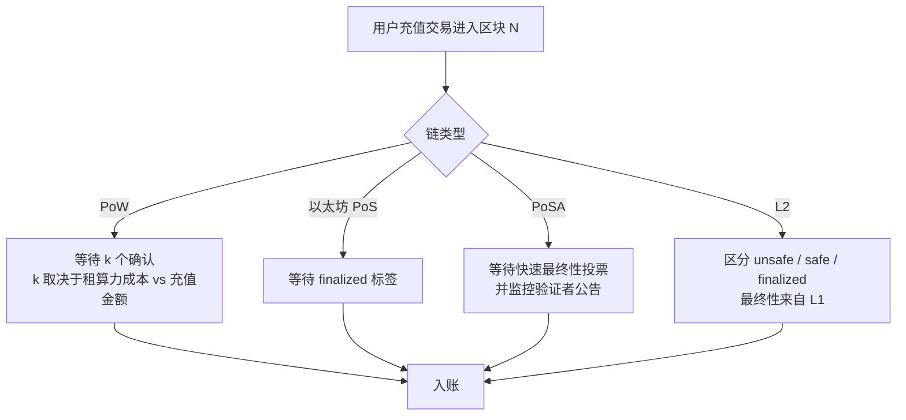
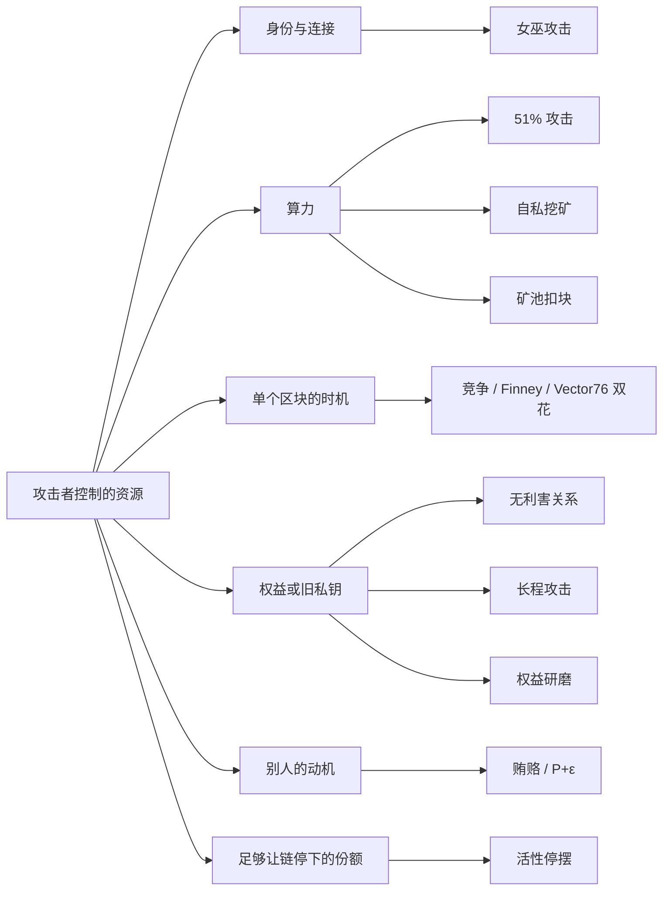

# 16 共识层与链级安全：当链本身出问题，先问攻击者控制了什么

> 学习目标：读完本章，你能——
> 1. 说出 PoW、PoS、PoSA / DPoS、L2 排序器四类出块方式的主要攻击面。
> 2. 按"攻击者控制的资源"给共识攻击分类，并为每类选对防线。
> 3. 解释深度重组、终局性丢失和链停摆对交易所充值确认的影响，并判断 51% 攻击、自私挖矿、Vector76 等攻击在什么条件下"加确认数"有效。
> 4. 为一条新链设定充值确认策略和停摆应急方案。
> 5. 在上币评估中记录算力、份额、罚没、检查点和托管资产投票的风险。
>
> 前置章节：[01 Web3 安全全景](01-security-landscape.md)、[12 跨链桥安全](12-cross-chain-bridges.md)
> 相关：[C01 BNB Chain](../chains/C01-bnb-chain.md)、[C03 Mantle](../chains/C03-mantle.md)、[17 节点与 RPC](17-node-rpc-infrastructure.md)、[23 托管与充提安全](23-custody-exchange-ops.md)、[02 密码学与随机数](02-cryptography-randomness.md)
> 交互实验：[confirmation-depth-lab.html](../interactive/confirmation-depth-lab.html)

> 最后核对：2026-11-10

---

## 开场：升级后第二天

2025 年 12 月 4 日，Fusaka 上线约 5 小时后，一个 Prysm 的 bug 在主网触发。全网投票参与率跌到约 75%。18.5% 的 slot 没有出块。验证者少拿约 382 ETH 奖励。

🤔 先猜再看：这次参与率仍有约 75%。如果同样的 bug 出在占比超过 1/3 的客户端，只按“N 个区块”入账的交易所会看到什么？

参与率低于 2/3，检查点不再最终确定。链还在出块，所以“N 个区块”的条件照样满足，系统继续入账。只有看 `finalized` 标签或监控最终性延迟的系统才会停下。

---

## 1. 一句话理解

**合约的安全上限是链的安全。链可以被重组，已经确认的交易会消失；链可以停摆，提币和清算都会停下；少数验证者可以协调冻结或回滚。交易所入账时说的"已确认"，只是对这条链安全假设的一个赌注。**

**共识攻击不都是 51% 攻击。先问攻击者控制了什么：身份、算力、区块时机、权益或旧私钥、别人的动机，还是让链停下的份额。控制的资源不同，防线就不同。**

共识（Consensus）：网络中的节点就"哪条链是正确的"达成一致的机制。
重组（Reorg）：节点放弃已接受的若干区块，改为接受另一条更长或更重的链。

> 🎯 打个比方：一个城市的公证处靠多数公证员签字确认房产交易。如果有人能临时雇来半数以上的公证员，他可以让一份已经盖章的买卖合同作废，再把同一套房卖给另一个人。这就是双花。
>
> 比喻的局限：真实世界雇公证员要花很多年。在小算力的 PoW 链上，攻击者可以按小时租用算力，成本可能只有几十个 BTC。

> 🎯 打个比方：小区物业排查一次闯入，先问对方拿到了什么：伪造的门禁卡、多数业主的投票，还是旧业主没交回的钥匙。拿到的东西不同，要换的锁也不同。
>
> 比喻的局限：小区闯入通常只用一种手段。真实的共识攻击会组合多种资源。

---

## 2. 威胁模型：出块方式与攻击者控制的资源

### 2.1 四类出块方式

| 出块方式 | 谁出块 | 主要攻击面 | 最终性 |
|---|---|---|---|
| PoW 工作量证明 | 矿工 | 租用算力的 51% 攻击；自私挖矿 | 概率性：确认越多越安全 |
| PoS 权益证明（以太坊） | 质押者 | 客户端 bug；大质押方合谋；终局性延迟 | 经济最终性：约 2 个 epoch（约 13 分钟）后不可回滚，除非 1/3 质押被罚没 |
| PoSA / DPoS（BSC、TRON 等） | 少量验证者 | 验证者合谋；协调停链、冻结、回滚 | 快速最终性，但依赖少数验证者 |
| L2 排序器 | 通常一个运营方 | 排序器宕机；审查；回滚未提交的块 | 取决于何时把数据和证明提交到 L1 |

**读图要点：**

- 每种链的"确认"含义不同。用同一个"N 个区块"的规则覆盖所有链，是交易所最常见的错误。
- PoW 链的确认数是一个经济问题：攻击成本必须高于可双花的金额。攻击方式见 §3.5。
- L2 的 unsafe 头只是排序器的承诺，可以被回滚。
- 局限：图里没有画"链停摆"。停摆时，所有分支都应该暂停入账，见第 3.2 节。

### 2.2 攻击者控制的资源

2025 年 9 月，Monero 出现史上最深的 18 块重组（§5.1）。矿池 Qubic 公开宣称使用自私挖矿，但研究者认为它日均未达到 51% 算力。这说明"51% 攻击"这个名字不够用。

初学者常把所有共识攻击都叫"51% 攻击"。这会选错防线。本节按"攻击者控制的资源"分类。每种攻击回答 5 个问题：控制什么、成本与条件、什么能阻止、真实案例、交易所要设置什么。

**读图要点：**

- 从左向右读。同一分支的攻击，防线通常相同。
- 女巫攻击本身不改写链。它是其他网络攻击的前置步骤（[17 章](17-node-rpc-infrastructure.md) 3.3 节）。
- 局限：真实攻击会组合多种资源。2016 年 Krypton 的攻击者同时使用了 51% 算力和 DDoS。

---

## 3. 攻击路径

§3.1–3.3 讲 PoS 的终局性丢失、链停摆和 L2 排序器。§3.4–3.13 按攻击者控制的资源，讲 51% 攻击、自私挖矿等共识攻击。

### 3.1 PoS 的终局性丢失与客户端 bug

- 以太坊要求 2/3 的质押投票才能让一个检查点最终确定。客户端 bug 让大量验证者掉线，链会继续出块，但**不再最终确定**。
- 如果某个客户端的占比超过 1/3，它的 bug 会导致终局性停止；超过 2/3，它的 bug 可能把错误的链最终确定。所以客户端多样性是共识安全的一部分。

### 3.2 链停摆与人为干预

- 链停摆：所有节点停止出块。原因可能是软件 bug、交易洪泛、或验证者主动暂停。
- 验证者集合小的链，可以在数小时内协调停链、冻结地址、甚至回滚状态。这能救急，也说明这条链的"不可篡改"有前提。

### 3.3 L2 排序器

| 情况 | 后果 | L1 上的保障 |
|---|---|---|
| 排序器宕机 | L2 停止出块，提币和清算停止 | 强制包含：用户可以通过 L1 合约提交交易（OP Stack 最长 12 小时，Arbitrum 24 小时，截至 2026 年 L2BEAT 资料） |
| 排序器审查 | 特定地址的交易被拒绝 | 同上 |
| 回滚 unsafe 块 | 尚未提交到 L1 的交易消失 | 无；只有已提交到 L1 的数据受保护 |

🤔 先猜再看：交易所按 unsafe 头给用户入账，用户随即提走。排序器回滚了这个块。这笔损失由谁承担？

由交易所承担。充值在链上消失了，资产已经被提走。L1 不保护尚未提交的数据。所以大额要等 L1 最终确定的批次。

### 3.4 女巫攻击（Sybil Attack）

女巫攻击：一个实体伪装成大量独立参与者。

- **控制什么**：大量节点身份和 IP。攻击者不需要算力或权益。
- **成本与条件**：成本是服务器和 IP。如果协议按节点数投票，攻击直接生效。
- **什么能阻止**：共识投票按算力或权益加权，节点数不计票。节点层靠连接多样性限制同一 IP 段的连接。
- **真实案例**：2020 年 11 月，Monero 网络出现恶意节点。它们试图把交易关联到广播者的 IP，并丢弃交易。Dandelion++ 限制了效果，恶意节点约 10 天后被加入黑名单。来源：[Decrypt](https://decrypt.co/47798/malicious-nodes-attempt-sybil-attack-on-monero)。
- **交易所要设置**：不把"多个节点返回一致"当作独立证据。来源按运营方统计（NOD-9、CON-14）。

### 3.5 51% 攻击与双花（Majority Attack）

1. 攻击者在交易所充值大额币，同时在私下挖一条不包含这笔充值的链。
2. 交易所在 k 个确认后入账，攻击者把币卖掉并提走其他资产。
3. 攻击者释放私下挖的更长的链，网络发生重组，充值交易消失。
4. 攻击者手里的币回来了，交易所的账上多出一笔不存在的充值。

> 💡 注意：自私挖矿（扣块后一次性释放）不需要持续超过 51% 的算力，也能造成多个区块的重组。

🤔 先猜再看：攻击者掌握 60% 算力。你把确认数从 6 提高到 600，双花成功概率下降多少？

不下降，概率仍是 100%。当 q ≥ 50%，攻击者最终一定能赶上。确认数此时只增加他要租算力的时间和成本。所以小算力链的确认数是经济问题。

> 🧪 动手验证：打开[确认深度实验](../interactive/confirmation-depth-lab.html)，把 q 设为 10%、n 设为 6，记录 Rosenfeld 和 Nakamoto 两个结果。再把 q 拖到 50%，记录“达到目标所需最少确认数”。

- **控制什么**：超过全网一半的算力，通常是短期租用。
- **成本与条件**：成本等于"租用时长 × 算力价格"，减去攻击期间挖到的奖励。算力越小、算法越容易租到，成本越低。
- **什么能阻止**：协议层只有更高的算力或更换共识。交易所只能提高成本，并限制单次能赚到的金额。当 q ≥ 50% 时，加确认数不能降低成功概率。
- **真实案例**：
  - Krypton（2016 年 8–9 月，各来源日期不一致）：自称"51 Crew"的团伙结合 51% 算力和 DDoS，从 Bittrex 提走 21,465 KR，约 5 BTC（事发时估值）。项目方建议 Bittrex 把确认数提高到 1,000。来源：[Cointelegraph](https://cointelegraph.com/news/test-attack-on-krypton-ethereum-classic-might-be-next)、[Bitcoinist](https://bitcoinist.com/attack-krypton-dry-run-ethereum/amp/)。
  - Verge（2018 年 4 月）：Verge 轮换 5 种算法。攻击者伪造时间戳，只用 Scrypt 一种算法快速连续出块，获利估计约 100 万美元（事发时估值，各来源不一）。2021 年 Verge 又发生重组，Coin Metrics 的研究员称约 200 天的历史消失。来源：[Sophos](https://news.sophos.com/en-us/2018/04/09/hacker-mines-up-to-1-million-in-verge-after-exploiting-major-bug)、[Decrypt](https://decrypt.co/57815/pornhub-favorite-verge-token-loses-200-days-of-transactions)。
  - Bitcoin Gold（2018 年 5 月）：被双花 388,000 BTG，约 1,800 万美元（事发时估值）。来源：[Security Affairs](https://securityaffairs.com/72878/hacking/bitcoin-gold-double-spend.html)。
  - Ethereum Classic（2019、2020）：见 §5.1。
- **交易所要设置**：按租算力成本和可双花金额定确认数；设单笔和单日上限；监控重组深度；重组超阈值自动暂停（CON-2、CON-3）。

> 💡 注意：Verge 的案例说明，多数算力不一定靠购买获得。共识代码的 bug 能让攻击者用低成本拿到多数出块权。

### 3.6 自私挖矿（Selfish Mining）

- **控制什么**：一部分算力，以及比别人更快的网络连接。
- **成本与条件**：攻击者扣留自己挖到的块，择机释放，让诚实矿工的工作作废。Eyal 和 Sirer 给出的盈利条件是 α > (1−γ)/(3−2γ)。α 是攻击者算力份额。γ 是平局时诚实矿工跟随攻击者的比例。γ=0 时阈值为 1/3；γ=1/2 时阈值为 1/4。来源：[arXiv 1311.0243](https://arxiv.org/abs/1311.0243)。
- **什么能阻止**：论文建议平局时随机选链，把 γ 固定在 1/2。这只提高阈值，不能消除攻击。
- **真实案例**：比特币主网没有被确证的自私挖矿。2025 年 Qubic 对 Monero 的行动公开宣称使用这一策略，见 §5.1。
- **交易所要设置**：确认数必须大于历史最大重组深度并留余量；上币评估记录前三大矿池的份额；孤块率突增时告警（CON-3、CON-10）。

### 3.7 竞争攻击、Finney 攻击与 Vector76

这三种攻击针对 0 确认或 1 确认的收款。攻击者不需要多数算力。定义见 [Bitcoin Wiki](https://en.bitcoin.it/wiki/Irreversible_Transactions)。

| 攻击 | 控制什么 | 步骤 | 对哪种收款有效 |
|---|---|---|---|
| 竞争攻击（Race Attack） | 交易的广播路径 | 向收款方发支付交易，同时向全网发冲突交易 | 0 确认 |
| Finney 攻击 | 一个挖到后暂不公开的区块 | 区块里放一笔转给自己的交易；付款成功后公开区块 | 0 确认 |
| Vector76 | 一个区块和发给受害节点的路径 | 把区块只转发给受害节点，让它看到 1 确认；全网接受另一条冲突的链 | 1 确认 |

- **成本与条件**：竞争攻击的成本接近零，但需要能直接连到收款方节点。Finney 和 Vector76 需要能挖到一个块，并放弃它的奖励或承担被孤立的风险。
- **什么能阻止**：只有等更多确认。Bitcoin Wiki 建议收款节点不接受入站连接，只主动连接连通性好的节点。这能降低风险，不能消除风险。
- **真实案例**：本书未查到可以独立核实的大额公开事故。这类攻击主要针对接受 0 确认的商户。
- **交易所要设置**：PoW 链不按 0 确认或 1 确认入账；充值扫描节点不直接暴露入站连接；区块来源至少两家运营方（CON-9）。

🤔 先猜再看：攻击者只有 5% 算力。他能让一个只等 1 确认的商户被双花吗？

能，但要等运气。Vector76 只需要挖到一个块并转发给受害节点。算力少，只是等这个块的时间更长。1 确认的安全性依赖"你看到的块就是全网接受的块"，而这一点取决于网络路径。

### 3.8 矿池扣块（Block Withholding）

矿池扣块：矿池成员提交部分工作量以领取分成，却丢弃真正能出块的结果。

- **控制什么**：矿池内部的一部分算力。
- **成本与条件**：攻击者放弃自己的出块收益，矿池的总收入下降。对手矿池可以派矿工渗透。Luu 等人的分析认为这种攻击长期有利可图。来源：[Courtois 和 Bahack](https://arxiv.org/abs/1402.1718)、[Luu 等](https://eprint.iacr.org/2015/155)。
- **什么能阻止**：矿池统计每个账户的"有效份额 / 实际出块"比例，异常账户暂停结算。
- **真实案例**：2014 年 6 月，Eligius 矿池报告损失 300 BTC，并拦截了攻击者约 200 BTC 的结算。来源：[Courtois 和 Bahack](https://arxiv.org/abs/1402.1718)、[arXiv 2511.11538](https://arxiv.org/abs/2511.11538)。
- **交易所要设置**：自营矿池时监控份额与出块比例（CON-15）。不运营矿池时，这种攻击不影响入账，只影响矿池集中度判断。

> 💡 注意：部分资料把自私挖矿也叫"block withholding"。本书把"矿工对全网扣块"称为自私挖矿，把"成员对矿池扣块"称为矿池扣块。

### 3.9 无利害关系（Nothing-at-Stake）

- **控制什么**：验证者自己的签名。攻击者不需要额外资源。
- **成本与条件**：如果协议只有奖励、没有惩罚，验证者同时在多条分叉上签名没有成本，分叉难以收敛。来源：[Buterin PoS FAQ](https://vitalik.eth.limo/general/2017/12/31/pos_faq.html)。
- **什么能阻止**：罚没（Slashing）。验证者对同一高度签两个结果，罚没其质押。
- **真实案例**：本书未查到造成资金损失的主网案例。现代 PoS 协议设计时已经处理这一问题。
- **交易所要设置**：上币评估确认这条链有针对双签的罚没。没有罚没的 PoS 链，按概率性最终性处理，增加确认数（CON-10）。

### 3.10 长程攻击与弱主观性（Long-Range Attack / Weak Subjectivity）

长程攻击：攻击者从很久以前的高度分叉，重新构造一条历史。
弱主观性（Weak Subjectivity）：新节点无法只靠协议判断哪条链正确，要从一个可信的近期检查点开始同步。

- **控制什么**：已经退出的验证者的旧私钥。这些验证者取回了质押，不再能被罚没。
- **成本与条件**：攻击者向旧验证者买私钥，价格可以很低。目标是长期离线的节点和新节点。
- **什么能阻止**：节点拒绝回滚已最终确定的区块；新节点从可信的弱主观性检查点同步。ethereum.org 称已同步的节点不接受这种攻击，剩余的信任假设在新节点的检查点。来源：[ethereum.org 攻击与防御](https://ethereum.org/developers/docs/consensus-mechanisms/pos/attack-and-defense/)、[弱主观性](https://ethereum.org/developers/docs/consensus-mechanisms/pos/weak-subjectivity/)。
- **真实案例**：本书未查到主网上发生过的案例。
- **交易所要设置**：新节点的检查点取自至少两个独立来源并比对；节点离线超过弱主观性周期后重新同步；检查点配置走变更审批（CON-11）。

🤔 先猜再看：攻击者买下一批已退出验证者的旧私钥，从一年前分叉。一个持续在线的节点和一个刚安装的节点，谁会接受这条链？

持续在线的节点不接受，它不回滚已最终确定的区块。刚安装的节点如果没有检查点，就无法区分两条链。所以新节点的检查点来源，就是这条链的信任入口。

### 3.11 权益研磨（Stake Grinding）

- **控制什么**：出块随机数的输入，例如区块参数、签名，或者是否放弃出块。
- **成本与条件**：攻击者试算不同的输入，选择对自己有利的结果。旧设计中，Peercoin 的参数和 NXT 的跳块都曾是研磨点。来源：[Buterin PoS FAQ](https://vitalik.eth.limo/general/2017/12/31/pos_faq.html)。
- **什么能阻止**：要求提前锁定质押；使用承诺-揭示、门限签名或 VRF。
- **真实案例**：本书未查到造成资金损失的主网案例。
- **交易所要设置**：不用链上出块随机数决定高价值结果，例如抽奖和空投名单（[02 章](02-cryptography-randomness.md)）。上币评估记录出块随机数的来源（CON-16）。

### 3.12 贿赂与 P+ε 攻击（Bribery / P+epsilon）

P+ε 攻击：攻击者承诺，只要你投给选项 X 而 X 最终落败，就付给你比正常奖励多一点的钱。投 X 因此成为每个人的优势策略。X 真的获胜时，攻击者不必付钱。来源：[以太坊基金会博客](https://blog.ethereum.org/2015/01/28/p-epsilon-attack)。

- **控制什么**：别人的动机。攻击者不持有多数算力或权益。
- **成本与条件**：攻击者需要可信的承诺，通常是链上合约。Buterin 估算，因为单个质押者很少是决定性的一票，贿金可以低到总质押的 0.5–1%。Bonneau 分析了短期"租用"算力的贿赂。来源：[Buterin PoS FAQ](https://vitalik.eth.limo/general/2017/12/31/pos_faq.html)、[Bonneau 2016](https://doi.org/10.1007/978-3-662-53357-4_2)。
- **什么能阻止**：让少数派也付出代价的惩罚设计；罚没；质押分散；社会层恢复。
- **真实案例**：2020 年 3 月的 Steem 事件不是经典的贿赂，但机制相近。报道称 Huobi、Binance、Poloniex 用托管的客户 STEEM 投票，帮助 Justin Sun 控制了见证人席位。Huobi 承认动用了客户资金；Binance 撤回了投票。来源：[Decrypt](https://decrypt.co/21108/did-binance-just-help-take-over-steem-network-justin-sun)、[Cointelegraph](https://cointelegraph.com/news/huobi-withdraws-steem-votes-admits-to-mobilizing-customer-funds)。
- **交易所要设置**：客户托管资产默认不参与投票，例外须有书面授权和审批记录；不接受投票或出块的第三方付费安排；公开交易所持有的治理份额（CON-12）。

> ⚠️ 警告：交易所的托管资产本身就是共识权力。Steem 事件中，攻击面就是交易所的投票权限。

### 3.13 活性停摆（Liveness Halt）

活性（Liveness）：链能继续处理新交易。安全性（Safety）：已确认的结果不被推翻。

- **控制什么**：足够让链停下来的份额，或者一个能让多数节点崩溃的 bug。
- **成本与条件**：见下表。bug 和交易洪泛不需要任何份额。
- **什么能阻止**：客户端多样性；交易费和限流；以太坊的不活跃惩罚（Inactivity Leak）会逐步削减离线验证者的质押，直到在线一方重新达到 2/3。来源：[eth2book](https://eth2book.info/altair/part2/incentives/inactivity)。
- **真实案例**：Solana、BSC、以太坊的终局性丢失，见 §5.2–5.4。
- **交易所要设置**：最终性延迟和出块间隔触发自动暂停；区分"继续出块但不最终确定"和"完全停止"两种状态；提前写好恢复后的对账步骤（CON-3、CON-5、CON-13）。

以太坊 PoS 的份额阈值（[ethereum.org](https://ethereum.org/developers/docs/consensus-mechanisms/pos/attack-and-defense/)）：

| 攻击者份额 | 能做什么 | 代价或后果 |
|---|---|---|
| 约 33% | 阻止最终性 | 不活跃惩罚逐步削减其质押 |
| 约 34% | 控制消息时序时，双重投票造成双重最终性 | 被最大比例罚没 |
| 约 51% | 主导分叉选择：审查、短程重组、提取 MEV | 社会层可能介入 |
| 约 66% | 在没有诚实方配合时最终确定自己的链 | 只能靠社会层恢复 |

> 🧪 动手验证：打开[确认深度实验](../interactive/confirmation-depth-lab.html)，把 q 设为 30%，分别把 n 设为 1 和 6。记录两个成功概率。再说明这两个数字为什么不适用于 Vector76 和 51% 以上的攻击者。

---

## 4. 防御方法：交易所的确认与停摆策略

### 4.1 设定确认策略

| 链类型 | 入账条件 | 额外措施 |
|---|---|---|
| 以太坊及 PoS L1 | 节点返回的 `finalized` 区块 | 终局性延迟超过阈值时暂停大额入账 |
| PoW 大链（比特币） | 按金额分级的确认数 | 监控算力分布 |
| PoW 小链 | 确认数按"租用 51% 算力的成本 < 可双花金额"动态设定；必要时以天计 | 监控重组和算力突变；设单笔、单日充值上限 |
| PoSA / DPoS | 快速最终性投票达成后入账 | 订阅验证者和官方的停链、冻结公告 |
| L2 | 大额以 L1 最终确定的批次为准；小额可接受 safe 头 | 监控 unsafe 与 finalized 头的差距；监控证明模式切换 |

> 🧪 动手验证：在[确认深度实验](../interactive/confirmation-depth-lab.html)第 2 节把金额设为 1,000,000。给小算力 PoW 选“5,760 个区块”，点“评估策略”。记录租算力成本和结论，再判断应该加确认数，还是降低单笔上限。

### 4.2 停摆与回滚预案

1. 监控出块间隔、终局性延迟、重组深度；超阈值自动暂停该链充提。
2. 订阅官方状态页和验证者公告频道。
3. 链恢复后，以恢复后的链为准重新对账：重组前入账但重组后消失的交易，逐笔追查。
4. 对验证者能冻结或回滚的链，在上币评估中单独记录这一风险。

### 4.3 节点与客户端

- 自建节点在执行层和共识层都使用少数派客户端，或者至少运行两种客户端交叉校验。
- 关注主网客户端份额。某个客户端接近 1/3 或 2/3 时，启动预案。细节见 [17 章](17-node-rpc-infrastructure.md)。

### 4.4 按攻击者控制的资源选防线

同一分支的攻击，防线通常相同。下表汇总 §3.4–3.13 各攻击的"交易所要设置"。确认数和停摆预案的完整做法见 §4.1–4.3。

| 攻击者控制的资源 | 交易所的防线 | 检查项 |
|---|---|---|
| 身份与连接（女巫攻击） | 不把"多个节点返回一致"当作独立证据；来源按运营方统计 | CON-14 |
| 算力（51% 攻击、自私挖矿、矿池扣块） | 按租算力成本和可双花金额定确认数；设单笔和单日上限；监控重组深度和孤块率 | CON-2、CON-3、CON-10、CON-15 |
| 单个区块的时机（竞争、Finney、Vector76） | PoW 链不按 0 确认或 1 确认入账；充值扫描节点不直接暴露入站连接 | CON-9 |
| 权益或旧私钥（无利害关系、长程攻击、权益研磨） | 确认链上有双签罚没；新节点检查点多源比对；不用出块随机数决定高价值结果 | CON-10、CON-11、CON-16 |
| 别人的动机（贿赂） | 客户托管资产默认不参与投票；不接受投票或出块的第三方付费安排 | CON-12 |
| 让链停下的份额（活性停摆） | 最终性延迟和出块间隔触发自动暂停；区分"不最终确定"和"完全停止" | CON-3、CON-13 |

---

## 5. 真实案例

> 💡 注意：以下每个案例只写摘要和教训。金额为事发时美元估值。

### 5.1 PoW 小链的 51% 攻击（2019–2025）

| 时间 | 链 | 事件 | 来源 |
|---|---|---|---|
| 2019-01 | Ethereum Classic | 深度重组和双花，约 21.95 万 ETC（约 110 万美元），Coinbase 发现并暂停 ETC 收付 | [The Hacker News](https://thehackernews.com/2019/01/ethereum-double-spend-attack.html) |
| 2020-08 | Ethereum Classic | 一个月内三次攻击；第一次重组约 3,693 块、双花约 560 万美元，第三次重组超过 7,000 块 | [Bitquery](https://bitquery.io/blog/ethereum-classic-51-chain-attack-july-31-2020)、[Decrypt](https://decrypt.co/40196/hackers-launch-third-51-attack-on-ethereum-classic-this-month) |
| 2018-05 / 2020-01 | Bitcoin Gold | 2018 年被双花约 1,800 万美元；2020 年两次重组，双花约 7.2 万美元 | [MIT DCI](https://medium.com/mit-media-lab-digital-currency-initiative/reorgs-on-bitcoin-gold-counterattacks-in-the-wild-da7e2b797c21) |
| 2025-08 / 09 | Monero | 矿池 Qubic 宣称获得多数算力；8 月出现 6 块重组，9 月出现 18 块重组，是 Monero 史上最深 | [Cointelegraph](https://cointelegraph.com/news/monero-qubic-selfish-mining-51-percent-attack)、[Decrypt](https://decrypt.co/339424/moneros-largest-reorg-erases-36-minutes-transaction-history) |

- 2020 年攻击后，Coinbase 把 ETC 的充值确认时间提高到约两周。来源：[ForkLog](https://forklog.com/en/coinbase-raises-ethereum-classic-deposit-confirmation-time-to-two-weeks/amp)。
- 研究者认为 Qubic 只在小时级接近或短暂超过 50%，日均未达到 51%。来源：[arXiv 2512.01437](https://arxiv.org/pdf/2512.01437)。
- 教训：小算力 PoW 链的确认数是经济问题，要随算力和币价调整。自私挖矿不需要持续多数算力。

### 5.2 Solana 停机（2021–2024）

- **2021 年 9 月**：一次代币发行引发机器人交易洪泛，验证者内存溢出，全网停止出块约 17 小时。来源：[Jump Crypto](https://jumpcrypto.com/resources/reflections-on-solanas-sept-14-outage)。
- **2022 年 4–5 月**：NFT 铸造机器人每秒约 600 万次请求，停机约 7 小时。来源：[Solana 官方报告](https://solana.com/news/04-30-22-solana-mainnet-beta-outage-report-mitigation)。
- **2024 年 2 月**：程序缓存的 bug 让旧程序被反复重编译，停机约 5 小时。超过 95% 的质押运行同一版本客户端。来源：[Solana 官方报告](https://solana.com/news/02-06-24-solana-mainnet-beta-outage-report)。
- 此后到本书核查时，没有再出现全网停机（二手资料）。来源：[Helius](https://www.helius.dev/blog/solana-outages-complete-history)。
- **2026 年 8 月 12 日（险情，未停机）**：托管商 Teraswitch 的路由故障让约 28.83% 的质押离线约 33 分钟，接近 33.34% 的最终性阈值。出块没有停止，也不需要协调重启。这个比例来自 Marinade。来源：[crypto.news](https://crypto.news/solana-stays-online-as-102-of-699-validators-stop-voting/)。
- 教训：高吞吐链要准备"全链停摆"的提币暂停和清算预案，并关注验证者软件版本是否高度集中。

### 5.3 BSC 停链（2022 年 10 月）

- Token Hub 跨链桥被伪造证明攻击，约 200 万 BNB 被铸出（见 [12 章](12-cross-chain-bridges.md)）。BNB Chain 要求验证者暂停出块，新版本冻结了攻击者地址并关闭原生跨链。停链持续数小时。
- 教训：少数验证者能协调停链和冻结地址。交易所对这类链要评估"中心化干预"的可能，并监控官方公告。
- 来源：[The Block](https://www.theblock.co/post/175403/bnb-smart-chain-halted-amid-potential-bridge-exploit)、[Halborn](https://www.halborn.com/blog/post/explained-the-bnb-chain-hack-october-2022)、[C01](../chains/C01-bnb-chain.md)

### 5.4 以太坊的终局性丢失与客户端 bug（2023–2025）

- **2023 年 5 月**：Prysm、Teku 处理旧投票时负载过高，主网先后约 25 分钟和约 1 小时没有最终确定。Lighthouse 未受影响。没有资金损失。来源：[Prysm 事后报告](https://prysm.offchainlabs.com/docs/misc/mainnet-postmortems/)、[ethresear.ch](https://ethresear.ch/t/cascading-network-effects-on-ethereums-finality/15871)。
- **2024 年 1 月**：Nethermind 的一个版本错误拒绝有效区块，约 8% 验证者掉线，当天修复；同月 Besu 也出现大量节点停摆，因为份额低于 1/3，没有影响终局性。来源：[EthStaker](https://ethstaker.notion.site/Nethermind-validators-offline-21-Jan-2024-0855d812a5d145728e4f9a2844dd463c)、[Besu Wiki](https://wiki.hyperledger.org/x/VQEABw)。
- **2025 年 2–3 月**：Holesky 测试网在 Pectra 升级时，多个执行层客户端配错了合约地址，测试网数周没有最终确定。来源：[The Block](https://www.theblock.co/post/345622/ethereums-holesky-testnet-regains-finality-after-weeks-of-disruption-amid-pectra-testing)。
- **2025 年 12 月 4 日**：Fusaka 上线后，Prysm 重建旧状态耗尽资源，参与率低至约 75%，持续 42 个 epoch，约 4.5 小时后缓解。验证者少拿约 382 ETH 奖励。Prysm 报告没有提到最终性丢失；75% 高于 2/3 阈值。来源：[Prysm 事后报告](https://prysm.offchainlabs.com/docs/misc/mainnet-postmortems/)、[Cointelegraph](https://cointelegraph.com/news/month-old-ethereum-client-bug-blamed-prysm-outage)。
- **客户端份额（2026 年 11 月 clientdiversity.org 快照）**：各数据源差异很大，不能只看一个数字。
  - 共识层：Miga Labs 显示 Lighthouse 约 47%、Nimbus 约 19%、Prysm 约 18%、Teku 约 7%。Rated 显示 Teku 约 54%。Blockprint 显示 Teku 约 99.8%，这个值明显异常，本书不采用。
  - 执行层：页面的手工汇总显示 Geth、Nethermind 各约 43%。这组数据只覆盖约 59.4% 的网络，其余被假定大多是 Geth；页面说明部分手工数据超过一年未更新。
  - Cointelegraph 在 Prysm 事件的报道中称 Lighthouse 约 52.6%，事发时约 56%，并指出它接近 2/3 阈值。
  - 来源：[clientdiversity.org](https://clientdiversity.org/)。
- 教训：单一客户端份额过高是系统性风险。交易所的节点要做到"双少数派"，或至少两种客户端交叉校验。

### 5.5 L2 排序器停机与干预（2023–2025）

| 时间 | L2 | 事件 | 来源 |
|---|---|---|---|
| 2023-12 | Arbitrum | 铭文交易洪峰导致排序器停摆约 78 分钟 | [Dedaub](https://dedaub.com/blog/arbitrum-sequencer-outage/) |
| 2024-06 | Linea | 为阻止 Velocore 攻击者跨链，主动暂停排序器并审查地址，引发中心化争议 | [The Block](https://www.theblock.co/post/298062/linea-decentralization-velocore-hack) |
| 2025-08 | Base | 自动切换到一个还不能出块的新排序器，出块停止约 33 分钟 | [The Block](https://www.theblock.co/post/365732/base-network-sequencer-failure) |
| 2025-09 | Starknet | 升级后停链并两次回滚，第二次回滚约 20 分钟的交易 | [Starknet 事件报告](https://www.starknet.io/blog/starknet-incident-report-september-2-2025/) |

- 教训：L2 充提要监控 unsafe 与 finalized 头的差距。排序器停摆或回滚时，以 L1 上已最终确定的数据为准。强制包含机制见 [L2BEAT](https://docs.l2beat.com/l2b_specs/stages_edgecases.html)。

### 5.6 重组深度与最终性的官方参数

- **以太坊**：1 个 epoch 为 32 个 slot，约 6.4 分钟；最终确定需要约 2 个 epoch。来源：[ethereum.org](https://ethereum.org/developers/docs/consensus-mechanisms/pos/)。
- **Polygon PoS**：2023 年 2 月发生 157 块重组；之后的 Heimdall v2 引入 milestone 机制，提供秒级确定性最终性。来源：[Polygon 论坛](https://forum.polygon.technology/t/157-block-reorg-at-block-height-39599624/11388)、[Polygon 文档](https://docs.polygon.technology/pos/architecture/heimdall_v2/milestones)。
- **BSC**：快速最终性（BEP-126）在 2/3 以上验证者投票时约 2 个区块最终确定，投票不足时退回概率性最终性。来源：[BNB Chain 文档](https://docs.bnbchain.org/bnb-smart-chain/introduction/)。
- 教训：入账以链提供的 finalized 标签为准，而不是自己数区块。

### 5.7 以太坊协议现状（截至 2026 年 11 月 9 日）

| 项目 | 状态 | 来源 |
|---|---|---|
| Fusaka | 2025 年 12 月 3 日 21:49:11 UTC 在主网激活（slot 13,164,544，epoch 411,392） | [以太坊基金会公告](https://blog.ethereum.org/2025/11/06/fusaka-mainnet-announcement) |
| PeerDAS（EIP-7594） | 随 Fusaka 上线。节点通过抽样确认 blob 数据可用，不再下载完整 blob | 同上 |
| BPO 分叉 | 2025 年 12 月 9 日目标/上限升到 10/15；2026 年 1 月 7 日升到 14/21 | 同上 |
| Glamsterdam 测试网 | 2026 年 10 月 6 日在 Sepolia 激活。Hoodi 原定 10 月 26 日，10 月 22 日宣布推迟，没有新日期 | [Sepolia 公告](https://blog.ethereum.org/2026/09/17/glamsterdam-testnet-announcement)、[Hoodi 推迟公告](https://blog.ethereum.org/2026/10/22/glamsterdam-hoodi-delay) |
| Glamsterdam 主网 | 没有激活日期。ethereum.org 写的是 2026 年第四季度目标，并注明日期未确认 | [ethereum.org](https://ethereum.org/roadmap/glamsterdam/) |
| Glamsterdam 内容 | 主要特性是 ePBS（EIP-7732）和区块级访问列表（EIP-7928） | 同上 |
| 推迟原因 | 核心开发者要继续调查 EIP-8037 与主网合约的交互。11 月 6 日的公告称，ChainSecurity 发现 EIP-8037、EIP-8038 破坏了部分项目依赖的不变量 | [EIP-8037/8038 公告](https://blog.ethereum.org/2026/11/06/glamsterdam-8037-8038) |
| FOCIL（EIP-7805） | 不在 Glamsterdam 内，已列为 Hegotá 的主要特性；Hegotá 日期未定 | [ethereum.org](https://ethereum.org/roadmap/hegota/) |

- 教训：硬分叉日期会变。入账系统、节点版本和合约假设要跟随官方公告，不跟随媒体预测。硬分叉前后加强最终性监控：2025 年 12 月的 Prysm 事件就发生在升级后数小时内。

### 5.8 按攻击类型索引

§3.4–3.13 各攻击的"真实案例"也是本章的案例。按攻击类型索引：

| 攻击 | 案例 | 位置 |
|---|---|---|
| 女巫攻击 | Monero 恶意节点（2020 年 11 月） | 3.4 节 |
| 51% 攻击 | Krypton（2016）、Verge（2018、2021）、Bitcoin Gold（2018） | 3.5 节 |
| 51% 攻击 | Ethereum Classic（2019、2020）、Bitcoin Gold（2020）、Monero（2025） | 5.1 节 |
| 自私挖矿 | Qubic 对 Monero 的行动（2025） | 3.6 节、5.1 节 |
| 矿池扣块 | Eligius 矿池（2014 年 6 月） | 3.8 节 |
| 贿赂（机制相近） | Steem（2020 年 3 月） | 3.12 节 |
| 活性停摆 | Solana、BSC、以太坊的终局性丢失 | 5.2–5.4 节 |

- 无利害关系、长程攻击、权益研磨：本书未查到造成资金损失的主网案例。
- 竞争攻击、Finney 攻击、Vector76：本书未查到可以独立核实的大额公开事故。

---

## 6. 评估检查点

- [ ] **CON-1** 每条链有单独的入账条件，写明依据（finalized 标签、确认数、L1 批次）。
- [ ] **CON-2** PoW 小链的确认数按租算力成本定期复核；有单笔和单日充值上限。
- [ ] **CON-3** 监控出块间隔、终局性延迟、重组深度；超阈值自动暂停充提。
- [ ] **CON-4** 订阅各链的官方状态页、验证者公告和客户端安全公告。
- [ ] **CON-5** 重组或回滚后，有逐笔对账流程。
- [ ] **CON-6** 自建节点的客户端选择考虑了主网份额；至少两种客户端交叉校验。
- [ ] **CON-7** L2 区分 unsafe / safe / finalized；大额以 L1 最终确定为准。
- [ ] **CON-8** 上币评估记录了验证者能否冻结、停链或回滚，以及历史上发生过几次。
- [ ] **CON-13** 预案区分"不最终确定"和"完全停止"两种状态，并分别规定充提动作。
- [ ] **CON-9** PoW 链不按 0 确认或 1 确认入账；充值扫描节点不直接暴露入站连接。
- [ ] **CON-10** 上币评估记录了算力是否可租、前三大矿池或验证者份额、是否有双签罚没。
- [ ] **CON-11** PoS 新节点的检查点来自至少两个独立来源；长期离线后重新同步；检查点变更有审批。
- [ ] **CON-12** 客户托管资产默认不投票、不委托；例外有书面授权和审批记录；不接受第三方付费投票或出块安排。
- [ ] **CON-14** 系统不把节点数量当作共识证据；一致性判断按独立运营方统计。
- [ ] **CON-15** 自营矿池监控账户的份额与出块比例；不运营矿池时标记为不适用。
- [ ] **CON-16** 高价值抽奖或名单不直接使用链上出块随机数。

**把检查结果写进报告：**

| 检查项 | 发现时的证据 | 常见定级（用 [A02](../assessment/A02-risk-rating-reporting.md) 复核） | 练习位置 |
|---|---|---|---|
| CON-1、CON-2 | 每条链的入账规则；租算力报价与确认数的计算 | High / Medium | [确认深度实验](../interactive/confirmation-depth-lab.html) |
| CON-3、CON-4 | 告警规则、演练记录、订阅清单 | Medium | [C01 BNB Chain](../chains/C01-bnb-chain.md) |
| CON-5 | 重组演练的对账结果 | High（可造成账实不符） | [A03 交易所合约与钱包](../assessment/A03-exchange-contracts-wallets.md) |
| CON-6 | 客户端版本和份额记录；交叉校验结果 | Medium | [17 章](17-node-rpc-infrastructure.md)、[RPC 多源仲裁实验](../interactive/rpc-quorum-lab.html) |
| CON-7 | L2 入账代码读取的标签 | High（大额走 unsafe 时） | [C03 Mantle](../chains/C03-mantle.md) |
| CON-8 | 上币报告中的干预历史 | 取决于敞口 | [A05 上币尽调](../assessment/A05-listing-due-diligence.md) |
| CON-13 | 两种状态的预案和演练记录 | Medium | [A03](../assessment/A03-exchange-contracts-wallets.md) |
| CON-9、CON-14 | 入账规则；节点入站配置；数据源的运营方清单 | High（影响入账时） | [确认深度实验](../interactive/confirmation-depth-lab.html)、[RPC 多源仲裁实验](../interactive/rpc-quorum-lab.html) |
| CON-10、CON-16 | 上币报告中的算力、份额、罚没和随机数来源 | Medium | [A05 上币尽调](../assessment/A05-listing-due-diligence.md) |
| CON-11 | 检查点来源、比对记录、变更审批 | High（新节点可被误导时） | [17 章](17-node-rpc-infrastructure.md) |
| CON-12 | 托管资产投票策略、授权记录、治理份额披露 | High（动用客户资产时） | [23 章](23-custody-exchange-ops.md) |
| CON-15 | 矿池账户的份额与出块统计 | Medium / 不适用 | [A06](../assessment/A06-operational-key-security.md) |

发现按 [T03 报告模板](../templates/T03-finding-report.md) 记录。运营层面的复核见 [A06](../assessment/A06-operational-key-security.md)。

---

## 7. 用户侧防护

1. 交易所显示"等待确认"时，耐心等待。确认数是为了防止你的资产因重组而消失。
2. 在小市值 PoW 币上收款时，收款金额越大，等待的确认越多。
3. 链停摆期间，不要重复提交交易；恢复后先查看交易状态。
4. 在 L2 上做大额操作前，了解它的排序器是否中心化、停机时如何通过 L1 提款。
5. 把币存在交易所时，交易所可能用它投票。2020 年 Steem 事件中，交易所用托管的客户 STEEM 投票。在意治理结果的用户，自己持有并自己投票。

---

## 8. 术语表

| 术语 | 英文 | 定义 |
|---|---|---|
| 共识 | Consensus | 节点就正确的链达成一致的机制 |
| 重组 | Reorg | 节点放弃已接受的区块，改为接受另一条链 |
| 双花 | Double Spend | 同一笔资产被花两次 |
| 51% 攻击 | 51% Attack | 控制多数算力或权益，改写链历史 |
| 自私挖矿 | Selfish Mining | 扣留挖出的区块，择机释放以获得优势 |
| 最终性 | Finality | 区块不可回滚的保证 |
| 终局性延迟 | Finality Delay | PoS 链长时间无法最终确定检查点 |
| 客户端多样性 | Client Diversity | 网络中使用多种独立实现的节点软件 |
| 排序器 | Sequencer | L2 中决定交易顺序并出块的角色 |
| 强制包含 | Forced Inclusion | 用户绕过排序器、通过 L1 提交 L2 交易的机制 |
| 女巫攻击 | Sybil Attack | 一个实体伪装成大量独立参与者 |
| 竞争攻击 | Race Attack | 向收款方和全网分别发送冲突交易 |
| Finney 攻击 | Finney Attack | 预先挖好含冲突交易的区块，付款后公开 |
| Vector76 | Vector76 Attack | 把区块只发给受害节点，造成虚假的 1 确认 |
| 矿池扣块 | Block Withholding | 矿池成员领取分成，却丢弃能出块的结果 |
| 无利害关系 | Nothing-at-Stake | 验证者在多条分叉上签名没有成本 |
| 长程攻击 | Long-Range Attack | 用旧私钥从很早的高度重建历史 |
| 弱主观性 | Weak Subjectivity | 新节点要依赖可信的近期检查点 |
| 权益研磨 | Stake Grinding | 操纵随机数输入，提高自己的出块机会 |
| P+ε 攻击 | P+epsilon Attack | 用条件支付让投某一选项成为优势策略 |
| 活性 | Liveness | 链能继续处理新交易 |

---

> 🪞 反思：打开你的系统里决定“这笔充值可以入账”的那段配置或代码，再打开你的上币评估模板。
> 1. 入账代码读的是确认数、标签，还是 L1 批次？每条链一样吗？这个数字上次是谁、因为什么改的？
> 2. 最终性停止 30 分钟，它会自动做什么？
> 3. 上币评估模板记录了算力能否租到、前三大矿池或验证者的份额吗？
> 4. 你的托管资产有没有被用来投票或委托？谁批准的？你的 PoS 节点重新同步时，检查点从哪里来？

## 9. 思考题

1. 一条 PoSA 链的验证者曾两次协调停链冻结被盗资金。这对交易所来说是加分项还是减分项？
2. 某 L2 的 unsafe 头比 finalized 头领先 3 小时。此时用户要提一笔大额资金，你的系统应该怎么做？
3. 一条 PoW 小链，租用 51% 算力一小时约需 2 万美元，出块 15 秒。你的交易所单笔充值上限设为多少、确认数设为多少比较合理？
4. 一个持续在线的节点和一个刚安装的节点，同时收到一条从一年前分叉的链。攻击者用的是已退出验证者的旧私钥。哪个节点有风险？交易所要怎么设置？
5. 2020 年 3 月的 Steem 事件中，取得见证人席位的一方没有靠自己的多数权益。起作用的是哪一类资源？交易所的哪项设置能阻止这种情况？

下一章：[17 节点与 RPC：你读到的是谁的链](17-node-rpc-infrastructure.md) —— 你读到的不是链，是某个节点告诉你的链。
